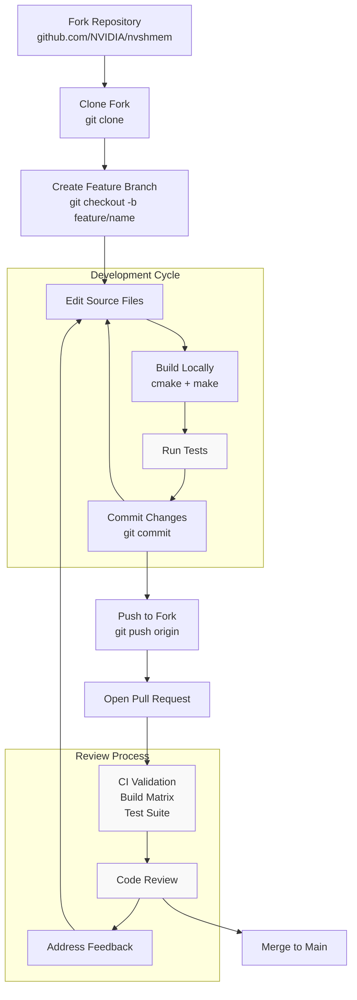
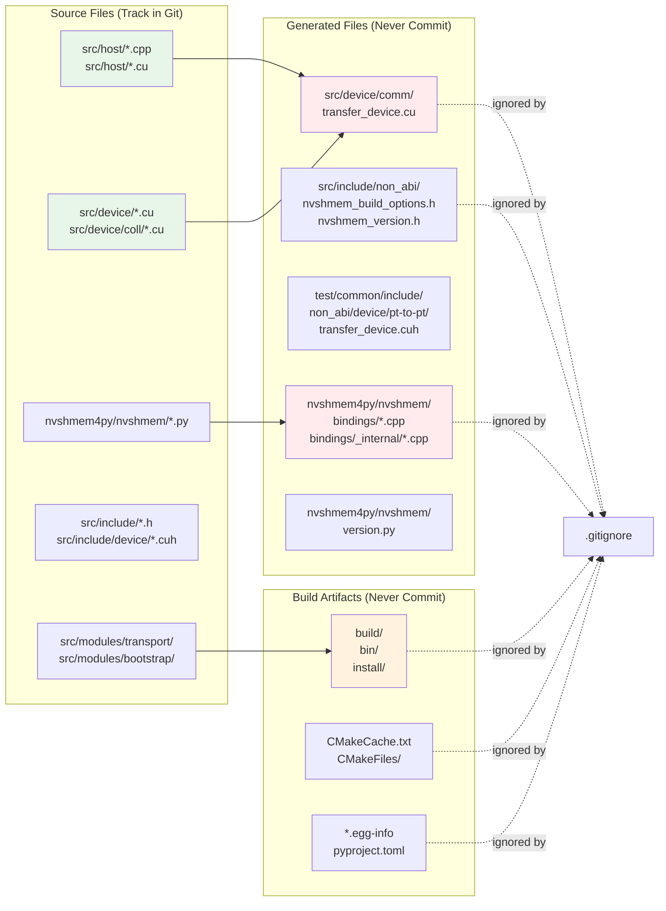
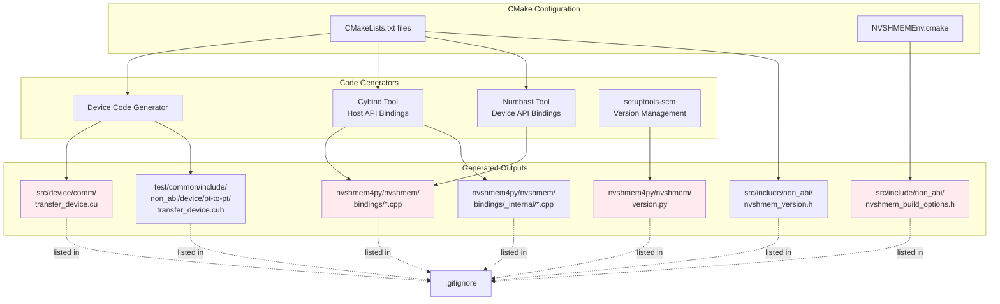
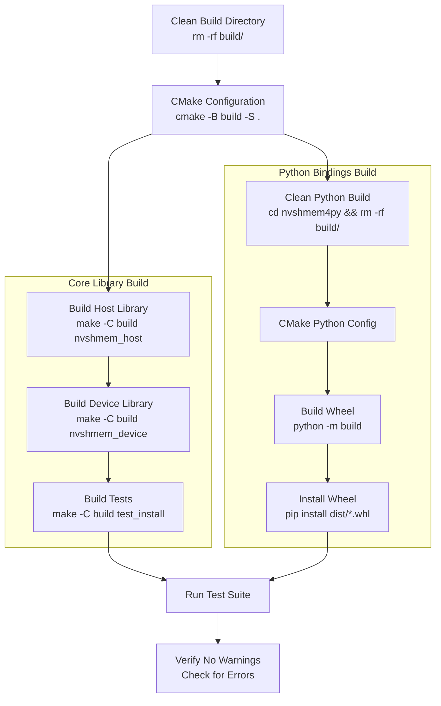

<!-- source: DeepWiki mcp.deepwiki.com · repo NVIDIA/nvshmem · page 8.5 Contributing Guidelines · fetched 2026-10-26 -->

# Contributing Guidelines

<details>
<summary>Relevant source files</summary>

The following files were used as context for generating this wiki page:

- [CMakeLists.txt](CMakeLists.txt)
- [cmake_config/NVSHMEMEnv.cmake](cmake_config/NVSHMEMEnv.cmake)
- [nvshmem4py/scripts/generate_pyproject_toml.py](nvshmem4py/scripts/generate_pyproject_toml.py)
- [src/CMakeLists.txt](src/CMakeLists.txt)

</details>


## Purpose and Scope

This page defines the standards and processes for contributing code, documentation, and improvements to the NVSHMEM project. It covers code style conventions, testing requirements, documentation expectations, and the review workflow for both the core C++/CUDA library and the nvshmem4py Python bindings.

For information about building the project from source, see [Building from Source](#8.2). For details on extending the Python bindings, see [Python Binding Development](#8.4). For implementing new transport layers, see [Implementing Custom Transports](#8.3).

---

## Contribution Workflow

The following diagram illustrates the standard workflow for contributing to NVSHMEM:



**Workflow Steps:**

1. **Fork and Clone**: Create a personal fork of the repository and clone it locally
2. **Branch**: Create a feature branch from the main branch
3. **Develop**: Make changes, build locally, and test
4. **Commit**: Write clear commit messages following conventions (see below)
5. **Push**: Push changes to your fork
6. **Pull Request**: Open a PR against the main repository
7. **Review**: Respond to CI feedback and code review comments
8. **Merge**: Once approved, maintainers will merge the contribution

Sources: Repository structure inferred from standard Git workflows

---

## Code Organization and File Types

Understanding the distinction between source files and generated files is critical for contributors:



### Key File Categories

| Category | Examples | Should Commit? |
|----------|----------|----------------|
| **Source Code** | `src/host/init.cu`, `src/device/coll/barrier.cu` | ✅ Yes |
| **Headers** | `src/include/nvshmem.h`, `src/include/device/coll.cuh` | ✅ Yes |
| **Transport Modules** | `src/modules/transport/ibrc/*.cpp` | ✅ Yes |
| **Python Source** | `nvshmem4py/nvshmem/*.py` (except `version.py`) | ✅ Yes |
| **Generated Device Code** | `src/device/comm/transfer_device.cu` | ❌ No |
| **Generated Headers** | `src/include/non_abi/nvshmem_build_options.h` | ❌ No |
| **Generated Bindings** | `nvshmem4py/nvshmem/bindings/*.cpp` | ❌ No |
| **Version Files** | `nvshmem4py/nvshmem/version.py` | ❌ No |
| **Build Artifacts** | `build/`, `*.o`, `*.so`, `*.a` | ❌ No |
| **CMake Cache** | `CMakeCache.txt`, `CMakeFiles/` | ❌ No |
| **Python Artifacts** | `*.egg-info`, `__pycache__` | ❌ No |

Sources: [.gitignore:1-99]()

---

## Code Style and Standards

### C/C++ and CUDA Code

**File Organization:**
- Host-side code: [src/host/]()
- Device-side code: [src/device/]()
- Transport implementations: [src/modules/transport/]()
- Bootstrap modules: [src/modules/bootstrap/]()

**Naming Conventions:**
```
Functions:     nvshmemi_<module>_<action>       // Internal
               nvshmem_<operation>              // Public API
               nvshmemx_<operation>             // Extended API

State Types:   nvshmemi_state_t                 // Host state
               nvshmemi_device_state_t          // Device state

Constants:     NVSHMEMI_<NAME>                  // Internal
               NVSHMEM_<NAME>                   // Public
```

**Header Guards:**
```c
#ifndef NVSHMEMI_<MODULE>_H
#define NVSHMEMI_<MODULE>_H
// ...
#endif
```

**File Extensions:**
- `.h`: C/C++ headers
- `.cuh`: CUDA device headers
- `.cpp`: C++ implementation
- `.cu`: CUDA implementation (host or device)

### Python Code

**Style Guidelines:**
- Follow PEP 8 conventions
- Use type hints for function signatures
- Document classes and functions with docstrings

**File Organization:**
- Public API: [nvshmem4py/nvshmem/]()
- Device bindings: [nvshmem4py/nvshmem/bindings/device/]()
- Internal utilities: [nvshmem4py/nvshmem/bindings/_internal/]()

**Naming Conventions:**
```python
Classes:       CapitalizedWords          # e.g., NvshmemResource
Functions:     lowercase_with_underscores # e.g., buffer(), free()
Constants:     UPPERCASE_WITH_UNDERSCORES # e.g., TEAM_WORLD
Private:       _leading_underscore        # e.g., _internal_func()
```

Sources: Repository structure inferred from [.gitignore:1-99](), Python version file [nvshmem4py/nvshmem/version.py:1-35]()

---

## Generated Files Management

The following diagram shows the build-time generation process and which files should never be manually edited:



**Important Rules:**

1. **Never manually edit generated files** - They are regenerated during each build
2. **Never commit generated files** - They are listed in `.gitignore`
3. **Modify the generators instead** - If generated code needs changes, update the generator scripts
4. **Version file is automatic** - `version.py` is managed by `setuptools-scm` from Git tags

**Verification:**
```bash
# Check that generated files are properly ignored
git status

# Should NOT show:
# - src/device/comm/transfer_device.cu
# - src/include/non_abi/nvshmem_build_options.h
# - nvshmem4py/nvshmem/bindings/*.cpp
# - nvshmem4py/nvshmem/version.py
```

Sources: [.gitignore:50-94](), [nvshmem4py/nvshmem/version.py:1-35]()

---

## Testing Requirements

### Core Library Testing

Contributors must ensure that changes to the core library pass the following tests:

**Test Categories:**

| Test Type | Location | Purpose |
|-----------|----------|---------|
| **Unit Tests** | `test/unit/` | Test individual components in isolation |
| **Performance Tests** | `perftest/` | Measure latency and bandwidth |
| **Integration Tests** | `test/` | Test complete workflows |
| **Examples** | `examples/` | Verify API usage examples compile and run |

**Running Tests:**
```bash
# Build tests
cd build
make test_install

# Run specific test suites
./test_install/bin/<test_name>

# Run with MPI launcher
mpirun -n <num_pes> ./test_install/bin/<test_name>
```

**Test Requirements for PRs:**
- All existing tests must pass
- New features must include corresponding tests
- Performance-sensitive changes should include perftest results
- Transport changes must be tested across all supported transports

### Python Bindings Testing

**Test Structure:**
- Unit tests for Python API
- Numba kernel tests for device bindings
- Framework integration tests (PyTorch, CuPy)

**Running Python Tests:**
```bash
cd nvshmem4py
pytest tests/

# Test specific CUDA version
CUDA_VERSION=12 pytest tests/

# Test with specific transport
NVSHMEM_BOOTSTRAP=MPI pytest tests/
```

**Coverage Requirements:**
- New Python APIs must have unit tests
- Device bindings must have Numba kernel tests
- Framework integration functions must be tested

Sources: Test structure inferred from [.gitignore:66-68]()

---

## Documentation Standards

### Code Documentation

**C/C++ API Documentation:**
```c
/**
 * @brief Brief description of the function
 *
 * Detailed description explaining behavior, parameters,
 * and return values.
 *
 * @param[in] param1 Description of input parameter
 * @param[out] param2 Description of output parameter
 * @return Description of return value
 */
```

**Python API Documentation:**
```python
def function_name(param1: Type1, param2: Type2) -> ReturnType:
    """Brief description.
    
    Detailed description of behavior and usage.
    
    Parameters
    ----------
    param1 : Type1
        Description of param1
    param2 : Type2
        Description of param2
        
    Returns
    -------
    ReturnType
        Description of return value
        
    Examples
    --------
    >>> result = function_name(value1, value2)
    """
```

### Wiki Documentation

Contributors adding new features should update relevant wiki pages:

- **New APIs**: Update [C/C++ API Reference](#5) or [Python API Reference](#4)
- **New Transport**: Document in [Transport Implementations](#6)
- **Architecture Changes**: Update [Architecture](#2) pages
- **Build Changes**: Update [Build System](#3) pages

**Wiki Page Format:**
- Use Mermaid diagrams to illustrate concepts
- Include code citations with line numbers: `[path/to/file:startLine-endLine]()`
- Reference other wiki pages by ID: `[Page Title](#section.number)`
- Include source file citations at end of sections

Sources: Wiki structure from provided table of contents

---

## Build Validation

### Local Build Validation

Before submitting a PR, validate the build locally:



**Build Matrix Testing:**

Contributors should test against multiple configurations when possible:

| Component | Variations |
|-----------|------------|
| **CUDA Version** | 11.8, 12.0, 12.1, 12.2, 12.3, 13.0 |
| **Python Version** | 3.9, 3.10, 3.11, 3.12 |
| **GPU Architecture** | sm_70, sm_80, sm_90 |
| **Transport** | Libfabric, IBRC, UCX |
| **Bootstrap** | MPI, PMI, PMIX |

### CI Pipeline

The continuous integration system validates:

1. **Build Matrix**: Multiple Python/CUDA version combinations
2. **Compilation**: Both host and device libraries compile without errors
3. **Static Analysis**: Code quality checks
4. **Test Suite**: All tests pass
5. **Documentation**: Generated docs build successfully

**CI Configuration Files:**
- Build configurations defined in CMake files
- Python matrix defined in setuptools configuration
- Test execution scripts in test directories

Sources: [.gitignore:62-68]() (build artifacts), build system structure inferred

---

## Commit Message Conventions

### Format

```
<type>(<scope>): <subject>

<body>

<footer>
```

### Types

| Type | Description |
|------|-------------|
| `feat` | New feature |
| `fix` | Bug fix |
| `docs` | Documentation changes |
| `style` | Code style/formatting (no logic change) |
| `refactor` | Code refactoring |
| `perf` | Performance improvements |
| `test` | Test additions or modifications |
| `build` | Build system or dependency changes |
| `ci` | CI/CD configuration changes |

### Scope

Examples of scopes:
- `transport`: Transport layer changes
- `libfabric`: Libfabric transport
- `ibrc`, `ibdevx`, `ibgda`: InfiniBand transports
- `ucx`: UCX transport
- `device`: Device library
- `host`: Host library
- `proxy`: Host proxy thread
- `tile`: Tile API
- `python`: Python bindings
- `cybind`: Cybind generator
- `numbast`: Numbast generator
- `build`: Build system
- `cmake`: CMake configuration

### Examples

```
feat(libfabric): add support for AWS EFA provider

Implement EFA-specific optimizations for better performance
on AWS instances with EFA adapters.

Closes #123
```

```
fix(proxy): resolve race condition in channel buffer

The proxy thread could read from channel buffers while
device kernels were still writing. Added proper fencing.

Fixes #456
```

```
docs(tile): add examples for warpgroup-level operations

Updated wiki page 2.6 with code examples demonstrating
warpgroup scope usage in tile_allreduce.
```

Sources: Standard Git commit conventions

---

## Code Review Process

### Review Checklist

Reviewers evaluate PRs based on the following criteria:

**Correctness:**
- [ ] Code is functionally correct
- [ ] No memory leaks or resource leaks
- [ ] Thread-safe where required
- [ ] Handles error conditions properly

**Code Quality:**
- [ ] Follows project coding style
- [ ] Clear and descriptive naming
- [ ] Minimal code duplication
- [ ] Appropriate abstractions

**Testing:**
- [ ] Adequate test coverage
- [ ] Tests pass in CI
- [ ] Performance-sensitive changes include benchmarks

**Documentation:**
- [ ] API documentation is complete
- [ ] Wiki pages updated if needed
- [ ] Code comments explain complex logic
- [ ] Commit messages are clear

**Build System:**
- [ ] CMake changes are correct
- [ ] No unintended file additions (check generated files)
- [ ] Build passes on all supported platforms

### Reviewer Responsibilities

- Provide constructive feedback
- Request clarification on unclear changes
- Verify that tests adequately cover changes
- Ensure documentation is updated
- Check that generated files are not committed

### Author Responsibilities

- Respond to review comments promptly
- Make requested changes or provide justification
- Keep PRs focused and reasonably sized
- Rebase on latest main branch before requesting re-review
- Verify CI passes before requesting review

Sources: Standard code review practices

---

## Special Considerations

### Transport Layer Changes

Changes to transport implementations require special attention:

1. **API Compatibility**: Maintain `nvshmem_transport_t` interface compatibility
2. **Multi-Transport Testing**: Test with different transport layers
3. **Performance Validation**: Include perftest results
4. **Hardware Dependencies**: Document any hardware-specific requirements

See [Implementing Custom Transports](#8.3) for detailed guidelines.

### Python Bindings Changes

Changes to Python bindings have unique requirements:

1. **Binding Generation**: Ensure Cybind/Numbast configurations are updated
2. **Framework Compatibility**: Test with PyTorch and CuPy
3. **Numba Support**: Verify device bindings work in Numba kernels
4. **Version Matrix**: Consider Python 3.9-3.12 and CUDA 11-13 support

See [Python Binding Development](#8.4) for detailed guidelines.

### Version Management

Version numbers are managed automatically:

- **Core Library**: Version defined in CMake configuration
- **Python Package**: Version managed by `setuptools-scm` from Git tags
- **Never manually edit** [nvshmem4py/nvshmem/version.py:1-35]()
- Release tags follow semantic versioning: `vX.Y.Z`

Sources: [nvshmem4py/nvshmem/version.py:1-35](), [.gitignore:1-99]()

---

## Getting Help

If you have questions about contributing:

1. Check existing documentation in wiki sections
2. Review similar merged PRs for examples
3. Open a draft PR with questions in the description
4. Contact maintainers through GitHub issues

For specific topics:
- Build issues: [Building from Source](#8.2)
- Transport development: [Implementing Custom Transports](#8.3)
- Python binding questions: [Python Binding Development](#8.4)
- Architecture questions: [Architecture](#2)

Sources: Repository structure and standard contribution practices