# Page: Overview

# Overview

<details>
<summary>Relevant source files</summary>

The following files were used as context for generating this wiki page:

- [CMakeLists.txt](CMakeLists.txt)
- [cmake_config/NVSHMEMEnv.cmake](cmake_config/NVSHMEMEnv.cmake)
- [nvshmem4py/scripts/generate_pyproject_toml.py](nvshmem4py/scripts/generate_pyproject_toml.py)
- [src/CMakeLists.txt](src/CMakeLists.txt)
- [src/host/init/init.cu](src/host/init/init.cu)
- [src/host/mem/mem_heap.cpp](src/host/mem/mem_heap.cpp)
- [src/include/non_abi/device/coll/utils.cuh](src/include/non_abi/device/coll/utils.cuh)

</details>


## Purpose and Scope

This page introduces NVSHMEM and nvshmem4py, explaining their purpose in distributed GPU computing, core programming model, and key capabilities. For detailed information about specific subsystems, see [Architecture](#2), [Build System](#3), [Python API Reference](#4), or [C/C++ API Reference](#5).

**Sources:** [CMakeLists.txt:48-52]()

## What is NVSHMEM?

**NVSHMEM** (NVIDIA Symmetric Hierarchical Memory) is a communication library that implements the OpenSHMEM API for GPU-to-GPU communication in distributed systems. It enables direct communication between GPUs across nodes without requiring explicit host involvement for every operation.

NVSHMEM provides a **Partitioned Global Address Space (PGAS)** programming model where each GPU's local memory is part of a globally addressable symmetric heap. This allows GPUs to directly read from and write to memory on remote GPUs using simple memory access patterns.

**Key characteristics:**
- Version 3.5.1.1 (core library)
- C/C++/CUDA API for device and host code
- Python bindings (nvshmem4py version 0.1.2)
- OpenSHMEM specification compliant
- Optimized for NVIDIA GPU architectures (Volta and newer)

**Sources:** [CMakeLists.txt:48-52](), [src/include/host/nvshmemx_api.h:1-36](), [nvshmem4py/nvshmem/version.py:31-34]()

## Core Programming Model

### Processing Elements (PEs)

In NVSHMEM, each GPU is represented as a **Processing Element (PE)**. PEs are identified by rank numbers from 0 to N-1, where N is the total number of PEs in the job. The core API provides functions to query PE information:

```cpp
int nvshmem_my_pe();     // Returns the calling PE's rank
int nvshmem_n_pes();     // Returns total number of PEs
```

**Sources:** [src/include/device_host/nvshmem_types.h:239-240](), [src/host/init/init.cu:437-440]()

### Symmetric Heap

The **symmetric heap** is a memory region allocated by NVSHMEM that exists at the same virtual address on all PEs. Memory allocated from this heap can be directly accessed by any PE in the system using the same pointer value.

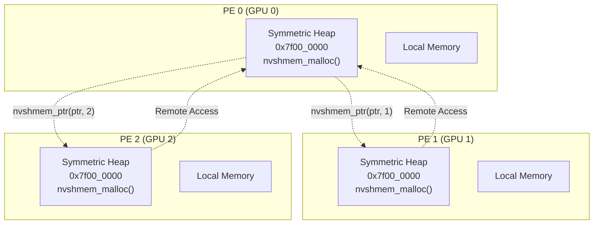

**Diagram: Symmetric Heap Architecture Across PEs**

The heap can be allocated using three strategies:
1. **VMM (Virtual Memory Management)**: Uses `cuMemCreate` API for virtual memory management (preferred)
2. **cudaMalloc**: Traditional CUDA memory allocation
3. **System Memory**: Host-accessible memory for specific use cases

**Sources:** [src/include/internal/host/nvshmem_internal.h:65](), [nvshmem4py/nvshmem/core/nvshmem_types.py:224-276]()

## Architecture Overview

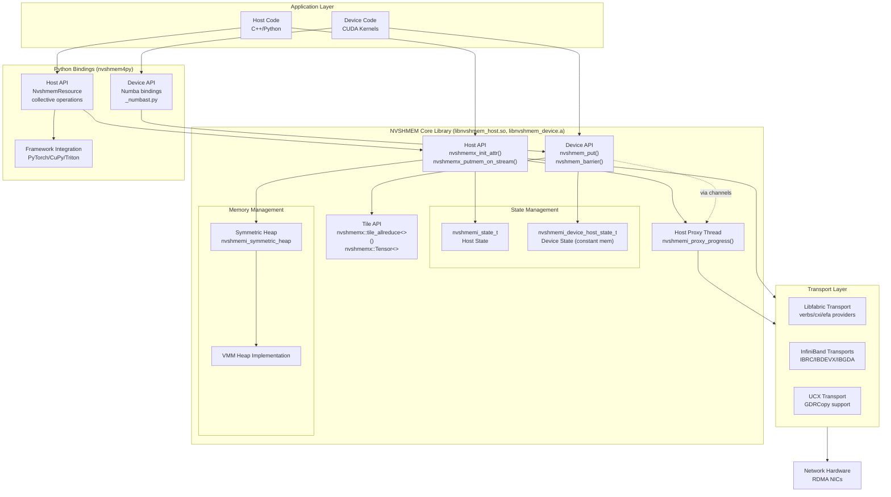

**Diagram: NVSHMEM High-Level Architecture**

**Sources:** [src/include/internal/host/nvshmem_internal.h:91-109](), [src/include/device_host/nvshmem_types.h:452-463](), [src/host/init/init.cu:56-90]()

## Core Capabilities

### 1. Remote Memory Access (RMA)

NVSHMEM provides one-sided communication primitives for reading from and writing to remote PE memory:

- **Put operations**: Write local data to remote PE memory
  - `nvshmem_put()`, `nvshmem_putmem()`, `nvshmemx_putmem_on_stream()`
- **Get operations**: Read data from remote PE memory to local memory
  - `nvshmem_get()`, `nvshmem_getmem()`, `nvshmemx_getmem_on_stream()`
- **Signal operations**: Put with remote notification
  - `nvshmem_put_signal()`, `nvshmemx_putmem_signal_on_stream()`

**Sources:** [src/include/host/nvshmemx_api.h:92-246](), [nvshmem4py/nvshmem/core/rma.py:1-277]()

### 2. Collective Operations

Collective communication primitives that involve all or a subset of PEs:

- **Synchronization**: `nvshmem_barrier()`, `nvshmem_sync()`, `nvshmem_quiet()`
- **Data movement**: `nvshmem_broadcast()`, `nvshmem_fcollect()`, `nvshmem_alltoall()`
- **Reductions**: `nvshmem_reduce()`, `nvshmem_allreduce()` with operations (sum, max, min)

Collectives can be issued from host or device, and support stream-based execution:

**Sources:** [nvshmem4py/nvshmem/core/collective.py:32-373]()

### 3. Device-Initiated Communication

Unlike traditional MPI-style communication that requires CPU coordination, NVSHMEM allows GPU threads to directly initiate communication operations from within CUDA kernels:

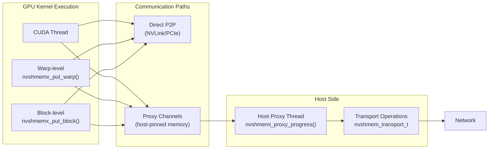

**Diagram: Device-Initiated Communication Paths**

**Sources:** [src/include/host/nvshmemx_api.h:277-398](), [src/host/init/init.cu:49](), [src/include/device_host/nvshmem_types.h:184-230]()

### 4. Multi-Transport Support

NVSHMEM supports multiple network transport implementations through a unified interface (`nvshmem_transport_t`):

| Transport | Description | Use Case |
|-----------|-------------|----------|
| **Libfabric** | Supports multiple providers (verbs, CXI, EFA) | Broad hardware compatibility |
| **IBRC** | InfiniBand Reliable Connected | Basic IB support |
| **IBDEVX** | InfiniBand with DevX API extensions | Enhanced IB features |
| **IBGDA** | GPU Direct Aware with DCI/DCT/RC QPs | Optimized IB for GPUs |
| **UCX** | Unified Communication X with GDRCopy | Portability layer |

**Sources:** Diagrams 2 and system architecture overview

### 5. Tile API for Tensor Operations

The **Tile API** (`nvshmemx::tile_*`) provides high-level abstractions for collective operations on tensor sub-regions (tiles). This is particularly useful for distributed deep learning:

```cpp
// Example: Warp-level allreduce on a tensor tile
nvshmemx::Tensor<float> src_tensor(src_ptr, layout);
nvshmemx::Tensor<float> dst_tensor(dst_ptr, layout);

nvshmemx::tile_sum_reduce_warp<
    decltype(src_tensor), 
    decltype(dst_tensor),
    decltype(boundary),
    nvshmemx::tile_coll_algo_t::NVLS_ONE_SHOT_PULL_NBI
>(team, src_tensor, dst_tensor, start_coord, boundary, flag);
```

Supported operations:
- `tile_allreduce()`, `tile_rooted_reduce()`: Reduction operations
- `tile_allgather()`: Gather from all PEs
- `tile_broadcast()`: Broadcast from root
- `tile_put()`, `tile_get()`: Point-to-point transfers

Threadgroup scopes: thread, warp, warpgroup (128 threads), block

**Sources:** [src/include/device/tile/nvshmemx_tile_api.hpp:1-129](), [src/include/device/tile/nvshmemx_tile_api_defines.cuh:1-178](), [examples/gemm_allreduce/allreduce_nvls_warpspecialized.hpp:43-159]()

### 6. Teams

NVSHMEM **teams** are subsets of PEs that can perform collective operations independently. The predefined team `NVSHMEM_TEAM_WORLD` includes all PEs. Custom teams can be created for hierarchical communication patterns.

**Sources:** [src/include/device_host/nvshmem_types.h:239-240](), [src/include/device_host/nvshmem_types.h:312-402]()

## Python Bindings (nvshmem4py)

**nvshmem4py** exposes NVSHMEM functionality to Python applications with integration for popular frameworks:

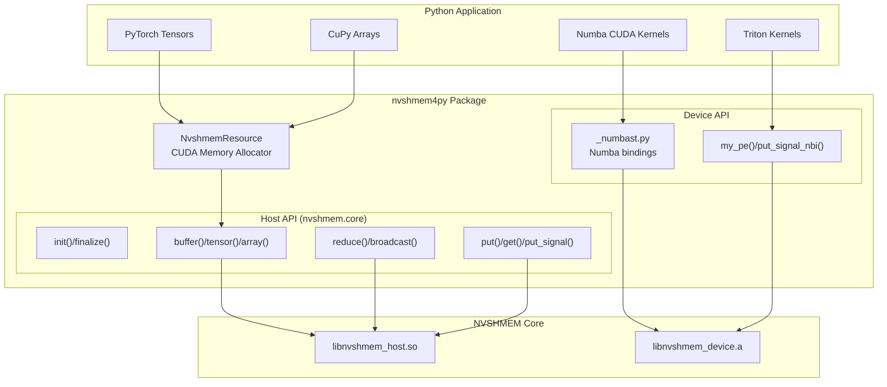

**Diagram: nvshmem4py Architecture and Framework Integration**

**Key features:**
- **Memory management**: `NvshmemResource` class implements CUDA memory allocator protocol
- **Framework interoperability**: Direct support for PyTorch tensors and CuPy arrays via DLPack
- **Device programming**: Numba bindings for writing NVSHMEM device kernels in Python
- **Stream integration**: Native support for PyTorch and CUDA Python streams

**Example workflow:**
```python
import nvshmem.core
import torch

# Initialize NVSHMEM
nvshmem.core.init(device=dev, uid=uniqueid, rank=rank, nranks=nranks)

# Allocate symmetric tensor
tensor = nvshmem.core.tensor((1024,), dtype=torch.float32)

# Perform collective operation
nvshmem.core.reduce(
    nvshmem.core.Teams.TEAM_WORLD, 
    tensor, tensor, "sum", 
    stream=stream
)

# Free and finalize
nvshmem.core.free_tensor(tensor)
nvshmem.core.finalize()
```

**Sources:** [nvshmem4py/nvshmem/core/nvshmem_types.py:1-536](), [nvshmem4py/examples/torch_triton_interop.py:1-140]()

## Initialization and State Management

NVSHMEM initialization establishes the distributed execution environment:

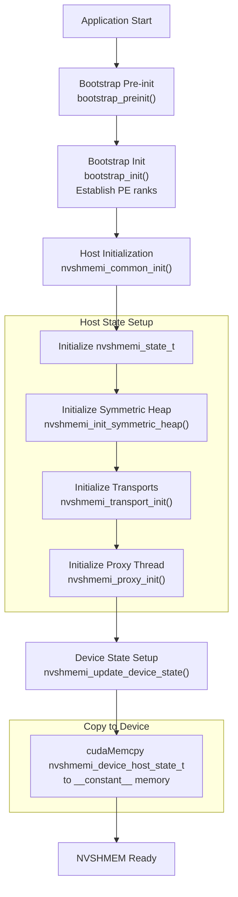

**Diagram: NVSHMEM Initialization Flow**

**Initialization options:**
1. **With MPI**: `nvshmemx_init_attr()` with `NVSHMEMX_INIT_WITH_MPI_COMM` flag
2. **With UniqueID**: `nvshmemx_init_attr()` with `NVSHMEMX_INIT_WITH_UNIQUEID` flag
3. **With SHMEM**: `NVSHMEMX_INIT_WITH_SHMEM` for interoperability

**Sources:** [src/host/init/init.cu:320-433](), [src/host/init/init.cu:146-197](), [src/include/device_host/nvshmem_types.h:184-230]()

## Use Cases and Applications

NVSHMEM is designed for high-performance GPU computing applications requiring efficient inter-GPU communication:

### Distributed Deep Learning
- **Tensor parallelism**: Split large models across multiple GPUs
- **Data parallelism**: Gradient allreduce operations
- **Pipeline parallelism**: Layer-to-layer communication
- **Example**: GEMM operations with integrated allreduce using Tile API

### Scientific Computing
- **Stencil computations**: Exchange halo regions between neighboring PEs
- **Iterative solvers**: Collective operations in distributed linear algebra
- **Molecular dynamics**: Spatial domain decomposition

### High-Performance Computing
- **GPU clusters**: Efficient communication for multi-node GPU applications
- **Co-design with CUDA**: Direct device-initiated communication without host bottlenecks
- **NVLS acceleration**: NVLink Switch hardware acceleration for collectives

**Sources:** [examples/gemm_allreduce/allreduce_nvls_warpspecialized.hpp:1-164](), [perftest/device/tile/tile_allreduce_latency.cu:1-293]()

## Version Information

**NVSHMEM Core Library:**
- Version: 3.5.1.1
- OpenSHMEM specification: Compliant
- Build identifier defined in: `NVSHMEM_VENDOR_MAJOR_VERSION`, `NVSHMEM_VENDOR_MINOR_VERSION`, `NVSHMEM_VENDOR_PATCH_VERSION`

**nvshmem4py Python Bindings:**
- Version: 0.1.2
- Python support: 3.9 through 3.12
- CUDA support: 11.x, 12.x, 13.x

**Sources:** [CMakeLists.txt:48-52](), [nvshmem4py/nvshmem/version.py:31-34](), [src/host/init/init.cu:78-79]()

## Next Steps

- **For architectural details**: See [Architecture](#2) for in-depth component design
- **For building from source**: See [Build System](#3)
- **For Python development**: See [Python API Reference](#4)
- **For C/C++ development**: See [C/C++ API Reference](#5)
- **For transport details**: See [Transport Implementations](#6)

---

# Page: Architecture

# Architecture

<details>
<summary>Relevant source files</summary>

The following files were used as context for generating this wiki page:

- [cmake_config/NVSHMEMEnv.cmake](cmake_config/NVSHMEMEnv.cmake)
- [nvshmem4py/scripts/generate_pyproject_toml.py](nvshmem4py/scripts/generate_pyproject_toml.py)
- [src/CMakeLists.txt](src/CMakeLists.txt)
- [src/host/init/init.cu](src/host/init/init.cu)
- [src/host/mem/mem_heap.cpp](src/host/mem/mem_heap.cpp)
- [src/host/topo/topo.cpp](src/host/topo/topo.cpp)
- [src/host/transport/transport.cpp](src/host/transport/transport.cpp)
- [src/include/non_abi/device/coll/utils.cuh](src/include/non_abi/device/coll/utils.cuh)
- [src/modules/transport/common/transport_common.cpp](src/modules/transport/common/transport_common.cpp)

</details>


This page provides a high-level architectural overview of NVSHMEM, explaining the layered design from application APIs down to hardware, and how the major subsystems interact. For detailed information on specific subsystems, see the child pages: [Core Library Architecture](#2.1), [Transport Layer](#2.2), [Device Programming Model](#2.3), [Memory Management and Symmetric Heap](#2.4), [Host Proxy Architecture](#2.5), [Team Management](#2.6), and [Python Bindings Architecture](#2.7).

## Five-Layer Design

NVSHMEM implements a five-layer architecture that separates concerns from high-level API abstractions down to hardware-specific communication mechanisms:

**Layer Architecture**

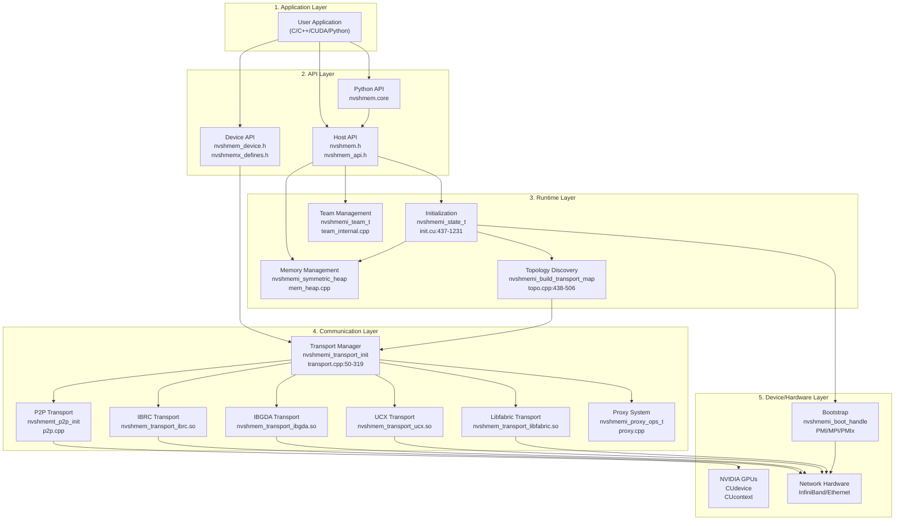

**Sources:** [src/host/init/init.cu:437-1231](), [src/host/transport/transport.cpp:50-319](), [src/host/mem/mem_heap.cpp:74-119](), [src/host/topo/topo.cpp:438-506]()

The layers provide clear separation:
- **Application Layer**: User code written in C/C++, CUDA kernels, or Python
- **API Layer**: Public interfaces (`nvshmem.h`, `nvshmemx.h`, Python `nvshmem.core`)
- **Runtime Layer**: State management, memory allocation, team operations
- **Communication Layer**: Pluggable transport system with proxy fallback
- **Device/Hardware Layer**: CUDA runtime, network hardware, bootstrap coordination

## Core State Management

The central state object `nvshmemi_state_t` (defined in [src/include/internal/host/nvshmemi_types.h]()) coordinates all subsystems:

**State Object Structure**

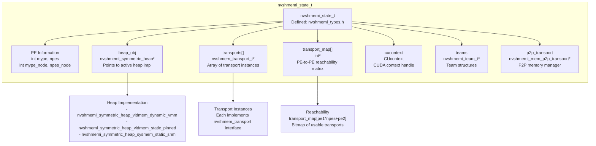

**Sources:** [src/include/internal/host/nvshmemi_types.h](), [src/host/init/init.cu:437-446]()

The state object is initialized in `nvshmemi_init_nvshmemi_state()` at [src/host/init/init.cu:437-446]() and accessed globally via the `nvshmemi_state` pointer.

## Initialization Flow

Initialization follows a carefully orchestrated sequence to establish process coordination, select hardware, allocate memory, and set up communication:

**Initialization Sequence**

```mermaid
graph TB
    START["nvshmem_init() / nvshmemx_init_attr()"]
    
    OPTIONS["nvshmemi_options_init()<br/>Parse environment variables<br/>bootstrap_host_transport/env_defs_internal.h"]
    
    BOOTSTRAP_PRE["nvshmemi_bootstrap_preinit()<br/>Discover network topology<br/>init.cu:322-328"]
    
    BOOTSTRAP["nvshmemi_bootstrap()<br/>Establish PE ranks, counts<br/>init.cu:330-435"]
    
    GPU_SELECT["nvshmemi_get_cucontext()<br/>Select/retain GPU context<br/>init.cu:495-597"]
    
    STATE_INIT["nvshmemi_init_nvshmemi_state()<br/>Initialize state object<br/>init.cu:437-446"]
    
    DETECT["nvshmemi_detect_same_device()<br/>Detect multi-process-per-GPU<br/>topo.cpp:523-573"]
    
    HEAP_INIT["nvshmemi_init_symmetric_heap()<br/>Allocate symmetric memory<br/>mem_heap.cpp:74-100"]
    
    TRANSPORT_INIT["nvshmemi_transport_init()<br/>Load transport plugins<br/>transport.cpp:50-319"]
    
    BUILD_MAP["nvshmemi_build_transport_map()<br/>Build PE reachability matrix<br/>topo.cpp:438-506"]
    
    CONNECT["nvshmemi_setup_connections()<br/>Connect transport endpoints<br/>transport.cpp:372-456"]
    
    REGISTER["register_heap_memory()<br/>Register heap with transports<br/>mem_heap.cpp:681-683"]
    
    TEAM_INIT["nvshmemi_team_init()<br/>Create default teams<br/>team_internal.cpp"]
    
    DEVICE_STATE["nvshmemi_update_device_state()<br/>Copy state to GPU<br/>init.cu:147-199"]
    
    READY["Initialization Complete<br/>nvshmemi_is_initialized = 1"]
    
    START --> OPTIONS
    OPTIONS --> BOOTSTRAP_PRE
    BOOTSTRAP_PRE --> BOOTSTRAP
    BOOTSTRAP --> GPU_SELECT
    GPU_SELECT --> STATE_INIT
    STATE_INIT --> DETECT
    DETECT --> HEAP_INIT
    HEAP_INIT --> TRANSPORT_INIT
    TRANSPORT_INIT --> BUILD_MAP
    BUILD_MAP --> CONNECT
    CONNECT --> REGISTER
    REGISTER --> TEAM_INIT
    TEAM_INIT --> DEVICE_STATE
    DEVICE_STATE --> READY
```

**Sources:** [src/host/init/init.cu:322-328](), [src/host/init/init.cu:330-435](), [src/host/init/init.cu:495-597](), [src/host/mem/mem_heap.cpp:74-100](), [src/host/transport/transport.cpp:50-319](), [src/host/topo/topo.cpp:438-506]()

Key initialization steps:

1. **Options Parsing**: Environment variables configure behavior (e.g., `NVSHMEM_SYMMETRIC_SIZE`, `NVSHMEM_DISABLE_P2P`)
2. **Bootstrap**: PMI/MPI establishes process group, determines `mype` and `npes`
3. **GPU Selection**: CUDA context is obtained or created
4. **Topology Detection**: Determines if multiple PEs share a GPU (MPG mode)
5. **Heap Allocation**: Symmetric memory allocated based on heap kind (VMM/static/sysmem)
6. **Transport Loading**: Plugins dynamically loaded (`.so` files for IBRC, UCX, etc.)
7. **Reachability Matrix**: Each PE determines which transports can reach which peers
8. **Endpoint Connection**: Transport-specific setup (QP creation, memory registration)
9. **Device State Copy**: Host state copied to device-accessible `nvshmemi_device_state_d`

## Communication Path Selection

NVSHMEM selects communication paths based on PE connectivity and operation type. The decision is made at runtime using the `job_connectivity` metric and transport capabilities:

**Communication Path Decision Tree**

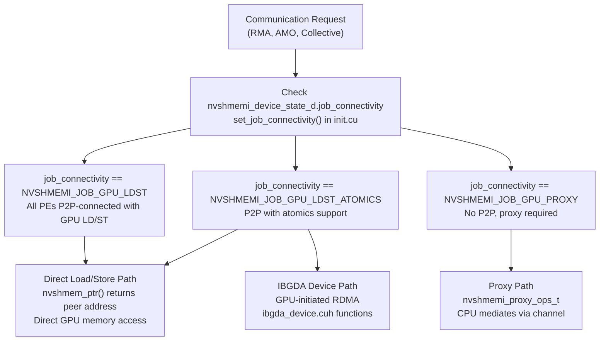

**Sources:** [src/host/init/init.cu:1094-1164](), [src/include/non_abi/device/pt-to-pt/nvshmemi_transfer_api.cuh]()

The `job_connectivity` value is computed in `set_job_connectivity()` at [src/host/init/init.cu:1094-1164]() and considers:

- **NVSHMEMI_JOB_GPU_LDST**: All PEs can perform direct load/store via `nvshmem_ptr()`
- **NVSHMEMI_JOB_GPU_LDST_ATOMICS**: P2P connections support GPU-side atomics
- **NVSHMEMI_JOB_GPU_PROXY**: Operations must go through CPU proxy

Device-side code checks this at [src/include/non_abi/device/pt-to-pt/nvshmemi_transfer_api.cuh]() to route operations correctly.

## Transport Plugin Architecture

Transports implement the `nvshmem_transport` interface defined in [src/include/internal/host_transport/transport.h](). The transport manager dynamically loads plugins and builds a reachability matrix:

**Transport Plugin System**

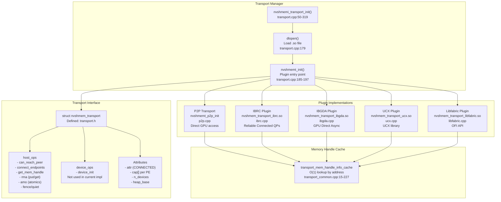

**Sources:** [src/host/transport/transport.cpp:50-319](), [src/include/internal/host_transport/transport.h](), [src/modules/transport/common/transport_common.cpp:85-227]()

Transport loading sequence:

1. **Plugin Selection**: Based on `NVSHMEM_REMOTE_TRANSPORT` environment variable (defaults to IBRC)
2. **Dynamic Loading**: `dlopen()` loads shared object at [src/host/transport/transport.cpp:179]()
3. **Initialization**: Each transport's `nvshmemt_init()` function called at [src/host/transport/transport.cpp:185-197]()
4. **Capability Detection**: `can_reach_peer()` determines PE-to-PE connectivity
5. **Endpoint Connection**: `connect_endpoints()` sets up communication channels
6. **Memory Registration**: Heap registered via `get_mem_handle()`, cached in `transport_mem_handle_info_cache`

The reachability matrix `transport_map[pe1*npes + pe2]` (built at [src/host/topo/topo.cpp:438-506]()) is a bitmap indicating which transports can connect each PE pair.

## Memory Management Components

The memory subsystem uses a polymorphic design with three heap implementations sharing a common interface:

**Symmetric Heap Architecture**

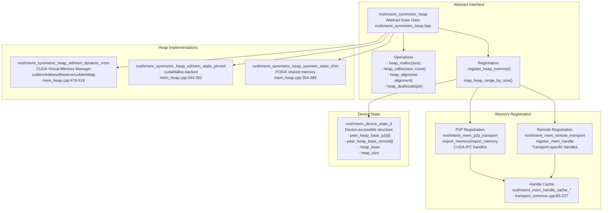

**Sources:** [src/include/internal/host/nvshmemi_symmetric_heap.hpp](), [src/host/mem/mem_heap.cpp:74-100](), [src/host/mem/mem_heap.cpp:344-388](), [src/host/mem/mem_heap.cpp:478-519](), [src/modules/transport/common/transport_common.cpp:85-227]()

Heap selection logic in `nvshmemi_init_symmetric_heap()` at [src/host/mem/mem_heap.cpp:74-100]():

- **VMM Heap**: Used when `NVSHMEM_USE_CUDA_VMM=1` or dynamically required
  - Provides fine-grained allocation control
  - Supports on-demand physical memory backing
  - Required for NVLS (NVLINK SHARP) features
  
- **Static VIDMEM**: Default GPU memory heap
  - Single `cudaMalloc()` allocation at [src/host/mem/mem_heap.cpp:344-352]()
  - Fixed size determined by `NVSHMEM_SYMMETRIC_SIZE`
  
- **SYSMEM**: System memory heap for intra-node only
  - POSIX shared memory (`shm_open()`) at [src/host/mem/mem_heap.cpp:354-388]()
  - Accessible by all PEs on same node
  - Registered with `cudaHostRegister()` for GPU access

Memory registration creates two handle types:
- **P2P handles**: CUDA IPC or VMM handles for direct GPU access
- **Remote handles**: Transport-specific (IB lkey/rkey, UCX rkey, etc.)

All handles cached in `transport_mem_handle_info_cache` for O(1) lookup during RMA operations.

## Device State Synchronization

The host-side `nvshmemi_state_t` structure is mirrored on the device as `nvshmemi_device_state_d`, a device-accessible constant structure:

**Device State Copy Mechanism**

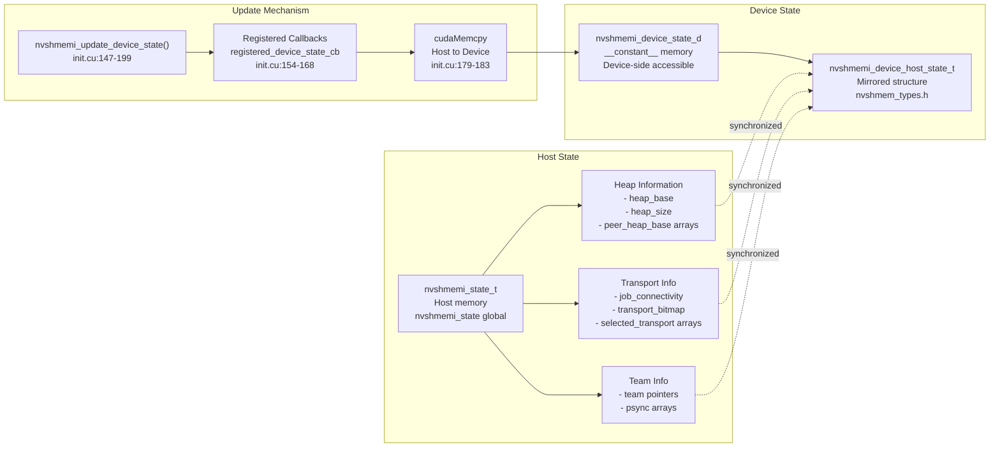

**Sources:** [src/host/init/init.cu:147-199](), [src/include/device_host/nvshmem_types.h]()

State synchronization flow:

1. **Callback Registration**: Device libraries register callbacks to receive state pointer via `nvshmemx_device_lib_init_cb`
2. **State Update**: `nvshmemi_update_device_state()` at [src/host/init/init.cu:147-199]() invoked after state changes
3. **Memory Copy**: `cudaMemcpy()` transfers `nvshmemi_device_host_state_t` to all registered device pointers at [src/host/init/init.cu:179-183]()
4. **Device Access**: GPU kernels read from `nvshmemi_device_state_d` via `__ldg()` or direct access

Critical fields synchronized to device:
- `peer_heap_base_p2p[]`: Base addresses for direct P2P access
- `peer_heap_base_remote[]`: Base addresses for remote operations
- `job_connectivity`: Communication path selection
- `selected_transport_for_rma[]`, `selected_transport_for_amo[]`: Per-PE transport indices

## Python Bindings Integration

The Python bindings (`nvshmem4py`) provide a three-tier architecture that bridges Python to the C/C++ implementation:

**Python Bindings Layers**

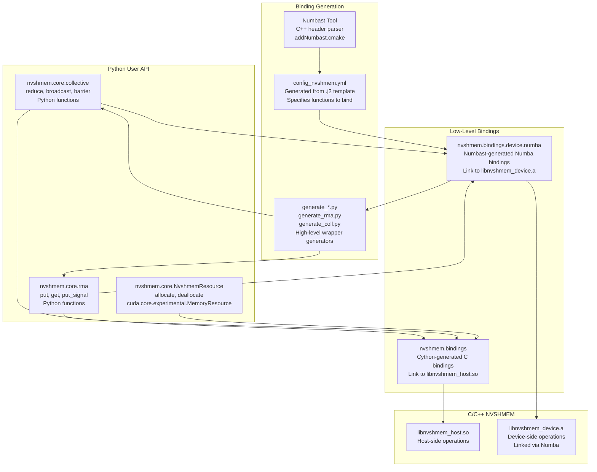

**Sources:** [nvshmem4py/scripts/generate_pyproject_toml.py:1-106](), [cmake_config/NVSHMEMEnv.cmake:54-55]()

Python binding generation occurs at build time:
1. **Numbast Processing**: CMake invokes Numbast tool (configured at [cmake_config/NVSHMEMEnv.cmake:54-55]()) to parse C++ headers
2. **YAML Configuration**: `config_nvshmem.yml.j2` template generates configuration specifying which functions to bind
3. **Numba Bindings**: Numbast produces raw Numba-compatible bindings for device functions
4. **Wrapper Generation**: Python scripts (`generate_rma.py`, `generate_coll.py`) create ergonomic high-level APIs
5. **Package Assembly**: `generate_pyproject_toml.py` at [nvshmem4py/scripts/generate_pyproject_toml.py:1-106]() creates final package metadata

The bindings integrate with:
- **PyTorch**: Via tensor interop
- **CuPy**: Via ndarray support
- **CUDA Python**: Via `cuda.core.experimental.MemoryResource` interface

For detailed Python architecture, see [Python Bindings Architecture](#2.7).

## Summary

NVSHMEM's architecture provides:

- **Layered Abstraction**: Clean separation from API to hardware
- **Pluggable Transports**: Dynamic loading of network-specific implementations
- **Flexible Memory**: Three heap types for different use cases
- **Dual Programming Model**: Both host and device APIs
- **Path Optimization**: Runtime selection between P2P, IBGDA, and proxy paths
- **Language Bindings**: Native Python support via Cython and Numbast

The architecture enables NVSHMEM to support diverse GPU clusters (single-node NVLink, multi-node InfiniBand, cloud EFA) with a single unified API while optimizing communication paths based on available hardware capabilities.

---

# Page: Core Library Architecture

# Core Library Architecture

<details>
<summary>Relevant source files</summary>

The following files were used as context for generating this wiki page:

- [cmake_config/NVSHMEMEnv.cmake](cmake_config/NVSHMEMEnv.cmake)
- [nvshmem4py/scripts/generate_pyproject_toml.py](nvshmem4py/scripts/generate_pyproject_toml.py)
- [src/CMakeLists.txt](src/CMakeLists.txt)
- [src/host/init/init.cu](src/host/init/init.cu)
- [src/host/mem/mem_heap.cpp](src/host/mem/mem_heap.cpp)
- [src/host/team/team_internal.cpp](src/host/team/team_internal.cpp)
- [src/include/non_abi/device/coll/barrier.cuh](src/include/non_abi/device/coll/barrier.cuh)
- [src/include/non_abi/device/coll/utils.cuh](src/include/non_abi/device/coll/utils.cuh)
- [src/include/non_abi/device/team/nvshmemi_team_defines.cuh](src/include/non_abi/device/team/nvshmemi_team_defines.cuh)

</details>


## Purpose and Scope

This page describes the core architecture of the NVSHMEM C/C++ library, covering its dual host-device structure, initialization flow, state management, and component organization. For details on specific subsystems, see [Transport Layer](#2.2), [Device Programming Model](#2.3), [Memory Management and Symmetric Heap](#2.4), [Host Proxy Architecture](#2.5), and [Team Management](#2.6). For the Python bindings architecture, see [Python Bindings Architecture](#2.7).

## Library Components

NVSHMEM consists of two primary libraries built from separate source trees:

| Library | Type | Build Location | Source Location | Purpose |
|---------|------|----------------|-----------------|---------|
| `libnvshmem_host.so` | Shared | `src/build/lib/` | `src/host/` | Host-side runtime, initialization, collectives, transport management |
| `libnvshmem_device.a` | Static | `src/build/lib/` | `src/device/` | Device-side functions called from CUDA kernels |
| `libnvshmem_device.bc` | Bitcode (optional) | `src/build/lib/` | `src/device/` | LLVM bitcode for alternative device linking |

The host library (`nvshmem_host`) is built as a shared object containing all runtime logic, while the device library (`nvshmem_device`) is built as a static archive linked into user CUDA applications. The build process is orchestrated through a two-stage CMake configuration where the device library is built as an `ExternalProject`.

**Sources:** [src/CMakeLists.txt:22-45](), [src/CMakeLists.txt:230-247]()

### Host Library Structure

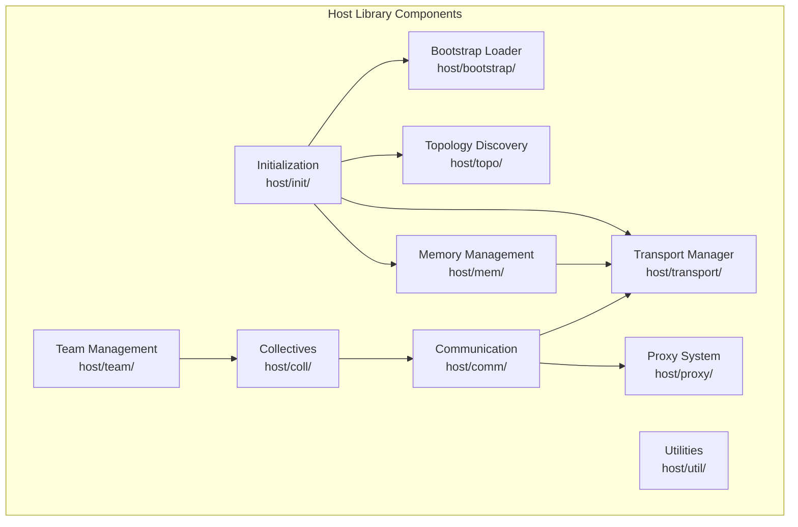

**Sources:** [src/CMakeLists.txt:316-359]()

### Device Library Structure

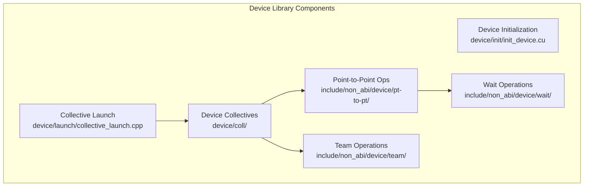

**Sources:** [src/CMakeLists.txt:286-289]()

## State Management Architecture

NVSHMEM maintains state structures on both host and device sides, with explicit synchronization between them.

### Core State Structures

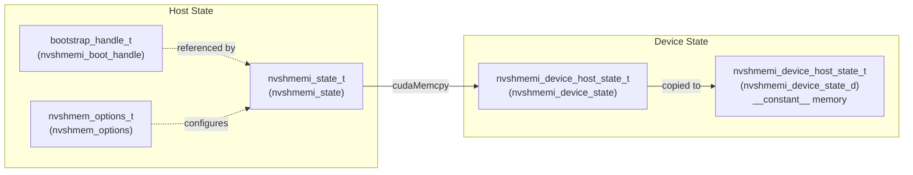

**Sources:** [src/host/init/init.cu:58-90]()

### nvshmemi_state_t Structure

The host-side state structure `nvshmemi_state_t` contains all runtime information:

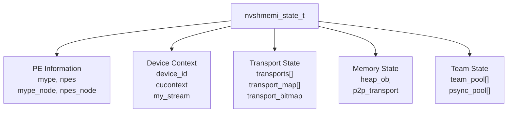

Key fields include:
- **PE identification**: `mype`, `npes`, `mype_node`, `npes_node` - process rank and size information
- **Device context**: `device_id`, `cucontext`, `my_stream` - CUDA device and execution context
- **Transport management**: `transports[]`, `transport_map[]`, `num_initialized_transports`
- **Memory management**: `heap_obj` (pointer to symmetric heap), `p2p_transport`
- **Team management**: Team pool and synchronization arrays

**Sources:** [src/host/init/init.cu:437-446](), [src/host/mem/mem_heap.cpp:74-99]()

### nvshmemi_device_host_state_t Structure

The device-side state structure `nvshmemi_device_host_state_t` is a read-only snapshot copied from the host:

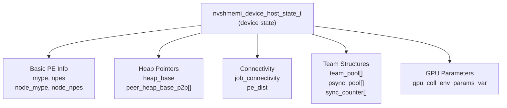

This structure resides in CUDA constant memory (`__constant__`) as `nvshmemi_device_state_d`, accessible from all device code.

**Sources:** [src/host/init/init.cu:49](), [src/host/init/init.cu:90]()

### State Update Mechanism

The function `nvshmemi_update_device_state()` synchronizes host state to device:

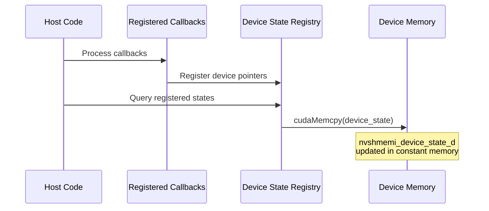

This function is called after any operation that modifies state visible to device code, such as heap allocation, team creation, or transport initialization.

**Sources:** [src/host/init/init.cu:147-199]()

## Initialization Flow

NVSHMEM initialization follows a multi-phase process coordinated by the `nvshmemi_init_thread_` function.

### Initialization Phases

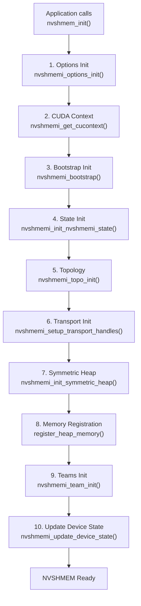

**Sources:** [src/host/init/init.cu:1050-1400]()

### Bootstrap Phase

The bootstrap subsystem establishes initial process coordination:

```mermaid
graph LR
    APP["Application"]
    
    subgraph "Bootstrap Selection"
        PRE["bootstrap_preinit()"]
        DETECT["Detect environment:<br/>PMI/PMI2/PMIx/MPI"]
        LOAD["Load bootstrap plugin:<br/>dlopen(nvshmem_bootstrap_*.so)"]
        INIT["bootstrap_init()"]
    end
    
    subgraph "Bootstrap Handle"
        HANDLE["bootstrap_handle_t<br/>(nvshmemi_boot_handle)"]
        OPS["Function pointers:<br/>allgather, barrier,<br/>get_unique_id, etc."]
    end
    
    APP --> PRE
    PRE --> DETECT
    DETECT --> LOAD
    LOAD --> INIT
    INIT --> HANDLE
    HANDLE --> OPS
```

The bootstrap phase populates `nvshmemi_boot_handle` with function pointers for collective operations needed during initialization (allgather, barrier) and provides PE rank/size information.

**Sources:** [src/host/init/init.cu:322-435](), [src/host/bootstrap/bootstrap.cpp]()

### Transport Initialization

Transport plugins are loaded and initialized after topology discovery:

```mermaid
sequenceDiagram
    participant Init as Initialization
    participant Topo as Topology Discovery
    participant TM as Transport Manager
    participant Plugins as Transport Plugins
    
    Init->>Topo: nvshmemi_topo_init()
    Note over Topo: Build PCIe/NVLink topology
    Topo->>TM: nvshmemi_setup_transport_handles()
    TM->>Plugins: Load transport plugins
    Note over Plugins: dlopen(nvshmem_transport_*.so)
    Plugins->>TM: Return transport_t structures
    TM->>Plugins: can_reach_peer() for all PE pairs
    Note over TM: Build transport_map[]
    TM->>Plugins: connect_endpoints()
    Note over Plugins: Establish connections
```

The transport manager builds a `transport_map[]` array indicating which transport(s) can reach each PE pair, enabling optimal path selection at runtime.

**Sources:** [src/host/init/init.cu:900-1000](), [src/host/transport/transport.cpp]()

## Host-Device Communication Model

NVSHMEM employs multiple mechanisms for host-device interaction:

### Device State Access Pattern

```mermaid
graph TB
    subgraph "Host Updates"
        HOST_OPS["Host Operations:<br/>- Heap allocation<br/>- Team creation<br/>- Transport setup"]
        UPDATE_FN["nvshmemi_update_device_state()"]
        MEMCPY["cudaMemcpy<br/>H2D transfer"]
    end
    
    subgraph "Device Access"
        KERNEL["CUDA Kernel"]
        CONST_MEM["__constant__<br/>nvshmemi_device_state_d"]
        READ["Read-only access<br/>via __ldg() or direct"]
    end
    
    HOST_OPS --> UPDATE_FN
    UPDATE_FN --> MEMCPY
    MEMCPY --> CONST_MEM
    KERNEL --> READ
    READ --> CONST_MEM
```

Device code accesses state via the constant memory symbol `nvshmemi_device_state_d`, which provides fast cached access to frequently-used data like PE information, heap base addresses, and team structures.

**Sources:** [src/host/init/init.cu:147-199]()

### Callback Registration

Device libraries register callbacks to receive state updates:

```mermaid
graph LR
    subgraph "Device Library"
        DEVICE_LIB["libnvshmem_device.a"]
        CALLBACK["nvshmemx_device_lib_init_cb"]
        REGISTER["nvshmemx_device_lib_init_register()"]
    end
    
    subgraph "Host Library"
        HOST_LIB["libnvshmem_host.so"]
        REGISTRY["registered_device_state_cb<br/>std::set"]
        UPDATE["nvshmemi_update_device_state()"]
    end
    
    DEVICE_LIB --> CALLBACK
    CALLBACK --> REGISTER
    REGISTER --> REGISTRY
    HOST_LIB --> UPDATE
    UPDATE --> REGISTRY
```

This callback mechanism allows device-side code to obtain pointers to device state structures that the host will update.

**Sources:** [src/host/init/init.cu:116-145](), [src/host/init/init.cu:154-169]()

## Component Dependencies

### Compilation Units Organization

The host library source files are organized by functionality:

```mermaid
graph TB
    subgraph "Host Communication Stack"
        COMM_API["host/comm/<br/>putget.cpp, amo.cpp<br/>fence.cpp, quiet.cpp"]
        RMA_KERN["host/comm/<br/>rma.cu<br/>(CUDA kernels)"]
    end
    
    subgraph "Host Collectives"
        COLL_CPU["host/coll/<br/>cpu_coll.cpp"]
        COLL_IMPL["host/coll/<br/>barrier/, broadcast/,<br/>reduce/, alltoall/"]
        COLL_STREAM["host/stream/coll/<br/>Stream-ordered collectives"]
    end
    
    subgraph "Memory Subsystem"
        MEM_API["host/mem/<br/>mem.cpp"]
        MEM_HEAP["host/mem/<br/>mem_heap.cpp"]
        MEM_TRANS["host/mem/<br/>mem_transport.cpp"]
    end
    
    subgraph "Infrastructure"
        INIT_FILES["host/init/<br/>init.cu, cudawrap.cpp<br/>nvmlwrap.cpp"]
        UTIL_FILES["host/util/<br/>util.cpp, debug.cpp<br/>env_vars.cpp"]
    end
    
    COMM_API --> MEM_HEAP
    COLL_IMPL --> COMM_API
    COLL_STREAM --> COLL_IMPL
    MEM_HEAP --> MEM_TRANS
    INIT_FILES --> MEM_HEAP
    INIT_FILES --> UTIL_FILES
```

**Sources:** [src/CMakeLists.txt:316-359]()

### Build Targets

Key CMake targets in the build system:

| Target | Type | Purpose |
|--------|------|---------|
| `nvshmem_device_project` | ExternalProject | Builds device library independently |
| `nvshmem_device` | STATIC IMPORTED | Import target for device library |
| `nvshmem_host` | SHARED | Main host library |
| `nvshmem_bootstrap_*` | SHARED (plugins) | Bootstrap implementations |
| `nvshmem_transport_*` | SHARED (plugins) | Transport implementations |
| `nvshmem-info` | EXECUTABLE | Configuration query tool |

**Sources:** [src/CMakeLists.txt:22-45](), [src/CMakeLists.txt:121-227](), [src/CMakeLists.txt:412-561](), [src/CMakeLists.txt:624-630]()

## Configuration and Options

### Build-time Configuration

The build system uses CMake options to enable/disable features:

```mermaid
graph TB
    CMAKE["CMake Configuration"]
    
    CMAKE --> BOOTSTRAP["Bootstrap Options<br/>NVSHMEM_MPI_SUPPORT<br/>NVSHMEM_PMIX_SUPPORT"]
    CMAKE --> TRANSPORT["Transport Options<br/>NVSHMEM_IBRC_SUPPORT<br/>NVSHMEM_IBGDA_SUPPORT<br/>NVSHMEM_UCX_SUPPORT<br/>NVSHMEM_LIBFABRIC_SUPPORT"]
    CMAKE --> FEATURES["Feature Options<br/>NVSHMEM_USE_GDRCOPY<br/>NVSHMEM_USE_NCCL<br/>NVSHMEM_ENABLE_ALL_DEVICE_INLINING"]
    CMAKE --> BUILD["Build Options<br/>NVSHMEM_DEBUG<br/>NVSHMEM_BUILD_TESTS"]
```

These options are processed by `cmake_config/NVSHMEMEnv.cmake` and generate preprocessor defines in `include/non_abi/nvshmem_build_options.h`.

**Sources:** [cmake_config/NVSHMEMEnv.cmake:36-124](), [src/CMakeLists.txt:250-280]()

### Runtime Configuration

Runtime behavior is controlled by environment variables processed in `nvshmemi_options_init()`:

```mermaid
graph LR
    ENV["Environment Variables"]
    
    ENV --> SIZE["Memory Configuration<br/>NVSHMEM_SYMMETRIC_SIZE<br/>NVSHMEM_MAX_MEMORY_PER_GPU"]
    ENV --> TRANSPORT_ENV["Transport Selection<br/>NVSHMEM_DISABLE_IB<br/>NVSHMEM_DISABLE_UCX"]
    ENV --> FEATURES_ENV["Feature Flags<br/>NVSHMEM_DISABLE_NVLS<br/>NVSHMEM_BOOTSTRAP_TWO_STAGE"]
    ENV --> DEBUG_ENV["Debugging<br/>NVSHMEM_DEBUG<br/>NVSHMEM_TRACE"]
```

These are parsed and stored in the `nvshmemi_options` global structure.

**Sources:** [src/host/util/env_vars.cpp](), [bootstrap_host_transport/env_defs_internal.h]()

## Symmetry and Collective Semantics

NVSHMEM enforces symmetric operation semantics:

### Symmetric Memory Allocation

All allocations must be symmetric across PEs:

```mermaid
sequenceDiagram
    participant PE0 as PE 0
    participant PE1 as PE 1
    participant PEN as PE N-1
    
    Note over PE0,PEN: All PEs call nvshmem_malloc(size)
    PE0->>PE0: heap_allocate(size)
    PE0->>PE0: is_symmetric(size) check
    PE1->>PE1: heap_allocate(size)
    PE1->>PE1: is_symmetric(size) check
    PEN->>PEN: heap_allocate(size)
    PEN->>PEN: is_symmetric(size) check
    Note over PE0,PEN: Implicit allgather validates<br/>size is identical
```

The `is_symmetric()` check performs an allgather to verify all PEs request the same size.

**Sources:** [src/host/mem/mem_heap.cpp:124-148]()

### Team Creation

Team operations require collective participation:

```mermaid
graph TB
    ALL_PES["All PEs in parent team"]
    
    ALL_PES --> CALL["Call nvshmem_team_split_*()"]
    CALL --> SYNC["Team creation barrier"]
    SYNC --> ALLGATHER["Allgather team membership"]
    ALLGATHER --> ASSIGN["Assign team indices"]
    ASSIGN --> RESOURCES["Allocate team resources"]
    RESOURCES --> UPDATE["Update device state"]
```

Each PE participates in team creation even if it won't be a member of the new team, ensuring consistent team indices across all PEs.

**Sources:** [src/host/team/team_internal.cpp:574-733]()

## Device State Consistency

### Team State Synchronization

Team structures on device mirror host structures:

```mermaid
graph LR
    subgraph "Host Side"
        HOST_TEAM["nvshmemi_team_t*<br/>(host memory)"]
        HOST_POOL["nvshmemi_team_pool[]"]
    end
    
    subgraph "Device Side"
        DEV_TEAM["nvshmemi_team_t*<br/>(device memory)"]
        DEV_POOL["nvshmemi_device_team_pool[]"]
    end
    
    HOST_TEAM -->|"copy_team_to_device()"| DEV_TEAM
    HOST_POOL -->|"cudaMemcpy"| DEV_POOL
```

The function `copy_team_to_device()` ensures teams visible on device match host-side definitions.

**Sources:** [src/host/team/team_internal.cpp:249-269](), [src/host/team/team_internal.cpp:271-285]()

### Memory Mapping Updates

Heap memory mappings must be visible to device code:

```mermaid
sequenceDiagram
    participant Host as Host Code
    participant Heap as Symmetric Heap
    participant Device as Device State
    participant GPU as GPU Memory
    
    Host->>Heap: register_heap_memory()
    Heap->>Heap: Create transport handles
    Heap->>Heap: Update peer_heap_base_p2p[]
    Heap->>Device: nvshmemi_update_device_state()
    Device->>GPU: cudaMemcpy(device_state)
    Note over GPU: Device kernels can now<br/>access new mappings
```

**Sources:** [src/host/mem/mem_heap.cpp:674-684](), [src/host/init/init.cu:147-199]()

## Summary

The NVSHMEM core library architecture implements a split host-device model where:

1. **Host library** (`libnvshmem_host.so`) manages runtime state, orchestrates initialization, and coordinates transport/memory subsystems
2. **Device library** (`libnvshmem_device.a`) provides GPU-callable functions linked into user kernels
3. **State management** maintains synchronized host-device state structures via explicit copy operations
4. **Initialization** follows a phased bootstrap → topology → transport → memory → teams sequence
5. **Symmetry enforcement** ensures consistent state across all PEs through collective validation

This architecture enables efficient device-initiated communication while maintaining compatibility with diverse network transports and GPU topologies. For deeper dives into specific subsystems, see the related architecture pages listed at the top of this document.

**Sources:** [src/CMakeLists.txt:1-900](), [src/host/init/init.cu:1-1500](), [src/host/mem/mem_heap.cpp:1-800](), [src/host/team/team_internal.cpp:1-600]()

---

# Page: Transport Layer

# Transport Layer

<details>
<summary>Relevant source files</summary>

The following files were used as context for generating this wiki page:

- [src/host/mem/mem_transport.cpp](src/host/mem/mem_transport.cpp)
- [src/host/proxy/proxy.cpp](src/host/proxy/proxy.cpp)
- [src/host/topo/topo.cpp](src/host/topo/topo.cpp)
- [src/host/transport/transport.cpp](src/host/transport/transport.cpp)
- [src/include/internal/host/util.h](src/include/internal/host/util.h)
- [src/modules/transport/common/transport_common.cpp](src/modules/transport/common/transport_common.cpp)
- [src/modules/transport/libfabric/libfabric.cpp](src/modules/transport/libfabric/libfabric.cpp)
- [src/modules/transport/libfabric/libfabric.h](src/modules/transport/libfabric/libfabric.h)
- [src/modules/transport/ucx/ucx.cpp](src/modules/transport/ucx/ucx.cpp)
- [test/host/interop/CMakeLists.txt](test/host/interop/CMakeLists.txt)
- [test/unit/mem/heap/internal/host/nvshmemi_mem_transport.hpp](test/unit/mem/heap/internal/host/nvshmemi_mem_transport.hpp)

</details>


## Purpose and Scope

The Transport Layer implements NVSHMEM's pluggable architecture for network communication, providing an abstraction over different interconnect technologies and enabling communication between processing elements (PEs). This page covers the transport interface, transport manager, topology discovery, and memory handle management. For details on individual transport implementations (Libfabric, InfiniBand, UCX), see [Transport Implementations](#5). For the proxy system that enables CPU-mediated device operations, see [Host Proxy Architecture](#2.5).

---

## Transport Interface

### Overview

NVSHMEM defines a common transport interface that all transport plugins must implement. This interface is defined in the `nvshmem_transport` structure, which contains function pointers for all transport operations, capability flags, and state information.

```mermaid
graph TB
    subgraph "Transport Interface Definition"
        TRANSPORT_STRUCT["nvshmem_transport struct<br/>transport.h"]
        HOST_OPS["host_ops<br/>Function pointers for<br/>RMA, AMO, Fence, Quiet"]
        DEVICE_OPS["device_ops<br/>Device-side operations"]
        CAP_ARRAY["cap array<br/>Per-PE capability flags"]
        STATE["state pointer<br/>Transport-specific data"]
    end
    
    subgraph "Core Operations"
        CAN_REACH["can_reach_peer()<br/>Reachability check"]
        CONNECT["connect_endpoints()<br/>Connection setup"]
        GET_MEM["get_mem_handle()<br/>Memory registration"]
        RELEASE_MEM["release_mem_handle()<br/>Handle release"]
        RMA_OP["rma()<br/>PUT/GET operations"]
        AMO_OP["amo()<br/>Atomic operations"]
        FENCE_OP["fence()<br/>Ordering guarantees"]
        QUIET_OP["quiet()<br/>Completion wait"]
    end
    
    subgraph "Transport Plugins"
        P2P_IMPL["P2P Transport<br/>nvshmemt_p2p_init()"]
        IBRC_IMPL["IBRC Transport<br/>libfabric.cpp, ibrc.cpp"]
        IBGDA_IMPL["IBGDA Transport<br/>ibgda.cpp"]
        UCX_IMPL["UCX Transport<br/>ucx.cpp"]
        LIBFAB_IMPL["Libfabric Transport<br/>libfabric.cpp"]
    end
    
    TRANSPORT_STRUCT --> HOST_OPS
    TRANSPORT_STRUCT --> DEVICE_OPS
    TRANSPORT_STRUCT --> CAP_ARRAY
    TRANSPORT_STRUCT --> STATE
    
    HOST_OPS --> CAN_REACH
    HOST_OPS --> CONNECT
    HOST_OPS --> GET_MEM
    HOST_OPS --> RELEASE_MEM
    HOST_OPS --> RMA_OP
    HOST_OPS --> AMO_OP
    HOST_OPS --> FENCE_OP
    HOST_OPS --> QUIET_OP
    
    P2P_IMPL -.implements.-> TRANSPORT_STRUCT
    IBRC_IMPL -.implements.-> TRANSPORT_STRUCT
    IBGDA_IMPL -.implements.-> TRANSPORT_STRUCT
    UCX_IMPL -.implements.-> TRANSPORT_STRUCT
    LIBFAB_IMPL -.implements.-> TRANSPORT_STRUCT
```

**Sources:** [src/include/internal/host_transport/transport.h](), [src/host/transport/transport.cpp:50-319]()

### Transport Capabilities

Each transport declares its capabilities on a per-PE basis using the `cap` array. Capabilities are represented as bit flags indicating what operations the transport supports for communication with each peer.

| Capability Flag | Description |
|----------------|-------------|
| `NVSHMEM_TRANSPORT_CAP_CPU_WRITE` | CPU can write to remote PE memory |
| `NVSHMEM_TRANSPORT_CAP_CPU_READ` | CPU can read from remote PE memory |
| `NVSHMEM_TRANSPORT_CAP_MAP` | Supports memory mapping (P2P access) |
| `NVSHMEM_TRANSPORT_CAP_GPU_WRITE` | GPU can write to remote PE memory |
| `NVSHMEM_TRANSPORT_CAP_GPU_READ` | GPU can read from remote PE memory |
| `NVSHMEM_TRANSPORT_CAP_GPU_ATOMICS` | GPU can perform atomic operations |

**Sources:** [src/include/internal/host_transport/nvshmemi_transport_defines.h]()

---

## Transport Manager

### Initialization and Loading

The transport manager (`nvshmemi_transport_init`) is responsible for discovering, loading, and initializing available transport plugins. Transports are loaded dynamically as shared libraries.

```mermaid
graph TB
    START["nvshmemi_transport_init()"]
    
    subgraph "P2P Transport"
        P2P_CHECK["Check DISABLE_P2P env"]
        P2P_INIT["nvshmemt_p2p_init()"]
        P2P_SETUP["Setup P2P capabilities<br/>Set heap_base, cap array"]
    end
    
    subgraph "Remote Transport Selection"
        ENV_CHECK["Check REMOTE_TRANSPORT env<br/>Default: ibrc"]
        DLOPEN["dlopen() transport plugin<br/>nvshmem_transport_*.so"]
        SYM_LOOKUP["dlsym() nvshmemt_init"]
        REMOTE_INIT["Call init_fn()<br/>with CUDA symbols, API version"]
        REMOTE_SETUP["Setup transport fields<br/>heap_base, log2_cumem_granularity"]
    end
    
    subgraph "IBGDA Transport (Optional)"
        IBGDA_CHECK["Check IB_ENABLE_IBGDA"]
        IBGDA_LOAD["dlopen() ibgda plugin"]
        IBGDA_INIT["Initialize IBGDA transport"]
    end
    
    BITMAP["Build transport_bitmap<br/>Track active transports"]
    
    START --> P2P_CHECK
    P2P_CHECK -->|enabled| P2P_INIT
    P2P_INIT --> P2P_SETUP
    P2P_SETUP --> ENV_CHECK
    
    ENV_CHECK --> DLOPEN
    DLOPEN --> SYM_LOOKUP
    SYM_LOOKUP --> REMOTE_INIT
    REMOTE_INIT --> REMOTE_SETUP
    
    REMOTE_SETUP --> IBGDA_CHECK
    IBGDA_CHECK -->|enabled| IBGDA_LOAD
    IBGDA_LOAD --> IBGDA_INIT
    
    IBGDA_INIT --> BITMAP
    REMOTE_SETUP -->|no IBGDA| BITMAP
```

**Sources:** [src/host/transport/transport.cpp:50-319]()

### Transport Selection

The transport manager selects which transport plugin to load based on the `NVSHMEM_REMOTE_TRANSPORT` environment variable. Supported values include:

- `ibrc` - InfiniBand Reliable Connected (default)
- `ucx` - UCX transport for multi-network support
- `ibdevx` - InfiniBand DEVX API for direct hardware access
- `libfabric` - Libfabric for AWS EFA, HPE Slingshot, etc.

**Code Flow:**
```
nvshmemi_transport_init() [transport.cpp:50]
├─> Check DISABLE_P2P [transport.cpp:70]
├─> nvshmemt_p2p_init() [transport.cpp:74]
├─> Parse REMOTE_TRANSPORT env [transport.cpp:98-168]
├─> dlopen("nvshmem_transport_<name>.so") [transport.cpp:179]
├─> dlsym("nvshmemt_init") [transport.cpp:185]
└─> init_fn(&transport, cuda_syms, version) [transport.cpp:197]
```

**Sources:** [src/host/transport/transport.cpp:50-319]()

---

## Topology Discovery and Device Selection

### NIC-to-GPU Mapping

The topology subsystem determines optimal NIC-to-GPU mappings based on PCIe topology to minimize communication latency. This is critical for achieving good performance.

```mermaid
graph TB
    subgraph "Topology Discovery Process"
        GET_BUSID["Get GPU PCIe Bus ID<br/>cudaDeviceGetPCIBusId()"]
        GET_PATHS["Get Device PCI Paths<br/>/sys/class/pci_bus/"]
        ALLGATHER["Bootstrap allgather<br/>Exchange GPU paths across PEs"]
    end
    
    subgraph "Distance Calculation"
        COMPARE["get_pci_distance()<br/>Compare GPU and NIC paths"]
        DISTANCE_TYPES["Distance Types:<br/>PIX (same switch)<br/>PXB (same bridge)<br/>PHB (same host bridge)<br/>NODE (same NUMA node)<br/>SYS (different NUMA)"]
    end
    
    subgraph "Assignment Algorithm"
        BUILD_PAIRS["Build PE-Device pairs<br/>Sorted by distance"]
        ASSIGN_LOOP["Loop 1: Initial Assignment<br/>Assign closest NICs to GPUs"]
        BALANCE_LOOP["Loop 2: Load Balancing<br/>Reassign oversubscribed NICs"]
    end
    
    subgraph "Results"
        DEVICE_ARR["device_arr[]<br/>Selected NIC(s) for this PE"]
        LL128_CHECK["Check if PIX distance<br/>Set are_nics_ll128_compliant"]
    end
    
    GET_BUSID --> GET_PATHS
    GET_PATHS --> ALLGATHER
    ALLGATHER --> COMPARE
    COMPARE --> DISTANCE_TYPES
    DISTANCE_TYPES --> BUILD_PAIRS
    BUILD_PAIRS --> ASSIGN_LOOP
    ASSIGN_LOOP --> BALANCE_LOOP
    BALANCE_LOOP --> DEVICE_ARR
    DEVICE_ARR --> LL128_CHECK
```

**Sources:** [src/host/topo/topo.cpp:138-436]()

### PCIe Distance Metrics

The topology discovery uses a hierarchical distance metric to evaluate NIC-GPU affinity:

| Distance | Description | Performance Score |
|----------|-------------|-------------------|
| PIX | Same PCIe switch | 4 (best) |
| PXB | Same PCIe bridge | 4 |
| PHB | Same PCIe host bridge | 3 |
| NODE | Same NUMA node | 2 |
| SYS | Different NUMA node | 1 (worst) |

**Code Detail:**
```
nvshmemi_get_devices_by_distance() [topo.cpp:138]
├─> Gather GPU bus IDs via bootstrap [topo.cpp:225-227]
├─> Get device paths from sysfs [topo.cpp:235-256]
├─> Calculate distances for all PE-NIC pairs [topo.cpp:261-281]
├─> Sort pairs by distance [topo.cpp:285]
├─> Assign NICs (closest first) [topo.cpp:285-326]
└─> Load balance oversubscribed NICs [topo.cpp:329-386]
```

**Sources:** [src/host/topo/topo.cpp:109-436](), [src/host/topo/topo.cpp:41-50]()

---

## Connection Setup

### Transport Map and Reachability

After initialization, NVSHMEM builds a transport map that records which transports can reach each PE. This map is used at runtime to select the appropriate transport for each communication operation.

```mermaid
graph TB
    subgraph "Build Transport Map"
        START["nvshmemi_build_transport_map()"]
        ALLOC_MAP["Allocate transport_map<br/>npes × npes matrix"]
        LOCAL_MAP["Allocate local_map[]<br/>Per-PE transport bitmap"]
    end
    
    subgraph "Reachability Loop"
        PE_LOOP["For each PE"]
        TRANS_LOOP["For each transport"]
        CAN_REACH["tcurr->can_reach_peer()"]
        UPDATE_CAP["Update cap[pe]<br/>Store capabilities"]
        UPDATE_MAP["Update local_map[pe]<br/>Set transport bit"]
        UPDATE_BITMAP["Update transport_bitmap<br/>Mark transport as used"]
    end
    
    subgraph "Exchange Maps"
        ALLGATHER_MAP["Bootstrap allgather<br/>Collect all local_maps"]
        FILL_MAP["Fill transport_map<br/>All-to-all reachability info"]
    end
    
    subgraph "Connection Establishment"
        CONN_START["nvshmemi_setup_connections()"]
        SELECT_DEV["Select devices for transport<br/>nvshmemi_get_devices_by_distance()"]
        CONNECT_EP["tcurr->connect_endpoints()<br/>Establish connections"]
    end
    
    START --> ALLOC_MAP
    ALLOC_MAP --> LOCAL_MAP
    LOCAL_MAP --> PE_LOOP
    PE_LOOP --> TRANS_LOOP
    TRANS_LOOP --> CAN_REACH
    CAN_REACH -->|reachable| UPDATE_CAP
    UPDATE_CAP --> UPDATE_MAP
    UPDATE_MAP --> UPDATE_BITMAP
    UPDATE_BITMAP --> TRANS_LOOP
    TRANS_LOOP -->|done| PE_LOOP
    PE_LOOP -->|done| ALLGATHER_MAP
    ALLGATHER_MAP --> FILL_MAP
    
    FILL_MAP --> CONN_START
    CONN_START --> SELECT_DEV
    SELECT_DEV --> CONNECT_EP
```

**Sources:** [src/host/topo/topo.cpp:438-506](), [src/host/transport/transport.cpp:372-443]()

### Connection Setup Flow

The `nvshmemi_setup_connections` function coordinates device selection and endpoint connection for each transport:

```
nvshmemi_setup_connections() [transport.cpp:372]
├─> For each initialized transport [transport.cpp:378]
│   ├─> Skip if not CONNECTED attribute [transport.cpp:383-385]
│   ├─> Calculate max_devices_per_pe [transport.cpp:387-389]
│   ├─> nvshmemi_get_devices_by_distance() [transport.cpp:409-421]
│   │   └─> Returns selected_devices[] array
│   └─> tcurr->connect_endpoints() [transport.cpp:427]
│       └─> Transport-specific connection logic
└─> Done
```

**Sources:** [src/host/transport/transport.cpp:372-443]()

---

## Memory Handle Management

### Memory Handle Cache

To avoid repeated lookups, NVSHMEM maintains a cache mapping symmetric heap addresses to transport-specific memory handles. The cache is indexed by address with granularity matching CUDA's minimum allocation size.

```mermaid
graph TB
    subgraph "Cache Structure"
        CACHE_STRUCT["transport_mem_handle_info_cache"]
        CACHE_ARRAY["void **cache<br/>Dynamic array"]
        SIZE["uint64_t size<br/>Current array size"]
        GRANULARITY["address_granularity<br/>Indexing granularity"]
        MASK["address_mask<br/>Alignment mask"]
    end
    
    subgraph "Cache Operations"
        INIT["nvshmemt_mem_handle_cache_init()<br/>Allocate initial array (1000 entries)"]
        ADD["nvshmemt_mem_handle_cache_add()<br/>Add handle at aligned address"]
        GET["nvshmemt_mem_handle_cache_get()<br/>Retrieve handle for address"]
        REMOVE["nvshmemt_mem_handle_cache_remove()<br/>Clear cache entry"]
    end
    
    subgraph "Index Calculation"
        ADDR_OFFSET["addr_offset = addr - heap_base"]
        ALIGN["aligned_addr = addr_offset & address_mask"]
        INDEX["arr_idx = aligned_addr / address_granularity"]
    end
    
    subgraph "Handle Types (Libfabric)"
        LF_INFO["nvshmemt_libfabric_memhandle_info_t"]
        PTR["void *ptr<br/>GPU pointer"]
        CPU_PTR["void *cpu_ptr<br/>GDRCOPY mapped pointer"]
        GDR_SIZE["gdr_mapping_size<br/>Mapping size"]
        GDR_MH["gdr_mh_t mh<br/>GDRCOPY handle"]
    end
    
    CACHE_STRUCT --> CACHE_ARRAY
    CACHE_STRUCT --> SIZE
    CACHE_STRUCT --> GRANULARITY
    CACHE_STRUCT --> MASK
    
    INIT --> CACHE_STRUCT
    ADD --> INDEX
    GET --> INDEX
    REMOVE --> INDEX
    
    INDEX --> CACHE_ARRAY
    
    LF_INFO --> PTR
    LF_INFO --> CPU_PTR
    LF_INFO --> GDR_SIZE
    LF_INFO --> GDR_MH
    
    CACHE_ARRAY -.stores.-> LF_INFO
```

**Sources:** [src/modules/transport/common/transport_common.cpp:15-227]()

### Cache Implementation Details

The memory handle cache is implemented in `transport_common.cpp` with the following key functions:

**Initialization:**
```
nvshmemt_mem_handle_cache_init() [transport_common.cpp:85]
├─> Allocate cache structure [transport_common.cpp:93-94]
├─> Allocate initial array (1000 entries) [transport_common.cpp:102-103]
├─> Set address_granularity from transport [transport_common.cpp:108]
└─> Compute address_mask for alignment [transport_common.cpp:109]
```

**Adding Handles:**
```
nvshmemt_mem_handle_cache_add() [transport_common.cpp:114]
├─> Validate address in heap [transport_common.cpp:120-123]
├─> Calculate array index [transport_common.cpp:125-131]
├─> Resize array if needed (doubles size) [transport_common.cpp:133-147]
└─> Store mem_handle_info at index [transport_common.cpp:149]
```

**Retrieving Handles:**
```
nvshmemt_mem_handle_cache_get() [transport_common.cpp:153]
├─> Validate address in heap [transport_common.cpp:159-162]
├─> Apply address_mask for alignment [transport_common.cpp:165]
├─> Calculate array index [transport_common.cpp:166]
└─> Return cached handle [transport_common.cpp:173]
```

**Sources:** [src/modules/transport/common/transport_common.cpp:85-227]()

### HCA List Parsing

The transport common code includes utilities for parsing hardware adapter (HCA) lists from environment variables:

```
nvshmemt_parse_hca_list() [transport_common.cpp:22]
├─> Parse comma-separated list [transport_common.cpp:34-72]
├─> Extract device name [transport_common.cpp:38-70]
├─> Extract port number (after ':') [transport_common.cpp:37-54]
├─> Extract count (after second ':') [transport_common.cpp:46-54]
└─> Return number of devices found [transport_common.cpp:82]
```

Format: `<name>:<port>:<count>,<name>:<port>:<count>,...`

Example: `mlx5_0:1:2,mlx5_1:1:2` specifies:
- 2 instances of mlx5_0 port 1
- 2 instances of mlx5_1 port 1

**Sources:** [src/modules/transport/common/transport_common.cpp:22-83]()

---

## Transport-Specific Structures

### Libfabric Transport State

The Libfabric transport maintains extensive state for managing endpoints, completion queues, and GDRCOPY integration:

```mermaid
graph TB
    subgraph "nvshmemt_libfabric_state_t"
        PROV_INFO["struct fi_info *prov_info<br/>Provider information"]
        FABRIC["struct fid_fabric *fabric<br/>Fabric handle"]
        DOMAIN["struct fid_domain *domain<br/>Domain handle"]
        EPS["nvshmemt_libfabric_endpoint_t eps[]<br/>Array of endpoints"]
        CACHE["transport_mem_handle_info_cache *cache<br/>Memory handle cache"]
        PROVIDER["nvshmemt_libfabric_provider<br/>VERBS/SLINGSHOT/EFA"]
    end
    
    subgraph "nvshmemt_libfabric_endpoint_t"
        EP_ENDPOINT["struct fid_ep *endpoint<br/>Endpoint handle"]
        EP_CQ["struct fid_cq *cq<br/>Completion queue"]
        EP_CNTR["struct fid_cntr *counter<br/>Operation counter"]
        EP_OPS["uint64_t submitted_ops<br/>uint64_t completed_staged_atomics"]
        EP_SEQ["endpoint_seq_counter_t<br/>put_signal_seq_counter"]
        EP_MAP["unordered_map<br/>proxy_put_signal_comp_map"]
    end
    
    subgraph "Operation Queues"
        OP_QUEUE["threadSafeOpQueue<br/>nvshmemtLibfabricOpQueue"]
        SEND_MUTEX["std::mutex send_mutex"]
        RECV_MUTEX["std::mutex ack_recv_mutex"]
        SEND_VEC["std::vector<void*> send"]
        ACK_DEQUE["std::deque<void*> ack_recv"]
        OTHER_DEQUE["std::deque<void*> other_recv"]
    end
    
    subgraph "Memory Handles"
        MEM_HDL["nvshmemt_libfabric_mem_handle_t"]
        EP_HDLS["mem_handle_ep_t hdls[2]<br/>Host and Proxy endpoints"]
        RKEY["struct fid_mr *mr<br/>uint64_t key"]
    end
    
    PROV_INFO --> FABRIC
    FABRIC --> DOMAIN
    DOMAIN --> EPS
    EPS --> EP_ENDPOINT
    EPS --> EP_CQ
    EPS --> EP_CNTR
    EPS --> EP_OPS
    EPS --> EP_SEQ
    EPS --> EP_MAP
    
    OP_QUEUE --> SEND_MUTEX
    OP_QUEUE --> RECV_MUTEX
    OP_QUEUE --> SEND_VEC
    OP_QUEUE --> ACK_DEQUE
    OP_QUEUE --> OTHER_DEQUE
    
    MEM_HDL --> EP_HDLS
    EP_HDLS --> RKEY
```

**Sources:** [src/modules/transport/libfabric/libfabric.h:392-456]()

### Endpoint Management

Libfabric transport uses multiple endpoints for different traffic classes:

| Endpoint | Index | Purpose |
|----------|-------|---------|
| Host EP | 0 (`NVSHMEMT_LIBFABRIC_HOST_EP_IDX`) | Host-initiated operations |
| Proxy EP | 1 (`NVSHMEMT_LIBFABRIC_PROXY_EP_IDX`) | Device-initiated operations via proxy |

Each endpoint has:
- **Completion Queue (CQ):** Receives completion events for posted operations
- **Counter:** Tracks submitted operations for quiet/fence
- **Sequence Counter:** Manages put-signal operation sequencing
- **Completion Map:** Tracks in-flight put-signal operations

**Sources:** [src/modules/transport/libfabric/libfabric.h:36-38](), [src/modules/transport/libfabric/libfabric.h:190-199]()

---

## Progress and Completion

### Progress Function

Transports implement a `progress` function that advances asynchronous operations and processes completions. This is called periodically during quiet/fence operations and by the proxy thread.

```mermaid
graph TB
    subgraph "Libfabric Progress Flow"
        PROGRESS["nvshmemt_libfabric_progress()"]
        PROCESS_COMP["nvshmemt_libfabric_process_completions()"]
        
        subgraph "For Each Endpoint"
            CHECK_ERR["fi_cntr_readerr()<br/>Check error counter"]
            READ_CQ["fi_cq_readfrom()<br/>Read completion queue"]
            PROCESS_ENTRY["Process each completion<br/>nvshmemt_libfabric_gdr_process_completion()"]
        end
        
        PROCESS_ACK["nvshmemt_libfabric_gdr_process_amos_ack()"]
        PROCESS_AMOS["nvshmemt_libfabric_gdr_process_amos()"]
    end
    
    subgraph "Completion Processing"
        CHECK_TYPE["Check completion type<br/>FI_SEND/FI_RMA/FI_RECV"]
        SEND_COMP["Return op to send queue"]
        RECV_COMP["Add to receive queue<br/>ACK or NOT_ACK type"]
        PUT_SIG_COMP["nvshmemt_libfabric_put_signal_completion()"]
    end
    
    PROGRESS --> PROCESS_COMP
    PROCESS_COMP --> CHECK_ERR
    CHECK_ERR --> READ_CQ
    READ_CQ --> PROCESS_ENTRY
    PROCESS_ENTRY --> CHECK_TYPE
    
    CHECK_TYPE -->|FI_SEND| SEND_COMP
    CHECK_TYPE -->|FI_RMA| SEND_COMP
    CHECK_TYPE -->|FI_RECV| RECV_COMP
    CHECK_TYPE -->|MATCH| PUT_SIG_COMP
    
    PROCESS_COMP --> PROCESS_ACK
    PROCESS_ACK --> PROCESS_AMOS
```

**Sources:** [src/modules/transport/libfabric/libfabric.cpp:235-255](), [src/modules/transport/libfabric/libfabric.cpp:166-233]()

### Quiet Operation

The `quiet` operation ensures all previously issued operations have completed:

```
nvshmemt_libfabric_quiet() [libfabric.cpp:629]
├─> Select endpoint (host or proxy) [libfabric.cpp:635-639]
├─> Check progress mode [libfabric.cpp:641-647]
│   ├─> Manual progress: Poll until complete [libfabric.cpp:649-660]
│   │   ├─> Read counter: completed = fi_cntr_read() [libfabric.cpp:650]
│   │   ├─> Check: completed + staged_atomics == submitted [libfabric.cpp:652]
│   │   └─> Progress: nvshmemt_libfabric_progress() [libfabric.cpp:655]
│   └─> Auto progress: Wait with timeout [libfabric.cpp:662]
│       └─> fi_cntr_wait(counter, submitted_ops, timeout) [libfabric.cpp:662]
└─> Return status [libfabric.cpp:673]
```

**Sources:** [src/modules/transport/libfabric/libfabric.cpp:629-674]()

---

## Transport Bitmap and Selection

### Runtime Transport Selection

NVSHMEM maintains a `transport_bitmap` that tracks which transports are active and can be used for communication. At runtime, operations select the appropriate transport based on:

1. **Capability requirements** - Does the transport support the needed operation?
2. **Peer reachability** - Can this transport reach the target PE?
3. **Performance characteristics** - What is the latency/bandwidth?

**Code Reference:**
```
State maintains [transport.cpp]:
├─> transport_bitmap [transport.cpp:455]
│   └─> Bit i set if transport i is active
├─> transport_map [topo.cpp:447]
│   └─> Matrix of which transports reach which PEs
└─> transports[] array [transport.cpp:66-68]
    └─> Array of transport pointers
```

**Sources:** [src/host/transport/transport.cpp:50-319](), [src/host/topo/topo.cpp:438-506]()

---

# Page: Device Programming Model

# Device Programming Model

<details>
<summary>Relevant source files</summary>

The following files were used as context for generating this wiki page:

- [src/host/init/init.cu](src/host/init/init.cu)
- [src/host/mem/mem_heap.cpp](src/host/mem/mem_heap.cpp)
- [src/include/internal/non_abi/nvshmemi_h_to_d_coll_defs.cuh](src/include/internal/non_abi/nvshmemi_h_to_d_coll_defs.cuh)
- [src/include/non_abi/device/coll/fcollect.cuh](src/include/non_abi/device/coll/fcollect.cuh)
- [src/include/non_abi/device/coll/reduce.cuh](src/include/non_abi/device/coll/reduce.cuh)
- [src/include/non_abi/device/coll/reducescatter.cuh](src/include/non_abi/device/coll/reducescatter.cuh)
- [src/include/non_abi/device/coll/utils.cuh](src/include/non_abi/device/coll/utils.cuh)
- [src/include/non_abi/device/pt-to-pt/ibgda_device.cuh](src/include/non_abi/device/pt-to-pt/ibgda_device.cuh)
- [src/include/non_abi/device/pt-to-pt/nvshmemi_transfer_api.cuh](src/include/non_abi/device/pt-to-pt/nvshmemi_transfer_api.cuh)
- [src/modules/transport/ibdevx/ibdevx.cpp](src/modules/transport/ibdevx/ibdevx.cpp)
- [src/modules/transport/ibgda/ibgda.cpp](src/modules/transport/ibgda/ibgda.cpp)
- [src/modules/transport/ibrc/ibrc.cpp](src/modules/transport/ibrc/ibrc.cpp)

</details>


## Purpose and Scope

This document explains how NVSHMEM enables GPU-initiated communication, covering device state management, the distinction between direct and proxied operations, and the mechanisms that allow GPU threads to perform distributed communication. The device programming model is fundamental to understanding how CUDA kernels interact with the NVSHMEM runtime to execute communication operations.

For host-side details, see [Host Proxy Architecture](#2.5). For memory management, see [Memory Management and Symmetric Heap](#2.4).

## Device State Management

NVSHMEM maintains shared state between the host and device to enable GPU-initiated communication. This state is stored in GPU constant memory for fast access and is synchronized during initialization and runtime.

### Device State Structure

**Diagram: Device State Organization**

```mermaid
graph TD
    HOST_STATE["nvshmemi_device_state<br/>(host-side)"]
    DEVICE_STATE["nvshmemi_device_state_d<br/>(__constant__ memory)"]
    
    HOST_STATE -->|cudaMemcpy| DEVICE_STATE
    
    DEVICE_STATE --> PE_INFO["PE Information<br/>mype, npes<br/>node_mype, node_npes"]
    DEVICE_STATE --> HEAP_INFO["Heap Pointers<br/>heap_base, heap_size<br/>peer_heap_base_p2p<br/>peer_heap_base_remote"]
    DEVICE_STATE --> PROXY_CHANNELS["Proxy Channel Pointers<br/>proxy_channels_buf<br/>proxy_channels_issue<br/>proxy_channels_complete"]
    DEVICE_STATE --> GLOBAL_BUFFER["Global Buffer State<br/>proxy_channel_g_buf<br/>g_buf_head_ptr"]
    DEVICE_STATE --> TEAM_DATA["Team Pool<br/>team_pool<br/>psync_pool"]
    DEVICE_STATE --> TIMEOUT_PTR["Timeout State<br/>timeout pointer"]
    
    INIT_UPDATE["nvshmemi_update_device_state()"]
    INIT_UPDATE -->|registers| DEVICE_STATE
```

The device state is defined in `nvshmemi_device_host_state_t` and includes:

| Field | Purpose |
|-------|---------|
| `mype`, `npes` | PE identification and count |
| `heap_base`, `heap_size` | Symmetric heap information |
| `peer_heap_base_p2p` | Peer heap base addresses for P2P access |
| `proxy_channels_*` | Proxy channel communication pointers |
| `proxy_channel_g_buf` | Global buffer for fetching AMO results |
| `team_pool` | Array of team structures |
| `job_connectivity` | Connection type (LDST, proxy, etc.) |
| `atomics_complete_on_quiet` | Whether atomics need consistency ops |

**Sources:** [src/include/device_host/nvshmem_types.h:327-388](), [src/host/init/init.cu:89-91](), [src/host/init/init.cu:146-196]()

### State Synchronization

State updates are handled through `nvshmemi_update_device_state()`:

1. Registered device state pointers are maintained in `registered_device_states` map
2. When state changes, `cudaMemcpy` transfers `nvshmemi_device_state` to `nvshmemi_device_state_d`
3. Multiple device libraries can register their device state pointers for updates

**Sources:** [src/host/init/init.cu:146-196]()

## Communication Paths: Direct vs Proxied Operations

NVSHMEM provides two primary communication paths from GPU devices, selected based on operation complexity and hardware capabilities.

**Diagram: Communication Path Selection**

```mermaid
graph TD
    GPU_OP["GPU Communication Operation"]
    
    GPU_OP --> CHECK_CAP["Check job_connectivity"]
    
    CHECK_CAP -->|NVSHMEMI_JOB_GPU_LDST| DIRECT["Direct Device Operations"]
    CHECK_CAP -->|NVSHMEMI_JOB_GPU_PROXY| PROXIED["Proxied Operations"]
    
    DIRECT --> P2P["P2P Put/Get<br/>nvshmemi_transfer_put<br/>nvshmemi_transfer_get"]
    DIRECT --> SIMPLE_COLL["Simple Collectives<br/>Dissemination barrier<br/>Reduce operations"]
    
    PROXIED --> PROXY_REQ["Create Proxy Request"]
    PROXY_REQ --> DMA_REQ["DMA Request<br/>put_dma_request_*"]
    PROXY_REQ --> INLINE_REQ["Inline Request<br/>put_inline_request_*"]
    PROXY_REQ --> AMO_REQ["AMO Request<br/>amo_request_*"]
    
    PROXY_REQ --> CHANNEL_BUF["Write to Channel Buffer<br/>proxy_channels_buf"]
    CHANNEL_BUF --> UPDATE_ISSUE["Increment Issue Counter<br/>proxy_channels_issue"]
    UPDATE_ISSUE --> PROXY_THREAD["Host Proxy Thread<br/>Processes Request"]
```

**Sources:** [src/include/non_abi/device/pt-to-pt/proxy_device.cuh:1-100](), [src/host/proxy/proxy.cpp:381-458]()

### Direct Device Operations

Direct operations execute entirely on the GPU without host involvement:

| Operation Type | Implementation | Requirements |
|---------------|----------------|--------------|
| P2P Put/Get | GPU load/store or RDMA | `NVSHMEMI_JOB_GPU_LDST` connectivity |
| Simple Collectives | Dissemination algorithm | All PEs P2P connected |
| Device Atomics | GPU atomic instructions | Hardware atomic support |

Direct operations use `nvshmemi_transfer_*` functions that check `job_connectivity` and select the fastest path.

**Sources:** [src/include/non_abi/device/pt-to-pt/transfer_device.cuh.in:1-50]()

### Proxied Operations

Complex operations requiring host CPU execution use the proxy mechanism:

1. **GPU Side**: Constructs request in channel buffer and increments issue counter
2. **Host Proxy Thread**: Polls channel, processes request, updates complete counter
3. **GPU Side**: Polls complete counter or continues asynchronously

**Sources:** [src/host/proxy/proxy.cpp:381-558]()

## Proxy Channel Architecture

The proxy channel mechanism enables GPU-initiated communication for operations requiring host processing.

**Diagram: Proxy Channel Structure**

```mermaid
graph TB
    subgraph "Device Side"
        GPU_KERNEL["GPU Kernel Thread"]
        CHANNEL_BUF["proxy_channels_buf<br/>(host-pinned memory)"]
        ISSUE_PTR["proxy_channels_issue<br/>(device memory)"]
        COMPLETE_PTR["proxy_channels_complete<br/>(host-pinned memory)"]
        G_BUF["proxy_channel_g_buf<br/>(symmetric heap)<br/>For AMO fetch results"]
    end
    
    subgraph "Host Side"
        PROXY_THREAD["Proxy Thread<br/>nvshmemi_proxy_progress()"]
        TRANSPORT["Transport Operations<br/>RMA/AMO"]
    end
    
    GPU_KERNEL -->|1. Write Request| CHANNEL_BUF
    GPU_KERNEL -->|2. Increment| ISSUE_PTR
    PROXY_THREAD -->|3. Poll| ISSUE_PTR
    PROXY_THREAD -->|4. Read| CHANNEL_BUF
    PROXY_THREAD -->|5. Execute| TRANSPORT
    TRANSPORT -->|6. For AMO fetch| G_BUF
    PROXY_THREAD -->|7. Update| COMPLETE_PTR
    GPU_KERNEL -->|8. Poll or Continue| COMPLETE_PTR
```

**Sources:** [src/host/proxy/proxy.cpp:76-145](), [src/include/device_host/nvshmem_proxy_channel.h:1-100]()

### Channel Buffer Layout

Each proxy channel has a circular buffer with fixed-size entries:

| Field | Size | Description |
|-------|------|-------------|
| Buffer | `CHANNEL_BUF_SIZE` (4MB) | Circular request buffer |
| Issue Counter | 8 bytes | GPU-incremented request counter (device memory) |
| Complete Counter | 8 bytes | Host-updated completion counter |
| Quiet Issue/Ack | 8 bytes each | For quiet operations |
| CST Issue/Ack | 8 bytes each | For consistency operations |

**Sources:** [src/host/proxy/proxy.cpp:157-201](), [src/include/device_host_transport/nvshmem_constants.h:23-44]()

### Request Types

**Put DMA Request** (24 bytes):
- `base_request_t`: Operation type, remote offset (8 bytes)
- `put_dma_request_0_t`: Local address high bits, flag (8 bytes)
- `put_dma_request_1_t`: Local address low, size (8 bytes)
- `put_dma_request_2_t`: PE, QP index (optional, 8 bytes)

**Inline Request** (16-24 bytes):
- Used for small data (≤8 bytes) embedded in the request
- Avoids DMA for sub-word operations

**AMO Request** (32-40 bytes):
- Atomic operation type, operands, return buffer location
- Uses global buffer (`g_buf`) for fetch results

**Sources:** [src/host/proxy/proxy.cpp:381-686](), [src/include/device_host/nvshmem_proxy_channel.h:50-150]()

### Request Processing Flow

1. **GPU enqueues request**: Writes request to wrapped position in channel buffer using flags
2. **GPU increments issue**: Atomic increment of `proxy_channels_issue`
3. **Proxy polls**: Compares `issue` vs `processed` counters
4. **Proxy processes**: Calls `process_channel_dma()`, `process_channel_inline()`, or `process_channel_amo()`
5. **Proxy updates complete**: Writes to `proxy_channels_complete` every ~1KB processed
6. **GPU polls or continues**: Non-blocking operations continue; blocking operations poll `complete`

**Sources:** [src/host/proxy/proxy.cpp:381-686]()

## Device-Initiated Collective Operations

NVSHMEM supports GPU-initiated collectives where all threads in a threadgroup cooperate to perform multi-PE operations.

**Diagram: Collective Operation Flow**

```mermaid
graph TD
    COLL_CALL["Collective API Call<br/>nvshmem_barrier_warp<br/>nvshmemx_*_reduce_block"]
    
    COLL_CALL --> SYNC1["Threadgroup Sync"]
    SYNC1 --> QUIET["Quiet Outstanding Ops<br/>nvshmemi_transfer_quiet"]
    
    QUIET --> ALGO_SELECT["Algorithm Selection"]
    
    ALGO_SELECT -->|P2P Connected| DISSEM["Dissemination Barrier<br/>sync_dissem_threadgroup"]
    ALGO_SELECT -->|Reduction| RECEXCH["Recursive Exchange<br/>perform_gpu_rdxn_recexch"]
    ALGO_SELECT -->|NVLS Available| NVLS_COLL["NVLS Multicast<br/>tile_allreduce"]
    
    DISSEM --> NOTIFY["Notify Neighbors<br/>nvshmemi_signal_for_barrier"]
    NOTIFY --> WAIT["Wait for Neighbors<br/>nvshmemi_wait_until_*"]
    
    RECEXCH --> EXCHANGE["Exchange & Reduce<br/>Multiple phases"]
    
    NVLS_COLL --> MC_REDUCE["Multicast LD/ST<br/>multimem.ld_reduce.global"]
    
    WAIT --> SYNC2["Final Sync"]
    EXCHANGE --> SYNC2
    MC_REDUCE --> SYNC2
    SYNC2 --> ENFORCE_CST["Enforce Consistency<br/>__threadfence_system"]
```

**Sources:** [src/include/non_abi/device/coll/barrier.cuh:24-251](), [src/include/non_abi/device/coll/reduce.cuh:1-500]()

### Collective Primitives

NVSHMEM provides several collective primitive implementations:

| Primitive | Algorithm | Best For |
|-----------|-----------|----------|
| Barrier | Dissemination (k-ary) | Synchronization across PEs |
| Reduce | Recursive Exchange | Small data, arbitrary PE counts |
| Reduce | NVLS Multicast | Large data, NVLS-capable hardware |
| Broadcast | Tree-based | One-to-many distribution |
| AllGather | Ring algorithm | Gathering distributed arrays |

**Sources:** [src/include/non_abi/device/coll/barrier.cuh:1-282](), [src/include/non_abi/device/coll/reduce.cuh:1-500]()

### Dissemination Barrier Implementation

The dissemination barrier uses a k-ary tree pattern:

1. Each PE notifies k-1 neighbors at distance `j * pow_k` in phase i
2. Each PE waits for k-1 neighbors at distance `-j * pow_k`
3. Phases continue until all PEs are synchronized
4. Counter-based signaling avoids race conditions across barriers

**Sources:** [src/include/non_abi/device/coll/barrier.cuh:24-176]()

## Threadgroup Programming Model

GPU threads in NVSHMEM are organized into hierarchical threadgroups that define cooperation scope for collective operations.

### Threadgroup Scopes

| Scope | Enumeration | Size | Synchronization |
|-------|-------------|------|----------------|
| Thread | `NVSHMEMI_THREADGROUP_THREAD` | 1 thread | None |
| Warp | `NVSHMEMI_THREADGROUP_WARP` | 32 threads | `__syncwarp()` |
| Warpgroup | `NVSHMEMI_THREADGROUP_WARPGROUP` | 128 threads | Named barriers |
| Block | `NVSHMEMI_THREADGROUP_BLOCK` | Block size | `__syncthreads()` |

**Sources:** [src/include/non_abi/device/threadgroup/nvshmemi_common_device_defines.cuh:32-41]()

### Threadgroup Utilities

Template functions provide threadgroup abstractions:

```cpp
template <threadgroup_t SCOPE>
__device__ int nvshmemi_thread_id_in_threadgroup();

template <threadgroup_t SCOPE>
__device__ int nvshmemi_threadgroup_size();

template <threadgroup_t SCOPE>
__device__ void nvshmemi_threadgroup_sync();
```

These templates specialize based on scope:
- **Warp scope**: Uses `%laneid` for thread ID, `__syncwarp()` for sync
- **Block scope**: Uses `threadIdx` calculations, `__syncthreads()` for sync

**Sources:** [src/include/non_abi/device/threadgroup/nvshmemi_common_device_defines.cuh:45-120]()

## Device API Organization

NVSHMEM exposes device-side APIs through a carefully structured header hierarchy designed to support multiple compilation paths (NVCC, NVRTC, Clang, Numba).

**Diagram: Device API Compilation Paths**

```mermaid
graph TD
    APP["Application Code"]
    
    APP --> NVCC_PATH["NVCC Compilation"]
    APP --> NVRTC_PATH["NVRTC Compilation<br/>__CUDACC_RTC__"]
    APP --> NUMBA_PATH["Numba Compilation<br/>__NVSHMEM_NUMBA_SUPPORT__"]
    APP --> BITCODE_PATH["Bitcode Library<br/>__clang_llvm_bitcode_lib__"]
    
    NVCC_PATH --> FULL_API["Full API<br/>nvshmem.h + nvshmemx.h"]
    NVRTC_PATH --> DEVICE_ONLY["Device-Only Headers<br/>No host types"]
    NUMBA_PATH --> INLINE_HINT["Inline Hints<br/>__inline_hint__"]
    BITCODE_PATH --> ALWAYS_INLINE["Always Inline<br/>__attribute__((always_inline))"]
    
    FULL_API --> DEVICE_FUNCS["Device Functions<br/>nvshmemi_transfer_*<br/>nvshmemi_signal_*"]
    DEVICE_ONLY --> DEVICE_FUNCS
    INLINE_HINT --> DEVICE_FUNCS
    ALWAYS_INLINE --> DEVICE_FUNCS
```

**Sources:** [src/include/device/nvshmem_device_macros.h:15-60](), [src/include/nvshmem.h:16-29]()

### API Categories

| Category | Scope Variants | Purpose |
|----------|---------------|----------|
| Point-to-Point | Thread, Warp, Block | `nvshmem_put`, `nvshmem_get` operations |
| Collective | Warp, Block | `nvshmem_barrier`, `nvshmem_broadcast` |
| Synchronization | Thread, Warp, Block | `nvshmem_quiet`, `nvshmem_fence` |
| Atomics | Thread | `nvshmem_atomic_add`, `nvshmem_atomic_fetch_add` |
| Memory Ordering | Thread | `nvshmem_fence`, `nvshmem_quiet` |

**Sources:** [src/include/host/nvshmemx_api.h:1-100]()

## Global Buffer for AMO Results

Fetching atomic operations require a mechanism to return values from remote PEs to the initiating GPU thread.

**Diagram: Global Buffer Architecture**

```mermaid
graph TD
    GPU_AMO["GPU Executes<br/>nvshmem_atomic_fetch_add()"]
    
    GPU_AMO --> ALLOC_SLOT["Allocate Slot in g_buf<br/>offset = counter * sizeof(g_elem_t)"]
    
    ALLOC_SLOT --> PROXY_AMO["Submit AMO Request<br/>to Proxy Channel"]
    
    PROXY_AMO --> PROXY_EXEC["Proxy Executes AMO<br/>via Transport"]
    
    PROXY_EXEC --> WRITE_RESULT["Write Result to g_buf<br/>g_buf[offset].data = value<br/>g_buf[offset].flag = expected"]
    
    WRITE_RESULT --> GPU_POLL["GPU Polls g_buf Slot<br/>wait_until(flag == expected)"]
    
    GPU_POLL --> RETURN["Return data value"]
```

The global buffer (`proxy_channel_g_buf`) is allocated in symmetric heap with size `G_BUF_SIZE` (default 512KB). Each slot contains:

```cpp
typedef struct g_elem {
    uint64_t data;  // Return value
    uint64_t flag;  // Completion flag
} g_elem_t;
```

**Sources:** [src/host/proxy/proxy.cpp:118-144](), [src/host/proxy/proxy.cpp:646-662]()

## Memory and Data Structures

### Tensor Layout System

NVSHMEM provides a tensor abstraction for multi-dimensional data operations:

```mermaid
graph TD
    TENSOR["nvshmemx::Tensor&lt;T, Layout&gt;"]
    
    TENSOR --> LAYOUT["Layout&lt;Shape, Stride&gt;"]
    TENSOR --> DATA_PTR["T* _data"]
    
    LAYOUT --> SHAPE["Shape: tuple&lt;...&gt;"]
    LAYOUT --> STRIDE["Stride: tuple&lt;...&gt;"]
    
    SHAPE --> MAKE_SHAPE["make_shape(dimensions...)"]
    STRIDE --> MAKE_STRIDE["make_stride(strides...)"]
    
    TENSOR --> VALUE_TYPE["value_type = T"]
    TENSOR --> LAYOUT_TYPE["layout_type = Layout"]
```

**Sources:** [src/include/device_host/nvshmem_tensor.h:47-103]()

### Constants and Configuration

The system defines various constants and enumerations used throughout the device programming model:

| Constant | Value | Purpose |
|----------|-------|---------|
| `CHANNEL_BUF_SIZE` | `1 << 22` (4MB) | Communication channel buffer size |
| `CHANNEL_ENTRY_BYTES` | 8 | Size of each channel entry |
| `NVSHMEM_MAX_NAME_LEN` | 256 | Maximum length for names |

**Sources:** [src/include/device_host_transport/nvshmem_constants.h:23-44]()

### Comparison and Thread Support Types

```mermaid
graph LR
    TYPES["Device Types"]
    
    TYPES --> CMP["nvshmemx_cmp_type_t"]
    TYPES --> THREAD["nvshmemx_thread_support_t"]
    TYPES --> STATUS["nvshmemx_init_status_t"]
    
    CMP --> EQ["NVSHMEM_CMP_EQ"]
    CMP --> NE["NVSHMEM_CMP_NE"]
    CMP --> GT["NVSHMEM_CMP_GT"]
    CMP --> LE["NVSHMEM_CMP_LE"]
    
    THREAD --> SINGLE["NVSHMEM_THREAD_SINGLE"]
    THREAD --> FUNNELED["NVSHMEM_THREAD_FUNNELED"]
    THREAD --> SERIALIZED["NVSHMEM_THREAD_SERIALIZED"]
    THREAD --> MULTIPLE["NVSHMEM_THREAD_MULTIPLE"]
    
    STATUS --> NOT_INIT["NVSHMEM_STATUS_NOT_INITIALIZED"]
    STATUS --> BOOTSTRAP["NVSHMEM_STATUS_IS_BOOTSTRAPPED"]
    STATUS --> INITIALIZED["NVSHMEM_STATUS_IS_INITIALIZED"]
```

**Sources:** [src/include/device_host_transport/nvshmem_constants.h:46-84]()

## API Headers and Integration

### Header Structure

The device programming model is exposed through a hierarchical header structure:

```mermaid
graph TD
    MAIN_HEADERS["Main Headers"]
    
    MAIN_HEADERS --> NVSHMEM_H["nvshmem.h"]
    MAIN_HEADERS --> NVSHMEMX_H["nvshmemx.h"]
    
    NVSHMEM_H --> DEVICE_DEFINES["device/nvshmem_defines.h"]
    NVSHMEM_H --> COLL_DEFINES["device/nvshmem_coll_defines.cuh"]
    
    NVSHMEMX_H --> NVSHMEMX_DEFINES["device/nvshmemx_defines.h"]
    NVSHMEMX_H --> TILE_API["device/tile/nvshmemx_tile_api_defines.cuh"]
    NVSHMEMX_H --> COLL_LAUNCH["device/nvshmemx_collective_launch_apis.h"]
    
    CONDITIONAL["Conditional Compilation"]
    CONDITIONAL --> NVRTC["__CUDACC_RTC__: NVRTC only"]
    CONDITIONAL --> BITCODE["__clang_llvm_bitcode_lib__: Bitcode only"]
    CONDITIONAL --> NUMBA["__NVSHMEM_NUMBA_SUPPORT__: Numba support"]
    CONDITIONAL --> HOSTLIB["NVSHMEM_HOSTLIB_ONLY: Host library only"]
```

**Sources:** [src/include/nvshmem.h:16-29](), [src/include/nvshmemx.h:18-29]()

### Integration with Framework Bindings

The device programming model integrates with higher-level framework bindings:

```mermaid
graph TD
    DEVICE_MODEL["Device Programming Model"]
    
    DEVICE_MODEL --> PYTHON_BINDINGS["nvshmem4py Bindings"]
    DEVICE_MODEL --> DIRECT_API["Direct Device API"]
    
    PYTHON_BINDINGS --> DIRECT_PY["nvshmem.core.direct"]
    PYTHON_BINDINGS --> COLLECTIVE_PY["nvshmem.core.collective"]
    
    DIRECT_PY --> COMPARISON_TYPE["ComparisonType = bindings.Cmp_type"]
    DIRECT_PY --> SIGNAL_OP["SignalOp = bindings.Signal_op"]
    DIRECT_PY --> INIT_STATUS["InitStatus = bindings.Init_status"]
    
    DIRECT_API --> MY_PE["my_pe()"]
    DIRECT_API --> N_PES["n_pes()"]
    DIRECT_API --> TEAM_MY_PE["team_my_pe(team)"]
    DIRECT_API --> TEAM_N_PES["team_n_pes(team)"]
```

**Sources:** [nvshmem4py/nvshmem/core/direct.py:16-92]()

---

# Page: Memory Management and Symmetric Heap

# Memory Management and Symmetric Heap

<details>
<summary>Relevant source files</summary>

The following files were used as context for generating this wiki page:

- [src/host/init/init.cu](src/host/init/init.cu)
- [src/host/mem/mem_heap.cpp](src/host/mem/mem_heap.cpp)
- [src/host/mem/mem_transport.cpp](src/host/mem/mem_transport.cpp)
- [src/host/topo/topo.cpp](src/host/topo/topo.cpp)
- [src/host/transport/transport.cpp](src/host/transport/transport.cpp)
- [src/include/non_abi/device/coll/utils.cuh](src/include/non_abi/device/coll/utils.cuh)
- [src/modules/transport/common/transport_common.cpp](src/modules/transport/common/transport_common.cpp)
- [src/modules/transport/libfabric/libfabric.h](src/modules/transport/libfabric/libfabric.h)
- [test/host/interop/CMakeLists.txt](test/host/interop/CMakeLists.txt)
- [test/unit/mem/heap/internal/host/nvshmemi_mem_transport.hpp](test/unit/mem/heap/internal/host/nvshmemi_mem_transport.hpp)

</details>


## Purpose and Scope

This page provides detailed documentation of NVSHMEM's memory management system and the symmetric heap concept. It covers:
- The symmetric heap architecture and allocation strategies (VMM, cudaMalloc, system memory)
- Memory allocation, registration, and deallocation mechanisms  
- Remote memory access patterns (peer and multicast)
- Python memory management via `NvshmemResource`
- Transport-specific memory handle management and caching

For information about device-initiated operations on symmetric memory, see [Device Programming Model](#2.3). For Python API usage examples, see [Core Types and Memory Management](#4.2). For C/C++ host API details, see [Host API](#5.1). For transport-specific memory registration details, see [Transport Layer](#2.2).

## Symmetric Heap Concept

The **symmetric heap** is the cornerstone of NVSHMEM's memory model. It is a region of memory that exists at consistent virtual addresses across all Processing Elements (PEs) in a NVSHMEM job. This property enables efficient address translation for remote memory operations.

### Key Properties

| Property | Description |
|----------|-------------|
| **Address Consistency** | Memory allocated at address `A` on PE 0 corresponds to address `A` on all other PEs |
| **Collective Allocation** | All PEs must participate in symmetric heap allocations synchronously |
| **Transport Registration** | Memory is registered with all active transports for RDMA operations |
| **GPU Visibility** | Memory is GPU-accessible for device-initiated operations |

The symmetric heap is represented by `heap_base` and `heap_size` fields in `nvshmemi_device_host_state_t`. For VMM heaps, addresses are truly identical across PEs. For non-VMM heaps, address translation follows:

```
remote_address = local_symmetric_address + (target_pe - local_pe) * heap_stride
```

**Sources:** [src/include/device_host/nvshmem_types.h:453-509](), [src/host/init/init.cu:473-479]()

## Heap Allocation Strategies

NVSHMEM supports three allocation strategies for the symmetric heap, implemented through a class hierarchy rooted at `nvshmemi_symmetric_heap`. The strategy is selected at initialization based on system capabilities and configuration.

### Heap Class Hierarchy

```mermaid
graph TB
    BASE["nvshmemi_symmetric_heap<br/>(Abstract Base Class)"]
    
    STATIC["nvshmemi_symmetric_heap_static<br/>(Fixed-size heaps)"]
    DYNAMIC["nvshmemi_symmetric_heap_dynamic<br/>(Dynamic heaps with VMM)"]
    
    VIDMEM_STATIC["nvshmemi_symmetric_heap_vidmem_static_pinned<br/>cudaMalloc-based"]
    SYSMEM_STATIC["nvshmemi_symmetric_heap_sysmem_static_shm<br/>POSIX shared memory"]
    VIDMEM_VMM["nvshmemi_symmetric_heap_vidmem_dynamic_vmm<br/>cuMemCreate + VMM"]
    
    BASE --> STATIC
    BASE --> DYNAMIC
    STATIC --> VIDMEM_STATIC
    STATIC --> SYSMEM_STATIC
    DYNAMIC --> VIDMEM_VMM
```

**Sources:** [src/host/mem/mem_heap.cpp:74-119]()

### Allocation Strategy Selection

The selection occurs in `nvshmemi_init_symmetric_heap()` at [src/host/mem/mem_heap.cpp:74-100]():

```mermaid
graph TD
    INIT["nvshmemi_init_symmetric_heap()<br/>state, is_vmm, heap_kind"]
    
    CHECK_VMM{"is_vmm == true?"}
    CHECK_KIND{"heap_kind?"}
    
    VMM_HEAP["Create vidmem_dynamic_vmm<br/>state->heap_obj"]
    VIDMEM_HEAP["Create vidmem_static_pinned<br/>state->heap_obj"]
    SYSMEM_HEAP["Create sysmem_static_shm<br/>state->heap_obj"]
    
    INIT --> CHECK_VMM
    CHECK_VMM -->|"Yes"| VMM_HEAP
    CHECK_VMM -->|"No"| CHECK_KIND
    CHECK_KIND -->|"NVSHMEMI_HEAP_KIND_VIDMEM"| VIDMEM_HEAP
    CHECK_KIND -->|"NVSHMEMI_HEAP_KIND_SYSMEM"| SYSMEM_HEAP
```

**Sources:** [src/host/mem/mem_heap.cpp:74-100]()

### VMM Heap (nvshmemi_symmetric_heap_vidmem_dynamic_vmm)

The VMM heap uses CUDA's Virtual Memory Management APIs for fine-grained control over memory allocation and mapping. Implementation at [src/host/mem/mem_heap.cpp:478-519]().

**Key Operations:**

| Operation | CUDA API | Purpose |
|-----------|----------|---------|
| Address reservation | `cuMemAddressReserve()` | Reserve virtual address space for all P2P-connected PEs |
| Physical allocation | `cuMemCreate()` | Create physical memory with specific handle type |
| Mapping | `cuMemMap()` | Map physical memory to virtual addresses |
| Access control | `cuMemSetAccess()` | Configure which PEs can access the memory |
| Handle export | `cuMemExportToShareableHandle()` | Export for P2P access (IPC or Fabric) |

**Characteristics:**
- True address symmetry across all PEs
- Supports NVLS (NVLink SHARP) multicast operations
- Required for hardware-accelerated collectives
- Handle type: `CU_MEM_HANDLE_TYPE_POSIX_FILE_DESCRIPTOR` or `CU_MEM_HANDLE_TYPE_FABRIC` (MNNVL)

**Heap Reservation:**
```
reserved_heap_size = heap_size * num_p2p_connected_pes
global_heap_base = cuMemAddressReserve(reserved_heap_size)
heap_base = global_heap_base  // Local PE's region
peer_heap_base_p2p[i] = global_heap_base + heap_size * i  // Peer i's region
```

**Sources:** [src/host/mem/mem_heap.cpp:478-519](), [src/host/mem/mem_heap.cpp:635-672]()

### Static VIDMEM Heap (nvshmemi_symmetric_heap_vidmem_static_pinned)

Uses traditional `cudaMalloc()` for GPU device memory allocation. Implementation at [src/host/mem/mem_heap.cpp:344-353]().

**Key Operations:**

| Operation | CUDA API | Purpose |
|-----------|----------|---------|
| Allocation | `cudaMalloc()` | Allocate GPU memory |
| IPC export | `cudaIpcGetMemHandle()` | Export for P2P access |
| Synchronization | `cuPointerSetAttribute(SYNC_MEMOPS)` | Enable synchronous memory operations |

**Characteristics:**
- No true address symmetry (each PE may have different base address)
- No NVLS support
- Compatible with CUDA 10.0+
- Address translation via `peer_heap_base_p2p[]` array

**Address Translation:**
For remote address `remote_addr` on PE `target_pe`:
```
local_offset = remote_addr - peer_heap_base_remote[target_pe]
local_ptr = peer_heap_base_p2p[target_pe] + local_offset
```

**Sources:** [src/host/mem/mem_heap.cpp:344-353](), [src/host/mem/mem_heap.cpp:436-476]()

### System Memory Heap (nvshmemi_symmetric_heap_sysmem_static_shm)

Uses POSIX shared memory (`shm_open()`) for intra-node symmetric allocation. Implementation at [src/host/mem/mem_heap.cpp:354-388]().

**Key Operations:**

| Operation | API | Purpose |
|-----------|-----|---------|
| Shared memory creation | `shared_memory_create()` / `shm_open()` | Create shared memory segment |
| GPU registration | `cudaHostRegister()` | Make accessible from GPU |
| Device pointer | `cudaHostGetDevicePointer()` | Get GPU-accessible pointer |

**Memory Layout:**
```
|<-------- PE 0 ------->|<-------- PE 1 ------->|<-------- PE 2 ------->|
[     heap_size bytes   ][     heap_size bytes   ][     heap_size bytes   ]
^                        ^                        ^
global_heap_base         PE 1 region              PE 2 region

heap_base[PE i] = global_heap_base + i * heap_size
```

**Characteristics:**
- Shared within a node (all PEs on same host share the same memory mapping)
- No IPC handle exchange needed for intra-node PEs
- Lower performance for GPU operations compared to VIDMEM heaps
- Requires `cudaHostRegister()` for GPU accessibility

**Sources:** [src/host/mem/mem_heap.cpp:354-388](), [src/host/mem/mem_heap.cpp:706-717]()

### Memory Space (mspace) Management

All heap types use a custom allocator (`mspace` class) for managing allocations within the symmetric heap. The allocator is created at [src/host/mem/mem_heap.cpp:402-414]().

**Key Components:**

- `heap_mspace_`: Allocator for symmetric heap allocations
- `mmap_mspace_`: (VMM only) Allocator for dynamically mapped user buffers
- Granularity-based allocation: Memory is allocated in chunks of `mem_granularity_` size
- Large chunk tracking: `track_large_chunks(1)` enables efficient coalescing

**Sources:** [src/host/mem/mem_heap.cpp:402-414]()

## Memory Allocation and Deallocation

### Core Allocation Flow

```mermaid
graph TB
    subgraph "Application Layer"
        APP["Application calls<br/>nvshmem_malloc()<br/>or nvshmem.core.buffer()"]
    end
    
    subgraph "Python Layer"
        PY_BUFFER["buffer(size, release, except_on_del)"]
        NVS_RES["NvshmemResource.allocate()"]
        TRACKING["_mr_references[device_id]<br/>Reference Counting"]
    end
    
    subgraph "C/C++ Core"
        HEAP_OBJ["state->heap_obj<br/>symmetric_heap instance"]
        ALLOC["heap_obj->allocate(size)"]
        MEM_REG["Transport Registration<br/>get_mem_handle()"]
    end
    
    subgraph "Transport Layer"
        T1["Transport 0<br/>get_mem_handle()"]
        T2["Transport 1<br/>get_mem_handle()"]
        CACHE["nvshmem_local_buf_cache_t<br/>lkeys/rkeys"]
    end
    
    APP --> PY_BUFFER
    PY_BUFFER --> NVS_RES
    NVS_RES --> TRACKING
    NVS_RES --> HEAP_OBJ
    
    HEAP_OBJ --> ALLOC
    ALLOC --> MEM_REG
    MEM_REG --> T1
    MEM_REG --> T2
    T1 --> CACHE
    T2 --> CACHE
```

**Sources:** [nvshmem4py/nvshmem/core/memory.py:54-92](), [src/include/internal/host/nvshmem_internal.h:135-153]()

### Python Memory Allocation

The Python API provides high-level memory management through the `NvshmemResource` class:

```python
def buffer(size, release=False, except_on_del=True) -> Buffer
```

**Parameters:**

| Parameter | Type | Description |
|-----------|------|-------------|
| `size` | int | Size in bytes to allocate |
| `release` | bool | If True, skip internal tracking (user must maintain references) |
| `except_on_del` | bool | If True, raise exception on double-free; if False, log error |

**Return:** `cuda.core.experimental.Buffer` object (DLPack-compatible)

**Collective Property:** This is a collective operation - all PEs must call it synchronously.

**Internal Flow:**
1. Check initialization status via `_is_initialized`
2. Get or create `NvshmemResource` for current device from `_mr_references`
3. Call `resource.allocate(size, release, except_on_del)`
4. Track allocation in `_mr_references[device_id]._mem_references` if `release=False`

**Sources:** [nvshmem4py/nvshmem/core/memory.py:54-92](), [nvshmem4py/nvshmem/core/_internal_tracking.py:18-45]()

### NvshmemResource Class

The `NvshmemResource` class manages memory allocation and tracking per GPU device.

**Key Responsibilities:**
- Wraps NVSHMEM's C API for Python
- Maintains reference counts for allocated buffers
- Integrates with `cuda.core.experimental.Buffer`
- Provides lifecycle management (allocation/deallocation)

**Global State:**
```python
_mr_references = {}  # Map: device_id -> NvshmemResource instance
```

**Per-Resource State:**
Each `NvshmemResource` maintains `_mem_references`, a map of `int(buffer.handle)` to metadata dict:

```python
{
    "buffer": Buffer,           # cuda.core Buffer object
    "ref_count": int,           # Reference count
    "freed": bool,              # Has free() been called?
    "type": BufferTypes,        # NORMAL, PEER, MULTICAST, EXTERNAL
    "released": bool,           # Skip tracking if release=True
    "except_on_del": bool       # Exception vs warning on error
}
```

**Sources:** [nvshmem4py/nvshmem/core/_internal_tracking.py:18-45](), [nvshmem4py/nvshmem/core/interop/cupy.py:55-62]()

### Deallocation

```python
def free(buffer: Buffer) -> None
```

Frees a previously allocated symmetric buffer. This is also a collective operation.

**Flow:**
1. Validate buffer is NVSHMEM-managed via `isinstance(buffer, Buffer)` and `hasattr(buffer, "handle")`
2. Mark buffer as freed in tracking metadata
3. Call `buffer.memory_resource.set_freed(buffer)`
4. Close the buffer handle with `buffer.close()`

**Automatic Cleanup:** At finalization, `_free_all_buffers()` scans `_mr_references` and frees any remaining allocations with `freed=False`, logging warnings for memory leaks.

**Sources:** [nvshmem4py/nvshmem/core/memory.py:94-123](), [nvshmem4py/nvshmem/core/memory.py:28-52]()

## Memory Registration

Memory registration establishes the mapping between symmetric memory regions and transport-specific resources (e.g., RDMA memory handles). This occurs in two phases: **P2P registration** for direct GPU access and **remote registration** for network-based RDMA.

### Registration Architecture

```mermaid
graph TB
    HEAP["Symmetric Heap<br/>heap_base, heap_size"]
    
    REGISTER["register_heap_memory()<br/>NULL, buf, size"]
    
    P2P_REG["P2P Registration<br/>nvshmemi_mem_p2p_transport"]
    REMOTE_REG["Remote Registration<br/>nvshmemi_mem_remote_transport"]
    
    P2P_EXPORT["For each P2P-connected PE:<br/>export_memory() / import_memory()"]
    REMOTE_GATHER["For each remote transport:<br/>gather_mem_handles()"]
    
    P2P_HANDLES["p2p_handles_<br/>CUipcMemHandle or Fabric handles"]
    REMOTE_HANDLES["remote_handles_<br/>nvshmem_mem_handle_t per transport"]
    
    CACHE_UPDATE["update_heap_handle_cache()<br/>idx_in_handles_ map"]
    
    HEAP --> REGISTER
    REGISTER --> P2P_REG
    REGISTER --> REMOTE_REG
    
    P2P_REG --> P2P_EXPORT
    REMOTE_REG --> REMOTE_GATHER
    
    P2P_EXPORT --> P2P_HANDLES
    REMOTE_GATHER --> REMOTE_HANDLES
    
    P2P_HANDLES --> CACHE_UPDATE
    REMOTE_HANDLES --> CACHE_UPDATE
```

**Sources:** [src/host/mem/mem_heap.cpp:1104-1287]()

### P2P Registration Flow

P2P registration enables direct GPU-to-GPU memory access via NVLink or PCIe. Managed by the singleton `nvshmemi_mem_p2p_transport` class at [src/host/mem/mem_transport.cpp:88-271]().

**Handle Type Detection:**

The P2P transport detects the appropriate handle type based on platform capabilities:

```mermaid
graph TD
    DETECT["P2P Transport Constructor"]
    CHECK_MNNVL{"Multi-node NVLink<br/>fabric detected?"}
    CHECK_FLAG{"CU_DEVICE_ATTRIBUTE_<br/>HANDLE_TYPE_FABRIC_<br/>SUPPORTED?"}
    CHECK_STATE{"Fabric state<br/>COMPLETED?"}
    
    SET_FABRIC["nvshmemi_mem_handle_type_ =<br/>CU_MEM_HANDLE_TYPE_FABRIC"]
    SET_POSIX["nvshmemi_mem_handle_type_ =<br/>CU_MEM_HANDLE_TYPE_POSIX_FILE_DESCRIPTOR"]
    
    DETECT --> CHECK_MNNVL
    CHECK_MNNVL -->|"Yes"| CHECK_FLAG
    CHECK_MNNVL -->|"No"| SET_POSIX
    CHECK_FLAG -->|"Yes"| CHECK_STATE
    CHECK_FLAG -->|"No"| SET_POSIX
    CHECK_STATE -->|"Yes"| SET_FABRIC
    CHECK_STATE -->|"No"| SET_POSIX
```

**Sources:** [src/host/mem/mem_transport.cpp:163-228]()

**Export/Import Process:**

For VMM heaps, memory is exported and imported using file descriptors or fabric handles:

1. **Export** (at [src/host/mem/mem_heap.cpp:1188-1221]()):
   - `cuMemExportToShareableHandle()` - Export to file descriptor or fabric handle
   - Store handle in `p2p_handles_.back()[pe_id * num_transports + transport_idx]`

2. **Exchange** (at [src/host/mem/mem_heap.cpp:743-853]()):
   - Use IPC sockets (`ipcOpenSocket`, `ipcSendFd`, `ipcRecvFd`) for handle exchange
   - Handles are sent between P2P-connected processes identified by PID

3. **Import** (at [src/host/mem/mem_heap.cpp:1223-1286]()):
   - `cuMemImportFromShareableHandle()` - Import remote PE's memory handle
   - `cuMemMap()` - Map to local virtual address space
   - `cuMemSetAccess()` - Grant access permissions

For static heaps, the process uses `cudaIpcGetMemHandle()` and `cudaIpcOpenMemHandle()`.

**Sources:** [src/host/mem/mem_heap.cpp:1104-1287](), [src/host/mem/mem_heap.cpp:743-853]()

### Remote Registration Flow

Remote registration creates transport-specific memory handles for network-based RDMA operations. Managed by `nvshmemi_mem_remote_transport` singleton at [src/host/mem/mem_transport.cpp:285-340]().

**Per-Transport Handle Creation:**

```mermaid
graph LR
    BUF["Buffer<br/>buf, size"]
    
    ITER["Iterate Active Transports<br/>for (i=0; i < num_transports; i++)"]
    
    GET_HANDLE["transport->host_ops.get_mem_handle()<br/>&local_handles[i], buf, size"]
    
    ALLGATHER["Bootstrap allgather<br/>local_handles -> all_handles"]
    
    REMOTE_HANDLES["remote_handles_[pe][transport]<br/>All PEs' handles"]
    
    BUF --> ITER
    ITER --> GET_HANDLE
    GET_HANDLE --> ALLGATHER
    ALLGATHER --> REMOTE_HANDLES
```

**Sources:** [src/host/mem/mem_heap.cpp:1104-1148]()

**Transport-Specific Handle Structure:**

Each transport defines its own memory handle format (e.g., at [src/modules/transport/libfabric/libfabric.h:426-439]()):

```c
typedef struct {
    struct fid_mr *mr;           // Memory region object
    uint64_t key;                // RDMA key
    void *local_desc;            // Local descriptor for operations
} nvshmemt_libfabric_mem_handle_ep_t;

typedef struct {
    void *buf;                   // Buffer pointer
    nvshmemt_libfabric_mem_handle_ep_t hdls[2];  // Per-endpoint handles
} nvshmemt_libfabric_mem_handle_t;
```

**Handle Registration Process:**

1. **Local Registration**: `transport->host_ops.get_mem_handle()` registers memory with the transport
2. **Exchange**: Bootstrap `allgather()` exchanges handles across all PEs
3. **Storage**: Handles stored in `remote_handles_[pe * num_transports + transport_idx]`
4. **Caching**: Index mapping stored in `idx_in_handles_` for fast lookup

**Sources:** [src/modules/transport/libfabric/libfabric.h:426-439](), [src/host/mem/mem_heap.cpp:1104-1148]()

### External Buffer Registration

External buffers (e.g., user-allocated via `cudaMalloc()`) can be registered for use in NVSHMEM operations via `nvshmemx_buffer_register()`.

**Registration Flow:**

1. Call `heap_obj->register_ext_buffer(buf, size)` 
2. For each transport: `transport->host_ops.get_mem_handle()` 
3. Bootstrap exchange of handles 
4. Store in `remote_mmap_handles_` (separate from symmetric heap handles)
5. Update handle cache with `idx_in_mmap_handles_` mapping

**Deregistration:**

`nvshmemx_buffer_unregister()` calls `heap_obj->unmap_mem()`, which:
- Unmaps P2P memory regions (`cuMemUnmap()` for VMM heaps)
- Releases transport handles (`transport->host_ops.release_mem_handle()`)
- Removes from handle cache

**Sources:** [src/host/mem/mem_heap.cpp:1289-1393](), [src/host/mem/mem_heap.cpp:1395-1475]()

### Memory Handle Cache

NVSHMEM maintains two types of handle caches for efficient memory handle lookup:

1. **Symmetric Heap Cache** (`idx_in_handles_`): Maps heap addresses to handle indices
2. **Transport Handle Cache** (`transport_mem_handle_info_cache`): Per-transport RDMA handle lookup

**Symmetric Heap Cache Architecture:**

```mermaid
graph TB
    HEAP["Symmetric Heap<br/>heap_base, heap_size<br/>mem_granularity"]
    
    IDX_MAP["idx_in_handles_<br/>vector<tuple<handle_idx, addr, size>>"]
    
    REMOTE["remote_handles_<br/>vector<nvshmem_mem_handle_t[npes * ntransports]>"]
    
    LOOKUP["Address 0x1000"]
    CALC["Calculate index:<br/>idx = (addr - heap_base) >> log2_mem_granularity"]
    GET_TUPLE["idx_in_handles_[idx]<br/>-> (handle_set_idx, base_addr, size)"]
    GET_HANDLE["remote_handles_[handle_set_idx][pe * ntransports + tidx]"]
    
    HEAP --> IDX_MAP
    IDX_MAP --> REMOTE
    
    LOOKUP --> CALC
    CALC --> GET_TUPLE
    GET_TUPLE --> GET_HANDLE
```

**Update Process** (at [src/host/mem/mem_heap.cpp:193-204]()):

After each registration, `update_idx_in_handle()` populates the cache:
```
addr_idx = (buf - heap_base) >> log2_mem_granularity
for (i = 0; i < size / mem_granularity; i++) {
    idx_in_handles_[addr_idx + i] = (handle_set_idx, buf, size)
}
```

**Sources:** [src/host/mem/mem_heap.cpp:193-204](), [src/host/mem/mem_heap.cpp:317-339]()

**Transport Memory Handle Cache:**

Each transport maintains its own handle cache implemented in [src/modules/transport/common/transport_common.cpp:15-227]():

```c
struct transport_mem_handle_info_cache {
    void **cache;                      // Array of handle pointers
    uint64_t size;                     // Cache size
    uint64_t address_granularity;      // Granularity (from transport)
    uintptr_t address_mask;            // Mask for alignment
};
```

**Cache Operations:**

| Function | Purpose | Implementation |
|----------|---------|----------------|
| `nvshmemt_mem_handle_cache_init()` | Initialize cache with 1000 entries | [transport_common.cpp:85-112]() |
| `nvshmemt_mem_handle_cache_add()` | Add handle for address | [transport_common.cpp:114-151]() |
| `nvshmemt_mem_handle_cache_get()` | Lookup handle by address | [transport_common.cpp:153-174]() |
| `nvshmemt_mem_handle_cache_remove()` | Remove handle | [transport_common.cpp:187-212]() |

**Address Calculation:**
```c
addr_offset = (char *)addr - (char *)t->heap_base;
aligned_addr = addr_offset & cache->address_mask;
arr_idx = aligned_addr / cache->address_granularity;
return cache->cache[arr_idx];
```

**Dynamic Growth:** Cache doubles in size when capacity is exceeded (at [transport_common.cpp:133-147]()).

**Sources:** [src/modules/transport/common/transport_common.cpp:15-227]()

### NVLS (NVLink SHARP) Integration

NVLS provides hardware-accelerated multicast for symmetric memory when using VMM heaps on supported platforms. Managed by `nvshmemi_nvls_rsc` class.

**NVLS Resource Lifecycle:**

```mermaid
graph TD
    DETECT["nvshmemi_detect_nvls_support()<br/>Check multicast support"]
    
    CREATE["nvls_create_heap_memory()<br/>cuMulticastCreate()"]
    
    ADD_DEV["nvls_add_device()<br/>cuMulticastAddDevice()<br/>For each PE in team"]
    
    BIND["nvls_bind_heap_memory()<br/>cuMulticastBindMem()<br/>Bind physical memory"]
    
    MAP["nvls_map_heap_memory()<br/>cuMulticastGetGranularity()<br/>Map multicast address"]
    
    MC_PTR["nvshmemx_mc_ptr()<br/>Return multicast-aliased pointer"]
    
    UNBIND["nvls_unbind_heap_memory()<br/>cuMulticastUnbind()"]
    DESTROY["cuMulticastDestroy()"]
    
    DETECT -->|"Supported"| CREATE
    CREATE --> ADD_DEV
    ADD_DEV --> BIND
    BIND --> MAP
    MAP --> MC_PTR
    
    MC_PTR -.->|"Cleanup"| UNBIND
    UNBIND --> DESTROY
```

**NVLS Requirements** (checked at [src/host/init/init.cu:448-492]()):

1. VMM heap: `dynamic_cast<nvshmemi_symmetric_heap_vidmem_dynamic_vmm *>(state->heap_obj) != nullptr`
2. Hardware support: `cuDeviceGetAttribute(CU_DEVICE_ATTRIBUTE_MULTICAST_SUPPORTED) == 1`
3. CUDA 12.1+ driver with `cuMulticast*` APIs available
4. Not disabled via `NVSHMEM_DISABLE_NVLS=1`

**Multicast Handle Management:**

Each team with P2P connectivity gets an NVLS resource:

```c
struct nvshmemi_nvls_rsc {
    CUmulticastObjectProp mc_prop;        // Multicast properties
    size_t mc_granularity;                 // Granularity
    CUmemGenericAllocationHandle mc_handle;  // Multicast handle
    void *mc_ptr;                          // Multicast-aliased pointer
    size_t mc_size;                        // Size of multicast region
};
```

**Multicast Pointer Translation:**

For address `addr` in symmetric heap:
```c
offset = (char *)addr - (char *)heap_base;
mc_addr = (char *)nvls_rsc->mc_ptr + offset;
return mc_addr;  // Write to this broadcasts to all PEs in team
```

**Sources:** [src/host/init/init.cu:448-492](), [src/include/internal/host/nvshmemi_nvls_rsc.hpp:1-85]()

## Remote Memory Access

NVSHMEM provides two primary patterns for remote memory access: peer access and multicast access.

### Peer Access (nvshmem_ptr)

```mermaid
graph LR
    subgraph "PE 0"
        LOCAL0["Local Buffer<br/>heap_base + offset"]
    end
    
    subgraph "PE 1"
        LOCAL1["Local Buffer<br/>heap_base + offset"]
        PEER1["nvshmem_ptr(local_addr, 1)<br/>Returns pointer to PE 1"]
    end
    
    subgraph "PE 2"
        LOCAL2["Local Buffer<br/>heap_base + offset"]
    end
    
    LOCAL0 -.->|"Remote reference"| PEER1
    PEER1 --> LOCAL1
```

#### C/C++ API

```c
void *nvshmem_ptr(const void *dest, int pe);
```

Returns a pointer to a symmetric object on a remote PE, allowing direct loads and stores from device code.

**Use Case:** Efficient for patterns with multiple reads/writes to the same remote location that don't match standard RMA patterns (put/get).

**Constraint:** Only works when peer-to-peer (P2P) GPU access is available (e.g., NVLink). Returns NULL if P2P is not available.

**Sources:** [nvshmem4py/nvshmem/core/memory.py:125-164]()

#### Python API

```python
def get_peer_buffer(buffer: Buffer, pe: int) -> Buffer
```

Returns a `Buffer` object representing the peer's memory.

**Implementation:**
1. Retrieve buffer metadata from `mr._mem_references`
2. Call C API `nvshmem_ptr()` via bindings
3. Wrap returned pointer in new `Buffer` with `BufferTypes.PEER`
4. Return buffer marked as not owned (no-op on free)

**Example Usage:**
```python
# Allocate symmetric buffer
buf = nvshmem.buffer(1024)

# Get peer buffer for PE 1
peer_buf = nvshmem.get_peer_buffer(buf, pe=1)

# peer_buf can be passed to kernels for direct access
# DO NOT call nvshmem.free(peer_buf) - memory is not owned
```

**Framework Integration:**
- `get_peer_tensor(tensor, pe)` - PyTorch variant
- `get_peer_array(array, pe)` - CuPy variant

**Sources:** [nvshmem4py/nvshmem/core/memory.py:125-164](), [nvshmem4py/nvshmem/core/interop/torch.py:137-145](), [nvshmem4py/nvshmem/core/interop/cupy.py:131-139]()

### Multicast Access (nvshmemx_mc_ptr)

```mermaid
graph TB
    subgraph "PE 0"
        LOCAL0["Symmetric Buffer"]
        MC0["nvshmemx_mc_ptr(TEAM_WORLD)<br/>Multicast Pointer"]
    end
    
    subgraph "NVLink Switch / SHARP"
        NVLS["Hardware Multicast<br/>One write broadcasts to N PEs"]
    end
    
    subgraph "PE 1"
        LOCAL1["Symmetric Buffer<br/>Receives multicast write"]
    end
    
    subgraph "PE 2"
        LOCAL2["Symmetric Buffer<br/>Receives multicast write"]
    end
    
    subgraph "PE 3"
        LOCAL3["Symmetric Buffer<br/>Receives multicast write"]
    end
    
    LOCAL0 --> MC0
    MC0 --> NVLS
    NVLS --> LOCAL1
    NVLS --> LOCAL2
    NVLS --> LOCAL3
```

#### C/C++ API

```c
void *nvshmemx_mc_ptr(void *dest, nvshmem_team_t team);
```

Returns a multicast-aliased pointer for use with NVLink SHARP (NVLS) hardware acceleration.

**Properties:**
- **Device-Only Access:** Cannot be accessed from host (CPU) code - will segfault
- **Team-Scoped:** Multicast applies to all PEs in the specified team
- **Hardware Acceleration:** Leverages NVSwitch for efficient one-to-many operations

**Requirements:**
- VMM heap allocation (`nvshmemi_symmetric_heap_vidmem_dynamic_vmm`)
- NVLS platform support (detected via `nvshmemi_detect_nvls_support()`)
- CUDA 12.1+ driver with `cuMulticast*` APIs
- NVSwitch hardware

**Sources:** [src/host/init/init.cu:446-492]()

#### Python API

```python
def get_multicast_buffer(team: Teams, buffer: Buffer) -> Buffer
```

Returns a multicast-aliased `Buffer` for the specified team.

**Implementation:**
1. Extract buffer from `mr._mem_references`
2. Call C API `nvshmemx_mc_ptr()` via bindings
3. Wrap in new `Buffer` with `BufferTypes.MULTICAST`
4. Return buffer marked as alias (no-op on free)

**Example with Triton:**
```python
# Allocate symmetric tensor
tensor = nvshmem.tensor((512,), dtype=torch.float32)

# Get multicast pointer
mc_tensor = nvshmem.get_multicast_tensor(nvshmem.Teams.TEAM_WORLD, tensor)

# Use in Triton kernel
@triton.jit
def broadcast_kernel(src_ptr, mc_ptr, n_elements):
    # Load from local, multicast store to all PEs
    val = tl.load(src_ptr)
    multimem_st_b64(mc_ptr, val)  # Hardware broadcast

broadcast_kernel[(n_elements,)](tensor, mc_tensor, n_elements)
```

See [nvshmem4py/examples/triton_comm_kernels.py:1-159]() for complete example.

**Framework Integration:**
- `get_multicast_tensor(team, tensor)` - PyTorch
- `get_multicast_array(team, array)` - CuPy

**Important Limitations:**
- Cannot use `copy_from()` or `copy_to()` on multicast buffers
- Only valid within GPU kernels
- Must synchronize with corresponding team barriers

**Sources:** [nvshmem4py/nvshmem/core/memory.py:227-272](), [nvshmem4py/nvshmem/core/interop/torch.py:147-180](), [nvshmem4py/nvshmem/core/interop/cupy.py:141-175]()

## Python Memory Management Details

### Framework Interoperability

NVSHMEM's Python bindings provide seamless integration with PyTorch and CuPy through DLPack.

#### PyTorch Integration

```python
# Allocation
tensor = nvshmem.tensor(shape=(1024,), dtype=torch.float32)

# Framework operations work transparently
tensor += 1.0
result = torch.sum(tensor)

# Cleanup
nvshmem.free_tensor(tensor)
```

**Memory Order Support:**
- `morder="C"` - Row-major (C-style) layout (default)
- `morder="F"` - Column-major (Fortran-style) layout

Fortran-style layout implemented via `as_strided()`:
```python
strides = [1]
for dim in shape[:-1]:
    strides.append(strides[-1] * dim)
view = tensor.as_strided(size=shape, stride=strides)
```

**Tensor Extraction:**
```python
def tensor_get_buffer(tensor: Tensor) -> Tuple[Buffer, int, str]:
    mr = _mr_references.get(int(tensor.get_device()))
    buf = mr._mem_references.get(int(tensor.data_ptr()), {}).get("buffer")
    return buf, (torch.numel(tensor) * tensor.element_size()), str(tensor.dtype)
```

**Sources:** [nvshmem4py/nvshmem/core/interop/torch.py:70-108](), [nvshmem4py/nvshmem/core/interop/torch.py:55-68]()

#### CuPy Integration

```python
# Allocation  
array = nvshmem.array(shape=(1024,), dtype="float32")

# CuPy operations
result = cupy.sum(array)
array *= 2.0

# Cleanup
nvshmem.free_array(array)
```

**Array Extraction:**
```python
def array_get_buffer(array: ndarray) -> Tuple[Buffer, int, str]:
    mr = _mr_references.get(array.device.id)
    buf = mr._mem_references.get(int(array.data.ptr), {}).get("buffer")
    return buf, get_size(array.shape, array.dtype), str(array.dtype)
```

**Byte Array Variant:**
Both frameworks provide `bytetensor()`/`bytearray()` functions that allocate raw byte memory (dtype=uint8/int8) sized for the requested shape and dtype, useful for low-level operations.

**Sources:** [nvshmem4py/nvshmem/core/interop/cupy.py:65-129](), [nvshmem4py/nvshmem/core/interop/cupy.py:49-62]()

### Reference Counting and Lifecycle

```mermaid
graph TB
    ALLOC["buffer() called"]
    CREATE["Create Buffer object<br/>Wrap with DLPack"]
    TRACK["Add to _mem_references<br/>ref_count = 1<br/>freed = False"]
    
    USE["User code holds reference"]
    
    FREE_CALL["free() called"]
    MARK_FREED["Set freed = True<br/>ref_count = 0"]
    DEALLOC["Call bindings.nvshmem_free()"]
    
    FINALIZE["nvshmem.finalize()"]
    SCAN["_free_all_buffers()"]
    LEAK_CHECK["Check freed=False entries"]
    WARN["Log warnings for leaks"]
    CLEANUP["Force cleanup"]
    
    ALLOC --> CREATE
    CREATE --> TRACK
    TRACK --> USE
    
    USE --> FREE_CALL
    FREE_CALL --> MARK_FREED
    MARK_FREED --> DEALLOC
    
    USE --> FINALIZE
    FINALIZE --> SCAN
    SCAN --> LEAK_CHECK
    LEAK_CHECK --> WARN
    WARN --> CLEANUP
```

**Buffer Metadata Dictionary:**
```python
{
    "buffer": Buffer,           # cuda.core Buffer object
    "ref_count": int,           # Reference count
    "freed": bool,              # Has free() been called?
    "type": BufferTypes,        # NORMAL, PEER, MULTICAST, EXTERNAL
    "released": bool,           # Skip tracking if release=True
    "except_on_del": bool       # Exception vs warning on error
}
```

**Sources:** [nvshmem4py/nvshmem/core/_internal_tracking.py:18-45](), [nvshmem4py/nvshmem/core/memory.py:28-52]()

### Buffer Type Categories

```python
class BufferTypes(IntEnum):
    NORMAL = 0      # Standard symmetric allocation
    PEER = 1        # Peer pointer (nvshmem_ptr)
    MULTICAST = 2   # Multicast pointer (nvshmemx_mc_ptr)
    EXTERNAL = 3    # Registered external buffer
```

**Type-Specific Behavior:**
- `NORMAL`: Full lifecycle management, collective free required
- `PEER`: No-op on free (memory not owned, alias of remote buffer)
- `MULTICAST`: No-op on free (alias of symmetric buffer)
- `EXTERNAL`: Call `nvshmemx_buffer_unregister()` on free

**Sources:** [nvshmem4py/nvshmem/core/interop/cupy.py:16]()

## Memory Visibility and Device State

The device-side view of symmetric memory is maintained through `nvshmemi_device_host_state_t`, copied to device constant memory via `cudaMemcpy`.

### Device State Memory Fields

```c
typedef struct {
    int version;
    int mype, npes;
    // ... initialization fields ...
    
    void *heap_base;                  // Base address of symmetric heap
    size_t heap_size;                 // Total heap size in bytes
    void **peer_heap_base_p2p;        // P2P-mapped peer base addresses
    void **peer_heap_base_remote;     // Remote peer base addresses (via transport)
    bool symmetric_heap_kind;         // true = vidmem, false = sysmem
    
    // ... proxy channel and team fields ...
} nvshmemi_device_host_state_t;
```

**Update Mechanism:**
```c
int nvshmemi_update_device_state() {
    // For each registered device state pointer:
    for (auto it = registered_device_states.cbegin(); 
         it != registered_device_states.cend(); ++it) {
        status = cudaMemcpy(it->first, &nvshmemi_device_state,
                           sizeof(nvshmemi_device_host_state_t),
                           cudaMemcpyHostToDevice);
    }
}
```

**Called During:**
- Initialization after heap setup via `nvshmemi_common_init()`
- When registering new device modules via `nvshmemx_cumodule_init()`
- After memory topology changes

**Sources:** [src/include/device_host/nvshmem_types.h:453-509](), [src/host/init/init.cu:146-197]()

## Initialization and Configuration

### Heap Initialization Flow

```mermaid
graph TD
    COMMON_INIT["nvshmemi_common_init()"]
    
    QUERY_ATTRS["nvshmemi_query_cuda_attributes()<br/>Check VMM support<br/>nvshmemi_is_vmm_supported<br/>Check 64-bit stream memops"]
    
    DETECT_NVLS["nvshmemi_detect_nvls_support()<br/>cuDeviceGetAttribute(MULTICAST_SUPPORTED)<br/>Check cuMulticast* APIs<br/>Verify heap_obj type"]
    
    INIT_HEAP["nvshmemi_init_symmetric_heap()<br/>Create heap_obj instance<br/>Set state->is_vmm, heap_kind"]
    
    HEAP_ALLOC["heap_obj->allocate()<br/>Initial symmetric allocation<br/>NVSHMEM_SYMMETRIC_SIZE"]
    
    TRANSPORT_REG["For each transport:<br/>transport->host_ops.get_mem_handle()<br/>Register heap with transports"]
    
    UPDATE_DEV["nvshmemi_update_device_state()<br/>Copy state to device constant memory"]
    
    COMMON_INIT --> QUERY_ATTRS
    QUERY_ATTRS --> DETECT_NVLS
    DETECT_NVLS --> INIT_HEAP
    INIT_HEAP --> HEAP_ALLOC
    HEAP_ALLOC --> TRANSPORT_REG
    TRANSPORT_REG --> UPDATE_DEV
```

**Environment Variables:**
- `NVSHMEM_SYMMETRIC_SIZE` - Heap size in bytes (0 = system memory)
- `NVSHMEM_DISABLE_CUDA_VMM` - Force disable VMM even if supported
- `NVSHMEM_DISABLE_NVLS` - Disable NVLS multicast support

**Sources:** [src/host/init/init.cu:446-492](), [src/host/init/init.cu:949-1017]()

### Python Initialization with Memory Context

```python
from cuda.core.experimental import Device
import nvshmem.core as nvshmem

# Select and set device
dev = Device(0)
dev.set_current()

# Initialize with device context
nvshmem.init(device=dev, mpi_comm=MPI.COMM_WORLD)

# Device is cached in _cached_device
# Memory allocations automatically use cached device
buf = nvshmem.buffer(1024)  # Uses cached device context
```

**Cached Device Management:**
```python
_cached_device = {"device": None}  # Global cache

def _get_device():
    """Returns (nvshmem_device, other_device_if_switched)"""
    user_nvshmem_dev = _cached_device["device"]
    other_dev = None
    
    if user_nvshmem_dev != Device():  # Current device differs
        other_dev = Device()
        user_nvshmem_dev.set_current()
    
    return user_nvshmem_dev, other_dev
```

This caching avoids repeated `Device()` calls, improving performance in tight allocation loops.

**Sources:** [nvshmem4py/nvshmem/core/_internal_tracking.py:38-40](), [nvshmem4py/nvshmem/core/memory.py:76-92]()

---

**Additional Sources:**
- [src/include/internal/host/nvshmem_internal.h:1-221]()
- [nvshmem4py/nvshmem/core/_internal_tracking.py:1-46]()
- [nvshmem4py/examples/triton_comm_kernels.py:1-159]()

---

# Page: Host Proxy Architecture

# Host Proxy Architecture

<details>
<summary>Relevant source files</summary>

The following files were used as context for generating this wiki page:

- [src/host/proxy/proxy.cpp](src/host/proxy/proxy.cpp)
- [src/host/topo/topo.cpp](src/host/topo/topo.cpp)
- [src/host/transport/transport.cpp](src/host/transport/transport.cpp)
- [src/include/internal/host/util.h](src/include/internal/host/util.h)
- [src/modules/transport/common/transport_common.cpp](src/modules/transport/common/transport_common.cpp)
- [src/modules/transport/libfabric/libfabric.cpp](src/modules/transport/libfabric/libfabric.cpp)
- [src/modules/transport/ucx/ucx.cpp](src/modules/transport/ucx/ucx.cpp)

</details>


## Purpose and Scope

This document describes NVSHMEM's host proxy thread mechanism, which enables GPU-initiated communication operations to be processed on the host CPU. The proxy provides a bridge between device-side communication requests and host-side transport operations, handling complex operations that cannot be efficiently performed directly from the GPU.

For information about the device programming model and how device code initiates these requests, see [Device Programming Model](#2.3). For details about the transport layer that the proxy invokes, see [Transport Layer](#2.2). For memory management aspects, see [Memory Management and Symmetric Heap](#2.4).

## Overview

The host proxy is a dedicated thread that continuously polls communication channels for requests from GPU kernels. When device code needs to perform operations that require host intervention (e.g., complex RMA operations, atomics, or synchronization), it writes requests to shared circular buffers. The proxy thread reads these requests and invokes the appropriate transport-level operations.

**Proxy Architecture**
```mermaid
graph TB
    subgraph GPU["GPU Device"]
        Kernel["CUDA Kernel"]
        DevState["nvshmemi_device_state"]
        ChannelBuf["Circular Buffer<br/>(host-pinned memory)"]
        IssuePtr["issue pointer<br/>(device memory)"]
    end
    
    subgraph HostMemory["Host Memory"]
        ProxyState["proxy_state_t"]
        Channels["proxy_channel_t[]<br/>(channels array)"]
        CompletePtr["complete pointer<br/>(host-pinned)"]
        QuietIssue["quiet_issue<br/>(host-pinned)"]
        QuietAck["quiet_ack<br/>(host-pinned)"]
    end
    
    subgraph ProxyThread["Proxy Thread"]
        ProgressLoop["nvshmemi_proxy_progress()"]
        ProgressChannels["progress_channels()"]
        ProgressQuiet["progress_quiet()"]
        ProgressCST["progress_cst()"]
        ProgressGlobalExit["progress_global_exit()"]
    end
    
    subgraph TransportLayer["Transport Layer"]
        TransportOps["transport->host_ops"]
        RMA["rma()"]
        AMO["amo()"]
        Fence["fence()"]
        Quiet["quiet()"]
    end
    
    Kernel -->|"writes request"| ChannelBuf
    Kernel -->|"updates"| IssuePtr
    
    ProgressLoop --> ProgressChannels
    ProgressLoop --> ProgressQuiet
    ProgressLoop --> ProgressCST
    ProgressLoop --> ProgressGlobalExit
    
    ProgressChannels -->|"reads"| ChannelBuf
    ProgressChannels -->|"polls"| IssuePtr
    ProgressChannels -->|"updates"| CompletePtr
    
    ProgressQuiet -->|"polls"| QuietIssue
    ProgressQuiet -->|"updates"| QuietAck
    
    ProgressChannels --> TransportOps
    ProgressQuiet --> TransportOps
    
    TransportOps --> RMA
    TransportOps --> AMO
    TransportOps --> Fence
    TransportOps --> Quiet
```

Sources: [src/host/proxy/proxy.cpp:1-1562]()

## Proxy Initialization and Levels

NVSHMEM supports three proxy levels, controlled by `NVSHMEM_DISABLE_LOCAL_ONLY_PROXY`:

| Level | Value | Description | Thread Created | Operations Supported |
|-------|-------|-------------|----------------|---------------------|
| `NVSHMEMI_PROXY_NONE` | 0 | No proxy | No | None (local-only mode) |
| `NVSHMEMI_PROXY_MINIMAL` | 1 | Minimal proxy | Yes | Global exit, timeout detection |
| `NVSHMEMI_PROXY_FULL` | 2 | Full proxy | Yes | All operations (RMA, AMO, quiet, etc.) |

**Initialization Flow**
```mermaid
graph TD
    Start["nvshmemi_proxy_init()"]
    CheckLevel{"proxy_level?"}
    
    AllocState["Allocate proxy_state_t"]
    SetupMinimal["nvshmemi_proxy_prep_minimal_state()"]
    UpdateDevice1["nvshmemi_update_device_state()"]
    CreateMinimal["pthread_create()<br/>nvshmemi_proxy_progress_minimal"]
    
    CreateChannels["nvshmemi_proxy_create_channels()"]
    SetupDevChannels["nvshmemi_proxy_setup_device_channels()"]
    UpdateDevice2["nvshmemi_update_device_state()"]
    SetupConnections["nvshmemi_proxy_setup_connections()"]
    CheckCST["Check GPU Direct RDMA<br/>consistency API support"]
    CreateFull["pthread_create()<br/>nvshmemi_proxy_progress"]
    
    Start --> CheckLevel
    CheckLevel -->|NONE| End["Return<br/>(no proxy)"]
    CheckLevel -->|MINIMAL| AllocState
    CheckLevel -->|FULL| AllocState
    
    AllocState --> SetupMinimal
    SetupMinimal --> UpdateDevice1
    
    UpdateDevice1 -->|MINIMAL| CreateMinimal
    UpdateDevice1 -->|FULL| CreateChannels
    
    CreateMinimal --> End
    
    CreateChannels --> SetupDevChannels
    SetupDevChannels --> UpdateDevice2
    UpdateDevice2 --> SetupConnections
    SetupConnections --> CheckCST
    CheckCST --> CreateFull
    CreateFull --> End
```

Sources: [src/host/proxy/proxy.cpp:252-379]()

### Proxy State Structure

The `proxy_state_t` structure maintains all proxy thread state:

```c
struct proxy_state_t {
    nvshmemi_state_t *nvshmemi_state;        // Pointer to global NVSHMEM state
    proxy_channel_t *channels;                // Array of communication channels
    int channel_count;                        // Number of channels (CHANNEL_COUNT)
    uint64_t channel_bufsize;                 // Size of each channel buffer
    uint64_t channel_bufsize_log;             // Log2 of channel buffer size
    
    struct nvshmem_transport **transport;     // Transport per PE
    int *transport_id;                        // Transport ID per PE
    uint64_t transport_bitmap;                // Bitmap of active transports
    
    int *global_exit_request_state;           // Global exit status
    int *global_exit_code;                    // Exit code
    nvshmemi_timeout_t *nvshmemi_timeout;     // Timeout tracking
    
    uint64_t quiet_in_progress;               // Quiet operation state
    uint64_t cst_in_progress;                 // Consistency operation state
    uint64_t issued_get;                      // Flag for issued GET operations
    
    cudaStream_t stream;                      // CUDA stream for operations
    cudaEvent_t cuev;                         // CUDA event for consistency
    bool is_consistency_api_supported;        // GPU Direct RDMA flush support
};
```

Sources: [src/host/proxy/proxy_host.h](), [src/host/proxy/proxy.cpp:267-373]()

## Channel Architecture

Communication channels are circular buffers in host-pinned memory that GPU kernels write to and the proxy thread reads from. Each channel supports concurrent operation submission with lock-free synchronization using flags.

**Channel Structure and Pointers**
```mermaid
graph TB
    subgraph ChannelStruct["proxy_channel_t"]
        Buf["buf<br/>(host-pinned circular buffer)"]
        Issue["issue<br/>(device memory, GPU writes)"]
        Complete["complete<br/>(host-pinned, CPU writes)"]
        QuietIssue["quiet_issue<br/>(host-pinned, GPU writes)"]
        QuietAck["quiet_ack<br/>(host-pinned, CPU writes)"]
        CSTIssue["cst_issue<br/>(host-pinned, GPU writes)"]
        CSTAck["cst_ack<br/>(host-pinned, CPU writes)"]
        
        Processed["processed<br/>(CPU counter)"]
        LastSync["last_sync<br/>(CPU counter)"]
        LastQuietIssue["last_quiet_issue<br/>(CPU counter)"]
        LastCSTIssue["last_cst_issue<br/>(CPU counter)"]
    end
    
    subgraph DeviceView["Device View (nvshmemi_device_state)"]
        DBuf["proxy_channels_buf"]
        DIssue["proxy_channels_issue"]
        DComplete["proxy_channels_complete"]
        DQuietIssue["proxy_channels_quiet_issue"]
        DQuietAck["proxy_channels_quiet_ack"]
        DCSTIssue["proxy_channels_cst_issue"]
        DCSTAck["proxy_channels_cst_ack"]
    end
    
    DBuf -.->|"device pointer to"| Buf
    DIssue -.->|"device pointer to"| Issue
    DComplete -.->|"device pointer to"| Complete
    DQuietIssue -.->|"device pointer to"| QuietIssue
    DQuietAck -.->|"device pointer to"| QuietAck
    DCSTIssue -.->|"device pointer to"| CSTIssue
    DCSTAck -.->|"device pointer to"| CSTAck
```

Sources: [src/host/proxy/proxy.cpp:76-145](), [src/host/proxy/proxy.cpp:157-201]()

### Channel Creation

Channels are created during proxy initialization:

1. **Allocate channel structures**: `proxy_channel_t` array of size `CHANNEL_COUNT` (typically 4)
2. **Allocate buffers**: Host-pinned circular buffer of size `(1 << CHANNEL_BUF_SIZE_LOG)` bytes per channel
3. **Allocate synchronization variables**: `issue`, `complete`, `quiet_issue`, `quiet_ack`, `cst_issue`, `cst_ack`
4. **Map to device**: Get device pointers via `cudaHostGetDevicePointer()` and store in `nvshmemi_device_state`

Sources: [src/host/proxy/proxy.cpp:157-201]()

### Channel Protocol

The channel protocol uses a flag-based synchronization mechanism to coordinate between GPU and CPU:

**Flag-Based Synchronization Protocol**
```mermaid
sequenceDiagram
    participant GPU as GPU Kernel
    participant Buffer as Circular Buffer
    participant Proxy as Proxy Thread
    
    Note over GPU,Proxy: Initial state: buffer zeroed, counters at 0
    
    GPU->>GPU: Calculate flag = !(counter >> log_size) & 1
    GPU->>Buffer: Write 8-byte request with flag in last byte
    GPU->>Buffer: Atomically update issue pointer
    
    loop Proxy Progress Loop
        Proxy->>Buffer: Read flag byte
        alt Flag matches expected value
            Proxy->>Proxy: Read complete request
            Proxy->>Proxy: Process request
            Proxy->>Buffer: Invoke transport operation
            Proxy->>Proxy: Increment processed counter
            Proxy->>Buffer: Update complete pointer
        else Flag doesn't match
            Proxy->>Proxy: Continue to next iteration
        end
    end
    
    Note over GPU,Proxy: Flag alternates 1->0->1->... as buffer wraps
```

Each 8-byte entry in the circular buffer has:
- **Bytes 0-6**: Request data (operation type, addresses, sizes, etc.)
- **Byte 7 (lowest bit)**: Flag bit that alternates on each wrap of the circular buffer

The proxy busy-waits on the flag byte using volatile loads to detect when the GPU has written a new request.

Sources: [src/host/proxy/proxy.cpp:1097-1124](), [src/host/proxy/proxy.cpp:1240-1344]()

### Buffer Wrapping Macros

The proxy uses helper macros to handle circular buffer addressing:

```c
#define WRAPPED_CHANNEL_BUF(state, ch, counter) \
    ((ch)->buf + ((counter) & ((state)->channel_bufsize - 1)))

#define COUNTER_TO_FLAG(state, counter) \
    (!((counter) >> (state)->channel_bufsize_log) & 1)
```

Sources: [src/host/proxy/proxy.cpp:393-394](), [src/host/proxy/proxy.cpp:471-472]()

## Request Processing

The proxy processes multiple types of requests, each with a specific format in the channel buffer:

**Request Type Processing Flow**
```mermaid
graph TD
    ProgressChannels["progress_channels()"]
    CheckFlag["Check flag byte"]
    
    ReadOp["Read base_request_t.op"]
    
    ProcessDMA["process_channel_dma()<br/>PUT, GET, G"]
    ProcessInline["process_channel_inline()<br/>P (small put)"]
    ProcessAMO["process_channel_amo()<br/>AMO operations"]
    ProcessFence["process_channel_fence()<br/>FENCE"]
    ProcessQPFence["process_channel_qp_fence()<br/>FENCE_QP"]
    ProcessQPQuiet["process_channel_qp_quiet()<br/>QUIET_QP"]
    ProcessPutSignal["process_channel_put_signal()<br/>PUT_SIGNAL"]
    
    UpdateProcessed["proxy_update_processed()"]
    
    ProgressChannels --> CheckFlag
    CheckFlag -->|"Flag ready"| ReadOp
    CheckFlag -->|"Flag not ready"| Done["Continue"]
    
    ReadOp --> ProcessDMA
    ReadOp --> ProcessInline
    ReadOp --> ProcessAMO
    ReadOp --> ProcessFence
    ReadOp --> ProcessQPFence
    ReadOp --> ProcessQPQuiet
    ReadOp --> ProcessPutSignal
    
    ProcessDMA --> UpdateProcessed
    ProcessInline --> UpdateProcessed
    ProcessAMO --> UpdateProcessed
    ProcessFence --> UpdateProcessed
    ProcessQPFence --> UpdateProcessed
    ProcessQPQuiet --> UpdateProcessed
    ProcessPutSignal --> UpdateProcessed
    
    UpdateProcessed --> Done
```

Sources: [src/host/proxy/proxy.cpp:1240-1345]()

### Request Types and Structures

| Request Type | Structure Name | Size (bytes) | Operations |
|--------------|---------------|--------------|------------|
| Base | `base_request_t` | 8 | Common header with op type |
| DMA | `put_dma_request_*` | 32 | PUT, GET, G operations |
| Inline | `put_inline_request_*` | 24/32 | P (small values up to 8 bytes) |
| AMO | `amo_request_*` | 40/48 | Atomic operations |
| Fence | N/A | 8 | FENCE operation |
| QP Fence/Quiet | `qp_sync_*` | Variable | Per-QP synchronization |
| Put-Signal | `put_signal_request_*` | 48 | Combined PUT and signal |

Sources: [src/host/proxy/proxy.cpp:381-458](), [src/host/proxy/proxy.cpp:460-559](), [src/host/proxy/proxy.cpp:561-686]()

### DMA Request Processing

DMA requests handle PUT and GET operations with large data transfers:

```mermaid
sequenceDiagram
    participant GPU as GPU Kernel
    participant Channel as Channel Buffer
    participant Proxy as process_channel_dma()
    participant Transport as Transport Layer
    
    GPU->>Channel: Write base_request (roffset, op)
    GPU->>Channel: Write dma_req_0 (laddr bits 32-63)
    GPU->>Channel: Write dma_req_1 (laddr bits 0-31, size)
    GPU->>Channel: Write dma_req_2 (pe, qp_index)
    
    Proxy->>Channel: Wait for all flags
    Proxy->>Proxy: Memory barrier (prevent reordering)
    Proxy->>Proxy: Reconstruct laddr, size, pe
    
    Proxy->>Transport: nvshmemi_process_multisend_rma()
    Transport-->>Proxy: Return status
    
    Proxy->>Proxy: proxy_update_processed(32 bytes)
    Proxy->>Channel: Update complete pointer
```

Sources: [src/host/proxy/proxy.cpp:381-458]()

### Inline Request Processing

Inline requests handle small PUT operations (P operations) with values up to 8 bytes:

Key characteristics:
- Value is embedded directly in the request (no DMA transfer needed)
- Host reads value from channel buffer and issues small PUT via transport
- Uses `NVSHMEMI_OP_P` verb with transport's `rma()` function
- Memory barriers ensure value is fully written before proxy reads it

Sources: [src/host/proxy/proxy.cpp:460-559]()

### AMO Request Processing

Atomic operations require special handling, particularly for fetching atomics:

**AMO Request Flow**
```mermaid
graph TD
    ReadAMO["Read AMO request<br/>(40-48 bytes)"]
    GetOp["Extract op, pe, size,<br/>swap_add, compare"]
    
    CheckFetch{"Fetching AMO?<br/>(op > NVSHMEMI_AMO_END_OF_NONFETCH)"}
    
    AllocGBuf["Allocate spot in proxy_channel_g_buf<br/>for return value"]
    SetRetPtr["Set memdesc.retptr<br/>Set memdesc.retflag"]
    
    InvokeTransport["tcurr->host_ops.amo()"]
    
    SetIssuedGet["proxy_state->issued_get = 1<br/>(triggers CST on quiet)"]
    
    UpdateProcessed["proxy_update_processed()"]
    
    ReadAMO --> GetOp
    GetOp --> CheckFetch
    
    CheckFetch -->|Yes| AllocGBuf
    CheckFetch -->|No| InvokeTransport
    
    AllocGBuf --> SetRetPtr
    SetRetPtr --> InvokeTransport
    
    InvokeTransport --> SetIssuedGet
    SetIssuedGet --> UpdateProcessed
```

For fetching atomics, the proxy allocates a slot in the global buffer (`proxy_channel_g_buf`) where the transport writes the return value. The device code polls this location with the associated flag.

Sources: [src/host/proxy/proxy.cpp:561-686]()

### Put-Signal Request Processing

Put-signal combines a PUT operation with an atomic signal at the destination:

Features:
- Handles chunked transfers (splits large transfers across multiple memory regions)
- Builds vector of local and remote memory descriptors
- Issues combined `put_signal()` transport operation
- Atomically signals completion at remote PE

Sources: [src/host/proxy/proxy.cpp:1070-1238]()

## Progress Loop

The proxy thread runs a continuous progress loop that drives all communication:

**Main Progress Loop Structure**
```mermaid
graph TB
    Entry["nvshmemi_proxy_progress(void *in)"]
    SetContext["cuCtxSetCurrent()<br/>(set CUDA context)"]
    AllocChannelReq["Allocate channel_req array"]
    
    ProgressLoop{"Progress Loop"}
    
    CallProgress["progress(proxy_state)"]
    
    CheckStop{"params->stop?"}
    
    FreeReq["free(channel_req)"]
    Return["Return NULL"]
    
    Entry --> SetContext
    SetContext --> AllocChannelReq
    AllocChannelReq --> ProgressLoop
    
    ProgressLoop --> CallProgress
    CallProgress --> CheckStop
    
    CheckStop -->|No| ProgressLoop
    CheckStop -->|Yes| FreeReq
    
    FreeReq --> Return
```

Sources: [src/host/proxy/proxy.cpp:1460-1486]()

### Progress Function Breakdown

The `progress()` function orchestrates multiple progress activities:

```c
void progress(proxy_state_t *proxy_state) {
    progress_global_exit(proxy_state);      // Check for global exit requests
    progress_quiet(proxy_state);            // Progress quiet operations
    progress_cst(proxy_state);              // Progress consistency operations
    #ifdef NVSHMEM_TIMEOUT_DEVICE_POLLING
    progress_timeout_polling(proxy_state);  // Check for device timeouts
    #endif
    progress_channels(proxy_state);         // Process channel requests
    progress_transports(proxy_state);       // Drive transport progress
}
```

Sources: [src/host/proxy/proxy.cpp:1439-1458]()

### Channel Progress

The `progress_channels()` function processes requests from all channels:

**Channel Progress Algorithm**
```mermaid
graph TD
    Start["progress_channels()"]
    LoopChannels["For each channel i"]
    LoopBatch["For j < PROXY_REQUEST_BATCH_MAX"]
    
    CheckCached{"channel_req[i]<br/>already cached?"}
    
    ReadFlag["Read flag from buffer"]
    CheckReady{"Flag matches<br/>expected?"}
    
    CacheReq["Cache request pointer"]
    
    ProcessSwitch["Switch on channel_req[i]->op"]
    
    ProcessOp["Call appropriate<br/>process_channel_* function"]
    
    CheckProcessed{"Operation<br/>fully processed?"}
    
    ClearCache["channel_req[i] = NULL"]
    KeepCache["Keep channel_req[i]<br/>for next iteration"]
    
    NextReq["Continue batch loop"]
    BreakBatch["Break batch loop"]
    NextChannel["Next channel"]
    
    Start --> LoopChannels
    LoopChannels --> LoopBatch
    LoopBatch --> CheckCached
    
    CheckCached -->|No| ReadFlag
    CheckCached -->|Yes| ProcessSwitch
    
    ReadFlag --> CheckReady
    CheckReady -->|No| BreakBatch
    CheckReady -->|Yes| CacheReq
    
    CacheReq --> ProcessSwitch
    ProcessSwitch --> ProcessOp
    ProcessOp --> CheckProcessed
    
    CheckProcessed -->|Yes| ClearCache
    CheckProcessed -->|No| KeepCache
    
    ClearCache --> NextReq
    KeepCache --> BreakBatch
    
    NextReq --> LoopBatch
    BreakBatch --> NextChannel
    NextChannel --> LoopChannels
```

Key optimizations:
- **Request Batching**: Processes up to `PROXY_REQUEST_BATCH_MAX` requests per channel before moving to the next
- **Request Caching**: Keeps partially processed requests in `channel_req[]` array to avoid re-reading headers
- **Early Break**: Stops processing a channel when no new requests are available

Sources: [src/host/proxy/proxy.cpp:1240-1345]()

### Progress Counter Update

The `proxy_update_processed()` function updates the completion counter visible to the device:

```c
inline void proxy_update_processed(proxy_channel_t *ch, int bytes, bool force_update = false) {
    ch->processed += bytes;
    
    // Only update device-visible counter periodically to reduce memory traffic
    if ((ch->processed - ch->last_sync) >= 1024 || force_update) {
        *ch->complete = ch->processed;
        ch->last_sync = ch->processed;
    }
}
```

This provides flow control: the device checks `complete` before submitting new requests to ensure buffer space is available.

Sources: [src/host/proxy/proxy.cpp:147-155]()

## Quiet and Fence Operations

Quiet and fence operations provide ordering and completion guarantees for NVSHMEM operations.

### Quiet Operation State Machine

**Quiet Progress State Machine**
```mermaid
stateDiagram-v2
    [*] --> INACTIVE
    
    INACTIVE: PROXY_QUIET_STATUS_CHANNELS_INACTIVE
    IN_PROGRESS: PROXY_QUIET_STATUS_CHANNELS_IN_PROGRESS
    DONE: PROXY_QUIET_STATUS_CHANNELS_DONE
    
    INACTIVE --> IN_PROGRESS: quiet_channels_check()<br/>detects quiet_issue updated
    
    IN_PROGRESS --> DONE: quiet_channels_test()<br/>all channels processed up to<br/>last_quiet_issue
    
    DONE --> INACTIVE: Transport quiet complete<br/>quiet_ack_channels() called
    
    note right of DONE
        For each PE:
        - tcurr->host_ops.quiet(pe)
        If issued_get flag set:
        - enforce_cst()
    end note
```

Sources: [src/host/proxy/proxy.cpp:787-836]()

### Quiet Implementation Details

The quiet operation has three phases:

1. **Detection Phase** (`CHANNELS_INACTIVE` → `IN_PROGRESS`):
   - `quiet_channels_check()` polls `quiet_issue` counters from all channels
   - When any channel's `quiet_issue` increases, transition to `IN_PROGRESS`

2. **Channel Drain Phase** (`IN_PROGRESS` → `DONE`):
   - `quiet_channels_test()` checks if all channels have processed up to their `last_quiet_issue` value
   - Once all channels caught up, transition to `DONE`

3. **Transport Quiet Phase** (`DONE` → `INACTIVE`):
   - Issue `transport->host_ops.quiet()` for all connected PEs
   - If any GET operations were issued (`issued_get` flag), call `enforce_cst()` to flush GPU Direct RDMA writes
   - Call `quiet_ack_channels()` to update `quiet_ack` pointers, signaling device that quiet is complete

Sources: [src/host/proxy/proxy.cpp:736-836]()

### Fence Operations

Fence operations order operations to a specific PE:

```mermaid
graph LR
    ProcessFence["process_channel_fence()"]
    LoopPEs["For each PE != mype"]
    CallTransport["tcurr->host_ops.fence(pe)"]
    UpdateProcessed["proxy_update_processed(8)"]
    
    ProcessFence --> LoopPEs
    LoopPEs --> CallTransport
    CallTransport --> UpdateProcessed
```

Per-QP fence operations (`process_channel_qp_fence()`) support fencing specific queue pairs:
- Reads variable number of QP indices from channel
- Supports `NVSHMEMX_PE_ALL` to fence all PEs
- Calls `transport->host_ops.fence(pe, qp_index, is_multi)`

Sources: [src/host/proxy/proxy.cpp:883-972]()

## Global Exit and Timeout Handling

The proxy handles two critical failure scenarios: global exit requests and device timeouts.

### Global Exit

Global exit allows any PE to terminate the entire job:

**Global Exit Flow**
```mermaid
sequenceDiagram
    participant Device as Device Code
    participant ProxyState as proxy_state_t
    participant Proxy as Proxy Thread
    participant Bootstrap as Bootstrap
    
    Device->>ProxyState: *global_exit_request_state =<br/>PROXY_GLOBAL_EXIT_REQUESTED
    Device->>ProxyState: *global_exit_code = exit_code
    
    loop Proxy Progress Loop
        Proxy->>ProxyState: progress_global_exit()
        Proxy->>ProxyState: Check *global_exit_request_state
        
        alt Exit Requested
            Proxy->>Bootstrap: nvshmem_global_exit(exit_code)
            Note over Proxy,Bootstrap: Bootstrap coordinates<br/>global termination
        end
    end
```

The global exit state is stored in host-pinned memory with device-accessible pointers, allowing device code to trigger exits during wait operations that timeout.

Sources: [src/host/proxy/proxy.cpp:781-785](), [src/host/proxy/proxy.cpp:55-74]()

### Timeout Detection

When `NVSHMEM_TIMEOUT_DEVICE_POLLING` is enabled, the proxy monitors device-side timeouts:

```c
void progress_timeout_polling(proxy_state_t *proxy_state) {
    nvshmemi_timeout_t *timeout = proxy_state->nvshmemi_timeout;
    
    if (timeout->signal) {
        // Device has signaled a timeout
        // Print diagnostic information:
        // - Call site (barrier, wait_until, etc.)
        // - Expected vs actual signal values
        // - Signal address
        exit(-1);
    }
}
```

Device code writes timeout information to the shared `nvshmemi_timeout_t` structure when wait operations exceed configured limits.

Sources: [src/host/proxy/proxy.cpp:1347-1413]()

## Consistency Operations

The proxy handles memory consistency operations to ensure proper ordering of GPU Direct RDMA writes.

### Consistency State Machine

**CST Progress State Machine**
```mermaid
stateDiagram-v2
    [*] --> INACTIVE
    
    INACTIVE: PROXY_CST_STATUS_CHANNELS_INACTIVE
    ACTIVE: PROXY_CST_STATUS_CHANNELS_ACTIVE
    
    INACTIVE --> ACTIVE: cst_channels_check()<br/>detects cst_issue updated
    
    ACTIVE --> INACTIVE: enforce_cst() complete<br/>cst_ack_channels() called
    
    note right of ACTIVE
        Call enforce_cst():
        - cuFlushGPUDirectRDMAWrites() OR
        - cudaEventRecord() OR
        - transport->enforce_cst()
        Then update cst_ack
    end note
```

Sources: [src/host/proxy/proxy.cpp:863-881]()

### Consistency Enforcement Methods

The `enforce_cst()` function chooses the appropriate method based on platform and capabilities:

**Consistency Method Selection**
```mermaid
graph TD
    EnforceCST["enforce_cst()"]
    
    CheckBypass{"NVSHMEM_BYPASS_FLUSH<br/>enabled?"}
    
    CheckAPI{"is_consistency_api_supported<br/>&& GPU ordering < OWNER?"}
    
    CallFlush["cuFlushGPUDirectRDMAWrites(<br/>CURRENT_CTX,<br/>TO_OWNER)"]
    
    CheckPPC{"Platform?"}
    
    EventRecord["cudaEventRecord(cuev, stream)"]
    TransportCST["For each transport:<br/>tcurr->host_ops.enforce_cst()"]
    
    Done["Return"]
    
    EnforceCST --> CheckBypass
    CheckBypass -->|Yes| Done
    CheckBypass -->|No| CheckAPI
    
    CheckAPI -->|Yes| CallFlush
    CheckAPI -->|No| CheckPPC
    
    CallFlush --> Done
    
    CheckPPC -->|PPC64LE| EventRecord
    CheckPPC -->|X86_64| TransportCST
    
    EventRecord --> Done
    TransportCST --> Done
```

Methods:
1. **GPU Direct RDMA Flush**: `cuFlushGPUDirectRDMAWrites()` - preferred on platforms supporting CUDA 11.3+ consistency API
2. **Event-based**: `cudaEventRecord()` - on POWER platforms without flush API
3. **Transport-specific**: `transport->host_ops.enforce_cst()` - on x86_64, delegates to transport (e.g., UCX performs a dummy GET operation)

Sources: [src/host/proxy/proxy.cpp:688-734]()

### Consistency Trigger Conditions

Consistency operations are triggered in two scenarios:

1. **After Fetching Atomics**: When `issued_get` flag is set and a quiet operation completes
   - Ensures fetching atomic return values are visible on the device
   - Flag is set in `process_channel_amo()` for fetching operations

2. **Explicit CST Request**: When device code requests consistency enforcement
   - Device writes to `cst_issue` counter
   - Proxy detects and processes via `progress_cst()`

Sources: [src/host/proxy/proxy.cpp:681-683](), [src/host/proxy/proxy.cpp:828-830]()

## Transport Integration

The proxy interfaces with the transport layer to execute communication operations.

### Transport Setup

During proxy initialization, transports are selected for each PE:

**Transport Connection Setup**
```mermaid
graph TD
    Setup["nvshmemi_proxy_setup_connections()"]
    
    AllocArrays["Allocate transport[] and<br/>transport_id[] arrays"]
    
    LoopPEs["For each PE j"]
    
    LoopTransports["For each transport i"]
    
    CheckBitmap{"Transport in<br/>transport_bitmap?"}
    
    CheckCap{"Transport has<br/>CPU_WRITE or<br/>CPU_READ capability?"}
    
    AssignTransport["transport[j] = tcurr<br/>transport_id[j] = i<br/>Update transport_bitmap"]
    
    Barrier["nvshmemi_boot_handle.barrier()"]
    
    Done["Return"]
    
    Setup --> AllocArrays
    AllocArrays --> LoopPEs
    LoopPEs --> LoopTransports
    LoopTransports --> CheckBitmap
    
    CheckBitmap -->|Yes| CheckCap
    CheckBitmap -->|No| LoopTransports
    
    CheckCap -->|Yes| AssignTransport
    CheckCap -->|No| LoopTransports
    
    AssignTransport --> LoopPEs
    LoopPEs --> Barrier
    Barrier --> Done
```

The proxy requires transports with `NVSHMEM_TRANSPORT_CAP_CPU_WRITE` or `NVSHMEM_TRANSPORT_CAP_CPU_READ` capability, as it operates from the host CPU thread.

Sources: [src/host/proxy/proxy.cpp:203-250]()

### Transport Progress

The proxy drives transport progress to ensure completion of outstanding operations:

```c
void progress_transports(proxy_state_t *proxy_state) {
    nvshmemi_state_t *state = proxy_state->nvshmemi_state;
    
    for (int i = 0; i < state->num_initialized_transports; i++) {
        struct nvshmem_transport *tcurr = state->transports[i];
        
        // Skip transports not used by proxy unless it's IBGDA
        if (!((proxy_state->transport_bitmap) & (1 << i)) &&
            (tcurr->type != NVSHMEM_TRANSPORT_LIB_CODE_IBGDA))
            continue;
        
        if (tcurr->host_ops.progress == NULL) continue;
        
        status = tcurr->host_ops.progress(tcurr);
    }
}
```

Transport progress functions handle:
- Polling completion queues (e.g., InfiniBand CQs)
- Processing incoming active messages (e.g., UCX atomics)
- Retiring completed operations

Sources: [src/host/proxy/proxy.cpp:1415-1434]()

### UCX Transport Example

The UCX transport illustrates proxy-transport interaction:

**UCX Progress with Active Messages**
```mermaid
graph TD
    Progress["nvshmemt_ucx_progress()"]
    
    WorkerProgress["ucp_worker_progress()"]
    
    CheckGDR{"use_local_atomics &&<br/>use_gdrcopy?"}
    
    ProcessAMOs["nvshmemt_ucx_process_amos()"]
    
    Done["Return"]
    
    Progress --> WorkerProgress
    WorkerProgress --> CheckGDR
    
    CheckGDR -->|Yes| ProcessAMOs
    CheckGDR -->|No| Done
    
    ProcessAMOs --> Done
    
    note right of ProcessAMOs
        Process pending_recv_headers:
        1. Get mem_handle_info via cache
        2. Call nvshmemt_ucx_handle_amo()
        3. Send response via ucp_am_send_nbx()
    end note
```

When GDRCopy is enabled, UCX uses active messages for atomic operations:
1. Remote PE sends atomic request via `ucp_am_send_nbx(NVSHMEMT_UCX_ATOMIC_SEND)`
2. Callback `nvshmemt_ucx_recv_send_am_data_cb()` queues request in `pending_recv_headers`
3. Proxy's `progress_transports()` calls `nvshmemt_ucx_progress()`
4. `nvshmemt_ucx_process_amos()` processes queued requests:
   - Maps GPU pointer to CPU-accessible pointer using GDRCopy
   - Performs atomic operation on CPU-mapped memory
   - Sends response via `ucp_am_send_nbx(NVSHMEMT_UCX_ATOMIC_RESP)`

Sources: [src/modules/transport/ucx/ucx.cpp:1069-1080](), [src/modules/transport/ucx/ucx.cpp:729-778](), [src/modules/transport/ucx/ucx.cpp:140-191]()

## Memory Barriers and Ordering

The proxy implementation includes explicit memory barriers to ensure correct ordering of operations across CPU, GPU, and network hardware.

### Critical Memory Barriers

**Barrier Placement in Request Processing**
```c
// After reading request flags, before processing request data
#if defined(NVSHMEM_PPC64LE) || defined(NVSHMEM_AARCH64)
    __sync_synchronize();  // Prevents load reordering
#elif defined(NVSHMEM_X86_64)
    asm volatile("" : : : "memory");  // Compiler fence
#endif

// After completing transport operation, before updating complete pointer
#if defined(NVSHMEM_PPC64LE) || defined(NVSHMEM_AARCH64)
    __sync_synchronize();  // Prevents store reordering
#endif
```

These barriers ensure:
1. Request data is fully visible before proxy processes it (prevents reading stale data)
2. Transport operations complete before proxy signals completion to device (prevents premature quiet/fence)

Sources: [src/host/proxy/proxy.cpp:417-422](), [src/host/proxy/proxy.cpp:445-448](), [src/host/proxy/proxy.cpp:823-826]()

### Platform-Specific Considerations

| Platform | Barrier Type | Reason |
|----------|-------------|---------|
| PPC64LE, AARCH64 | `__sync_synchronize()` | Weak memory ordering requires full barriers |
| x86_64 | `asm volatile("" : : : "memory")` | Strong memory ordering, only compiler fence needed |

Sources: [src/host/proxy/proxy.cpp:417-422]()

## Summary of Key Functions

| Function | Purpose | Called From |
|----------|---------|-------------|
| `nvshmemi_proxy_init()` | Initialize proxy thread and channels | Initialization |
| `nvshmemi_proxy_progress()` | Main proxy thread entry point | pthread_create |
| `progress()` | Orchestrate all progress activities | Proxy thread loop |
| `progress_channels()` | Process requests from channels | progress() |
| `progress_quiet()` | Handle quiet operations | progress() |
| `progress_cst()` | Handle consistency operations | progress() |
| `progress_global_exit()` | Check for global exit requests | progress() |
| `progress_transports()` | Drive transport progress | progress() |
| `process_channel_dma()` | Process PUT/GET requests | progress_channels() |
| `process_channel_inline()` | Process small PUT requests | progress_channels() |
| `process_channel_amo()` | Process atomic operations | progress_channels() |
| `process_channel_fence()` | Process fence requests | progress_channels() |
| `process_channel_qp_quiet()` | Process quiet requests | progress_channels() |
| `process_channel_put_signal()` | Process put-signal requests | progress_channels() |
| `enforce_cst()` | Enforce memory consistency | progress_quiet(), progress_cst() |
| `nvshmemi_proxy_finalize()` | Cleanup proxy resources | Finalization |

Sources: [src/host/proxy/proxy.cpp:1-1562]()

---

# Page: Team Management

# Team Management

<details>
<summary>Relevant source files</summary>

The following files were used as context for generating this wiki page:

- [nvshmem4py/nvshmem/core/__init__.py](nvshmem4py/nvshmem/core/__init__.py)
- [nvshmem4py/nvshmem/core/teams.py](nvshmem4py/nvshmem/core/teams.py)
- [nvshmem4py/requirements_optional_cuda12.txt](nvshmem4py/requirements_optional_cuda12.txt)
- [nvshmem4py/requirements_optional_cuda13.txt](nvshmem4py/requirements_optional_cuda13.txt)
- [src/host/team/team.cu](src/host/team/team.cu)
- [src/host/team/team_internal.cpp](src/host/team/team_internal.cpp)
- [src/include/non_abi/device/coll/barrier.cuh](src/include/non_abi/device/coll/barrier.cuh)
- [src/include/non_abi/device/team/nvshmemi_team_defines.cuh](src/include/non_abi/device/team/nvshmemi_team_defines.cuh)

</details>


## Purpose and Scope

This document describes NVSHMEM's team management system, which enables collective operations and communication patterns on subsets of processing elements (PEs). Teams provide a mechanism to partition PEs into groups for optimized communication patterns and resource allocation.

For details on collective operations that use teams, see [Device Programming Model](#2.3). For information on NVLS resources used by teams, see [Memory Management and Symmetric Heap](#2.4).

## Team Concepts

A team in NVSHMEM represents a collection of PEs that can perform collective operations together. Each team maintains:

- **PE Membership**: A mapping of team-local PE indices to global PE indices
- **Synchronization State**: pSync arrays for collective operations
- **Hardware Context**: Information about P2P connectivity and NVLS support
- **Resource Ownership**: NCCL communicators and NVLS multicast resources

The core team structure is defined in `nvshmemi_team_t` [src/host/team/team_internal.cpp:1-100]().

### Team Structure

```mermaid
graph TB
    subgraph "nvshmemi_team_t Structure"
        TEAM_T["nvshmemi_team_t"]
        
        BASIC["Basic Properties<br/>team_idx, size<br/>start, stride<br/>my_pe"]
        
        PE_MAP["PE Mapping<br/>pe_mapping[size + npes]<br/>Forward and reverse lookup"]
        
        RESOURCES["Team Resources"]
        PSYNC["pSync Pool<br/>Per-team sync arrays"]
        COUNTERS["Sync Counters<br/>sync_counter[2]<br/>rdxn_count, alltoall_count"]
        NVLS["NVLS Resources<br/>nvls_rsc<br/>nvls_rsc_base_ptr"]
        NCCL["NCCL Communicator<br/>nccl_comm"]
        
        FLAGS["Status Flags<br/>are_gpus_p2p_connected<br/>config"]
        
        ALGO["Algorithm State<br/>reduce_recexch<br/>step1_sendto, step2_nbrs"]
        
        DUPS["Team Duplicates<br/>team_dups[128]"]
    end
    
    TEAM_T --> BASIC
    TEAM_T --> PE_MAP
    TEAM_T --> RESOURCES
    TEAM_T --> FLAGS
    TEAM_T --> ALGO
    TEAM_T --> DUPS
    
    RESOURCES --> PSYNC
    RESOURCES --> COUNTERS
    RESOURCES --> NVLS
    RESOURCES --> NCCL
```

**Sources**: [src/host/team/team_internal.cpp:1-100]()

### PE Mapping Structure

Teams use a dual-purpose `pe_mapping` array of size `size + npes`:
- **First `size` entries**: Team PE index → Global PE index (forward mapping)
- **Last `npes` entries**: Global PE index → Team PE index (reverse mapping)

This structure enables O(1) PE translation in both directions [src/host/team/team_internal.cpp:167-169]().

## Predefined Teams

NVSHMEM provides six predefined teams representing different hardware and process topologies:

```mermaid
graph TB
    WORLD["NVSHMEM_TEAM_WORLD<br/>All PEs<br/>nvshmemi_team_world"]
    
    SHARED["NVSHMEM_TEAM_SHARED<br/>P2P-connected PEs<br/>nvshmemi_team_shared"]
    
    NODE["NVSHMEMX_TEAM_NODE<br/>Same physical node<br/>nvshmemi_team_node"]
    
    SAME_MYPE["NVSHMEMX_TEAM_SAME_MYPE_NODE<br/>Same within-node index<br/>nvshmemi_team_same_mype_node"]
    
    SAME_GPU["NVSHMEMI_TEAM_SAME_GPU<br/>Same GPU device (multi-PE per GPU)<br/>nvshmemi_team_same_gpu"]
    
    GPU_LEADERS["NVSHMEMI_TEAM_GPU_LEADERS<br/>One PE per GPU<br/>nvshmemi_team_gpu_leaders"]
    
    WORLD --> SHARED
    WORLD --> NODE
    WORLD --> SAME_MYPE
    WORLD --> SAME_GPU
    SAME_GPU --> GPU_LEADERS
    
    style WORLD fill:#f9f9f9
    style SHARED fill:#f9f9f9
```

**Sources**: [src/host/team/team_internal.cpp:73-85]()

### Team Initialization Order

Teams are initialized during `nvshmem_init()` in the following order [src/host/team/team_internal.cpp:1173-1358]():

1. **NVSHMEM_TEAM_WORLD**: All PEs in the job
2. **NVSHMEMX_TEAM_NODE**: PEs on the same physical node
3. **NVSHMEMX_TEAM_SAME_MYPE_NODE**: PEs with the same intra-node rank across nodes
4. **NVSHMEMI_TEAM_SAME_GPU**: PEs mapped to the same GPU (if multiple PEs per GPU)
5. **NVSHMEMI_TEAM_GPU_LEADERS**: One PE per GPU (if multiple PEs per GPU)
6. **NVSHMEM_TEAM_SHARED**: PEs that can communicate via P2P (GPU direct access)

## Team Creation Operations

### team_split_strided

Creates a team from a parent team using arithmetic progression. The new team contains PEs at positions: `start, start + stride, start + 2*stride, ..., start + (size-1)*stride`.

```mermaid
graph LR
    subgraph "Parent Team (size=8)"
        P0[PE 0]
        P1[PE 1]
        P2[PE 2]
        P3[PE 3]
        P4[PE 4]
        P5[PE 5]
        P6[PE 6]
        P7[PE 7]
    end
    
    subgraph "split_strided(start=1, stride=2, size=4)"
        N0["New Team PE 0<br/>(parent PE 1)"]
        N1["New Team PE 1<br/>(parent PE 3)"]
        N2["New Team PE 2<br/>(parent PE 5)"]
        N3["New Team PE 3<br/>(parent PE 7)"]
    end
    
    P1 -.-> N0
    P3 -.-> N1
    P5 -.-> N2
    P7 -.-> N3
```

**C API**: `nvshmem_team_split_strided()` [src/host/team/team.cu:60-71]()  
**Python API**: `team_split_strided()` [nvshmem4py/nvshmem/core/teams.py:46-108]()  
**Implementation**: `nvshmemi_team_split_strided()` [src/host/team/team_internal.cpp:1454-1591]()

Non-participating PEs receive `NVSHMEM_TEAM_INVALID` (-1) [nvshmem4py/nvshmem/core/teams.py:103-105]().

### team_split_2d

Partitions a parent team into two orthogonal teams representing rows and columns of a 2D grid.

```mermaid
graph TB
    subgraph "Parent Team (16 PEs)"
        direction LR
        R0["0 1 2 3"]
        R1["4 5 6 7"]
        R2["8 9 10 11"]
        R3["12 13 14 15"]
    end
    
    subgraph "split_2d(xrange=4)"
        direction TB
        XTEAMS["X-Axis Teams (rows)<br/>4 teams of 4 PEs each<br/>[0,1,2,3], [4,5,6,7], [8,9,10,11], [12,13,14,15]"]
        YTEAMS["Y-Axis Teams (columns)<br/>4 teams of 4 PEs each<br/>[0,4,8,12], [1,5,9,13], [2,6,10,14], [3,7,11,15]"]
    end
    
    R0 -.-> XTEAMS
    R1 -.-> XTEAMS
    R2 -.-> XTEAMS
    R3 -.-> XTEAMS
    
    R0 -.-> YTEAMS
    R1 -.-> YTEAMS
    R2 -.-> YTEAMS
    R3 -.-> YTEAMS
```

**C API**: `nvshmem_team_split_2d()` [src/host/team/team.cu:86-99]()  
**Python API**: `team_split_2d()` [nvshmem4py/nvshmem/core/teams.py:110-182]()  
**Implementation**: `nvshmemi_team_split_2d()` [src/host/team/team_internal.cpp:1593-1753]()

Each PE receives two team handles: one for its row (x-axis) and one for its column (y-axis). PEs that don't fit evenly may receive `NVSHMEM_TEAM_INVALID` for one or both axes.

### team_init

Manually constructs a team with explicit PE membership, requiring coordination across all participating PEs.

**C API**: `nvshmemx_team_init()` [src/host/team/team.cu:79-84]()  
**Python API**: `team_init()` [nvshmem4py/nvshmem/core/teams.py:212-248]()  
**Implementation**: `nvshmemi_team_create()` [src/host/team/team_internal.cpp:1755-1910]()

This operation uses `nvshmemx_team_uniqueid_t` to coordinate team creation across PEs. A unique ID must be generated on one PE and broadcast to all participating PEs [nvshmem4py/nvshmem/core/teams.py:30-44]().

## Team Resources

### pSync Pool

Each team allocates a pSync pool from the symmetric heap for collective operation synchronization. The pool is partitioned for different operations:

```mermaid
graph TB
    subgraph "Team pSync Layout"
        SYNC["SYNC<br/>4 × NVSHMEMI_SYNC_SIZE<br/>Barrier and sync operations<br/>Double-buffered"]
        
        REDUCE["REDUCE<br/>reduce_scratch_size / 2<br/>Double-buffered by rdxn_count"]
        
        BCAST["BCAST<br/>NVSHMEMI_BCAST_SYNC_SIZE<br/>Broadcast operations"]
        
        FCOLLECT["FCOLLECT<br/>2 × 2 × npes × threshold<br/>fcollect low-latency mode"]
        
        ALLTOALL["ALLTOALL<br/>2 × NVSHMEMI_ALLTOALL_SYNC_SIZE<br/>Double-buffered by alltoall_count"]
        
        FCOLLECT128["FCOLLECT_128<br/>LL128 mode pSync"]
        
        P2P["P2P_SYNC_ON_STREAM<br/>npes longs<br/>Stream synchronization"]
    end
    
    SYNC --> REDUCE
    REDUCE --> BCAST
    BCAST --> FCOLLECT
    FCOLLECT --> ALLTOALL
    ALLTOALL --> FCOLLECT128
    FCOLLECT128 --> P2P
```

**Sources**: [src/host/team/team_internal.cpp:594-632](), [src/include/non_abi/device/team/nvshmemi_team_defines.cuh:126-173]()

The pSync pool size is calculated per team using `get_psync_len_per_team()` [src/host/team/team_internal.cpp:616-632](), and total memory requirements are computed by `nvshmemi_get_teams_mem_requirement()` [src/host/team/team_internal.cpp:634-648]().

### Sync Counters

Each team maintains per-PE synchronization counters in the symmetric heap:

- **sync_counter[0]**: Barrier/sync operation counter (incremented on each operation)
- **sync_counter[1]**: Reserved for future use
- **rdxn_count**: Reduction double-buffer index
- **alltoall_count**: Alltoall double-buffer index

Device kernels access these via `nvshmemi_team_get_sync_counter()` [src/include/non_abi/device/team/nvshmemi_team_defines.cuh:175-178]().

**Sources**: [src/host/team/team_internal.cpp:68-69]()

### NVLS Resources

Teams with P2P-connected PEs can leverage NVLS (NVLINK SHARP) for hardware-accelerated multicast operations:

```mermaid
graph TB
    subgraph "NVLS Resource Lifecycle"
        CHECK["nvshmemi_team_is_nvls_capable()<br/>Check P2P connectivity and size"]
        
        EXISTING["nvshmemi_team_get_same_existing_nvls_team()<br/>Search for identical team with NVLS"]
        
        SHARE["Share NVLS Resource<br/>nvls->add_refcount()<br/>Reuse existing MC groups"]
        
        CREATE["nvshmemi_team_create_nvls()<br/>new nvshmemi_nvls_rsc()"]
        
        RESERVE["nvls_obj->reserve_group_mem()<br/>Reserve MC address space"]
        
        BIND["nvls_obj->nvls_bind_heap_memory()<br/>Bind UC handles to MC"]
        
        MAP["nvls_obj->nvls_map_heap_memory()<br/>Map MC groups to heap"]
    end
    
    CHECK -->|"capable"| EXISTING
    EXISTING -->|"found"| SHARE
    EXISTING -->|"not found"| CREATE
    CREATE --> RESERVE
    RESERVE --> BIND
    BIND --> MAP
    
    CHECK -->|"not capable"| NULL["nvls_rsc = nullptr"]
```

**Sources**: [src/host/team/team_internal.cpp:686-854]()

NVLS resource sharing is controlled by `NVSHMEM_DISABLE_NVLS_SHARING` [src/host/team/team_internal.cpp:702-704](). When enabled (default), teams with identical PE membership share a single NVLS resource to conserve multicast groups.

Ownership tracking ensures proper cleanup: when destroying a team, if it's the last reference, the NVLS resource is freed [src/host/team/team_internal.cpp:717-750]().

### NCCL Communicators

Teams can optionally create NCCL communicators for GPU-native collective operations when `NVSHMEM_USE_NCCL` is enabled:

**Sources**: [src/host/team/team_internal.cpp:650-681]()

The NCCL unique ID is broadcast using the REDUCE pSync array as temporary storage [src/host/team/team_internal.cpp:661-665](), coordinated with a barrier to ensure all PEs receive the ID before communicator initialization.

## PE Translation

PE translation maps PE indices between different team numbering spaces:

```mermaid
graph LR
    subgraph "nvshmem_team_translate_pe(src_team, src_pe, dest_team)"
        SRCT["src_team<br/>PE numbering"]
        WORLD["NVSHMEM_TEAM_WORLD<br/>Global PE numbering"]
        DESTT["dest_team<br/>PE numbering"]
        
        SRCT -->|"pe_mapping[src_pe]"| WORLD
        WORLD -->|"pe_mapping[size + global_pe]"| DESTT
    end
```

**Host API**: `nvshmem_team_translate_pe()` [src/host/team/team.cu:50-58]()  
**Device API**: `nvshmemi_team_translate_pe()` [src/include/non_abi/device/team/nvshmemi_team_defines.cuh:107-124]()  
**Python API**: `team_translate_pe()` [nvshmem4py/nvshmem/core/teams.py:250-297]()

The implementation uses the dual-purpose `pe_mapping` array:
1. Forward lookup: `src_team->pe_mapping[src_pe]` → global PE
2. Reverse lookup: `dest_team->pe_mapping[dest_team->size + global_pe]` → dest PE

**Sources**: [src/host/team/team_internal.cpp:574-592]()

## Team Algorithms

### Recursive-Exchange Reduction

Teams pre-compute neighbor communication patterns for recursive-exchange (reduce-scatter + allgather) reduction algorithms:

```mermaid
graph TB
    subgraph "reduce_recexch Structure"
        STEP1["Step 1: Non-participating PEs<br/>step1_sendto<br/>step1_recvfrom[k-1]<br/>step1_nrecvs"]
        
        STEP2["Step 2: Recursive Exchange<br/>step2_nbrs[nphases][k-1]<br/>step2_nphases"]
        
        KVAL["Radix k<br/>NVSHMEM_REDUCE_RECEXCH_KVAL<br/>Default: 2"]
    end
    
    STEP1 --> STEP2
    KVAL --> STEP1
    KVAL --> STEP2
```

**Sources**: [src/host/team/team_internal.cpp:287-466]()

The algorithm partitions PEs into:
- **Participating PEs**: `num_pes - rem` PEs that perform the recursive exchange
- **Non-participating PEs**: `rem` PEs that send data to participating neighbors

The recursive exchange proceeds in `log_k(p_of_k)` phases, where `p_of_k` is the largest power of k less than the number of PEs [src/host/team/team_internal.cpp:304-316]().

### Dissemination Barrier

Device-side barrier implementations use dissemination algorithms with configurable radix:

**Sources**: [src/include/non_abi/device/coll/barrier.cuh:24-251]()

The radix `k` is selected based on:
- Environment variable: `NVSHMEM_BARRIER_TG_DISSEM_KVAL`
- P2P connectivity: If `are_gpus_p2p_connected` and block scope, use `k = size` (single-phase)
- Otherwise: Use power-of-2 radix (2, 4, 8, 16, 32) or general dissemination

For strided teams, an optimized path uses `sync_dissem_pow2_threadgroup()` [src/include/non_abi/device/coll/barrier.cuh:24-72](). For non-strided teams, `sync_dissem_threadgroup_non_strided()` uses the `pe_mapping` array [src/include/non_abi/device/coll/barrier.cuh:75-125]().

## Team Lifecycle

### Team Creation Flow

```mermaid
graph TB
    START["Team Creation Request<br/>split_strided / split_2d / team_init"]
    
    ALLOC["nvshmemi_team_allocate_team()<br/>Allocate host and device team structures"]
    
    POPULATE["Populate pe_mapping array<br/>Forward: team PE → global PE<br/>Reverse: global PE → team PE"]
    
    PSYNC_ALLOC["Allocate pSync from pool<br/>nvshmemi_psync_pool"]
    
    COUNTER["Allocate sync_counter<br/>nvshmemi_sync_counter"]
    
    P2P_CHECK["nvshmemi_team_set_p2p_connectivity()<br/>Check if subset of NVSHMEM_TEAM_SHARED"]
    
    NVLS_SETUP["nvshmemi_team_setup_nvls()<br/>Create or share NVLS resources"]
    
    NCCL_INIT["nvshmemi_team_init_nccl_comm()<br/>Initialize NCCL communicator (optional)"]
    
    ALGO["nvshmemi_recexchalgo_get_neighbors()<br/>Pre-compute reduction neighbors"]
    
    COPY["copy_team_to_device()<br/>Copy team structure to device memory"]
    
    REGISTER["Register in nvshmemi_team_pool<br/>and nvshmemi_device_team_pool"]
    
    START --> ALLOC
    ALLOC --> POPULATE
    POPULATE --> PSYNC_ALLOC
    PSYNC_ALLOC --> COUNTER
    COUNTER --> P2P_CHECK
    P2P_CHECK --> NVLS_SETUP
    NVLS_SETUP --> NCCL_INIT
    NCCL_INIT --> ALGO
    ALGO --> COPY
    COPY --> REGISTER
```

**Sources**: [src/host/team/team_internal.cpp:1360-1452]()

### Team Destruction

```mermaid
graph TB
    DESTROY["nvshmem_team_destroy(team)"]
    
    CHECK["Check predefined teams<br/>Cannot destroy WORLD, SHARED, etc."]
    
    RECEXCH["nvshmemi_recexchalgo_free_mem()<br/>Free device neighbor arrays"]
    
    NVLS["nvshmemi_team_destroy_nvls()<br/>Decrement refcount or free"]
    
    NCCL["Destroy NCCL communicator<br/>ncclCommDestroy()"]
    
    PSYNC["Mark pSync pool slot available<br/>nvshmemi_bit_clear()"]
    
    FREE["Free team structures<br/>cudaFree(device_team)<br/>free(host_team)"]
    
    UNREGISTER["Remove from team pools<br/>nvshmemi_team_pool[team] = NULL"]
    
    DESTROY --> CHECK
    CHECK --> RECEXCH
    RECEXCH --> NVLS
    NVLS --> NCCL
    NCCL --> PSYNC
    PSYNC --> FREE
    FREE --> UNREGISTER
```

**Sources**: [src/host/team/team_internal.cpp:1912-1998]()

NVLS destruction is reference-counted. If multiple teams share an NVLS resource, only the final destruction actually frees the multicast groups [src/host/team/team_internal.cpp:722-733]().

## Device-Side Team Usage

Device kernels access teams through the global `nvshmemi_device_state_d.team_pool` array:

```mermaid
graph LR
    KERNEL["CUDA Kernel"]
    
    TEAM_POOL["nvshmemi_device_state_d<br/>.team_pool[team_idx]"]
    
    TEAM_PTR["nvshmemi_team_t*"]
    
    OPS["Team Operations"]
    MY_PE["my_pe"]
    SIZE["size"]
    PE_MAP["pe_mapping[i]"]
    PSYNC["pSync arrays"]
    COUNTERS["sync_counter"]
    NVLS_PTR["nvls_rsc_base_ptr"]
    
    KERNEL --> TEAM_POOL
    TEAM_POOL --> TEAM_PTR
    TEAM_PTR --> OPS
    OPS --> MY_PE
    OPS --> SIZE
    OPS --> PE_MAP
    OPS --> PSYNC
    OPS --> COUNTERS
    OPS --> NVLS_PTR
```

**Helper Functions**:
- `nvshmemi_team_my_pe(team)`: Get team-local PE index [src/include/non_abi/device/team/nvshmemi_team_defines.cuh:14-24]()
- `nvshmemi_team_n_pes(team)`: Get team size [src/include/non_abi/device/team/nvshmemi_team_defines.cuh:26-35]()
- `nvshmemi_team_get_psync(team, op)`: Get pSync for operation [src/include/non_abi/device/team/nvshmemi_team_defines.cuh:126-173]()
- `nvshmemi_team_get_sync_counter(team)`: Get sync counter [src/include/non_abi/device/team/nvshmemi_team_defines.cuh:175-178]()
- `nvshmemi_team_translate_pe_to_team_world_wrap()`: Forward translation [src/include/non_abi/device/team/nvshmemi_team_defines.cuh:77-80]()
- `nvshmemi_team_translate_pe_from_team_world()`: Reverse translation [src/include/non_abi/device/team/nvshmemi_team_defines.cuh:82-85]()

**Sources**: [src/include/non_abi/device/team/nvshmemi_team_defines.cuh:1-182]()

## Configuration

Team behavior is controlled by environment variables:

| Variable | Default | Description |
|----------|---------|-------------|
| `NVSHMEM_MAX_TEAMS` | Platform-dependent | Maximum number of teams (min: `NVSHMEM_TEAMS_MIN`) |
| `NVSHMEM_DISABLE_NVLS_SHARING` | 0 | Disable NVLS resource sharing between identical teams |
| `NVSHMEM_REDUCE_RECEXCH_KVAL` | 2 | Radix for recursive-exchange reduction |
| `NVSHMEM_BARRIER_TG_DISSEM_KVAL` | 2 | Radix for dissemination barrier |

**Sources**: [src/host/team/team_internal.cpp:857-871]()

On NVLS-capable platforms, `NVSHMEM_MAX_TEAMS` defaults to at least 64 to support NVLS multicast team duplication [src/host/team/team_internal.cpp:860-865]().

---

# Page: Python Bindings Architecture

# Python Bindings Architecture

<details>
<summary>Relevant source files</summary>

The following files were used as context for generating this wiki page:

- [nvshmem4py/build_assets/numbast/config_nvshmem.py](nvshmem4py/build_assets/numbast/config_nvshmem.py)
- [nvshmem4py/build_assets/numbast/numbast_entry_point.h](nvshmem4py/build_assets/numbast/numbast_entry_point.h)
- [nvshmem4py/build_assets/numbast/templates/config_nvshmem.yml.j2](nvshmem4py/build_assets/numbast/templates/config_nvshmem.yml.j2)
- [nvshmem4py/cmake/addNumbast.cmake](nvshmem4py/cmake/addNumbast.cmake)
- [nvshmem4py/examples/device_custom_kernel.py](nvshmem4py/examples/device_custom_kernel.py)
- [nvshmem4py/examples/torch_triton_interop.py](nvshmem4py/examples/torch_triton_interop.py)
- [nvshmem4py/nvshmem/core/collective.py](nvshmem4py/nvshmem/core/collective.py)
- [nvshmem4py/nvshmem/core/device/numba/__init__.py](nvshmem4py/nvshmem/core/device/numba/__init__.py)
- [nvshmem4py/nvshmem/core/device/numba/direct.py](nvshmem4py/nvshmem/core/device/numba/direct.py)
- [nvshmem4py/nvshmem/core/nvshmem_types.py](nvshmem4py/nvshmem/core/nvshmem_types.py)
- [nvshmem4py/nvshmem/core/rma.py](nvshmem4py/nvshmem/core/rma.py)

</details>


## Purpose and Scope

This document describes the architecture of **nvshmem4py**, the Python bindings for NVSHMEM. It covers the dual-path design that separates host-initiated operations from device-initiated operations, the memory management system, framework integration patterns, and the code generation pipeline that produces bindings from the C/C++ API.

For information about the C/C++ core library that these bindings wrap, see [Core Library Architecture](#2.1). For details on specific Python APIs, see [Python API Reference](#4). For information on building the Python bindings, see [Python Bindings Build](#3.2).

## Overall Architecture

The Python bindings are organized into two distinct layers that mirror the host/device separation in NVSHMEM's core:

```mermaid
graph TB
    subgraph "User Application Layer"
        USER_HOST["Host Python Code<br/>PyTorch/CuPy/NumPy"]
        USER_DEVICE["Device Python Code<br/>Numba/Triton Kernels"]
    end
    
    subgraph "Host-Side Python Layer"
        NVRES["NvshmemResource<br/>nvshmem_types.py"]
        TENSOR_API["Tensor/Array APIs<br/>PyTorch/CuPy Interop"]
        COLL_HOST["Collective Operations<br/>collective.py"]
        RMA_HOST["RMA Operations<br/>rma.py"]
        DIRECT["Direct APIs<br/>direct.py"]
    end
    
    subgraph "Device-Side Python Layer"
        NUMBA_HIGH["High-Level Device APIs<br/>numba/rma.py<br/>numba/amo.py<br/>numba/collective.py"]
        NUMBA_DIRECT["Direct Device APIs<br/>numba/direct.py"]
    end
    
    subgraph "Generated Bindings Layer"
        CYBIND["Cybind Host Bindings<br/>nvshmem.bindings<br/>1:1 C API Wrappers"]
        NUMBAST["Numbast Device Bindings<br/>bindings/device/numba/_numbast.py<br/>Low-Level Device Functions"]
    end
    
    subgraph "Code Generation Tools"
        CYBIND_TOOL["Cybind<br/>AST-Based Generator<br/>addCybind.cmake"]
        NUMBAST_TOOL["Numbast<br/>Config-Driven Generator<br/>addNumbast.cmake"]
        CONFIG_GEN["Config Generator<br/>config_nvshmem.py"]
    end
    
    subgraph "NVSHMEM Core"
        NVSHMEM_HOST["libnvshmem_host.so<br/>Host API"]
        NVSHMEM_DEVICE["libnvshmem_device.a<br/>Device API"]
    end
    
    USER_HOST --> NVRES
    USER_HOST --> TENSOR_API
    USER_HOST --> COLL_HOST
    USER_HOST --> RMA_HOST
    USER_HOST --> DIRECT
    
    USER_DEVICE --> NUMBA_HIGH
    USER_DEVICE --> NUMBA_DIRECT
    
    NVRES --> CYBIND
    TENSOR_API --> NVRES
    COLL_HOST --> CYBIND
    RMA_HOST --> CYBIND
    DIRECT --> CYBIND
    
    NUMBA_HIGH --> NUMBAST
    NUMBA_DIRECT --> NUMBAST
    
    CYBIND --> NVSHMEM_HOST
    NUMBAST --> NVSHMEM_DEVICE
    
    CYBIND_TOOL -.->|"generates"| CYBIND
    NUMBAST_TOOL -.->|"generates"| NUMBAST
    CONFIG_GEN -.->|"configures"| NUMBAST_TOOL
    
    style NVRES fill:#e1f5ff
    style NUMBAST fill:#ffe1f5
    style CYBIND fill:#fff5e1
```

**Key Design Principles:**

1. **Host/Device Separation**: Host-side bindings support stream-based operations initiated from Python, while device-side bindings enable NVSHMEM operations within GPU kernels.

2. **Dual Code Generation**: Two separate tools generate bindings - Cybind for 1:1 host API mapping and Numbast for device API with Numba integration.

3. **Framework Agnostic Core**: The `NvshmemResource` memory allocator provides a framework-neutral base with adapters for PyTorch and CuPy.

4. **Layered Abstraction**: Low-level generated bindings are wrapped by high-level Pythonic APIs that handle type conversions and validation.

**Sources:** [nvshmem4py/nvshmem/core/nvshmem_types.py:1-536](), [nvshmem4py/nvshmem/core/collective.py:1-373](), [nvshmem4py/nvshmem/core/rma.py:1-277](), [nvshmem4py/cmake/addNumbast.cmake:1-184]()

## Host-Side Bindings Architecture

### Memory Management with NvshmemResource

The `NvshmemResource` class is the cornerstone of host-side memory management, implementing the `cuda.core.experimental.MemoryResource` protocol:

```mermaid
graph TB
    subgraph "Memory Resource Interface"
        MR_PROTOCOL["MemoryResource Protocol<br/>cuda.core.experimental"]
    end
    
    subgraph "NvshmemResource Implementation"
        NVRES_CLASS["NvshmemResource<br/>nvshmem_types.py:237-534"]
        
        ALLOCATE["allocate()<br/>Calls nvshmem_malloc"]
        DEALLOCATE["deallocate()<br/>Reference counting cleanup"]
        GET_PEER["get_peer_buffer()<br/>Returns nvshmem_ptr()"]
        GET_MC["get_mc_buffer()<br/>Returns nvshmemx_mc_ptr()"]
        REG_EXT["register_external_buffer()<br/>Calls buffer_register_symmetric"]
        
        MEM_REFS["_mem_references Dict<br/>Tracks allocated buffers"]
    end
    
    subgraph "Buffer Tracking"
        BUFFER_ENTRY["Buffer Entry:<br/>ref_count<br/>buffer: Buffer<br/>type: BufferTypes<br/>freed: bool<br/>released: bool"]
        
        TYPES["BufferTypes Enum<br/>NORMAL<br/>PEER<br/>MULTIMEM<br/>EXTERNAL"]
    end
    
    subgraph "Framework Integration"
        TORCH_TENSOR["PyTorch Tensor<br/>DLPack Exchange"]
        CUPY_ARRAY["CuPy Array<br/>DLPack Exchange"]
        CUDA_BUFFER["cuda.core Buffer<br/>Direct Handle"]
    end
    
    MR_PROTOCOL --> NVRES_CLASS
    NVRES_CLASS --> ALLOCATE
    NVRES_CLASS --> DEALLOCATE
    NVRES_CLASS --> GET_PEER
    NVRES_CLASS --> GET_MC
    NVRES_CLASS --> REG_EXT
    
    ALLOCATE --> MEM_REFS
    DEALLOCATE --> MEM_REFS
    GET_PEER --> MEM_REFS
    GET_MC --> MEM_REFS
    REG_EXT --> MEM_REFS
    
    MEM_REFS --> BUFFER_ENTRY
    BUFFER_ENTRY --> TYPES
    
    TORCH_TENSOR --> NVRES_CLASS
    CUPY_ARRAY --> NVRES_CLASS
    CUDA_BUFFER --> NVRES_CLASS
```

**NvshmemResource Key Features:**

| Feature | Implementation | Lines |
|---------|---------------|-------|
| Symmetric Allocation | `allocate()` wraps `malloc()` from bindings | [237-311]() |
| Reference Counting | `_mem_references` dict tracks buffer lifecycle | [277-310]() |
| Peer Access | `get_peer_buffer()` calls `ptr()` binding | [384-409]() |
| Multicast Buffers | `get_mc_buffer()` calls `mc_ptr()` binding | [412-435]() |
| External Registration | `register_external_buffer()` with `buffer_register_symmetric()` | [445-478]() |
| Automatic Cleanup | `deallocate()` validates freed state, decrements refs | [313-382]() |

The `_mem_references` dictionary structure tracks each buffer:

```python
{
    ptr: {
        "ref_count": int,
        "resource": NvshmemResource,
        "buffer": Buffer,
        "type": BufferTypes,  # NORMAL, PEER, MULTIMEM, EXTERNAL
        "freed": bool,
        "released": bool,
        "except_on_del": bool,
        "child": int  # Optional ptr to peer/mc buffer
    }
}
```

**Sources:** [nvshmem4py/nvshmem/core/nvshmem_types.py:237-534]()

### Framework Interoperability Layer

The host-side bindings provide deep integration with PyTorch and CuPy through buffer exchange patterns:

```mermaid
graph LR
    subgraph "PyTorch Integration"
        PT_USER["torch.Tensor"]
        PT_API["tensor()<br/>bytetensor()<br/>get_peer_tensor()<br/>get_multicast_tensor()"]
        PT_CONV["tensor_get_buffer()<br/>Extract cuda.core Buffer<br/>via __dlpack__"]
    end
    
    subgraph "CuPy Integration"
        CP_USER["cupy.ndarray"]
        CP_API["array()<br/>bytearray()<br/>get_peer_array()<br/>get_multicast_array()"]
        CP_CONV["array_get_buffer()<br/>Extract cuda.core Buffer<br/>via __dlpack__"]
    end
    
    subgraph "Core Memory System"
        NVRES["NvshmemResource"]
        BUFFER["cuda.core Buffer"]
    end
    
    subgraph "NVSHMEM Operations"
        COLL["Collectives"]
        RMA["RMA"]
        OPS["Other Operations"]
    end
    
    PT_USER --> PT_API
    PT_API --> NVRES
    PT_API --> PT_CONV
    PT_CONV --> BUFFER
    
    CP_USER --> CP_API
    CP_API --> NVRES
    CP_API --> CP_CONV
    CP_CONV --> BUFFER
    
    NVRES --> BUFFER
    
    BUFFER --> COLL
    BUFFER --> RMA
    BUFFER --> OPS
```

**DLPack Exchange Pattern:**

Both PyTorch and CuPy tensors/arrays are converted to `cuda.core.experimental.Buffer` objects via the `__dlpack__` protocol, enabling zero-copy interoperability:

1. Framework tensor allocated on NVSHMEM symmetric heap via `NvshmemResource`
2. Operations accept framework tensors directly
3. Internal conversion to `Buffer` via `_get_buffers()` helper
4. NVSHMEM operations operate on raw device pointers

**Sources:** [nvshmem4py/nvshmem/core/collective.py:212-247](), [nvshmem4py/nvshmem/core/rma.py:35-74]()

### Cybind-Generated Bindings

Cybind generates 1:1 Python bindings for the NVSHMEM C API. The generation process creates Cython `.pyx` files that wrap C functions directly:

**Generation Process:**

```mermaid
graph TD
    subgraph "Source Analysis"
        NVSHMEM_H["nvshmem.h<br/>C API Header"]
        AST_PARSE["Cybind AST Parser<br/>Extracts function signatures"]
    end
    
    subgraph "Code Generation"
        CYBIND_GEN["Cybind Generator<br/>addCybind.cmake"]
        PYX_OUT["Generated .pyx Files<br/>nvshmem4py/bindings/"]
        BUILD["Cython Compilation<br/>Produces .so modules"]
    end
    
    subgraph "Python Module Structure"
        BINDINGS_INIT["nvshmem.bindings.__init__"]
        HOST_FUNCS["Host Functions:<br/>malloc(), free()<br/>ptr(), mc_ptr()<br/>*_on_stream()"]
        ENUMS["Enums:<br/>Team_id<br/>ComparisonType<br/>SignalOp"]
    end
    
    NVSHMEM_H --> AST_PARSE
    AST_PARSE --> CYBIND_GEN
    CYBIND_GEN --> PYX_OUT
    PYX_OUT --> BUILD
    BUILD --> BINDINGS_INIT
    BINDINGS_INIT --> HOST_FUNCS
    BINDINGS_INIT --> ENUMS
```

**Key Cybind Bindings:**

| Category | Functions | Usage |
|----------|-----------|-------|
| Memory | `malloc()`, `free()`, `ptr()`, `mc_ptr()` | Symmetric heap allocation, peer access |
| Collectives | `*_reduce_on_stream()`, `*_alltoall_on_stream()`, etc. | Stream-based collective operations |
| RMA | `putmem_on_stream()`, `getmem_on_stream()`, `put_signal_on_stream()` | Remote memory access |
| Synchronization | `barrier_on_stream()`, `quiet_on_stream()`, `signal_wait_until_on_stream()` | Ordering and completion |
| Registration | `buffer_register_symmetric()`, `buffer_unregister_symmetric()` | External buffer registration |
| Teams | `Team_id` enum | TEAM_WORLD, custom teams |

**Sources:** [nvshmem4py/CMakeLists.txt:23-30](), [nvshmem4py/nvshmem/core/nvshmem_types.py:24-24]()

### High-Level Host APIs

High-level wrapper modules provide Pythonic interfaces over the Cybind bindings:

```mermaid
graph TB
    subgraph "High-Level Host APIs"
        DIRECT["direct.py<br/>init(), finalize()<br/>my_pe(), n_pes()<br/>team operations"]
        
        COLLECTIVE["collective.py<br/>reduce(), broadcast()<br/>alltoall(), fcollect()<br/>barrier(), sync()"]
        
        RMA["rma.py<br/>put(), get()<br/>put_signal(), signal_op()<br/>signal_wait(), quiet()"]
        
        MEM_API["Memory APIs<br/>buffer(), free()<br/>tensor(), array()<br/>get_peer_*(), get_multicast_*()"]
    end
    
    subgraph "Validation and Conversion"
        TYPE_CHECK["_check_dtype()<br/>Maps framework dtypes<br/>to NVSHMEM types"]
        
        BUF_CONV["_get_buffers()<br/>Converts tensors/arrays<br/>to cuda.core Buffers"]
        
        STREAM_WRAP["Stream handling<br/>NvshmemStream wrapper<br/>PyTorch/cuda.core compatibility"]
    end
    
    subgraph "Generated Bindings"
        CYBIND_FUNCS["nvshmem.bindings<br/>Low-level C API wrappers"]
    end
    
    DIRECT --> CYBIND_FUNCS
    COLLECTIVE --> TYPE_CHECK
    COLLECTIVE --> CYBIND_FUNCS
    RMA --> BUF_CONV
    RMA --> CYBIND_FUNCS
    MEM_API --> CYBIND_FUNCS
    
    TYPE_CHECK --> BUF_CONV
    BUF_CONV --> CYBIND_FUNCS
    STREAM_WRAP --> CYBIND_FUNCS
```

**Collective Operations Example:**

The `collective_on_buffer()` function demonstrates the high-level wrapper pattern:

1. **Validation**: Check initialization state, validate stream, validate buffers
2. **Function Name Construction**: Build function name from dtype, op, and collective type (e.g., `"float_sum_reduce_on_stream"`)
3. **Argument Preparation**: Extract buffer handles, convert stream to raw handle
4. **Binding Invocation**: Call generated Cybind function via `getattr(bindings, func_name)`
5. **Error Handling**: Check return codes, restore device context

**Sources:** [nvshmem4py/nvshmem/core/collective.py:112-210](), [nvshmem4py/nvshmem/core/rma.py:76-136]()

## Device-Side Bindings Architecture

### Numbast-Generated Bindings

Numbast generates low-level device bindings that expose NVSHMEM device functions to Numba's CUDA JIT compiler:

```mermaid
graph TB
    subgraph "Numbast Generation Pipeline"
        CONFIG["config_nvshmem.yml<br/>Function specifications<br/>Type mappings"]
        
        ENTRY_POINT["numbast_entry_point.h<br/>Selected device functions<br/>Preprocessor filtered"]
        
        NUMBAST_TOOL["Numbast Tool<br/>YAML-driven code gen<br/>AST Canopy parser"]
        
        NUMBAST_OUT["_numbast.py<br/>Generated Numba bindings<br/>~1000s of device functions"]
    end
    
    subgraph "Configuration Generation"
        CONFIG_SCRIPT["config_nvshmem.py<br/>Reads NVSHMEM headers<br/>Generates YAML config"]
        
        TEMPLATE["config_nvshmem.yml.j2<br/>Jinja2 template<br/>Function filters"]
    end
    
    subgraph "Runtime Components"
        NUMBA_MODULE["bindings/device/numba/__init__.py<br/>Sets CUDA_NVRTC_EXTRA_SEARCH_PATHS<br/>entry_point.h for compilation"]
        
        RUNTIME_LINK["Numba Runtime Linking<br/>Links against entry_point.h<br/>Accesses libnvshmem_device.a"]
    end
    
    CONFIG_SCRIPT --> TEMPLATE
    TEMPLATE --> CONFIG
    CONFIG --> NUMBAST_TOOL
    ENTRY_POINT --> NUMBAST_TOOL
    NUMBAST_TOOL --> NUMBAST_OUT
    
    NUMBAST_OUT --> NUMBA_MODULE
    ENTRY_POINT --> NUMBA_MODULE
    NUMBA_MODULE --> RUNTIME_LINK
```

**Numbast Configuration Structure (`config_nvshmem.yml`):**

```yaml
functions:
  - pattern: "nvshmem_.*"
    exclude: ["nvshmemx_.*"]
  - pattern: "nvshmemx_tile_.*"
    
types:
  - source: "nvshmem_team_t"
    target: "int64"
```

**Generated Binding Pattern:**

Each NVSHMEM device function is wrapped as a Numba-callable Python function with:
- Type annotations for Numba type inference
- `@cuda.jit(device=True, link=[...])` decorator for device compilation
- Direct calls to C functions in `entry_point.h`

**Sources:** [nvshmem4py/cmake/addNumbast.cmake:115-133](), [nvshmem4py/nvshmem/bindings/device/numba/__init__.py:1-40]()

### High-Level Device APIs

High-level device bindings provide friendly Python interfaces for common patterns:

```mermaid
graph TB
    subgraph "High-Level Device Modules"
        RMA_DEV["numba/rma.py<br/>put_nbi(), get_nbi()<br/>put_signal_nbi()<br/>Type-specific variants"]
        
        AMO_DEV["numba/amo.py<br/>atomic_add()<br/>atomic_compare_swap()<br/>Type-specific atomics"]
        
        COLL_DEV["numba/collective.py<br/>barrier(), sync()<br/>team_allreduce()<br/>Type-specific collectives"]
        
        DIRECT_DEV["numba/direct.py<br/>my_pe(), n_pes()<br/>fence(), quiet()<br/>signal_wait_until()"]
    end
    
    subgraph "Numbast Low-Level Bindings"
        NUMBAST_FUNCS["_numbast.py<br/>nvshmem_int_p()<br/>nvshmem_float_put_nbi()<br/>nvshmemx_team_sync()<br/>..."]
    end
    
    subgraph "User Numba Kernels"
        USER_KERNEL["@cuda.jit<br/>Custom Device Kernels<br/>Calls high-level APIs"]
    end
    
    RMA_DEV --> NUMBAST_FUNCS
    AMO_DEV --> NUMBAST_FUNCS
    COLL_DEV --> NUMBAST_FUNCS
    DIRECT_DEV --> NUMBAST_FUNCS
    
    USER_KERNEL --> RMA_DEV
    USER_KERNEL --> AMO_DEV
    USER_KERNEL --> COLL_DEV
    USER_KERNEL --> DIRECT_DEV
    USER_KERNEL --> NUMBAST_FUNCS
```

**High-Level Device Binding Generation:**

Scripts generate high-level device bindings from templates:

| Generator Script | Output | Purpose |
|-----------------|--------|---------|
| `generate_rma.py` | `numba/rma.py` | Type-specific put/get variants |
| `generate_amo.py` | `numba/amo.py` | Type-specific atomic operations |
| `generate_coll.py` | `numba/collective.py` | Type-specific collectives |

These scripts programmatically generate functions for each supported type (float, double, int32, etc.).

**Sources:** [nvshmem4py/cmake/addNumbast.cmake:162-179](), [nvshmem4py/nvshmem/core/device/numba/__init__.py:1-27]()

### Numba Integration

The device bindings integrate with Numba's CUDA JIT compilation system:

```mermaid
graph LR
    subgraph "User Code"
        KERNEL_DEF["@cuda.jit decorator<br/>Python function<br/>Calls NVSHMEM device APIs"]
    end
    
    subgraph "Numba Compilation"
        NUMBA_JIT["Numba JIT Compiler<br/>Type inference<br/>CUDA code generation"]
        
        NVRTC["NVRTC Compilation<br/>Includes entry_point.h<br/>CUDA_NVRTC_EXTRA_SEARCH_PATHS"]
    end
    
    subgraph "NVSHMEM Device Library"
        ENTRY_H["entry_point.h<br/>Device function declarations<br/>Copied from numbast_entry_point.h"]
        
        DEVICE_LIB["libnvshmem_device.a<br/>Device function implementations<br/>Linked at kernel load time"]
    end
    
    subgraph "Execution"
        KERNEL_LAUNCH["Kernel Launch<br/>ring_reduce[1,1](...)<br/>Device-initiated communication"]
    end
    
    KERNEL_DEF --> NUMBA_JIT
    NUMBA_JIT --> NVRTC
    NVRTC --> ENTRY_H
    ENTRY_H --> DEVICE_LIB
    DEVICE_LIB --> KERNEL_LAUNCH
```

**Key Configuration:**

The `bindings/device/numba/__init__.py` module sets up Numba's include path at import time:

```python
INCLUDE_PATH = find_nvidia_header_directory("nvshmem")
this_folder = os.path.dirname(os.path.abspath(__file__))
cuda.config.CUDA_NVRTC_EXTRA_SEARCH_PATHS = ":".join([INCLUDE_PATH, this_folder])
```

This allows NVRTC to find both `nvshmem.h` and `entry_point.h` during kernel compilation.

**Sources:** [nvshmem4py/nvshmem/bindings/device/numba/__init__.py:11-36](), [nvshmem4py/examples/device_custom_kernel.py:1-98]()

### Triton Kernel Support

NVSHMEM device operations can be invoked from Triton kernels through inline PTX assembly or by using compiled Triton kernels with NVSHMEM:

**Triton Integration Pattern:**

```mermaid
graph TB
    subgraph "Triton Kernel Development"
        TRITON_DEF["@triton.jit decorator<br/>Triton kernel code<br/>tl.load(), tl.store()"]
        
        TRITON_COMP["Triton Compilation<br/>Generates PTX/CUBIN<br/>triton_kernel.handle"]
    end
    
    subgraph "NVSHMEM Integration"
        KERNEL_OBJ["NvshmemKernelObject.from_triton()<br/>Wraps Triton kernel handle"]
        
        NVSHMEM_BUF["NVSHMEM Buffers<br/>Multicast buffers<br/>Peer buffers"]
        
        LAUNCH["Kernel Launch<br/>Triton kernel operates on<br/>NVSHMEM symmetric heap"]
    end
    
    subgraph "Advanced Patterns"
        INLINE_ASM["Inline PTX Assembly<br/>tl.inline_asm_elementwise()<br/>Direct NVSHMEM PTX ops"]
        
        MC_BUF["Multicast Buffer Access<br/>get_multicast_tensor()<br/>NVLS-accelerated collectives"]
    end
    
    TRITON_DEF --> TRITON_COMP
    TRITON_COMP --> KERNEL_OBJ
    KERNEL_OBJ --> NVSHMEM_BUF
    NVSHMEM_BUF --> LAUNCH
    
    TRITON_DEF --> INLINE_ASM
    INLINE_ASM --> MC_BUF
```

**NvshmemKernelObject Usage:**

The `NvshmemKernelObject` class provides factory methods to create kernel objects from various sources:

```python
# From Triton JIT function
kernel_obj = NvshmemKernelObject.from_triton(triton_kernel)

# From CUBIN bytes
kernel_obj = NvshmemKernelObject.from_obj_bytes(cubin_bytes)

# From cuda.core ObjectCode
kernel_obj = NvshmemKernelObject.from_obj(object_code)
```

**Sources:** [nvshmem4py/nvshmem/core/nvshmem_types.py:117-167](), [nvshmem4py/examples/torch_triton_interop.py:1-140]()

## Code Generation Pipeline

### Build System Overview

The Python bindings build system coordinates multiple code generation stages:

```mermaid
graph TD
    subgraph "CMake Configuration"
        ROOT_CMAKE["nvshmem4py/CMakeLists.txt<br/>Master build orchestration"]
        
        CYBIND_CMAKE["cmake/addCybind.cmake<br/>Cybind generation"]
        
        NUMBAST_CMAKE["cmake/addNumbast.cmake<br/>Numbast generation"]
        
        WHEEL_CMAKE["cmake/buildWheel.cmake<br/>Wheel matrix build"]
    end
    
    subgraph "Generation Targets"
        CYBIND_TARGET["build_bindings_cybind<br/>Generates host bindings"]
        
        NUMBAST_TARGET["build_bindings_numbast<br/>Generates device bindings"]
        
        WHEEL_TARGETS["build_nvshmem4py_wheel_*<br/>Python 3.9-3.12 × CUDA 11-13"]
    end
    
    subgraph "Dependencies"
        CYBIND_DEPS["Cybind Tool<br/>Git clone from NVIDIA/cybind"]
        
        NUMBAST_DEPS["Numbast Tool<br/>AST Canopy<br/>Git clone from NVIDIA/numbast"]
        
        VENV["Python Virtual Environment<br/>requirements_build.txt"]
    end
    
    subgraph "Outputs"
        BINDINGS_OUT["nvshmem4py/nvshmem/bindings/<br/>Generated .pyx and .so files"]
        
        DEVICE_OUT["nvshmem4py/nvshmem/bindings/device/<br/>_numbast.py, entry_point.h"]
        
        WHEELS_OUT["build/dist/<br/>nvshmem4py-*-py3-none-manylinux*.whl"]
    end
    
    ROOT_CMAKE --> CYBIND_CMAKE
    ROOT_CMAKE --> NUMBAST_CMAKE
    ROOT_CMAKE --> WHEEL_CMAKE
    
    CYBIND_CMAKE --> CYBIND_TARGET
    NUMBAST_CMAKE --> NUMBAST_TARGET
    WHEEL_CMAKE --> WHEEL_TARGETS
    
    CYBIND_DEPS --> CYBIND_TARGET
    NUMBAST_DEPS --> NUMBAST_TARGET
    VENV --> NUMBAST_TARGET
    
    CYBIND_TARGET --> BINDINGS_OUT
    NUMBAST_TARGET --> DEVICE_OUT
    
    WHEEL_TARGETS --> WHEELS_OUT
    
    CYBIND_TARGET -.->|"dependency"| WHEEL_TARGETS
    NUMBAST_TARGET -.->|"dependency"| WHEEL_TARGETS
```

**Build Dependencies:**

All wheel builds depend on bindings being generated first:

```cmake
if(TARGET build_bindings_cybind)
    add_dependencies(${WHEEL_TARGET} build_bindings_cybind)
endif()

if(TARGET build_bindings_numbast AND NVSHMEM_BUILD_PYTHON_DEVICE_LIB)
    add_dependencies(${WHEEL_TARGET} build_bindings_numbast)
endif()
```

**Sources:** [nvshmem4py/CMakeLists.txt:1-100](), [nvshmem4py/cmake/addNumbast.cmake:1-184]()

### Cybind Generation Workflow

Cybind generates host bindings through AST parsing of C headers:

**Cybind Generation Steps:**

1. **Clone Cybind Tool**: Git clone from `github.com/NVIDIA/cybind` at specified tag
2. **Install Dependencies**: Set up Python virtual environment with `requirements_build.txt`
3. **Parse Headers**: Cybind analyzes `nvshmem.h` and extracts function signatures
4. **Generate Cython**: Produces `.pyx` files with 1:1 C function wrappers
5. **Compile Extensions**: Cython compiles `.pyx` to `.so` shared libraries
6. **Copy to Package**: Generated bindings placed in `nvshmem4py/nvshmem/bindings/`

**Key Cybind Outputs:**

| Generated File | Content | Purpose |
|----------------|---------|---------|
| `__init__.pyx` | Import aggregation | Exposes all bindings in `nvshmem.bindings` |
| `memory.pyx` | `malloc()`, `free()`, `ptr()`, `mc_ptr()` | Memory management functions |
| `rma.pyx` | `putmem_on_stream()`, `getmem_on_stream()` | RMA operations |
| `collective.pyx` | `*_reduce_on_stream()`, `barrier_on_stream()` | Collective operations |
| `teams.pyx` | `Team_id` enum | Team constants |

**Sources:** [nvshmem4py/CMakeLists.txt:23-30]()

### Numbast Generation and Configuration

Numbast uses a sophisticated configuration system to generate device bindings:

```mermaid
graph TD
    subgraph "Configuration Pipeline"
        TEMPLATE_J2["config_nvshmem.yml.j2<br/>Jinja2 template<br/>Function patterns"]
        
        CONFIG_SCRIPT["config_nvshmem.py<br/>--nvshmem-home<br/>--entry-point-path<br/>--output-path"]
        
        CONFIG_YML["config_nvshmem.yml<br/>Generated YAML config<br/>Function filters, type maps"]
    end
    
    subgraph "Entry Point Generation"
        NVSHMEM_H["src/include/nvshmem.h<br/>Full NVSHMEM API"]
        
        ENTRY_POINT_H["numbast_entry_point.h<br/>Filtered device functions<br/>Preprocessor directives"]
    end
    
    subgraph "Numbast Execution"
        NUMBAST_CMD["numbast --cfg-path config_nvshmem.yml<br/>AST Canopy parsing<br/>Code generation"]
        
        NUMBAST_PY["_numbast.py<br/>Generated device bindings<br/>Numba-compatible functions"]
    end
    
    subgraph "High-Level Generation"
        GEN_RMA["generate_rma.py<br/>Type-specific RMA wrappers"]
        GEN_AMO["generate_amo.py<br/>Type-specific AMO wrappers"]
        GEN_COLL["generate_coll.py<br/>Type-specific collectives"]
        
        HIGH_OUT["numba/rma.py<br/>numba/amo.py<br/>numba/collective.py"]
    end
    
    TEMPLATE_J2 --> CONFIG_SCRIPT
    CONFIG_SCRIPT --> CONFIG_YML
    NVSHMEM_H --> ENTRY_POINT_H
    
    CONFIG_YML --> NUMBAST_CMD
    ENTRY_POINT_H --> NUMBAST_CMD
    NUMBAST_CMD --> NUMBAST_PY
    
    NUMBAST_PY --> GEN_RMA
    NUMBAST_PY --> GEN_AMO
    NUMBAST_PY --> GEN_COLL
    
    GEN_RMA --> HIGH_OUT
    GEN_AMO --> HIGH_OUT
    GEN_COLL --> HIGH_OUT
```

**Numbast Configuration Generation:**

The `config_nvshmem.py` script generates the YAML configuration by:

1. Reading the Jinja2 template at `config_nvshmem.yml.j2`
2. Extracting function patterns and type mappings from NVSHMEM headers
3. Generating function inclusion/exclusion rules
4. Writing the final `config_nvshmem.yml` used by Numbast

**CMake Target Chain:**

```
clean_numbast → 
clone_numbast → 
pip_install_numbast → 
copy_source_numbast → 
generate_numbast_config → 
run_numbast → 
get_numbast_output → 
generate_high_level_bindings → 
get_high_level_bindings
```

**Sources:** [nvshmem4py/cmake/addNumbast.cmake:115-179]()

### Wheel Matrix Build

The build system produces a matrix of wheels for different Python and CUDA versions:

**Wheel Matrix:**

| Python Version | CUDA 11 | CUDA 12 | CUDA 13 |
|----------------|---------|---------|---------|
| 3.9 | ✓ | ✓ | ✓ |
| 3.10 | ✓ | ✓ | ✓ |
| 3.11 | ✓ | ✓ | ✓ |
| 3.12 | ✓ | ✓ | ✓ |

**Wheel Generation Process:**

1. **Find Python Versions**: Script discovers all Python 3.9+ installations
2. **Generate pyproject.toml**: Script creates version-specific `pyproject.toml` with correct dependencies
3. **Build Wheel**: `python -m build` creates wheel for specific Python/CUDA combo
4. **Auditwheel**: Ensures manylinux compatibility
5. **Install to dist/**: Wheels placed in `build/dist/` for distribution

**Per-CUDA Dependencies:**

The `generate_pyproject_toml.py` script reads `requirements_cuda{11,12,13}.txt` and generates appropriate dependency specifications for each CUDA version.

**Sources:** [nvshmem4py/CMakeLists.txt:44-93](), [nvshmem4py/scripts/generate_pyproject_toml.py:1-106]()

## Integration Patterns

### Host-Initiated Stream-Based Operations

The typical pattern for host-initiated NVSHMEM operations:

```python
import nvshmem.core
from cuda.core.experimental import Device

# Initialize
device = Device(0)
nvshmem.core.init(device=device)

# Create stream
stream = device.create_stream()

# Allocate on symmetric heap
src = nvshmem.core.tensor((1024,), dtype=torch.float32)
dst = nvshmem.core.tensor((1024,), dtype=torch.float32)

# Host-initiated collective on stream
nvshmem.core.reduce(nvshmem.core.Teams.TEAM_WORLD, dst, src, "sum", stream=stream)

# Cleanup
nvshmem.core.free_tensor(src)
nvshmem.core.free_tensor(dst)
nvshmem.core.finalize()
```

**Sources:** [nvshmem4py/examples/torch_triton_interop.py:1-140]()

### Device-Initiated Custom Kernels

Pattern for writing custom communication kernels with Numba:

```python
from numba import cuda
from nvshmem.bindings.device.numba import my_pe, n_pes, put_signal_nbi, signal_wait_until

@cuda.jit(lto=True)
def custom_kernel(dst, src, signal):
    mype = my_pe()
    npes = n_pes()
    peer = (mype + 1) % npes
    
    # Device-initiated communication
    if cuda.threadIdx.x == 0:
        put_signal_nbi(dst, src, len(src), signal, 1, SIGNAL_ADD, peer)
        signal_wait_until(signal, CMP_GE, expected_value)
```

**Sources:** [nvshmem4py/examples/device_custom_kernel.py:15-73]()

### Framework Integration with External Registration

For pre-allocated framework tensors not on NVSHMEM symmetric heap:

```python
# Allocate tensor using PyTorch
torch_tensor = torch.zeros((1024,), dtype=torch.float32, device='cuda')

# Register with NVSHMEM
nvshmem_buf = nvshmem.core.register_external_tensor(torch_tensor)

# Use in NVSHMEM operations
nvshmem.core.put(remote_buf, nvshmem_buf, remote_pe=1, stream=stream)

# Unregister when done
nvshmem.core.unregister_external_tensor(nvshmem_buf)
```

The registration creates symmetric mappings across PEs and returns a new buffer handle that must be used for NVSHMEM operations.

**Sources:** [nvshmem4py/nvshmem/core/nvshmem_types.py:445-494]()

---

# Page: Build System

# Build System

<details>
<summary>Relevant source files</summary>

The following files were used as context for generating this wiki page:

- [CMakeLists.txt](CMakeLists.txt)
- [cmake_config/NVSHMEMEnv.cmake](cmake_config/NVSHMEMEnv.cmake)
- [nvshmem4py/scripts/generate_pyproject_toml.py](nvshmem4py/scripts/generate_pyproject_toml.py)
- [src/CMakeLists.txt](src/CMakeLists.txt)

</details>


## Purpose and Scope

This document provides an overview of NVSHMEM's CMake-based build system, covering build configuration, dependency discovery, and the generation of core libraries, plugin modules, and executables. For detailed information about building the C/C++ core library and plugins, see [Core Library Build](#3.1). For Python bindings build specifics, see [Python Bindings Build](#3.2).

---

## Build System Architecture

NVSHMEM uses a hierarchical CMake build system with three primary configuration files:

1. **[CMakeLists.txt:1-189]()** - Root configuration: project setup, CUDA configuration, and top-level build orchestration
2. **[src/CMakeLists.txt:1-1066]()** - Core library build: host/device libraries, bootstrap/transport plugins, and installation rules
3. **[cmake_config/NVSHMEMEnv.cmake:1-178]()** - Environment variable configuration and build option management

### CMake Configuration Flow

```mermaid
graph TD
    ROOT["Root CMakeLists.txt"]
    ENVCONFIG["NVSHMEMEnv.cmake<br/>Environment & Options"]
    PKGCONFIG["CMakePackageConfigHelpers"]
    
    CUDACONFIG["CUDA Configuration<br/>CUDAToolkit_Root<br/>CMAKE_CUDA_ARCHITECTURES"]
    
    FINDDEPS["Dependency Discovery<br/>find_package()"]
    UCX["UCX (optional)"]
    MPI["MPI (optional)"]
    CLANG["Clang (optional)"]
    NCCL["NCCL headers (optional)"]
    GDRCOPY["GDRCopy (optional)"]
    SHMEM["SHMEM (optional)"]
    
    SRCBUILD["src/CMakeLists.txt"]
    PYBUILD["nvshmem4py/CMakeLists.txt"]
    
    ROOT --> ENVCONFIG
    ROOT --> PKGCONFIG
    ROOT --> CUDACONFIG
    ROOT --> FINDDEPS
    
    FINDDEPS --> UCX
    FINDDEPS --> MPI
    FINDDEPS --> CLANG
    FINDDEPS --> NCCL
    FINDDEPS --> GDRCOPY
    FINDDEPS --> SHMEM
    
    ROOT --> SRCBUILD
    ROOT --> PYBUILD
    
    ENVCONFIG -.configures.-> SRCBUILD
    ENVCONFIG -.configures.-> PYBUILD
```

**Sources:** [CMakeLists.txt:1-189](), [cmake_config/NVSHMEMEnv.cmake:1-178]()

---

## Build Configuration Options

NVSHMEM's build is controlled by environment variables that are transformed into CMake options via macros defined in `NVSHMEMEnv.cmake`. Options are categorized as enabled-by-default or disabled-by-default.

### Configuration Macros

| Macro | Purpose | Default Behavior |
|-------|---------|------------------|
| `nvshmem_add_default_on_option` | Define option enabled by default | ON if env var unset |
| `nvshmem_add_default_off_option` | Define option disabled by default | OFF if env var unset |
| `nvshmem_add_default_environment_path` | Define path variable | Uses provided default |

**Sources:** [cmake_config/NVSHMEMEnv.cmake:9-34]()

### Key Build Options

#### Transport Support (Default: ON)
- `NVSHMEM_IBRC_SUPPORT` - InfiniBand Reliable Connected transport
- `NVSHMEM_IBGDA_SUPPORT` - InfiniBand GPU Direct Async transport (Default: OFF)
- `NVSHMEM_IBDEVX_SUPPORT` - InfiniBand DEVX transport (Default: OFF)
- `NVSHMEM_UCX_SUPPORT` - UCX transport (Default: OFF)
- `NVSHMEM_LIBFABRIC_SUPPORT` - Libfabric transport (Default: OFF)

#### Bootstrap Support
- `NVSHMEM_MPI_SUPPORT` - MPI bootstrap (Default: ON)
- `NVSHMEM_PMIX_SUPPORT` - PMIx bootstrap (Default: OFF)
- `NVSHMEM_SHMEM_SUPPORT` - SHMEM bootstrap (Default: OFF)

#### Feature Flags
- `NVSHMEM_USE_GDRCOPY` - GDRCopy integration for CPU-side GPU memory access (Default: ON)
- `NVSHMEM_USE_NCCL` - NCCL integration for collectives (Default: OFF)
- `NVSHMEM_ENABLE_ALL_DEVICE_INLINING` - Inline all device code (Default: OFF)

**Sources:** [cmake_config/NVSHMEMEnv.cmake:36-87]()

### Dependency Paths

| Variable | Default | Description |
|----------|---------|-------------|
| `CUDA_HOME` | `/usr/local/cuda` | CUDA Toolkit installation |
| `UCX_HOME` | `/usr/local/ucx` | UCX installation |
| `LIBFABRIC_HOME` | `/usr/local/libfabric` | Libfabric installation |
| `MPI_HOME` | `/usr/local/ompi` | MPI implementation |
| `GDRCOPY_HOME` | `/usr/local/gdrdrv` | GDRCopy installation |
| `NVSHMEM_PREFIX` | `/usr/local/nvshmem` | Installation prefix |

**Sources:** [cmake_config/NVSHMEMEnv.cmake:90-103]()

---

## Build Targets and Output Artifacts

### Build Target Hierarchy

```mermaid
graph TB
    subgraph "Core Libraries"
        HOSTLIB["nvshmem_host<br/>(SHARED)<br/>libnvshmem_host.so"]
        DEVLIB["nvshmem_device<br/>(STATIC)<br/>libnvshmem_device.a"]
        BITCODE["libnvshmem_device_bitcode<br/>(CUSTOM)<br/>libnvshmem_device.bc"]
    end
    
    subgraph "Bootstrap Plugins"
        PMI["nvshmem_bootstrap_pmi.so"]
        PMI2["nvshmem_bootstrap_pmi2.so"]
        PMIX["nvshmem_bootstrap_pmix.so"]
        MPI["nvshmem_bootstrap_mpi.so"]
        SHMEM["nvshmem_bootstrap_shmem.so"]
        UID["nvshmem_bootstrap_uid.so"]
    end
    
    subgraph "Transport Plugins"
        IBRC["nvshmem_transport_ibrc.so"]
        IBGDA["nvshmem_transport_ibgda.so"]
        IBDEVX["nvshmem_transport_ibdevx.so"]
        UCX["nvshmem_transport_ucx.so"]
        LIBFAB["nvshmem_transport_libfabric.so"]
    end
    
    subgraph "Executables"
        INFO["nvshmem-info"]
    end
    
    subgraph "Python Package"
        PY["nvshmem4py"]
    end
    
    DEVLIB -.links.-> HOSTLIB
    HOSTLIB --> INFO
    DEVLIB --> INFO
    
    HOSTLIB -.links.-> PY
    DEVLIB -.links.-> PY
```

**Sources:** [src/CMakeLists.txt:22-45](), [src/CMakeLists.txt:121-220](), [src/CMakeLists.txt:399-570](), [src/CMakeLists.txt:624-630]()

### Library Versioning

#### Host Library
- **Major.Minor.Patch:** `${PROJECT_VERSION_MAJOR}.${PROJECT_VERSION_MINOR}.${PROJECT_VERSION_PATCH}`
- **SOVERSION:** `${PROJECT_VERSION_MAJOR}`
- Configured at: [src/CMakeLists.txt:245-246]()

#### Bootstrap Plugins
- **Version:** `3.0.0` (MAJOR.MINOR.PATCH)
- **SOVERSION:** `3`
- Configured at: [src/CMakeLists.txt:8-10](), [src/CMakeLists.txt:222-226]()

#### Transport Plugins
- **Version:** `4.0.0` (MAJOR.MINOR.PATCH)
- **SOVERSION:** `4`
- Configured at: [src/CMakeLists.txt:400-402](), [src/CMakeLists.txt:563-569]()

**Sources:** [src/CMakeLists.txt:8-10](), [src/CMakeLists.txt:245-246](), [src/CMakeLists.txt:400-402]()

---

## CUDA Architecture Configuration

NVSHMEM automatically selects appropriate CUDA architectures based on the detected CUDA Toolkit version:

```mermaid
graph LR
    DETECT["Detect CUDA Version"]
    
    CUDA10["CUDA < 11<br/>Arch: 70"]
    CUDA11["CUDA 11.0-11.7<br/>Arch: 70-real, 80"]
    CUDA118["CUDA 11.8-12.7<br/>Arch: 70-real, 80-real,<br/>89-real, 90"]
    CUDA13["CUDA 13+<br/>Arch: 75-real, 80-real,<br/>89-real, 90-real,<br/>100-real, 120"]
    
    DETECT --> CUDA10
    DETECT --> CUDA11
    DETECT --> CUDA118
    DETECT --> CUDA13
```

Users can override this by setting `CMAKE_CUDA_ARCHITECTURES` before invoking CMake.

**Sources:** [CMakeLists.txt:35-85]()

---

## Dependency Discovery Process

### Package Discovery Order

```mermaid
graph TD
    START["CMake Configuration"]
    
    CUDA["find_package(CUDAToolkit)<br/>Required"]
    CCCL["find_package(CCCL)<br/>Optional for CUDA 12+"]
    
    UCX_CHECK{"NVSHMEM_UCX_SUPPORT?"}
    UCX_FIND["find_package(UCX)<br/>REQUIRED"]
    
    MPI_CHECK{"NVSHMEM_MPI_SUPPORT?"}
    MPI_FIND["find_package(MPI)<br/>REQUIRED"]
    
    CLANG_CHECK{"NVSHMEM_BUILD_<br/>BITCODE_LIBRARY?"}
    CLANG_FIND["find_package(Clang)<br/>REQUIRED"]
    
    NCCL_CHECK{"NVSHMEM_USE_NCCL?"}
    NCCL_FIND["find_path(NCCL_INCLUDE<br/>nccl.h)"]
    
    GDR_CHECK{"NVSHMEM_USE_GDRCOPY?"}
    GDR_FIND["find_path(GDRCOPY_INCLUDE<br/>gdrapi.h)"]
    
    SHMEM_CHECK{"NVSHMEM_SHMEM_SUPPORT?"}
    SHMEM_FIND["find_library(SHMEM_LIB<br/>oshmem)"]
    
    START --> CUDA
    CUDA --> CCCL
    CCCL --> UCX_CHECK
    
    UCX_CHECK -->|Yes| UCX_FIND
    UCX_CHECK -->|No| MPI_CHECK
    UCX_FIND --> MPI_CHECK
    
    MPI_CHECK -->|Yes| MPI_FIND
    MPI_CHECK -->|No| CLANG_CHECK
    MPI_FIND --> CLANG_CHECK
    
    CLANG_CHECK -->|Yes| CLANG_FIND
    CLANG_CHECK -->|No| NCCL_CHECK
    CLANG_FIND --> NCCL_CHECK
    
    NCCL_CHECK -->|Yes| NCCL_FIND
    NCCL_CHECK -->|No| GDR_CHECK
    NCCL_FIND --> GDR_CHECK
    
    GDR_CHECK -->|Yes| GDR_FIND
    GDR_CHECK -->|No| SHMEM_CHECK
    GDR_FIND --> SHMEM_CHECK
    
    SHMEM_CHECK -->|Yes| SHMEM_FIND
    SHMEM_CHECK -->|No| END["Continue Build"]
    SHMEM_FIND --> END
```

**Sources:** [CMakeLists.txt:63-142]()

### InfiniBand Hardware Capability Detection

The build system performs compile-time checks for InfiniBand features:

| Check | Macro | Purpose |
|-------|-------|---------|
| `IBV_ACCESS_RELAXED_ORDERING` | `HAVE_IBV_ACCESS_RELAXED_ORDERING` | Relaxed ordering support |
| `MLX5DV_UAR_ALLOC_TYPE_NC_DEDICATED` | `HAVE_MLX5DV_UAR_ALLOC_TYPE_NC_DEDICATED` | Dedicated non-cached UAR allocation |
| `MLX5DV_UMEM_MASK_DMABUF` | `HAVE_MLX5DV_UMEM_MASK_DMABUF` | DMA-BUF support |

**Sources:** [src/CMakeLists.txt:404-501]()

---

## Source File Organization

### Host Library Sources

The `nvshmem_host` shared library is built from multiple source categories:

#### CUDA-Compiled Sources with Register Limits
Files compiled with `--maxrregcount=32`:
- RMA operations: `host/comm/rma.cu`
- Stream-based operations: `host/stream/comm/*.cu`
- Stream-based collectives: `host/stream/coll/**/*.cu`

**Sources:** [src/CMakeLists.txt:291-314](), [src/CMakeLists.txt:617]()

#### Host-Only Sources
C++ sources without register count limits:
- Bootstrap: `host/bootstrap/*.cpp`
- Collectives: `host/coll/**/*.cpp`
- Communication: `host/comm/*.cpp`
- Initialization: `host/init/*.cu`, `host/init/*.cpp`
- Memory management: `host/mem/*.cpp`
- Team management: `host/team/*.cpp`, `host/team/*.cu`
- Topology: `host/topo/topo.cpp`
- Utilities: `host/util/*.cpp`

**Sources:** [src/CMakeLists.txt:316-359]()

### Device Library Sources

The `nvshmem_device` static library is built via an `ExternalProject`:
- Device initialization: `device/init/init_device.cu`
- Collective launch: `device/launch/collective_launch.cpp`
- Optional transfer device: `device/comm/transfer_device.cu` (if not using all-inline mode)

**Sources:** [src/CMakeLists.txt:22-45](), [src/CMakeLists.txt:286-289](), [src/CMakeLists.txt:604-611]()

---

## Bootstrap and Transport Plugin Build

### Bootstrap Plugin Configuration

All bootstrap plugins are built as shared libraries with versioned symbols. The `ACTIVE_BOOTSTRAPS` list tracks which plugins are enabled:

```mermaid
graph LR
    ALWAYS["Always Built"]
    CONDITIONAL["Conditionally Built"]
    
    PMI["nvshmem_bootstrap_pmi"]
    PMI2["nvshmem_bootstrap_pmi2"]
    UID["nvshmem_bootstrap_uid"]
    
    PMIX["nvshmem_bootstrap_pmix"]
    MPI_BOOT["nvshmem_bootstrap_mpi"]
    SHMEM["nvshmem_bootstrap_shmem"]
    
    ALWAYS --> PMI
    ALWAYS --> PMI2
    ALWAYS --> UID
    
    CONDITIONAL --> PMIX
    CONDITIONAL --> MPI_BOOT
    CONDITIONAL --> SHMEM
    
    PMIX_OPT{"NVSHMEM_PMIX_SUPPORT"} -.enables.-> PMIX
    MPI_OPT{"NVSHMEM_MPI_SUPPORT"} -.enables.-> MPI_BOOT
    SHMEM_OPT{"NVSHMEM_SHMEM_SUPPORT"} -.enables.-> SHMEM
```

**Sources:** [src/CMakeLists.txt:120-220]()

#### Bootstrap Common Dependencies

All bootstrap plugins link against:
- `modules/bootstrap/common/bootstrap_util.cpp`
- Version script: `nvshmem_bootstrap.sym`

**Sources:** [src/CMakeLists.txt:125-128](), [src/CMakeLists.txt:144]()

### Transport Plugin Configuration

Transport plugins are similarly managed via the `ACTIVE_TRANSPORTS` list:

```mermaid
graph TB
    subgraph "IB Transport Family"
        IBRC["nvshmem_transport_ibrc"]
        IBDEVX["nvshmem_transport_ibdevx"]
        IBGDA["nvshmem_transport_ibgda"]
        
        IB_COMMON["transport_ib_common.cpp"]
        MLX5_COMMON["transport_mlx5_common.cpp"]
        GDR_COMMON["transport_gdr_common.cpp"]
    end
    
    subgraph "Other Transports"
        UCX["nvshmem_transport_ucx"]
        LIBFAB["nvshmem_transport_libfabric"]
    end
    
    COMMON["transport_common.cpp"]
    
    IBRC --> IB_COMMON
    IBRC --> GDR_COMMON
    IBDEVX --> IB_COMMON
    IBDEVX --> MLX5_COMMON
    IBGDA --> IB_COMMON
    IBGDA --> MLX5_COMMON
    IBGDA --> GDR_COMMON
    
    IBRC --> COMMON
    IBDEVX --> COMMON
    IBGDA --> COMMON
    UCX --> COMMON
    LIBFAB --> COMMON
    
    UCX --> GDR_COMMON
    LIBFAB --> GDR_COMMON
```

**Sources:** [src/CMakeLists.txt:410-561]()

#### Transport-Specific Dependencies

| Transport | Required Libraries | Optional Features |
|-----------|-------------------|-------------------|
| `ibrc` | `libibverbs` | GDRCopy, Relaxed Ordering |
| `ibdevx` | `libibverbs`, `libmlx5` | Relaxed Ordering |
| `ibgda` | `libibverbs`, `libmlx5` | GDRCopy, Dedicated UAR, DMA-BUF |
| `ucx` | `ucx::ucs`, `ucx::ucp` | GDRCopy |
| `libfabric` | `libfabric` | GDRCopy |

**Sources:** [src/CMakeLists.txt:436-461](), [src/CMakeLists.txt:468-489](), [src/CMakeLists.txt:491-535](), [src/CMakeLists.txt:412-434](), [src/CMakeLists.txt:537-561]()

---

## Bitcode Library Generation

When `NVSHMEM_BUILD_BITCODE_LIBRARY=ON`, an LLVM bitcode library is generated using Clang:

### Bitcode Build Process

```mermaid
graph LR
    SRC["device/init/init_device.cu"]
    
    CLANG["clang -c -emit-llvm<br/>-O1 -std=c++11/17<br/>--cuda-device-only<br/>--cuda-gpu-arch=sm_70/90"]
    
    UNOPT["libnvshmem_device.bc.unoptimized"]
    
    OPT["opt --passes=<br/>internalize,inline,globaldce"]
    
    OPTBC["libnvshmem_device.bc<br/>(optimized)"]
    
    CLEAN["bitcode_lib_cleanup.sh"]
    
    FINAL["lib/libnvshmem_device.bc"]
    
    SRC --> CLANG
    CLANG --> UNOPT
    UNOPT --> OPT
    OPT --> OPTBC
    OPTBC --> CLEAN
    CLEAN --> FINAL
```

**Key internalized symbols:** `nvshmem_*`, `nvshmemx_*`, `nvshmemi_device_lib_version_d`, `nvshmemi_device_state_d`

**Sources:** [src/CMakeLists.txt:60-101]()

---

## Compilation Configuration

### Compiler Base Configuration Macro

The `nvshmem_library_set_base_config` macro applies common settings to all NVSHMEM libraries:

#### Platform-Specific Defines
- `NVSHMEM_X86_64` for x86_64 architecture
- `NVSHMEM_PPC64LE` for ppc64le architecture
- `NVSHMEM_AARCH64` for aarch64 architecture

#### Build Type Flags
- **Debug:** `-O0 -g -G` (CUDA), `-O0 -g` (C++)
- **Release:** `-O3`

#### CUDA-Specific Options
- `-Xptxas -v` when `NVSHMEM_VERBOSE=ON`
- `-t4` for parallel NVCC compilation (if supported)
- `__STDC_LIMIT_MACROS` and `__STDC_CONSTANT_MACROS` defines

#### Development Mode
When `NVSHMEM_DEVEL=ON`, strict warnings are enabled:
- CUDA: `-Werror all-warnings`
- C++: `-Werror -Wall -Wextra` (with some exceptions)

**Sources:** [src/CMakeLists.txt:249-280]()

---

## Installation Layout

### Install Directories

```mermaid
graph TB
    PREFIX["${CMAKE_INSTALL_PREFIX}"]
    
    BIN["bin/<br/>nvshmem-info<br/>hydra utilities"]
    LIB["lib/<br/>libnvshmem_host.so<br/>libnvshmem_device.a<br/>bootstrap plugins<br/>transport plugins<br/>cmake/nvshmem/"]
    INCLUDE["include/<br/>nvshmem.h<br/>nvshmem_host.h<br/>nvshmemx.h<br/>device headers<br/>non_abi headers"]
    SHARE["share/<br/>src/bootstrap-plugins/<br/>src/transport-plugins/<br/>src/examples/<br/>src/perftest/"]
    ROOT["LICENSE.txt<br/>changelog<br/>version.txt<br/>git_commit.txt"]
    
    PREFIX --> BIN
    PREFIX --> LIB
    PREFIX --> INCLUDE
    PREFIX --> SHARE
    PREFIX --> ROOT
```

**Sources:** [src/CMakeLists.txt:162-164](), [src/CMakeLists.txt:884-967]()

### CMake Package Configuration Files

Installed CMake files enable `find_package(NVSHMEM)`:
- `NVSHMEMConfig.cmake` - Main configuration file
- `NVSHMEMVersion.cmake` - Version compatibility information
- `NVSHMEMTargets.cmake` - Exported target definitions
- `NVSHMEMDeviceTargets.cmake` - Device library target

**Sources:** [CMakeLists.txt:166-174](), [src/CMakeLists.txt:862-914]()

### Plugin Source Distribution

Source code for creating custom plugins is installed to `share/src/`:

#### Bootstrap Plugin Template
- Source files: `modules/bootstrap/**/*.cpp`, `modules/bootstrap/**/*.c`
- Headers: Selected from `include/bootstrap_*/`, `include/internal/bootstrap_*/`
- Build system: `CMakeLists.txt.in` templates
- Symbol export: `nvshmem_bootstrap.sym`

**Sources:** [src/CMakeLists.txt:689-744]()

#### Transport Plugin Template
- Source files: `modules/transport/**/*.cpp`, `modules/transport/**/*.h`
- Headers: Selected from `include/*_transport/`, `include/internal/host_transport/`
- Build system: `CMakeLists.txt.in` templates
- Symbol export: `nvshmem_transport.sym`

**Sources:** [src/CMakeLists.txt:746-805]()

---

## Package Generation

NVSHMEM supports multiple package formats controlled by build options:

### Package Types

| Option | Generator | Package Format |
|--------|-----------|----------------|
| `NVSHMEM_BUILD_TGZ_PACKAGE` | TGZ | Gzipped tar archive |
| `NVSHMEM_BUILD_TXZ_PACKAGE` | TXZ | XZ-compressed tar archive (default ON) |
| `NVSHMEM_BUILD_RPM_PACKAGE` | RPM | Red Hat package |
| `NVSHMEM_BUILD_DEB_PACKAGE` | DEB | Debian package |

### Package Naming Convention

**Binary Package:**
```
libnvshmem_${VERSION_MAJOR}.${VERSION_MINOR}.${VERSION_PATCH}-${VERSION_TWEAK}+cuda${CUDA_MAJOR}.${CUDA_MINOR}_${ARCH}
```

**Source Package:**
```
nvshmem_src_${VERSION_MAJOR}.${VERSION_MINOR}.${VERSION_PATCH}-${VERSION_TWEAK}
```

**Sources:** [src/CMakeLists.txt:971-1044]()

### Version Information Generation

The `git_commit` custom target generates version metadata:
- Extracts git commit hash (if available)
- Records `NVSHMEM_MAJOR`, `NVSHMEM_MINOR`, `NVSHMEM_PATCH`, `NVSHMEM_PACKAGE`
- Creates `git_commit.txt` and `version.txt` files

**Sources:** [src/CMakeLists.txt:809-817]()

---

## Build Process Summary

```mermaid
graph TD
    CONFIGURE["cmake -B build -S ."]
    
    ENVSETUP["NVSHMEMEnv.cmake<br/>Process environment variables"]
    FINDDEPS["Find dependencies<br/>CUDA, UCX, MPI, etc."]
    ARCHSELECT["Select CUDA architectures"]
    
    DEVPROJ["ExternalProject: nvshmem_device"]
    DEVBUILD["Build device/<br/>libnvshmem_device.a"]
    
    HOSTLIB["Build host/<br/>libnvshmem_host.so"]
    
    BOOTSTRAP["Build bootstrap plugins<br/>nvshmem_bootstrap_*.so"]
    TRANSPORT["Build transport plugins<br/>nvshmem_transport_*.so"]
    
    BITCODE{"NVSHMEM_BUILD_<br/>BITCODE_LIBRARY?"}
    BITCODE_GEN["Generate LLVM bitcode<br/>libnvshmem_device.bc"]
    
    INFO["Build nvshmem-info executable"]
    
    PYTHON{"NVSHMEM_BUILD_<br/>PYTHON_LIB?"}
    PYBUILD["Build nvshmem4py"]
    
    INSTALL["make install"]
    PKG{"Package requested?"}
    CPACK["CPack generation"]
    
    CONFIGURE --> ENVSETUP
    ENVSETUP --> FINDDEPS
    FINDDEPS --> ARCHSELECT
    ARCHSELECT --> DEVPROJ
    
    DEVPROJ --> DEVBUILD
    DEVBUILD --> HOSTLIB
    DEVBUILD --> BOOTSTRAP
    DEVBUILD --> TRANSPORT
    
    HOSTLIB --> BITCODE
    BITCODE -->|Yes| BITCODE_GEN
    BITCODE -->|No| INFO
    BITCODE_GEN --> INFO
    
    BOOTSTRAP --> INFO
    TRANSPORT --> INFO
    
    INFO --> PYTHON
    PYTHON -->|Yes| PYBUILD
    PYTHON -->|No| INSTALL
    PYBUILD --> INSTALL
    
    INSTALL --> PKG
    PKG -->|Yes| CPACK
    PKG -->|No| END["Build Complete"]
    CPACK --> END
```

**Sources:** [CMakeLists.txt:1-189](), [src/CMakeLists.txt:22-1066]()

---

## Key Build System Files

| File | Purpose |
|------|---------|
| `CMakeLists.txt` | Root project configuration |
| `src/CMakeLists.txt` | Core library and plugin builds |
| `device/CMakeLists.txt` | Device library external project |
| `cmake_config/NVSHMEMEnv.cmake` | Environment variable configuration |
| `cmake_config/NVSHMEMConfig.cmake.in` | CMake package config template |
| `nvshmem_host.sym` | Host library symbol export list |
| `nvshmem_bootstrap.sym` | Bootstrap plugin symbol export list |
| `nvshmem_transport.sym` | Transport plugin symbol export list |

**Sources:** [CMakeLists.txt:1-189](), [src/CMakeLists.txt:1-1066](), [cmake_config/NVSHMEMEnv.cmake:1-178]()

---

# Page: Core Library Build

# Core Library Build

<details>
<summary>Relevant source files</summary>

The following files were used as context for generating this wiki page:

- [CMakeLists.txt](CMakeLists.txt)
- [cmake_config/NVSHMEMEnv.cmake](cmake_config/NVSHMEMEnv.cmake)
- [nvshmem4py/scripts/generate_pyproject_toml.py](nvshmem4py/scripts/generate_pyproject_toml.py)
- [src/CMakeLists.txt](src/CMakeLists.txt)

</details>


This document covers the build system for the core NVSHMEM C/C++ library, including CMake configuration, transport options, bootstrap methods, and installation procedures. The build system is primarily defined in the main CMakeLists.txt file and produces the core libraries that provide NVSHMEM functionality.

For information about building the Python bindings, see [Python Bindings Build](#3.2). For details about the core library architecture, see [Core Library Architecture](#2.1).

## Build System Overview

The NVSHMEM core library build system uses CMake and is structured as a multi-component system that produces several libraries and utilities:

```mermaid
graph TD
    CMakeLists["src/CMakeLists.txt<br/>Main Build Configuration"]
    
    subgraph "Core Libraries"
        nvshmem_static["nvshmem (static)<br/>Combined library"]
        nvshmem_host["nvshmem_host (shared)<br/>Host-side library"]
        nvshmem_device["nvshmem_device (static)<br/>Device-side library"]
        bitcode["libnvshmem_device.bc<br/>Optional bitcode library"]
    end
    
    subgraph "Bootstrap Libraries"
        bootstrap_pmi["nvshmem_bootstrap_pmi"]
        bootstrap_pmi2["nvshmem_bootstrap_pmi2"] 
        bootstrap_mpi["nvshmem_bootstrap_mpi"]
        bootstrap_pmix["nvshmem_bootstrap_pmix"]
        bootstrap_shmem["nvshmem_bootstrap_shmem"]
        bootstrap_uid["nvshmem_bootstrap_uid"]
    end
    
    subgraph "Transport Libraries"
        transport_ucx["nvshmem_transport_ucx"]
        transport_ibrc["nvshmem_transport_ibrc"]
        transport_ibdevx["nvshmem_transport_ibdevx"]
        transport_ibgda["nvshmem_transport_ibgda"]
        transport_libfabric["nvshmem_transport_libfabric"]
    end
    
    subgraph "Utilities"
        nvshmem_info["nvshmem-info<br/>System information utility"]
    end
    
    CMakeLists --> nvshmem_static
    CMakeLists --> nvshmem_host
    CMakeLists --> nvshmem_device
    CMakeLists --> bitcode
    CMakeLists --> bootstrap_pmi
    CMakeLists --> bootstrap_pmi2
    CMakeLists --> bootstrap_mpi
    CMakeLists --> bootstrap_pmix
    CMakeLists --> bootstrap_shmem
    CMakeLists --> bootstrap_uid
    CMakeLists --> transport_ucx
    CMakeLists --> transport_ibrc
    CMakeLists --> transport_ibdevx
    CMakeLists --> transport_ibgda
    CMakeLists --> transport_libfabric
    CMakeLists --> nvshmem_info
    
    nvshmem_device --> nvshmem_host
    nvshmem_static -.-> nvshmem_device
    nvshmem_static -.-> nvshmem_host
```

Sources: [src/CMakeLists.txt:1-1070]()

## CMake Configuration and Environment Variables

The build system uses a comprehensive set of environment variables and CMake options to control compilation. The configuration is managed through macros defined in the environment configuration:

```mermaid
graph LR
    subgraph "Configuration Sources"
        env_vars["Environment Variables"]
        cmake_cache["CMake Cache"]
        defaults["Default Values"]
    end
    
    subgraph "Configuration Macros"
        default_on["nvshmem_add_default_on_option"]
        default_off["nvshmem_add_default_off_option"] 
        env_path["nvshmem_add_default_environment_path"]
    end
    
    subgraph "Key Options"
        bootstrap_opts["Bootstrap Options<br/>NVSHMEM_MPI_SUPPORT<br/>NVSHMEM_PMIX_SUPPORT"]
        transport_opts["Transport Options<br/>NVSHMEM_UCX_SUPPORT<br/>NVSHMEM_IBRC_SUPPORT"]
        build_opts["Build Options<br/>NVSHMEM_DEBUG<br/>NVSHMEM_BUILD_TESTS"]
        paths["Dependency Paths<br/>CUDA_HOME<br/>UCX_HOME<br/>MPI_HOME"]
    end
    
    env_vars --> default_on
    env_vars --> default_off
    env_vars --> env_path
    cmake_cache --> default_on
    defaults --> default_on
    defaults --> default_off
    defaults --> env_path
    
    default_on --> bootstrap_opts
    default_off --> transport_opts
    default_off --> build_opts
    env_path --> paths
```

Key configuration categories include:

| Category | Default State | Examples |
|----------|---------------|----------|
| Bootstrap | ON | `NVSHMEM_MPI_SUPPORT`, `NVSHMEM_PMIX_SUPPORT` |
| Transport | Mixed | `NVSHMEM_IBRC_SUPPORT` (ON), `NVSHMEM_UCX_SUPPORT` (OFF) |
| Build | Mixed | `NVSHMEM_BUILD_TESTS` (ON), `NVSHMEM_DEBUG` (OFF) |
| Functionality | ON | `NVSHMEM_USE_GDRCOPY`, `NVSHMEM_NVTX` |

Sources: [cmake_config/NVSHMEMEnv.cmake:1-176](), [src/CMakeLists.txt:12-20]()

## Core Library Targets

The build system produces three main library targets that form the core of NVSHMEM:

### Static Library (`nvshmem`)

The combined static library includes both host and device code:

- **Target**: `nvshmem` (static library)
- **Sources**: Host sources, device sources, and device sources without max register count
- **Properties**: Position-independent code, CUDA separable compilation
- **Standards**: C++11/C++17 depending on CUDA version

### Shared Host Library (`nvshmem_host`)

The host-only shared library for runtime loading:

- **Target**: `nvshmem_host` (shared library)  
- **Dependencies**: Links with `nvshmem_device` static library
- **Version Script**: Uses `nvshmem_host.sym` for symbol control
- **Sources**: Host sources only (no device compilation)

### Device Library (`nvshmem_device`)

The device-side library built as an external project:

- **Build**: ExternalProject with separate CMake configuration
- **Location**: `device/` subdirectory with its own build system
- **Output**: `libnvshmem_device.a` static library
- **Integration**: Imported target linked into host library

Sources: [src/CMakeLists.txt:22-43](), [src/CMakeLists.txt:223-243](), [src/CMakeLists.txt:605-614]()

## Transport Library System

Transport libraries provide communication backends and are built conditionally based on configuration options:

```mermaid
graph TD
    subgraph "Transport Build Logic"
        transport_check["Transport Support Check<br/>NVSHMEM_*_SUPPORT variables"]
        common_sources["Common Transport Sources<br/>transport_common.cpp<br/>transport_ib_common.cpp"]
        version_script["Version Script<br/>nvshmem_transport.sym"]
    end
    
    subgraph "Available Transports"
        ucx["UCX Transport<br/>nvshmem_transport_ucx<br/>ucx.cpp"]
        ibrc["InfiniBand RC<br/>nvshmem_transport_ibrc<br/>ibrc.cpp"]
        ibdevx["InfiniBand DevX<br/>nvshmem_transport_ibdevx<br/>ibdevx.cpp"]
        ibgda["InfiniBand GDA<br/>nvshmem_transport_ibgda<br/>ibgda.cpp"]
        libfabric["Libfabric<br/>nvshmem_transport_libfabric<br/>libfabric.cpp"]
    end
    
    subgraph "Dependencies"
        ucx_deps["UCX Libraries<br/>ucx::ucs, ucx::ucp"]
        ib_deps["InfiniBand Libraries<br/>mlx5, ibverbs"]
        fabric_deps["Libfabric Library<br/>fabric"]
        gdr_deps["GDRCopy (optional)<br/>transport_gdr_common.cpp"]
    end
    
    transport_check --> ucx
    transport_check --> ibrc
    transport_check --> ibdevx
    transport_check --> ibgda
    transport_check --> libfabric
    
    common_sources --> ucx
    common_sources --> ibrc
    common_sources --> ibdevx
    common_sources --> ibgda
    common_sources --> libfabric
    
    version_script --> ucx
    version_script --> ibrc
    version_script --> ibdevx
    version_script --> ibgda
    version_script --> libfabric
    
    ucx_deps --> ucx
    ib_deps --> ibrc
    ib_deps --> ibdevx
    ib_deps --> ibgda
    fabric_deps --> libfabric
    gdr_deps -.-> ucx
    gdr_deps -.-> ibrc
    gdr_deps -.-> ibgda
    gdr_deps -.-> libfabric
```

Each transport library:
- Uses the `nvshmem_library_set_base_config()` macro for consistent compilation settings
- Links against CUDA runtime (`CUDA::cudart_static`)
- Optionally includes GDRCopy support for GPU memory optimization
- Has version information (`TRANSPORT_VERSION_MAJOR.MINOR.PATCH`)

Sources: [src/CMakeLists.txt:390-561](), [src/CMakeLists.txt:403-424](), [src/CMakeLists.txt:427-453]()

## Bootstrap Library System

Bootstrap libraries handle process initialization and are built based on available dependencies:

```mermaid
graph TD
    subgraph "Bootstrap Libraries"
        pmi["nvshmem_bootstrap_pmi<br/>Simple PMI"]
        pmi2["nvshmem_bootstrap_pmi2<br/>PMI-2 API"]
        mpi["nvshmem_bootstrap_mpi<br/>MPI Bootstrap"]
        pmix["nvshmem_bootstrap_pmix<br/>PMIX Bootstrap"]
        shmem["nvshmem_bootstrap_shmem<br/>SHMEM Bootstrap"]
        uid["nvshmem_bootstrap_uid<br/>UID Bootstrap"]
    end
    
    subgraph "Common Components"
        util["bootstrap_util.cpp"]
        socket["ncclSocket implementation"]
    end
    
    subgraph "Dependencies"
        mpi_dep["MPI::MPI_C"]
        pmix_dep["pmix library"]
        shmem_dep["shmem library"]
        no_deps["No external dependencies"]
    end
    
    subgraph "Configuration"
        build_pmi2["NVSHMEM_BUILD_PMI2 definition"]
        version_script["nvshmem_bootstrap.sym"]
        bootstrap_version["BOOTSTRAP_VERSION_MAJOR.MINOR.PATCH"]
    end
    
    util --> pmi
    util --> pmi2
    util --> mpi
    util --> pmix
    util --> shmem
    util --> uid
    
    socket --> uid
    
    mpi_dep --> mpi
    pmix_dep --> pmix
    shmem_dep --> shmem
    no_deps --> pmi
    no_deps --> pmi2
    no_deps --> uid
    
    build_pmi2 --> pmi2
    version_script --> pmi2
    bootstrap_version --> pmi
    bootstrap_version --> pmi2
    bootstrap_version --> mpi
    bootstrap_version --> pmix
    bootstrap_version --> shmem
    bootstrap_version --> uid
```

The UID bootstrap (`nvshmem_bootstrap_uid`) is always built as it has no external dependencies and includes a socket-based implementation derived from NCCL.

Sources: [src/CMakeLists.txt:112-220](), [src/CMakeLists.txt:194-211](), [src/CMakeLists.txt:162-176]()

## Bitcode Library Support

For LLVM-based compilation workflows, NVSHMEM can optionally build a bitcode library:

The bitcode build process:
1. **Clang Compilation**: Uses Clang to compile device code to LLVM bitcode
2. **Optimization**: Applies LLVM optimization passes (`internalize`, `inline`, `globaldce`)
3. **Symbol Export**: Maintains public API symbols (`nvshmem_*`, `nvshmemx_*`)
4. **Cleanup**: Processes the bitcode file to remove unwanted symbols

Build targets:
- **Condition**: `NVSHMEM_BUILD_BITCODE_LIBRARY=ON`
- **Output**: `libnvshmem_device.bc`
- **Architecture**: `sm_70` (CUDA < 12) or `sm_90` (CUDA >= 12)
- **Standard**: C++11 (CUDA < 13) or C++17 (CUDA >= 13)

Sources: [src/CMakeLists.txt:44-96](), [src/CMakeLists.txt:71-86]()

## Installation and Packaging

The build system provides comprehensive installation and packaging options:

### Installation Targets

| Component | Destination | Purpose |
|-----------|-------------|---------|
| Libraries | `lib/` | Core NVSHMEM libraries and transports |
| Headers | `include/` | Public API headers |
| Binaries | `bin/` | nvshmem-info utility, examples, tests |
| Sources | `share/src/` | Bootstrap and transport plugin sources |
| Documentation | `./` | License, changelog, version information |

### Package Generation

The system supports multiple package formats:
- **TGZ/TXZ**: Compressed archives (default)
- **RPM**: Red Hat Package Manager
- **DEB**: Debian package format

Package naming follows the pattern:
```
libnvshmem_${MAJOR}.${MINOR}.${PATCH}-${TWEAK}+cuda${CUDA_MAJOR}.${CUDA_MINOR}_${ARCH}
```

### CMake Integration

NVSHMEM provides CMake targets for downstream projects:
- **Export Target**: `NVSHMEM::nvshmem`
- **Config Files**: `NVSHMEMConfig.cmake`, `NVSHMEMVersion.cmake`
- **Target Files**: `NVSHMEMTargets.cmake`, `NVSHMEMDeviceTargets.cmake`

Sources: [src/CMakeLists.txt:824-959](), [src/CMakeLists.txt:962-1047](), [src/CMakeLists.txt:853-884]()

---

# Page: Python Bindings Build

# Python Bindings Build

<details>
<summary>Relevant source files</summary>

The following files were used as context for generating this wiki page:

- [nvshmem4py/build_assets/numbast/config_nvshmem.py](nvshmem4py/build_assets/numbast/config_nvshmem.py)
- [nvshmem4py/build_assets/numbast/numbast_entry_point.h](nvshmem4py/build_assets/numbast/numbast_entry_point.h)
- [nvshmem4py/build_assets/numbast/templates/config_nvshmem.yml.j2](nvshmem4py/build_assets/numbast/templates/config_nvshmem.yml.j2)
- [nvshmem4py/cmake/addNumbast.cmake](nvshmem4py/cmake/addNumbast.cmake)
- [nvshmem4py/examples/device_custom_kernel.py](nvshmem4py/examples/device_custom_kernel.py)
- [nvshmem4py/nvshmem/core/device/numba/__init__.py](nvshmem4py/nvshmem/core/device/numba/__init__.py)
- [nvshmem4py/nvshmem/core/device/numba/direct.py](nvshmem4py/nvshmem/core/device/numba/direct.py)
- [nvshmem4py/requirements_cuda12.txt](nvshmem4py/requirements_cuda12.txt)
- [nvshmem4py/requirements_cuda13.txt](nvshmem4py/requirements_cuda13.txt)

</details>


This page documents the build system for nvshmem4py, the Python bindings for NVSHMEM. It covers the CMake-based build system that generates Python wheels for multiple CUDA and Python versions, dependency management, and the automated binding generation process.

For information about building the core NVSHMEM C/C++ library that these bindings depend on, see [Core Library Build](#3.1). For details on the Python API that these bindings expose, see [Python API Reference](#4).

## Build System Overview

The nvshmem4py build system is implemented using CMake and focuses on generating distributable Python wheels for multiple combinations of Python and CUDA versions. The build process involves several key components:

### Build System Architecture

```mermaid
graph TD
    subgraph "Build Configuration"
        MAIN_CMAKE["nvshmem4py/CMakeLists.txt<br/>Main Build Configuration"]
        BUILD_WHEEL["cmake/buildWheel.cmake<br/>Wheel Build Logic"]
        FIND_PYTHON["scripts/find_python_versions.sh<br/>Python Discovery"]
    end
    
    subgraph "Binding Generation"
        CYBIND_CMAKE["cmake/addCybind.cmake<br/>Host Bindings"]
        NUMBAST_CMAKE["cmake/addNumbast.cmake<br/>Device Bindings"]
        CYBIND_TARGET["build_bindings_cybind<br/>Target"]
        NUMBAST_TARGET["build_bindings_numbast<br/>Target"]
    end
    
    subgraph "Multi-Version Wheels"
        CU11_WHEELS["build_nvshmem4py_wheel_cu11_*<br/>CUDA 11 Wheels"]
        CU12_WHEELS["build_nvshmem4py_wheel_cu12_*<br/>CUDA 12 Wheels"] 
        CU13_WHEELS["build_nvshmem4py_wheel_cu13_*<br/>CUDA 13 Wheels"]
        ALL_WHEELS["build_nvshmem4py_wheels<br/>Master Target"]
    end
    
    subgraph "Dependencies"
        REQ_CU11["requirements_cuda11.txt"]
        REQ_CU12["requirements_cuda12.txt"]
        REQ_CU13["requirements_cuda13.txt"]
    end
    
    MAIN_CMAKE --> BUILD_WHEEL
    MAIN_CMAKE --> FIND_PYTHON
    MAIN_CMAKE --> CYBIND_CMAKE
    MAIN_CMAKE --> NUMBAST_CMAKE
    
    CYBIND_CMAKE --> CYBIND_TARGET
    NUMBAST_CMAKE --> NUMBAST_TARGET
    
    BUILD_WHEEL --> CU11_WHEELS
    BUILD_WHEEL --> CU12_WHEELS
    BUILD_WHEEL --> CU13_WHEELS
    
    CU11_WHEELS --> ALL_WHEELS
    CU12_WHEELS --> ALL_WHEELS
    CU13_WHEELS --> ALL_WHEELS
    
    CYBIND_TARGET --> CU11_WHEELS
    CYBIND_TARGET --> CU12_WHEELS
    CYBIND_TARGET --> CU13_WHEELS
    
    NUMBAST_TARGET --> CU11_WHEELS
    NUMBAST_TARGET --> CU12_WHEELS
    NUMBAST_TARGET --> CU13_WHEELS
    
    REQ_CU11 --> CU11_WHEELS
    REQ_CU12 --> CU12_WHEELS
    REQ_CU13 --> CU13_WHEELS
```

Sources: [nvshmem4py/CMakeLists.txt:1-99]()

## Dependencies and Requirements

The build system manages dependencies through version-specific requirements files that specify the exact versions of runtime dependencies needed for each CUDA version.

### CUDA Version Dependencies

| CUDA Version | Requirements File | Key Dependencies |
|--------------|-------------------|------------------|
| CUDA 11 | `requirements_cuda11.txt` | nvidia-nvshmem-cu11>=3.2.5, cuda-python>=11.0,<=11.8.0 |
| CUDA 12 | `requirements_cuda12.txt` | nvidia-nvshmem-cu12, cuda-python>=12.0,<=12.9.1 |
| CUDA 13 | `requirements_cuda13.txt` | nvidia-nvshmem-cu13, cuda-python>=13.0 |

### Common Dependencies

All CUDA versions share these common dependencies:
- `cuda.core==0.3.0` - CUDA core Python bindings
- `numpy` - Numerical computing library (version 1.24.3 for CUDA 11, latest for others)
- `Cython>=0.29.24` - Python to C compiler for extensions

Sources: [nvshmem4py/requirements_cuda11.txt:1-8](), [nvshmem4py/requirements_cuda12.txt:1-8](), [nvshmem4py/requirements_cuda13.txt:1-8]()

## Build Process

### Python Version Discovery

The build system automatically discovers available Python versions using a shell script:

```mermaid
graph LR
    SCRIPT["find_python_versions.sh"] --> DISCOVERY["Python Version Discovery"]
    DISCOVERY --> PARSE["Parse Output:<br/>version|path pairs"]
    PARSE --> TARGETS["Generate Wheel Targets"]
    
    TARGETS --> PY39["Python 3.9 Targets"]
    TARGETS --> PY310["Python 3.10 Targets"] 
    TARGETS --> PY311["Python 3.11 Targets"]
    TARGETS --> PYMORE["Python 3.x+ Targets"]
```

The discovery process generates pairs of Python version and executable path, which are then used to create individual wheel build targets for each Python/CUDA combination.

Sources: [nvshmem4py/CMakeLists.txt:44-53]()

### Wheel Build Targets

Each wheel build target follows the naming convention `build_nvshmem4py_wheel_cu{CUDA_VER}_{PY_VER}`:

```mermaid
graph TD
    subgraph "Target Generation Loop"
        PYTHON_LOOP["For each Python version"]
        CUDA_LOOP["For each CUDA version (11, 12, 13)"]
        TARGET_CREATE["Create wheel target:<br/>build_nvshmem4py_wheel_cu{CUDA_VER}_{PY_VER}"]
    end
    
    subgraph "Dependencies"
        PREV_TARGET["Previous wheel target<br/>(sequential dependency)"]
        CYBIND_DEP["build_bindings_cybind<br/>(if exists)"]
        NUMBAST_DEP["build_bindings_numbast<br/>(if NVSHMEM_BUILD_PYTHON_DEVICE_LIB)"]
    end
    
    subgraph "Build Process"
        BUILD_WHEEL_FUNC["BuildWheel() function"]
        WHEEL_OUTPUT["Generated .whl file"]
    end
    
    PYTHON_LOOP --> CUDA_LOOP
    CUDA_LOOP --> TARGET_CREATE
    TARGET_CREATE --> BUILD_WHEEL_FUNC
    BUILD_WHEEL_FUNC --> WHEEL_OUTPUT
    
    PREV_TARGET --> TARGET_CREATE
    CYBIND_DEP --> TARGET_CREATE
    NUMBAST_DEP --> TARGET_CREATE
```

Sources: [nvshmem4py/CMakeLists.txt:59-86]()

## Binding Generation

The Python bindings are generated using two different tools depending on whether host-side or device-side bindings are needed.

### Cybind for Host Bindings

Cybind generates 1:1 Python bindings for NVSHMEM host functions:

```mermaid
graph LR
    subgraph "Cybind Process"
        CYBIND_CMAKE["addCybind.cmake"] --> CYBIND_CLONE["Clone Cybind repo<br/>(main branch)"]
        CYBIND_CLONE --> CYBIND_GEN["Generate host bindings"]
        CYBIND_GEN --> CYBIND_OUTPUT["Output to:<br/>src/nvshmem4py/bindings/"]
    end
    
    subgraph "Conditional Execution"
        CMAKE_CHECK["Check if addCybind.cmake exists"] --> CYBIND_CMAKE
        TARGET_CHECK["build_bindings_cybind target"] --> WHEEL_DEPS["Add to wheel dependencies"]
    end
```

Sources: [nvshmem4py/CMakeLists.txt:23-30](), [nvshmem4py/CMakeLists.txt:76-78]()

### Numbast for Device Bindings

Numbast generates device-side bindings for GPU kernel code:

```mermaid
graph LR
    subgraph "Numbast Process"
        NUMBAST_CMAKE["addNumbast.cmake"] --> NUMBAST_CLONE["Clone Numbast repo<br/>(v0.5.1)"]
        NUMBAST_CLONE --> CONFIG_GEN["config_nvshmem.py<br/>Generate YAML config"]
        CONFIG_GEN --> NUMBAST_GEN["Generate device bindings"]
    end
    
    subgraph "Conditional Execution" 
        CMAKE_CHECK["Check if addNumbast.cmake exists"] --> DEVICE_FLAG["NVSHMEM_BUILD_PYTHON_DEVICE_LIB flag"]
        DEVICE_FLAG --> NUMBAST_CMAKE
        TARGET_CHECK["build_bindings_numbast target"] --> WHEEL_DEPS["Add to wheel dependencies"]
    end
```

### Device Function Configuration

The `config_nvshmem.py` script generates a comprehensive list of NVSHMEM device functions that require cooperative kernel launch:

```mermaid
graph TD
    subgraph "Function Categories"
        BARRIERS["Barrier Functions<br/>nvshmem_barrier<br/>nvshmemx_barrier_block/warp"]
        SYNC["Sync Functions<br/>nvshmem_sync<br/>nvshmemx_sync_block/warp"]
        COLLECTIVES["Collective Operations<br/>alltoall, broadcast, fcollect<br/>reduce (and, or, xor, max, min, sum, prod)"]
        MEMORY_OPS["Memory Operations<br/>alltoallmem, broadcastmem<br/>fcollectmem"]
        WAIT_TEST["Wait/Test Operations<br/>wait_until, test<br/>all/any/some variants"]
    end
    
    subgraph "Data Type Support"
        FLOATS["float, half, double, bfloat16"]
        INTS["int8, int16, int32, int64<br/>short, int, long, longlong"]
        UINTS["uint8, uint16, uint32, uint64<br/>uchar, ushort, uint, ulong"]
        MISC["size, char, schar, ptrdiff"]
    end
    
    CONFIG_SCRIPT["config_nvshmem.py"] --> BARRIERS
    CONFIG_SCRIPT --> SYNC
    CONFIG_SCRIPT --> COLLECTIVES
    CONFIG_SCRIPT --> MEMORY_OPS
    CONFIG_SCRIPT --> WAIT_TEST
    
    FLOATS --> COLLECTIVES
    INTS --> COLLECTIVES
    UINTS --> COLLECTIVES
    MISC --> COLLECTIVES
```

Sources: [nvshmem4py/CMakeLists.txt:35-40](), [nvshmem4py/CMakeLists.txt:80-82](), [nvshmem4py/build_assets/numbast/config_nvshmem.py:6-116]()

## Multi-Version Support

The build system creates a matrix of wheels covering all supported Python and CUDA version combinations:

### Build Matrix

| Python Version | CUDA 11 | CUDA 12 | CUDA 13 |
|----------------|---------|---------|---------|
| 3.9 | ✓ | ✓ | ✓ |
| 3.10 | ✓ | ✓ | ✓ |
| 3.11 | ✓ | ✓ | ✓ |
| 3.x+ | ✓ | ✓ | ✓ |

### Sequential Build Dependencies

To manage build resources efficiently, wheel targets are built sequentially with each target depending on the previous one:

```mermaid
graph LR
    WHEEL1["build_nvshmem4py_wheel_cu11_3.9"] --> WHEEL2["build_nvshmem4py_wheel_cu12_3.9"]
    WHEEL2 --> WHEEL3["build_nvshmem4py_wheel_cu13_3.9"]
    WHEEL3 --> WHEEL4["build_nvshmem4py_wheel_cu11_3.10"]
    WHEEL4 --> WHEEL5["build_nvshmem4py_wheel_cu12_3.10"]
    WHEEL5 --> DOTS["..."]
    
    DOTS --> MASTER["build_nvshmem4py_wheels<br/>(Master Target)"]
```

Sources: [nvshmem4py/CMakeLists.txt:64-86](), [nvshmem4py/CMakeLists.txt:89-92]()

## Installation and Distribution

The build system generates distributable wheels that are installed to a standardized location:

### Output Structure

```
build/dist/
├── nvshmem4py-<version>-cp39-cp39-linux_x86_64.whl
├── nvshmem4py-<version>-cp310-cp310-linux_x86_64.whl
└── ...
```

The install step copies the entire `dist` directory to `lib/python/` in the installation target for packaging into tarballs.

Sources: [nvshmem4py/CMakeLists.txt:94-98]()

---

# Page: Python API Reference (nvshmem4py)

# Python API Reference (nvshmem4py)

<details>
<summary>Relevant source files</summary>

The following files were used as context for generating this wiki page:

- [nvshmem4py/examples/torch_triton_interop.py](nvshmem4py/examples/torch_triton_interop.py)
- [nvshmem4py/nvshmem/core/collective.py](nvshmem4py/nvshmem/core/collective.py)
- [nvshmem4py/nvshmem/core/nvshmem_types.py](nvshmem4py/nvshmem/core/nvshmem_types.py)
- [nvshmem4py/nvshmem/core/rma.py](nvshmem4py/nvshmem/core/rma.py)

</details>


This page provides a comprehensive reference for the **nvshmem4py** Python API, which exposes NVSHMEM's distributed GPU memory operations to Python applications. The API is designed for seamless integration with PyTorch, CuPy, and Numba, enabling host-initiated collective operations, remote memory access (RMA), and device-side communication from Python.

For information about the underlying C/C++ NVSHMEM library, see [C/C++ API Reference](#5). For details on building nvshmem4py from source, see [Python Bindings Build](#3.2). For architectural details about the Python bindings layer, see [Python Bindings Architecture](#2.7).

## API Architecture Overview

The nvshmem4py API is organized into several layers that provide different levels of abstraction:

```mermaid
graph TB
    subgraph "High-Level Framework APIs"
        TORCH["torch integration<br/>tensor(), free_tensor()<br/>get_peer_tensor()"]
        CUPY["cupy integration<br/>array(), free_array()<br/>get_peer_array()"]
    end
    
    subgraph "Core Memory Management"
        BUFFER["buffer()<br/>free()"]
        PEER["get_peer_buffer()"]
        MC["get_multicast_buffer()"]
        EXTERNAL["register_external_buffer()<br/>unregister_external_buffer()"]
    end
    
    subgraph "Communication Primitives"
        COLL["Collectives<br/>reduce(), broadcast()<br/>barrier(), alltoall()"]
        RMA["RMA Operations<br/>put(), get()<br/>put_signal(), quiet()"]
        SIGNAL["Signal Operations<br/>signal_op(), signal_wait()"]
    end
    
    subgraph "Core Types"
        NVRES["NvshmemResource<br/>MemoryResource impl"]
        TEAMS["Teams<br/>MutableEnum"]
        BUFTYPES["BufferTypes<br/>NORMAL/PEER/MULTIMEM"]
    end
    
    subgraph "Device Programming"
        NUMBA["Numba Device Bindings<br/>nvshmem.bindings.device"]
        TRITON["Triton Kernel Support<br/>NvshmemKernelObject"]
    end
    
    subgraph "Native Layer"
        CYBIND["Cybind Generated Bindings<br/>nvshmem.bindings"]
        NUMBAST["Numbast Generated Bindings<br/>nvshmem.bindings.device.numba._numbast"]
    end
    
    TORCH --> BUFFER
    CUPY --> BUFFER
    BUFFER --> NVRES
    PEER --> NVRES
    MC --> NVRES
    EXTERNAL --> NVRES
    
    COLL --> CYBIND
    RMA --> CYBIND
    SIGNAL --> CYBIND
    
    NVRES --> TEAMS
    NVRES --> BUFTYPES
    
    NUMBA --> NUMBAST
    TRITON --> CYBIND
    
    CYBIND --> LIBNVSHMEM["libnvshmem_host.so"]
    NUMBAST --> LIBDEVICE["libnvshmem_device.a"]
```

Sources: [nvshmem4py/nvshmem/core/nvshmem_types.py](), [nvshmem4py/nvshmem/core/memory.py](), [nvshmem4py/nvshmem/core/collective.py](), [nvshmem4py/nvshmem/core/rma.py]()

## Core Types

### NvshmemResource

`NvshmemResource` is the central memory allocator implementing the `cuda.core.experimental.MemoryResource` interface. It manages NVSHMEM symmetric heap allocations and tracks buffer lifecycles.

**Key Attributes and Methods:**

| Method | Description |
|--------|-------------|
| `allocate(size, stream=None, release=False, except_on_del=True)` | Allocates symmetric memory using `nvshmem_malloc` |
| `deallocate(ptr, size, stream=None)` | Frees symmetric memory (called by `Buffer.close()`) |
| `get_peer_buffer(buffer, pe)` | Returns peer-accessible buffer via `nvshmem_ptr` |
| `get_mc_buffer(team, buffer)` | Returns multicast buffer via `nvshmemx_mc_ptr` |
| `register_external_buffer(buffer, call_register=True)` | Registers externally-allocated memory |
| `unregister_external_buffer(buffer)` | Unregisters external memory |
| `set_freed(buffer)` | Marks buffer as freed for tracking |

**Internal Tracking:**

The class maintains `_mem_references`, a dictionary mapping pointer addresses to metadata:

```python
{
    ptr: {
        "ref_count": int,           # Reference counter
        "resource": NvshmemResource, # Memory resource instance
        "buffer": Buffer,           # cuda.core Buffer object
        "type": BufferTypes,        # NORMAL/PEER/MULTIMEM/EXTERNAL
        "freed": bool,              # Whether explicitly freed
        "released": bool,           # Whether tracking disabled
        "except_on_del": bool       # Raise exception on implicit free
    }
}
```

**Buffer Lifecycle Diagram:**

```mermaid
stateDiagram-v2
    [*] --> Allocated: "buffer() calls allocate()"
    Allocated --> Tracked: "ref_count=1, freed=False"
    Tracked --> PeerCreated: "get_peer_buffer()"
    Tracked --> MCCreated: "get_multicast_buffer()"
    PeerCreated --> Tracked: "child pointer tracked"
    MCCreated --> Tracked: "child pointer tracked"
    Tracked --> Freed: "free() calls set_freed()"
    Freed --> Deallocated: "buffer.close() calls deallocate()"
    Deallocated --> [*]: "ref_count=0, nvshmem_free()"
```

Sources: [nvshmem4py/nvshmem/core/nvshmem_types.py:237-534]()

### BufferTypes Enum

Distinguishes different buffer allocation types:

```python
class BufferTypes(IntEnum):
    NORMAL = 0      # Standard symmetric heap allocation
    PEER = 1        # Peer-accessible pointer from nvshmem_ptr
    MULTIMEM = 2    # Multicast pointer from nvshmemx_mc_ptr
    EXTERNAL = 3    # Externally-registered buffer
```

Sources: [nvshmem4py/nvshmem/core/nvshmem_types.py:227-231]()

### Teams Enum

`Teams` is a `MutableEnum` derived from the C `nvshmem_team_id_t` enum, allowing dynamic team creation:

**Predefined Teams:**

| Team | Value | Description |
|------|-------|-------------|
| `TEAM_WORLD` | -1 | All PEs in the job |
| `TEAM_NODE` | -2 | All PEs on the same node |
| `TEAM_SHARED` | -3 | PEs with direct memory access |

**Dynamic Team Management:**

```python
# Add custom team
Teams.add("MY_TEAM", team_handle)

# Remove team
Teams.remove("MY_TEAM")

# Remove by value
Teams.remove_by_value(team_handle)
```

Sources: [nvshmem4py/nvshmem/core/nvshmem_types.py:40-115]()

### Version Class

Provides version information:

```python
class Version:
    openshmem_spec_version: str   # OpenSHMEM spec version
    nvshmem4py_version: str       # Python package version
    libnvshmem_version: str       # Native library version
```

Sources: [nvshmem4py/nvshmem/core/nvshmem_types.py:171-183]()

### NvshmemKernelObject

Wrapper for CUDA kernel objects used with device-side bindings:

**Factory Methods:**

| Method | Description |
|--------|-------------|
| `from_handle(handle)` | Create from integer handle |
| `from_obj(obj)` | Create from `cuda.core.experimental.ObjectCode` |
| `from_obj_bytes(obj_bytes)` | Create from compiled CUDA binary |
| `from_triton(triton_kernel)` | Create from Triton JIT kernel |
| `from_cuda_bindings(cuda_kernel)` | Create from `cuda.bindings.driver.CUmodule` |

Sources: [nvshmem4py/nvshmem/core/nvshmem_types.py:117-167]()

### Exception Classes

| Exception | Usage |
|-----------|-------|
| `NvshmemError` | General runtime errors (allocation failures, invalid operations) |
| `NvshmemInvalid` | Invalid arguments or state (uninitialized, wrong buffer type) |
| `NvshmemWarning` | Non-fatal warnings |

Sources: [nvshmem4py/nvshmem/core/nvshmem_types.py:203-223]()

## Memory Management API

### buffer()

Allocates NVSHMEM-backed symmetric memory:

```python
def buffer(size: int, release: bool = False, except_on_del: bool = True) -> Buffer
```

**Parameters:**
- `size`: Size in bytes
- `release`: If `True`, disables internal tracking (user must maintain references)
- `except_on_del`: If `True`, raises exception on implicit deallocation

**Returns:** `cuda.core.experimental._memory.Buffer`

**Collective Semantics:** All PEs must call `buffer()` with the same size.

**Implementation Flow:**

```mermaid
sequenceDiagram
    participant App as "Application"
    participant API as "buffer()"
    participant MR as "NvshmemResource"
    participant Binding as "nvshmem.bindings.malloc"
    participant Native as "nvshmem_malloc()"
    
    App->>API: "buffer(size)"
    API->>MR: "allocate(size)"
    MR->>Binding: "malloc(size)"
    Binding->>Native: "nvshmem_malloc()"
    Native-->>Binding: "ptr"
    Binding-->>MR: "ptr"
    MR->>MR: "Track in _mem_references[ptr]"
    MR-->>API: "Buffer.from_handle(ptr, size, mr)"
    API-->>App: "Buffer"
```

Sources: [nvshmem4py/nvshmem/core/memory.py:54-92]()

### free()

Frees NVSHMEM-allocated buffer:

```python
def free(buffer: Buffer) -> None
```

**Collective Semantics:** All PEs must call `free()` on corresponding buffers.

**Behavior:**
1. Marks buffer as freed via `set_freed()`
2. Calls `buffer.close()`, which invokes `deallocate()`
3. `deallocate()` decrements reference count
4. When `ref_count` reaches 0, calls `nvshmem_free()`

Sources: [nvshmem4py/nvshmem/core/memory.py:94-123]()

### get_peer_buffer()

Returns peer-accessible pointer to remote PE's buffer:

```python
def get_peer_buffer(buffer: Buffer, pe: int) -> Buffer
```

**Equivalent to:** `nvshmem_ptr()` in C API

**Parameters:**
- `buffer`: Local symmetric heap buffer
- `pe`: Target PE rank

**Returns:** `Buffer` pointing to PE `pe`'s copy of the buffer

**Usage Pattern:**
```python
# PE 0 code
local_buf = nvshmem.core.buffer(1024)
peer_buf = nvshmem.core.get_peer_buffer(local_buf, pe=1)
# peer_buf can be used for loads/stores to PE 1's memory
```

**Implementation:** Calls `nvshmem_ptr(buffer.handle, pe)` and wraps result in a `Buffer` with `BufferTypes.PEER`.

Sources: [nvshmem4py/nvshmem/core/memory.py:125-164](), [nvshmem4py/nvshmem/core/nvshmem_types.py:384-409]()

### get_multicast_buffer()

Returns multicast-accessible buffer for hardware-accelerated collectives:

```python
def get_multicast_buffer(team: Teams, buffer: Buffer) -> Buffer
```

**Equivalent to:** `nvshmemx_mc_ptr()` in C API

**Parameters:**
- `team`: NVSHMEM team (e.g., `Teams.TEAM_WORLD`)
- `buffer`: Local symmetric heap buffer

**Returns:** `Buffer` with multicast alias (device-only access)

**Important:** The returned buffer is **NOT** host-accessible. It can only be used in GPU kernels.

**Use Case:** Leverages NVLink SHARP for one-to-many operations.

Sources: [nvshmem4py/nvshmem/core/memory.py:227-272](), [nvshmem4py/nvshmem/core/nvshmem_types.py:412-435]()

### register_external_buffer() / unregister_external_buffer()

Registers non-NVSHMEM memory for use in NVSHMEM operations:

```python
def register_external_buffer(buffer: Buffer) -> Buffer
def unregister_external_buffer(buffer: Buffer) -> None
```

**Collective Semantics:** All PEs must call in concert.

**Returns:** New `Buffer` with symmetric pointer (use this for NVSHMEM ops)

**Example:**
```python
# Allocate memory outside NVSHMEM
external_buf = some_cuda_allocator(size)

# Register with NVSHMEM
nvshmem_buf = nvshmem.core.register_external_buffer(external_buf)

# Use nvshmem_buf in collectives
nvshmem.core.reduce(Teams.TEAM_WORLD, dst, nvshmem_buf, "sum", stream=stream)

# Unregister when done
nvshmem.core.unregister_external_buffer(nvshmem_buf)
```

Sources: [nvshmem4py/nvshmem/core/memory.py:166-225](), [nvshmem4py/nvshmem/core/nvshmem_types.py:445-494]()

## Collective Operations

### Collective API Overview

All collective operations are **stream-based** and operate on PyTorch tensors, CuPy arrays, or raw `Buffer` objects:

```mermaid
graph LR
    subgraph "Input Types"
        TENSOR["torch.Tensor"]
        ARRAY["cupy.ndarray"]
        BUF["cuda.core.Buffer"]
    end
    
    subgraph "Type Checking"
        CHECK["_check_dtype()"]
    end
    
    subgraph "Core Function"
        COLL["collective_on_buffer()"]
    end
    
    subgraph "Binding Layer"
        CYBIND["Cybind bindings<br/>dtype_op_collective_on_stream"]
    end
    
    subgraph "Native"
        NATIVE["nvshmemx_..._on_stream()"]
    end
    
    TENSOR --> CHECK
    ARRAY --> CHECK
    BUF --> COLL
    CHECK --> COLL
    COLL --> CYBIND
    CYBIND --> NATIVE
```

Sources: [nvshmem4py/nvshmem/core/collective.py:79-111]()

### reduce()

Performs reduction across team to root PE:

```python
def reduce(team: Teams, dst_array: object, src_array: object, 
           op: str, stream: NvshmemStreamsType = None)
```

**Parameters:**
- `team`: NVSHMEM team
- `dst_array`: Destination (torch.Tensor, cupy.ndarray, or Buffer)
- `src_array`: Source (same type as dst)
- `op`: Reduction operator: `"sum"`, `"max"`, `"min"`
- `stream`: CUDA stream (required)

**Supported dtypes:** `float16`, `bfloat16`, `float32`, `float64`, `int8`, `int16`, `int32`, `int64`, `uint8`

Sources: [nvshmem4py/nvshmem/core/collective.py:311-322]()

### broadcast()

Broadcasts data from root PE to all team members:

```python
def broadcast(team: Teams, dst_array: object, src_array: object, 
              root: int = 0, stream: NvshmemStreamsType = None)
```

**Parameters:**
- `root`: Root PE rank (default: 0)

Sources: [nvshmem4py/nvshmem/core/collective.py:361-372]()

### alltoall()

All-to-all personalized exchange:

```python
def alltoall(team: Teams, dst_array: object, src_array: object, 
             stream: NvshmemStreamsType = None)
```

**Semantics:** Each PE sends `chunk_size = len(src) / n_pes` to every other PE.

Sources: [nvshmem4py/nvshmem/core/collective.py:337-347]()

### fcollect()

Full collect (gather to all):

```python
def fcollect(team: Teams, dst_array: object, src_array: object, 
             stream: NvshmemStreamsType = None)
```

**Semantics:** Concatenates all PEs' `src_array` into each PE's `dst_array`.

Sources: [nvshmem4py/nvshmem/core/collective.py:349-359]()

### barrier() / sync()

Team-wide synchronization:

```python
def barrier(team: Teams, stream: NvshmemStreamsType = None)
def sync(team: Teams, stream: NvshmemStreamsType = None)
```

**Note:** `barrier()` and `sync()` have identical semantics in NVSHMEM.

Sources: [nvshmem4py/nvshmem/core/collective.py:249-279]()

### barrier_all() / sync_all()

Runtime-wide synchronization (supports Multi-Process-per-GPU):

```python
def barrier_all(stream: NvshmemStreamsType = None)
def sync_all(stream: NvshmemStreamsType = None)
```

Sources: [nvshmem4py/nvshmem/core/collective.py:281-309]()

### collective_on_buffer()

Low-level collective interface for advanced users:

```python
def collective_on_buffer(coll: str, team: Teams, dest: Buffer, src: Buffer, 
                        dtype: str = None, op: str = None, root: int = 0, 
                        stream: NvshmemStreamsType = None, 
                        enable_timing: bool = False) -> float
```

**Parameters:**
- `coll`: Collective name (`"reduce"`, `"broadcast"`, `"alltoall"`, `"fcollect"`)
- `dtype`: NVSHMEM dtype string (`"float"`, `"double"`, `"int32"`, etc.)
- `enable_timing`: If True, returns elapsed time in milliseconds

**Function Name Resolution:**

```python
func_name = f"{dtype}_{op}_{coll}_on_stream"
# Example: "float_sum_reduce_on_stream"
```

Sources: [nvshmem4py/nvshmem/core/collective.py:112-210]()

## Remote Memory Access (RMA)

### put()

Host-initiated put operation:

```python
def put(dst: object, src: object, remote_pe: int = -1, 
        stream: NvshmemStreamsType = None)
```

**Parameters:**
- `dst`: Destination buffer (on remote PE)
- `src`: Source buffer (local)
- `remote_pe`: Target PE rank
- `stream`: CUDA stream

**Transfer size:** `min(src.size, dst.size)`

Sources: [nvshmem4py/nvshmem/core/rma.py:241-257]()

### get()

Host-initiated get operation:

```python
def get(dst: object, src: object, remote_pe: int = -1, 
        stream: NvshmemStreamsType = None)
```

**Semantics:** Fetches data from remote PE's `src` to local `dst`.

Sources: [nvshmem4py/nvshmem/core/rma.py:259-275]()

### put_signal()

Put with remote signal atomics:

```python
def put_signal(dst: object, src: object, signal_var: Buffer, 
               signal_val: int, signal_op: SignalOp, 
               remote_pe: int = -1, stream: NvshmemStreamsType = None)
```

**Parameters:**
- `signal_var`: Symmetric `Buffer` >= 8 bytes (holds `uint64_t`)
- `signal_val`: Value to write to signal
- `signal_op`: Operation type (see `SignalOp` enum)

**Use Case:** Non-blocking notification of data availability.

```mermaid
sequenceDiagram
    participant PE0 as "PE 0"
    participant PE1 as "PE 1"
    participant SIG as "signal_var on PE 1"
    
    PE0->>PE1: "put_signal(dst, src, signal_var, 42, SIGNAL_SET)"
    Note over PE0,PE1: "Data transfer + atomic signal"
    PE1->>SIG: "signal_var = 42"
    PE1->>SIG: "signal_wait_until(signal_var, CMP_EQ, 42)"
    Note over PE1: "Proceeds when signal received"
```

Sources: [nvshmem4py/nvshmem/core/rma.py:137-159]()

### signal_op()

Standalone signaling (no data transfer):

```python
def signal_op(signal_var: Buffer, signal_val: int, signal_op: SignalOp, 
              remote_pe: int = -1, stream: NvshmemStreamsType = None)
```

Sources: [nvshmem4py/nvshmem/core/rma.py:161-187]()

### signal_wait()

Waits for signal condition:

```python
def signal_wait(signal_var: Buffer, signal_val: int, 
                signal_op: ComparisonType, stream: NvshmemStreamsType = None)
```

**Parameters:**
- `signal_op`: `ComparisonType` enum (from `nvshmem.core.direct`)

Sources: [nvshmem4py/nvshmem/core/rma.py:190-213]()

### quiet()

Ensures completion of all issued RMA operations:

```python
def quiet(stream: NvshmemStreamsType = None)
```

**Semantics:** Returns when all prior put/get operations to all PEs have completed locally.

**Note:** Remote completion not guaranteed. Use barriers for global synchronization.

Sources: [nvshmem4py/nvshmem/core/rma.py:216-239]()

## Framework Integration

### PyTorch Integration

#### tensor()

Allocates PyTorch tensor on NVSHMEM symmetric heap:

```python
def tensor(shape: Tuple[int], dtype: torch.dtype = torch.float32, 
           release: bool = False, morder: str = "C", 
           except_on_del: bool = True) -> torch.Tensor
```

**Parameters:**
- `shape`: Tensor dimensions
- `dtype`: PyTorch dtype (float16, float32, int32, etc.)
- `morder`: Memory layout: `"C"` (row-major) or `"F"` (column-major)

**Implementation:**
1. Allocates via `buffer(get_size(shape, dtype))`
2. Wraps in DLPack tensor via `torch.utils.dlpack.from_dlpack()`
3. Views as target dtype and reshapes

Sources: [nvshmem4py/nvshmem/core/interop/torch.py:70-108]()

#### get_peer_tensor()

Returns peer-accessible tensor:

```python
def get_peer_tensor(tensor: torch.Tensor, peer_pe: int) -> torch.Tensor
```

**Returns:** Tensor view on remote PE's memory.

Sources: [nvshmem4py/nvshmem/core/interop/torch.py:137-145]()

#### get_multicast_tensor()

Returns multicast-enabled tensor (device-only):

```python
def get_multicast_tensor(team: Teams, tensor: torch.Tensor) -> torch.Tensor
```

**Warning:** Returned tensor cannot be accessed from host CPU.

Sources: [nvshmem4py/nvshmem/core/interop/torch.py:147-180]()

#### register_external_tensor()

Registers externally-allocated tensor:

```python
def register_external_tensor(tensor: torch.Tensor) -> torch.Tensor
```

Sources: [nvshmem4py/nvshmem/core/interop/torch.py:182-190]()

#### free_tensor()

Frees NVSHMEM tensor:

```python
def free_tensor(tensor: torch.Tensor) -> None
```

Sources: [nvshmem4py/nvshmem/core/interop/torch.py:201-218]()

### CuPy Integration

CuPy integration provides identical API with `array` naming:

| PyTorch API | CuPy API |
|-------------|----------|
| `tensor()` | `array()` |
| `bytetensor()` | `bytearray()` |
| `free_tensor()` | `free_array()` |
| `get_peer_tensor()` | `get_peer_array()` |
| `get_multicast_tensor()` | `get_multicast_array()` |
| `register_external_tensor()` | `register_external_array()` |

**Implementation Note:** Arrays use `cupy.from_dlpack()` for DLPack conversion.

Sources: [nvshmem4py/nvshmem/core/interop/cupy.py:65-214]()

## Device Programming with Triton

### Basic Triton Integration

nvshmem4py tensors can be passed directly to Triton kernels:

```python
import triton
import triton.language as tl
import nvshmem.core

@triton.jit
def my_kernel(x_ptr, n_elements, BLOCK_SIZE: tl.constexpr):
    pid = tl.program_id(axis=0)
    offsets = pid * BLOCK_SIZE + tl.arange(0, BLOCK_SIZE)
    mask = offsets < n_elements
    x = tl.load(x_ptr + offsets, mask=mask)
    # ... computation ...
    tl.store(x_ptr + offsets, result, mask=mask)

# Allocate on symmetric heap
tensor = nvshmem.core.tensor((1024,), dtype=torch.float32)

# Launch Triton kernel
grid = lambda meta: (triton.cdiv(1024, meta['BLOCK_SIZE']),)
my_kernel[grid](tensor, 1024, BLOCK_SIZE=256)
```

Sources: [nvshmem4py/examples/torch_triton_interop.py:63-114]()

### Custom Communication Kernels

For advanced use cases, Triton inline assembly can access NVSHMEM multicast stores:

```python
@triton.jit
def multimem_st_b64(ptr, val):
    """Multicast store of 8-byte value"""
    return tl.inline_asm_elementwise(
        asm="multimem.st.global.b64 [$1], $2;",
        constraints=("=r,l,l"),
        args=[ptr, val],
        dtype=tl.int32,
        is_pure=False,
        pack=1
    )
```

**Broadcast Example:**

```mermaid
sequenceDiagram
    participant Root as "Root PE"
    participant MC as "Multicast Memory"
    participant Peers as "All PEs"
    
    Root->>MC: "get_multicast_buffer(team, tensor)"
    Note over Root: "Launch Triton kernel"
    Root->>Root: "load local data"
    Root->>MC: "multimem_st_b64(mc_ptr, val)"
    MC-->>Peers: "Broadcast via NVLink SHARP"
    Peers->>Peers: "Data available in local tensor"
```

Sources: [nvshmem4py/examples/triton_comm_kernels.py:51-109]()

### NvshmemKernelObject with Triton

For device-side NVSHMEM calls from Triton kernels:

```python
# Compile Triton kernel
triton_kernel = my_triton_function.compile()

# Wrap for NVSHMEM device bindings
kernel_obj = nvshmem.core.NvshmemKernelObject.from_triton(triton_kernel)

# Use with device-side NVSHMEM functions (future feature)
```

Sources: [nvshmem4py/nvshmem/core/nvshmem_types.py:154-158]()

## Initialization and Finalization

Initialization API is covered in detail in [Initialization and Finalization](#4.4). Key functions:

- `init()`: Initialize NVSHMEM runtime
- `my_pe()`: Get current PE rank
- `n_pes()`: Get total PE count
- `finalize()`: Shut down NVSHMEM runtime

For complete details, refer to the dedicated subsection in this reference.

## Advanced Topics

### Direct Bindings Access

For maximum control, users can access low-level bindings:

**Cybind-generated host bindings:**
```python
from nvshmem.bindings import malloc, free, ptr, putmem_on_stream
```

**Numbast-generated device bindings (for Numba):**
```python
from nvshmem.bindings.device.numba import _numbast
# Access device-side functions for Numba kernels
```

See [Direct Bindings Access](#4.9) for details.

### Stream Interoperability

nvshmem4py supports multiple stream types via `NvshmemStreamsType`:

```python
# PyTorch stream
torch_stream = torch.cuda.current_stream()

# cuda.core stream
core_stream = device.create_stream()

# Wrapped stream
wrapped_stream = nvshmem.core.NvshmemStream(torch_stream)
```

**Internal Protocol:**

All stream types must implement `__cuda_stream__()` returning `(device_id, stream_handle)` tuple.

Sources: [nvshmem4py/nvshmem/core/nvshmem_types.py:188-197]()

### Error Handling Best Practices

```python
try:
    buf = nvshmem.core.buffer(1024)
    # ... operations ...
    nvshmem.core.free(buf)
except nvshmem.core.NvshmemInvalid as e:
    # Invalid arguments or state
    print(f"Invalid operation: {e.msg}")
except nvshmem.core.NvshmemError as e:
    # Runtime errors
    print(f"Runtime error: {e.msg}")
```

Sources: [nvshmem4py/nvshmem/core/nvshmem_types.py:203-215]()

## Type Mapping Reference

### Python to NVSHMEM Dtype Mapping

The collective operations automatically map framework dtypes to NVSHMEM types:

| PyTorch dtype | CuPy dtype | NVSHMEM dtype |
|---------------|------------|---------------|
| `torch.float16` | `float16` | `half` |
| `torch.bfloat16` | `bfloat16` | `bfloat16` |
| `torch.float32` | `float32` | `float` |
| `torch.float64` | `float64` | `double` |
| `torch.int8` | `int8` | `int8` |
| `torch.int16` | `int16` | `int16` |
| `torch.int32` | `int32` | `int32` |
| `torch.int64` | `int64` | `int64` |
| `torch.uint8` | `uint8` | `uint8` |
| `torch.bool` | `bool` | `uint8` |

Sources: [nvshmem4py/nvshmem/core/collective.py:46-77]()

## Usage Examples

### Complete PyTorch Example

```python
import torch
import nvshmem.core
from cuda.core.experimental import Device

# Initialize
device = Device(0)
device.set_current()
nvshmem.core.init(device=device, initializer_method="mpi")

# Allocate and initialize
tensor = nvshmem.core.tensor((1024,), dtype=torch.float32)
tensor[:] = float(nvshmem.core.my_pe())

# Collective operation
stream = device.create_stream()
result = nvshmem.core.tensor((1024,), dtype=torch.float32)
nvshmem.core.reduce(nvshmem.core.Teams.TEAM_WORLD, result, tensor, "sum", stream)

# Cleanup
nvshmem.core.free_tensor(tensor)
nvshmem.core.free_tensor(result)
nvshmem.core.finalize()
```

### Complete CuPy Example

```python
import cupy
import nvshmem.core
from cuda.core.experimental import Device

# Initialize
device = Device(0)
device.set_current()
nvshmem.core.init(device=device, initializer_method="mpi")

# Allocate
array = nvshmem.core.array((1024,), dtype="float32")
array[:] = float(nvshmem.core.my_pe())

# RMA operation
stream = device.create_stream()
if nvshmem.core.my_pe() == 0:
    remote_array = nvshmem.core.get_peer_array(array, peer_pe=1)
    nvshmem.core.put(remote_array, array, remote_pe=1, stream=stream)

# Cleanup
nvshmem.core.free_array(array)
nvshmem.core.finalize()
```

Sources: [nvshmem4py/examples/torch_triton_interop.py](), [nvshmem4py/examples/triton_comm_kernels.py]()

---

# Page: Installation and Dependencies

# Installation and Dependencies

<details>
<summary>Relevant source files</summary>

The following files were used as context for generating this wiki page:

- [nvshmem4py/nvshmem/core/__init__.py](nvshmem4py/nvshmem/core/__init__.py)
- [nvshmem4py/nvshmem/core/teams.py](nvshmem4py/nvshmem/core/teams.py)
- [nvshmem4py/requirements_cuda12.txt](nvshmem4py/requirements_cuda12.txt)
- [nvshmem4py/requirements_cuda13.txt](nvshmem4py/requirements_cuda13.txt)
- [nvshmem4py/requirements_optional_cuda12.txt](nvshmem4py/requirements_optional_cuda12.txt)
- [nvshmem4py/requirements_optional_cuda13.txt](nvshmem4py/requirements_optional_cuda13.txt)
- [src/host/team/team.cu](src/host/team/team.cu)

</details>


## Purpose and Scope

This page documents the installation process and dependency requirements for **nvshmem4py**, the Python bindings for NVSHMEM. It covers runtime dependencies, CUDA version compatibility, Python version requirements, and environment setup. For information about building the core C++/CUDA library, see [Core Library Build](#3.1). For building nvshmem4py from source, see [Python Bindings Build](#3.2) and [Building from Source](#8.2).

## Overview

nvshmem4py is distributed as pre-built Python wheels targeting multiple Python and CUDA versions. Each wheel includes:
- Cybind-generated host bindings wrapping the NVSHMEM C API
- Numbast-generated device bindings for Numba CUDA kernels
- Runtime dependencies on the native NVSHMEM library

The installation process automatically handles most dependencies through PyPI, but requires the native NVSHMEM library package (`nvidia-nvshmem-cuXX`) to be available.

## Installation Methods

### Installing from PyPI

nvshmem4py wheels are available for Python 3.9+ and CUDA 11/12/13. Install using pip with the appropriate CUDA version specifier:

```bash
# For CUDA 12.x
pip install nvshmem4py-cu12

# For CUDA 13.x
pip install nvshmem4py-cu13

# For CUDA 11.x
pip install nvshmem4py-cu11
```

The wheel naming convention follows: `nvshmem4py-cu{CUDA_MAJOR_VERSION}`.

### Installation Architecture

```mermaid
graph TB
    subgraph "PyPI Distribution"
        WHEEL["nvshmem4py-cuXX wheel<br/>Python {3.9,3.10,3.11,3.12}"]
    end
    
    subgraph "Runtime Dependencies"
        NVSHMEM_PKG["nvidia-nvshmem-cuXX<br/>Native library package"]
        CUDA_PY["cuda-python<br/>CUDA Python bindings"]
        CUDA_CORE["cuda.core==0.3<br/>CUDA Core API"]
        CUDA_PATH["cuda.pathfinder==1.2.3<br/>Header discovery"]
        NUMPY["numpy<br/>Array operations"]
        CYTHON["Cython>=0.29.24<br/>Extension compilation"]
    end
    
    subgraph "Installed Components"
        BINDINGS_HOST["nvshmem.bindings<br/>Cybind-generated host API"]
        BINDINGS_DEV["nvshmem.bindings.device.numba<br/>Numbast-generated device API"]
        CORE_API["nvshmem.core<br/>High-level Python API"]
        ENTRY_POINT["entry_point.h<br/>Numba header"]
    end
    
    subgraph "Native Libraries"
        LIBNVSHMEM["libnvshmem_host.so<br/>NVSHMEM host library"]
        LIBNVSHMEM_DEV["libnvshmem_device.a<br/>NVSHMEM device library"]
        NVSHMEM_H["nvshmem.h<br/>C API headers"]
    end
    
    WHEEL --> NVSHMEM_PKG
    WHEEL --> CUDA_PY
    WHEEL --> CUDA_CORE
    WHEEL --> CUDA_PATH
    WHEEL --> NUMPY
    WHEEL --> CYTHON
    
    WHEEL -.->|installs| BINDINGS_HOST
    WHEEL -.->|installs| BINDINGS_DEV
    WHEEL -.->|installs| CORE_API
    WHEEL -.->|installs| ENTRY_POINT
    
    NVSHMEM_PKG --> LIBNVSHMEM
    NVSHMEM_PKG --> LIBNVSHMEM_DEV
    NVSHMEM_PKG --> NVSHMEM_H
    
    BINDINGS_HOST -.->|wraps| LIBNVSHMEM
    BINDINGS_DEV -.->|includes| ENTRY_POINT
    BINDINGS_DEV -.->|requires| NVSHMEM_H
```

Sources: [nvshmem4py/requirements_cuda12.txt:1-9](), [nvshmem4py/requirements_cuda13.txt:1-9](), [nvshmem4py/CMakeLists.txt:65-88]()

## Runtime Dependencies

### Core Dependencies by CUDA Version

The runtime dependency matrix varies by CUDA version:

| Dependency | CUDA 12.x | CUDA 13.x | Purpose |
|------------|-----------|-----------|---------|
| `nvidia-nvshmem-cuXX` | Required | Required | Native NVSHMEM library and headers |
| `cuda-python` | `>=12.0,<=12.9` | `>=13.0,<14.0` | CUDA runtime Python bindings |
| `cuda.core` | `==0.3` | `==0.3` | CUDA Core API for device management |
| `cuda.pathfinder` | `==1.2.3` | `==1.2.3` | Header file discovery utility |
| `numpy` | Latest | Latest | Array operations |
| `Cython` | `>=0.29.24` | `>=0.29.24` | Extension module compilation |

**CUDA 11.x Note**: CUDA 11 wheels have similar dependencies with version constraints adjusted for CUDA 11.x compatibility.

### Python Version Compatibility

nvshmem4py requires Python 3.9 or later. The wheel build matrix supports:
- Python 3.9
- Python 3.10
- Python 3.11
- Python 3.12

This is configured in [nvshmem4py/CMakeLists.txt:44-88]() where the build system discovers available Python versions:

```python
# From scripts/find_python_versions.sh (called by CMake)
# Finds all Python3 versions >= 3.9
```

The `pyproject.toml` specifies: `requires-python = ">=3.9"` [nvshmem4py/scripts/generate_pyproject_toml.py:23]()

## Build-Time Dependencies

For users building from source or developing nvshmem4py, additional dependencies are required:

### Binding Generation Tools

| Tool | Version | Purpose |
|------|---------|---------|
| `networkx` | Latest | Graph analysis for Cybind |
| `pycparser` | Latest | C parsing for Cybind |
| `pybind11` | Latest | Numbast C++ bindings |
| `pyyaml` | Latest | Numbast configuration parsing |
| `click` | Latest | Numbast CLI interface |
| `scikit-build-core` | Latest | Numbast build system |
| `ninja` | Latest | Fast parallel builds |
| `numba-cuda[cu12]` | `==0.20.0` | Numba CUDA support for device bindings |

### Wheel Building Tools

| Tool | Version | Purpose |
|------|---------|---------|
| `setuptools` | `==68` | Python packaging |
| `setuptools_scm` | Latest | Git-based versioning |
| `wheel` | Latest | Wheel format support |
| `auditwheel` | Latest | Wheel repair/validation |
| `patchelf` | Latest | Binary patching |

Sources: [nvshmem4py/requirements_build.txt:1-21]()

### Build System Flow

```mermaid
graph LR
    subgraph "Source Repository"
        CMAKE["CMakeLists.txt"]
        CYBIND_CMAKE["cmake/addCybind.cmake"]
        NUMBAST_CMAKE["cmake/addNumbast.cmake"]
    end
    
    subgraph "Binding Generation"
        CYBIND_TOOL["Cybind<br/>AST-based C parser"]
        NUMBAST_TOOL["Numbast<br/>YAML config generator"]
        
        NVSHMEM_H_IN["nvshmem.h<br/>nvshmemx.h"]
        CONFIG_YAML["config_nvshmem.yml"]
    end
    
    subgraph "Generated Bindings"
        CYBIND_OUT["nvshmem/bindings/*.py<br/>1:1 C API wrappers"]
        NUMBAST_OUT["nvshmem/bindings/device/numba/_numbast.py<br/>Numba device bindings"]
    end
    
    subgraph "Wheel Matrix Build"
        PY39_CU12["Python 3.9 + CUDA 12"]
        PY310_CU12["Python 3.10 + CUDA 12"]
        PY39_CU13["Python 3.9 + CUDA 13"]
        PY310_CU13["Python 3.10 + CUDA 13"]
        MORE["... (3.11, 3.12)"]
    end
    
    CMAKE --> CYBIND_CMAKE
    CMAKE --> NUMBAST_CMAKE
    
    CYBIND_CMAKE --> CYBIND_TOOL
    NUMBAST_CMAKE --> NUMBAST_TOOL
    
    NVSHMEM_H_IN --> CYBIND_TOOL
    CONFIG_YAML --> NUMBAST_TOOL
    
    CYBIND_TOOL --> CYBIND_OUT
    NUMBAST_TOOL --> NUMBAST_OUT
    
    CYBIND_OUT --> PY39_CU12
    CYBIND_OUT --> PY310_CU12
    CYBIND_OUT --> PY39_CU13
    CYBIND_OUT --> PY310_CU13
    CYBIND_OUT --> MORE
    
    NUMBAST_OUT --> PY39_CU12
    NUMBAST_OUT --> PY310_CU12
    NUMBAST_OUT --> PY39_CU13
    NUMBAST_OUT --> PY310_CU13
    NUMBAST_OUT --> MORE
```

Sources: [nvshmem4py/CMakeLists.txt:20-93]()

## Optional Dependencies

### Framework Integration

nvshmem4py integrates with deep learning and numerical computing frameworks through optional dependencies:

| Framework | Package | Purpose | Documentation |
|-----------|---------|---------|---------------|
| PyTorch | `torch` | Tensor interoperability | [PyTorch Integration](#4.5.1) |
| CuPy | `cupy-cuda{11x,12x}` | Array interoperability | [CuPy Integration](#4.5.2) |
| SciPy | `scipy>=1.6.0` | Numerical algorithms | General purpose |

These are not included in the base installation but can be installed separately:

```bash
# For PyTorch integration
pip install torch

# For CuPy integration (CUDA 12.x)
pip install cupy-cuda12x
```

### Numba Device Bindings

The Numba device bindings require:
- `numba-cuda[cu12]==0.20.0` (for development, testing)

The bindings are included in all wheel distributions but are only activated if the `_numbast.py` file is present. See [Device Programming with Numba](#4.6) for usage details.

Sources: [nvshmem4py/scripts/generate_pyproject_toml.py:24-28,59-66](), [nvshmem4py/requirements_build.txt:20]()

## Environment Setup and Verification

### Header Path Discovery

nvshmem4py uses `cuda.pathfinder` to locate NVSHMEM headers at runtime. The initialization process in [nvshmem4py/nvshmem/bindings/device/numba/__init__.py:11-36]() performs the following checks:

```mermaid
graph TD
    IMPORT["Import nvshmem.bindings.device.numba"]
    
    CHECK_NUMBAST{"_numbast.py<br/>exists?"}
    
    FIND_HEADERS["cuda.pathfinder.find_nvidia_header_directory('nvshmem')"]
    
    CHECK_NVSHMEM_H{"nvshmem.h<br/>in INCLUDE_PATH?"}
    
    FIND_ENTRY{"entry_point.h<br/>in package?"}
    
    SET_NVRTC["Set cuda.config.CUDA_NVRTC_EXTRA_SEARCH_PATHS"]
    
    SUCCESS["Numba bindings ready"]
    
    WARN["warnings.warn<br/>NvshmemWarning"]
    
    ERROR_NVSHMEM["RuntimeError:<br/>nvshmem.h not found"]
    
    ERROR_ENTRY["RuntimeError:<br/>entry_point.h not found"]
    
    IMPORT --> CHECK_NUMBAST
    
    CHECK_NUMBAST -->|No| WARN
    CHECK_NUMBAST -->|Yes| FIND_HEADERS
    
    FIND_HEADERS --> CHECK_NVSHMEM_H
    
    CHECK_NVSHMEM_H -->|No| ERROR_NVSHMEM
    CHECK_NVSHMEM_H -->|Yes| FIND_ENTRY
    
    FIND_ENTRY -->|No| ERROR_ENTRY
    FIND_ENTRY -->|Yes| SET_NVRTC
    
    SET_NVRTC --> SUCCESS
```

Sources: [nvshmem4py/nvshmem/bindings/device/numba/__init__.py:1-40]()

### Verification Steps

After installation, verify the environment:

```python
import nvshmem

# Check version
print(nvshmem.__version__)

# Verify host bindings
from nvshmem.bindings import nvshmemx_hostlib_init_attr
print("Host bindings available")

# Verify device bindings (optional)
try:
    from nvshmem.bindings.device.numba import my_pe, n_pes
    print("Device bindings available")
except ImportError:
    print("Device bindings not available (requires nvidia-nvshmem-cuXX)")
```

### Common Installation Issues

| Issue | Cause | Solution |
|-------|-------|----------|
| `RuntimeError: nvshmem.h not found` | Missing `nvidia-nvshmem-cuXX` package | Install matching CUDA version: `pip install nvidia-nvshmem-cu12` |
| `RuntimeError: entry_point.h not found` | Corrupted wheel installation | Reinstall: `pip uninstall nvshmem4py && pip install nvshmem4py-cuXX` |
| `NvshmemWarning: Numba device bindings not enabled` | `_numbast.py` missing from wheel | Reinstall wheel or check CUDA version compatibility |
| Version mismatch errors | CUDA version mismatch between packages | Ensure all packages use same CUDA version (e.g., all `-cu12`) |

### Environment Variables

No environment variables are required for basic installation. For advanced configuration and runtime tuning, see [Configuration and Environment](#7).

Sources: [nvshmem4py/nvshmem/bindings/device/numba/__init__.py:20-39]()

## Wheel Build Matrix

The build system generates wheels for all combinations of:
- **Python versions**: 3.9, 3.10, 3.11, 3.12
- **CUDA versions**: 11, 12, 13

This results in 12 wheel files per release. The CMake configuration automatically discovers available Python versions and builds serially with dependencies:

```
build_nvshmem4py_wheel_cu12_3.9 (depends on: bindings)
├─> build_nvshmem4py_wheel_cu12_3.10 (depends on: previous wheel)
    ├─> build_nvshmem4py_wheel_cu12_3.11
        ├─> build_nvshmem4py_wheel_cu12_3.12
            ├─> build_nvshmem4py_wheel_cu13_3.9
                └─> ... (continues for all combinations)
```

Sources: [nvshmem4py/CMakeLists.txt:60-93]()

## Next Steps

- For initialization and usage, see [Initialization and Finalization](#4.4)
- For memory allocation, see [Core Types and Memory Management](#4.2)
- For device kernel development, see [Device Programming with Numba](#4.6)
- For building from source, see [Python Bindings Build](#3.2)

---

# Page: Core Types and Memory Management

# Core Types and Memory Management

<details>
<summary>Relevant source files</summary>

The following files were used as context for generating this wiki page:

- [nvshmem4py/examples/torch_triton_interop.py](nvshmem4py/examples/torch_triton_interop.py)
- [nvshmem4py/nvshmem/core/collective.py](nvshmem4py/nvshmem/core/collective.py)
- [nvshmem4py/nvshmem/core/nvshmem_types.py](nvshmem4py/nvshmem/core/nvshmem_types.py)
- [nvshmem4py/nvshmem/core/rma.py](nvshmem4py/nvshmem/core/rma.py)

</details>


This document covers the core data types and memory management functionality in nvshmem4py, the Python bindings for NVSHMEM. It focuses on the foundational classes, enums, and memory resource management that enable symmetric memory allocation and buffer operations across processing elements (PEs).

For information about collective operations and remote memory access patterns, see [Collective Operations and RMA](#4.2). For framework-specific integration details, see [Framework Interoperability](#4.4).

## Core Type Hierarchy

The nvshmem4py library defines several fundamental types that enable memory management and inter-PE communication. The following diagram shows the primary classes and their relationships:

```mermaid
classDiagram
    class MemoryResource {
        <<interface>>
        +allocate(size, stream)
        +deallocate(ptr, size, stream)
        +is_device_accessible
        +is_host_accessible
    }
    
    class NvshmemResource {
        -Device device
        -dict _mem_references
        +allocate(size, stream, release) Buffer
        +deallocate(ptr, size, stream)
        +get_peer_buffer(buffer, pe) Buffer
        +get_mc_buffer(team, buffer) Buffer
        +register_external_buffer(buffer) Buffer
        +unregister_external_buffer(buffer)
        +set_freed(buffer)
    }
    
    class Buffer {
        +int handle
        +int size
        +MemoryResource memory_resource
        +close()
    }
    
    class BufferTypes {
        <<enumeration>>
        NORMAL
        PEER
        MULTIMEM
        EXTERNAL
    }
    
    class Teams {
        <<MutableEnum>>
        +add(key, value)
        +remove(key)
        +remove_by_value(value)
    }
    
    class MutableEnum {
        -dict _members
        +add(key, value)
        +remove(key)
        +remove_by_value(value)
        +from_enum(enum_cls)
    }
    
    MemoryResource <|-- NvshmemResource
    NvshmemResource --> BufferTypes : uses
    NvshmemResource --> Buffer : creates/manages
    Teams --|> MutableEnum
    NvshmemResource --> Teams : uses for multicast
```

**Sources:** [nvshmem4py/nvshmem/core/nvshmem_types.py:231-520](), [nvshmem4py/nvshmem/core/nvshmem_types.py:221-226](), [nvshmem4py/nvshmem/core/nvshmem_types.py:41-110](), [nvshmem4py/nvshmem/core/nvshmem_types.py:116]()

## Memory Management Architecture

The memory management system in nvshmem4py centers around the `NvshmemResource` class, which implements the CUDA Python `MemoryResource` interface. The following diagram illustrates the memory allocation and tracking workflow:

```mermaid
flowchart TD
    subgraph "User API"
        buffer_func["buffer(size, release=False)"]
        free_func["free(buffer)"]
        get_peer_func["get_peer_buffer(buffer, pe)"]
        get_mc_func["get_multicast_buffer(team, buffer)"]
    end
    
    subgraph "NvshmemResource"
        allocate["allocate(size, stream, release)"]
        deallocate["deallocate(ptr, size, stream)"]
        get_peer_buffer["get_peer_buffer(buffer, pe)"]
        get_mc_buffer["get_mc_buffer(team, buffer)"]
        mem_refs["_mem_references dict"]
    end
    
    subgraph "Native Bindings"
        malloc_bind["bindings.malloc(size)"]
        free_bind["bindings.free(ptr)"]
        ptr_bind["bindings.ptr(ptr, pe)"]
        mc_ptr_bind["bindings.mc_ptr(team, ptr)"]
    end
    
    subgraph "Reference Tracking"
        normal_buf["BufferTypes.NORMAL"]
        peer_buf["BufferTypes.PEER"]
        mc_buf["BufferTypes.MULTIMEM"]
        ext_buf["BufferTypes.EXTERNAL"]
    end
    
    buffer_func --> allocate
    free_func --> deallocate
    get_peer_func --> get_peer_buffer
    get_mc_func --> get_mc_buffer
    
    allocate --> malloc_bind
    deallocate --> free_bind
    get_peer_buffer --> ptr_bind
    get_mc_buffer --> mc_ptr_bind
    
    allocate --> mem_refs
    allocate --> normal_buf
    get_peer_buffer --> peer_buf
    get_mc_buffer --> mc_buf
    
    mem_refs --> normal_buf
    mem_refs --> peer_buf
    mem_refs --> mc_buf
    mem_refs --> ext_buf
```

**Sources:** [nvshmem4py/nvshmem/core/memory.py:48-84](), [nvshmem4py/nvshmem/core/memory.py:86-116](), [nvshmem4py/nvshmem/core/nvshmem_types.py:270-299](), [nvshmem4py/nvshmem/core/nvshmem_types.py:301-369]()

## Buffer Types and Reference Management

The `NvshmemResource` class maintains internal reference tracking through the `_mem_references` dictionary, which stores metadata for each allocated buffer. The system supports four distinct buffer types:

| Buffer Type | Description | Lifecycle Management |
|-------------|-------------|---------------------|
| `NORMAL` | Standard symmetric heap allocation via `nvshmem_malloc` | Explicitly freed via `nvshmem_free` |
| `PEER` | Remote PE buffer access via `nvshmem_ptr` | Managed by NVSHMEM internally |
| `MULTIMEM` | Multicast memory buffer via `nvshmemx_mc_ptr` | Managed by NVSHMEM internally |
| `EXTERNAL` | User-provided buffer registered via `nvshmemx_buffer_register` | Unregistered via `nvshmemx_buffer_unregister` |

The reference tracking structure for each buffer contains:

```python
{
    "ref_count": int,      # Reference count for the buffer
    "resource": NvshmemResource,  # Associated memory resource
    "buffer": Buffer,      # CUDA Python Buffer object
    "type": BufferTypes,   # Buffer type enum value
    "freed": bool,         # Whether buffer has been freed
    "released": bool       # Whether tracking is disabled
}
```

**Sources:** [nvshmem4py/nvshmem/core/nvshmem_types.py:221-226](), [nvshmem4py/nvshmem/core/nvshmem_types.py:249-267](), [nvshmem4py/nvshmem/core/nvshmem_types.py:317-341]()

## Exception Handling and Error Types

The library defines specific exception types for error handling:

```mermaid
classDiagram
    class Exception {
        <<built-in>>
    }
    
    class NvshmemInvalid {
        +str msg
        +__init__(msg)
        +__repr__()
    }
    
    class NvshmemError {
        +str msg
        +__init__(msg)
        +__repr__()
    }
    
    Exception <|-- NvshmemInvalid
    Exception <|-- NvshmemError
```

- `NvshmemInvalid`: Raised for invalid operations or uninitialized library state
- `NvshmemError`: Raised for runtime errors during NVSHMEM operations

**Sources:** [nvshmem4py/nvshmem/core/nvshmem_types.py:204-216]()

## Integration with CUDA Python Ecosystem

The core types integrate seamlessly with the CUDA Python ecosystem through several key interfaces:

### Stream Integration

The `NvshmemStream` class provides compatibility with various stream types:

```mermaid
classDiagram
    class NvshmemStreamsType {
        <<Union Type>>
    }
    
    class NvshmemStream {
        +pt_stream
        +int handle
        +__cuda_stream__()
    }
    
    class torch_stream {
        <<PyTorch>>
        +cuda_stream
    }
    
    class Stream {
        <<CUDA Python>>
    }
    
    NvshmemStreamsType --> NvshmemStream
    NvshmemStreamsType --> torch_stream
    NvshmemStreamsType --> Stream
    NvshmemStream --> torch_stream : wraps
```

**Sources:** [nvshmem4py/nvshmem/core/nvshmem_types.py:189-198]()

### Team Management

The `Teams` object is a `MutableEnum` that allows dynamic addition and removal of team identifiers, enabling flexible process group management:

```python
# Teams starts as MutableEnum copy of Team_id enum
Teams = MutableEnum.from_enum(Team_id)

# Dynamic team creation adds new entries
Teams.add("CUSTOM_TEAM", team_handle)

# Teams can be removed by value when destroyed
Teams.remove_by_value(team_handle)
```

**Sources:** [nvshmem4py/nvshmem/core/nvshmem_types.py:111-116](), [nvshmem4py/nvshmem/core/nvshmem_types.py:63-80]()

### Version Information

The `Version` class provides comprehensive version information across the NVSHMEM stack:

```python
class Version:
    openshmem_spec_version: str    # OpenSHMEM specification version
    nvshmem4py_version: str       # Python bindings version  
    libnvshmem_version: str       # Core library version
```

**Sources:** [nvshmem4py/nvshmem/core/nvshmem_types.py:172-184]()

## Kernel Object Integration

The `NvshmemKernelObject` class provides a unified interface for various kernel object types, enabling integration with different CUDA compilation toolchains:

```mermaid
flowchart LR
    subgraph "Input Sources"
        handle["Raw Handle"]
        objcode["ObjectCode"]
        bytes_obj["Cubin Bytes"]
        triton["Triton JITFunction"]
        cuda_bindings["CUDA Bindings Module"]
    end
    
    subgraph "NvshmemKernelObject"
        from_handle["from_handle(handle)"]
        from_obj["from_obj(obj)"]
        from_obj_bytes["from_obj_bytes(bytes)"]
        from_triton["from_triton(kernel)"]
        from_cuda_bindings["from_cuda_bindings(module)"]
    end
    
    subgraph "Output"
        kernel_obj["NvshmemKernelObject"]
    end
    
    handle --> from_handle
    objcode --> from_obj
    bytes_obj --> from_obj_bytes
    triton --> from_triton
    cuda_bindings --> from_cuda_bindings
    
    from_handle --> kernel_obj
    from_obj --> kernel_obj
    from_obj_bytes --> kernel_obj
    from_triton --> kernel_obj
    from_cuda_bindings --> kernel_obj
```

**Sources:** [nvshmem4py/nvshmem/core/nvshmem_types.py:118-167]()

---

# Page: Collective Operations and RMA

# Collective Operations and RMA

<details>
<summary>Relevant source files</summary>

The following files were used as context for generating this wiki page:

- [nvshmem4py/examples/torch_triton_interop.py](nvshmem4py/examples/torch_triton_interop.py)
- [nvshmem4py/nvshmem/core/collective.py](nvshmem4py/nvshmem/core/collective.py)
- [nvshmem4py/nvshmem/core/nvshmem_types.py](nvshmem4py/nvshmem/core/nvshmem_types.py)
- [nvshmem4py/nvshmem/core/rma.py](nvshmem4py/nvshmem/core/rma.py)

</details>


This page documents the **host-initiated** collective communication and remote memory access (RMA) operations available in the nvshmem4py Python API. These operations are launched from the host (CPU) and executed asynchronously on CUDA streams.

For **device-initiated** communication from within CUDA kernels, see [Device Programming with Numba](#4.6). For the native C/C++ API, see [Host API](#5.1) and [Device API](#5.2).

All operations documented here operate on:
- PyTorch tensors allocated via `nvshmem.core.tensor()`
- CuPy arrays allocated via `nvshmem.core.array()`  
- Raw `Buffer` objects from `nvshmem.core.buffer()`

**Important**: All operations require explicit stream management. Non-stream variants are not currently supported. Operations are asynchronous and completion must be ensured via stream synchronization or `quiet()`.

Sources: [nvshmem4py/nvshmem/core/collective.py:1-373](), [nvshmem4py/nvshmem/core/rma.py:1-277]()

---

## Communication Architecture Overview

```mermaid
graph TB
    subgraph "User Application"
        APP["Python Application"]
        TENSOR["torch.Tensor or<br/>cupy.ndarray"]
    end
    
    subgraph "nvshmem4py Host API"
        COLL_API["collective.py<br/>reduce/broadcast/alltoall"]
        RMA_API["rma.py<br/>put/get/put_signal"]
        HELPER["_call_collective()<br/>_call_putget()"]
    end
    
    subgraph "Framework Integration"
        TENSOR_GET["tensor_get_buffer()<br/>array_get_buffer()"]
        DTYPE_MAP["external_to_nvshmem_dtypes<br/>torch.float32 → float"]
    end
    
    subgraph "Buffer Management"
        BUF["cuda.core.Buffer"]
        MR["NvshmemResource<br/>_mem_references"]
    end
    
    subgraph "NVSHMEM Bindings Layer"
        CYBIND["bindings.reduce_on_stream()<br/>bindings.putmem_signal_on_stream()<br/>bindings.quiet_on_stream()"]
    end
    
    subgraph "Native NVSHMEM"
        NATIVE["libnvshmem_host.so<br/>Stream-based operations"]
    end
    
    APP --> COLL_API
    APP --> RMA_API
    TENSOR --> TENSOR_GET
    
    COLL_API --> HELPER
    RMA_API --> HELPER
    HELPER --> TENSOR_GET
    TENSOR_GET --> DTYPE_MAP
    TENSOR_GET --> BUF
    
    BUF --> MR
    HELPER --> CYBIND
    CYBIND --> NATIVE
    
    style COLL_API fill:#f9f9f9
    style RMA_API fill:#f9f9f9
    style CYBIND fill:#e8e8e8
```

**Host-Initiated Communication Flow**

This diagram shows how Python-level operations flow through the nvshmem4py stack. User-provided tensors or arrays are validated and converted to `Buffer` objects, their dtypes are mapped to NVSHMEM types, and operations are dispatched via Cybind-generated bindings to the native NVSHMEM library.

Sources: [nvshmem4py/nvshmem/core/collective.py:79-111](), [nvshmem4py/nvshmem/core/rma.py:76-136](), [nvshmem4py/nvshmem/core/collective.py:212-248]()

---

## Collective Operations

Collective operations synchronize and exchange data across multiple PEs (Processing Elements) within a **team**. All PEs in a team must participate for the operation to complete.

### Teams

Teams define the scope of collective operations. The `Teams` enum provides access to predefined and user-created teams:

| Team | Description |
|------|-------------|
| `Teams.TEAM_WORLD` | All PEs in the NVSHMEM session |
| `Teams.TEAM_SHARED` | PEs that share memory (e.g., on same node) |
| Custom teams | Created via team management APIs (see [Team Management](#4.8)) |

The `Teams` object is a `MutableEnum` that allows dynamic addition of custom teams at runtime.

Sources: [nvshmem4py/nvshmem/core/nvshmem_types.py:110-115](), [nvshmem4py/nvshmem/core/collective.py:23]()

### Available Collective Operations

```mermaid
graph LR
    subgraph "Collectives API"
        REDUCE["reduce(team, dst, src, op, stream)<br/>Sum/Max/Min reduction"]
        REDSCATTER["reducescatter(team, dst, src, op, stream)<br/>Reduce and scatter result"]
        ALLTOALL["alltoall(team, dst, src, stream)<br/>All-to-all personalized exchange"]
        FCOLLECT["fcollect(team, dst, src, stream)<br/>Full collect / allgather"]
        BROADCAST["broadcast(team, dst, src, root, stream)<br/>Broadcast from root PE"]
    end
    
    subgraph "Synchronization"
        BARRIER["barrier(team, stream)<br/>Team-wide barrier"]
        SYNC["sync(team, stream)<br/>Team-wide sync"]
        BARRIER_ALL["barrier_all(stream)<br/>Runtime-wide barrier"]
        SYNC_ALL["sync_all(stream)<br/>Runtime-wide sync"]
    end
    
    subgraph "Internal Implementation"
        CALL_COLL["_call_collective()<br/>Validate and dispatch"]
        COLL_BUF["collective_on_buffer()<br/>Low-level buffer operation"]
        CHECK["_check_dtype()<br/>Validate array types"]
    end
    
    REDUCE --> CALL_COLL
    REDSCATTER --> CALL_COLL
    ALLTOALL --> CALL_COLL
    FCOLLECT --> CALL_COLL
    BROADCAST --> CALL_COLL
    
    CALL_COLL --> CHECK
    CHECK --> COLL_BUF
    
    BARRIER -.->|no dtype| COLL_BUF
    SYNC -.->|no dtype| COLL_BUF
```

**Collective Operations Dispatch Path**

High-level collective functions perform validation and dtype conversion before dispatching to `collective_on_buffer()`. Barrier and sync operations bypass dtype checking since they don't transfer data.

Sources: [nvshmem4py/nvshmem/core/collective.py:32-44](), [nvshmem4py/nvshmem/core/collective.py:311-372]()

### Data Type Mapping

NVSHMEM operations require explicit dtype specification. The Python API automatically maps framework dtypes:

| Framework Type | NVSHMEM Type |
|----------------|--------------|
| `torch.float16` / `cupy.float16` | `half` |
| `torch.bfloat16` / `cupy.bfloat16` | `bfloat16` |
| `torch.float32` / `cupy.float32` | `float` |
| `torch.float64` / `cupy.float64` | `double` |
| `torch.int8` / `cupy.int8` | `int8` |
| `torch.int16` / `cupy.int16` | `int16` |
| `torch.int32` / `cupy.int32` | `int32` |
| `torch.int64` / `cupy.int64` | `int64` |
| `torch.uint8` / `cupy.uint8` | `uint8` |
| `torch.bool` / `cupy.bool` | `uint8` |

This mapping is implemented in `external_to_nvshmem_dtypes` dictionary and used by `_check_dtype()` to validate inputs.

Sources: [nvshmem4py/nvshmem/core/collective.py:46-77](), [nvshmem4py/nvshmem/core/collective.py:212-248]()

### Function Signatures

#### reduce()

```python
def reduce(team: Teams, dst_array: object, src_array: object, 
           op: str, stream: NvshmemStreamsType=None)
```

Performs a reduction across all PEs in the team. Valid operators: `"sum"`, `"max"`, `"min"`.

- **team**: NVSHMEM team handle
- **dst_array**: Destination buffer (receives reduced result on all PEs)
- **src_array**: Source buffer (contributes to reduction)
- **op**: Reduction operator
- **stream**: CUDA stream for asynchronous execution

Sources: [nvshmem4py/nvshmem/core/collective.py:311-322]()

#### reducescatter()

```python
def reducescatter(team: Teams, dst_array: object, src_array: object, 
                  op: str, stream: NvshmemStreamsType=None)
```

Performs reduction and scatters the result, with each PE receiving its portion.

Sources: [nvshmem4py/nvshmem/core/collective.py:324-335]()

#### alltoall()

```python
def alltoall(team: Teams, dst_array: object, src_array: object, 
             stream: NvshmemStreamsType=None)
```

All-to-all personalized communication where each PE sends unique data to every other PE.

Sources: [nvshmem4py/nvshmem/core/collective.py:337-347]()

#### fcollect()

```python
def fcollect(team: Teams, dst_array: object, src_array: object, 
             stream: NvshmemStreamsType=None)
```

Full collect (allgather) operation where each PE gathers data from all other PEs.

Sources: [nvshmem4py/nvshmem/core/collective.py:349-359]()

#### broadcast()

```python
def broadcast(team: Teams, dst_array: object, src_array: object, 
              root: int=0, stream: NvshmemStreamsType=None)
```

Broadcasts data from the root PE to all other PEs in the team.

Sources: [nvshmem4py/nvshmem/core/collective.py:361-372]()

#### barrier() / sync()

```python
def barrier(team: Teams, stream: NvshmemStreamsType=None)
def sync(team: Teams, stream: NvshmemStreamsType=None)
```

Team-wide synchronization. All PEs in the team must reach the barrier/sync point. **Does not support MPG (Multi-Process per GPU) configurations.**

Sources: [nvshmem4py/nvshmem/core/collective.py:249-279]()

#### barrier_all() / sync_all()

```python
def barrier_all(stream: NvshmemStreamsType=None)
def sync_all(stream: NvshmemStreamsType=None)
```

Runtime-wide synchronization across all PEs. **Supports MPG configurations.**

Sources: [nvshmem4py/nvshmem/core/collective.py:281-309]()

### collective_on_buffer() - Low-Level API

```python
def collective_on_buffer(coll: str, team: Teams, dest: Buffer, src: Buffer, 
                         dtype: str=None, op: str=None, root: int=0, 
                         stream: Stream=None, enable_timing: bool=False) -> float
```

Experimental low-level API for performing collectives directly on `Buffer` objects. Useful when working with DLPack-converted memory or custom allocations.

**Parameters:**
- **coll**: Collective type string (`"reduce"`, `"fcollect"`, `"alltoall"`, `"broadcast"`, `"reducescatter"`)
- **team**: NVSHMEM team handle
- **dest**: Destination buffer (must be NVSHMEM-allocated)
- **src**: Source buffer (must be NVSHMEM-allocated)
- **dtype**: NVSHMEM dtype string (e.g., `"float"`, `"int32"`)
- **op**: Reduction operator if applicable
- **root**: Root PE for broadcast operations
- **stream**: CUDA stream
- **enable_timing**: If True, returns execution time in milliseconds

**Returns**: Execution time in ms if `enable_timing=True`, else `0`

**Implementation Details:**

The function constructs the binding function name dynamically:
```python
func_name = f"{dtype}_{op}_{coll}_on_stream"  # e.g., "float_sum_reduce_on_stream"
```

It computes element count based on operation type:
- For `fcollect` and `alltoall`: Uses source buffer size
- For other operations: Uses destination buffer size
- For `alltoall`: Divides by number of PEs

Sources: [nvshmem4py/nvshmem/core/collective.py:112-210]()

---

## RMA (Remote Memory Access) Operations

RMA operations enable direct memory access to remote PE memory. Unlike collectives, RMA operations are **one-sided** - only the initiating PE needs to participate.

### Core RMA Operations

```mermaid
graph TB
    subgraph "RMA Operations"
        PUT["put(dst, src, remote_pe, stream)<br/>Write to remote PE"]
        GET["get(dst, src, remote_pe, stream)<br/>Read from remote PE"]
        PUT_SIG["put_signal(dst, src, signal_var,<br/>signal_val, signal_op, remote_pe, stream)<br/>Put with signaling"]
        SIG_OP["signal_op(signal_var, signal_val,<br/>signal_op, remote_pe, stream)<br/>Signal without data movement"]
        SIG_WAIT["signal_wait(signal_var, signal_val,<br/>signal_op, stream)<br/>Wait for signal condition"]
        QUIET["quiet(stream)<br/>Ensure local completion"]
    end
    
    subgraph "Implementation"
        CALL_PUTGET["_call_putget()<br/>Dispatch RMA operation"]
        GET_BUF["_get_buffers()<br/>Convert to Buffer objects"]
        BINDING["bindings.putmem_on_stream()<br/>bindings.getmem_on_stream()<br/>bindings.putmem_signal_on_stream()<br/>bindings.signal_op_on_stream()"]
    end
    
    PUT --> CALL_PUTGET
    GET --> CALL_PUTGET
    PUT_SIG --> CALL_PUTGET
    
    CALL_PUTGET --> GET_BUF
    GET_BUF --> BINDING
    
    SIG_OP -.->|direct| BINDING
    SIG_WAIT -.->|direct| BINDING
    QUIET -.->|direct| BINDING
```

**RMA Operation Dispatch**

RMA operations convert framework objects to buffers, compute safe transfer sizes, and dispatch to NVSHMEM bindings. Signal operations have direct bindings for efficiency.

Sources: [nvshmem4py/nvshmem/core/rma.py:30-136]()

### put()

```python
def put(dst: object, src: object, remote_pe: int=-1, stream: NvshmemStreamsType=None)
```

Writes data from local source buffer to remote destination buffer.

- **dst**: Destination buffer (Buffer, CuPy array, or Torch tensor) on remote PE
- **src**: Source buffer on local PE
- **remote_pe**: Target PE for the write operation
- **stream**: CUDA stream for asynchronous execution

The operation transfers `min(src.size, dst.size)` bytes to prevent buffer overruns.

Sources: [nvshmem4py/nvshmem/core/rma.py:241-257]()

### get()

```python
def get(dst: object, src: object, remote_pe: int=-1, stream: NvshmemStreamsType=None)
```

Reads data from remote source buffer to local destination buffer.

- **dst**: Local destination buffer
- **src**: Source buffer on remote PE
- **remote_pe**: Source PE for the read operation
- **stream**: CUDA stream for asynchronous execution

Sources: [nvshmem4py/nvshmem/core/rma.py:259-275]()

### Signaling Mechanism

NVSHMEM's signaling mechanism enables fine-grained synchronization by allowing RMA operations to atomically update a signal variable upon completion.

#### Signal Operations

| Operation | Purpose |
|-----------|---------|
| `SignalOp.SET` | Set signal to value |
| `SignalOp.ADD` | Add value to signal |
| `SignalOp.OR` | Bitwise OR with value |
| `SignalOp.AND` | Bitwise AND with value |
| `SignalOp.XOR` | Bitwise XOR with value |

#### ComparisonType for Waits

| Type | Meaning |
|------|---------|
| `ComparisonType.EQ` | Equal to |
| `ComparisonType.NE` | Not equal to |
| `ComparisonType.GT` | Greater than |
| `ComparisonType.GE` | Greater than or equal |
| `ComparisonType.LT` | Less than |
| `ComparisonType.LE` | Less than or equal |

Sources: [nvshmem4py/nvshmem/core/rma.py:24]()

### put_signal()

```python
def put_signal(dst: object, src: object, signal_var: Buffer, 
               signal_val: int, signal_op: SignalOp, 
               remote_pe: int=-1, stream: NvshmemStreamsType=None)
```

Performs a put operation and atomically updates a signal variable on the remote PE.

- **signal_var**: Symmetric memory buffer (≥8 bytes) used as signal variable
- **signal_val**: Value used in the signal operation
- **signal_op**: Signal operation type (SET/ADD/OR/AND/XOR)

**Requirements**: The `signal_var` must be:
1. A `Buffer` object allocated by nvshmem4py
2. At least 8 bytes in size (underlying API expects `uint64_t`)
3. Symmetric memory (accessible on all PEs)

Sources: [nvshmem4py/nvshmem/core/rma.py:137-159]()

### signal_op()

```python
def signal_op(signal_var: Buffer, signal_val: int, signal_op: SignalOp, 
              remote_pe: int=-1, stream: NvshmemStreamsType=None)
```

Performs a signal operation without data movement. Equivalent to `put_signal()` with zero-byte transfer.

Sources: [nvshmem4py/nvshmem/core/rma.py:161-187]()

### signal_wait()

```python
def signal_wait(signal_var: Buffer, signal_val: int, 
                signal_op: ComparisonType, stream: NvshmemStreamsType=None)
```

Waits until a local signal variable satisfies the specified condition.

- **signal_op**: Comparison type (EQ/NE/GT/GE/LT/LE)

This operation polls the signal variable until the condition is met. The stream-based variant allows other operations to proceed concurrently.

Sources: [nvshmem4py/nvshmem/core/rma.py:190-213]()

### quiet()

```python
def quiet(stream: NvshmemStreamsType=None)
```

Ensures all previously issued NVSHMEM operations on the stream have completed **locally**. This means:
- Local memory can be safely reused
- Remote operations may still be in flight
- Additional synchronization (e.g., barriers) needed for remote completion guarantees

This is the stream-based equivalent of device-side `nvshmem_quiet()`.

Sources: [nvshmem4py/nvshmem/core/rma.py:216-239]()

---

## Stream-Based Execution Model

All collective and RMA operations in nvshmem4py are **stream-based**, meaning they are enqueued on CUDA streams for asynchronous execution.

```mermaid
graph LR
    subgraph "Python Host Thread"
        APP["Application Code"]
        LAUNCH1["collective.reduce(...)"]
        LAUNCH2["rma.put(...)"]
        LAUNCH3["tensor.copy_()"]
        SYNC["stream.sync()"]
    end
    
    subgraph "CUDA Stream Queue"
        OP1["Reduce Operation"]
        OP2["Put Operation"]
        OP3["Tensor Copy"]
    end
    
    subgraph "GPU Execution"
        EXEC["Asynchronous Execution"]
        COMPLETE["Operations Complete"]
    end
    
    APP --> LAUNCH1
    LAUNCH1 --> LAUNCH2
    LAUNCH2 --> LAUNCH3
    LAUNCH3 --> SYNC
    
    LAUNCH1 -.enqueue.-> OP1
    LAUNCH2 -.enqueue.-> OP2
    LAUNCH3 -.enqueue.-> OP3
    
    OP1 --> EXEC
    OP2 --> EXEC
    OP3 --> EXEC
    EXEC --> COMPLETE
    SYNC -.waits for.-> COMPLETE
```

**Stream-Based Execution Flow**

Operations are enqueued on streams and execute asynchronously. The host thread continues immediately after launch. Synchronization is required to ensure completion before accessing results.

### Stream Compatibility

The API accepts multiple stream types via the `NvshmemStreamsType` union:

1. **PyTorch streams**: `torch.cuda.Stream`
2. **NVSHMEM wrapper**: `NvshmemStream` (wraps PyTorch streams for CUDA Python compatibility)
3. **CUDA Python streams**: `cuda.core.experimental.Stream`

Example conversions:
```python
# PyTorch stream
pt_stream = torch.cuda.Stream()
nvshmem.core.reduce(..., stream=pt_stream)

# Wrapped stream
wrapped = nvshmem.core.NvshmemStream(pt_stream)
nvshmem.core.reduce(..., stream=wrapped)

# CUDA Python stream
from cuda.core.experimental import Device
dev = Device(0)
cuda_stream = dev.create_stream()
nvshmem.core.reduce(..., stream=cuda_stream)
```

Sources: [nvshmem4py/nvshmem/core/nvshmem_types.py:188-197]()

### Stream Synchronization

**Non-stream variants are not implemented.** All operations require explicit stream management:

```python
# Correct usage
stream = torch.cuda.current_stream()
nvshmem.core.put(dst, src, remote_pe=1, stream=stream)
nvshmem.core.quiet(stream)  # Ensure local completion
stream.synchronize()         # Wait for stream

# Incorrect - will raise NotImplemented
nvshmem.core.put(dst, src, remote_pe=1, stream=None)  # Error!
```

Operations launched on the same stream are guaranteed to execute in order. Cross-stream dependencies require explicit synchronization via events or barriers.

Sources: [nvshmem4py/nvshmem/core/collective.py:138-144](), [nvshmem4py/nvshmem/core/rma.py:108-110]()

---

## Buffer Validation and Tracking

All collective and RMA operations validate that buffers are allocated by nvshmem4py and tracked in the memory resource.

```mermaid
graph TB
    subgraph "Buffer Validation Flow"
        INPUT["User Input<br/>Tensor/Array/Buffer"]
        
        CHECK_TYPE["_is_tensor()?<br/>_is_array()?<br/>isinstance(Buffer)?"]
        
        GET_BUF["tensor_get_buffer()<br/>array_get_buffer()<br/>Buffer.handle"]
        
        TRACKED["Check _mem_references<br/>on NvshmemResource"]
        
        VALIDATE_FREED["Check freed flag"]
        
        DISPATCH["Dispatch to<br/>NVSHMEM bindings"]
        
        ERROR["Raise NvshmemInvalid"]
    end
    
    INPUT --> CHECK_TYPE
    CHECK_TYPE -->|Yes| GET_BUF
    CHECK_TYPE -->|No| ERROR
    
    GET_BUF --> TRACKED
    TRACKED -->|Not tracked| ERROR
    TRACKED -->|Tracked| VALIDATE_FREED
    
    VALIDATE_FREED -->|Freed| ERROR
    VALIDATE_FREED -->|Valid| DISPATCH
```

**Buffer Validation Process**

The API ensures buffers are NVSHMEM-allocated and not freed before dispatching operations. This prevents segmentation faults from invalid memory accesses.

### Memory Reference Tracking

The `NvshmemResource` maintains a dictionary of allocated buffers in `_mem_references`:

```python
self._mem_references[ptr] = {
    "ref_count": 1,
    "resource": self,
    "buffer": buffer_object,
    "type": BufferTypes.NORMAL,  # or PEER/MULTIMEM/EXTERNAL
    "freed": False,
    "released": False,
    "except_on_del": True
}
```

Collective and RMA operations verify buffer presence:
```python
if not _mr_references.get(device_id)._mem_references.get(int(buffer.handle)):
    raise NvshmemInvalid("Buffer not allocated by NVSHMEM4Py")
```

Sources: [nvshmem4py/nvshmem/core/nvshmem_types.py:277-309](), [nvshmem4py/nvshmem/core/collective.py:150-153]()

---

## Usage Examples

### Example 1: Collective Reduction

```python
import nvshmem.core
import torch
from cuda.core.experimental import Device

# Initialize NVSHMEM
dev = Device(0)
nvshmem.core.init(device=dev)

# Allocate tensors on symmetric heap
n = 1024
src = nvshmem.core.tensor((n,), dtype=torch.float32)
dst = nvshmem.core.tensor((n,), dtype=torch.float32)

# Each PE initializes with its rank
src[:] = float(nvshmem.core.my_pe())

# Perform sum reduction across all PEs
stream = torch.cuda.current_stream()
nvshmem.core.reduce(
    nvshmem.core.Teams.TEAM_WORLD,
    dst, src, "sum", stream=stream
)

# Synchronize and check result
stream.synchronize()
expected = sum(range(nvshmem.core.n_pes()))
assert torch.allclose(dst, torch.full_like(dst, expected))

# Cleanup
nvshmem.core.free_tensor(src)
nvshmem.core.free_tensor(dst)
nvshmem.core.finalize()
```

Sources: [nvshmem4py/examples/torch_triton_interop.py:94-139]()

### Example 2: RMA with Signaling

```python
import nvshmem.core
import torch
from nvshmem.core import SignalOp, ComparisonType

# Initialize
dev = Device(0)
nvshmem.core.init(device=dev)
stream = torch.cuda.current_stream()

# Allocate buffers
data = nvshmem.core.tensor((1024,), dtype=torch.float32)
signal = nvshmem.core.buffer(8)  # 8 bytes for uint64_t signal

if nvshmem.core.my_pe() == 0:
    # PE 0: Write data and signal to PE 1
    data[:] = 42.0
    nvshmem.core.put_signal(
        dst=data, src=data,
        signal_var=signal, signal_val=1, signal_op=SignalOp.SET,
        remote_pe=1, stream=stream
    )
    nvshmem.core.quiet(stream)  # Ensure completion
    
elif nvshmem.core.my_pe() == 1:
    # PE 1: Wait for signal
    nvshmem.core.signal_wait(
        signal_var=signal,
        signal_val=1,
        signal_op=ComparisonType.EQ,
        stream=stream
    )
    # Data is now ready
    stream.synchronize()
    assert torch.allclose(data, torch.full_like(data, 42.0))

# Cleanup
nvshmem.core.free_tensor(data)
nvshmem.core.free(signal)
nvshmem.core.finalize()
```

### Example 3: Broadcast from Root

```python
import nvshmem.core
import cupy as cp

# Initialize
dev = Device(0)
nvshmem.core.init(device=dev)

# Allocate CuPy arrays
src = nvshmem.core.array((100, 100), dtype=cp.float32)
dst = nvshmem.core.array((100, 100), dtype=cp.float32)

# Root initializes data
if nvshmem.core.my_pe() == 0:
    src[:] = cp.random.rand(100, 100)

# Broadcast from PE 0 to all PEs
stream = cp.cuda.get_current_stream()
wrapped_stream = nvshmem.core.NvshmemStream(stream)
nvshmem.core.broadcast(
    nvshmem.core.Teams.TEAM_WORLD,
    dst, src, root=0, stream=wrapped_stream
)

stream.synchronize()
# All PEs now have the same data in dst

# Cleanup
nvshmem.core.free_array(src)
nvshmem.core.free_array(dst)
nvshmem.core.finalize()
```

---

## Error Handling

All operations raise exceptions for invalid inputs or failures:

| Exception | Condition |
|-----------|-----------|
| `NvshmemInvalid` | Invalid input parameters (wrong types, untracked buffers, unsupported dtypes) |
| `NvshmemError` | Operation execution failure (collective failed, allocation failed) |
| `NotImplemented` | Unsupported feature (non-stream operations) |

Example validation failures:
```python
# Invalid dtype
tensor = torch.zeros(10, dtype=torch.complex64)
nvshmem.core.reduce(..., tensor, ...)  # Raises NvshmemInvalid

# External buffer
tensor = torch.zeros(10).cuda()  # Not NVSHMEM-allocated
nvshmem.core.put(tensor, ...)  # Raises NvshmemInvalid

# Missing stream
nvshmem.core.put(..., stream=None)  # Raises NotImplemented

# Mismatched dtypes
src = nvshmem.core.tensor((10,), dtype=torch.float32)
dst = nvshmem.core.tensor((10,), dtype=torch.int32)
nvshmem.core.reduce(..., dst, src, "sum")  # Raises NvshmemInvalid
```

Sources: [nvshmem4py/nvshmem/core/nvshmem_types.py:203-222](), [nvshmem4py/nvshmem/core/collective.py:104-109](), [nvshmem4py/nvshmem/core/rma.py:103-104]()

---

## Performance Considerations

### Sizing and Element Count

Operations compute element counts based on buffer sizes and dtypes:

```python
# For most collectives: use destination size
size_elem = dest.size // dtype_nbytes(dtype)

# For alltoall: divide by number of PEs
size_elem = dest.size // (n_pes() * dtype_nbytes(dtype))

# For fcollect: use source size
size_elem = src.size // dtype_nbytes(dtype)
```

Ensure buffers are appropriately sized for the operation. Mismatched sizes result in partial transfers (using the minimum size).

Sources: [nvshmem4py/nvshmem/core/collective.py:169-179](), [nvshmem4py/nvshmem/core/rma.py:120]()

### Timing Collectives

The `collective_on_buffer()` function supports optional timing:

```python
time_ms = nvshmem.core.collective_on_buffer(
    coll="reduce",
    team=nvshmem.core.Teams.TEAM_WORLD,
    dest=dst_buf, src=src_buf,
    dtype="float", op="sum",
    stream=stream,
    enable_timing=True
)
print(f"Reduction took {time_ms} ms")
```

Timing uses CUDA events (`dev.create_event({"enable_timing": True})`) to measure execution time accurately.

Sources: [nvshmem4py/nvshmem/core/collective.py:158-201]()

### Safe Size Calculation for RMA

RMA operations compute the safe transfer size as the minimum of source and destination buffer sizes:

```python
safe_size = min(src_buf.size, dst_buf.size)
```

This prevents buffer overruns when sizes don't match exactly. Users should ensure buffers are properly sized for their use case.

Sources: [nvshmem4py/nvshmem/core/rma.py:120]()

---

## Relationship to Device API

The operations documented here are **host-initiated** and launched from Python. For communication initiated from within CUDA kernels:

- Use Numba device bindings (see [Device Programming with Numba](#4.6))
- Use Triton kernel integration (see [Advanced: Custom Communication with Triton](#4.7))
- Use native C++ device API (see [Device API](#5.2))

Host-initiated operations offer:
- Simpler programming model (no kernel writing required)
- Integration with PyTorch/CuPy workflows
- Stream-based asynchronous execution

Device-initiated operations offer:
- Lower latency (no host involvement)
- Fine-grained control (per-thread/warp/block operations)
- Custom communication patterns

Sources: [nvshmem4py/nvshmem/core/collective.py:12-13](), [nvshmem4py/nvshmem/core/rma.py:12-13]()

---

# Page: Team Management

# Team Management

<details>
<summary>Relevant source files</summary>

The following files were used as context for generating this wiki page:

- [nvshmem4py/nvshmem/core/__init__.py](nvshmem4py/nvshmem/core/__init__.py)
- [nvshmem4py/nvshmem/core/teams.py](nvshmem4py/nvshmem/core/teams.py)
- [nvshmem4py/requirements_optional_cuda12.txt](nvshmem4py/requirements_optional_cuda12.txt)
- [nvshmem4py/requirements_optional_cuda13.txt](nvshmem4py/requirements_optional_cuda13.txt)
- [src/host/team/team.cu](src/host/team/team.cu)
- [src/host/team/team_internal.cpp](src/host/team/team_internal.cpp)
- [src/include/non_abi/device/coll/barrier.cuh](src/include/non_abi/device/coll/barrier.cuh)
- [src/include/non_abi/device/team/nvshmemi_team_defines.cuh](src/include/non_abi/device/team/nvshmemi_team_defines.cuh)

</details>


This page documents the Python API for NVSHMEM team management in nvshmem4py. Teams are subsets of PEs (Processing Elements) that can perform collective operations independently. This documentation covers team creation, configuration, translation, and destruction operations.

For information about the underlying C/C++ team architecture and implementation details, see [Team Management Architecture](#2.6). For device-side team usage in Numba kernels, see [Device Programming with Numba](#4.6).

## Purpose and Scope

This page covers:
- Creating teams using `team_split_strided()`, `team_split_2d()`, and `team_init()`
- Configuring teams with `TeamConfig` objects
- Translating PE indices between teams with `team_translate_pe()`
- Destroying user-created teams with `team_destroy()`
- Working with the `Teams` registry for team name management
- Handling non-participating PEs and return values

## Teams Overview

Teams partition the global PE space into subsets that can perform collective operations independently. Each team maintains its own process mapping and can be hierarchically organized.

### Team Handles and the Teams Registry

Team handles are integer values that identify teams. The `Teams` class provides a registry mapping string names to team handles for convenient access:

```python
from nvshmem.core import Teams

# Access predefined teams by name or attribute
world_team = Teams["TEAM_WORLD"]
world_team = Teams.TEAM_WORLD  # equivalent

# User-created teams are automatically registered
new_team = team_split_strided(Teams.TEAM_WORLD, 0, 2, 4, config, 0)
# new_team is a Teams object with both name and handle
```

### Predefined Teams

NVSHMEM provides several predefined teams accessible via the `Teams` registry:

| Team Name | Description | Handle Constant |
|-----------|-------------|-----------------|
| `TEAM_WORLD` | All PEs in the job | `NVSHMEM_TEAM_WORLD` |
| `TEAM_SHARED` | P2P-connected PEs (GPUs with direct access) | `NVSHMEM_TEAM_SHARED` |
| `TEAM_NODE` | PEs on the same physical node | `NVSHMEMX_TEAM_NODE` |
| `TEAM_SAME_MYPE_NODE` | PEs with same within-node index across nodes | `NVSHMEMX_TEAM_SAME_MYPE_NODE` |
| `TEAM_SAME_GPU` | Multiple processes on the same GPU (MPS/MIG) | `NVSHMEMI_TEAM_SAME_GPU` |
| `TEAM_GPU_LEADERS` | One PE per GPU device | `NVSHMEMI_TEAM_GPU_LEADERS` |

**Sources:** [nvshmem4py/nvshmem/core/teams.py:1-26](), [src/host/team/team_internal.cpp:73-78]()

## Team Creation Operations

### Team Lifecycle Diagram

```mermaid
graph TB
    subgraph "Team Creation"
        PARENT["Parent Team<br/>(Teams.TEAM_WORLD)"]
        
        SPLIT_STRIDED["team_split_strided()<br/>nvshmem/core/teams.py:46"]
        SPLIT_2D["team_split_2d()<br/>nvshmem/core/teams.py:110"]
        INIT["team_init()<br/>nvshmem/core/teams.py:212"]
    end
    
    subgraph "Configuration"
        CONFIG["TeamConfig object<br/>nvshmem.bindings.TeamConfig"]
        MASK["config_mask<br/>bit flags"]
        UNIQUEID["TeamUniqueId<br/>nvshmem.bindings.team_uniqueid"]
    end
    
    subgraph "Team Registry"
        HANDLE["Team Handle<br/>(c_int value)"]
        NAME["Team Name<br/>(string)"]
        REGISTRY["Teams.add()<br/>nvshmem_types.Teams"]
    end
    
    subgraph "Operations"
        TRANSLATE["team_translate_pe()<br/>teams.py:250"]
        COLLECTIVE["Collective Operations<br/>(reduce, barrier, etc.)"]
        DESTROY["team_destroy()<br/>teams.py:184"]
    end
    
    PARENT --> SPLIT_STRIDED
    PARENT --> SPLIT_2D
    CONFIG --> SPLIT_STRIDED
    CONFIG --> SPLIT_2D
    CONFIG --> INIT
    MASK --> SPLIT_STRIDED
    MASK --> SPLIT_2D
    MASK --> INIT
    UNIQUEID -.optional.-> INIT
    
    SPLIT_STRIDED --> HANDLE
    SPLIT_2D --> HANDLE
    INIT --> HANDLE
    
    HANDLE --> REGISTRY
    NAME --> REGISTRY
    
    REGISTRY --> TRANSLATE
    REGISTRY --> COLLECTIVE
    REGISTRY --> DESTROY
    
    DESTROY -.removes.-> REGISTRY
```

**Sources:** [nvshmem4py/nvshmem/core/teams.py:46-248]()

### team_split_strided()

Creates a new team by selecting PEs from a parent team using a strided pattern.

**Signature:**
```python
def team_split_strided(
    parent_team: Teams, 
    start: int, 
    stride: int, 
    size: int, 
    config: TeamConfig, 
    config_mask: int, 
    new_team_name: str = None
) -> Teams
```

**Parameters:**
- `parent_team`: Parent team to split from (e.g., `Teams.TEAM_WORLD`)
- `start`: Starting PE index in the parent team
- `stride`: Stride between selected PEs (must be >= 1)
- `size`: Number of PEs in the new team (must be > 0)
- `config`: Configuration for the new team
- `config_mask`: Bitmask specifying which configuration options to apply
- `new_team_name`: Optional name for the team. If `None`, generates name as `"TEAM_{handle}"`

**Return Value:**
- Returns a `Teams` object representing the new team
- Returns `None` if the calling PE is not part of the new team

**Example:**
```python
from nvshmem.core import Teams, TeamConfig, team_split_strided

# Create a team with even-numbered PEs from TEAM_WORLD
# start=0, stride=2, size=n_pes//2
config = TeamConfig()
even_team = team_split_strided(
    Teams.TEAM_WORLD,  # parent
    0,                  # start
    2,                  # stride (every other PE)
    n_pes // 2,        # size
    config,
    0,                  # config_mask
    "EVEN_PES"         # team name
)

if even_team is not None:
    # This PE is part of even_team
    # Perform operations...
    pass
```

**Validation:**
The function performs early validation to prevent entering collective operations with invalid parameters:
- `parent_team` must not be negative
- `size` must be > 0
- `stride` must be >= 1
- `start` must be >= 0 and < parent team size

**Sources:** [nvshmem4py/nvshmem/core/teams.py:46-108](), [src/host/team/team.cu:60-71]()

### team_split_2d()

Splits a parent team into two teams organized as a 2D grid: an x-axis team and a y-axis team.

**Signature:**
```python
def team_split_2d(
    parent_team: Teams, 
    xrange: int, 
    xaxis_config: TeamConfig, 
    xaxis_mask: int, 
    yaxis_config: TeamConfig, 
    yaxis_mask: int, 
    new_team_name: str = None
) -> tuple[Teams, Teams]
```

**Parameters:**
- `parent_team`: Parent team to split from
- `xrange`: Number of PEs in the x-axis team
- `xaxis_config`: Configuration for x-axis team
- `xaxis_mask`: Configuration mask for x-axis
- `yaxis_config`: Configuration for y-axis team
- `yaxis_mask`: Configuration mask for y-axis
- `new_team_name`: Optional base name. If `None`, generates `"TEAM_X_{handle}"` and `"TEAM_Y_{handle}"`

**Return Value:**
Returns a tuple `(xaxis_team, yaxis_team)` where:
- `xaxis_team` is the x-axis team or `None` if PE not in x-axis
- `yaxis_team` is the y-axis team or `None` if PE not in y-axis

**Example:**
```python
# Split 8 PEs into 2x4 grid
# PEs 0-1 in x-axis team 0, PEs 2-3 in x-axis team 1, etc.
# PEs 0,2,4,6 in y-axis team 0, PEs 1,3,5,7 in y-axis team 1

xaxis_config = TeamConfig()
yaxis_config = TeamConfig()

x_team, y_team = team_split_2d(
    Teams.TEAM_WORLD,
    2,              # xrange (2 PEs per row)
    xaxis_config, 0,
    yaxis_config, 0,
    "GRID_2x4"
)

if x_team is not None:
    # Perform row-wise operations
    pass
if y_team is not None:
    # Perform column-wise operations
    pass
```

**Non-Participating PEs:**
A PE may be part of one team but not the other. The function returns `None` for teams the PE does not belong to.

**Sources:** [nvshmem4py/nvshmem/core/teams.py:110-182](), [src/host/team/team.cu:86-99]()

### team_init()

Creates a new team with explicit configuration, bypassing parent team splitting. This is a lower-level API for custom team creation.

**Signature:**
```python
def team_init(
    team_config: TeamConfig, 
    config_mask: int, 
    npes: int, 
    pe_idx_in_team: int, 
    new_team_name: str = None
) -> Teams
```

**Parameters:**
- `team_config`: Configuration for the new team
- `config_mask`: Configuration options bitmask
- `npes`: Total number of PEs in the team
- `pe_idx_in_team`: Index of the current PE within the team
- `new_team_name`: Optional team name

**Return Value:**
- Returns a `Teams` object for the new team
- Raises `NvshmemError` if creation fails (handle is -1)

**Note:** Unlike split operations, `team_init()` is only called by PEs that will be part of the team. A return value of -1 always indicates an error.

**Sources:** [nvshmem4py/nvshmem/core/teams.py:212-248](), [src/host/team/team.cu:79-84]()

## Team Configuration

### TeamConfig Object

The `TeamConfig` class wraps the C `nvshmem_team_config_t` structure for team configuration.

```python
from nvshmem.bindings import TeamConfig

config = TeamConfig()
# Configure team properties (implementation-defined)
```

Configuration options are specified via the `config_mask` parameter in team creation functions. The mask is a bitfield enabling specific configuration features.

**Sources:** [nvshmem4py/nvshmem/core/teams.py:18]()

### TeamUniqueId

The `TeamUniqueId` class provides unique identifiers for team coordination:

```python
from nvshmem.core import get_team_unique_id, TeamUniqueId

# Generate a unique ID for team creation
unique_id = get_team_unique_id()
```

The underlying C implementation uses a 64-bit random number generator to ensure uniqueness across all processes.

**Sources:** [nvshmem4py/nvshmem/core/teams.py:28-44](), [src/host/team/team_internal.cpp:105-115]()

## Team Translation and Operations

### team_translate_pe()

Translates a PE index from one team's numbering to another team's numbering.

**Signature:**
```python
def team_translate_pe(
    src_team: Teams, 
    src_pe: int, 
    dest_team: Teams
) -> int
```

**Parameters:**
- `src_team`: Source team containing the PE
- `src_pe`: PE index in the source team
- `dest_team`: Destination team to translate to

**Return Value:**
- Returns the PE index in `dest_team` corresponding to `src_pe` in `src_team`
- Returns -1 if the PE is not in the destination team

**Use Case:**
Different teams may number the same physical PE differently. Translation enables cross-team communication:

```python
# PE 2 in even_team might be PE 4 in TEAM_WORLD
world_pe = team_translate_pe(even_team, 2, Teams.TEAM_WORLD)
# Now can use world_pe for direct operations
```

### Translation Mechanism

```mermaid
graph LR
    subgraph "Source Team"
        SRC_PE["src_pe<br/>(team-local index)"]
        SRC_MAPPING["src_team.pe_mapping[]<br/>team_internal.cpp:575"]
    end
    
    subgraph "Global PE Space"
        GLOBAL["Global PE Index<br/>(TEAM_WORLD numbering)"]
    end
    
    subgraph "Destination Team"
        DEST_MAPPING["dest_team.pe_mapping[]<br/>reverse lookup"]
        DEST_PE["dest_pe<br/>(dest team index)"]
    end
    
    SRC_PE --> SRC_MAPPING
    SRC_MAPPING --> GLOBAL
    GLOBAL --> DEST_MAPPING
    DEST_MAPPING --> DEST_PE
```

**Implementation Details:**
- Each team maintains a `pe_mapping` array: [src/host/team/team_internal.cpp:199]()
- First `size` entries map team-local indices to global indices
- Next `npes` entries provide reverse mapping from global to team-local
- Device-side equivalent: [src/include/non_abi/device/team/nvshmemi_team_defines.cuh:77-124]()

**Validation:**
The function validates that:
- Both teams are valid (handles >= 0)
- `src_pe` is within bounds of the source team
- Teams are registered in the `Teams` registry

**Sources:** [nvshmem4py/nvshmem/core/teams.py:250-297](), [src/host/team/team.cu:50-58](), [src/host/team/team_internal.cpp:574-592]()

## Team Destruction

### team_destroy()

Destroys a user-created team and removes it from the registry.

**Signature:**
```python
def team_destroy(team: Union[int, str]) -> None
```

**Parameters:**
- `team`: Team to destroy, specified as either:
  - Integer handle
  - String name (must exist in `Teams` registry)

**Behavior:**
- Removes the team from the `Teams` registry
- Frees team resources (psync arrays, NVLS resources if applicable)
- Predefined teams (`TEAM_WORLD`, `TEAM_SHARED`, etc.) cannot be destroyed

**Example:**
```python
# Destroy by name
team_destroy("EVEN_PES")

# Destroy by handle
team_destroy(custom_team)

# Error: cannot destroy predefined teams
# team_destroy(Teams.TEAM_WORLD)  # Will print error
```

**Resource Cleanup:**
The underlying C implementation [src/host/team/team_internal.cpp:1223-1279]() performs:
- NVLS resource cleanup for P2P-connected teams
- Release of psync memory slots
- Freeing of team duplicate tracking structures
- Removal from device team pool

**Sources:** [nvshmem4py/nvshmem/core/teams.py:184-210](), [src/host/team/team.cu:101-114]()

## Team Registry and Naming

### Teams Class Registry

The `Teams` class provides a centralized registry mapping string names to team handles:

```mermaid
graph TB
    subgraph "Teams Registry Structure"
        DICT["Teams._teams<br/>dict[str, int]"]
        ADD["Teams.add(name, handle)<br/>nvshmem_types.py"]
        GET["Teams.__getitem__(name)<br/>returns handle"]
        REMOVE["Teams.remove(name)<br/>or remove_by_value(handle)"]
    end
    
    subgraph "Access Patterns"
        BY_NAME["teams['TEAM_WORLD']<br/>-> handle 0"]
        BY_ATTR["teams.TEAM_WORLD<br/>-> handle 0"]
        VALUES["teams.values()<br/>all handles"]
    end
    
    subgraph "Auto-Registration"
        SPLIT["team_split_strided()<br/>teams.py:107"]
        INIT["team_init()<br/>teams.py:246"]
        AUTO["Automatically calls<br/>Teams.add()"]
    end
    
    ADD --> DICT
    DICT --> GET
    DICT --> REMOVE
    
    GET --> BY_NAME
    GET --> BY_ATTR
    
    SPLIT --> AUTO
    INIT --> AUTO
    AUTO --> ADD
```

**Methods:**
- `Teams.add(name, handle)`: Register a new team
- `Teams[name]`: Access team handle by name
- `Teams.remove(name)`: Remove by name
- `Teams.remove_by_value(handle)`: Remove by handle
- `Teams.values()`: Get all registered handles

**Auto-Registration:**
All team creation functions automatically register the new team:
- [nvshmem4py/nvshmem/core/teams.py:107]() - `team_split_strided()` registers
- [nvshmem4py/nvshmem/core/teams.py:246]() - `team_init()` registers
- [nvshmem4py/nvshmem/core/teams.py:173-180]() - `team_split_2d()` registers both teams

**Sources:** [nvshmem4py/nvshmem/core/teams.py:46-248]()

## Error Handling

### Validation and Error Cases

Team management functions perform early validation to prevent collective operation mismatches:

| Error Condition | Validation Location | Behavior |
|----------------|-------------------|----------|
| Invalid parent team (< 0) | [teams.py:74-75]() | Raises `NvshmemError` |
| Invalid size (≤ 0) | [teams.py:76-77]() | Raises `NvshmemError` |
| Invalid stride (< 1) | [teams.py:78-79]() | Raises `NvshmemError` |
| Invalid start (< 0 or >= parent size) | [teams.py:80-87]() | Raises `NvshmemError` |
| team_init() returns -1 | [teams.py:243-244]() | Raises `NvshmemError` |
| Unregistered team in translate_pe | [teams.py:276-288]() | Raises `NvshmemError` |

### Non-Participating PEs

Team split operations may result in PEs not being part of the created team:

```python
# PE 1 calls team_split_strided with start=0, stride=2, size=4
# This selects PEs 0, 2, 4, 6 from parent team
# PE 1 is NOT selected

team = team_split_strided(Teams.TEAM_WORLD, 0, 2, 4, config, 0)

if team is None:
    # This PE (PE 1) is not part of the team
    # Cannot perform operations on this team
    pass
else:
    # This PE is part of the team
    # Can perform collective operations
    pass
```

**Debug Logging:**
The implementation logs when a PE receives a -1 handle:
- [nvshmem4py/nvshmem/core/teams.py:103-104]() - `team_split_strided` debug message
- [nvshmem4py/nvshmem/core/teams.py:166-177]() - `team_split_2d` debug messages

This is **not an error** - it's expected behavior for split operations where not all PEs participate.

**Sources:** [nvshmem4py/nvshmem/core/teams.py:72-105, 138-182]()

## Summary Table

| Function | Purpose | Returns None for non-participating PEs? |
|----------|---------|----------------------------------------|
| `team_split_strided()` | Create team with strided PE selection | Yes |
| `team_split_2d()` | Create two teams in 2D grid layout | Yes (individually) |
| `team_init()` | Create team with explicit configuration | No (raises error) |
| `team_translate_pe()` | Map PE index between teams | N/A (returns -1) |
| `team_destroy()` | Destroy team and free resources | N/A |
| `get_team_unique_id()` | Generate unique team identifier | N/A |

**Sources:** [nvshmem4py/nvshmem/core/teams.py:1-298]()

---

# Page: Framework Interoperability

# Framework Interoperability

<details>
<summary>Relevant source files</summary>

The following files were used as context for generating this wiki page:

- [nvshmem4py/examples/torch_triton_interop.py](nvshmem4py/examples/torch_triton_interop.py)
- [nvshmem4py/nvshmem/core/collective.py](nvshmem4py/nvshmem/core/collective.py)
- [nvshmem4py/nvshmem/core/nvshmem_types.py](nvshmem4py/nvshmem/core/nvshmem_types.py)
- [nvshmem4py/nvshmem/core/rma.py](nvshmem4py/nvshmem/core/rma.py)

</details>


## Purpose and Scope

This page provides an overview of nvshmem4py's integration with deep learning and numerical computing frameworks, specifically **PyTorch** and **CuPy**. It covers the memory interoperability model, common integration patterns, and how NVSHMEM-allocated memory can be seamlessly used with framework-native tensors and arrays.

For framework-specific APIs and detailed usage examples, see:
- PyTorch integration: [4.5.1](#4.5.1)
- CuPy integration: [4.5.2](#4.5.2)
- Device programming with Numba: [4.6](#4.6)
- Custom communication with Triton: [4.7](#4.7)

For core memory management APIs independent of frameworks, see [4.2](#4.2).

---

## Architecture Overview

```mermaid
graph TB
    subgraph "Framework Layer"
        TORCH["PyTorch<br/>torch.Tensor"]
        CUPY["CuPy<br/>cupy.ndarray"]
        TRITON["Triton Kernels<br/>Custom Communication"]
    end
    
    subgraph "Interop Layer"
        TORCH_API["torch.py<br/>tensor(), bytetensor()<br/>get_peer_tensor()<br/>get_multicast_tensor()"]
        CUPY_API["cupy.py<br/>array(), bytearray()<br/>get_peer_array()<br/>get_multicast_array()"]
    end
    
    subgraph "Core Memory Layer"
        BUFFER["buffer()<br/>cuda.core.Buffer"]
        MEMORY_RESOURCE["NvshmemResource<br/>CUDA Memory Allocator"]
        TRACKING["_mr_references<br/>Buffer Tracking"]
    end
    
    subgraph "NVSHMEM C Library"
        NVSHMEM_MALLOC["nvshmem_malloc"]
        NVSHMEM_PTR["nvshmem_ptr<br/>Peer Access"]
        NVSHMEMX_MC_PTR["nvshmemx_mc_ptr<br/>Multicast Access"]
        BUFFER_REGISTER["nvshmemx_buffer_register<br/>External Registration"]
    end
    
    TORCH --> TORCH_API
    CUPY --> CUPY_API
    TRITON -.->|uses| CUPY_API
    
    TORCH_API --> BUFFER
    CUPY_API --> BUFFER
    
    BUFFER --> MEMORY_RESOURCE
    MEMORY_RESOURCE --> TRACKING
    
    MEMORY_RESOURCE --> NVSHMEM_MALLOC
    TORCH_API --> NVSHMEM_PTR
    CUPY_API --> NVSHMEM_PTR
    TORCH_API --> NVSHMEMX_MC_PTR
    CUPY_API --> NVSHMEMX_MC_PTR
    TORCH_API --> BUFFER_REGISTER
    CUPY_API --> BUFFER_REGISTER
```

**Diagram: Framework Interoperability Architecture**

The framework integration is built on three layers:
1. **Core Memory Layer**: Manages NVSHMEM symmetric heap allocations via `NvshmemResource` and exposes `cuda.core.Buffer` objects
2. **Interop Layer**: Framework-specific modules that convert `Buffer` objects to framework-native types using DLPack
3. **Framework Layer**: User-facing PyTorch tensors and CuPy arrays that wrap NVSHMEM memory

Sources: [nvshmem4py/nvshmem/core/interop/torch.py:1-219](), [nvshmem4py/nvshmem/core/interop/cupy.py:1-214](), [nvshmem4py/nvshmem/core/memory.py:1-274]()

---

## Memory Interoperability Model

### DLPack-Based Zero-Copy Exchange

nvshmem4py leverages the **DLPack** standard for zero-copy tensor exchange between frameworks. The interoperability flow is:

```mermaid
graph LR
    NVSHMEM_ALLOC["NVSHMEM Allocation<br/>nvshmem_malloc"]
    BUFFER["cuda.core.Buffer<br/>DLPack Compatible"]
    FRAMEWORK_TENSOR["Framework Tensor<br/>torch.Tensor or cupy.ndarray"]
    
    NVSHMEM_ALLOC -->|"wrapped by"| BUFFER
    BUFFER -->|"torch.utils.dlpack.from_dlpack()<br/>or cupy.from_dlpack()"| FRAMEWORK_TENSOR
```

**Diagram: Zero-Copy Memory Exchange via DLPack**

The key insight is that `cuda.core.Buffer` implements the DLPack protocol, allowing framework-specific converters to create views without copying data. This ensures that operations on the framework tensor directly modify the NVSHMEM symmetric heap.

Sources: [nvshmem4py/nvshmem/core/interop/torch.py:99-101](), [nvshmem4py/nvshmem/core/interop/cupy.py:95-98]()

### Buffer Tracking and Lifecycle Management

```mermaid
graph TB
    subgraph "Global Tracking Dictionary"
        MR_REFS["_mr_references<br/>{device_id: NvshmemResource}"]
    end
    
    subgraph "Per-Device NvshmemResource"
        MEM_REFS["_mem_references<br/>{ptr: metadata}"]
        
        METADATA["Metadata Dictionary<br/>buffer: Buffer<br/>type: BufferTypes<br/>ref_count: int<br/>freed: bool<br/>released: bool<br/>except_on_del: bool"]
    end
    
    MR_REFS --> MEM_REFS
    MEM_REFS --> METADATA
```

**Diagram: Internal Buffer Tracking Structure**

Each allocated buffer is tracked in `_mr_references`, a global dictionary mapping device IDs to `NvshmemResource` instances. Each `NvshmemResource` maintains `_mem_references`, which maps buffer pointers to metadata including:
- `buffer`: The `cuda.core.Buffer` object
- `type`: One of `BufferTypes.NORMAL`, `BufferTypes.PEER`, `BufferTypes.MULTICAST`, or `BufferTypes.EXTERNAL`
- `ref_count`: Reference count for the buffer
- `freed`: Whether the buffer has been explicitly freed
- `released`: Whether the buffer is not tracked (user-managed lifecycle)
- `except_on_del`: Whether to raise exception on unexpected deallocation

Sources: [nvshmem4py/nvshmem/core/_internal_tracking.py:18-22](), [nvshmem4py/nvshmem/core/memory.py:28-53]()

---

## Framework Integration Patterns

### Pattern 1: Allocating Framework Tensors on NVSHMEM Memory

Both PyTorch and CuPy provide wrapper functions that allocate NVSHMEM symmetric heap memory and return framework-native tensors:

| Framework | Function | Description |
|-----------|----------|-------------|
| PyTorch | `nvshmem.tensor(shape, dtype)` | Returns `torch.Tensor` with specified shape/dtype |
| PyTorch | `nvshmem.bytetensor(shape, dtype)` | Returns `torch.Tensor` with `torch.uint8` dtype |
| CuPy | `nvshmem.array(shape, dtype)` | Returns `cupy.ndarray` with specified shape/dtype |
| CuPy | `nvshmem.bytearray(shape, dtype)` | Returns `cupy.ndarray` with `cupy.uint8` dtype |

**Implementation**: Each function calls `nvshmem.core.buffer()` to allocate symmetric heap memory, then converts the resulting `Buffer` to the framework type using DLPack.

Sources: [nvshmem4py/nvshmem/core/interop/torch.py:70-108](), [nvshmem4py/nvshmem/core/interop/cupy.py:65-99]()

### Pattern 2: Peer Buffer Views

Both frameworks provide functions to obtain peer-accessible views of NVSHMEM-allocated memory:

```mermaid
graph LR
    LOCAL["Local Tensor/Array<br/>NVSHMEM-allocated"]
    GET_BUFFER["Framework-specific<br/>tensor_get_buffer() or<br/>array_get_buffer()"]
    CORE_PEER["nvshmem.core.get_peer_buffer()<br/>Wraps nvshmem_ptr"]
    PEER_TENSOR["Peer Tensor/Array<br/>Same shape/dtype"]
    
    LOCAL --> GET_BUFFER
    GET_BUFFER -->|"Extract Buffer"| CORE_PEER
    CORE_PEER -->|"DLPack conversion"| PEER_TENSOR
```

**Diagram: Peer Buffer View Creation Flow**

| Framework | Function | C API Equivalent |
|-----------|----------|------------------|
| PyTorch | `nvshmem.get_peer_tensor(tensor, pe)` | `nvshmem_ptr` |
| CuPy | `nvshmem.get_peer_array(array, pe)` | `nvshmem_ptr` |

The peer buffer allows direct local access to a remote PE's symmetric heap memory, enabling efficient fine-grained communication patterns.

Sources: [nvshmem4py/nvshmem/core/interop/torch.py:137-145](), [nvshmem4py/nvshmem/core/interop/cupy.py:131-139](), [nvshmem4py/nvshmem/core/memory.py:125-164]()

### Pattern 3: Multicast Buffer Views

Multicast buffers provide hardware-accelerated one-to-many access for collectives:

| Framework | Function | C API Equivalent |
|-----------|----------|------------------|
| PyTorch | `nvshmem.get_multicast_tensor(team, tensor)` | `nvshmemx_mc_ptr` |
| CuPy | `nvshmem.get_multicast_array(team, array)` | `nvshmemx_mc_ptr` |

**Important Constraints**:
- Multicast buffers can **only be accessed from GPU kernels**, not from host code
- Suitable for use in Triton kernels, Numba kernels, or custom CUDA kernels
- Enable NVLink SHARP features when available

Sources: [nvshmem4py/nvshmem/core/interop/torch.py:147-180](), [nvshmem4py/nvshmem/core/interop/cupy.py:141-175](), [nvshmem4py/nvshmem/core/memory.py:227-272]()

### Pattern 4: External Buffer Registration

For tensors/arrays allocated outside NVSHMEM (e.g., via framework-native allocators), registration makes them usable with NVSHMEM operations:

```mermaid
graph LR
    EXTERNAL["External Tensor/Array<br/>torch.cuda.FloatTensor or<br/>cupy.ndarray"]
    REGISTER_FUNC["Framework-specific<br/>register_external_tensor()<br/>or register_external_array()"]
    CORE_REGISTER["nvshmem.core.register_external_buffer()<br/>Wraps nvshmemx_buffer_register"]
    REGISTERED["Registered Tensor/Array<br/>Usable with NVSHMEM ops"]
    
    EXTERNAL --> REGISTER_FUNC
    REGISTER_FUNC -->|"Extract pointer/size"| CORE_REGISTER
    CORE_REGISTER -->|"Returns symmetric view"| REGISTERED
```

**Diagram: External Buffer Registration Flow**

| Framework | Register Function | Unregister Function |
|-----------|-------------------|---------------------|
| PyTorch | `nvshmem.register_external_tensor(tensor)` | `nvshmem.unregister_external_tensor(tensor)` |
| CuPy | `nvshmem.register_external_array(array)` | `nvshmem.unregister_external_array(array)` |

**Note**: Registration is a **collective operation**. All PEs must call the registration function simultaneously.

Sources: [nvshmem4py/nvshmem/core/interop/torch.py:182-199](), [nvshmem4py/nvshmem/core/interop/cupy.py:177-194](), [nvshmem4py/nvshmem/core/memory.py:166-225]()

---

## Supported Frameworks

### PyTorch Integration

nvshmem4py provides comprehensive PyTorch integration, enabling distributed training and inference with NVSHMEM communication primitives. Key features:

- **Memory allocation**: `tensor()`, `bytetensor()` create PyTorch tensors on symmetric heap
- **Peer access**: `get_peer_tensor()` for direct remote memory access
- **Multicast views**: `get_multicast_tensor()` for hardware-accelerated collectives
- **External registration**: `register_external_tensor()` for existing PyTorch tensors
- **Lifecycle management**: `free_tensor()` for explicit deallocation

For detailed API documentation and examples, see [4.5.1](#4.5.1).

Sources: [nvshmem4py/nvshmem/core/interop/torch.py:1-219]()

### CuPy Integration

CuPy is a NumPy-compatible array library for GPU computing. nvshmem4py provides similar functionality for CuPy:

- **Memory allocation**: `array()`, `bytearray()` create CuPy arrays on symmetric heap
- **Peer access**: `get_peer_array()` for direct remote memory access
- **Multicast views**: `get_multicast_array()` for hardware-accelerated collectives
- **External registration**: `register_external_array()` for existing CuPy arrays
- **Lifecycle management**: `free_array()` for explicit deallocation

For detailed API documentation and examples, see [4.5.2](#4.5.2).

Sources: [nvshmem4py/nvshmem/core/interop/cupy.py:1-214]()

---

## Usage Examples

### Basic Framework Tensor Allocation

```python
import nvshmem.core as nvshmem
import torch

# Initialize NVSHMEM
nvshmem.init(device=dev, mpi_comm=MPI.COMM_WORLD)

# Allocate PyTorch tensor on NVSHMEM symmetric heap
tensor = nvshmem.tensor((1024, 1024), dtype=torch.float32)

# Use tensor in PyTorch operations
tensor.fill_(nvshmem.my_pe())

# Free when done
nvshmem.free_tensor(tensor)
nvshmem.finalize()
```

### Peer Access Pattern

```python
import nvshmem.core as nvshmem
import cupy as cp

# Allocate CuPy array
local_array = nvshmem.array((1024,), dtype='float32')

# Get peer's array for direct access
peer_pe = (nvshmem.my_pe() + 1) % nvshmem.n_pes()
peer_array = nvshmem.get_peer_array(local_array, peer_pe)

# Read from peer's memory (GPU kernel or CuPy operations)
# Note: This creates a view, no copy is performed
```

### Multicast Buffer for Custom Kernels

```python
import nvshmem.core as nvshmem
import torch
import triton
import triton.language as tl

# Allocate tensor on symmetric heap
tensor = nvshmem.tensor((512,), dtype=torch.float32)

# Get multicast view for use in Triton kernel
mc_tensor = nvshmem.get_multicast_tensor(nvshmem.Teams.TEAM_WORLD, tensor)

# Pass mc_tensor to custom Triton kernel
# (See examples/triton_comm_kernels.py for full example)
```

Sources: [nvshmem4py/examples/triton_comm_kernels.py:111-158]()

---

## Implementation Details

### Helper Functions for Framework Detection

Both interop modules provide internal helper functions to detect framework-specific types without forcing imports:

```python
# In torch.py
def _is_tensor(tensor: Union[Tensor, object]) -> bool:
    if not _torch_enabled:
        return False
    return isinstance(tensor, Tensor)

# In cupy.py
def _is_array(array: Union[ndarray, object]) -> bool:
    if not _cupy_enabled:
        return False
    return isinstance(array, ndarray)
```

These functions are used by collective operations to dispatch to framework-specific handlers without tight coupling.

Sources: [nvshmem4py/nvshmem/core/interop/torch.py:45-53](), [nvshmem4py/nvshmem/core/interop/cupy.py:39-47]()

### Buffer Extraction and Validation

Framework-specific functions extract the underlying `Buffer` from tensors/arrays:

| Framework | Function | Returns |
|-----------|----------|---------|
| PyTorch | `tensor_get_buffer(tensor)` | `(Buffer, size_bytes, dtype_str)` |
| CuPy | `array_get_buffer(array)` | `(Buffer, size_bytes, dtype_str)` |

These functions:
1. Look up the `NvshmemResource` for the tensor's device
2. Retrieve the buffer metadata using the data pointer as key
3. Validate that the tensor is tracked by NVSHMEM
4. Return the `Buffer` object, size, and dtype information

Sources: [nvshmem4py/nvshmem/core/interop/torch.py:55-68](), [nvshmem4py/nvshmem/core/interop/cupy.py:49-62]()

### Memory Order Support

Both frameworks support C-style (row-major) and Fortran-style (column-major) memory layouts:

```python
# C-style (default)
tensor_c = nvshmem.tensor((10, 20), dtype=torch.float32, morder="C")

# Fortran-style (column-major)
tensor_f = nvshmem.tensor((10, 20), dtype=torch.float32, morder="F")
```

For Fortran-style layout, PyTorch uses custom stride computation to achieve column-major ordering:

```python
# Compute Fortran-style (column-major) strides
strides = [1]
for dim in shape[:-1]:
    strides.append(strides[-1] * dim)
view = view.as_strided(size=shape, stride=strides)
```

Sources: [nvshmem4py/nvshmem/core/interop/torch.py:92-107](), [nvshmem4py/nvshmem/core/interop/cupy.py:92-98]()

---

## Common Patterns and Best Practices

### Pattern: Collective Allocation

Since `buffer()` is a collective operation, all framework allocation functions are also collective:

```python
# ALL PEs must call this simultaneously
tensor = nvshmem.tensor((1024,), dtype=torch.float32)

# Failure case: Only some PEs allocate
if nvshmem.my_pe() == 0:
    tensor = nvshmem.tensor((1024,))  # DEADLOCK: Other PEs waiting
```

### Pattern: Explicit Memory Management

Unlike framework-native allocators, NVSHMEM memory requires explicit deallocation:

```python
tensor = nvshmem.tensor((1024,), dtype=torch.float32)

# Do work...

# MUST free before finalize
nvshmem.free_tensor(tensor)
nvshmem.finalize()
```

The `_free_all_buffers()` function attempts cleanup at finalization but logs warnings for leaked allocations.

Sources: [nvshmem4py/nvshmem/core/memory.py:28-53]()

### Pattern: View Safety

When creating views from NVSHMEM-backed tensors, always disable copying:

```python
# PyTorch
base_tensor = nvshmem.tensor((1024,), dtype=torch.float32)
view = base_tensor.view(...)  # Safe: Creates view without copy

# CuPy
base_array = nvshmem.array((1024,), dtype='float32')
view = base_array.view(...)  # Safe with copy=False in from_dlpack
```

Copying would move data off the symmetric heap, breaking NVSHMEM semantics.

Sources: [nvshmem4py/nvshmem/core/interop/torch.py:70-108](), [nvshmem4py/nvshmem/core/interop/cupy.py:65-99]()

---

# Page: PyTorch Integration

# PyTorch Integration

<details>
<summary>Relevant source files</summary>

The following files were used as context for generating this wiki page:

- [nvshmem4py/examples/torch_triton_interop.py](nvshmem4py/examples/torch_triton_interop.py)
- [nvshmem4py/nvshmem/core/collective.py](nvshmem4py/nvshmem/core/collective.py)
- [nvshmem4py/nvshmem/core/nvshmem_types.py](nvshmem4py/nvshmem/core/nvshmem_types.py)
- [nvshmem4py/nvshmem/core/rma.py](nvshmem4py/nvshmem/core/rma.py)

</details>


This page provides a complete guide to using NVSHMEM with PyTorch tensors through the `nvshmem.core.interop.torch` module. It covers tensor creation, memory management, advanced features like peer access and multicast operations, and integration with PyTorch's memory management system.

For information about CuPy integration, see [CuPy Integration](#4.5.2). For general framework interoperability concepts, see [Framework Interoperability](#4.5).

## Overview

The PyTorch integration enables seamless use of NVSHMEM-allocated memory as PyTorch tensors, allowing distributed GPU computations to leverage NVSHMEM's efficient communication primitives while maintaining full compatibility with PyTorch's ecosystem.

### Integration Architecture

```mermaid
graph TB
    subgraph "PyTorch Application Layer"
        APP["PyTorch Application"]
        TENSORS["torch.Tensor Objects"]
    end
    
    subgraph "NVSHMEM4Py PyTorch Integration"
        TORCH_API["nvshmem.core.interop.torch"]
        TENSOR_FUNC["tensor()"]
        BYTETENSOR_FUNC["bytetensor()"]
        FREE_FUNC["free_tensor()"]
        PEER_FUNC["get_peer_tensor()"]
        MC_FUNC["get_multicast_tensor()"]
        REG_FUNC["register_external_tensor()"]
    end
    
    subgraph "Memory Management Layer"
        BUFFER_API["nvshmem.core.memory.buffer()"]
        DLPACK["DLPack Interface"]
        TORCH_DLPACK["torch.utils.dlpack.from_dlpack()"]
    end
    
    subgraph "NVSHMEM Core"
        NVSHMEM_MEM["NVSHMEM Memory Management"]
        SYMMETRIC_HEAP["Symmetric Heap"]
    end
    
    APP --> TENSORS
    TENSORS --> TORCH_API
    TORCH_API --> TENSOR_FUNC
    TORCH_API --> BYTETENSOR_FUNC
    TORCH_API --> FREE_FUNC
    TORCH_API --> PEER_FUNC
    TORCH_API --> MC_FUNC
    TORCH_API --> REG_FUNC
    
    TENSOR_FUNC --> BUFFER_API
    BYTETENSOR_FUNC --> BUFFER_API
    
    BUFFER_API --> DLPACK
    DLPACK --> TORCH_DLPACK
    TORCH_DLPACK --> TENSORS
    
    BUFFER_API --> NVSHMEM_MEM
    NVSHMEM_MEM --> SYMMETRIC_HEAP
```

Sources: [nvshmem4py/nvshmem/core/interop/torch.py:1-219]()

## Tensor Creation and Management

### Basic Tensor Creation

The primary functions for creating PyTorch tensors backed by NVSHMEM memory are `tensor()` and `bytetensor()`:

#### Tensor Creation Flow

```mermaid
graph LR
    shape_dtype["shape, dtype"]
    get_size["get_size()"]
    buffer_alloc["buffer()"]
    dlpack["torch.utils.dlpack.from_dlpack()"]
    view_ops["view(dtype).view(shape)"]
    result["torch.Tensor"]
    
    shape_dtype --> get_size
    get_size --> buffer_alloc
    buffer_alloc --> dlpack
    dlpack --> view_ops
    view_ops --> result
```

Sources: [nvshmem4py/nvshmem/core/interop/torch.py:70-108]()

### API Reference

| Function | Purpose | Return Type | Key Parameters |
|----------|---------|-------------|----------------|
| `tensor(shape, dtype, release, morder, except_on_del)` | Create typed tensor with specific shape and dtype | `torch.Tensor` | `shape`: tuple, `dtype`: torch.dtype (default: `torch.float32`), `release`: bool, `morder`: str (`"C"` or `"F"`) |
| `bytetensor(shape, dtype, release, morder, except_on_del)` | Create raw byte tensor (always `uint8` dtype) | `torch.Tensor` | Same as `tensor()`, but output is always `uint8` |
| `free_tensor(tensor)` | Free NVSHMEM-backed tensor memory | None | `tensor`: torch.Tensor |

#### tensor() Implementation

The `tensor()` function at [nvshmem4py/nvshmem/core/interop/torch.py:70-108]() performs:

1. Calculates buffer size via `get_size(shape, dtype)` at [nvshmem4py/nvshmem/core/interop/torch.py:99]()
2. Allocates NVSHMEM memory via `buffer()` at [nvshmem4py/nvshmem/core/interop/torch.py:99]()
3. Converts to PyTorch via `torch.utils.dlpack.from_dlpack()` at [nvshmem4py/nvshmem/core/interop/torch.py:100]()
4. Creates typed view with `.view(dtype).view(shape)` at [nvshmem4py/nvshmem/core/interop/torch.py:101]()
5. Applies custom strides for Fortran layout if `morder='F'` at [nvshmem4py/nvshmem/core/interop/torch.py:102-107]()

#### bytetensor() Implementation

The `bytetensor()` function at [nvshmem4py/nvshmem/core/interop/torch.py:110-135]() wraps `tensor()` with forced `dtype=uint8` at [nvshmem4py/nvshmem/core/interop/torch.py:135](), creating raw byte tensors useful for low-level memory operations.

Sources: [nvshmem4py/nvshmem/core/interop/torch.py:70-135]()

### Memory Layout Options

Both tensor creation functions support memory layout control via `morder`:

| Layout | Description | Use Case |
|--------|-------------|----------|
| `"C"` (default) | Row-major (C-style) | Standard PyTorch layout |
| `"F"` | Column-major (Fortran-style) | Interoperability with Fortran/MATLAB code |

For Fortran layout, custom strides are computed at [nvshmem4py/nvshmem/core/interop/torch.py:103-107]() to achieve column-major ordering via `tensor.as_strided()`.

Sources: [nvshmem4py/nvshmem/core/interop/torch.py:92-108]()

## Advanced Features

### Peer Tensor Access

The `get_peer_tensor(tensor, peer_pe)` function at [nvshmem4py/nvshmem/core/interop/torch.py:137-145]() provides access to remote PE memory through PyTorch tensor views, wrapping the `nvshmem_ptr` functionality:

#### Peer Access Flow

```mermaid
graph LR
    local_tensor["Local torch.Tensor"]
    tensor_get_buffer["tensor_get_buffer()"]
    get_peer_buffer["nvshmem.core.get_peer_buffer()"]
    dlpack["torch.utils.dlpack.from_dlpack()"]
    peer_tensor["Peer torch.Tensor View"]
    
    local_tensor --> tensor_get_buffer
    tensor_get_buffer --> get_peer_buffer
    get_peer_buffer --> dlpack
    dlpack --> peer_tensor
```

Sources: [nvshmem4py/nvshmem/core/interop/torch.py:137-145]()

**Implementation Steps:**
1. Extracts underlying NVSHMEM buffer via `tensor_get_buffer()` at [nvshmem4py/nvshmem/core/interop/torch.py:143]()
2. Gets peer buffer via `nvshmem.core.get_peer_buffer(buf, peer_pe)` at [nvshmem4py/nvshmem/core/interop/torch.py:144]()
3. Creates tensor view preserving original dtype and shape via `.view(tensor.dtype).view(tensor.shape)` at [nvshmem4py/nvshmem/core/interop/torch.py:145]()

**Use Case:** Efficient sequential reads/writes to remote PE memory when access pattern doesn't match standard RMA operations.

Sources: [nvshmem4py/nvshmem/core/interop/torch.py:137-145]()

### Multicast Tensor Support

The `get_multicast_tensor(team, tensor)` function at [nvshmem4py/nvshmem/core/interop/torch.py:147-180]() creates tensor views optimized for NVSwitch-based collective operations via `nvshmemx_mc_ptr`:

#### Multicast Tensor Creation

```mermaid
graph TB
    input_tensor["Input torch.Tensor"]
    tensor_get_buffer["tensor_get_buffer()"]
    get_mc_buffer["nvshmem.core.get_multicast_buffer(team, buf)"]
    dlpack["torch.utils.dlpack.from_dlpack()"]
    mc_tensor["Multicast torch.Tensor View"]
    device_only["⚠️ Device-only Access"]
    
    input_tensor --> tensor_get_buffer
    tensor_get_buffer --> get_mc_buffer
    get_mc_buffer --> dlpack
    dlpack --> mc_tensor
    mc_tensor --> device_only
```

Sources: [nvshmem4py/nvshmem/core/interop/torch.py:147-180]()

**Important Restrictions:**
- Multicast tensors can **only** be accessed from GPU kernels at [nvshmem4py/nvshmem/core/interop/torch.py:158-159]()
- Host access results in undefined behavior
- See [nvshmem4py/examples/triton_comm_kernels.py:139]() for example usage in Triton kernels

**Use Case:** Leveraging NVLink SHARP for hardware-accelerated multicast operations.

Sources: [nvshmem4py/nvshmem/core/interop/torch.py:147-180](), [nvshmem4py/examples/triton_comm_kernels.py:1-159]()

### External Tensor Registration

For tensors allocated outside NVSHMEM (e.g., via standard `torch.empty()`), registration functions enable NVSHMEM operations:

| Function | Signature | Purpose | Collective Operation |
|----------|-----------|---------|---------------------|
| `register_external_tensor(tensor)` | Returns `torch.Tensor` | Register external tensor with NVSHMEM | Yes - all PEs must call |
| `unregister_external_tensor(tensor)` | Returns `None` | Unregister external tensor | Yes - all PEs must call |

#### Registration Process

The `register_external_tensor()` function at [nvshmem4py/nvshmem/core/interop/torch.py:182-190]():

1. Creates `Buffer.from_handle()` from `tensor.data_ptr()` at [nvshmem4py/nvshmem/core/interop/torch.py:188]()
2. Registers via `nvshmem.core.register_external_buffer()` at [nvshmem4py/nvshmem/core/interop/torch.py:189]()
3. Returns new tensor view with symmetric pointer at [nvshmem4py/nvshmem/core/interop/torch.py:190]()

**Important:** The returned tensor (not the original) must be passed to NVSHMEM operations.

The `unregister_external_tensor()` function at [nvshmem4py/nvshmem/core/interop/torch.py:192-199]() reverses this process, calling `nvshmem.core.unregister_external_buffer()` at [nvshmem4py/nvshmem/core/interop/torch.py:199]().

Sources: [nvshmem4py/nvshmem/core/interop/torch.py:182-199]()

## Usage Examples

### Basic Tensor Allocation and Communication

```python
import torch
import nvshmem.core as nvshmem

# Initialize NVSHMEM
nvshmem.init()

# Allocate NVSHMEM-backed tensor
tensor = nvshmem.tensor((1024,), dtype=torch.float32)

# Use in NVSHMEM operations
nvshmem.barrier_all()

# Free when done
nvshmem.free_tensor(tensor)
nvshmem.finalize()
```

Sources: [nvshmem4py/nvshmem/core/interop/torch.py:70-108](), [nvshmem4py/nvshmem/core/interop/torch.py:201-218]()

### Peer Tensor Access Example

```python
# Allocate tensor on local PE
local_tensor = nvshmem.tensor((128,), dtype=torch.float32)
local_tensor[:] = float(nvshmem.my_pe())

# Access remote PE's tensor directly
peer_pe = (nvshmem.my_pe() + 1) % nvshmem.n_pes()
peer_tensor = nvshmem.get_peer_tensor(local_tensor, peer_pe)

# Read from peer (loads from remote PE memory)
peer_values = peer_tensor[:]
```

Sources: [nvshmem4py/nvshmem/core/interop/torch.py:137-145]()

### Multicast Tensor for Custom Kernels

The [nvshmem4py/examples/triton_comm_kernels.py]() example demonstrates multicast tensor usage in Triton kernels:

```python
# Allocate tensor and obtain multicast view
tensor = nvshmem.tensor((512,), dtype=torch.float32)
remote_mc_tensor = nvshmem.get_multicast_tensor(
    nvshmem.Teams.TEAM_WORLD, 
    tensor
)

# Use in device kernel (Triton, CUDA, etc.)
# multicast stores via remote_mc_tensor reach all PEs
broadcast_kernel[(nblocks,)](
    tensor, 
    remote_mc_tensor,
    ...
)
```

Sources: [nvshmem4py/examples/triton_comm_kernels.py:130-140](), [nvshmem4py/nvshmem/core/interop/torch.py:147-180]()

### External Tensor Registration

```python
# Allocate tensor with standard PyTorch
external_tensor = torch.empty((256,), dtype=torch.float32, device='cuda')

# Register with NVSHMEM (collective operation)
registered_tensor = nvshmem.register_external_tensor(external_tensor)

# Use registered tensor in NVSHMEM operations
nvshmem.barrier_all()

# Unregister when done (collective operation)
nvshmem.unregister_external_tensor(registered_tensor)
```

Sources: [nvshmem4py/nvshmem/core/interop/torch.py:182-199]()

### Memory Pool Integration

The [nvshmem4py/examples/torch_mempool.py]() example demonstrates advanced integration using PyTorch's `CUDAPluggableAllocator`:

#### Memory Pool Architecture

```mermaid
graph TD
    vmm_source["C++ VMM Allocator Source"]
    compile["torch.utils.cpp_extension.load_inline()"]
    pluggable["torch.cuda.CUDAPluggableAllocator"]
    mempool["torch.cuda.MemPool"]
    allocate["torch.empty(..., mem_pool=...)"]
    register["register_external_tensor()"]
    ops["NVSHMEM Operations"]
    
    vmm_source --> compile
    compile --> pluggable
    pluggable --> mempool
    mempool --> allocate
    allocate --> register
    register --> ops
```

Sources: [nvshmem4py/examples/torch_mempool.py:1-157]()

The example includes:
- Custom C++ allocator using CUDA VMM APIs (`CUmemCreate`, `CUmemMap`) at [nvshmem4py/examples/torch_mempool.py:51-120]()
- PyTorch memory pool creation via `torch.cuda.MemPool()` at [nvshmem4py/examples/torch_mempool.py:135]()
- Tensor registration via `nvshmem.core.register_external_tensor()` at [nvshmem4py/examples/torch_mempool.py:142]()
- NVSHMEM collective operations on registered tensors at [nvshmem4py/examples/torch_mempool.py:147-152]()

Sources: [nvshmem4py/examples/torch_mempool.py:1-157]()

## Internal Implementation Details

### Buffer Tracking System

The integration maintains references between PyTorch tensors and NVSHMEM buffers using the internal tracking system defined in [nvshmem4py/nvshmem/core/_internal_tracking.py:22]():

#### Buffer Lookup Architecture

```mermaid
graph LR
    device_id["tensor.get_device()"]
    mr_refs["_mr_references[device_id]"]
    data_ptr["tensor.data_ptr()"]
    mem_refs["mr._mem_references[data_ptr]"]
    buffer_obj["buffer object"]
    
    device_id --> mr_refs
    data_ptr --> mem_refs
    mr_refs --> mem_refs
    mem_refs --> buffer_obj
```

Sources: [nvshmem4py/nvshmem/core/interop/torch.py:55-68](), [nvshmem4py/nvshmem/core/_internal_tracking.py:19-22]()

The `tensor_get_buffer()` function at [nvshmem4py/nvshmem/core/interop/torch.py:55-68]():
1. Retrieves memory resource for device via `_mr_references.get(tensor.get_device())` at [nvshmem4py/nvshmem/core/interop/torch.py:61]()
2. Looks up buffer using `tensor.data_ptr()` in `mr._mem_references` at [nvshmem4py/nvshmem/core/interop/torch.py:65]()
3. Returns tuple of `(buffer, size, dtype)` where size is computed via `torch.numel() * tensor.element_size()` at [nvshmem4py/nvshmem/core/interop/torch.py:68]()

**Error Handling:**
- Raises `NvshmemInvalid` if device has no NVSHMEM allocations at [nvshmem4py/nvshmem/core/interop/torch.py:64]()
- Raises `NvshmemInvalid` if tensor is not tracked by NVSHMEM at [nvshmem4py/nvshmem/core/interop/torch.py:67]()

Sources: [nvshmem4py/nvshmem/core/interop/torch.py:55-68]()

### PyTorch Availability Handling

The module gracefully handles PyTorch availability through conditional imports at [nvshmem4py/nvshmem/core/interop/torch.py:30-43]():

#### Import Handling Flow

```mermaid
graph TD
    import_try["try: import torch"]
    success["_torch_enabled = True<br/>torch types available"]
    failure["_torch_enabled = False<br/>types set to None"]
    is_tensor["_is_tensor(tensor)<br/>type checking helper"]
    
    import_try --> success
    import_try --> failure
    success --> is_tensor
    failure --> is_tensor
```

Sources: [nvshmem4py/nvshmem/core/interop/torch.py:30-53]()

The `_torch_enabled` flag at [nvshmem4py/nvshmem/core/interop/torch.py:36]() controls function availability:
- When `True`: All functions operate normally
- When `False`: Functions return early without error at [nvshmem4py/nvshmem/core/interop/torch.py:91-92](), [nvshmem4py/nvshmem/core/interop/torch.py:131-132](), etc.

The `_is_tensor()` helper at [nvshmem4py/nvshmem/core/interop/torch.py:45-53]() provides type checking for collective operations in other modules, avoiding PyTorch import logic duplication.

Sources: [nvshmem4py/nvshmem/core/interop/torch.py:30-53]()

## Best Practices

### Memory Management
- Always call [`free_tensor()`](nvshmem4py/nvshmem/core/interop/torch.py:201-218) for NVSHMEM-allocated tensors
- Use `release=True` parameter when manual reference management is required
- Unregister external tensors before deletion via [`unregister_external_tensor()`](nvshmem4py/nvshmem/core/interop/torch.py:192-199)

### Performance Considerations
- Use multicast tensors for collective operations when NVSwitch is available
- Consider custom memory allocators for advanced distributed training scenarios
- Leverage peer tensor access for direct remote memory operations

### Error Handling
- Check [`_torch_enabled`](nvshmem4py/nvshmem/core/interop/torch.py:36) before using PyTorch integration functions
- Handle [`NvshmemInvalid`](nvshmem4py/nvshmem/core/interop/torch.py:64) exceptions for invalid tensor operations
- Verify tensor tracking via [`tensor_get_buffer()`](nvshmem4py/nvshmem/core/interop/torch.py:55) before NVSHMEM operations

Sources: [nvshmem4py/nvshmem/core/interop/torch.py:1-219](), [nvshmem4py/examples/torch_mempool.py:1-157]()

---

# Page: CuPy Integration

# CuPy Integration

<details>
<summary>Relevant source files</summary>

The following files were used as context for generating this wiki page:

- [nvshmem4py/examples/torch_triton_interop.py](nvshmem4py/examples/torch_triton_interop.py)
- [nvshmem4py/nvshmem/core/collective.py](nvshmem4py/nvshmem/core/collective.py)
- [nvshmem4py/nvshmem/core/nvshmem_types.py](nvshmem4py/nvshmem/core/nvshmem_types.py)
- [nvshmem4py/nvshmem/core/rma.py](nvshmem4py/nvshmem/core/rma.py)

</details>


This page documents the CuPy-specific API in `nvshmem.core.interop.cupy` for allocating and managing `cupy.ndarray` objects backed by NVSHMEM symmetric heap memory. These functions enable zero-copy integration between CuPy arrays and NVSHMEM communication operations.

For PyTorch integration, see page 4.5.1. For general framework concepts, see page 4.5.

## Overview

The CuPy integration module provides functions to create `cupy.ndarray` objects allocated on NVSHMEM's symmetric heap. This enables direct participation in NVSHMEM RMA, atomic, and collective operations without memory copies. The integration uses DLPack protocol for zero-copy wrapping between NVSHMEM buffers and CuPy arrays.

**Module Location**: `nvshmem4py/nvshmem/core/interop/cupy.py`

**Public API** (`__all__` exports):
- `array()` - Create typed CuPy array
- `bytearray()` - Create raw byte array
- `free_array()` - Free NVSHMEM-backed array
- `array_get_buffer()` - Extract buffer from array
- `get_peer_array()` - Get peer PE array view
- `get_multicast_array()` - Get multicast-optimized view
- `register_external_array()` - Register external array
- `unregister_external_array()` - Unregister external array

Sources: [nvshmem4py/nvshmem/core/interop/cupy.py:1-25]()

## Array Creation API

### `array()`

Creates a CuPy array view on NVSHMEM-allocated symmetric heap memory.

**Signature**:
```python
def array(shape: Tuple[int], dtype: str="float32", release=False, 
          morder="C", except_on_del=True) -> ndarray
```

**Parameters**:
| Parameter | Type | Default | Description |
|-----------|------|---------|-------------|
| `shape` | `Tuple[int]` | Required | Shape of array (e.g., `(1024,)` or `(32, 64)`) |
| `dtype` | `str`, `np.dtype`, or `cupy.dtype` | `"float32"` | Data type of array elements |
| `release` | `bool` | `False` | If `True`, do not track buffer internally (user manages refs) |
| `morder` | `str` | `"C"` | Memory order: `"C"` (row-major) or `"F"` (column-major) |
| `except_on_del` | `bool` | `True` | If `True`, raise exception on improper deallocation |

**Returns**: `cupy.ndarray` backed by NVSHMEM symmetric heap

**Implementation Flow**:
```mermaid
graph LR
    array_call["array(shape, dtype)"] --> get_size["get_size(shape, dtype)"]
    get_size --> buffer_alloc["nvshmem.core.buffer(size)"]
    buffer_alloc --> dlpack["cupy.from_dlpack(buf, copy=False)"]
    dlpack --> view_reshape["cupy_array.view(dtype).reshape(shape)"]
    view_reshape --> result["cupy.ndarray"]
```

**Important**: Call `.view()` with `copy=False` to avoid copying data off symmetric heap.

Sources: [nvshmem4py/nvshmem/core/interop/cupy.py:65-99]()

### `bytearray()`

Creates a raw byte array (dtype `int8`) from NVSHMEM memory. Uses `shape` and `dtype` to determine allocation size but does not cast or reshape.

**Signature**:
```python
def bytearray(shape: Tuple[int], dtype: str="float32", release=False, 
              device_id: int=None, morder="C", except_on_del=True) -> ndarray
```

**Returns**: `cupy.ndarray` with dtype `cupy.uint8`

**Implementation**: Internally calls `array(shape, dtype="int8", ...)` after computing size.

Sources: [nvshmem4py/nvshmem/core/interop/cupy.py:101-129]()

### Usage Example: Array Creation

```python
import cupy as cp
import nvshmem.core as nvshmem

# Initialize NVSHMEM
nvshmem.init()

# Create float32 array
arr = nvshmem.array((1024, 1024), dtype="float32")
arr[:] = nvshmem.my_pe()  # Initialize with PE ID

# Create raw byte buffer
raw = nvshmem.bytearray((2048,), dtype="float64")

# Cleanup
nvshmem.free_array(arr)
nvshmem.free_array(raw)
nvshmem.finalize()
```

## Memory Management API

### `array_get_buffer()`

Extracts the underlying NVSHMEM buffer from a CuPy array allocated with `nvshmem.array()` or `nvshmem.bytearray()`.

**Signature**:
```python
def array_get_buffer(array: ndarray) -> Tuple[Buffer, int, str]
```

**Returns**: `(Buffer, size_bytes, dtype_str)`

**Implementation Details**:
```mermaid
graph LR
    array_input["cupy.ndarray"] --> device_id["array.device.id"]
    device_id --> lookup_mr["_mr_references.get(device_id)"]
    array_input --> data_ptr["array.data.ptr"]
    data_ptr --> lookup_buf["mr._mem_references[ptr]['buffer']"]
    lookup_buf --> return_tuple["(Buffer, size, dtype)"]
```

**Raises**:
- `NvshmemInvalid` if array not tracked by NVSHMEM or device has no allocations

Sources: [nvshmem4py/nvshmem/core/interop/cupy.py:49-62]()

### `free_array()`

Frees an NVSHMEM-backed CuPy array. This is a collective operation - all PEs must call it in concert.

**Signature**:
```python
def free_array(array: ndarray) -> None
```

**Implementation**:
1. Calls `array_get_buffer(array)` to extract buffer
2. Calls `nvshmem.core.free(buf)` to deallocate

**Important**: This is a collective operation. All participating PEs must call `free_array()` synchronously.

Sources: [nvshmem4py/nvshmem/core/interop/cupy.py:196-213]()

### Memory Tracking Architecture

```mermaid
graph TB
    subgraph "_mr_references Dict"
        device_0["0: NvshmemResource"]
        device_1["1: NvshmemResource"]
    end
    
    subgraph "NvshmemResource._mem_references Dict"
        ptr_1["ptr_1: {'buffer': Buffer, 'ref_count': 1, 'freed': False}"]
        ptr_2["ptr_2: {'buffer': Buffer, 'ref_count': 2, 'freed': False}"]
    end
    
    cupy_array["cupy.ndarray"] --> data_ptr["array.data.ptr"]
    data_ptr --> ptr_1
    device_0 --> ptr_1
    device_0 --> ptr_2
```

Sources: [nvshmem4py/nvshmem/core/_internal_tracking.py:19-22](), [nvshmem4py/nvshmem/core/interop/cupy.py:55-61]()

## Remote Access API

### `get_peer_array()`

Returns a CuPy array view of memory on a remote PE. Python wrapper for `nvshmem_ptr()`.

**Signature**:
```python
def get_peer_array(array: ndarray, peer_pe: int=None) -> ndarray
```

**Parameters**:
| Parameter | Type | Description |
|-----------|------|-------------|
| `array` | `cupy.ndarray` | Local NVSHMEM-backed array |
| `peer_pe` | `int` | Target PE rank (if `None`, implementation-defined behavior) |

**Returns**: `cupy.ndarray` view of remote PE's memory

**Implementation Flow**:
```mermaid
graph LR
    array_input["cupy.ndarray"] --> array_get_buffer["array_get_buffer(array)"]
    array_get_buffer --> get_peer_buffer["nvshmem.core.get_peer_buffer(buf, peer_pe)"]
    get_peer_buffer --> nvshmem_ptr["nvshmem_ptr (C API)"]
    nvshmem_ptr --> peer_buf["Buffer (peer memory)"]
    peer_buf --> from_dlpack["cupy.from_dlpack(peer_buf)"]
    from_dlpack --> view_reshape["view(dtype).reshape(shape)"]
    view_reshape --> result["cupy.ndarray (peer view)"]
```

**Use Case**: Efficient fine-grained remote reads/writes when communication pattern doesn't match standard RMA operations.

Sources: [nvshmem4py/nvshmem/core/interop/cupy.py:131-139](), [nvshmem4py/nvshmem/core/memory.py:125-164]()

### `get_multicast_array()`

Returns a multicast-optimized memory view backed by `nvshmemx_mc_ptr()`. Enables NVLink SHARP hardware acceleration.

**Signature**:
```python
def get_multicast_array(team: Teams, array: ndarray) -> ndarray
```

**Parameters**:
| Parameter | Type | Description |
|-----------|------|-------------|
| `team` | `Teams` | NVSHMEM team for multicast (typically `Teams.TEAM_WORLD` or `Teams.TEAM_NODE`) |
| `array` | `cupy.ndarray` | NVSHMEM-backed array |

**Returns**: `cupy.ndarray` with multicast memory alias

**Critical Constraints**:
- **Device-only**: Cannot be accessed from host CPU
- **GPU kernels only**: Valid only in CUDA/Numba/Triton kernels
- Host-side access is undefined behavior

**Implementation**:
```mermaid
graph LR
    input["(team, array)"] --> extract["array_get_buffer(array)"]
    extract --> get_mc["nvshmem.core.get_multicast_buffer(team, buf)"]
    get_mc --> mc_ptr_api["nvshmemx_mc_ptr (C API)"]
    mc_ptr_api --> mc_alias["Multicast memory handle"]
    mc_alias --> dlpack["cupy.from_dlpack(mc_buf)"]
    dlpack --> result["cupy.ndarray (multicast view)"]
```

Sources: [nvshmem4py/nvshmem/core/interop/cupy.py:141-175](), [nvshmem4py/nvshmem/core/memory.py:227-272]()

### Usage Example: Peer and Multicast Access

```python
import cupy as cp
import nvshmem.core as nvshmem

nvshmem.init()
mype = nvshmem.my_pe()
npes = nvshmem.n_pes()

# Create local array
local = nvshmem.array((1024,), dtype="float32")
local[:] = mype * 10.0

# Get peer array (access neighbor's memory)
if npes > 1:
    neighbor_pe = (mype + 1) % npes
    peer_array = nvshmem.get_peer_array(local, neighbor_pe)
    # Can now read/write peer_array to access neighbor's memory

# Get multicast view (for use in custom kernels)
mc_array = nvshmem.get_multicast_array(nvshmem.Teams.TEAM_WORLD, local)
# mc_array can only be used in GPU kernels, not on host

nvshmem.free_array(local)
nvshmem.finalize()
```

## External Buffer Registration API

### `register_external_array()`

Registers a CuPy array allocated outside NVSHMEM (e.g., via `cupy.zeros()`) for use in NVSHMEM operations. This is a collective operation.

**Signature**:
```python
def register_external_array(array: ndarray) -> ndarray
```

**Parameters**:
| Parameter | Type | Description |
|-----------|------|-------------|
| `array` | `cupy.ndarray` | Externally allocated CuPy array (e.g., from `cupy.zeros()`) |

**Returns**: New `cupy.ndarray` wrapping the registered symmetric pointer

**Important**: 
- Users must use the **returned array** for NVSHMEM operations, not the original
- This is a **collective operation** - all PEs must call it synchronously

**Implementation**:
```mermaid
graph LR
    ext_array["cupy.ndarray (external)"] --> data_ptr["array.data.ptr"]
    ext_array --> get_size["get_size(array.shape, dtype)"]
    data_ptr --> from_handle["Buffer.from_handle(ptr, size)"]
    get_size --> from_handle
    from_handle --> register["nvshmem.core.register_external_buffer(buf)"]
    register --> nvshmemx_api["nvshmemx_buffer_register (C API)"]
    nvshmemx_api --> registered_buf["Buffer (symmetric ptr)"]
    registered_buf --> dlpack["cupy.from_dlpack(registered_buf)"]
    dlpack --> result["cupy.ndarray (registered)"]
```

Sources: [nvshmem4py/nvshmem/core/interop/cupy.py:177-185](), [nvshmem4py/nvshmem/core/memory.py:166-197]()

### `unregister_external_array()`

Unregisters an externally allocated array from NVSHMEM. This is a collective operation.

**Signature**:
```python
def unregister_external_array(array: ndarray) -> None
```

**Parameters**:
| Parameter | Type | Description |
|-----------|------|-------------|
| `array` | `cupy.ndarray` | Array returned by `register_external_array()` |

**Important**: Pass the array **returned by** `register_external_array()`, not the original external array.

Sources: [nvshmem4py/nvshmem/core/interop/cupy.py:187-194](), [nvshmem4py/nvshmem/core/memory.py:199-225]()

### Usage Example: External Buffer Registration

```python
import cupy as cp
import nvshmem.core as nvshmem

nvshmem.init()

# Allocate array with CuPy (not NVSHMEM)
external_array = cp.zeros((512, 512), dtype=cp.float32)

# Register with NVSHMEM (collective)
registered_array = nvshmem.register_external_array(external_array)

# Use registered_array for NVSHMEM operations
nvshmem.barrier_all()
# ... perform NVSHMEM operations with registered_array ...

# Unregister when done (collective)
nvshmem.unregister_external_array(registered_array)

# external_array can now be freed normally
del external_array

nvshmem.finalize()
```

## Integration Architecture

### CuPy-NVSHMEM Integration Stack

```mermaid
graph TB
    subgraph "Application Layer"
        user_code["User CuPy Code"]
        cupy_kernels["CuPy GPU Kernels"]
    end
    
    subgraph "CuPy Integration Module"
        cupy_interop["nvshmem.core.interop.cupy"]
        array_creation["array(), bytearray()"]
        buffer_mgmt["array_get_buffer(), free_array()"]
        peer_ops["get_peer_array(), get_multicast_array()"]
        external_reg["register_external_array()"]
    end
    
    subgraph "NVSHMEM Core Layer"
        core_buffer["nvshmem.core.buffer()"]
        core_peer["nvshmem.core.get_peer_buffer()"]
        core_mc["nvshmem.core.get_multicast_buffer()"]
        core_reg["nvshmem.core.register_external_buffer()"]
    end
    
    subgraph "Memory and Communication"
        dlpack_protocol["DLPack Protocol"]
        symmetric_heap["NVSHMEM Symmetric Heap"]
        transport_layer["Transport Layer"]
    end
    
    user_code --> array_creation
    cupy_kernels --> peer_ops
    
    array_creation --> core_buffer
    buffer_mgmt --> core_buffer
    peer_ops --> core_peer
    peer_ops --> core_mc
    external_reg --> core_reg
    
    core_buffer --> dlpack_protocol
    core_peer --> dlpack_protocol
    core_mc --> dlpack_protocol
    
    dlpack_protocol --> symmetric_heap
    symmetric_heap --> transport_layer
```

### Key Integration Components

| Component | File Location | Purpose |
|-----------|---------------|---------|
| `_cupy_enabled` | [nvshmem4py/nvshmem/core/interop/cupy.py:29-34]() | Runtime CuPy availability check |
| `_is_array()` | [nvshmem4py/nvshmem/core/interop/cupy.py:39-47]() | CuPy array type detection |
| `_mr_references` | [nvshmem4py/nvshmem/core/interop/cupy.py:17]() | Memory resource tracking |
| `__all__` exports | [nvshmem4py/nvshmem/core/interop/cupy.py:25]() | Public API surface |

Sources: [nvshmem4py/nvshmem/core/interop/cupy.py:1-214]()

## Usage Considerations

### Memory Order and Views
- Arrays support both C-style (`"C"`) and Fortran-style (`"F"`) memory ordering
- `.view()` operations should use `copy=False` to maintain symmetric heap allocation
- Buffer tracking ensures proper memory lifecycle management

### Error Handling
- `ModuleNotFoundError` raised when CuPy not available
- `NvshmemInvalid` for invalid memory operations or untracked buffers
- Automatic fallback when CuPy disabled (`_cupy_enabled = False`)

Sources: [nvshmem4py/nvshmem/core/interop/cupy.py:88-93](), [nvshmem4py/nvshmem/core/interop/cupy.py:55-61]()

---

# Page: Device Programming with Numba

# Device Programming with Numba

<details>
<summary>Relevant source files</summary>

The following files were used as context for generating this wiki page:

- [nvshmem4py/build_assets/numbast/config_nvshmem.py](nvshmem4py/build_assets/numbast/config_nvshmem.py)
- [nvshmem4py/build_assets/numbast/numbast_entry_point.h](nvshmem4py/build_assets/numbast/numbast_entry_point.h)
- [nvshmem4py/build_assets/numbast/templates/config_nvshmem.yml.j2](nvshmem4py/build_assets/numbast/templates/config_nvshmem.yml.j2)
- [nvshmem4py/cmake/addNumbast.cmake](nvshmem4py/cmake/addNumbast.cmake)
- [nvshmem4py/examples/device_custom_kernel.py](nvshmem4py/examples/device_custom_kernel.py)
- [nvshmem4py/nvshmem/core/device/numba/__init__.py](nvshmem4py/nvshmem/core/device/numba/__init__.py)
- [nvshmem4py/nvshmem/core/device/numba/direct.py](nvshmem4py/nvshmem/core/device/numba/direct.py)

</details>


## Purpose and Scope

This page describes how to write custom CUDA kernels in Python that use NVSHMEM device-side communication operations using the Numba JIT compiler. These bindings enable Python developers to implement custom GPU communication patterns without writing C++/CUDA code directly.

**Scope**: This page covers the Numba-based device bindings generated by the Numbast tool, including setup, available device functions, and usage patterns. For host-side collective and RMA operations initiated from Python, see [Collective Operations and RMA](#4.3). For advanced communication with Triton kernels, see [Custom Communication with Triton](#4.7). For the native C/C++ device API, see [Device API](#5.2).

## Overview of Numba Device Bindings

The nvshmem4py package provides device-side Python bindings that allow Numba-compiled CUDA kernels to call NVSHMEM operations directly from GPU code. These bindings are automatically generated from the NVSHMEM C/C++ headers using the Numbast tool, which parses device function declarations and creates Python wrappers suitable for Numba's CUDA compilation pipeline.

### Architecture

```mermaid
graph TB
    subgraph "Python Application"
        USER["User Numba Kernel<br/>@cuda.jit(lto=True)"]
    end
    
    subgraph "High-Level Device Bindings"
        RMA["nvshmem.core.device.numba.rma<br/>put_signal_nbi()"]
        AMO["nvshmem.core.device.numba.amo<br/>atomic_add()"]
        COLL["nvshmem.core.device.numba.collective<br/>barrier_block()"]
        DIRECT["nvshmem.core.device.numba.direct<br/>my_pe(), n_pes()"]
    end
    
    subgraph "Generated Low-Level Bindings"
        NUMBAST["nvshmem.bindings.device.numba._numbast<br/>Auto-generated from headers"]
        ENTRY["entry_point.h<br/>Numba compilation entry"]
    end
    
    subgraph "Numba Runtime"
        NUMBA_JIT["Numba JIT Compiler"]
        CUMODULE["CUmodule Lifecycle"]
        CALLBACKS["Module Callbacks<br/>cumodule_init()<br/>cumodule_finalize()"]
    end
    
    subgraph "NVSHMEM Device Library"
        DEVICE_LIB["libnvshmem_device.a<br/>Device State<br/>nvshmemi_device_state_d"]
    end
    
    USER --> RMA
    USER --> AMO
    USER --> COLL
    USER --> DIRECT
    
    RMA --> NUMBAST
    AMO --> NUMBAST
    COLL --> NUMBAST
    DIRECT --> NUMBAST
    
    NUMBAST --> NUMBA_JIT
    ENTRY --> NUMBA_JIT
    
    NUMBA_JIT --> CUMODULE
    CUMODULE --> CALLBACKS
    CALLBACKS --> DEVICE_LIB
    
    style NUMBAST fill:#e8f4f8
    style RMA fill:#f0f8e8
    style AMO fill:#f0f8e8
    style COLL fill:#f0f8e8
    style DIRECT fill:#f0f8e8
```

**Sources**: [nvshmem4py/nvshmem/core/device/numba/__init__.py:1-27](), [nvshmem4py/examples/device_custom_kernel.py:1-98]()

### Key Components

| Component | Location | Purpose |
|-----------|----------|---------|
| `_numbast.py` | `nvshmem/bindings/device/numba/` | Auto-generated low-level bindings from NVSHMEM headers |
| `entry_point.h` | `nvshmem/bindings/device/numba/` | C++ header used by Numba during kernel compilation |
| High-level modules | `nvshmem/core/device/numba/` | User-friendly wrappers: `rma.py`, `amo.py`, `collective.py`, `direct.py` |
| Module callbacks | `nvshmem.bindings` | Setup/teardown functions called for each CUmodule lifecycle |

**Sources**: [nvshmem4py/cmake/addNumbast.cmake:35-37,155-157](), [nvshmem4py/build_assets/numbast/templates/config_nvshmem.yml.j2:39-44]()

## Binding Generation Process

The Numba device bindings are generated at build time through a multi-stage process orchestrated by CMake and the Numbast tool.

### Build Workflow

```mermaid
graph TD
    subgraph "Source Headers"
        NVSHMEM_H["src/include/device/<br/>nvshmem_defines.h<br/>nvshmemx_defines.h<br/>nvshmem_coll_defines.cuh<br/>nvshmemx_coll_defines.cuh"]
    end
    
    subgraph "Configuration Generation"
        CONFIG_PY["build_assets/numbast/<br/>config_nvshmem.py"]
        TEMPLATE["templates/<br/>config_nvshmem.yml.j2"]
        CONFIG_YML["config_nvshmem.yml<br/>Generated configuration"]
    end
    
    subgraph "Numbast Tool"
        CLONE["Clone numbast repo<br/>clone_numbast target"]
        INSTALL["Install numbast<br/>pip_install_numbast target"]
        RUN["Run numbast parser<br/>run_numbast target"]
        AST_CANOPY["ast_canopy library<br/>C++ AST parsing"]
    end
    
    subgraph "Generated Bindings"
        NUMBAST_PY["_numbast.py<br/>Low-level bindings"]
        ENTRY_H["entry_point.h<br/>Compilation entry"]
    end
    
    subgraph "High-Level Generation"
        GEN_RMA["generate_rma.py"]
        GEN_COLL["generate_coll.py"]
        GEN_AMO["generate_amo.py"]
        HIGH_LEVEL["rma.py<br/>collective.py<br/>amo.py"]
    end
    
    NVSHMEM_H --> CONFIG_PY
    CONFIG_PY --> TEMPLATE
    TEMPLATE --> CONFIG_YML
    
    CLONE --> INSTALL
    INSTALL --> AST_CANOPY
    CONFIG_YML --> RUN
    AST_CANOPY --> RUN
    NVSHMEM_H --> RUN
    
    RUN --> NUMBAST_PY
    RUN --> ENTRY_H
    
    NUMBAST_PY --> GEN_RMA
    NUMBAST_PY --> GEN_COLL
    NUMBAST_PY --> GEN_AMO
    
    GEN_RMA --> HIGH_LEVEL
    GEN_COLL --> HIGH_LEVEL
    GEN_AMO --> HIGH_LEVEL
    
    style CONFIG_YML fill:#f0f8e8
    style NUMBAST_PY fill:#e8f4f8
    style HIGH_LEVEL fill:#f0f8e8
```

**Sources**: [nvshmem4py/cmake/addNumbast.cmake:1-184]()

### Configuration Generation

The Numbast configuration file is generated from a Jinja2 template by the `config_nvshmem.py` script. This script dynamically constructs a list of functions requiring cooperative kernel launch (barriers, syncs, and collectives) based on NVSHMEM's type system.

Key configuration settings in [config_nvshmem.yml.j2:1-44]():

| Setting | Value | Purpose |
|---------|-------|---------|
| Entry Point | `numbast_entry_point.h` | Header parsed to extract declarations |
| File List | Device header files | Source of API declarations |
| GPU Arch | `sm_70` | Architecture used for parsing (runtime uses actual CC) |
| Macro-expanded Prefixes | `nvshmem_`, `nvshmemx_` | Function families to extract |
| Predefined Macros | `__NVSHMEM_NUMBA_SUPPORT__` | Conditional compilation macro |
| Module Callbacks | `cumodule_init()`, `cumodule_finalize()` | Per-module lifecycle hooks |

The cooperative launch function list is generated by [config_nvshmem.py:6-116](), which enumerates all type variants for barriers, syncs, collectives, and wait operations.

**Sources**: [nvshmem4py/build_assets/numbast/config_nvshmem.py:1-163](), [nvshmem4py/build_assets/numbast/templates/config_nvshmem.yml.j2:1-44]()

### CMake Build Targets

The binding generation is divided into eight sequential CMake targets:

```mermaid
graph LR
    CLEAN["clean_numbast"]
    CLONE["clone_numbast"]
    INSTALL["pip_install_numbast"]
    COPY["copy_source_numbast"]
    CONFIG["generate_numbast_config"]
    RUN["run_numbast"]
    GET["get_numbast_output"]
    HIGH["generate_high_level_bindings"]
    FINAL["build_bindings_numbast"]
    
    CLEAN --> CLONE
    CLONE --> INSTALL
    INSTALL --> COPY
    COPY --> CONFIG
    INSTALL --> CONFIG
    CONFIG --> RUN
    INSTALL --> RUN
    COPY --> RUN
    RUN --> GET
    GET --> HIGH
    HIGH --> FINAL
```

**Sources**: [nvshmem4py/cmake/addNumbast.cmake:60-183]()

## Device Function Categories

The generated `_numbast.py` module exposes all device-side NVSHMEM functions with API prefix removal (`nvshmem_` and `nvshmemx_` are stripped). Functions are organized into the following categories:

### Function Categories

| Category | Example Functions | High-Level Module | Description |
|----------|------------------|-------------------|-------------|
| **Information** | `my_pe()`, `n_pes()`, `team_my_pe()` | `direct.py` | PE information and team queries |
| **RMA Non-blocking** | `put_nbi()`, `get_nbi()`, `putmem_nbi()` | `rma.py` | Asynchronous remote memory access |
| **RMA Signaling** | `put_signal_nbi()`, `signal_wait_until()` | `rma.py` | Signaled RMA operations |
| **Atomic Operations** | `atomic_add()`, `atomic_swap()`, `atomic_compare_swap()` | `amo.py` | Atomic memory operations |
| **Barriers** | `barrier()`, `barrier_all()`, `barrier_block()`, `barrier_warp()` | `collective.py` | Synchronization primitives |
| **Collectives** | `alltoall()`, `broadcast()`, `fcollect()`, `*_reduce()` | `collective.py` | Data movement and reduction operations |
| **Memory Fences** | `fence()`, `quiet()` | `rma.py` | Memory ordering and completion |
| **Wait/Test** | `wait_until()`, `test()`, `test_all()` | `rma.py` | Point-to-point synchronization |

**Sources**: [nvshmem4py/build_assets/numbast/config_nvshmem.py:6-116](), [nvshmem4py/nvshmem/core/device/numba/__init__.py:16-21]()

### Threadgroup Variants

Many collective operations have variants for different threadgroup scopes:

| Variant Suffix | Threadgroup Size | Use Case |
|----------------|------------------|----------|
| (none) | Single thread | Fine-grained control, thread-level parallelism |
| `_warp` | 32 threads | Warp-collective operations |
| `_block` | All threads in block | Block-collective operations |
| `_warpgroup` | 128 threads (Hopper+) | Large threadgroup collectives |

**Sources**: [nvshmem4py/build_assets/numbast/config_nvshmem.py:22-23,53-70]()

## Using NVSHMEM in Numba Kernels

### Kernel Compilation Requirements

To use NVSHMEM device functions in a Numba kernel:

1. **LTO Required**: Use `@cuda.jit(lto=True)` decorator to enable link-time optimization, which is necessary for linking with the NVSHMEM device library
2. **Import Device Functions**: Import functions from `nvshmem.bindings.device.numba` or the high-level modules
3. **Module Lifecycle**: NVSHMEM automatically registers setup/teardown callbacks with Numba

### Entry Point Configuration

The entry point header [entry_point.h:1-4]() defines a special macro and includes the NVSHMEM device headers:

```c++
#define __NVSHMEM_NUMBA_SUPPORT__
#include <nvshmem.h>
#include <nvshmemx.h>
```

The `__NVSHMEM_NUMBA_SUPPORT__` macro enables Numba-specific code paths in NVSHMEM headers. This header serves dual purposes:
1. Parsed by Numbast to extract function declarations
2. Included by Numba during runtime kernel compilation

**Sources**: [nvshmem4py/bindings/device/numba/entry_point.h:1-4](), [nvshmem4py/build_assets/numbast/numbast_entry_point.h:1-4]()

### Module Callbacks

The Numbast configuration specifies module lifecycle callbacks [config_nvshmem.yml.j2:39-41]():

```yaml
Module Callbacks:
  setup: "lambda x: nvshmem.bindings.cumodule_init(int(x))"
  teardown: "lambda x: nvshmem.bindings.cumodule_finalize(int(x))"
```

These callbacks are invoked automatically by Numba for each compiled CUDA module:
- `cumodule_init(module_ptr)`: Called after module compilation, initializes NVSHMEM device state for the module
- `cumodule_finalize(module_ptr)`: Called before module destruction, cleans up NVSHMEM state

**Sources**: [nvshmem4py/build_assets/numbast/templates/config_nvshmem.yml.j2:39-44]()

### Basic Example: Query PE Information

```python
from numba import cuda
from nvshmem.bindings.device.numba import my_pe, n_pes

@cuda.jit(lto=True)
def print_pe_info(output):
    """Simple kernel that stores PE information."""
    tid = cuda.threadIdx.x
    if tid == 0:
        output[0] = my_pe()
        output[1] = n_pes()
```

Both `my_pe()` and `n_pes()` are device functions that query the NVSHMEM device state structure `nvshmemi_device_state_d` stored in GPU constant memory.

**Sources**: [nvshmem4py/examples/device_custom_kernel.py:3,17-18]()

### RMA Example: Signaled Put Operation

```python
from numba import cuda
from nvshmem.bindings.device.numba import put_signal_nbi
from nvshmem.core import SignalOp

SIGNAL_ADD = SignalOp.ADD.value

@cuda.jit(lto=True)
def signaled_transfer(local_data, signal, peer_pe):
    """Transfer data to peer and signal completion."""
    tid = cuda.threadIdx.x
    if tid == 0:
        # Put 64 elements and increment remote signal by 1
        put_signal_nbi(
            dest=local_data,      # Remote destination (symmetric address)
            source=local_data,    # Local source
            nelems=64,           # Number of elements
            sig_addr=signal,      # Remote signal address
            signal=1,            # Signal value to add
            sig_op=SIGNAL_ADD,   # Signal operation
            pe=peer_pe           # Target PE
        )
```

The `put_signal_nbi()` function performs a non-blocking put operation followed by a signal update on the remote PE. The signaling operation is atomic.

**Sources**: [nvshmem4py/examples/device_custom_kernel.py:3,9,55-56]()

## Complete Example: Ring Reduce

The example at [device_custom_kernel.py:1-98]() demonstrates a custom ring-based reduction algorithm implemented entirely on the GPU using NVSHMEM device operations.

### Algorithm Overview

```mermaid
graph LR
    subgraph "Phase 1: Reduce"
        PE0_R["PE 0<br/>Forward src"]
        PE1_R["PE 1<br/>Accumulate + Forward"]
        PE2_R["PE 2<br/>Accumulate + Forward"]
        PE3_R["PE 3<br/>Accumulate<br/>(has result)"]
    end
    
    subgraph "Phase 2: Broadcast"
        PE3_B["PE 3<br/>Forward result"]
        PE2_B["PE 2<br/>Forward result"]
        PE1_B["PE 1<br/>Forward result"]
        PE0_B["PE 0<br/>Receive result"]
    end
    
    PE0_R --> PE1_R
    PE1_R --> PE2_R
    PE2_R --> PE3_R
    
    PE3_R -.->|"Switch phases"| PE3_B
    
    PE3_B --> PE2_B
    PE2_B --> PE1_B
    PE1_B --> PE0_B
```

### Kernel Implementation Structure

The [ring_reduce kernel:15-72]() uses three main device functions:

```mermaid
graph TD
    subgraph "Thread 0 Operations"
        WAIT["signal_wait_until()<br/>Wait for data arrival"]
        PUT["put_signal_nbi()<br/>Send data + signal"]
        RESET["signal[0] = 0<br/>Reset for next iteration"]
    end
    
    subgraph "All Thread Operations"
        SYNC1["cuda.syncthreads()<br/>Before accumulation"]
        ACCUM["dst[i] = dst[i] + src[i]<br/>Parallel accumulation"]
        SYNC2["cuda.syncthreads()<br/>After accumulation"]
    end
    
    subgraph "Control Flow"
        CHUNK["for chunk in chunks"]
        REDUCE["Reduce Phase"]
        BCAST["Broadcast Phase"]
    end
    
    CHUNK --> REDUCE
    REDUCE --> WAIT
    WAIT --> SYNC1
    SYNC1 --> ACCUM
    ACCUM --> SYNC2
    SYNC2 --> PUT
    
    REDUCE --> BCAST
    BCAST --> WAIT
    WAIT --> PUT
    PUT --> RESET
```

**Sources**: [nvshmem4py/examples/device_custom_kernel.py:15-73]()

### Key Functions Used

| Function | Usage in Example | Purpose |
|----------|-----------------|---------|
| `my_pe()` | [device_custom_kernel.py:17]() | Determine current PE's rank |
| `n_pes()` | [device_custom_kernel.py:18]() | Get total PE count |
| `put_signal_nbi()` | [device_custom_kernel.py:55-56,68-69]() | Transfer chunk and signal completion |
| `signal_wait_until()` | [device_custom_kernel.py:46,65]() | Wait for incoming data signal |

### Signal Operations

The example uses signals to coordinate data transfers between PEs:

- **Signal type**: `uint64` array with one element per block ([device_custom_kernel.py:94]())
- **Signal operation**: `SignalOp.ADD` to increment signal counter ([device_custom_kernel.py:9,12]())
- **Comparison**: `ComparisonType.GE` to wait until signal reaches threshold ([device_custom_kernel.py:10,13]())

Each chunk transfer increments the signal by 1, allowing the receiver to track how many chunks have arrived.

**Sources**: [nvshmem4py/examples/device_custom_kernel.py:9-13,46,55-56,65,68-69,72,94]()

### Initialization and Execution

The example demonstrates proper setup:

```python
# Initialize NVSHMEM with MPI
nvshmem.core.init(device=dev, mpi_comm=MPI.COMM_WORLD, 
                  initializer_method="mpi")

# Allocate symmetric memory
src = nvshmem.core.array((size,), dtype="float32")
dst = nvshmem.core.array((size,), dtype="float32")
signal = nvshmem.core.array((1,), dtype="uint64")

# Launch kernel with LTO enabled
ring_reduce[1, 1](dst, src, size, signal, chunk_size)
```

Memory allocated through `nvshmem.core.array()` is placed in the symmetric heap and accessible by all PEs at the same virtual address. The `@cuda.jit(lto=True)` decorator on the kernel enables linking with the NVSHMEM device library.

**Sources**: [nvshmem4py/examples/device_custom_kernel.py:88-96]()

## Available High-Level Bindings

If the bindings are successfully generated during build, the high-level modules are available in `nvshmem.core.device.numba`:

### Module Organization

| Module | Functions | Description |
|--------|-----------|-------------|
| `rma` | `put_nbi()`, `get_nbi()`, `put_signal_nbi()`, `signal_wait_until()`, `fence()`, `quiet()` | Remote memory access operations |
| `amo` | `atomic_add()`, `atomic_inc()`, `atomic_fetch()`, `atomic_swap()`, `atomic_compare_swap()` | Atomic memory operations |
| `collective` | `barrier()`, `barrier_all()`, `barrier_block()`, `barrier_warp()`, collectives with type/operator variants | Collective and synchronization operations |
| `direct` | `my_pe()`, `n_pes()`, `team_my_pe()`, `team_n_pes()` | PE information queries |

The [__init__.py:16-21]() module conditionally imports these if the binding files exist, issuing a warning if they are not available.

### Accessing Low-Level Bindings

For functions not wrapped by the high-level modules, import directly from the generated `_numbast` module:

```python
from nvshmem.bindings.device.numba._numbast import (
    float_p,           # Direct float put (blocking)
    int64_wait_until,  # Wait on int64 value
    team_sync,         # Team synchronization
)
```

The low-level bindings preserve the full function names with only the `nvshmem_`/`nvshmemx_` prefix removed, as configured in [config_nvshmem.yml.j2:31-34]().

**Sources**: [nvshmem4py/nvshmem/core/device/numba/__init__.py:16-26](), [nvshmem4py/build_assets/numbast/templates/config_nvshmem.yml.j2:31-34](), [nvshmem4py/cmake/addNumbast.cmake:162-179]()

## Troubleshooting

### Bindings Not Available Warning

If you see the warning "Numba device bindings are not enabled" ([__init__.py:23]()), the binding generation failed or was skipped during build. This can occur if:

1. Numbast dependencies are not installed
2. The CMake target `build_bindings_numbast` was not executed
3. The generated files were not copied to the package directory

Check that `nvshmem/bindings/device/numba/_numbast.py` exists in the installation.

### LTO Compilation Errors

If kernel compilation fails with linker errors, ensure:

1. The `@cuda.jit` decorator includes `lto=True`
2. NVSHMEM is properly initialized before kernel launch
3. The CUDA toolkit version matches the nvshmem4py package CUDA version

### Cooperative Launch Requirements

Functions listed in the cooperative launch configuration ([config_nvshmem.py:6-116]()) require cooperative kernel launch semantics. Numba automatically handles this if the function is properly marked in the Numbast configuration. If a kernel deadlocks or hangs, verify that barrier and collective operations are used correctly according to NVSHMEM semantics.

**Sources**: [nvshmem4py/nvshmem/core/device/numba/__init__.py:22-26](), [nvshmem4py/build_assets/numbast/config_nvshmem.py:6-116](), [nvshmem4py/build_assets/numbast/templates/config_nvshmem.yml.j2:28-29]()

---

# Page: Advanced: Custom Communication with Triton

# Advanced: Custom Communication with Triton

<details>
<summary>Relevant source files</summary>

The following files were used as context for generating this wiki page:

- [nvshmem4py/examples/torch_triton_interop.py](nvshmem4py/examples/torch_triton_interop.py)
- [nvshmem4py/nvshmem/core/collective.py](nvshmem4py/nvshmem/core/collective.py)
- [nvshmem4py/nvshmem/core/nvshmem_types.py](nvshmem4py/nvshmem/core/nvshmem_types.py)
- [nvshmem4py/nvshmem/core/rma.py](nvshmem4py/nvshmem/core/rma.py)

</details>


This page documents how to use NVSHMEM with Triton kernels to implement custom communication patterns in Python. Triton enables writing high-performance CUDA kernels with inline assembly for direct RDMA operations on NVSHMEM symmetric heap memory. This approach is particularly useful for implementing specialized collective operations or optimizing communication patterns that are not covered by standard NVSHMEM APIs.

**Scope**: This page covers Triton-specific integration with NVSHMEM, including memory allocation, multicast pointer access, and inline assembly for RDMA operations. For general device programming with Numba, see [Device Programming with Numba](#4.6). For standard collective operations without custom kernels, see [Collective Operations and RMA](#4.3).

## Overview

Triton integration with NVSHMEM enables developers to:

1. **Allocate tensors on the symmetric heap** using `nvshmem.tensor()` or `nvshmem.array()`
2. **Obtain multicast-capable pointers** via `nvshmem.get_multicast_tensor()` for NVLink-based operations
3. **Write custom kernels** with `@triton.jit` decorators that operate directly on symmetric memory
4. **Use inline assembly** for vectorized loads and RDMA multicast stores

This capability is most valuable for:
- Implementing custom collective algorithms tailored to specific workloads
- Optimizing communication patterns using NVLink Switch (NVLS) multicast features
- Achieving ultra-low latency with direct device-to-device communication
- Integrating NVSHMEM with Triton-based deep learning kernels

**Diagram 1: Triton-NVSHMEM Integration Architecture**

```mermaid
graph TB
    subgraph "User Code"
        USER["Python Application"]
        TRITON_KERNEL["@triton.jit<br/>Custom Kernel"]
    end
    
    subgraph "NVSHMEM4Py Memory API"
        TENSOR_ALLOC["nvshmem.tensor()<br/>nvshmem.array()"]
        MC_PTR["nvshmem.get_multicast_tensor()<br/>nvshmem.get_multicast_array()"]
        PEER_PTR["nvshmem.get_peer_tensor()<br/>nvshmem.get_peer_array()"]
    end
    
    subgraph "Triton Kernel Operations"
        TL_LOAD["tl.load()<br/>Standard loads"]
        TL_STORE["tl.store()<br/>Standard stores"]
        INLINE_ASM["tl.inline_asm_elementwise()"]
        
        subgraph "Inline Assembly Operations"
            VEC_LOAD["ld.volatile.global.v4.u32<br/>Vectorized loads"]
            MC_STORE["multimem.st.global.b64<br/>Multicast stores"]
        end
    end
    
    subgraph "NVSHMEM Core"
        SYM_HEAP["Symmetric Heap<br/>VMM/cudaMalloc"]
        MC_MEM["Multicast Memory Alias<br/>nvshmemx_mc_ptr"]
    end
    
    subgraph "Hardware"
        NVLINK["NVLink/NVSwitch<br/>RDMA Capable"]
    end
    
    USER --> TENSOR_ALLOC
    USER --> MC_PTR
    USER --> PEER_PTR
    USER --> TRITON_KERNEL
    
    TENSOR_ALLOC --> SYM_HEAP
    MC_PTR --> MC_MEM
    PEER_PTR --> SYM_HEAP
    
    TRITON_KERNEL --> TL_LOAD
    TRITON_KERNEL --> TL_STORE
    TRITON_KERNEL --> INLINE_ASM
    
    INLINE_ASM --> VEC_LOAD
    INLINE_ASM --> MC_STORE
    
    TL_LOAD -.->|"reads from"| SYM_HEAP
    TL_LOAD -.->|"reads from"| MC_MEM
    TL_STORE -.->|"writes to"| SYM_HEAP
    MC_STORE -.->|"multicast writes"| MC_MEM
    
    MC_MEM -.->|"leverages"| NVLINK
```

Sources: [nvshmem4py/examples/triton_comm_kernels.py:1-159](), [nvshmem4py/nvshmem/core/interop/torch.py:147-180](), [nvshmem4py/nvshmem/core/memory.py:227-273]()

## Memory Management for Triton Kernels

### Allocating Tensors on Symmetric Heap

NVSHMEM tensors and arrays must be allocated using the framework-specific allocation functions to ensure they reside on the symmetric heap and are accessible from all PEs.

**PyTorch Integration:**

```python
import nvshmem.core as nvshmem
import torch

# Allocate a float32 tensor on symmetric heap
tensor = nvshmem.tensor((1024,), dtype=torch.float32)

# Allocate a byte tensor (uint8)
bytetensor = nvshmem.bytetensor((1024,), dtype=torch.float32)
```

**CuPy Integration:**

```python
import nvshmem.core as nvshmem

# Allocate a float32 array on symmetric heap
array = nvshmem.array((1024,), dtype="float32")

# Allocate a byte array
bytearray = nvshmem.bytearray((1024,), dtype="float32")
```

| Function | Framework | Return Type | Description |
|----------|-----------|-------------|-------------|
| `nvshmem.tensor()` | PyTorch | `torch.Tensor` | Allocates typed tensor on symmetric heap |
| `nvshmem.bytetensor()` | PyTorch | `torch.Tensor` (uint8) | Allocates raw byte tensor |
| `nvshmem.array()` | CuPy | `cupy.ndarray` | Allocates typed array on symmetric heap |
| `nvshmem.bytearray()` | CuPy | `cupy.ndarray` (int8) | Allocates raw byte array |

All allocated tensors/arrays must be explicitly freed using `nvshmem.free_tensor()` or `nvshmem.free_array()` before finalization.

Sources: [nvshmem4py/nvshmem/core/interop/torch.py:70-136](), [nvshmem4py/nvshmem/core/interop/cupy.py:65-129]()

### Obtaining Multicast Pointers

For operations that leverage NVLink Switch multicast capabilities, obtain a multicast-capable pointer using `get_multicast_tensor()` or `get_multicast_array()`. This returns a device-only view that maps to `nvshmemx_mc_ptr` in the C API.

```python
# Allocate tensor on symmetric heap
tensor = nvshmem.tensor((1024,), dtype=torch.float32)

# Get multicast pointer for TEAM_WORLD
mc_tensor = nvshmem.get_multicast_tensor(nvshmem.Teams.TEAM_WORLD, tensor)
```

**Important Constraints:**

1. **Device-only access**: Multicast pointers cannot be accessed from the host (CPU). Attempting host access results in undefined behavior.
2. **NVLink domain requirement**: Multicast operations require all PEs to be within the same NVLink domain (typically a single node with NVSwitch).
3. **Team scope**: The multicast pointer is valid only for the specified team.

**Diagram 2: Memory Pointer Types and Access Patterns**

```mermaid
graph LR
    subgraph "Allocated Memory"
        TENSOR["nvshmem.tensor()<br/>Symmetric Heap Address"]
    end
    
    subgraph "Pointer Views"
        LOCAL["Local Pointer<br/>Standard tensor access"]
        PEER["Peer Pointer<br/>nvshmem.get_peer_tensor()<br/>nvshmem_ptr()"]
        MC["Multicast Pointer<br/>nvshmem.get_multicast_tensor()<br/>nvshmemx_mc_ptr()"]
    end
    
    subgraph "Access Methods"
        HOST_ACCESS["Host Access<br/>CPU operations"]
        DEVICE_LOAD["Device Load<br/>tl.load()"]
        DEVICE_STORE["Device Store<br/>tl.store()"]
        MC_STORE["Multicast Store<br/>multimem.st.global"]
    end
    
    TENSOR --> LOCAL
    TENSOR --> PEER
    TENSOR --> MC
    
    LOCAL --> HOST_ACCESS
    LOCAL --> DEVICE_LOAD
    LOCAL --> DEVICE_STORE
    
    PEER --> DEVICE_LOAD
    PEER --> DEVICE_STORE
    
    MC -.->|"INVALID"| HOST_ACCESS
    MC --> DEVICE_LOAD
    MC --> MC_STORE
```

Sources: [nvshmem4py/nvshmem/core/interop/torch.py:147-180](), [nvshmem4py/nvshmem/core/interop/cupy.py:141-175](), [nvshmem4py/nvshmem/core/memory.py:227-273]()

## Writing Custom Communication Kernels

### Triton Kernel Basics

Triton kernels are defined using the `@triton.jit` decorator and can accept pointers to NVSHMEM-allocated memory. The kernel execution model uses program IDs to parallelize work across threads.

```python
import triton
import triton.language as tl

@triton.jit
def communication_kernel(src_ptr, dst_ptr, nbytes, rank):
    """
    Custom communication kernel
    
    Args:
        src_ptr: Pointer to source buffer (local or remote)
        dst_ptr: Pointer to destination buffer (may be multicast)
        nbytes: Number of bytes to process
        rank: Current PE rank
    """
    thread_idx = tl.program_id(axis=0)     # Thread index within grid
    block_dim = tl.num_programs(axis=0)    # Total number of threads
    
    # Compute element indices for this thread
    # ...
```

**Key Triton Functions:**

| Function | Description |
|----------|-------------|
| `tl.program_id(axis)` | Get current thread's program ID |
| `tl.num_programs(axis)` | Get total number of programs in dimension |
| `tl.load(ptr)` | Load from pointer (standard memory operations) |
| `tl.store(ptr, value)` | Store to pointer (standard memory operations) |
| `tl.cast(value, dtype)` | Cast value to target data type |
| `tl.inline_asm_elementwise(...)` | Inline PTX assembly for custom operations |

Sources: [nvshmem4py/examples/triton_comm_kernels.py:68-109]()

### Inline Assembly for RDMA Operations

For maximum performance, use `tl.inline_asm_elementwise()` to embed PTX assembly directly in Triton kernels. This is essential for vectorized loads and multicast stores.

#### Vectorized Load Example

```python
@triton.jit
def load_v4_u32(ptr):
    """
    Perform a vectorized load of 4x32-bit unsigned integers.
    
    Loads 128 bits (16 bytes) in a single operation.
    """
    return tl.inline_asm_elementwise(
        asm="""
        ld.volatile.global.v4.u32 {$0,$1,$2,$3}, [$4];
        """,
        constraints=("=r,=r,=r,=r,l"),
        args=[ptr],
        dtype=(tl.int32, tl.int32, tl.int32, tl.int32),
        is_pure=False,
        pack=1
    )
```

**PTX Instruction Breakdown:**
- `ld.volatile.global.v4.u32`: Load 4 unsigned 32-bit integers with volatile semantics
- `{$0,$1,$2,$3}`: Output registers for the 4 loaded values
- `[$4]`: Input pointer (memory address)
- Constraints: `=r` (output register), `l` (64-bit address register)

#### Multicast Store Example

```python
@triton.jit
def multimem_st_b64(ptr, val0):
    """
    Perform a multicast store of a 64-bit value.
    
    Broadcasts val0 to all PEs in the multicast group via NVLink.
    """
    return tl.inline_asm_elementwise(
        asm="""
        multimem.st.global.b64 [$1], $2;
        mov.u32 $0, 0;
        """,
        constraints=("=r,l,l"),
        args=[ptr, val0],
        dtype=tl.int32,
        is_pure=False,
        pack=1
    )
```

**PTX Instruction Breakdown:**
- `multimem.st.global.b64`: Multicast store of 64 bits to all peers
- `[$1]`: Destination pointer (must be multicast address from `nvshmemx_mc_ptr`)
- `$2`: 64-bit value to broadcast
- `mov.u32 $0, 0`: Return dummy value (required by inline_asm_elementwise)

**Diagram 3: Inline Assembly Data Flow**

```mermaid
graph TB
    subgraph "Triton Kernel Code"
        LOAD_CALL["load_v4_u32(ptr)"]
        STORE_CALL["multimem_st_b64(mc_ptr, val)"]
    end
    
    subgraph "PTX Assembly Generation"
        LD_PTX["ld.volatile.global.v4.u32<br/>{r0,r1,r2,r3}, [ptr]"]
        ST_PTX["multimem.st.global.b64<br/>[mc_ptr], val"]
    end
    
    subgraph "Hardware Execution"
        LOAD_HW["Memory Load Unit<br/>128-bit read"]
        STORE_HW["NVLink Multicast Unit<br/>64-bit broadcast"]
    end
    
    subgraph "Memory"
        SRC["Source Buffer<br/>Symmetric Heap"]
        MC_DST["Multicast Destination<br/>nvshmemx_mc_ptr"]
        REMOTE["Remote PE Buffers<br/>All peers receive"]
    end
    
    LOAD_CALL --> LD_PTX
    STORE_CALL --> ST_PTX
    
    LD_PTX --> LOAD_HW
    ST_PTX --> STORE_HW
    
    LOAD_HW --> SRC
    STORE_HW --> MC_DST
    MC_DST -.->|"broadcasts to"| REMOTE
```

Sources: [nvshmem4py/examples/triton_comm_kernels.py:35-66]()

### Complete Example: Broadcast Operation

The following example demonstrates a complete broadcast implementation using Triton with NVSHMEM. The root PE loads data and multicasts it to all other PEs using vectorized operations.

**Diagram 4: Broadcast Kernel Implementation Flow**

```mermaid
sequenceDiagram
    participant Root as Root PE (rank=0)
    participant Kernel as broadcast_naive_block
    participant Memory as Symmetric Heap
    participant MC as Multicast Memory
    participant Peers as Other PEs
    
    Root->>Memory: Allocate tensor with nvshmem.tensor()
    Root->>Memory: Initialize tensor[:] = 1.0
    Root->>MC: Get multicast pointer with get_multicast_tensor()
    
    Root->>Kernel: Launch kernel[(input_nelems,)]
    
    loop For each thread
        Kernel->>Memory: Load 4x32-bit values via load_v4_u32()
        Kernel->>Kernel: Pack into 2x64-bit values
        Kernel->>MC: multimem_st_b64(mc_ptr, val01)
        MC-->>Peers: Broadcast 64 bits via NVLink
        Kernel->>MC: multimem_st_b64(mc_ptr+2, val23)
        MC-->>Peers: Broadcast 64 bits via NVLink
    end
    
    Root->>Root: barrier(TEAM_WORLD)
    Peers->>Peers: barrier(TEAM_WORLD)
    
    Peers->>Memory: Read broadcasted data
```

**Kernel Implementation:**

The complete kernel from [nvshmem4py/examples/triton_comm_kernels.py:68-109]() performs the following:

1. **Thread assignment**: Each thread processes a subset of 16-byte chunks (4 floats)
2. **Vectorized load**: Use `load_v4_u32()` to read 4 consecutive 32-bit values
3. **Value packing**: Combine pairs of 32-bit values into 64-bit values for multicast
4. **Multicast store**: Use `multimem_st_b64()` twice to broadcast all 4 values

```python
@triton.jit
def broadcast_naive_block(src_ptr, nbytes, rank, root_rank, remote_mc_ptr):
    """
    Broadcast from root PE using multicast stores.
    
    Only root PE executes; others passively receive via remote_mc_ptr.
    """
    remote_mc_ptr = tl.cast(remote_mc_ptr, tl.pointer_type(tl.float32))
    
    if rank == root_rank:
        thread_idx = tl.program_id(axis=0)
        block_dim = tl.num_programs(axis=0)
        src_ptr = tl.cast(src_ptr, tl.pointer_type(tl.float32))
        
        num_int4 = nbytes // 16  # Number of 16-byte chunks
        
        for n in range(thread_idx, num_int4, block_dim):
            # Load 4 floats (16 bytes)
            val0, val1, val2, val3 = load_v4_u32(src_ptr + 4 * n)
            
            # Pack into 64-bit values
            val01 = (tl.cast(val1, tl.uint64) << 32) | tl.cast(val0, tl.uint64)
            val23 = (tl.cast(val3, tl.uint64) << 32) | tl.cast(val2, tl.uint64)
            
            # Multicast store (broadcasts to all PEs)
            base_offset = 4 * n
            multimem_st_b64(remote_mc_ptr + base_offset, val01)
            multimem_st_b64(remote_mc_ptr + base_offset + 2, val23)
```

**Host-side Setup and Launch:**

```python
import nvshmem.core as nvshmem
from mpi4py import MPI
from cuda.core.experimental import Device, system

# Initialize NVSHMEM
local_rank = MPI.COMM_WORLD.Get_rank() % system.num_devices
dev = Device(local_rank)
dev.set_current()
nvshmem.init(device=dev, mpi_comm=MPI.COMM_WORLD, initializer_method="mpi")

# Allocate symmetric tensor
input_nelems = 512
tensor = nvshmem.tensor((input_nelems,), dtype=torch.float32)

if nvshmem.my_pe() == 0:
    tensor[:] = 1.0  # Root PE initializes data

# Get multicast pointer (device-only)
remote_mc_tensor = nvshmem.get_multicast_tensor(nvshmem.Teams.TEAM_WORLD, tensor)

# Launch kernel with grid of input_nelems threads
buf_sz = tensor.numel() * tensor.element_size()
broadcast_naive_block[(input_nelems,)](
    tensor, buf_sz, nvshmem.my_pe(), 0, remote_mc_tensor
)

# Synchronize
stream = dev.create_stream()
nvshmem.barrier(nvshmem.Teams.TEAM_WORLD, stream=stream)
torch.cuda.synchronize()

# Cleanup
nvshmem.free_tensor(tensor)
nvshmem.finalize()
```

Sources: [nvshmem4py/examples/triton_comm_kernels.py:111-159]()

## Optimization Techniques

### Vectorization Strategy

Maximize memory bandwidth by using vectorized loads and stores:

| Operation | PTX Instruction | Bytes Transferred | Recommended Use |
|-----------|----------------|-------------------|-----------------|
| Scalar load | `ld.global.u32` | 4 | Small data, irregular access |
| Vector load (v2) | `ld.global.v2.u32` | 8 | Moderate vectorization |
| Vector load (v4) | `ld.global.v4.u32` | 16 | Maximum vectorization for 128-bit alignment |
| Multicast store | `multimem.st.global.b64` | 8 (broadcast) | NVLink-connected peers |

**Best Practice**: Use v4 loads (128-bit) when data is aligned and combine with multicast stores for optimal NVLink utilization.

### Thread-to-Work Mapping

Balance work across threads to maximize GPU occupancy:

```python
@triton.jit
def optimized_kernel(ptr, total_elements):
    thread_idx = tl.program_id(axis=0)
    block_dim = tl.num_programs(axis=0)
    
    # Strided access: each thread handles elements thread_idx, thread_idx+block_dim, ...
    for idx in range(thread_idx, total_elements, block_dim):
        # Process element at idx
        pass
```

**Grid Size Selection:**
- Small grids (< 256 threads): Good for small messages with low latency requirements
- Medium grids (256-1024 threads): Balance latency and bandwidth
- Large grids (> 1024 threads): Maximize bandwidth for large transfers

### Memory Alignment

Ensure pointers are aligned to 16-byte boundaries for vectorized operations:

```python
# Allocate with proper alignment
tensor = nvshmem.tensor((1024,), dtype=torch.float32)  # Naturally aligned

# Verify alignment if using offsets
assert (int(tensor.data_ptr()) % 16) == 0, "Misaligned pointer"
```

Sources: [nvshmem4py/examples/triton_comm_kernels.py:35-109]()

## Limitations and Considerations

### Platform Requirements

| Requirement | Description | Impact |
|-------------|-------------|--------|
| **NVLink domain** | All PEs must be within same NVLink fabric | Multicast operations fail across nodes |
| **Compute capability** | SM 7.0+ required for RDMA features | Older GPUs not supported |
| **SHARP support** | NVSwitch required for hardware multicast | Software fallback may be slower |
| **Memory model** | VMM heap preferred over cudaMalloc | Better performance for RDMA operations |

### Safety Constraints

1. **Multicast pointers are device-only**: Never dereference `mc_ptr` from host code. This will cause segmentation faults or undefined behavior.

2. **Synchronization required**: Always use `nvshmem.barrier()` or `nvshmem.quiet()` after custom communication to ensure completion.

3. **Alignment requirements**: Vectorized operations require proper alignment. Misaligned accesses may cause errors or performance degradation.

4. **Team consistency**: Multicast pointers must use the same team across all participating PEs.

### Error Handling

Triton kernels do not have explicit error handling. Verify correctness through:

1. **Host-side validation**: Check results after synchronization
2. **Debug prints**: Use conditional printf in Triton (limited support)
3. **Compute-sanitizer**: Run with CUDA compute-sanitizer for memory errors
4. **Incremental testing**: Test with small data sizes first

**Diagram 5: Safe Communication Pattern**

```mermaid
graph TB
    subgraph "Initialization Phase"
        INIT["nvshmem.init()"]
        ALLOC["nvshmem.tensor()"]
        MC_PTR["nvshmem.get_multicast_tensor()"]
    end
    
    subgraph "Communication Phase"
        SETUP["Setup local data"]
        KERNEL["Launch Triton kernel"]
        BARRIER["nvshmem.barrier()"]
    end
    
    subgraph "Verification Phase"
        SYNC["torch.cuda.synchronize()"]
        VALIDATE["Validate results"]
    end
    
    subgraph "Cleanup Phase"
        FREE["nvshmem.free_tensor()"]
        FINALIZE["nvshmem.finalize()"]
    end
    
    INIT --> ALLOC
    ALLOC --> MC_PTR
    MC_PTR --> SETUP
    
    SETUP --> KERNEL
    KERNEL --> BARRIER
    BARRIER --> SYNC
    
    SYNC --> VALIDATE
    VALIDATE --> FREE
    FREE --> FINALIZE
    
    style KERNEL fill:#f9f9f9
    style BARRIER fill:#f9f9f9
    style VALIDATE fill:#f9f9f9
```

Sources: [nvshmem4py/examples/triton_comm_kernels.py:111-159](), [nvshmem4py/nvshmem/core/memory.py:227-273]()

### Performance Considerations

**Expected Performance Characteristics:**

- **Latency**: Custom Triton kernels achieve 1-3 μs latency for small messages with multicast
- **Bandwidth**: NVLink bandwidth (600 GB/s on A100, 900 GB/s on H100) for local multicast
- **Scalability**: Linear scaling within single node; across-node requires different approach

**When to Use Triton vs. Standard APIs:**

| Use Case | Recommendation | Reason |
|----------|---------------|--------|
| Standard collectives (allreduce, broadcast) | Use [Tile API](#2.6) or [Collective Operations](#4.3) | Optimized implementations |
| Custom collectives (ring, butterfly) | Use Triton with inline assembly | Full control over communication pattern |
| Point-to-point transfers | Use [RMA operations](#4.3) | Simpler and sufficient for most cases |
| Fused computation-communication | Use Triton | Overlap kernel computation with RDMA |
| Debugging/prototyping | Avoid Triton initially | Use high-level APIs first |

Sources: [nvshmem4py/examples/triton_comm_kernels.py:1-159](), [nvshmem4py/nvshmem/core/interop/torch.py:147-180]()

## Related Pages

- [Device Programming with Numba](#4.6): Alternative device programming with Numba
- [Collective Operations and RMA](#4.3): Standard NVSHMEM collectives and RMA operations
- [PyTorch Integration](#4.5.1): PyTorch-specific memory management APIs
- [CuPy Integration](#4.5.2): CuPy-specific memory management APIs
- [Tile API for Tensor Operations](#2.6): High-level collective operations on tensor tiles
- [Team Management](#4.8): Working with NVSHMEM teams for scoped operations

---

# Page: Direct Bindings Access

# Direct Bindings Access

<details>
<summary>Relevant source files</summary>

The following files were used as context for generating this wiki page:

- [nvshmem4py/cmake/addNumbast.cmake](nvshmem4py/cmake/addNumbast.cmake)
- [nvshmem4py/examples/device_custom_kernel.py](nvshmem4py/examples/device_custom_kernel.py)
- [nvshmem4py/examples/torch_triton_interop.py](nvshmem4py/examples/torch_triton_interop.py)
- [nvshmem4py/nvshmem/core/collective.py](nvshmem4py/nvshmem/core/collective.py)
- [nvshmem4py/nvshmem/core/device/numba/__init__.py](nvshmem4py/nvshmem/core/device/numba/__init__.py)
- [nvshmem4py/nvshmem/core/device/numba/direct.py](nvshmem4py/nvshmem/core/device/numba/direct.py)
- [nvshmem4py/nvshmem/core/nvshmem_types.py](nvshmem4py/nvshmem/core/nvshmem_types.py)
- [nvshmem4py/nvshmem/core/rma.py](nvshmem4py/nvshmem/core/rma.py)

</details>


This page documents low-level access to the automatically generated Python bindings for NVSHMEM. These direct bindings provide 1:1 mappings to the native NVSHMEM C/C++ API and are intended for advanced users who need fine-grained control or access to functions not exposed through the high-level API. For typical usage of device kernels with Numba, see [Device Programming with Numba](#4.6). For host-side collective and RMA operations, see [Collective Operations and RMA](#4.3).

## Overview

The nvshmem4py package provides two layers of bindings:

1. **High-level API** (`nvshmem.core.*`) - Pythonic interfaces with framework integration, memory management, and convenient wrappers
2. **Direct bindings** (`nvshmem.bindings.*`) - Auto-generated 1:1 mappings to the native NVSHMEM API

Direct bindings are generated by two tools during the build process:
- **Cybind**: Generates host-side Python bindings from NVSHMEM's C API headers
- **Numbast**: Generates device-side Numba bindings for use in CUDA kernels

The high-level API is built on top of these direct bindings, providing additional features like automatic type conversion, reference counting, and integration with PyTorch/CuPy.

## Binding Generation Architecture

```mermaid
graph TB
    subgraph "NVSHMEM Native API"
        NVSHMEM_H["nvshmem.h<br/>Native C Headers"]
        NVSHMEMX_H["nvshmemx.h<br/>Extension API Headers"]
    end
    
    subgraph "Build-Time Code Generation"
        CYBIND_TOOL["Cybind Tool<br/>AST-based C Parser"]
        NUMBAST_TOOL["Numbast Tool<br/>Clang-based Parser"]
        
        CONFIG_YAML["config_nvshmem.yml<br/>Numbast Configuration"]
        ENTRY_POINT["numbast_entry_point.h<br/>Device API Entry Point"]
    end
    
    subgraph "Generated Bindings"
        CYBIND_OUT["nvshmem.bindings._internal<br/>Host-side Cython bindings"]
        NUMBAST_OUT["nvshmem.bindings.device.numba._numbast<br/>Device-side Numba bindings"]
        
        ENTRY_COPY["nvshmem.bindings.device.numba.entry_point.h<br/>Runtime Compilation Header"]
    end
    
    subgraph "High-Level API"
        CORE_HOST["nvshmem.core.*<br/>Host API"]
        CORE_DEVICE["nvshmem.core.device.numba.*<br/>Device API wrappers"]
    end
    
    NVSHMEM_H --> CYBIND_TOOL
    NVSHMEMX_H --> CYBIND_TOOL
    CYBIND_TOOL --> CYBIND_OUT
    
    NVSHMEM_H --> NUMBAST_TOOL
    NVSHMEMX_H --> NUMBAST_TOOL
    CONFIG_YAML --> NUMBAST_TOOL
    ENTRY_POINT --> NUMBAST_TOOL
    
    NUMBAST_TOOL --> NUMBAST_OUT
    ENTRY_POINT --> ENTRY_COPY
    
    CYBIND_OUT --> CORE_HOST
    NUMBAST_OUT --> CORE_DEVICE
    ENTRY_COPY --> NUMBAST_OUT
    
    style CYBIND_OUT fill:#e8f4f8
    style NUMBAST_OUT fill:#f0e8f8
    style CONFIG_YAML fill:#fff4e6
```

**Diagram 1: Binding Generation Pipeline**

Sources: [nvshmem4py/cmake/addNumbast.cmake:1-184](), [nvshmem4py/CMakeLists.txt:23-41]()

## Host-Side Direct Bindings (Cybind)

### Location and Access

The Cybind-generated host bindings are located at `nvshmem.bindings._internal` and provide direct access to NVSHMEM's C API functions. These bindings are typically not imported directly by users but are consumed by the high-level `nvshmem.core` API.

### Binding Structure

Cybind generates 1:1 Python wrappers for C functions using Cython, providing:
- Direct function calls with minimal overhead
- Automatic type conversion between Python and C types
- Error handling through Python exceptions
- Pointer management for memory operations

### When to Use Cybind Bindings

Use Cybind bindings directly when:
- You need access to NVSHMEM functions not exposed in the high-level API
- You require precise control over C-level parameters
- You are implementing custom memory management or transport operations
- Performance profiling requires isolating binding overhead

### Example Access Pattern

```python
# High-level API (recommended)
import nvshmem.core as nvshmem

# Direct binding access (advanced)
from nvshmem.bindings._internal import nvshmem_barrier_all
```

The high-level API adds features like stream integration, error handling, and reference tracking on top of the direct bindings.

Sources: [nvshmem4py/CMakeLists.txt:23-30]()

## Device-Side Direct Bindings (Numbast)

### Location and Access

The Numbast-generated device bindings are located at `nvshmem.bindings.device.numba._numbast` and provide access to NVSHMEM's device API for use in Numba CUDA kernels.

```mermaid
graph LR
    subgraph "Import Hierarchy"
        NUMBAST_MODULE["nvshmem.bindings.device.numba._numbast<br/>Auto-generated bindings"]
        INIT_FILE["nvshmem.bindings.device.numba.__init__<br/>Re-exports _numbast symbols"]
        HIGH_LEVEL["nvshmem.core.device.numba.rma<br/>nvshmem.core.device.numba.amo<br/>nvshmem.core.device.numba.collective<br/>High-level wrappers"]
    end
    
    subgraph "User Code"
        CUSTOM_KERNEL["Custom Numba Kernel<br/>@cuda.jit"]
    end
    
    NUMBAST_MODULE --> INIT_FILE
    INIT_FILE --> HIGH_LEVEL
    INIT_FILE -.->|"direct import"| CUSTOM_KERNEL
    HIGH_LEVEL --> CUSTOM_KERNEL
```

**Diagram 2: Device Binding Import Paths**

Sources: [nvshmem4py/nvshmem/bindings/device/numba/__init__.py:20-39](), [nvshmem4py/nvshmem/core/device/numba/__init__.py:16-26]()

### Generated Binding Content

The `_numbast.py` module contains Numba-compatible Python wrappers for NVSHMEM device functions, generated from parsing NVSHMEM headers. Each function includes:

| Component | Purpose |
|-----------|---------|
| Function signature | Python function with type annotations matching C API |
| Numba decorator | `@cuda.jit(device=True, link=...)` for device compilation |
| External linkage | References to NVSHMEM device library symbols |
| Type conversions | Automatic pointer and size type handling |

### Runtime Compilation Requirements

The Numbast bindings require specific setup at runtime to enable Numba to compile NVSHMEM device calls:

```mermaid
graph TB
    subgraph "Runtime Environment Setup"
        CUDA_CONFIG["cuda.config.CUDA_NVRTC_EXTRA_SEARCH_PATHS"]
        INCLUDE_PATH["NVSHMEM Headers<br/>From nvidia-nvshmem-cuXX package"]
        ENTRY_POINT_H["entry_point.h<br/>Copied to bindings directory"]
    end
    
    subgraph "Numba Compilation Process"
        KERNEL_CODE["User Kernel Code<br/>@cuda.jit"]
        NVRTC["NVRTC Compiler<br/>Runtime CUDA Compilation"]
        DEVICE_LIB["libnvshmem_device.a<br/>Linked at compile time"]
    end
    
    subgraph "Validation"
        CHECK_HEADERS["Check nvshmem.h exists"]
        CHECK_ENTRY["Check entry_point.h exists"]
    end
    
    INCLUDE_PATH --> CUDA_CONFIG
    ENTRY_POINT_H --> CUDA_CONFIG
    CHECK_HEADERS --> INCLUDE_PATH
    CHECK_ENTRY --> ENTRY_POINT_H
    
    CUDA_CONFIG --> NVRTC
    KERNEL_CODE --> NVRTC
    NVRTC --> DEVICE_LIB
```

**Diagram 3: Runtime Compilation Dependencies**

The initialization code ensures these paths are configured:

[nvshmem4py/nvshmem/bindings/device/numba/__init__.py:23-35]()

- Locates NVSHMEM headers using `cuda.pathfinder.find_nvidia_header_directory()`
- Validates `nvshmem.h` exists in the header directory
- Adds both header directory and local `entry_point.h` to `CUDA_NVRTC_EXTRA_SEARCH_PATHS`
- Raises `RuntimeError` if headers are missing

Sources: [nvshmem4py/nvshmem/bindings/device/numba/__init__.py:11-39]()

### Available Functions in _numbast

The Numbast-generated module provides device-callable functions including:

| Function Category | Examples |
|------------------|----------|
| PE Information | `my_pe()`, `n_pes()` |
| Point-to-Point RMA | `put_nbi()`, `get_nbi()`, `put_signal_nbi()` |
| Signaling Operations | `signal_wait_until()`, `signal_add()` |
| Atomic Operations | `atomic_add()`, `atomic_fetch()`, `atomic_compare_swap()` |
| Synchronization | `barrier_all()`, `quiet()`, `fence()` |
| Collective Operations | `allreduce()`, `broadcast()`, `alltoall()` |

Each function is type-specialized with suffixes for different data types (e.g., `put_nbi_float32`, `put_nbi_int64`).

Sources: [nvshmem4py/examples/device_custom_kernel.py:3-3]()

### Direct Binding Usage Example

Here's how to use direct Numbast bindings in a custom kernel:

```python
from numba import cuda
from nvshmem.bindings.device.numba import (
    my_pe, n_pes, put_signal_nbi, signal_wait_until
)

@cuda.jit(lto=True)
def custom_communication_kernel(data, signal, peer):
    # Direct access to low-level NVSHMEM functions
    mype = my_pe()
    
    # Signal operation constants must be provided as values
    SIGNAL_ADD = 1  # SignalOp.ADD.value
    CMP_GE = 2      # ComparisonType.GE.value
    
    # Direct binding call
    put_signal_nbi(data, data, len(data), signal, 1, SIGNAL_ADD, peer)
    
    # Wait for signal from peer
    signal_wait_until(signal, CMP_GE, 1)
```

This example shows direct use of `_numbast` functions without the high-level wrappers from `nvshmem.core.device.numba`.

Sources: [nvshmem4py/examples/device_custom_kernel.py:1-70]()

## Build Process Details

### Numbast Generation Workflow

```mermaid
graph TD
    CLEAN["clean_numbast<br/>Remove previous build artifacts"]
    CLONE["clone_numbast<br/>Git clone NVIDIA/numbast"]
    INSTALL["pip_install_numbast<br/>Build ast_canopy + install numbast"]
    COPY["copy_source_numbast<br/>Copy build_assets/numbast"]
    GEN_CONFIG["generate_numbast_config<br/>Run config_nvshmem.py"]
    RUN["run_numbast<br/>Execute numbast tool"]
    GET_OUTPUT["get_numbast_output<br/>Copy _numbast.py + entry_point.h"]
    GEN_HIGH["generate_high_level_bindings<br/>Generate rma.py, amo.py, coll.py"]
    GET_HIGH["get_high_level_bindings<br/>Copy to nvshmem/core/device/numba/"]
    
    CLEAN --> CLONE
    CLONE --> INSTALL
    INSTALL --> COPY
    COPY --> GEN_CONFIG
    GEN_CONFIG --> RUN
    RUN --> GET_OUTPUT
    GET_OUTPUT --> GEN_HIGH
    GEN_HIGH --> GET_HIGH
    
    style GET_OUTPUT fill:#f0e8f8
    style RUN fill:#fff4e6
```

**Diagram 4: Numbast Build Pipeline**

Sources: [nvshmem4py/cmake/addNumbast.cmake:60-182]()

### Key Build Artifacts

| Artifact | Location | Purpose |
|----------|----------|---------|
| `_numbast.py` | `nvshmem/bindings/device/numba/` | Generated low-level device bindings |
| `entry_point.h` | `nvshmem/bindings/device/numba/` | Header for Numba runtime compilation |
| `config_nvshmem.yml` | `build/externals/numbast/build_assets/numbast/` | Numbast configuration file |
| `rma.py`, `amo.py`, `coll.py` | `nvshmem/core/device/numba/` | Generated high-level wrappers |

### Configuration Generation

The Numbast configuration is dynamically generated by `config_nvshmem.py`:

[nvshmem4py/cmake/addNumbast.cmake:115-133]()

This script:
1. Parses NVSHMEM headers to discover available functions
2. Generates `config_nvshmem.yml` with function signatures and type mappings
3. Specifies which functions should be exposed in the bindings
4. Defines type specializations for generic functions

Sources: [nvshmem4py/cmake/addNumbast.cmake:115-133]()

## Conditional Availability

Both direct binding modules are conditionally available based on build configuration:

### Device Bindings Check

[nvshmem4py/nvshmem/bindings/device/numba/__init__.py:20-39]()

The module checks for `_numbast.py` existence at import time. If not found, it issues a warning and sets `_numbast = None`.

### High-Level Wrapper Check

[nvshmem4py/nvshmem/core/device/numba/__init__.py:16-26]()

Similarly, the high-level device API checks for generated `rma.py`, `amo.py`, etc., and warns if Numba device bindings are disabled.

This allows the package to function in environments where device bindings cannot be built (e.g., systems without CUDA development tools).

Sources: [nvshmem4py/nvshmem/bindings/device/numba/__init__.py:20-39](), [nvshmem4py/nvshmem/core/device/numba/__init__.py:16-26]()

## Dependencies for Direct Binding Usage

### Host Bindings (Cybind)

| Dependency | Version | Purpose |
|------------|---------|---------|
| Cython | ≥0.29.24 | Compile Cython-generated binding code |
| numpy | ≥1.20.0 | Array type conversions |
| nvidia-nvshmem-cuXX | Runtime | Native NVSHMEM library |

### Device Bindings (Numbast)

| Dependency | Version | Purpose |
|------------|---------|---------|
| numba-cuda | 0.20.0 | CUDA kernel compilation |
| cuda-python | Latest | NVRTC header path discovery |
| nvidia-nvshmem-cuXX | Runtime | NVSHMEM headers and device library |

Sources: [nvshmem4py/requirements_build.txt:1-20](), [nvshmem4py/scripts/generate_pyproject_toml.py:24-28]()

## Advanced Usage: Bypassing High-Level API

### When to Use Direct Bindings

Consider using direct bindings when:

1. **Performance-critical paths**: Eliminate wrapper overhead in tight loops
2. **Unsupported functions**: Access newly added NVSHMEM functions not yet wrapped
3. **Custom memory management**: Implement specialized allocation strategies
4. **Low-level debugging**: Isolate issues in NVSHMEM calls vs. Python wrappers
5. **Integration with other C extensions**: Pass NVSHMEM handles to other native code

### Risks and Considerations

Using direct bindings bypasses several safety mechanisms:
- No automatic reference counting for memory
- No stream synchronization guarantees
- No automatic error checking or exception translation
- Potential for memory leaks if not carefully managed
- Loss of framework integration (PyTorch/CuPy interop)

**Recommendation**: Use high-level API whenever possible. Only use direct bindings when profiling demonstrates measurable benefit or when accessing unsupported functionality.

## Relationship to C/C++ API

The direct bindings provide nearly 1:1 correspondence to the native API documented in [C/C++ API Reference](#5):

```mermaid
graph LR
    subgraph "C/C++ API"
        HOST_C["Host API<br/>nvshmem_init<br/>nvshmem_barrier_all<br/>nvshmemx_putmem_on_stream"]
        DEVICE_C["Device API<br/>nvshmem_my_pe<br/>nvshmem_put_nbi<br/>nvshmemx_tile_allreduce"]
    end
    
    subgraph "Python Direct Bindings"
        CYBIND["nvshmem.bindings._internal<br/>1:1 Cython wrappers"]
        NUMBAST["nvshmem.bindings.device.numba._numbast<br/>Numba-compatible wrappers"]
    end
    
    subgraph "Python High-Level API"
        CORE_HOST["nvshmem.core.*<br/>Pythonic wrappers"]
        CORE_DEVICE["nvshmem.core.device.numba.*<br/>Type-safe device wrappers"]
    end
    
    HOST_C --> CYBIND
    DEVICE_C --> NUMBAST
    CYBIND --> CORE_HOST
    NUMBAST --> CORE_DEVICE
    
    style CYBIND fill:#e8f4f8
    style NUMBAST fill:#f0e8f8
```

**Diagram 5: API Layer Correspondence**

Sources: [nvshmem4py/CMakeLists.txt:23-41]()

## Summary

Direct bindings in nvshmem4py provide:
- **Cybind host bindings** (`nvshmem.bindings._internal`): 1:1 Cython wrappers for C API
- **Numbast device bindings** (`nvshmem.bindings.device.numba._numbast`): Numba-compatible device functions
- **Automatic generation**: Built during package compilation from NVSHMEM headers
- **Conditional availability**: Gracefully degrades if build tools unavailable
- **Advanced use cases**: Enable fine-grained control for expert users

For most applications, use the high-level APIs documented in [Core Types and Memory Management](#4.2), [Collective Operations and RMA](#4.3), and [Device Programming with Numba](#4.6). Direct bindings are reserved for advanced scenarios requiring maximum control or access to bleeding-edge NVSHMEM features.

---

# Page: Transport Implementations

# Transport Implementations

<details>
<summary>Relevant source files</summary>

The following files were used as context for generating this wiki page:

- [src/host/topo/topo.cpp](src/host/topo/topo.cpp)
- [src/host/transport/transport.cpp](src/host/transport/transport.cpp)
- [src/modules/transport/common/transport_common.cpp](src/modules/transport/common/transport_common.cpp)

</details>


## Purpose and Scope

This page provides an overview of NVSHMEM's transport layer architecture and the common infrastructure shared by all transport implementations. The transport layer is responsible for abstracting different network interconnects (InfiniBand, Ethernet, NVLink, etc.) behind a unified interface, enabling NVSHMEM to operate across diverse hardware configurations.

For detailed documentation of specific transport implementations, see:
- [Transport Interface and Common Code](#5.1) for the `nvshmem_transport` interface definition and shared utilities
- [Libfabric Transport](#5.2) for EFA and Slingshot fabric support
- [InfiniBand Transports](#5.3) for IBRC, IBDEVX, and IBGDA implementations
- [UCX Transport](#5.4) for multi-network UCX-based communication

For information about transport API integration from user code, see [Host API](#6.1) and [Device API](#6.2).

**Sources:** [src/host/transport/transport.cpp:1-457](), [src/modules/transport/common/transport_common.cpp:1-273]()

## Transport Plugin Architecture

NVSHMEM implements a **plugin-based transport architecture** where each transport is a dynamically loaded shared library that implements the `nvshmem_transport` interface. This design allows NVSHMEM to support multiple network fabrics without requiring all dependencies at build time.

### Transport Types

NVSHMEM supports six transport implementations:

| Transport | Type | Use Case | Library Name |
|-----------|------|----------|--------------|
| P2P | Built-in | Intra-node GPU-to-GPU via NVLink/PCIe | Statically linked |
| IBRC | Plugin | InfiniBand Reliable Connected QPs | `nvshmem_transport_ibrc.so` |
| IBDEVX | Plugin | InfiniBand via DEVX API | `nvshmem_transport_ibdevx.so` |
| IBGDA | Plugin | GPU Direct Async over InfiniBand | `nvshmem_transport_ibgda.so` |
| UCX | Plugin | Unified Communication X | `nvshmem_transport_ucx.so` |
| Libfabric | Plugin | EFA, Slingshot, and other OFI fabrics | `nvshmem_transport_libfabric.so` |

### Dynamic Loading Process

```mermaid
graph TB
    START["nvshmemi_transport_init()"]
    P2P_INIT["Initialize P2P Transport<br/>nvshmemt_p2p_init()"]
    
    CHECK_ENV["Check NVSHMEM_REMOTE_TRANSPORT"]
    
    SELECT_IBRC["Select IBRC?<br/>strcmp(env, 'ibrc')"]
    SELECT_UCX["Select UCX?<br/>strcmp(env, 'ucx')"]
    SELECT_DEVX["Select IBDEVX?<br/>strcmp(env, 'ibdevx')"]
    SELECT_LIBFAB["Select Libfabric?<br/>strcmp(env, 'libfabric')"]
    
    DLOPEN["dlopen(transport_object_file)"]
    DLSYM["dlsym(lib, 'nvshmemt_init')"]
    CALL_INIT["Call init_fn(&transports[index])"]
    
    IBGDA_CHECK["NVSHMEM_IB_ENABLE_IBGDA?"]
    IBGDA_LOAD["Load IBGDA transport"]
    
    SETUP_CONN["nvshmemi_setup_connections()"]
    
    START --> P2P_INIT
    P2P_INIT --> CHECK_ENV
    
    CHECK_ENV --> SELECT_IBRC
    SELECT_IBRC -->|"'ibrc'"| DLOPEN
    SELECT_IBRC -->|no| SELECT_UCX
    
    SELECT_UCX -->|"'ucx'"| DLOPEN
    SELECT_UCX -->|no| SELECT_DEVX
    
    SELECT_DEVX -->|"'ibdevx'"| DLOPEN
    SELECT_DEVX -->|no| SELECT_LIBFAB
    
    SELECT_LIBFAB -->|"'libfabric'"| DLOPEN
    SELECT_LIBFAB -->|no| IBGDA_CHECK
    
    DLOPEN --> DLSYM
    DLSYM --> CALL_INIT
    CALL_INIT --> IBGDA_CHECK
    
    IBGDA_CHECK -->|yes| IBGDA_LOAD
    IBGDA_CHECK -->|no| SETUP_CONN
    IBGDA_LOAD --> SETUP_CONN
```

**Transport Initialization Flow**

The transport manager initializes transports in the following order:

1. **P2P Transport** (if not disabled): Always initialized first for intra-node communication
2. **Remote Transport**: One of IBRC/UCX/IBDEVX/Libfabric selected via `NVSHMEM_REMOTE_TRANSPORT`
3. **IBGDA Transport** (optional): Loaded if `NVSHMEM_IB_ENABLE_IBGDA=1` for GPU-initiated operations

**Sources:** [src/host/transport/transport.cpp:50-319]()

### Interface Versioning

Each transport plugin must implement a versioned interface. The version is checked at load time to ensure compatibility:

```c
// From transport.cpp:197-200
status = init_fn(&transports[index], nvshmemi_cuda_syms, NVSHMEM_TRANSPORT_INTERFACE_VERSION);
assert(NVSHMEM_TRANSPORT_MAJOR_MINOR_VERSION(transports[index]->api_version) <=
       NVSHMEM_TRANSPORT_MAJOR_MINOR_VERSION(NVSHMEM_TRANSPORT_INTERFACE_VERSION));
```

The transport plugin's `nvshmemt_init` function populates the `nvshmem_transport` structure with function pointers and capabilities. The plugin's major version must match the runtime's interface version.

**Sources:** [src/host/transport/transport.cpp:185-228]()

## Transport Manager Data Structures

### Transport State Array

The transport manager maintains an array of `nvshmem_transport_t` pointers in `nvshmemi_state_t`:

```c
// From transport.cpp:64-68
if (!state->transports)
    state->transports =
        (nvshmem_transport_t *)calloc(NVSHMEM_TRANSPORT_COUNT, sizeof(nvshmem_transport_t));
transports = (nvshmem_transport_t *)state->transports;
```

Each initialized transport is assigned an index that serves as its transport ID. The maximum number of transports is defined as `NVSHMEM_TRANSPORT_COUNT = 6` [src/host/transport/transport.cpp:30]().

### Transport Bitmap

A bitmap tracks which transports are active and can reach specific PEs:

```c
// From topo.cpp:456-493
state->transport_bitmap = 0;
for (int i = 0; i < state->npes; i++) {
    for (int j = 0; j < state->num_initialized_transports; j++) {
        // ...
        if (reach) {
            int m = 1 << j;
            local_map[i] |= m;
            if ((state->transport_bitmap & m) == 0) {
                state->transport_bitmap |= m;
            }
        }
    }
}
```

The transport bitmap indicates which transport indices are in use, allowing efficient checks for transport availability.

**Sources:** [src/host/transport/transport.cpp:64-68](), [src/host/topo/topo.cpp:456-493]()

## Topology Discovery and Device Mapping

### PCIe Distance Calculation

NVSHMEM determines optimal GPU-to-NIC mappings by calculating PCIe path distances. The system classifies paths into five categories based on shared PCIe hierarchy:

```c
// From topo.cpp:41-50
enum pci_distance {
    PATH_PIX = 0,   // Same PCIe switch
    PATH_PXB = 1,   // Same PCIe bridge
    PATH_PHB = 2,   // Same PCIe host bridge
    PATH_NODE = 3,  // Same NUMA node
    PATH_SYS = 4    // Different NUMA nodes
};
static const int pci_distance_perf[PATH_COUNT] = {4, 4, 3, 2, 1};
```

The `get_pci_distance()` function compares device paths in `/sys/class/pci_bus/` to determine the deepest common ancestor in the PCIe topology:

```c
// From topo.cpp:109-130
static enum pci_distance get_pci_distance(char *cuda_path, char *mlx_path) {
    int score = 0;
    int depth = 0;
    int same = 1;
    for (i = 0; i < strlen(cuda_path); i++) {
        if (cuda_path[i] != mlx_path[i]) same = 0;
        if (cuda_path[i] == '/') {
            depth++;
            if (same == 1) score++;
        }
    }
    // Return distance based on score
}
```

**Device-to-NIC Mapping Algorithm**

```mermaid
graph TB
    START["nvshmemi_get_devices_by_distance()"]
    
    GATHER["Gather GPU and NIC PCIe paths<br/>via bootstrap allgather"]
    
    CALC_DIST["Calculate all PE-Device distances<br/>get_pci_distance()"]
    
    SORT["Sort PE-Device pairs by distance<br/>std::list insertion sort"]
    
    LOOP1["Loop 1: Initial Assignment<br/>Assign closest NIC to each GPU"]
    
    CHECK_OPT["Is this NIC optimal<br/>for this GPU?"]
    ASSIGN_OPT["Assign NIC to GPU<br/>pe_selected_devices[pe][dev]"]
    MARK_NONE["Mark no optimal NICs left<br/>PE_DEVICE_NO_OPTIMAL_ASSIGNMENT"]
    
    LOOP2["Loop 2: Load Balancing<br/>Redistribute overloaded NICs"]
    
    CHECK_DENSITY["NIC density >= 2?"]
    FIND_ALT["Find alternative NIC<br/>with lower density"]
    REASSIGN["Reassign NIC<br/>Update used_devs[]"]
    
    DONE["Return selected_devices[]"]
    
    START --> GATHER
    GATHER --> CALC_DIST
    CALC_DIST --> SORT
    SORT --> LOOP1
    
    LOOP1 --> CHECK_OPT
    CHECK_OPT -->|"Yes, optimal"| ASSIGN_OPT
    CHECK_OPT -->|"No, not optimal"| MARK_NONE
    
    ASSIGN_OPT --> LOOP2
    MARK_NONE --> LOOP2
    
    LOOP2 --> CHECK_DENSITY
    CHECK_DENSITY -->|"Yes, overloaded"| FIND_ALT
    CHECK_DENSITY -->|"No, balanced"| DONE
    
    FIND_ALT --> REASSIGN
    REASSIGN --> CHECK_DENSITY
```

**Topology Discovery Algorithm**

The algorithm operates in two phases:

**Phase 1: Initial Assignment** [src/host/topo/topo.cpp:284-326]()
- Iterate through PE-device pairs sorted by PCIe distance (closest first)
- Assign the closest available NIC to each GPU
- Mark GPUs as having "no optimal assignments" when all remaining NICs are suboptimal
- Track NIC usage in `used_devs[]` array

**Phase 2: Load Balancing** [src/host/topo/topo.cpp:328-375]()
- For each GPU with an overloaded NIC (density >= 2):
  - Search for an alternative NIC with lower density
  - Reassign if the alternative is equally optimal and reduces load by at least 2
- Maintains optimal PCIe paths while distributing load

**Sources:** [src/host/topo/topo.cpp:41-50](), [src/host/topo/topo.cpp:109-130](), [src/host/topo/topo.cpp:138-436]()

### Low-Latency Compliance

The topology system checks if all assigned NICs meet low-latency requirements:

```c
// From topo.cpp:394-400
if (pci_distance_perf[pe_device_distance[mype_array_index]] < pci_distance_perf[PATH_PIX]) {
    nvshmemi_state->are_nics_ll128_compliant = false;
    INFO(NVSHMEM_TOPO,
         "Our PE is connected to a NIC with pci distance %s."
         "this will provide less than optimal performance.\n",
         pci_distance_string[pe_device_distance[mype_array_index]]);
}
```

NICs that are not in `PATH_PIX` or `PATH_PXB` category are flagged as non-compliant, which may disable certain optimizations that require low-latency interconnects.

**Sources:** [src/host/topo/topo.cpp:394-400]()

## Transport Reachability Matrix

### Capability Determination

Each transport implements a `can_reach_peer` function that determines whether it can communicate with a given PE. The transport manager calls this for all PE-transport pairs:

```c
// From topo.cpp:457-484
for (int i = 0; i < state->npes; i++) {
    int reach_any = 0;
    for (int j = 0; j < state->num_initialized_transports; j++) {
        int reach = 0;
        status = state->transports[j]->host_ops.can_reach_peer(&reach, &state->pe_info[i],
                                                               state->transports[j]);
        state->transports[j]->cap[i] = reach;
        reach_any |= reach;
        
        if (reach) {
            int m = 1 << j;
            local_map[i] |= m;
            if ((state->transport_bitmap & m) == 0) {
                state->transport_bitmap |= m;
            }
        }
    }
    
    if ((!reach_any) && (!nvshmemi_options.BYPASS_ACCESSIBILITY_CHECK)) {
        // Error: PE not reachable by any transport
    }
}
```

### Global Reachability Matrix

The local reachability bitmap is exchanged across all PEs via bootstrap allgather:

```c
// From topo.cpp:495-498
status = nvshmemi_boot_handle.allgather((void *)local_map, (void *)state->transport_map,
                                        sizeof(int) * state->npes, &nvshmemi_boot_handle);
```

The resulting `transport_map` is a flattened 2D array of size `npes × npes`, where `transport_map[i * npes + j]` contains a bitmap indicating which transports PE `i` can use to reach PE `j`.

**Transport Map Structure**

```mermaid
graph LR
    subgraph "PE 0 View"
        P0["transport_map[0*npes + 0]<br/>Bitmap for PE0→PE0"]
        P1["transport_map[0*npes + 1]<br/>Bitmap for PE0→PE1"]
        P2["transport_map[0*npes + 2]<br/>Bitmap for PE0→PE2"]
        PN["transport_map[0*npes + n]<br/>Bitmap for PE0→PEn"]
    end
    
    subgraph "Bitmap Encoding"
        B0["Bit 0: P2P Transport"]
        B1["Bit 1: IBRC/UCX/Libfabric"]
        B2["Bit 2: IBGDA (if enabled)"]
    end
    
    P0 -.-> B0
    P1 -.-> B1
    P2 -.-> B2
```

**Sources:** [src/host/topo/topo.cpp:438-506]()

## Connection Establishment

### Endpoint Connection Flow

After topology discovery and reachability matrix construction, the transport manager establishes connections for each transport that requires them:

```c
// From transport.cpp:372-456
int nvshmemi_setup_connections(nvshmemi_state_t *state) {
    nvshmem_transport_t *transports = (nvshmem_transport_t *)state->transports;
    
    for (int i = 0; i < state->num_initialized_transports; i++) {
        if (!((state->transport_bitmap) & (1 << i))) continue;
        tcurr = transports[i];
        
        if (!(tcurr->attr & NVSHMEM_TRANSPORT_ATTR_CONNECTED)) {
            continue;  // Skip connectionless transports
        }
        
        // Determine device selection
        int max_devices_per_pe = tcurr->n_devices / state->npes_node;
        int selected_devices[max_devices_per_pe];
        
        if (nvshmemi_options.ENABLE_NIC_PE_MAPPING) {
            selected_devices[0] = state->mype_node % tcurr->n_devices;
        } else {
            nvshmemi_get_devices_by_distance(selected_devices, max_devices_per_pe, tcurr);
        }
        
        current_status = tcurr->host_ops.connect_endpoints(tcurr, selected_devices, 
                                                          found_devices, NULL, 0);
    }
}
```

### Device Selection Strategies

NVSHMEM provides two device selection strategies:

| Strategy | Environment Variable | Behavior |
|----------|---------------------|----------|
| **PCIe-based** | `NVSHMEM_ENABLE_NIC_PE_MAPPING=0` (default) | Use topology-aware mapping from `nvshmemi_get_devices_by_distance()` |
| **Round-robin** | `NVSHMEM_ENABLE_NIC_PE_MAPPING=1` | Simple modulo mapping: `device_id = mype_node % n_devices` |

The PCIe-based strategy is recommended for optimal performance, as it considers actual hardware topology rather than assuming uniform connectivity.

**Sources:** [src/host/transport/transport.cpp:372-456]()

### Transport Finalization

During shutdown, the transport manager iterates through all initialized transports and calls their finalization routines:

```c
// From transport.cpp:321-345, 347-370
int nvshmemi_transport_finalize_one(nvshmemi_state_t *state, int transport_id) {
    nvshmem_transport_t transport = state->transports[transport_id];
    if (transport->is_successfully_initialized) {
        if (transport->type == NVSHMEM_TRANSPORT_LIB_CODE_IBGDA) {
            nvshmemi_device_state.ibgda_is_initialized = false;
        }
        if (transport->cache_handle) {
            nvshmemi_transport_buffer_unregister_all(transport);
            nvshmemi_local_mem_cache_fini(transport->cache_handle);
        }
        status = transport->host_ops.finalize(transport);
    }
    nvshmemi_state->transport_bitmap &= ~(1 << transport_id);
    state->transports[transport_id] = NULL;
}
```

Each transport is responsible for cleaning up its resources (queue pairs, memory registrations, etc.) in its `finalize` callback.

**Sources:** [src/host/transport/transport.cpp:321-370]()

## Common Transport Utilities

### Memory Handle Cache

All transports that perform RDMA operations maintain a memory handle cache for O(1) lookup of remote memory handles. The cache structure is defined in `transport_common.cpp`:

```c
// From transport_common.cpp:15-20
struct transport_mem_handle_info_cache {
    void **cache;
    uint64_t size;
    uint64_t address_granularity;
    uintptr_t address_mask;
};
```

**Cache Operations**

```mermaid
graph LR
    INIT["nvshmemt_mem_handle_cache_init()<br/>Allocate initial cache (1000 entries)"]
    
    ADD["nvshmemt_mem_handle_cache_add()<br/>addr → handle mapping"]
    CALC_IDX["Calculate index:<br/>idx = (addr - heap_base) / granularity"]
    CHECK_SIZE["idx >= cache->size?"]
    REALLOC["Reallocate cache:<br/>new_size = max(size*2, idx+1)"]
    STORE["cache[idx] = handle"]
    
    GET["nvshmemt_mem_handle_cache_get()<br/>Retrieve handle by addr"]
    ALIGN["Align address:<br/>aligned = addr & address_mask"]
    LOOKUP["Return cache[aligned/granularity]"]
    
    INIT --> ADD
    ADD --> CALC_IDX
    CALC_IDX --> CHECK_SIZE
    CHECK_SIZE -->|"Yes, expand"| REALLOC
    CHECK_SIZE -->|"No, fits"| STORE
    REALLOC --> STORE
    
    GET --> ALIGN
    ALIGN --> LOOKUP
```

**Cache Initialization and Growth**

The cache is initialized with 1000 entries [src/modules/transport/common/transport_common.cpp:102]() and grows dynamically by doubling when a higher index is needed [src/modules/transport/common/transport_common.cpp:133-146]().

The `address_granularity` is set to `2^log2_cumem_granularity` where the granularity comes from the CUDA Virtual Memory Manager's allocation granularity [src/modules/transport/common/transport_common.cpp:108-109]().

**Cache Lookup**

Lookups handle unaligned addresses by masking to the nearest aligned boundary:

```c
// From transport_common.cpp:154-174
void *nvshmemt_mem_handle_cache_get(nvshmem_transport_t t,
                                    struct transport_mem_handle_info_cache *cache, void *addr) {
    uintptr_t addr_offset = (uintptr_t)((char *)addr - (char *)t->heap_base);
    uintptr_t aligned_addr = addr_offset & cache->address_mask;
    uint64_t arr_idx = (uint64_t)aligned_addr / cache->address_granularity;
    
    if (arr_idx >= cache->size) {
        return NULL;  // Not registered
    }
    return cache->cache[arr_idx];
}
```

**Sources:** [src/modules/transport/common/transport_common.cpp:15-227]()

### HCA List Parsing

The `nvshmemt_parse_hca_list()` function parses user-specified HCA (Host Channel Adapter) names from environment variables like `NVSHMEM_HCA_LIST`:

**Format:** `dev_name[:port][:count][,dev_name[:port][:count]]...`

**Examples:**
- `mlx5_0` - Use device mlx5_0, any port
- `mlx5_0:1` - Use device mlx5_0, port 1
- `mlx5_0:1:2,mlx5_1:1:2` - Use two devices with counts

The parser handles three segments per device:
1. Device name (required)
2. Port number (optional, default: -1 for any port)
3. Count (optional, default: 1)

```c
// From transport_common.cpp:22-83
int nvshmemt_parse_hca_list(const char *string, struct nvshmemt_hca_info *hca_list, 
                            int max_count, int log_level) {
    // State machine parser
    // Segments separated by ':'
    // Devices separated by ','
    // segment_counter tracks: 0=name, 1=port, 2=count
}
```

The function returns the number of devices parsed and populates the `hca_list` array with `nvshmemt_hca_info` structures.

**Sources:** [src/modules/transport/common/transport_common.cpp:22-83]()

### Put-Signal Implementation

The `nvshmemt_put_signal()` function provides a common implementation of the put-signal operation for transports that don't have native hardware support:

```c
// From transport_common.cpp:229-256
int nvshmemt_put_signal(struct nvshmem_transport *tcurr, int pe, rma_verb_t write_verb,
                        std::vector<rma_memdesc_t> &write_remote,
                        std::vector<rma_memdesc_t> &write_local,
                        std::vector<rma_bytesdesc_t> &write_bytesdesc, amo_verb_t sig_verb,
                        amo_memdesc_t *sig_target, amo_bytesdesc_t sig_bytesdesc, int is_proxy) {
    // 1. Issue all RMA writes
    for (size_t i = 0; i < write_remote.size(); i++) {
        tcurr->host_ops.rma(tcurr, pe, write_verb, &write_remote[i], &write_local[i],
                           write_bytesdesc[i], is_proxy);
    }
    
    // 2. Fence to ensure writes complete
    if (tcurr->host_ops.fence) 
        tcurr->host_ops.fence(tcurr, pe, NVSHMEMX_QP_DEFAULT, 0);
    
    // 3. Signal operation (atomic)
    tcurr->host_ops.amo(tcurr, pe, NULL, sig_verb, sig_target, sig_bytesdesc, is_proxy);
}
```

This implementation ensures ordering by inserting a fence between the data writes and the signal atomic, guaranteeing that all data is visible before the signal is updated.

**Sources:** [src/modules/transport/common/transport_common.cpp:229-256]()

### External Global Memory Check

The `check_egm()` function determines if an address belongs to External Global Memory (EGM), which may require special handling by transports:

```c
// From transport_common.cpp:258-272
bool check_egm(void *addr, std::unordered_map<void *, size_t> *egm_map) {
    if (egm_map == NULL) return false;
    
    // Exact match
    if (egm_map->count(addr)) return true;
    
    // Range check - addr within any registered EGM region
    for (auto iter = egm_map->begin(); iter != egm_map->end(); ++iter) {
        if ((addr >= iter->first) && 
            ((char *)addr < ((char *)iter->first + iter->second))) {
            return true;
        }
    }
    return false;
}
```

This is used by transports to apply EGM-specific registration or access patterns when needed.

**Sources:** [src/modules/transport/common/transport_common.cpp:258-272]()

## Transport Interface Overview

The transport interface is defined by the `nvshmem_transport` structure, which contains:

### Core Fields

| Field | Type | Purpose |
|-------|------|---------|
| `api_version` | `uint64_t` | Interface version for compatibility checking |
| `type` | `int` | Transport type code (P2P, IBRC, UCX, etc.) |
| `attr` | `uint32_t` | Attribute flags (CONNECTED, NO_ENDPOINTS, etc.) |
| `cap` | `int*` | Per-PE capability bitmap |
| `n_devices` | `int` | Number of physical devices (NICs) |
| `device_pci_paths` | `char**` | PCIe sysfs paths for topology discovery |
| `heap_base` | `void*` | Symmetric heap base pointer |
| `max_op_len` | `size_t` | Maximum single operation size |

### Function Pointers

The `host_ops` structure contains function pointers for all transport operations:

```c
struct nvshmem_transport {
    // ... fields ...
    struct {
        int (*can_reach_peer)(int *reach, nvshmem_transport_pe_info_t *peer_info, 
                             nvshmem_transport_t t);
        int (*connect_endpoints)(nvshmem_transport_t t, int *selected_devices, 
                                int num_devices, int *ep_order, int num_eps);
        int (*get_mem_handle)(nvshmem_mem_handle_t *mem_handle, void *buf, size_t length, 
                             nvshmem_transport_t t, bool local);
        int (*release_mem_handle)(nvshmem_mem_handle_t *mem_handle, nvshmem_transport_t t);
        int (*rma)(nvshmem_transport_t t, int pe, rma_verb_t verb, 
                  rma_memdesc_t *remote, rma_memdesc_t *local, 
                  rma_bytesdesc_t bytesdesc, int is_proxy);
        int (*amo)(nvshmem_transport_t t, int pe, void *retval, amo_verb_t verb, 
                  amo_memdesc_t *remote, amo_bytesdesc_t bytesdesc, int is_proxy);
        int (*fence)(nvshmem_transport_t t, int pe, int qp_idx, int is_proxy);
        int (*quiet)(nvshmem_transport_t t, int pe, int is_proxy);
        int (*finalize)(nvshmem_transport_t t);
        // ... other operations ...
    } host_ops;
    // ...
};
```

For detailed documentation of the interface, see [Transport Interface](#5.1).

**Sources:** [src/host/transport/transport.cpp:50-319](), [src/modules/transport/common/transport_common.cpp:1-273]()

---

# Page: Transport Interface and Common Code

# Transport Interface and Common Code

<details>
<summary>Relevant source files</summary>

The following files were used as context for generating this wiki page:

- [src/host/mem/mem_transport.cpp](src/host/mem/mem_transport.cpp)
- [src/host/topo/topo.cpp](src/host/topo/topo.cpp)
- [src/host/transport/transport.cpp](src/host/transport/transport.cpp)
- [src/modules/transport/common/transport_common.cpp](src/modules/transport/common/transport_common.cpp)
- [src/modules/transport/libfabric/libfabric.h](src/modules/transport/libfabric/libfabric.h)
- [test/host/interop/CMakeLists.txt](test/host/interop/CMakeLists.txt)
- [test/unit/mem/heap/internal/host/nvshmemi_mem_transport.hpp](test/unit/mem/heap/internal/host/nvshmemi_mem_transport.hpp)

</details>


## Purpose and Scope

This page documents the common transport infrastructure that all NVSHMEM transport implementations share. This includes the standardized transport interface (`nvshmem_transport` struct), transport manager for plugin loading and lifecycle management, topology discovery for optimal NIC-GPU pairing, memory handle caching for RDMA operations, and HCA list parsing utilities.

For documentation of specific transport implementations, see [Libfabric Transport](#5.2), [InfiniBand Transports](#5.3), and [UCX Transport](#5.4). For the overall transport architecture, see [Transport Layer](#2.2).

---

## Transport Interface

All transport plugins implement a common interface defined by the `nvshmem_transport` structure. This interface provides a uniform API for the runtime to interact with different network backends.

### Core Transport Structure

The transport interface is defined through function pointers organized into host-side and device-side operation groups:

```mermaid
graph TB
    subgraph "nvshmem_transport Structure"
        COMMON["Common Fields<br/>• api_version<br/>• type<br/>• is_successfully_initialized<br/>• attr<br/>• n_devices<br/>• device_pci_paths"]
        HOST_OPS["host_ops Function Pointers<br/>• can_reach_peer<br/>• connect_endpoints<br/>• get_mem_handle<br/>• release_mem_handle<br/>• rma (put/get)<br/>• amo (atomics)<br/>• fence/quiet<br/>• finalize<br/>• show_info<br/>• progress"]
        DEVICE_OPS["device_ops Structure<br/>>(rarely used)"]
        CONTEXT["Context Fields<br/>• heap_base<br/>• log2_cumem_granularity<br/>• cap (reachability)<br/>• cache_handle<br/>• alias_va_map<br/>• egm_map"]
    end
    
    COMMON --> HOST_OPS
    COMMON --> DEVICE_OPS
    COMMON --> CONTEXT
```

**Sources:** [src/modules/transport/libfabric/libfabric.h:1-456](), high-level Diagram 3

### Key Interface Operations

| Operation Category | Function Pointer | Purpose |
|-------------------|------------------|---------|
| **Initialization** | `can_reach_peer` | Determine if PE is reachable via this transport |
| | `connect_endpoints` | Establish connections to remote PEs |
| **Memory Management** | `get_mem_handle` | Register memory for RDMA operations |
| | `release_mem_handle` | Unregister memory handle |
| | `add_device_remote_mem_handles` | Add memory handles for device-side access |
| **Data Transfer** | `rma` | Remote memory access (put/get) |
| | `amo` | Atomic memory operations |
| | `put_signal` | Combined put and signal operation |
| **Ordering** | `fence` | Order operations to a specific PE |
| | `quiet` | Wait for all outstanding operations |
| **Progress** | `progress` | Advance transport progress (for proxy) |

**Sources:** High-level Diagram 3, [src/host/transport/transport.cpp:1-457]()

### Transport Attributes

Each transport declares its capabilities through attribute flags:

```mermaid
graph LR
    ATTR["Transport Attributes"]
    CONNECTED["NVSHMEM_TRANSPORT_ATTR_CONNECTED<br/>Requires explicit connection setup"]
    NO_ENDPOINTS["NVSHMEM_TRANSPORT_ATTR_NO_ENDPOINTS<br/>Manages endpoints internally"]
    
    ATTR --> CONNECTED
    ATTR --> NO_ENDPOINTS
```

**Sources:** [src/host/transport/transport.cpp:383-385]()

---

## Transport Manager

The transport manager handles dynamic loading of transport plugins, initialization, connection establishment, and lifecycle management.

### Transport Initialization Flow

```mermaid
graph TB
    START["nvshmemi_transport_init"]
    
    P2P_CHECK{"P2P Disabled?"}
    P2P_INIT["nvshmemt_p2p_init<br/>Initialize P2P transport"]
    P2P_SETUP["Setup P2P context:<br/>• heap_base<br/>• cache_handle<br/>• cap array"]
    
    REMOTE_SEL["Select remote transport:<br/>NVSHMEM_REMOTE_TRANSPORT env"]
    PLUGIN_LOAD["dlopen transport plugin:<br/>nvshmem_transport_XXX.so.N"]
    PLUGIN_SYM["dlsym 'nvshmemt_init'"]
    REMOTE_INIT["Call transport init function"]
    REMOTE_SETUP["Setup remote context:<br/>• heap_base (global or local)<br/>• log2_cumem_granularity<br/>• alias_va_map<br/>• egm_map"]
    
    IBGDA_CHECK{"IBGDA Enabled?"}
    IBGDA_LOAD["Load IBGDA plugin"]
    IBGDA_INIT["Initialize IBGDA transport"]
    
    DONE["Update num_initialized_transports"]
    
    START --> P2P_CHECK
    P2P_CHECK -->|No| P2P_INIT
    P2P_INIT --> P2P_SETUP
    P2P_CHECK -->|Yes| REMOTE_SEL
    P2P_SETUP --> REMOTE_SEL
    
    REMOTE_SEL --> PLUGIN_LOAD
    PLUGIN_LOAD --> PLUGIN_SYM
    PLUGIN_SYM --> REMOTE_INIT
    REMOTE_INIT --> REMOTE_SETUP
    
    REMOTE_SETUP --> IBGDA_CHECK
    IBGDA_CHECK -->|Yes| IBGDA_LOAD
    IBGDA_LOAD --> IBGDA_INIT
    IBGDA_INIT --> DONE
    IBGDA_CHECK -->|No| DONE
```

**Sources:** [src/host/transport/transport.cpp:50-319]()

### Transport Selection

Transports are selected based on environment variables and build configuration:

1. **P2P Transport**: Always initialized first unless `NVSHMEM_DISABLE_P2P=1`
2. **Remote Transport**: Selected via `NVSHMEM_REMOTE_TRANSPORT` (values: `ibrc`, `ucx`, `ibdevx`, `libfabric`)
3. **IBGDA Transport**: Optionally loaded if `NVSHMEM_IB_ENABLE_IBGDA=1`

**Sources:** [src/host/transport/transport.cpp:70-95](), [src/host/transport/transport.cpp:98-168](), [src/host/transport/transport.cpp:230-291]()

### Connection Setup

```mermaid
graph TB
    START["nvshmemi_setup_connections"]
    LOOP["For each initialized transport"]
    
    CHECK_ATTR{"Transport has<br/>ATTR_CONNECTED?"}
    DEVICE_SEL["Select devices for this PE"]
    
    TOPO_CHECK{"n_devices > 1 AND<br/>!ENABLE_NIC_PE_MAPPING?"}
    TOPO_DIST["nvshmemi_get_devices_by_distance<br/>PCIe-aware device selection"]
    SIMPLE_SEL["Simple selection:<br/>mype_node % n_devices"]
    
    CONNECT["transport->connect_endpoints<br/>selected_devices, found_devices"]
    BARRIER["Bootstrap barrier"]
    UPDATE["nvshmemi_update_device_state"]
    
    START --> LOOP
    LOOP --> CHECK_ATTR
    CHECK_ATTR -->|No| LOOP
    CHECK_ATTR -->|Yes| DEVICE_SEL
    DEVICE_SEL --> TOPO_CHECK
    TOPO_CHECK -->|Yes| TOPO_DIST
    TOPO_CHECK -->|No| SIMPLE_SEL
    TOPO_DIST --> CONNECT
    SIMPLE_SEL --> CONNECT
    CONNECT --> BARRIER
    BARRIER --> UPDATE
    UPDATE --> LOOP
```

**Sources:** [src/host/transport/transport.cpp:372-456]()

---

## Topology Discovery

Topology discovery determines optimal NIC-GPU pairing based on PCIe distance to minimize latency and maximize bandwidth.

### PCIe Distance Classification

The system classifies PCIe paths into five categories based on topology:

```mermaid
graph LR
    PIX["PATH_PIX (Perf: 4)<br/>Same PCIe switch"]
    PXB["PATH_PXB (Perf: 4)<br/>PCIe bridge"]
    PHB["PATH_PHB (Perf: 3)<br/>PCIe host bridge"]
    NODE["PATH_NODE (Perf: 2)<br/>Same NUMA node"]
    SYS["PATH_SYS (Perf: 1)<br/>Different NUMA node"]
    
    PIX -->|Closer| PXB
    PXB -->|Closer| PHB
    PHB -->|Closer| NODE
    NODE -->|Closer| SYS
```

| Distance | Performance Score | Description |
|----------|-------------------|-------------|
| `PATH_PIX` | 4 | GPU and NIC on same PCIe switch (optimal) |
| `PATH_PXB` | 4 | Connected via PCIe bridge |
| `PATH_PHB` | 3 | Connected via PCIe host bridge |
| `PATH_NODE` | 2 | Same NUMA node but different paths |
| `PATH_SYS` | 1 | Different NUMA nodes |

**Sources:** [src/host/topo/topo.cpp:41-50]()

### PCIe Distance Calculation

The distance is computed by analyzing sysfs paths:

```mermaid
graph TB
    START["get_pci_distance<br/>cuda_path, mlx_path"]
    
    COMPARE["Compare path strings<br/>character by character"]
    SCORE["Calculate common depth:<br/>count matching '/' separators"]
    
    CLASSIFY{"Depth score?"}
    NUMA["score <= 3:<br/>Check NUMA IDs"]
    NUMA_CHECK{"Same NUMA?"}
    NODE_DIST["Return PATH_NODE"]
    SYS_DIST["Return PATH_SYS"]
    
    PHB_CHECK{"score == 4?"}
    PHB_DIST["Return PATH_PHB"]
    
    PIX_CHECK{"score == depth - 1?"}
    PIX_DIST["Return PATH_PIX"]
    PXB_DIST["Return PATH_PXB"]
    
    START --> COMPARE
    COMPARE --> SCORE
    SCORE --> CLASSIFY
    
    CLASSIFY --> NUMA
    NUMA --> NUMA_CHECK
    NUMA_CHECK -->|Yes| NODE_DIST
    NUMA_CHECK -->|No| SYS_DIST
    
    CLASSIFY --> PHB_CHECK
    PHB_CHECK -->|Yes| PHB_DIST
    PHB_CHECK -->|No| PIX_CHECK
    PIX_CHECK -->|Yes| PIX_DIST
    PIX_CHECK -->|No| PXB_DIST
```

**Sources:** [src/host/topo/topo.cpp:109-130]()

### Device Selection Algorithm

The `nvshmemi_get_devices_by_distance` function implements a two-phase algorithm for optimal NIC-GPU pairing:

**Phase 1: Initial Assignment**
- Build sorted list of (PE, device, distance) tuples
- For each tuple in distance order:
  - If GPU has no device assigned, assign this device
  - If device is less optimal than already assigned, mark GPU as complete

**Phase 2: Load Balancing**
- For each assigned (GPU, device) pair:
  - If device is used by ≥2 GPUs, search for alternative
  - Only switch to equally optimal device with lower utilization
  - Maintain load difference threshold of ≥2

**Sources:** [src/host/topo/topo.cpp:138-436]()

### Transport Reachability Map

After topology discovery, the system builds a reachability matrix:

```mermaid
graph TB
    START["nvshmemi_build_transport_map"]
    ALLOC["Allocate transport_map:<br/>npes × npes matrix"]
    LOCAL["Allocate local_map:<br/>npes array"]
    
    LOOP["For each PE"]
    INNER["For each transport"]
    REACH["transport->can_reach_peer"]
    UPDATE_LOCAL["local_map[pe] |= (1 << transport_idx)"]
    UPDATE_BITMAP["transport_bitmap |= (1 << transport_idx)"]
    
    ALLGATHER["allgather local_map<br/>to transport_map"]
    
    START --> ALLOC
    ALLOC --> LOCAL
    LOCAL --> LOOP
    LOOP --> INNER
    INNER --> REACH
    REACH --> UPDATE_LOCAL
    UPDATE_LOCAL --> UPDATE_BITMAP
    UPDATE_BITMAP --> INNER
    INNER --> LOOP
    LOOP --> ALLGATHER
```

The resulting `transport_map` is a 2D matrix where `transport_map[pe][target_pe]` is a bitmask indicating which transports can reach `target_pe` from `pe`.

**Sources:** [src/host/topo/topo.cpp:438-506]()

---

## Memory Handle Cache

The memory handle cache provides O(1) lookup of transport-specific memory handles for registered heap regions. This is critical for performance as every RMA operation needs the handle for the target address.

### Cache Structure

```mermaid
graph TB
    CACHE["transport_mem_handle_info_cache"]
    
    FIELDS["Fields:<br/>• void **cache (array)<br/>• uint64_t size (array size)<br/>• uint64_t address_granularity<br/>• uintptr_t address_mask"]
    
    ADDR["Heap Address"]
    OFFSET["Calculate offset:<br/>addr - heap_base"]
    ALIGN["Align to granularity:<br/>offset & address_mask"]
    INDEX["Array index:<br/>aligned_offset / granularity"]
    HANDLE["cache[index]<br/>(mem handle info)"]
    
    CACHE --> FIELDS
    ADDR --> OFFSET
    OFFSET --> ALIGN
    ALIGN --> INDEX
    INDEX --> HANDLE
```

**Sources:** [src/modules/transport/common/transport_common.cpp:15-20]()

### Cache Operations

#### Initialization

```c
nvshmemt_mem_handle_cache_init(nvshmem_transport_t t,
                               transport_mem_handle_info_cache **cache)
```

- Allocates cache structure with initial size of 1000 entries
- Sets `address_granularity` from transport's `log2_cumem_granularity`
- Computes `address_mask` for fast alignment: `~(granularity - 1)`

**Sources:** [src/modules/transport/common/transport_common.cpp:85-112]()

#### Adding Handles

```c
nvshmemt_mem_handle_cache_add(nvshmem_transport_t t,
                              transport_mem_handle_info_cache *cache,
                              void *addr, void *mem_handle_info)
```

Algorithm:
1. Validate `addr >= heap_base`
2. Calculate offset: `addr - heap_base`
3. Verify alignment to `address_granularity`
4. Compute index: `offset / granularity`
5. Resize cache if needed (doubles size or grows to `index + 1`)
6. Store handle: `cache[index] = mem_handle_info`

**Sources:** [src/modules/transport/common/transport_common.cpp:114-151]()

#### Lookup

```c
void* nvshmemt_mem_handle_cache_get(nvshmem_transport_t t,
                                    transport_mem_handle_info_cache *cache,
                                    void *addr)
```

Algorithm:
1. Calculate offset: `addr - heap_base`
2. Align to granularity: `offset & address_mask`
3. Compute index: `aligned_offset / granularity`
4. Return `cache[index]`

This operation is O(1) with no branching in the common case.

**Sources:** [src/modules/transport/common/transport_common.cpp:153-174]()

#### Removal

```c
nvshmemt_mem_handle_cache_remove(nvshmem_transport_t t,
                                 transport_mem_handle_info_cache *cache,
                                 void *addr)
```

Similar to add operation but sets `cache[index] = NULL`.

**Sources:** [src/modules/transport/common/transport_common.cpp:187-212]()

### Cache Usage Example

When a transport needs to perform RMA to address `target_addr` on remote PE:

1. Get cache: `cache = transport->cache_handle`
2. Lookup: `handle_info = nvshmemt_mem_handle_cache_get(transport, cache, target_addr)`
3. Extract transport-specific handle from `handle_info`
4. Use handle for RDMA operation

**Sources:** [src/modules/transport/common/transport_common.cpp:153-174]()

---

## HCA List Parsing

Transports with multiple devices (NICs/HCAs) use a common parser to interpret user-specified device lists from environment variables.

### HCA Info Structure

```c
struct nvshmemt_hca_info {
    char name[NVSHMEM_HCA_NAME_LEN];  // Device name (e.g., "mlx5_0")
    int port;                          // Port number or -1 for any
    int count;                         // Number of instances
    int found;                         // Whether device was found
};
```

**Sources:** Implicit from [src/modules/transport/common/transport_common.cpp:22-83]()

### Parsing Format

The `nvshmemt_parse_hca_list` function parses strings with format:

```
device1:port1:count1,device2:port2:count2,...
```

Examples:
- `"mlx5_0"` → Single device, any port, count=1
- `"mlx5_0:1"` → Single device, port 1, count=1
- `"mlx5_0:1:2"` → Device mlx5_0 port 1, use 2 instances
- `"mlx5_0,mlx5_1"` → Two devices, any port, count=1 each

**Sources:** [src/modules/transport/common/transport_common.cpp:22-83]()

### Parsing Algorithm

```mermaid
graph TB
    START["Input: string, hca_list, max_count"]
    SKIP["Skip leading '^' if present"]
    
    LOOP["For each character"]
    COLON{"Character == ':'?"}
    COMMA{"Character == ','?"}
    NULL{"Character == NULL?"}
    CHAR["Regular character"]
    
    PARSE_PORT["Parse port number<br/>Advance to next segment"]
    PARSE_COUNT["Parse count number"]
    
    FINISH_ENTRY["Complete current entry:<br/>• Set name null terminator<br/>• Set defaults (port=-1, count=1)<br/>• Increment if_num"]
    
    NEXT["Next character"]
    DONE["Return if_num"]
    
    START --> SKIP
    SKIP --> LOOP
    LOOP --> COLON
    LOOP --> COMMA
    LOOP --> NULL
    LOOP --> CHAR
    
    COLON --> PARSE_PORT
    PARSE_PORT --> NEXT
    
    COMMA --> FINISH_ENTRY
    NULL --> FINISH_ENTRY
    FINISH_ENTRY --> DONE
    
    CHAR --> NEXT
    NEXT --> LOOP
```

**Sources:** [src/modules/transport/common/transport_common.cpp:22-83]()

---

## Common Transport Operations

### Put-Signal Implementation

The `nvshmemt_put_signal` function provides a reference implementation for transports that don't have native put-signal support:

```mermaid
graph TB
    START["nvshmemt_put_signal<br/>tcurr, pe, write_verb, write_remote,<br/>write_local, write_bytesdesc,<br/>sig_verb, sig_target, sig_bytesdesc"]
    
    ASSERT["Assertions:<br/>• transport->rma != NULL<br/>• transport->amo != NULL<br/>• sizes match"]
    
    LOOP["For each write descriptor"]
    RMA["tcurr->host_ops.rma<br/>put write_local to write_remote"]
    
    FENCE["tcurr->host_ops.fence<br/>Order writes before signal"]
    
    AMO["tcurr->host_ops.amo<br/>Write signal value"]
    
    START --> ASSERT
    ASSERT --> LOOP
    LOOP --> RMA
    RMA --> LOOP
    LOOP --> FENCE
    FENCE --> AMO
```

This implementation:
1. Issues all put operations via `transport->host_ops.rma`
2. Ensures ordering with `transport->host_ops.fence`
3. Issues signal operation via `transport->host_ops.amo`

**Sources:** [src/modules/transport/common/transport_common.cpp:229-256]()

### EGM Detection

The `check_egm` function determines if an address belongs to Extended GPU Memory:

```c
bool check_egm(void *addr, std::unordered_map<void *, size_t> *egm_map)
```

Algorithm:
1. If `egm_map` is NULL, return false
2. Check for exact match in map keys
3. If not found, iterate through all EGM regions
4. Check if `addr` falls within any `[base, base + size)` range

This is used by transports to apply special handling for EGM allocations.

**Sources:** [src/modules/transport/common/transport_common.cpp:258-272]()

---

## Transport Context Fields

Each transport instance maintains context information shared across all transport implementations:

| Field | Type | Purpose |
|-------|------|---------|
| `heap_base` | `void*` | Base address of symmetric heap |
| `log2_cumem_granularity` | `int` | Log2 of CUDA memory granularity for cache alignment |
| `cap` | `int*` | Per-PE capability bitmask (reachability flags) |
| `index` | `int` | Transport index in state->transports array |
| `my_pe` | `int` | Local PE rank |
| `n_pes` | `int` | Total number of PEs |
| `cache_handle` | `void*` | Pointer to `nvshmem_local_buf_cache_t` |
| `alias_va_map` | `std::unordered_map*` | Virtual address alias mapping for VMM |
| `egm_map` | `std::unordered_map*` | Extended GPU Memory regions |

**Sources:** [src/host/transport/transport.cpp:74-87](), [src/host/transport/transport.cpp:197-217](), [src/host/transport/transport.cpp:256-275]()

---

## Transport Lifecycle

### Initialization Summary

1. **P2P Transport**: Initialize if not disabled
2. **Remote Transport Selection**: Based on `NVSHMEM_REMOTE_TRANSPORT`
3. **Plugin Loading**: `dlopen` shared library
4. **Symbol Resolution**: `dlsym` for `nvshmemt_init`
5. **Transport Init**: Call plugin's init function
6. **Context Setup**: Populate transport structure fields
7. **IBGDA Loading**: Optional second remote transport
8. **Topology Discovery**: Build transport reachability map
9. **Connection Setup**: Establish endpoints with selected devices

**Sources:** [src/host/transport/transport.cpp:50-319]()

### Finalization

```mermaid
graph TB
    START["nvshmemi_transport_finalize"]
    LOOP["For each initialized transport"]
    
    CHECK{"is_successfully_initialized?"}
    IBGDA_FLAG["Clear ibgda_is_initialized flag"]
    UNREG["nvshmemi_transport_buffer_unregister_all"]
    CACHE_FINI["nvshmemi_local_mem_cache_fini"]
    TFINI["transport->host_ops.finalize"]
    UPDATE["nvshmemi_update_device_state"]
    BITMAP["Clear bit in transport_bitmap"]
    NULL_PTR["Set transports[i] = NULL"]
    
    DLCLOSE1["dlclose transport_lib"]
    DLCLOSE2["dlclose transport_lib_IBGDA"]
    
    START --> LOOP
    LOOP --> CHECK
    CHECK -->|Yes| IBGDA_FLAG
    IBGDA_FLAG --> UNREG
    UNREG --> CACHE_FINI
    CACHE_FINI --> TFINI
    TFINI --> UPDATE
    UPDATE --> BITMAP
    BITMAP --> NULL_PTR
    NULL_PTR --> LOOP
    CHECK -->|No| LOOP
    LOOP --> DLCLOSE1
    DLCLOSE1 --> DLCLOSE2
```

**Sources:** [src/host/transport/transport.cpp:347-370](), [src/host/transport/transport.cpp:321-345]()

---

## Summary

The transport interface and common code provide a unified abstraction layer that allows NVSHMEM to support multiple network backends through a plugin architecture. Key components include:

- **Transport Interface**: Standardized function pointers for initialization, memory management, data transfer, and synchronization
- **Transport Manager**: Dynamic plugin loading, initialization coordination, and lifecycle management
- **Topology Discovery**: PCIe-aware NIC-GPU pairing for optimal performance
- **Memory Handle Cache**: O(1) lookup structure for RDMA operation handles
- **HCA Parsing**: Flexible device selection from environment variables
- **Common Operations**: Shared implementations for operations like put-signal

This architecture enables transport implementations to focus on hardware-specific logic while sharing common infrastructure for device selection, topology optimization, and memory handle management.

**Sources:** [src/host/transport/transport.cpp:1-457](), [src/host/topo/topo.cpp:1-574](), [src/modules/transport/common/transport_common.cpp:1-273]()

---

# Page: Libfabric Transport

# Libfabric Transport

<details>
<summary>Relevant source files</summary>

The following files were used as context for generating this wiki page:

- [src/host/mem/mem_transport.cpp](src/host/mem/mem_transport.cpp)
- [src/host/proxy/proxy.cpp](src/host/proxy/proxy.cpp)
- [src/include/internal/host/util.h](src/include/internal/host/util.h)
- [src/modules/transport/libfabric/libfabric.cpp](src/modules/transport/libfabric/libfabric.cpp)
- [src/modules/transport/libfabric/libfabric.h](src/modules/transport/libfabric/libfabric.h)
- [src/modules/transport/ucx/ucx.cpp](src/modules/transport/ucx/ucx.cpp)
- [test/host/interop/CMakeLists.txt](test/host/interop/CMakeLists.txt)
- [test/unit/mem/heap/internal/host/nvshmemi_mem_transport.hpp](test/unit/mem/heap/internal/host/nvshmemi_mem_transport.hpp)

</details>


## Purpose and Scope

This document describes the Libfabric transport implementation in NVSHMEM, which provides network communication support for cloud and HPC fabric interconnects including AWS Elastic Fabric Adapter (EFA) and HPE/Cray Slingshot. The Libfabric transport is one of six transport implementations in NVSHMEM's pluggable architecture.

For general transport architecture and the common interface, see [Transport Interface and Common Code](#5.1). For InfiniBand-specific transports (IBRC, IBGDA, IBDEVX), see [InfiniBand Transports](#5.3). For UCX transport, see [UCX Transport](#5.4).

**Sources:** [src/modules/transport/libfabric/libfabric.cpp:1-100](), [src/modules/transport/libfabric/libfabric.h:1-60]()

---

## Architecture Overview

The Libfabric transport implements NVSHMEM's `nvshmem_transport` interface using the OpenFabrics Interfaces (OFI) Libfabric API. It supports multiple fabric providers and integrates with GDRCopy for CPU-side access to GPU memory when available.

```mermaid
graph TB
    subgraph "Transport Interface"
        TRANSPORT["nvshmem_transport<br/>libfabric.cpp"]
    end
    
    subgraph "Provider Detection"
        PROVIDER_EFA["NVSHMEMT_LIBFABRIC_PROVIDER_EFA<br/>AWS EFA"]
        PROVIDER_SLING["NVSHMEMT_LIBFABRIC_PROVIDER_SLINGSHOT<br/>HPE Slingshot"]
        PROVIDER_VERBS["NVSHMEMT_LIBFABRIC_PROVIDER_VERBS<br/>IB Verbs"]
    end
    
    subgraph "State Management"
        STATE["nvshmemt_libfabric_state_t"]
        FABRIC["fid_fabric"]
        DOMAIN["fid_domain"]
        WORKER["fid_av (address vector)"]
        EPS["nvshmemt_libfabric_endpoint_t[2]<br/>HOST_EP_IDX=0, PROXY_EP_IDX=1"]
    end
    
    subgraph "Operation Management"
        OPQUEUE["threadSafeOpQueue<br/>nvshmemtLibfabricOpQueue"]
        SEND_Q["send queue (vector)"]
        RECV_Q["ack_recv queue (deque)"]
        OTHER_Q["other_recv queue (deque)"]
    end
    
    subgraph "Memory Management"
        MR["fid_mr (memory region)"]
        CACHE["transport_mem_handle_info_cache"]
        HANDLES["nvshmemt_libfabric_mem_handle_t"]
    end
    
    subgraph "GDRCopy Integration"
        GDR["gdrcopy_function_table"]
        GDR_DESC["gdr_t gdr_desc"]
        GDR_CTX["nvshmemt_libfabric_gdr_op_ctx_t"]
    end
    
    TRANSPORT --> STATE
    STATE --> PROVIDER_EFA
    STATE --> PROVIDER_SLING
    STATE --> PROVIDER_VERBS
    STATE --> FABRIC
    STATE --> DOMAIN
    STATE --> WORKER
    STATE --> EPS
    STATE --> MR
    STATE --> CACHE
    
    OPQUEUE --> SEND_Q
    OPQUEUE --> RECV_Q
    OPQUEUE --> OTHER_Q
    
    EPS --> OPQUEUE
    
    STATE --> GDR
    GDR --> GDR_DESC
    GDR_CTX --> GDR_DESC
    
    style TRANSPORT fill:#e1f5ff
    style STATE fill:#ffe1e1
    style OPQUEUE fill:#e1ffe1
```

**Sources:** [src/modules/transport/libfabric/libfabric.h:392-418](), [src/modules/transport/libfabric/libfabric.h:253-390](), [src/modules/transport/libfabric/libfabric.cpp:48-56]()

---

## Provider Support and Detection

The Libfabric transport supports three provider types, with provider-specific optimizations activated based on runtime detection:

| Provider | Enum Value | Description | Key Features |
|----------|-----------|-------------|--------------|
| EFA | `NVSHMEMT_LIBFABRIC_PROVIDER_EFA` | AWS Elastic Fabric Adapter | Selective completions, staged atomics, put-signal with sequence numbers |
| Slingshot | `NVSHMEMT_LIBFABRIC_PROVIDER_SLINGSHOT` | HPE/Cray Slingshot | Native Libfabric atomics |
| Verbs | `NVSHMEMT_LIBFABRIC_PROVIDER_VERBS` | InfiniBand Verbs provider | Fallback support |

Provider detection occurs during initialization by examining `fi_info->fabric_attr->prov_name`. For EFA, special handling is enabled including:
- Operation context tracking via `nvshmemt_libfabric_gdr_op_ctx_t`
- Write-with-immediate data for put-signal operations
- Staged atomic processing via active messages

**Sources:** [src/modules/transport/libfabric/libfabric.h:236-240](), [src/modules/transport/libfabric/libfabric.cpp:206-217](), [src/modules/transport/libfabric/libfabric.cpp:719-734]()

---

## Endpoint Management

The Libfabric transport creates two endpoints per PE to separate host-initiated and proxy-initiated operations:

```mermaid
graph LR
    subgraph "Local PE"
        HOST_OPS["Host Operations<br/>NVSHMEMT_LIBFABRIC_HOST_EP_IDX=0"]
        PROXY_OPS["Proxy Operations<br/>NVSHMEMT_LIBFABRIC_PROXY_EP_IDX=1"]
    end
    
    subgraph "Remote PE X"
        REMOTE_HOST["Remote Host EP<br/>pe*2 + 0"]
        REMOTE_PROXY["Remote Proxy EP<br/>pe*2 + 1"]
    end
    
    subgraph "Endpoint Structure"
        EP["nvshmemt_libfabric_endpoint_t"]
        ENDPOINT["fid_ep *endpoint"]
        CQ["fid_cq *cq"]
        CNTR["fid_cntr *counter"]
        SUBMIT["uint64_t submitted_ops"]
        COMPLETE["uint64_t completed_staged_atomics"]
        SEQ["put_signal_seq_counter"]
        MAP["proxy_put_signal_comp_map"]
    end
    
    HOST_OPS --> REMOTE_HOST
    PROXY_OPS --> REMOTE_PROXY
    
    EP --> ENDPOINT
    EP --> CQ
    EP --> CNTR
    EP --> SUBMIT
    EP --> COMPLETE
    EP --> SEQ
    EP --> MAP
    
    style HOST_OPS fill:#e1f5ff
    style PROXY_OPS fill:#ffe1e1
```

Each endpoint contains:
- **endpoint**: Libfabric endpoint for sending/receiving operations
- **cq**: Completion queue for tracking operation completions
- **counter**: Counter for fast completion checking
- **submitted_ops**: Total operations submitted on this endpoint
- **completed_staged_atomics**: Count of completed atomic operations (EFA only)
- **put_signal_seq_counter**: Sequence number allocator for put-signal operations
- **proxy_put_signal_comp_map**: Hash map tracking partial put-signal completions

**Sources:** [src/modules/transport/libfabric/libfabric.h:190-199](), [src/modules/transport/libfabric/libfabric.h:35-38](), [src/modules/transport/libfabric/libfabric.cpp:716-717]()

---

## Operation Queue Management

For EFA provider, the transport uses a thread-safe operation queue (`threadSafeOpQueue`) to manage operation contexts between completion processing and operation execution:

```mermaid
graph TB
    subgraph "threadSafeOpQueue"
        SEND["send<br/>vector&lt;void*&gt;<br/>Protected by send_mutex"]
        ACK_RECV["ack_recv<br/>deque&lt;void*&gt;<br/>Protected by ack_recv_mutex"]
        OTHER_RECV["other_recv<br/>deque&lt;void*&gt;<br/>Protected by other_recv_mutex"]
    end
    
    subgraph "Operation Flow"
        ALLOC["Allocate from pool<br/>getNextSends()"]
        USE["Use for operation"]
        COMPLETE["Completion handler"]
        RETURN["Return to pool<br/>putToSend()"]
    end
    
    subgraph "Atomic Processing"
        RECV_AMO["Receive atomic request"]
        PROCESS["Process atomic<br/>perform_gdrcopy_amo()"]
        SEND_ACK["Send acknowledgment<br/>gdrcopy_amo_ack()"]
    end
    
    ALLOC --> USE
    USE --> COMPLETE
    COMPLETE --> RETURN
    RETURN --> SEND
    SEND --> ALLOC
    
    RECV_AMO --> OTHER_RECV
    OTHER_RECV --> PROCESS
    PROCESS --> ACK_RECV
    ACK_RECV --> SEND_ACK
    
    style SEND fill:#e1f5ff
    style ACK_RECV fill:#ffe1e1
    style OTHER_RECV fill:#e1ffe1
```

The queue provides thread-safe methods:
- **getNextSends(elems, num)**: Retrieve operation contexts for new operations (returns `-EAGAIN` if insufficient buffers)
- **putToSend(elem)**: Return completed operation context to send pool
- **putToRecv(elem, type)**: Queue received operation for processing
- **getNextAmoOps(send_elems, recv_elem, type)**: Atomically get receive and required send contexts for atomic processing

**Sources:** [src/modules/transport/libfabric/libfabric.h:253-390](), [src/modules/transport/libfabric/libfabric.cpp:69](), [src/modules/transport/libfabric/libfabric.cpp:720-728]()

---

## RMA Operations

The Libfabric transport implements remote memory access via `nvshmemt_libfabric_rma()` and `nvshmemt_libfabric_rma_impl()`:

```mermaid
graph TB
    subgraph "Operation Types"
        P_OP["NVSHMEMI_OP_P<br/>Small inline operation<br/>(≤8 bytes)"]
        PUT_OP["NVSHMEMI_OP_PUT<br/>Large put operation"]
        GET_OP["NVSHMEMI_OP_GET<br/>Get operation"]
    end
    
    subgraph "P Operation Path (EFA)"
        P_GET_CTX["Get gdr_op_ctx<br/>from queue"]
        P_COPY["Copy value to<br/>p_op.value field"]
        P_WRITE["fi_write()<br/>with FI_INJECT"]
    end
    
    subgraph "P Operation Path (Non-EFA)"
        P_MSG["Build fi_msg_rma<br/>with stack buffer"]
        P_INJECT["fi_writemsg()<br/>with FI_INJECT flag"]
    end
    
    subgraph "PUT Operation"
        PUT_WRITE["fi_write() or<br/>fi_writedata()<br/>(if imm_data)"]
    end
    
    subgraph "GET Operation"
        GET_READ["fi_read()"]
    end
    
    P_OP --> P_GET_CTX
    P_GET_CTX --> P_COPY
    P_COPY --> P_WRITE
    
    P_OP --> P_MSG
    P_MSG --> P_INJECT
    
    PUT_OP --> PUT_WRITE
    GET_OP --> GET_READ
    
    style P_OP fill:#e1f5ff
    style PUT_OP fill:#ffe1e1
    style GET_OP fill:#e1ffe1
```

**Key implementation details:**

**P Operations (inline)**: For operations ≤8 bytes, the value is sent inline to avoid DMA overhead. On EFA, the value is copied to the operation context's `p_op.value` field and sent with a completion context. On non-EFA providers, `fi_writemsg()` with `FI_INJECT` flag copies data internally, so no context is needed.

**PUT Operations**: Use `fi_write()` for standard writes or `fi_writedata()` when immediate data is required (for put-signal operations). The operation context is passed for EFA to track completion.

**GET Operations**: Use `fi_read()` to fetch remote data into local buffer.

All operations use registered memory descriptors (`local_mr_desc`) obtained from the memory handle's `nvshmemt_libfabric_mem_handle_ep_t` structure. Target endpoint index is computed as `pe * 2 + ep_idx` where `ep_idx` is 0 for host operations and 1 for proxy operations.

**Sources:** [src/modules/transport/libfabric/libfabric.cpp:688-823](), [src/modules/transport/libfabric/libfabric.cpp:739-777](), [src/modules/transport/libfabric/libfabric.cpp:778-794]()

---

## Put-Signal with Sequence Numbers

The Libfabric transport implements put-signal operations using write-with-immediate data on EFA, with a sophisticated sequence number mechanism to handle acknowledgments:

```mermaid
graph TB
    subgraph "Sequence Counter Structure"
        COUNTER["nvshmemt_libfabric_endpoint_seq_counter_t"]
        SEQ_CNTR["sequence_counter<br/>(28 bits)"]
        PENDING["pending_acks[2]<br/>(per category)"]
        BITS["Bit layout:<br/>|1 bit category|27 bit index|"]
    end
    
    subgraph "Put-Signal Operation"
        ALLOC_SEQ["seq = next_seq_num()<br/>Check category available<br/>Increment pending_acks"]
        BUILD_IMM["imm_data = <br/>(IMTYPE_SEQ << 28) | seq"]
        SEND_DATA["fi_writedata()<br/>data + imm_data"]
        SEND_SIG["fi_send()<br/>signal operation"]
    end
    
    subgraph "Remote Side"
        RECV_DATA["Receive write<br/>with FI_REMOTE_CQ_DATA"]
        RECV_SIG["Receive signal<br/>message"]
        MATCH["Match data + signal<br/>in comp_map"]
        PROCESS["Process signal<br/>write to target"]
        SEND_ACK["fi_writedata()<br/>ACK with seq_num"]
    end
    
    subgraph "Initiator Completion"
        RECV_ACK["Receive ACK<br/>FI_REMOTE_CQ_DATA"]
        RETURN_SEQ["return_acked_seq_num()<br/>Decrement pending_acks"]
        FREE_CAT["Category available<br/>for reuse"]
    end
    
    COUNTER --> SEQ_CNTR
    COUNTER --> PENDING
    SEQ_CNTR --> BITS
    
    ALLOC_SEQ --> BUILD_IMM
    BUILD_IMM --> SEND_DATA
    BUILD_IMM --> SEND_SIG
    
    SEND_DATA --> RECV_DATA
    SEND_SIG --> RECV_SIG
    RECV_DATA --> MATCH
    RECV_SIG --> MATCH
    MATCH --> PROCESS
    PROCESS --> SEND_ACK
    
    SEND_ACK --> RECV_ACK
    RECV_ACK --> RETURN_SEQ
    RETURN_SEQ --> FREE_CAT
    
    style COUNTER fill:#e1f5ff
    style ALLOC_SEQ fill:#ffe1e1
    style RECV_ACK fill:#e1ffe1
```

**Sequence Number Allocation**: The sequence counter provides a 28-bit sequence space divided into 2 categories (1 bit) of 2^27 indices each. This allows up to 2^27 outstanding operations per category. The allocator checks if a category is available before issuing a new sequence number.

**Immediate Data Format**: The upper 4 bits encode the message type (`NVSHMEMT_LIBFABRIC_IMM_PUT_SIGNAL_SEQ = 0`) and the lower 28 bits contain the sequence number. This format is used for both data writes and acknowledgments, with different type values distinguishing them.

**Completion Matching**: The remote side maintains a hash map (`proxy_put_signal_comp_map`) keyed by `(src_addr << 32 | sequence_count)`. Each entry tracks the number of expected completions (data writes + signal message). When all expected completions arrive, the signal operation is executed and an acknowledgment is sent.

**Acknowledgment Protocol**: After processing the signal, the remote side sends a write-with-immediate containing `(NVSHMEMT_LIBFABRIC_IMM_STAGED_ATOMIC_ACK << 28 | seq_num)`. The initiator decrements `pending_acks` for the sequence's category, allowing the category to be reused once all outstanding operations complete.

**Sources:** [src/modules/transport/libfabric/libfabric.h:86-177](), [src/modules/transport/libfabric/libfabric.cpp:571-627](), [src/modules/transport/libfabric/libfabric.cpp:97-111](), [src/modules/transport/libfabric/libfabric.cpp:102-111]()

---

## Atomic Operations with GDRCopy

For EFA provider, atomic operations are implemented using active messaging with optional GDRCopy integration for direct CPU access to GPU memory:

```mermaid
graph TB
    subgraph "Atomic Initiation"
        BUILD_REQ["Build request<br/>nvshmemt_libfabric_gdr_send_amo_op_t"]
        GET_CTX["Get operation context<br/>getNextSends()"]
        SEND["fi_send()<br/>WIREDATA_SIZE bytes"]
        TRACK["submitted_ops += 2<br/>(request + ack expected)"]
    end
    
    subgraph "Remote Processing"
        RECV["fi_recv() completion<br/>FI_RECV flag"]
        QUEUE["putToRecv()<br/>NOT_ACK type"]
        DEQUEUE["getNextAmoOps()<br/>get recv + 2 sends"]
        PROCESS["perform_gdrcopy_amo&lt;T&gt;()"]
    end
    
    subgraph "GDRCopy Path"
        CACHE_GET["Get handle from cache"]
        GDR_PTR["cpu_ptr = handle->cpu_ptr<br/>+ offset"]
        ATOMIC["Perform atomic<br/>old = *ptr<br/>new = compute(old)<br/>*ptr = new"]
        BARRIER["STORE_BARRIER()"]
    end
    
    subgraph "Non-GDRCopy Path"
        DIRECT["ptr = target_addr<br/>(direct GPU access)"]
        ATOMIC2["Same atomic logic"]
    end
    
    subgraph "Response and Repost"
        REPOST["fi_recv()<br/>Repost receive buffer"]
        SEND_RET["fi_send()<br/>Return old value<br/>(if fetch AMO)"]
        SEND_ACK["gdrcopy_amo_ack()<br/>fi_writedata() ACK"]
    end
    
    BUILD_REQ --> GET_CTX
    GET_CTX --> SEND
    SEND --> TRACK
    
    TRACK --> RECV
    RECV --> QUEUE
    QUEUE --> DEQUEUE
    DEQUEUE --> PROCESS
    
    PROCESS --> CACHE_GET
    CACHE_GET --> GDR_PTR
    GDR_PTR --> ATOMIC
    
    PROCESS --> DIRECT
    DIRECT --> ATOMIC2
    
    ATOMIC --> BARRIER
    ATOMIC2 --> BARRIER
    
    BARRIER --> REPOST
    REPOST --> SEND_RET
    SEND_RET --> SEND_ACK
    
    style BUILD_REQ fill:#e1f5ff
    style GDR_PTR fill:#ffe1e1
    style SEND_ACK fill:#e1ffe1
```

**Wire Format**: The atomic request is packed into `nvshmemt_libfabric_gdr_send_amo_op_t` containing:
- `op`: Atomic operation type (`nvshmemi_amo_t`)
- `target_addr`: Remote GPU memory address
- `ret_addr`: Return value destination (for fetch operations)
- `swap_add`: Operand value
- `comp`: Compare value (for compare-swap)
- `size`: Element size (2, 4, or 8 bytes)
- `src_pe`: Source PE for acknowledgment routing

**GDRCopy Integration**: When `use_gdrcopy` is enabled and the target buffer is pinned, the transport:
1. Retrieves `nvshmemt_libfabric_memhandle_info_t` from cache using `target_addr`
2. Computes CPU-accessible pointer: `cpu_ptr + (target_addr - base_ptr)`
3. Performs atomic operation directly from CPU using volatile loads/stores
4. Issues `STORE_BARRIER()` to ensure visibility

**Operation Processing**: The `perform_gdrcopy_amo<T>()` template function handles all atomic types (ADD, OR, AND, XOR, SWAP, COMPARE_SWAP, FETCH) for 16-bit, 32-bit, and 64-bit operands. After computing the new value, it:
1. Writes new value to target
2. Reposts receive buffer via `fi_recv()`
3. Sends return value via `fi_send()` if fetch operation
4. Sends acknowledgment via `gdrcopy_amo_ack()` with sequence number

**Sources:** [src/modules/transport/libfabric/libfabric.cpp:831-883](), [src/modules/transport/libfabric/libfabric.cpp:316-429](), [src/modules/transport/libfabric/libfabric.cpp:431-454](), [src/modules/transport/libfabric/libfabric.cpp:289-314]()

---

## Memory Handle Management

Memory registration and handle management follows the common transport pattern with Libfabric-specific extensions:

```mermaid
graph TB
    subgraph "Memory Handle Structure"
        HANDLE["nvshmemt_libfabric_mem_handle_t"]
        BUF["void *buf<br/>Buffer pointer"]
        EP_HDLS["hdls[2]<br/>Per-endpoint handles"]
    end
    
    subgraph "Per-Endpoint Handle"
        EP_HDL["nvshmemt_libfabric_mem_handle_ep_t"]
        MR["fid_mr *mr<br/>Memory region"]
        KEY["uint64_t key<br/>Remote key"]
        DESC["void *local_desc<br/>Local descriptor"]
    end
    
    subgraph "Handle Info (Cache Entry)"
        INFO["nvshmemt_libfabric_memhandle_info_t"]
        PTR["void *ptr<br/>GPU pointer"]
        CPU_PTR["void *cpu_ptr<br/>GDRCopy mapping"]
        SIZE["size_t gdr_mapping_size"]
        MH["gdr_mh_t mh<br/>GDRCopy handle"]
    end
    
    subgraph "Registration Process"
        REG_MR["fi_mr_reg()<br/>Register memory region"]
        GET_KEY["Extract rkey from mr"]
        GET_DESC["fi_mr_desc()<br/>Get local descriptor"]
        GDR_PIN["gdrcopy pin_buffer()"]
        GDR_MAP["gdrcopy map()"]
        CACHE_ADD["Add to cache<br/>at cumem_granularity"]
    end
    
    HANDLE --> BUF
    HANDLE --> EP_HDLS
    EP_HDLS --> EP_HDL
    EP_HDL --> MR
    EP_HDL --> KEY
    EP_HDL --> DESC
    
    INFO --> PTR
    INFO --> CPU_PTR
    INFO --> SIZE
    INFO --> MH
    
    REG_MR --> GET_KEY
    GET_KEY --> GET_DESC
    GET_DESC --> GDR_PIN
    GDR_PIN --> GDR_MAP
    GDR_MAP --> CACHE_ADD
    
    style HANDLE fill:#e1f5ff
    style EP_HDL fill:#ffe1e1
    style INFO fill:#e1ffe1
```

**Registration Process**: Memory registration occurs in `nvshmemt_libfabric_get_mem_handle()`:
1. Call `fi_mr_reg()` with `FI_SEND | FI_RECV | FI_READ | FI_WRITE | FI_REMOTE_READ | FI_REMOTE_WRITE` flags
2. Extract remote key and local descriptor for each endpoint (host and proxy)
3. If GDRCopy is enabled:
   - Pin GPU buffer via `gdrcopy_ftable.pin_buffer()`
   - Map to CPU address space via `gdrcopy_ftable.map()`
   - Compute offset-adjusted CPU pointer: `cpu_ptr_base + (buf - va)`
4. Add handle info to cache at `cumem_granularity` intervals

**Cache Lookup**: During operations, `nvshmemt_mem_handle_cache_get()` retrieves the handle info using the GPU pointer. The cache is keyed at granularity boundaries to support efficient lookups for arbitrary addresses within registered regions.

**Deregistration**: `nvshmemt_libfabric_release_mem_handle()` performs:
1. GDRCopy cleanup: `gdr_unmap()` then `gdr_unpin_buffer()`
2. Libfabric cleanup: `fi_close()` on memory region
3. Cache removal at all granularity-aligned addresses in the region
4. Free handle info structure

**Sources:** [src/modules/transport/libfabric/libfabric.h:420-439](), [src/modules/transport/libfabric/libfabric.cpp:1150-1263](), [src/modules/transport/libfabric/libfabric.cpp:1265-1318]()

---

## Progress and Completion Processing

The Libfabric transport requires manual progress to drive operation completions and process incoming requests:

```mermaid
graph TB
    subgraph "Progress Entry Point"
        PROGRESS["nvshmemt_libfabric_progress()"]
        PROC_COMP["nvshmemt_libfabric_process_completions()"]
        PROC_AMO["nvshmemt_libfabric_gdr_process_amos()<br/>(EFA only)"]
        PROC_ACK["nvshmemt_libfabric_gdr_process_amos_ack()<br/>(EFA only)"]
    end
    
    subgraph "Completion Processing Loop"
        READ_CNTR["fi_cntr_readerr()<br/>Check error counter"]
        POLL_CQ["fi_cq_readfrom()<br/>Batch read completions"]
        CLASSIFY["Classify completion type"]
    end
    
    subgraph "Completion Types"
        WRITE_IMM["FI_REMOTE_CQ_DATA<br/>Write with immediate"]
        CHECK_HDR["Check imm header:<br/>PUT_SIGNAL_SEQ or<br/>STAGED_ATOMIC_ACK"]
        
        SEND_COMP["FI_SEND<br/>Send completion"]
        RMA_COMP["FI_RMA<br/>RMA completion"]
        RETURN_SEND["putToSend()<br/>Return to pool"]
        
        RECV_COMP["FI_RECV<br/>Receive completion"]
        CHECK_TYPE["Check op->type:<br/>ACK or SEND"]
        QUEUE_RECV["putToRecv()"]
    end
    
    subgraph "Atomic Processing"
        LOCK["gdrRecvMutex.try_lock()"]
        GET_NEXT["getNextAmoOps()<br/>NOT_ACK type"]
        PROCESS["perform_gdrcopy_amo()"]
        UNLOCK["mutex.unlock()"]
    end
    
    PROGRESS --> PROC_COMP
    PROGRESS --> PROC_AMO
    PROGRESS --> PROC_ACK
    
    PROC_COMP --> READ_CNTR
    READ_CNTR --> POLL_CQ
    POLL_CQ --> CLASSIFY
    
    CLASSIFY --> WRITE_IMM
    WRITE_IMM --> CHECK_HDR
    
    CLASSIFY --> SEND_COMP
    CLASSIFY --> RMA_COMP
    SEND_COMP --> RETURN_SEND
    RMA_COMP --> RETURN_SEND
    
    CLASSIFY --> RECV_COMP
    RECV_COMP --> CHECK_TYPE
    CHECK_TYPE --> QUEUE_RECV
    
    PROC_AMO --> LOCK
    LOCK --> GET_NEXT
    GET_NEXT --> PROCESS
    PROCESS --> UNLOCK
    
    style PROGRESS fill:#e1f5ff
    style POLL_CQ fill:#ffe1e1
    style PROCESS fill:#e1ffe1
```

**Completion Queue Polling**: Each endpoint's completion queue is polled via `fi_cq_readfrom()` with batch size `MAX_COMPLETIONS_PER_CQ_POLL = 300`. The function returns source addresses for each completion, which are used for matching acknowledgments and responses.

**Error Handling**: Before processing completions, `fi_cntr_readerr()` checks the error counter. If errors are present, `fi_cq_readerr()` retrieves detailed error information including provider errno and supplemental error data.

**Completion Classification**:
- **FI_REMOTE_CQ_DATA**: Write-with-immediate data. Header in immediate data determines if it's a put-signal operation or atomic acknowledgment
- **FI_SEND/FI_RMA**: Operation completion. Context is returned to send pool via `putToSend()`
- **FI_RECV**: Incoming atomic request. Context is queued for processing based on type (ACK vs regular operation)

**Atomic Processing**: On EFA, atomic operations are processed separately in `nvshmemt_libfabric_gdr_process_amos()` with `gdrRecvMutex` protection to prevent concurrent GDRCopy access. The function uses `try_lock()` to avoid blocking progress on lock contention.

**Retry Mechanism**: The `try_again()` helper function handles `-FI_EAGAIN` errors by calling progress functions up to `NVSHMEMT_LIBFABRIC_MAX_RETRIES = 2^20` times. It supports two modes: completions-only (calls `process_completions()`) or full progress (calls `progress()` including atomic processing).

**Sources:** [src/modules/transport/libfabric/libfabric.cpp:235-255](), [src/modules/transport/libfabric/libfabric.cpp:166-233](), [src/modules/transport/libfabric/libfabric.cpp:257-287](), [src/modules/transport/libfabric/libfabric.cpp:510-547]()

---

## Quiet and Fence Operations

Synchronization operations ensure completion of all outstanding operations on an endpoint:

```mermaid
graph TB
    subgraph "Quiet Operation"
        QUIET["nvshmemt_libfabric_quiet()"]
        SELECT_EP["Select endpoint:<br/>is_proxy ? PROXY_EP : HOST_EP"]
        CHECK_PROG["Check progress mode"]
    end
    
    subgraph "Manual Progress Path"
        LOOP["while (true)"]
        READ_CNTR["completed = fi_cntr_read()"]
        COMPARE["completed + staged ==<br/>submitted_ops?"]
        CALL_PROG["nvshmemt_libfabric_progress()"]
    end
    
    subgraph "Automatic Progress Path"
        WAIT["fi_cntr_wait()<br/>timeout = 20ms"]
    end
    
    subgraph "Fence Operation"
        FENCE["nvshmemt_libfabric_fence()"]
        CALL_QUIET["nvshmemt_libfabric_quiet()"]
    end
    
    QUIET --> SELECT_EP
    SELECT_EP --> CHECK_PROG
    
    CHECK_PROG --> LOOP
    LOOP --> READ_CNTR
    READ_CNTR --> COMPARE
    COMPARE --> CALL_PROG
    CALL_PROG --> LOOP
    
    CHECK_PROG --> WAIT
    
    FENCE --> CALL_QUIET
    
    style QUIET fill:#e1f5ff
    style LOOP fill:#ffe1e1
    style FENCE fill:#e1ffe1
```

**Progress Mode Detection**: The transport checks three conditions to determine if manual progress is required:
1. `prov_info->domain_attr->control_progress == FI_PROGRESS_MANUAL`
2. `prov_info->domain_attr->data_progress == FI_PROGRESS_MANUAL`
3. `use_staged_atomics == true` (EFA provider)
4. `use_gdrcopy == true` (if enabled)

If any condition is true, manual progress is required.

**Manual Progress**: Reads the completion counter and compares against `submitted_ops`. For EFA, also adds `completed_staged_atomics` to account for operations that complete outside the normal counter mechanism. Calls `nvshmemt_libfabric_progress()` repeatedly until all operations complete.

**Automatic Progress**: Uses `fi_cntr_wait()` with 20ms timeout, relying on provider's internal progress thread.

**Fence**: Implemented as an alias to quiet, as Libfabric operations are inherently ordered within an endpoint.

**Sources:** [src/modules/transport/libfabric/libfabric.cpp:629-674](), [src/modules/transport/libfabric/libfabric.cpp:676-681]()

---

## Initialization and Finalization

Transport lifecycle management follows the common transport pattern with Libfabric-specific setup:

| Phase | Key Operations | Functions |
|-------|---------------|-----------|
| **Provider Discovery** | Query available providers via `fi_getinfo()`, select based on capabilities and user preferences | `nvshmemt_libfabric_init()` |
| **Fabric Setup** | Create fabric (`fi_fabric()`), domain (`fi_domain()`), address vectors | Connection setup |
| **Endpoint Creation** | Create 2 endpoints per PE, allocate completion queues and counters | Endpoint initialization |
| **GDRCopy Setup** | Load GDRCopy library via `dlopen()`, initialize with `gdr_open()` | Conditional initialization |
| **Buffer Pools** | Allocate send/receive buffer pools for EFA staged operations | Memory allocation |
| **Memory Registration** | Register buffer pools with Libfabric, setup memory region for operations | MR setup |
| **Cache Initialization** | Initialize memory handle cache with cumem granularity | Cache setup |

**Provider Selection**: The transport queries Libfabric with hints for required capabilities (`FI_MSG`, `FI_RMA`, `FI_ATOMIC`). It checks for CUDA support via `FI_OPT_CUDA_API_PERMITTED` option. Provider names are matched against known types (EFA, Slingshot, Verbs) to enable specific optimizations.

**GDRCopy Integration**: If `NVSHMEM_USE_GDRCOPY` is enabled, the transport attempts to load `libgdrapi.so` and initialize the GDRCopy handle. If successful, `use_gdrcopy` is set to true for CPU-side atomic operations.

**Buffer Pool Sizing**: For EFA provider:
- Send buffers: Sized based on `num_sends` parameter
- Receive buffers: Sized based on `num_recvs` parameter  
- Pre-posted receives for incoming atomic operations

**Finalization**: During shutdown:
1. Drain outstanding operations via quiet
2. Close endpoints via `ucp_ep_close_nb()`
3. Destroy address vectors
4. Close domain and fabric handles
5. Release GDRCopy resources if initialized
6. Free buffer pools and cache structures

**Sources:** [src/modules/transport/libfabric/libfabric.cpp:1476-1780](), [src/modules/transport/libfabric/libfabric.cpp:48-56](), [src/modules/transport/libfabric/libfabric.cpp:1320-1474]()

---

# Page: InfiniBand Transports

# InfiniBand Transports

<details>
<summary>Relevant source files</summary>

The following files were used as context for generating this wiki page:

- [src/host/topo/topo.cpp](src/host/topo/topo.cpp)
- [src/host/transport/transport.cpp](src/host/transport/transport.cpp)
- [src/include/internal/non_abi/nvshmemi_h_to_d_coll_defs.cuh](src/include/internal/non_abi/nvshmemi_h_to_d_coll_defs.cuh)
- [src/include/non_abi/device/coll/fcollect.cuh](src/include/non_abi/device/coll/fcollect.cuh)
- [src/include/non_abi/device/coll/reduce.cuh](src/include/non_abi/device/coll/reduce.cuh)
- [src/include/non_abi/device/coll/reducescatter.cuh](src/include/non_abi/device/coll/reducescatter.cuh)
- [src/include/non_abi/device/pt-to-pt/ibgda_device.cuh](src/include/non_abi/device/pt-to-pt/ibgda_device.cuh)
- [src/include/non_abi/device/pt-to-pt/nvshmemi_transfer_api.cuh](src/include/non_abi/device/pt-to-pt/nvshmemi_transfer_api.cuh)
- [src/modules/transport/common/transport_common.cpp](src/modules/transport/common/transport_common.cpp)
- [src/modules/transport/ibdevx/ibdevx.cpp](src/modules/transport/ibdevx/ibdevx.cpp)
- [src/modules/transport/ibgda/ibgda.cpp](src/modules/transport/ibgda/ibgda.cpp)
- [src/modules/transport/ibrc/ibrc.cpp](src/modules/transport/ibrc/ibrc.cpp)

</details>


## Purpose and Scope

This page documents NVSHMEM's three InfiniBand transport implementations: IBRC, IBDEVX, and IBGDA. These transports provide high-performance remote memory access over InfiniBand and RoCE networks using Mellanox/NVIDIA ConnectX hardware. For general transport architecture and the pluggable transport interface, see [Transport Layer](#2.2). For other network transports, see [Libfabric Transport](#5.2) and [UCX Transport](#5.4).

The three InfiniBand transports differ in their programming model and performance characteristics:

- **IBRC**: Traditional CPU-mediated transport using standard InfiniBand verbs
- **IBDEVX**: CPU-mediated transport with direct hardware access via DEVX API
- **IBGDA**: GPU-initiated transport with GPU Direct Async capabilities

## Transport Selection and Capabilities

### Selection Hierarchy

The InfiniBand transport is selected via the `NVSHMEM_REMOTE_TRANSPORT` environment variable. When set to `ibrc`, `ibdevx`, or left unspecified (with appropriate build flags), NVSHMEM loads the corresponding transport plugin at initialization.

```mermaid
graph TB
    ENV["NVSHMEM_REMOTE_TRANSPORT"]
    
    IBRC_CHECK{"Value == 'ibrc'?"}
    DEVX_CHECK{"Value == 'ibdevx'?"}
    DEFAULT["Default Selection"]
    
    IBRC_LIB["nvshmem_transport_ibrc.so"]
    DEVX_LIB["nvshmem_transport_ibdevx.so"]
    IBGDA_LIB["nvshmem_transport_ibgda.so"]
    
    IBRC_INIT["nvshmemt_ibrc_init"]
    DEVX_INIT["nvshmemt_ibdevx_init"]
    IBGDA_INIT["nvshmemt_ibgda_init"]
    
    ENV --> IBRC_CHECK
    IBRC_CHECK -->|Yes| IBRC_LIB
    IBRC_CHECK -->|No| DEVX_CHECK
    DEVX_CHECK -->|Yes| DEVX_LIB
    DEVX_CHECK -->|No| DEFAULT
    DEFAULT --> IBGDA_LIB
    
    IBRC_LIB --> IBRC_INIT
    DEVX_LIB --> DEVX_INIT
    IBGDA_LIB --> IBGDA_INIT
```

**Sources:** [src/host/transport/transport.cpp:98-173]()

### Capability Reporting

All three transports implement the `can_reach_peer` function to report capabilities:

| Transport | CPU Write | CPU Read | CPU Atomics | GPU Write | GPU Read | GPU Atomics |
|-----------|-----------|----------|-------------|-----------|----------|-------------|
| IBRC      | ✓         | ✓        | ✓           | ✗         | ✗        | ✗           |
| IBDEVX    | ✓         | ✓        | ✓           | ✗         | ✗        | ✗           |
| IBGDA     | ✓         | ✓        | ✓           | ✓         | ✓        | ✓           |

**Sources:** [src/modules/transport/ibrc/ibrc.cpp:248-256](), [src/modules/transport/ibdevx/ibdevx.cpp:264-272](), [src/modules/transport/ibgda/ibgda.cpp:472-480]()

## Common InfiniBand Infrastructure

### Shared Structures and Code

All three transports share common infrastructure for InfiniBand device management and memory registration:

```mermaid
graph TB
    subgraph "Common Structures"
        COMMON_DEV["nvshmemt_ib_common_device<br/>- dev: ibv_device*<br/>- context: ibv_context*<br/>- pd: ibv_pd*<br/>- port_attr<br/>- gid_info<br/>- data_direct: bool"]
        
        COMMON_EP["nvshmemt_ib_common_ep<br/>- head_op_id<br/>- tail_op_id<br/>- transport: nvshmem_transport_t"]
        
        COMMON_MH["nvshmemt_ib_common_mem_handle<br/>- mr: ibv_mr*<br/>- buf: void*<br/>- lkey: uint32_t<br/>- rkey: uint32_t<br/>- local_only: bool"]
    end
    
    subgraph "Common Functions"
        REG["nvshmemt_ib_common_reg_mem_handle"]
        RELEASE["nvshmemt_ib_common_release_mem_handle"]
        CHECK_NIC["nvshmemt_ib_common_check_nic"]
        MLX_PATH["nvshmemt_ib_iface_get_mlx_path"]
    end
    
    subgraph "MLX5-Specific"
        MLX5_COMMON["transport_mlx5_common.h<br/>- Query capabilities<br/>- DEVX object creation<br/>- Hardware-specific setup"]
    end
    
    subgraph "GDRCopy Support"
        GDR_COMMON["transport_gdr_common.h<br/>- CPU-side GPU memory access<br/>- Pin buffer management<br/>- Fast reads from BAR1"]
    end
    
    COMMON_DEV --> REG
    COMMON_DEV --> RELEASE
    COMMON_EP --> REG
    
    REG --> MLX5_COMMON
    REG --> GDR_COMMON
```

**Sources:** [src/modules/transport/common/transport_ib_common.h](), [src/modules/transport/common/transport_mlx5_common.h](), [src/modules/transport/common/transport_gdr_common.h]()

### Device Discovery and Selection

All InfiniBand transports use a common device discovery mechanism:

1. **HCA Enumeration**: Query all InfiniBand devices via `ibv_get_device_list`
2. **Filtering**: Apply `NVSHMEM_HCA_LIST` environment variable to filter devices
3. **Topology-Based Selection**: Use PCIe distance calculation to assign optimal NICs to GPUs
4. **Port Selection**: For each device, select active ports with appropriate link layer (IB or Ethernet)

The topology discovery ranks GPU-NIC pairs by PCIe distance:
- **PIX**: Same PCIe switch
- **PXB**: Same PCIe bridge
- **PHB**: Same PCIe host bridge  
- **NODE**: Same NUMA node
- **SYS**: Different NUMA nodes

**Sources:** [src/host/topo/topo.cpp:109-130](), [src/modules/transport/ibgda/ibgda.cpp:1290-1450]()

## IBRC Transport (Reliable Connected)

### Architecture Overview

IBRC implements a traditional InfiniBand transport using the verbs API with CPU-mediated operations. It uses a Shared Receive Queue (SRQ) for handling incoming atomic operations.

```mermaid
graph TB
    subgraph "IBRC Endpoint Structure"
        EP["ibrc_ep<br/>- common_ep<br/>- devid, portid<br/>- qp: ibv_qp*<br/>- send_cq<br/>- recv_cq<br/>- req: ibrc_request[]"]
    end
    
    subgraph "IBRC Device Structure"
        DEV["ibrc_device<br/>- common_device<br/>- srq: ibv_srq*<br/>- srq_posted<br/>- bpool_mr<br/>- recv_cq<br/>- send_cq"]
    end
    
    subgraph "Buffer Pool"
        BPOOL["bpool: ibrc_buf_t[]<br/>- rwr: ibv_recv_wr<br/>- sge: ibv_sge<br/>- buf[64]"]
        
        BPOOL_FREE["bpool_free<br/>std::vector"]
        
        BQUEUE["bqueue_toprocess<br/>std::deque"]
    end
    
    subgraph "Request Queue"
        REQ["ibrc_request<br/>- sr: ibv_send_wr<br/>- sge: ibv_sge"]
    end
    
    EP --> DEV
    EP --> REQ
    DEV --> BPOOL
    BPOOL --> BPOOL_FREE
    BPOOL --> BQUEUE
```

**Sources:** [src/modules/transport/ibrc/ibrc.cpp:86-148]()

### Connection Establishment

IBRC establishes point-to-point Reliable Connected (RC) queue pairs:

1. **QP Creation**: Create RC QP with specified depth (`NVSHMEM_IBRC_QP_DEPTH`)
2. **QP Initialization**: Transition to INIT state with port and access flags
3. **Handle Exchange**: Exchange QPN, LID/GID via bootstrap
4. **RTR Transition**: Move to Ready-To-Receive with remote QP information
5. **RTS Transition**: Move to Ready-To-Send with timeout and retry parameters
6. **SRQ Setup**: Post receive buffers to shared receive queue

**Sources:** [src/modules/transport/ibrc/ibrc.cpp:258-433]()

### Operation Execution

#### RMA Operations

IBRC performs RMA (put/get) operations via CPU:

```mermaid
graph LR
    APP["Application"] --> HOST_RMA["nvshmemt_ibrc_rma"]
    
    HOST_RMA --> CHECK["Check operation size"]
    CHECK --> INLINE{"Size <= 128?"}
    
    INLINE -->|Yes| INLINE_OP["Inline send<br/>IBV_SEND_INLINE"]
    INLINE -->|No| REG_OP["Regular send<br/>with memory handle"]
    
    INLINE_OP --> POST["ibv_post_send"]
    REG_OP --> POST
    
    POST --> PROGRESS["progress_send<br/>Poll CQ"]
    PROGRESS --> COMPLETE["Operation complete"]
```

**Sources:** [src/modules/transport/ibrc/ibrc.cpp:1074-1180]()

#### Atomic Operations

IBRC handles atomics differently based on hardware support:

- **Native IB Atomics**: Use `IBV_WR_ATOMIC_*` work requests for 64-bit operations
- **Emulated Atomics**: Use SRQ-based request/response for unsupported operations

For emulated atomics:
1. Client posts atomic request to server's SRQ
2. Server receives request in buffer pool
3. Server performs atomic operation on CPU
4. Server sends result back via RDMA write
5. Client polls for completion

**Sources:** [src/modules/transport/ibrc/ibrc.cpp:842-1072]()

### Progress Engine

IBRC requires explicit progress to complete asynchronous operations:

```c
int progress_send(nvshmemt_ib_common_state_t ibrc_state) {
    // Poll send completion queue
    for each device:
        ibv_poll_cq(device->send_cq, ...)
        // Update tail_op_id for completed operations
    
    // Process received atomic requests
    process_atomics()
}
```

The progress function is called during `quiet` and `fence` operations, and can be explicitly invoked via `nvshmem_quiet`.

**Sources:** [src/modules/transport/ibrc/ibrc.cpp:174-223]()

## IBDEVX Transport

### Architecture Overview

IBDEVX provides direct hardware access using the DEVX API, allowing fine-grained control over queue pairs and work queue entries while remaining CPU-mediated.

```mermaid
graph TB
    subgraph "IBDEVX Endpoint"
        DEVX_EP["ibdevx_ep<br/>- common_ep<br/>- devx_qp: mlx5dv_devx_obj*<br/>- wq_umem<br/>- db_umem<br/>- uar: mlx5dv_devx_uar*<br/>- bf_reg<br/>- dbr_buf<br/>- wq_buf<br/>- wqe_bb_idx"]
    end
    
    subgraph "DEVX Objects"
        UAR["UAR<br/>BlueFlame Register"]
        WQ["Work Queue<br/>WQE Buffer"]
        DBR["Doorbell Record<br/>Send/Recv Counters"]
    end
    
    subgraph "Hardware Structures"
        CTRL["mlx5_wqe_ctrl_seg<br/>Control Segment"]
        RADDR["mlx5_wqe_raddr_seg<br/>Remote Address"]
        DATA["mlx5_wqe_data_seg<br/>Data Segment"]
    end
    
    DEVX_EP --> UAR
    DEVX_EP --> WQ
    DEVX_EP --> DBR
    
    WQ --> CTRL
    WQ --> RADDR
    WQ --> DATA
```

**Sources:** [src/modules/transport/ibdevx/ibdevx.cpp:201-222]()

### DEVX Queue Pair Creation

IBDEVX creates queue pairs directly using DEVX:

1. **Query HCA Capabilities**: Get BlueFlame register size via `MLX5_CMD_OP_QUERY_HCA_CAP`
2. **Allocate UAR**: `mlx5dv_devx_alloc_uar` for doorbell register
3. **Register Memory**: `mlx5dv_devx_umem_reg` for WQ buffer and doorbell record
4. **Create QP**: Use `mlx5dv_devx_obj_create` with MLX5 QP context structure
5. **Initialize State**: Transition QP through INIT → RTR → RTS states

**Sources:** [src/modules/transport/ibdevx/ibdevx.cpp:296-525]()

### Work Request Construction

IBDEVX manually constructs hardware-level work queue entries:

```c
struct ibdevx_rw_wqe {
    struct mlx5_wqe_ctrl_seg ctrl;  // Control segment
    struct mlx5_wqe_raddr_seg raddr; // Remote address
    union {
        struct mlx5_wqe_data_seg data_seg;       // Scatter-gather
        struct ibdevx_rw_inline_data_seg data_inl; // Inline data
    } data;
};
```

For each operation:
1. Get next WQE slot from work queue
2. Populate control segment (opcode, QPN, WQE index)
3. Set remote address and rkey
4. Set local data pointer or inline data
5. Update doorbell record
6. Ring doorbell via UAR

**Sources:** [src/modules/transport/ibdevx/ibdevx.cpp:100-124](), [src/modules/transport/ibdevx/ibdevx.cpp:817-938]()

## IBGDA Transport (GPU Direct Async)

### Architecture Overview

IBGDA is the most sophisticated InfiniBand transport, enabling GPU threads to directly initiate RDMA operations without CPU involvement.

```mermaid
graph TB
    subgraph "IBGDA Device Structure"
        DEV["ibgda_device<br/>- common_device<br/>- num_eps<br/>- eps: ibgda_ep**<br/>- support_nic_buf_on_gpumem<br/>- support_half_av_seg<br/>- nic_handler<br/>- data_direct"]
    end
    
    subgraph "DCI Configuration"
        DCI["DCI (Dynamic Connected)<br/>- dci_ctrl<br/>- eps: ibgda_ep**<br/>- num_eps<br/>- map_by: CTA/SM/WARP"]
    end
    
    subgraph "DCT Configuration"
        DCT["DCT (Dynamic Connected Target)<br/>- dct_handles<br/>- pd, srq<br/>- ah, dah"]
    end
    
    subgraph "RC Configuration"
        RC["RC (Reliable Connected)<br/>- eps: ibgda_ep**<br/>- num_eps_per_pe<br/>- map_by: CTA/SM/WARP"]
    end
    
    subgraph "Endpoint"
        EP["ibgda_ep<br/>- qp_type: DCI/RC<br/>- qp_ctrl<br/>- devx_qp or ib_qp<br/>- qpn<br/>- sq_cnt, rq_cnt<br/>- uar_mobject<br/>- send_cq<br/>- user_index"]
    end
    
    DEV --> DCI
    DEV --> DCT
    DEV --> RC
    
    DCI --> EP
    RC --> EP
```

**Sources:** [src/modules/transport/ibgda/ibgda.cpp:236-278]()

### QP Type Selection

IBGDA supports two queue pair types:

**Dynamic Connected Transport (DCI/DCT)**:
- Multiple GPUs connect to shared DCTs
- More scalable for large PE counts
- Requires half or full address vector per operation
- Set via `NVSHMEM_IBGDA_ENABLE_DCI=1`

**Reliable Connected (RC)**:
- Point-to-point connections
- Better performance for small PE counts
- No address vector overhead
- Default when DCI disabled

**Sources:** [src/modules/transport/ibgda/ibgda.cpp:2488-2641]()

### QP Mapping Strategies

IBGDA maps queue pairs to GPU execution units based on `NVSHMEM_IBGDA_DCI_MAP_BY` / `NVSHMEM_IBGDA_RC_MAP_BY`:

| Strategy | Description | Use Case |
|----------|-------------|----------|
| CTA | One QP per thread block | Fine-grained parallelism |
| SM | One QP per streaming multiprocessor | Medium parallelism |
| WARP | One QP per warp | High parallelism |
| DCT | All threads share DCT (DCI only) | Maximum scalability |

**Sources:** [src/modules/transport/ibgda/ibgda.cpp:379-407]()

### Memory Object Management

IBGDA uses a sophisticated memory object abstraction to handle GPU, host, and NIC memory:

```mermaid
graph TB
    subgraph "ibgda_mem_object"
        TYPE["mem_type<br/>HOST/GPU/NIC"]
        
        BASE["base<br/>- cpu_ptr<br/>- gpu_ptr<br/>- size"]
        
        ALIGNED["aligned<br/>- cpu_ptr<br/>- gpu_ptr<br/>- size"]
        
        NIC["NIC Mapping<br/>- umem: mlx5dv_devx_umem*<br/>- uar: mlx5dv_devx_uar*"]
        
        FLAGS["Mapping Flags<br/>- has_cpu_mapping<br/>- has_gpu_mapping<br/>- has_nic_mapping"]
    end
    
    subgraph "Usage"
        WQ["Work Queue Buffer"]
        DBR["Doorbell Record"]
        IBUF["Internal Buffer"]
        PROD_IDX["Producer Index"]
    end
    
    TYPE --> BASE
    BASE --> ALIGNED
    ALIGNED --> NIC
    FLAGS --> NIC
    
    WQ --> TYPE
    DBR --> TYPE
    IBUF --> TYPE
    PROD_IDX --> TYPE
```

Memory objects support:
- **CPU Mapping**: For CPU-side progress and initialization
- **GPU Mapping**: For device-side direct access
- **NIC Mapping**: Registration with hardware via DEVX UMEM

The `nic_handler` setting controls which path is used:
- `AUTO`: Choose based on hardware capabilities
- `GPU`: GPU directly accesses NIC control structures
- `CPU_GDRCOPY`: CPU accesses GPU memory via GDRCopy
- `CPU_HOST_MEMORY`: Use host memory for NIC structures

**Sources:** [src/modules/transport/ibgda/ibgda.cpp:145-167](), [src/modules/transport/ibgda/ibgda.cpp:917-1008]()

### Device-Side Operation Path

IBGDA's key innovation is GPU-initiated RDMA:

```mermaid
graph LR
    GPU["GPU Thread"] --> GET_QP["Select QP<br/>by CTA/SM/WARP"]
    
    GET_QP --> CHECK_SPACE["Check SQ space<br/>prod_idx vs cons_idx"]
    
    CHECK_SPACE --> WRITE_WQE["Write WQE<br/>ibgda_write_rdma_write_wqe"]
    
    subgraph "WQE Structure"
        CTRL["Control Segment<br/>qpn_ds, opcode"]
        AV["Address Vector<br/>(DCI only)"]
        RADDR["Remote Address<br/>raddr, rkey"]
        DATA["Data Segment<br/>laddr, lkey, bytes"]
    end
    
    WRITE_WQE --> CTRL
    WRITE_WQE --> AV
    WRITE_WQE --> RADDR
    WRITE_WQE --> DATA
    
    DATA --> MEMBAR["IBGDA_MEMBAR<br/>Ensure WQE visible"]
    MEMBAR --> UPDATE_PROD["Atomic update<br/>prod_idx"]
    UPDATE_PROD --> RING_DB["Ring doorbell<br/>(GPU or CPU)"]
    
    RING_DB --> POLL{"quiet/fence?"}
    POLL -->|Yes| POLL_CQ["ibgda_poll_cq<br/>Wait for completion"]
```

**Sources:** [src/include/non_abi/device/pt-to-pt/ibgda_device.cuh:665-730]()

### GPU-Side WQE Construction

Device code constructs work queue entries directly:

```c
template <bool support_half_av_seg>
__device__ void ibgda_write_rdma_write_wqe(
    nvshmemi_ibgda_device_qp_t *qp,
    uint32_t dct_idx,          // DCT index (DCI only)
    uint64_t laddr, __be32 lkey, // Local address
    uint64_t raddr, __be32 rkey, // Remote address
    uint32_t bytes,            // Transfer size
    uint16_t wqe_idx,          // WQE index
    uint8_t fm_ce_se,          // Fence/CE/SE flags
    void **out_wqes)           // Output WQE pointers
{
    // Construct control segment
    ctrl_seg.qpn_ds = HTOBE32((qp->qpn << 8) | ds);
    ctrl_seg.fm_ce_se = fm_ce_se;
    ctrl_seg.opmod_idx_opcode = HTOBE32((wqe_idx << 8) | MLX5_OPCODE_RDMA_WRITE);
    
    // Write address vector (DCI only)
    if (support_half_av_seg) {
        IBGDA_STORE_DCT_AV_SEG(dct_idx, av_seg_ptr);
    }
    
    // Write remote address segment
    raddr_seg.raddr = HTOBE64(raddr);
    raddr_seg.rkey = rkey;
    
    // Write data segment
    data_seg.byte_count = HTOBE32(bytes);
    data_seg.lkey = lkey;
    data_seg.addr = HTOBE64(laddr);
    
    // Use relaxed stores for all segments
    ibgda_store_relaxed(...);
}
```

**Sources:** [src/include/non_abi/device/pt-to-pt/ibgda_device.cuh:665-730]()

### Completion Queue Polling

GPU threads can poll completion queues directly:

```c
__device__ int ibgda_poll_cq(
    nvshmemi_ibgda_device_cq_t *cq,
    uint64_t idx,              // Wait for this index
    int *error)
{
    struct mlx5_cqe64 *cqe64 = (struct mlx5_cqe64 *)cq->cqe;
    uint64_t cons_idx = ibgda_atomic_read(cq->cons_idx);
    
    // Wait for producer to catch up
    while (ibgda_atomic_read(cq->prod_idx) < idx);
    
    // Poll wqe_counter from CQE
    do {
        new_wqe_counter = ibgda_atomic_read(&cqe64->wqe_counter);
        wqe_counter = BSWAP16(new_wqe_counter);
    } while (wqe_counter + 1 < idx);
    
    // Update consumer index
    atomicMax(cq->cons_idx, new_cons_idx);
    
    // Check for errors
    if (opcode == MLX5_CQE_REQ_ERR) {
        *error = cqe_err->syndrome;
        return -1;
    }
}
```

**Sources:** [src/include/non_abi/device/pt-to-pt/ibgda_device.cuh:483-607]()

### CPU Progress Path

For systems without GPU-side doorbell ringing support:

```c
int ibgda_dci_progress(nvshmem_transport_t t) {
    // For each device
    for (int j = 0; j < n_devs_selected; j++) {
        // Read producer indices from GPU memory
        #ifdef NVSHMEM_USE_GDRCOPY
        if (nic_handler == CPU_GDRCOPY) {
            gdrcopy_ftable.copy_from_mapping(
                mh, prod_idx_snapshot, prod_idx_array, ...);
        }
        #endif
        
        // Ring doorbells for updated indices
        for (int i = 0; i < num_prod_idx_slots; ++i) {
            if (prod_idx_cache[i] < prod_idx_snapshot[i]) {
                // Write control segment to doorbell
                IBGDA_WRITE_ONCE(*dbrec, htobe32(prod_idx & 0xffff));
                IBGDA_WRITE_ONCE(*bf, ctrl_seg);
                prod_idx_cache[i] = prod_idx;
            }
        }
    }
}
```

**Sources:** [src/modules/transport/ibgda/ibgda.cpp:491-621]()

## Memory Registration

### Common Registration Flow

All InfiniBand transports register memory for RDMA access:

```mermaid
graph TB
    APP["nvshmemt_get_mem_handle"] --> CHECK_ALIAS["Check alias_va_map<br/>for mmapped buffers"]
    
    CHECK_ALIAS --> REG_MR["ibv_reg_mr<br/>or mlx5dv_devx_umem_reg"]
    
    REG_MR --> DMABUF{"DMA-BUF support?"}
    
    DMABUF -->|Yes| USE_DMABUF["Register with<br/>IBV_ACCESS_ON_DEMAND"]
    DMABUF -->|No| USE_CUPTR["Register with<br/>CUdeviceptr"]
    
    USE_DMABUF --> CACHE["Add to mem_handle_cache"]
    USE_CUPTR --> CACHE
    
    CACHE --> LKEYS{"local_only?"}
    
    LKEYS -->|No| GLOBAL["Add lkeys to<br/>device constant/global memory"]
    LKEYS -->|Yes| LOCAL["Add to local_only_mhandle list"]
```

**Sources:** [src/modules/transport/ibgda/ibgda.cpp:711-907](), [src/modules/transport/ibrc/ibrc.cpp:453-610]()

### IBGDA Memory Handle Structure

IBGDA maintains memory handles per device and optimizes key lookup:

```c
struct ibgda_mem_handle {
    struct nvshmemt_ib_common_mem_handle 
        dev_mem_handles[NVSHMEMI_IBGDA_MAX_DEVICES_PER_PE];
    int num_devs;
};

// Device-side key lookup
typedef struct {
    __be32 key;
    uint64_t next_addr;  // For chunked lookup
} nvshmemi_ibgda_device_key_t;

// Keys stored in constant memory for fast access
nvshmemi_ibgda_device_key_t lkeys[NVSHMEMI_IBGDA_MAX_CONST_LKEYS];
```

For large heaps, keys are stored in:
1. **Constant memory**: First `NVSHMEMI_IBGDA_MAX_CONST_LKEYS` entries
2. **Global memory**: Overflow entries

**Sources:** [src/modules/transport/ibgda/ibgda.cpp:218-221](), [src/modules/transport/ibgda/ibgda.cpp:815-881]()

### GDRCopy Integration

When `NVSHMEM_USE_GDRCOPY` is enabled, IBRC and IBGDA support fast CPU reads from GPU memory:

```c
#ifdef NVSHMEM_USE_GDRCOPY
typedef struct ibrc_mem_handle_info {
    struct ibv_mr *mr;
    void *ptr;
    size_t size;
    void *cpu_ptr;       // CPU-accessible mapping
    void *cpu_ptr_base;  // Base of BAR1 mapping
    gdr_mh_t mh;         // GDRCopy handle
} ibrc_mem_handle_info_t;

// Pin GPU memory for CPU access
gdr_pin_buffer(gdr_desc, gpu_ptr, size, 0, 0, &mh);
gdr_map(gdr_desc, mh, &cpu_ptr_base, size);
cpu_ptr = cpu_ptr_base + offset;

// Fast CPU read from GPU memory
gdr_copy_from_mapping(mh, dest, gpu_ptr, size);
#endif
```

This enables efficient CPU-side progress for atomic operations and doorbell ringing.

**Sources:** [src/modules/transport/ibrc/ibrc.cpp:136-144](), [src/modules/transport/ibgda/ibgda.cpp:511-522]()

## Connection Setup

### Connection Manager Flow

All transports follow a common connection establishment pattern:

```mermaid
sequenceDiagram
    participant App
    participant Transport
    participant Bootstrap
    participant Topo
    participant Device
    
    App->>Transport: nvshmemi_setup_connections
    Transport->>Topo: nvshmemi_get_devices_by_distance
    Topo-->>Transport: selected_dev_ids[]
    
    loop For each PE
        Transport->>Transport: ep_create(devid)
        Transport->>Device: Create QP
        Device-->>Transport: ep
        
        Transport->>Transport: ep_get_handle
        Transport->>Bootstrap: alltoall(ep_handles)
        Bootstrap-->>Transport: remote_ep_handles[]
        
        Transport->>Transport: ep_connect(ep, remote_handle)
        Transport->>Device: Modify QP to RTS
    end
    
    Transport->>Transport: Setup reachability matrix
    Transport-->>App: Connection complete
```

**Sources:** [src/modules/transport/ibgda/ibgda.cpp:3449-3775]()

### IBGDA-Specific Connection Setup

IBGDA performs additional setup for device-side access:

1. **Allocate Device State**:
   - Create `nvshmemi_ibgda_device_state_t` in device memory
   - Copy QP handles, CQ pointers, DCT information

2. **Setup Address Vectors** (DCI mode):
   - For each DCT, populate address vector in constant/global memory
   - Store half or full AV based on hardware support

3. **Initialize Producer Indices**:
   - Allocate GPU-visible producer index arrays
   - Set up GDRCopy mappings if needed

4. **Configure Memory Keys**:
   - Populate lkey/rkey arrays for registered memory
   - Setup local-only memory handle linked list

**Sources:** [src/modules/transport/ibgda/ibgda.cpp:3449-3775]()

## Performance Considerations

### Transport Selection Guidelines

| Scenario | Recommended Transport | Rationale |
|----------|----------------------|-----------|
| Small PE count (<16) | IBGDA with RC | Lowest latency, no AV overhead |
| Large PE count (>64) | IBGDA with DCI | Better scalability |
| CPU-heavy workload | IBRC | Mature, well-tested |
| GPU-initiated ops | IBGDA | Direct GPU access |
| Mixed CPU/GPU ops | IBDEVX | Balance of control and performance |

**Sources:** [src/modules/transport/ibgda/ibgda.cpp:2488-2641]()

### IBGDA Optimization Flags

Key environment variables for tuning IBGDA:

- `NVSHMEM_IBGDA_SUPPORT_GPUMEM_ONLY`: Enable GPU memory for all NIC structures
- `NVSHMEM_IBGDA_DCI_MAP_BY`: QP mapping strategy (CTA/SM/WARP/DCT)
- `NVSHMEM_IBGDA_ENABLE_DCI`: Use DCI instead of RC
- `NVSHMEM_IBGDA_NIC_HANDLER`: Control doorbell path (GPU/CPU/AUTO)
- `NVSHMEM_IBGDA_QP_DEPTH`: Queue pair depth

**Sources:** [src/modules/transport/ibgda/ibgda.cpp:2144-2245]()

### Hardware Requirements

IBGDA requires:
- **GPU Architecture**: Compute capability 7.0+ (Volta or newer)
- **NIC**: Mellanox ConnectX-5 or newer with DEVX support
- **Driver**: MLNX_OFED 5.0+ or upstream kernel with DEVX
- **Optional**: GDRCopy for CPU-side progress optimization

IBRC and IBDEVX work with older hardware but provide CPU-mediated operation only.

**Sources:** [src/modules/transport/ibgda/ibgda.cpp:1936-2143]()

---

# Page: UCX Transport

# UCX Transport

<details>
<summary>Relevant source files</summary>

The following files were used as context for generating this wiki page:

- [src/host/proxy/proxy.cpp](src/host/proxy/proxy.cpp)
- [src/host/topo/topo.cpp](src/host/topo/topo.cpp)
- [src/host/transport/transport.cpp](src/host/transport/transport.cpp)
- [src/include/internal/host/util.h](src/include/internal/host/util.h)
- [src/modules/transport/common/transport_common.cpp](src/modules/transport/common/transport_common.cpp)
- [src/modules/transport/libfabric/libfabric.cpp](src/modules/transport/libfabric/libfabric.cpp)
- [src/modules/transport/ucx/ucx.cpp](src/modules/transport/ucx/ucx.cpp)

</details>


## Purpose and Scope

The UCX (Unified Communication X) Transport is a network transport plugin for NVSHMEM that provides RDMA-based communication over InfiniBand, RoCE, and other high-performance interconnects. This transport implements the standard NVSHMEM transport interface and supports both CPU-initiated and proxy-mediated operations.

This page documents the UCX transport implementation, including its initialization, memory management, RMA operations, and atomic operations. For information about the transport plugin architecture and how transports are selected, see [Transport Interface and Common Code](#5.1). For details about other transport implementations, see [InfiniBand Transports](#5.3) and [Libfabric Transport](#5.2).

Sources: [src/modules/transport/ucx/ucx.cpp:1-1492]()

## Architecture Overview

The UCX transport consists of several key components that work together to provide efficient communication:

```mermaid
graph TB
    subgraph "UCX Transport Components"
        INIT["nvshmemt_init()<br/>ucx.cpp:1249"]
        STATE["transport_ucx_state_t<br/>Worker, Endpoints, Buffers"]
        CONNECT["nvshmemt_ucx_connect_endpoints()<br/>ucx.cpp:424"]
        
        subgraph "Memory Management"
            GET_HANDLE["nvshmemt_ucx_get_mem_handle()<br/>ucx.cpp:292"]
            REL_HANDLE["nvshmemt_ucx_release_mem_handle()<br/>ucx.cpp:235"]
            MEM_CACHE["Memory Handle Cache<br/>transport_common.cpp"]
        end
        
        subgraph "Communication Operations"
            RMA["nvshmemt_ucx_rma()<br/>ucx.cpp:558"]
            LOCAL_AMO["nvshmemt_ucx_local_amo()<br/>ucx.cpp:781"]
            REMOTE_AMO["nvshmemt_ucx_remote_amo()<br/>ucx.cpp:843"]
        end
        
        subgraph "Active Messaging (GDRCopy)"
            SEND_AM_CB["nvshmemt_ucx_recv_send_am_data_cb()<br/>ucx.cpp:140"]
            RESP_AM_CB["ucx_recv_resp_am_data_cb()<br/>ucx.cpp:193"]
            PROCESS_AMO["nvshmemt_ucx_process_amos()<br/>ucx.cpp:729"]
            HANDLE_AMO["nvshmemt_ucx_handle_amo()<br/>ucx.cpp:635"]
        end
        
        subgraph "Progress & Completion"
            PROGRESS["nvshmemt_ucx_progress()<br/>ucx.cpp:1069"]
            QUIET["nvshmemt_ucx_quiet()<br/>ucx.cpp:1024"]
            FENCE["nvshmemt_ucx_fence()<br/>ucx.cpp:1012"]
        end
        
        subgraph "Resource Pools"
            BOUNCE_POOL["Bounce Buffer Pool<br/>NVSHMEMT_UCX_BOUNCE_BUFFER_POOL_SIZE"]
            HEADER_POOL["AM Header Pool<br/>NVSHMEMT_UCX_ATOMIC_POOL_SIZE"]
        end
    end
    
    subgraph "UCX Library"
        UCP_WORKER["ucp_worker_context"]
        UCP_EPS["ucp_endpoints[]<br/>Per PE + Proxy"]
        UCP_RKEY["ucp_rkey_h<br/>Remote Keys"]
    end
    
    subgraph "GDRCopy (Optional)"
        GDR_DESC["gdr_desc"]
        GDR_MAP["CPU-side GPU Memory"]
    end
    
    INIT --> STATE
    INIT --> UCP_WORKER
    CONNECT --> UCP_EPS
    
    GET_HANDLE --> MEM_CACHE
    GET_HANDLE --> UCP_RKEY
    GET_HANDLE --> GDR_MAP
    
    RMA --> UCP_EPS
    RMA --> UCP_RKEY
    RMA --> BOUNCE_POOL
    
    LOCAL_AMO --> SEND_AM_CB
    LOCAL_AMO --> HEADER_POOL
    REMOTE_AMO --> UCP_EPS
    REMOTE_AMO --> BOUNCE_POOL
    
    SEND_AM_CB --> PROCESS_AMO
    PROCESS_AMO --> HANDLE_AMO
    HANDLE_AMO --> RESP_AM_CB
    HANDLE_AMO --> GDR_MAP
    
    PROGRESS --> UCP_WORKER
    PROGRESS --> PROCESS_AMO
    
    QUIET --> UCP_WORKER
```

**Key Components:**
- **transport_ucx_state_t**: Main state structure containing UCX worker, endpoints, and resource pools
- **Endpoints**: Multiple endpoints per PE (host and proxy) for different operation types
- **Bounce Buffers**: Pre-registered host memory for small transfers
- **Active Messaging**: GDRCopy-based path for CPU-side atomic processing
- **Memory Handle Cache**: Fast lookup for registered memory regions

Sources: [src/modules/transport/ucx/ucx.cpp:1-1492]()

## Initialization and Configuration

### Transport Initialization

The UCX transport is initialized through the `nvshmemt_init()` function, which is dynamically loaded by the transport manager:

```mermaid
graph TB
    TRANSPORT_INIT["nvshmemt_transport_init()<br/>transport.cpp:50"]
    DLOPEN["dlopen(nvshmem_transport_ucx.so)"]
    NVSHMEMT_INIT["nvshmemt_init()<br/>ucx.cpp:1249"]
    
    subgraph "UCX Initialization Steps"
        CONFIG["ucp_config_read()<br/>ucx.cpp:1338"]
        MODIFY_TLS["ucp_config_modify(TLS)<br/>ucx.cpp:1345-1352"]
        UCP_INIT["ucp_init()<br/>ucx.cpp:1362"]
        WORKER["ucp_worker_create()<br/>ucx.cpp:1389"]
        REG_BOUNCE["ucp_mem_map(bounce_buffers)<br/>ucx.cpp:1369-1380"]
        AM_HANDLERS["ucp_worker_set_am_recv_handler()<br/>ucx.cpp:1416-1431"]
    end
    
    CHECK_IB["Check libibverbs<br/>dlopen(libibverbs.so.1)<br/>ucx.cpp:1294"]
    GDRCOPY_INIT["nvshmemt_gdrcopy_ftable_init()<br/>ucx.cpp:1289"]
    
    TRANSPORT_INIT --> DLOPEN
    DLOPEN --> NVSHMEMT_INIT
    
    NVSHMEMT_INIT --> CHECK_IB
    NVSHMEMT_INIT --> GDRCOPY_INIT
    
    CHECK_IB --> |"No IB devices"| LOCAL_ATOMICS["use_local_atomics = true"]
    CHECK_IB --> |"IB found"| REMOTE_ATOMICS["use_local_atomics = false"]
    
    NVSHMEMT_INIT --> CONFIG
    CONFIG --> MODIFY_TLS
    
    LOCAL_ATOMICS --> |"TLS = posix,ib"| MODIFY_TLS
    REMOTE_ATOMICS --> |"TLS = rc"| MODIFY_TLS
    
    MODIFY_TLS --> UCP_INIT
    UCP_INIT --> WORKER
    WORKER --> REG_BOUNCE
    REG_BOUNCE --> AM_HANDLERS
    
    AM_HANDLERS --> POPULATE_OPS["Populate transport->host_ops"]
```

**Configuration Decisions:**

| Condition | Configuration | Impact |
|-----------|--------------|---------|
| No IB devices detected | `use_local_atomics = true`<br/>`TLS = "posix,ib"` | Atomics processed via Active Messages with GDRCopy |
| IB devices present | `use_local_atomics = false`<br/>`TLS = "rc"` | Atomics use UCX native operations (RC transport) |
| GDRCopy available | `use_gdrcopy = true` | CPU-side GPU memory access for atomics |
| GDRCopy disabled | `use_gdrcopy = false` | Fallback to UCX operations only |

Sources: [src/modules/transport/ucx/ucx.cpp:1249-1491](), [src/host/transport/transport.cpp:115-131]()

### Environment Variables

The UCX transport sets critical environment variables during initialization:

```c
// Enable small get operations
setenv("UCX_RC_TX_INLINE_RESP", "0", 1);
```

This configuration allows g/get operations of 64 bytes or less to be inlined.

Sources: [src/modules/transport/ucx/ucx.cpp:1314-1318]()

## Connection Management

### Endpoint Structure

The UCX transport maintains multiple endpoints per PE to support different operation types:

```mermaid
graph LR
    subgraph "PE 0 Endpoints"
        PE0_HOST["ep[0 * ep_count + 0]<br/>Host operations"]
        PE0_QP1["ep[0 * ep_count + 1]<br/>QP 1"]
        PE0_DOTS["..."]
        PE0_PROXY["ep[0 * ep_count + proxy_idx]<br/>Proxy operations"]
    end
    
    subgraph "PE 1 Endpoints"
        PE1_HOST["ep[1 * ep_count + 0]<br/>Host operations"]
        PE1_QP1["ep[1 * ep_count + 1]<br/>QP 1"]
        PE1_DOTS["..."]
        PE1_PROXY["ep[1 * ep_count + proxy_idx]<br/>Proxy operations"]
    end
    
    EP_ARRAY["ucx_state->endpoints[]<br/>n_pes * ep_count"]
    
    EP_ARRAY --> PE0_HOST
    EP_ARRAY --> PE0_QP1
    EP_ARRAY --> PE0_DOTS
    EP_ARRAY --> PE0_PROXY
    EP_ARRAY --> PE1_HOST
    EP_ARRAY --> PE1_QP1
    EP_ARRAY --> PE1_DOTS
    EP_ARRAY --> PE1_PROXY
```

**Endpoint Calculation:**
```c
// Host operations
ep_index = pe * ucx_state->ep_count + 0

// Proxy operations  
ep_index = pe * ucx_state->ep_count + ucx_state->proxy_ep_idx
```

Where `ep_count = MAX_TRANSPORT_EP_COUNT + 1` and `proxy_ep_idx = MAX_TRANSPORT_EP_COUNT`.

Sources: [src/modules/transport/ucx/ucx.cpp:437-439](), [src/modules/transport/ucx/ucx.cpp:578-584]()

### Connection Establishment

```mermaid
sequenceDiagram
    participant Local as Local PE
    participant Boot as Bootstrap
    participant Remote as Remote PEs
    participant UCX as UCX Library
    
    Local->>UCX: ucp_worker_get_address()
    UCX-->>Local: local_addr
    
    Local->>Boot: allgather(local_ep_handle)
    Boot-->>Local: ep_handles[n_pes]
    
    loop For each remote PE
        loop For each endpoint
            Local->>UCX: ucp_ep_create(remote_addr)
            UCX-->>Local: endpoint handle
        end
    end
    
    Local->>Boot: barrier()
```

The connection process exchanges worker addresses via the bootstrap interface, then creates UCX endpoints to each remote PE.

Sources: [src/modules/transport/ucx/ucx.cpp:424-504]()

## Memory Handle Management

### Memory Registration

Memory registration involves mapping GPU memory with UCX and optionally with GDRCopy for CPU-side access:

```mermaid
graph TB
    GET_HANDLE["nvshmemt_ucx_get_mem_handle()"]
    
    CHECK_ALIAS["Check alias_va_map<br/>for mmap aliasing<br/>ucx.cpp:312"]
    
    UCP_MAP["ucp_mem_map()<br/>Register with UCX<br/>ucx.cpp:329"]
    PACK_RKEY["ucp_rkey_pack()<br/>Serialize rkey<br/>ucx.cpp:335"]
    
    ALLOC_INFO["Allocate handle_info<br/>ucx.cpp:343"]
    
    GDR_CHECK{"use_gdrcopy &&<br/>!local_only &&<br/>!is_egm?"}
    
    GDR_PIN["gdrcopy_pin_buffer()<br/>ucx.cpp:367"]
    GDR_MAP["gdrcopy_map()<br/>ucx.cpp:372"]
    GDR_INFO["gdrcopy_get_info()<br/>Calculate cpu_ptr<br/>ucx.cpp:376-383"]
    
    CACHE_ADD["nvshmemt_mem_handle_cache_add()<br/>Per granularity chunk<br/>ucx.cpp:388-399"]
    
    COPY_RKEY["memcpy(rkey_packed_buf)<br/>ucx.cpp:404"]
    
    GET_HANDLE --> CHECK_ALIAS
    CHECK_ALIAS --> UCP_MAP
    UCP_MAP --> PACK_RKEY
    PACK_RKEY --> ALLOC_INFO
    
    ALLOC_INFO --> GDR_CHECK
    GDR_CHECK --> |Yes| GDR_PIN
    GDR_CHECK --> |No| CACHE_ADD
    
    GDR_PIN --> GDR_MAP
    GDR_MAP --> GDR_INFO
    GDR_INFO --> CACHE_ADD
    
    CACHE_ADD --> COPY_RKEY
```

**Memory Handle Structure:**

```c
typedef struct nvshmemt_ucx_mem_handle {
    ucp_mem_h mem_handle;                           // UCX memory handle
    ucp_rkey_h ep_rkey_host;                       // Unpacked rkey for host EP
    ucp_rkey_h ep_rkey_proxy;                      // Unpacked rkey for proxy EP
    uint8_t rkey_packed_buf[NVSHMEMT_UCP_RKEY_PACKED_MAX_LEN];  // Serialized rkey
    size_t rkey_packed_buf_len;
    void *ptr;                                     // Original GPU pointer
    bool local_only;                               // Skip remote registration
} nvshmemt_ucx_mem_handle_t;
```

**Memory Handle Info (Cached):**

```c
typedef struct nvshmemt_ucx_mem_handle_info {
    nvshmemt_ucx_mem_handle_t *mem_handle;        // Parent handle
    void *ptr;                                     // GPU pointer
    size_t size;                                   // Buffer size
    void *cpu_ptr_base;                           // GDRCopy base address
    void *cpu_ptr;                                // GDRCopy aligned address
    gdr_mh_t mh;                                  // GDRCopy handle
} nvshmemt_ucx_mem_handle_info_t;
```

Sources: [src/modules/transport/ucx/ucx.cpp:292-422](), [src/modules/transport/ucx/ucx.h]()

### GDRCopy Memory Mapping

When GDRCopy is enabled, GPU memory is mapped into CPU address space for direct access:

```
GPU Memory:     [============================================]
                 ^
                 buf (0x7f0000001234)
                 
GDRCopy Map:    [============================================]
                 ^              ^
                 info.va        cpu_ptr_base (64KB aligned)
                 (0x7f0000000000)
                 
Offset Calc:    cpu_ptr = cpu_ptr_base + (buf - info.va)
```

This allows CPU-side atomic operations to directly read/modify GPU memory without going through the GPU.

Sources: [src/modules/transport/ucx/ucx.cpp:367-383]()

## RMA Operations

### RMA Implementation

```mermaid
graph TB
    RMA_ENTRY["nvshmemt_ucx_rma()"]
    
    GET_EP["Get endpoint<br/>Based on is_proxy<br/>ucx.cpp:578-584"]
    
    UNPACK_RKEY{"ep_rkey cached?"}
    DO_UNPACK["ucp_ep_rkey_unpack()<br/>ucx.cpp:588"]
    
    CHECK_OP{"verb.desc?"}
    
    OP_P["NVSHMEMI_OP_P<br/>P operation"]
    GET_BOUNCE["nvshmemt_ucx_get_bounce_buffer()<br/>ucx.cpp:598"]
    COPY_VAL["Copy value to bounce buffer<br/>ucx.cpp:601"]
    PUT_P["ucp_put_nbx(bounce_buffer)<br/>ucx.cpp:604"]
    
    OP_PUT["NVSHMEMI_OP_PUT<br/>Put operation"]
    PUT["ucp_put_nbx(gpu_ptr)<br/>ucx.cpp:607"]
    
    OP_GET["NVSHMEMI_OP_G/GET<br/>Get operation"]
    GET["ucp_get_nbx(gpu_ptr)<br/>ucx.cpp:610"]
    
    CHECK_STATUS{"Status?"}
    FREE_BOUNCE["Free bounce buffer<br/>if allocated"]
    
    RMA_ENTRY --> GET_EP
    GET_EP --> UNPACK_RKEY
    UNPACK_RKEY --> |No| DO_UNPACK
    UNPACK_RKEY --> |Yes| CHECK_OP
    DO_UNPACK --> CHECK_OP
    
    CHECK_OP --> |P| OP_P
    CHECK_OP --> |PUT| OP_PUT
    CHECK_OP --> |GET| OP_GET
    
    OP_P --> GET_BOUNCE
    GET_BOUNCE --> COPY_VAL
    COPY_VAL --> PUT_P
    
    OP_PUT --> PUT
    OP_GET --> GET
    
    PUT_P --> CHECK_STATUS
    PUT --> CHECK_STATUS
    GET --> CHECK_STATUS
    
    CHECK_STATUS --> |NULL or error| FREE_BOUNCE
```

**Operation Parameters:**

```c
ucp_request_param_t param;
param.op_attr_mask = UCP_OP_ATTR_FIELD_CALLBACK | 
                     UCP_OP_ATTR_FIELD_MEMORY_TYPE;
param.cb.send = nvshmemt_ucx_send_request_cb;
param.memory_type = UCS_MEMORY_TYPE_CUDA;  // Or HOST for bounce buffer
```

For P operations, the memory type is set to `UCS_MEMORY_TYPE_HOST` since the value is copied to a bounce buffer first.

Sources: [src/modules/transport/ucx/ucx.cpp:558-631]()

## Atomic Operations

### Atomic Operation Modes

The UCX transport supports two modes for atomic operations:

| Mode | Trigger | Implementation | Device Access |
|------|---------|----------------|---------------|
| **Local Atomics** | No IB devices detected | Active Messages + GDRCopy | CPU reads/writes GPU memory |
| **Remote Atomics** | IB devices present | UCX native atomics (ucp_atomic_*) | NIC performs operations |

Sources: [src/modules/transport/ucx/ucx.cpp:1294-1311](), [src/modules/transport/ucx/ucx.cpp:1439-1443]()

### Local Atomic Flow (Active Messaging)

```mermaid
sequenceDiagram
    participant Initiator as Initiator PE
    participant UCX_I as UCX (Initiator)
    participant UCX_T as UCX (Target)
    participant Target as Target PE CPU
    participant GPU as Target GPU Memory
    
    Note over Initiator: nvshmemt_ucx_local_amo()
    
    Initiator->>Initiator: Get AM header from pool
    Initiator->>Initiator: Fill header (op, addr, value, etc.)
    
    Initiator->>UCX_I: ucp_am_send_nbx(NVSHMEMT_UCX_ATOMIC_SEND)
    UCX_I->>UCX_T: Active Message
    
    UCX_T->>Target: nvshmemt_ucx_recv_send_am_data_cb()
    Target->>Target: Queue header in pending_recv_headers
    
    Note over Target: Progress loop calls nvshmemt_ucx_progress()
    
    Target->>Target: nvshmemt_ucx_process_amos()
    Target->>Target: Dequeue header
    Target->>Target: Get mem_handle_info (cpu_ptr)
    Target->>GPU: Read old value via GDRCopy
    Target->>Target: Compute new value
    Target->>GPU: Write new value via GDRCopy
    
    alt Fetch Operation
        Target->>UCX_T: ucp_am_send_nbx(NVSHMEMT_UCX_ATOMIC_RESP)
        UCX_T->>UCX_I: Response Message
        UCX_I->>Initiator: ucx_recv_resp_am_data_cb()
        Initiator->>Initiator: Write retval to g_elem via GDRCopy
    end
```

**Active Message Headers:**

```c
typedef struct nvshmemt_ucx_am_send_header {
    ucp_ep_h ep;              // Reply endpoint
    void *addr;               // Target GPU address
    uint8_t op_size;          // 2, 4, or 8 bytes
    uint64_t value;           // Swap/add value
    uint64_t cmp;             // Compare value (for CSWAP)
    void *retptr;             // Return value pointer
    uint64_t retflag;         // Return flag
    nvshmemi_amo_t op;        // Operation type
} nvshmemt_ucx_am_send_header_t;

typedef struct nvshmemt_ucx_am_resp_header {
    void *retptr;             // Return value pointer
    uint64_t retval;          // Return value
    uint64_t retflag;         // Return flag
} nvshmemt_ucx_am_resp_header_t;
```

Sources: [src/modules/transport/ucx/ucx.cpp:781-841](), [src/modules/transport/ucx/ucx.cpp:140-191](), [src/modules/transport/ucx/ucx.cpp:729-778](), [src/modules/transport/ucx/ucx.cpp:635-727]()

### Remote Atomic Flow (UCX Native)

```mermaid
graph TB
    REMOTE_AMO["nvshmemt_ucx_remote_amo()"]
    
    GET_EP["Get endpoint and rkey"]
    
    CHECK_POST{"Non-fetch?"}
    
    POST_ADD["ucp_atomic_post(ADD)<br/>ucx.cpp:886"]
    POST_AND["ucp_atomic_post(AND)<br/>ucx.cpp:891"]
    POST_OR["ucp_atomic_post(OR)<br/>ucx.cpp:896"]
    POST_XOR["ucp_atomic_post(XOR)<br/>ucx.cpp:901"]
    
    RETURN_POST["Return (no fetch)<br/>ucx.cpp:908-910"]
    
    FETCH_OPS["Fetch operations"]
    
    GDR_CHECK{"use_gdrcopy?"}
    
    ALLOC_BOUNCE["Get bounce buffer<br/>ucx.cpp:921"]
    SETUP_PARAM["Setup reply_buffer<br/>ucx.cpp:935"]
    
    MAP_OPCODE["Map to UCP_ATOMIC_OP_*<br/>ucx.cpp:945-985"]
    
    ATOMIC_NBX["ucp_atomic_op_nbx()<br/>ucx.cpp:987"]
    
    CB["Completion callback writes<br/>retval via GDRCopy<br/>ucx.cpp:86-119"]
    
    REMOTE_AMO --> GET_EP
    GET_EP --> CHECK_POST
    
    CHECK_POST --> |ADD/AND/OR/XOR| POST_ADD
    CHECK_POST --> |Fetch ops| FETCH_OPS
    POST_ADD --> RETURN_POST
    POST_AND --> RETURN_POST
    POST_OR --> RETURN_POST
    POST_XOR --> RETURN_POST
    
    FETCH_OPS --> GDR_CHECK
    GDR_CHECK --> |Yes| ALLOC_BOUNCE
    GDR_CHECK --> |No| ERROR["Not supported"]
    
    ALLOC_BOUNCE --> SETUP_PARAM
    SETUP_PARAM --> MAP_OPCODE
    MAP_OPCODE --> ATOMIC_NBX
    ATOMIC_NBX --> CB
```

**Supported Remote Atomic Operations:**

| NVSHMEM Operation | UCX Opcode | Fetch Support |
|-------------------|------------|---------------|
| `NVSHMEMI_AMO_ADD` | `UCP_ATOMIC_POST_OP_ADD` | No |
| `NVSHMEMI_AMO_AND` | `UCP_ATOMIC_POST_OP_AND` | No |
| `NVSHMEMI_AMO_OR` | `UCP_ATOMIC_POST_OP_OR` | No |
| `NVSHMEMI_AMO_XOR` | `UCP_ATOMIC_POST_OP_XOR` | No |
| `NVSHMEMI_AMO_FETCH_ADD` | `UCP_ATOMIC_OP_ADD` | Yes (GDRCopy) |
| `NVSHMEMI_AMO_FETCH_AND` | `UCP_ATOMIC_OP_AND` | Yes (GDRCopy) |
| `NVSHMEMI_AMO_FETCH_OR` | `UCP_ATOMIC_OP_OR` | Yes (GDRCopy) |
| `NVSHMEMI_AMO_FETCH_XOR` | `UCP_ATOMIC_OP_XOR` | Yes (GDRCopy) |
| `NVSHMEMI_AMO_SWAP` | `UCP_ATOMIC_OP_SWAP` | Yes (GDRCopy) |
| `NVSHMEMI_AMO_COMPARE_SWAP` | `UCP_ATOMIC_OP_CSWAP` | Yes (GDRCopy) |

Sources: [src/modules/transport/ucx/ucx.cpp:843-1010]()

### Atomic Operation Template

Both local and remote atomic paths use a template function for CPU-side processing:

```c
template <typename T>
int nvshmemt_ucx_handle_amo(struct nvshmem_transport *transport, 
                             ucp_ep_h ep, nvshmemi_amo_t op,
                             void *ptr, uint64_t swap_add, 
                             uint64_t compare, void *retptr,
                             uint64_t retflag, bool is_proxy);
```

This template is instantiated for `uint16_t`, `uint32_t`, and `uint64_t` to handle 2, 4, and 8-byte atomics respectively.

Sources: [src/modules/transport/ucx/ucx.cpp:635-727]()

## Progress and Completion

### Progress Mechanism

```mermaid
graph TB
    PROGRESS["nvshmemt_ucx_progress()"]
    
    UCP_PROGRESS["ucp_worker_progress()<br/>Poll for completions<br/>ucx.cpp:1072"]
    
    CHECK_LOCAL{"use_local_atomics &&<br/>use_gdrcopy?"}
    
    PROCESS_AMOS["nvshmemt_ucx_process_amos()<br/>Process pending AM atomics<br/>ucx.cpp:1075"]
    
    DEQUEUE["Dequeue from pending_recv_headers"]
    LOOKUP["Get mem_handle_info for cpu_ptr"]
    HANDLE["nvshmemt_ucx_handle_amo<T>()"]
    SEND_RESP["Send AM response if needed"]
    RELEASE["Release or free header"]
    
    PROGRESS --> UCP_PROGRESS
    UCP_PROGRESS --> CHECK_LOCAL
    
    CHECK_LOCAL --> |Yes| PROCESS_AMOS
    CHECK_LOCAL --> |No| DONE
    
    PROCESS_AMOS --> DEQUEUE
    DEQUEUE --> LOOKUP
    LOOKUP --> HANDLE
    HANDLE --> SEND_RESP
    SEND_RESP --> RELEASE
    RELEASE --> |More headers?| DEQUEUE
    RELEASE --> |Empty| DONE
```

Progress is driven by:
1. **Proxy thread**: Continuously calls `transport->host_ops.progress()` 
2. **Host API**: Called before blocking operations
3. **Resource starvation**: Called when bounce buffers or headers are exhausted

Sources: [src/modules/transport/ucx/ucx.cpp:1069-1080](), [src/host/proxy/proxy.cpp:235-255]()

### Quiet Operation

The `quiet` operation ensures all outstanding operations have completed:

```c
int nvshmemt_ucx_quiet(struct nvshmem_transport *tcurr, 
                       int pe, int qp_index) {
    // Wait for active message atomics to complete
    if (use_gdrcopy) {
        if (qp_index != NVSHMEMX_QP_HOST) {
            while (nvshmemt_ucx_submitted_proxy_atomics > 
                   nvshmemt_ucx_completed_proxy_atomics) {
                nvshmemt_ucx_progress(tcurr);
            }
        } else {
            while (nvshmemt_ucx_submitted_host_atomics > 
                   nvshmemt_ucx_completed_host_atomics) {
                nvshmemt_ucx_progress(tcurr);
            }
        }
    }
    
    // Flush UCX worker
    ucs_status = ucp_worker_flush_nbx(ucx_state->worker_context, &param);
    // ... wait for completion
}
```

Separate counters track proxy and host atomics to ensure proper completion ordering.

Sources: [src/modules/transport/ucx/ucx.cpp:1024-1067]()

### Fence Operation

```c
int nvshmemt_ucx_fence(struct nvshmem_transport *tcurr, 
                       int pe, int qp_index, int is_multi) {
    return ucp_worker_fence(ucx_state->worker_context);
}
```

Fence ensures ordering of operations but doesn't guarantee completion (unlike quiet).

Sources: [src/modules/transport/ucx/ucx.cpp:1012-1022]()

## Bounce Buffers and Resource Management

### Bounce Buffer Pool

Bounce buffers are used for small transfers and atomic operations to avoid synchronous GPU operations:

```mermaid
graph TB
    subgraph "Bounce Buffer Pool"
        BB_ARRAY["ucx_state->bounce_buffers[]<br/>Size: NVSHMEMT_UCX_BOUNCE_BUFFER_POOL_SIZE<br/>Pre-registered with ucp_mem_map"]
        
        BB_0["bounce_buffers[0]"]
        BB_1["bounce_buffers[1]"]
        BB_DOTS["..."]
        BB_N["bounce_buffers[N-1]"]
        
        BB_ARRAY --> BB_0
        BB_ARRAY --> BB_1
        BB_ARRAY --> BB_DOTS
        BB_ARRAY --> BB_N
    end
    
    GET_BB["nvshmemt_ucx_get_bounce_buffer()<br/>ucx.cpp:540"]
    
    CHECK_AVAIL{"Available?"}
    PROGRESS_LOOP["ucp_worker_progress()<br/>Wait for free buffer"]
    
    FETCH_ADD["__sync_fetch_and_add()<br/>idx = counter & MASK"]
    MARK_USED["buffer->in_use = true<br/>nvshmemt_ucx_bounce_buffers_in_use++"]
    
    CALLBACK["nvshmemt_ucx_send_request_cb()<br/>On completion"]
    RELEASE["buffer->in_use = false<br/>nvshmemt_ucx_bounce_buffers_in_use--"]
    
    GET_BB --> CHECK_AVAIL
    CHECK_AVAIL --> |"in_use > POOL_SIZE"| PROGRESS_LOOP
    PROGRESS_LOOP --> CHECK_AVAIL
    Check_AVAIL --> |Available| FETCH_ADD
    FETCH_ADD --> MARK_USED
    
    MARK_USED -.Used by operation.-> CALLBACK
    CALLBACK --> RELEASE
```

**Bounce Buffer Structure:**

```c
typedef struct nvshmemt_ucx_bounce_buffer {
    bool in_use;                      // Allocation flag
    uint64_t value;                   // Data payload
    uint64_t retvalue;                // Atomic return value
    bool amo_has_retval;              // Atomic return flag
    void *amo_device_retptr;          // Return pointer
    uint64_t amo_retflag;             // Return flag value
    bool is_proxy;                    // Proxy operation flag
    // ... additional fields
} nvshmemt_ucx_bounce_buffer_t;
```

Sources: [src/modules/transport/ucx/ucx.cpp:540-556](), [src/modules/transport/ucx/ucx.h]()

### AM Header Pool

Active message headers are similarly pooled:

```mermaid
graph LR
    subgraph "Header Allocation"
        FREE_POOL["free_recv_headers<br/>deque"]
        PEND_POOL["pending_recv_headers<br/>deque"]
        SEND_HEADERS["ucx_state->send_headers[]<br/>Static pool"]
        RECV_HEADERS["ucx_state->recv_headers[]<br/>Static pool"]
    end
    
    GET_HEADER["nvshmemt_ucx_get_header()"]
    RECV_CB["nvshmemt_ucx_recv_send_am_data_cb()"]
    PROCESS["nvshmemt_ucx_process_amos()"]
    
    GET_HEADER --> |Allocate| SEND_HEADERS
    RECV_CB --> |Check free pool| FREE_POOL
    RECV_CB --> |Or allocate new| DYNAMIC
    RECV_CB --> |Queue| PEND_POOL
    PROCESS --> |Dequeue| PEND_POOL
    PROCESS --> |Return| FREE_POOL
```

**Header Management:**
- **send_headers**: Pre-allocated array for outgoing active messages
- **recv_headers**: Pre-allocated array for incoming active messages
- **Dynamic allocation**: If pools exhausted, dynamically allocate (tracked with `dynamic_alloc` flag)

Sources: [src/modules/transport/ucx/ucx.cpp:514-538](), [src/modules/transport/ucx/ucx.cpp:140-191](), [src/modules/transport/ucx/ucx.cpp:1332-1336]()

## Transport Interface Implementation

The UCX transport implements the standard `nvshmem_transport` interface:

```mermaid
graph TB
    TRANSPORT["struct nvshmem_transport"]
    
    subgraph "Required Function Pointers"
        CAN_REACH["host_ops.can_reach_peer<br/>nvshmemt_ucx_can_reach_peer"]
        CONNECT["host_ops.connect_endpoints<br/>nvshmemt_ucx_connect_endpoints"]
        GET_HANDLE["host_ops.get_mem_handle<br/>nvshmemt_ucx_get_mem_handle"]
        REL_HANDLE["host_ops.release_mem_handle<br/>nvshmemt_ucx_release_mem_handle"]
        RMA_OP["host_ops.rma<br/>nvshmemt_ucx_rma"]
        AMO_OP["host_ops.amo<br/>local_amo or remote_amo"]
        FENCE_OP["host_ops.fence<br/>nvshmemt_ucx_fence"]
        QUIET_OP["host_ops.quiet<br/>nvshmemt_ucx_quiet"]
        PROG["host_ops.progress<br/>nvshmemt_ucx_progress"]
        CST["host_ops.enforce_cst<br/>nvshmemt_ucx_enforce_cst_at_target"]
        FINAL["host_ops.finalize<br/>nvshmemt_ucx_finalize"]
        INFO["host_ops.show_info<br/>nvshmemt_ucx_show_info"]
        PUT_SIG["host_ops.put_signal<br/>nvshmemt_put_signal (common)"]
    end
    
    subgraph "Transport Attributes"
        ATTR["attr = NVSHMEM_TRANSPORT_ATTR_CONNECTED"]
        STATE["state = ucx_state"]
        DEVICES["n_devices = 0<br/>device_pci_paths = NULL"]
        VERSION["api_version"]
    end
    
    TRANSPORT --> CAN_REACH
    TRANSPORT --> CONNECT
    TRANSPORT --> GET_HANDLE
    TRANSPORT --> REL_HANDLE
    TRANSPORT --> RMA_OP
    TRANSPORT --> AMO_OP
    TRANSPORT --> FENCE_OP
    TRANSPORT --> QUIET_OP
    TRANSPORT --> PROG
    TRANSPORT --> CST
    TRANSPORT --> FINAL
    TRANSPORT --> INFO
    TRANSPORT --> PUT_SIG
    
    TRANSPORT --> ATTR
    TRANSPORT --> STATE
    TRANSPORT --> DEVICES
    TRANSPORT --> VERSION
```

**Key Interface Properties:**

| Property | Value | Notes |
|----------|-------|-------|
| `attr` | `NVSHMEM_TRANSPORT_ATTR_CONNECTED` | Connection-oriented transport |
| `n_devices` | 0 | UCX manages devices internally |
| `can_reach_peer` | Always returns `CPU_WRITE | CPU_READ | CPU_ATOMICS` | Universal reachability |
| `enforce_cst_at_target` | NULL | CST enforcement handled by `enforce_cst` |

**AMO Function Selection:**

```c
if (use_local_atomics) {
    transport->host_ops.amo = nvshmemt_ucx_local_amo;  // Active messaging
} else {
    transport->host_ops.amo = nvshmemt_ucx_remote_amo; // UCX atomics
}
```

Sources: [src/modules/transport/ucx/ucx.cpp:1434-1461](), [src/include/internal/host_transport/transport.h]()

## Consistency Operations

### Enforce CST at Target

The UCX transport implements memory consistency enforcement through a read-back operation:

```c
int nvshmemt_ucx_enforce_cst_at_target(struct nvshmem_transport *tcurr) {
    // With GDRCopy: direct CPU read from GPU memory
    if (use_gdrcopy) {
        int temp;
        gdrcopy_ftable.copy_from_mapping(mem_handle_info->mh, &temp, 
                                        mem_handle_info->cpu_ptr, 
                                        sizeof(int));
        return 0;
    }
    
    // Without GDRCopy: perform a get to flush writes
    ucs_ptr_rc = ucp_get_nbx(ep, &local_int, sizeof(int), 
                             (uint64_t)mem_handle_info->ptr, 
                             rkey, &param);
    // ... wait for completion
}
```

This operation is called by the proxy to ensure GPU writes from the NIC are visible to the GPU before proceeding with dependent operations.

Sources: [src/modules/transport/ucx/ucx.cpp:1183-1242]()

## Error Handling and Completion Callbacks

### Completion Callbacks

The UCX transport uses several specialized callbacks for different operation types:

```mermaid
graph TB
    subgraph "Callback Types"
        SEND_CB["nvshmemt_ucx_send_request_cb<br/>RMA operations<br/>ucx.cpp:71"]
        ATOMIC_CB["nvshmemt_ucx_atomic_request_cb<br/>Atomic operations<br/>ucx.cpp:86"]
        AM_SEND_CB["nvshmemt_ucx_send_am_request_cb<br/>AM send<br/>ucx.cpp:121"]
    end
    
    subgraph "Callback Actions"
        FREE_BOUNCE["Free bounce buffer<br/>buffer->in_use = false"]
        WRITE_RETVAL["Write atomic return value<br/>via GDRCopy"]
        FREE_HEADER["Free AM header<br/>header->in_use = false"]
        FREE_REQ["ucp_request_free(request)"]
    end
    
    SEND_CB --> FREE_BOUNCE
    SEND_CB --> FREE_REQ
    
    ATOMIC_CB --> WRITE_RETVAL
    ATOMIC_CB --> FREE_BOUNCE
    ATOMIC_CB --> FREE_REQ
    
    AM_SEND_CB --> FREE_HEADER
    AM_SEND_CB --> FREE_REQ
```

**Callback Flow for Fetch Atomic:**

```c
// Operation submission
buffer = nvshmemt_ucx_get_bounce_buffer(ucx_state);
buffer->amo_device_retptr = remote->retptr;
buffer->amo_retflag = remote->retflag;
param.user_data = buffer;
param.cb.send = nvshmemt_ucx_atomic_request_cb;

// Callback execution
void nvshmemt_ucx_atomic_request_cb(void *request, 
                                   ucs_status_t status, 
                                   void *user_data) {
    buffer = (nvshmemt_ucx_bounce_buffer_t *)user_data;
    
    if (buffer->amo_has_retval) {
        // Get CPU pointer via cache lookup
        mem_handle_info = get_mem_handle_info(...);
        cpu_ptr = mem_handle_info->cpu_ptr + offset;
        
        // Write return value
        elem = (g_elem_t *)cpu_ptr;
        elem->data = buffer->retvalue;
        elem->flag = buffer->amo_retflag;
    }
    
    buffer->in_use = false;
    ucp_request_free(request);
}
```

Sources: [src/modules/transport/ucx/ucx.cpp:71-137]()

## Finalization

The finalization process cleanly shuts down all UCX resources:

```mermaid
graph TB
    FINAL["nvshmemt_ucx_finalize()"]
    
    CLEAN_CACHE["Clean memory handle cache<br/>Free all handle_info<br/>ucx.cpp:1094-1103"]
    
    CLEAN_HEADERS["Clean AM header pools<br/>free_recv_headers<br/>pending_recv_headers<br/>ucx.cpp:1105-1129"]
    
    CLOSE_EPS["Close all endpoints<br/>ucp_ep_close_nb()<br/>ucx.cpp:1133-1151"]
    
    GDR_FINI["Finalize GDRCopy<br/>nvshmemt_gdrcopy_ftable_fini()<br/>ucx.cpp:1153-1156"]
    
    DESTROY_WORKER["ucp_worker_destroy()<br/>ucx.cpp:1161-1163"]
    
    UNMAP_BOUNCE["ucp_mem_unmap(bounce_buffers)<br/>ucx.cpp:1165-1167"]
    
    CLEANUP["ucp_cleanup()<br/>ucx.cpp:1169-1171"]
    
    RELEASE_CONFIG["ucp_config_release()<br/>ucx.cpp:1173-1175"]
    
    FREE_STATE["free(ucx_state)<br/>ucx.cpp:1177"]
    
    FINAL --> CLEAN_CACHE
    CLEAN_CACHE --> CLEAN_HEADERS
    CLEAN_HEADERS --> CLOSE_EPS
    CLOSE_EPS --> GDR_FINI
    GDR_FINI --> DESTROY_WORKER
    DESTROY_WORKER --> UNMAP_BOUNCE
    UNMAP_BOUNCE --> CLEANUP
    CLEANUP --> RELEASE_CONFIG
    RELEASE_CONFIG --> FREE_STATE
```

**Cleanup Considerations:**
- **Pending operations**: Endpoint closure uses `UCP_EP_CLOSE_MODE_FLUSH` to ensure completion
- **AM headers**: Checks for uncompleted active messages and warns if found
- **Memory handles**: Iterates through cache and frees all `handle_info` structures
- **GDRCopy**: Only cleaned up if it was successfully initialized

Sources: [src/modules/transport/ucx/ucx.cpp:1082-1181]()

---

# Page: C/C++ API Reference

# C/C++ API Reference

<details>
<summary>Relevant source files</summary>

The following files were used as context for generating this wiki page:

- [src/host/init/init.cu](src/host/init/init.cu)
- [src/host/mem/mem_heap.cpp](src/host/mem/mem_heap.cpp)
- [src/include/internal/non_abi/nvshmemi_h_to_d_coll_defs.cuh](src/include/internal/non_abi/nvshmemi_h_to_d_coll_defs.cuh)
- [src/include/non_abi/device/coll/fcollect.cuh](src/include/non_abi/device/coll/fcollect.cuh)
- [src/include/non_abi/device/coll/reduce.cuh](src/include/non_abi/device/coll/reduce.cuh)
- [src/include/non_abi/device/coll/reducescatter.cuh](src/include/non_abi/device/coll/reducescatter.cuh)
- [src/include/non_abi/device/coll/utils.cuh](src/include/non_abi/device/coll/utils.cuh)
- [src/include/non_abi/device/pt-to-pt/ibgda_device.cuh](src/include/non_abi/device/pt-to-pt/ibgda_device.cuh)
- [src/include/non_abi/device/pt-to-pt/nvshmemi_transfer_api.cuh](src/include/non_abi/device/pt-to-pt/nvshmemi_transfer_api.cuh)

</details>


This document provides a comprehensive reference for the NVSHMEM C/C++ APIs. It covers both host-side APIs (functions callable from CPU code) and device-side APIs (functions callable from CUDA kernels). 

For detailed transport plugin interface documentation, see [Transport Interface](#6.3). For Python bindings, see [Python API Reference](#4).

## API Organization

NVSHMEM provides two distinct API surfaces that work together to enable symmetric memory operations:

**Host API**: Functions executed on the CPU for initialization, memory management, team operations, and host-initiated collective operations. These functions are prefixed with `nvshmem_` or `nvshmemx_` (for experimental/extended features).

**Device API**: Functions callable from within CUDA kernels (`__device__` functions) for GPU-initiated point-to-point operations, collectives, and atomic memory operations. These functions are also prefixed with `nvshmem_` or `nvshmemx_`.

The two APIs share common types and constants but differ significantly in implementation and usage patterns.

### Host API Structure

```mermaid
graph TB
    subgraph "Host API Headers"
        NVAPI["host/nvshmem_api.h<br/>Core API"]
        NVXAPI["host/nvshmemx_api.h<br/>Extended API"]
        TYPES["device_host/nvshmem_types.h<br/>Common Types"]
    end
    
    subgraph "Host API Categories"
        INIT["Initialization<br/>nvshmem_init()<br/>nvshmem_finalize()"]
        MEM["Memory Management<br/>nvshmem_malloc()<br/>nvshmem_free()"]
        TEAM["Team Management<br/>nvshmem_team_split_strided()<br/>nvshmem_team_destroy()"]
        COLL["Host Collectives<br/>nvshmem_barrier_all_on_stream()<br/>nvshmem_reduce_on_stream()"]
        QUERY["Query Functions<br/>nvshmem_my_pe()<br/>nvshmem_n_pes()"]
    end
    
    subgraph "Implementation"
        INITCU["src/host/init/init.cu"]
        MEMCPP["src/host/mem/mem_heap.cpp"]
        TEAMCPP["src/host/team/team_internal.cpp"]
    end
    
    NVAPI --> INIT
    NVAPI --> MEM
    NVAPI --> TEAM
    NVAPI --> QUERY
    NVXAPI --> COLL
    
    NVAPI --> TYPES
    NVXAPI --> TYPES
    
    INIT --> INITCU
    MEM --> MEMCPP
    TEAM --> TEAMCPP
```

**Sources**: [src/host/init/init.cu:1-850](), [src/host/mem/mem_heap.cpp:1-400]()

### Device API Structure

```mermaid
graph TB
    subgraph "Device API Headers"
        DEVH["device/nvshmem_device_macros.h<br/>Device Macros"]
        DEVAPI["device/nvshmem.cuh<br/>Main Device Header"]
        XFERAPI["non_abi/device/pt-to-pt/nvshmemi_transfer_api.cuh<br/>Transfer API Abstraction"]
    end
    
    subgraph "Device API Categories"
        P2P["Point-to-Point<br/>nvshmem_put()<br/>nvshmem_get()<br/>nvshmem_p()"]
        AMO["Atomics<br/>nvshmem_atomic_fetch_add()<br/>nvshmem_atomic_compare_swap()"]
        SYNC["Synchronization<br/>nvshmem_fence()<br/>nvshmem_quiet()"]
        DEVCOLL["Device Collectives<br/>nvshmemi_barrier_threadgroup()<br/>nvshmemi_reduce_threadgroup()"]
        SIGNAL["Signaling<br/>nvshmem_put_signal()<br/>nvshmem_signal_op()"]
    end
    
    subgraph "Implementation Layers"
        XFER["transfer_device.cuh<br/>Transfer Implementation"]
        IBGDA["ibgda_device.cuh<br/>IB GDA Direct Access"]
        PROXY["proxy_device.cuh<br/>Proxy Path"]
        COLLIMPL["reduce.cuh<br/>fcollect.cuh<br/>barrier.cuh"]
    end
    
    DEVAPI --> P2P
    DEVAPI --> AMO
    DEVAPI --> SYNC
    DEVAPI --> SIGNAL
    DEVAPI --> DEVCOLL
    
    P2P --> XFERAPI
    AMO --> XFERAPI
    SYNC --> XFERAPI
    SIGNAL --> XFERAPI
    
    XFERAPI --> XFER
    XFERAPI --> IBGDA
    XFERAPI --> PROXY
    DEVCOLL --> COLLIMPL
```

**Sources**: [src/include/non_abi/device/pt-to-pt/nvshmemi_transfer_api.cuh:1-76](), [src/include/non_abi/device/coll/reduce.cuh:1-50]()

## Function Categories

NVSHMEM APIs are organized into functional categories:

| Category | Host Functions | Device Functions | Description |
|----------|---------------|------------------|-------------|
| **Initialization** | `nvshmem_init()`, `nvshmem_finalize()`, `nvshmemx_init_attr()` | N/A | Library lifecycle management |
| **Memory Management** | `nvshmem_malloc()`, `nvshmem_free()`, `nvshmem_align()`, `nvshmem_calloc()` | N/A | Symmetric heap allocation |
| **Query** | `nvshmem_my_pe()`, `nvshmem_n_pes()`, `nvshmem_ptr()` | `nvshmem_my_pe()`, `nvshmem_n_pes()`, `nvshmem_ptr()` | PE information |
| **Point-to-Point RMA** | N/A | `nvshmem_put()`, `nvshmem_get()`, `nvshmem_put_nbi()`, `nvshmem_get_nbi()` | Remote memory access |
| **Point-to-Point Signaling** | N/A | `nvshmem_put_signal()`, `nvshmem_signal_op()` | RMA with completion signaling |
| **Atomic Memory Operations** | N/A | `nvshmem_atomic_fetch_add()`, `nvshmem_atomic_compare_swap()`, `nvshmem_atomic_swap()` | Atomic RMA operations |
| **Memory Ordering** | N/A | `nvshmem_fence()`, `nvshmem_quiet()` | Enforce ordering and completion |
| **Collectives (Host)** | `nvshmem_barrier_all_on_stream()`, `nvshmem_reduce_on_stream()`, `nvshmem_broadcast_on_stream()` | N/A | Host-initiated GPU collectives |
| **Collectives (Device)** | N/A | `nvshmemi_barrier_threadgroup()`, `nvshmemi_reduce_threadgroup()`, `nvshmemi_fcollect_threadgroup()` | GPU-initiated collectives |
| **Team Management** | `nvshmem_team_split_strided()`, `nvshmem_team_split_2d()`, `nvshmem_team_destroy()` | N/A | Create and manage PE subgroups |

**Sources**: [src/host/init/init.cu:269-290](), [src/include/non_abi/device/pt-to-pt/nvshmemi_transfer_api.cuh:28-72]()

## API Naming Conventions

NVSHMEM follows consistent naming conventions to indicate function properties:

### Prefixes

- **`nvshmem_`**: Standard API functions (both host and device)
- **`nvshmemx_`**: Extended/experimental functions (may change between versions)
- **`nvshmemi_`**: Internal implementation functions (not part of public API)

### Suffixes and Modifiers

- **`_nbi`**: Non-blocking operations (e.g., `nvshmem_put_nbi()`)
- **`_signal`**: Operations with signaling (e.g., `nvshmem_put_signal()`)
- **`_on_stream`**: Host operations launched on CUDA stream (e.g., `nvshmem_barrier_all_on_stream()`)
- **`_threadgroup`**: Internal device functions accepting threadgroup scope (e.g., `nvshmemi_reduce_threadgroup<SCOPE>()`)

### Type Suffixes

Many functions are type-generic and follow OpenSHMEM conventions with type suffixes:

```c
// Examples of type-specific functions
nvshmem_int_put(int *dest, const int *source, size_t nelems, int pe);
nvshmem_float_put(float *dest, const float *source, size_t nelems, int pe);
nvshmem_double_get(double *dest, const double *source, size_t nelems, int pe);
```

For C++/CUDA, templates are often used instead of explicit type suffixes in device code.

**Sources**: [src/include/non_abi/device/pt-to-pt/nvshmemi_transfer_api.cuh:28-60]()

## Host API Usage Pattern

```mermaid
sequenceDiagram
    participant App as "Application"
    participant HostAPI as "NVSHMEM Host API"
    participant Bootstrap as "Bootstrap System"
    participant Heap as "Symmetric Heap"
    participant Device as "GPU Device"
    
    App->>HostAPI: nvshmem_init()
    HostAPI->>Bootstrap: Initialize PE communication
    HostAPI->>Heap: Allocate symmetric heap
    HostAPI->>Device: Copy device state
    HostAPI-->>App: Return (PE ready)
    
    App->>HostAPI: nvshmem_malloc(size)
    HostAPI->>Heap: Allocate symmetric memory
    Heap->>Heap: Register with transports
    HostAPI-->>App: Return device pointer
    
    App->>HostAPI: Launch kernel with nvshmem_ptr()
    Note over Device: Device operations occur
    
    App->>HostAPI: nvshmem_barrier_all_on_stream(stream)
    HostAPI->>Device: Launch barrier kernel
    
    App->>HostAPI: nvshmem_free(ptr)
    HostAPI->>Heap: Deallocate memory
    
    App->>HostAPI: nvshmem_finalize()
    HostAPI->>Heap: Cleanup symmetric memory
    HostAPI->>Bootstrap: Finalize communication
```

**Sources**: [src/host/init/init.cu:437-597](), [src/host/mem/mem_heap.cpp:150-191]()

## Device API Usage Pattern

Device APIs are designed for use within CUDA kernels and support different threadgroup scopes:

### Threadgroup Scopes

Device collective operations accept a threadgroup scope template parameter:

```cpp
// From nvshmemi_common_device_defines.cuh
typedef enum {
    NVSHMEMI_THREADGROUP_THREAD = 0,  // Single thread
    NVSHMEMI_THREADGROUP_WARP = 1,    // Warp (32 threads)
    NVSHMEMI_THREADGROUP_BLOCK = 2    // Thread block
} threadgroup_t;
```

Operations can be performed by individual threads, warps, or entire blocks cooperatively.

### Device Operation Flow

```mermaid
graph LR
    subgraph "CUDA Kernel"
        THREAD["Thread calls<br/>nvshmem_put()"]
    end
    
    subgraph "Transfer API Layer"
        XFER["nvshmemi_transfer_rma()"]
        CONN["job_connectivity<br/>check"]
    end
    
    subgraph "Execution Paths"
        P2P["GPU Load/Store<br/>Direct memory access"]
        IBGDA["IBGDA WQE<br/>GPU-posted RDMA"]
        PROXY["Proxy Channel<br/>CPU-mediated"]
    end
    
    THREAD --> XFER
    XFER --> CONN
    CONN -->|"job_connectivity <= GPU_LDST"| P2P
    CONN -->|"GDA supported"| IBGDA
    CONN -->|"Otherwise"| PROXY
    
    P2P --> MEM["Symmetric Heap"]
    IBGDA --> NIC["Network Interface"]
    PROXY --> CPU["Proxy Thread"]
```

**Sources**: [src/include/non_abi/device/pt-to-pt/nvshmemi_transfer_api.cuh:36-48](), [src/include/non_abi/device/pt-to-pt/ibgda_device.cuh:665-730]()

## Type System

NVSHMEM defines several key types used across both host and device APIs:

### Core Types

| Type | Definition | Description |
|------|------------|-------------|
| `nvshmem_team_t` | `int` | Team handle (index into team pool) |
| `nvshmemx_qp_handle_t` | `int` | Queue pair handle for multi-rail |
| `nvshmemi_amo_t` | `enum` | Atomic memory operation type |
| `nvshmemi_op_t` | `enum` | Channel operation type (PUT/GET) |
| `rdxn_ops_t` | `enum` | Reduction operation type |

### Reduction Operations

```cpp
// From device_host/nvshmem_common_transport.h
typedef enum {
    RDXN_OPS_SUM = 0,
    RDXN_OPS_PROD,
    RDXN_OPS_AND,
    RDXN_OPS_OR,
    RDXN_OPS_XOR,
    RDXN_OPS_MIN,
    RDXN_OPS_MAX,
    RDXN_OPS_MAXLOC  // Maximum with location
} rdxn_ops_t;
```

**Sources**: [src/include/non_abi/device/coll/reduce.cuh:49-105]()

### Atomic Operations

```cpp
// From device_host_transport/nvshmem_constants.h
typedef enum {
    NVSHMEMI_AMO_SIGNAL,
    NVSHMEMI_AMO_SET,
    NVSHMEMI_AMO_ADD,
    NVSHMEMI_AMO_FETCH_ADD,
    NVSHMEMI_AMO_SWAP,
    NVSHMEMI_AMO_FETCH_SWAP,
    NVSHMEMI_AMO_COMPARE_SWAP,
    NVSHMEMI_AMO_FETCH_AND,
    NVSHMEMI_AMO_FETCH_OR,
    NVSHMEMI_AMO_FETCH_XOR
} nvshmemi_amo_t;
```

**Sources**: [src/include/non_abi/device/pt-to-pt/nvshmemi_transfer_api.cuh:52-59]()

## Device State Access

Device-side operations access a global device state structure containing PE information, heap pointers, and transport metadata:

```mermaid
graph TB
    subgraph "Device State Structure"
        DEVSTATE["nvshmemi_device_host_state_t<br/>nvshmemi_device_state_d"]
        
        PEID["PE Identity<br/>mype, npes"]
        HEAPINFO["Heap Information<br/>heap_base<br/>peer_heap_base_p2p[]<br/>peer_heap_base_actual[]"]
        JOBCONN["Job Connectivity<br/>job_connectivity<br/>enable_rail_opt"]
        TEAMPOOL["Team Pool<br/>team_pool[]"]
        COLLPARAMS["Collective Params<br/>gpu_coll_env_params_var"]
    end
    
    DEVSTATE --> PEID
    DEVSTATE --> HEAPINFO
    DEVSTATE --> JOBCONN
    DEVSTATE --> TEAMPOOL
    DEVSTATE --> COLLPARAMS
    
    KERNEL["CUDA Kernel"] --> DEVSTATE
```

The device state is copied from host to device during initialization:

**Sources**: [src/host/init/init.cu:147-199]()

## Collective Operation Templates

Device-side collective operations are implemented as C++ templates accepting type and scope parameters:

```cpp
// Generic device collective signature pattern
template <typename TYPE, rdxn_ops_t OP, threadgroup_t SCOPE>
__device__ void nvshmemi_reduce_threadgroup(
    nvshmem_team_t team,
    TYPE *dest,
    const TYPE *source,
    size_t nreduce
);

// Example instantiation for sum reduction at block scope
nvshmemi_reduce_threadgroup<float, RDXN_OPS_SUM, NVSHMEMI_THREADGROUP_BLOCK>(
    NVSHMEM_TEAM_WORLD, dest, source, nelems
);
```

### Collective Algorithm Selection

Collectives automatically select algorithms based on:
- Team connectivity (P2P, NVLS available)
- Data size and type
- Environment variable settings

```mermaid
graph TD
    COLL["Collective Call"] --> CHECK["Check Conditions"]
    CHECK --> SIZE{"Data Size"}
    CHECK --> NVLS{"NVLS Available?"}
    CHECK --> P2P{"P2P Connected?"}
    
    SIZE -->|"Small"| LL["LL8/LL128 Algorithm"]
    NVLS -->|"Yes"| NVLSALGO["NVLS Multicast"]
    P2P -->|"Yes"| P2PALGO["P2P Direct"]
    
    SIZE -->|"Large"| ONESHOT["One-Shot Algorithm"]
    NVLS -->|"No"| PROXY["Proxy-based"]
    P2P -->|"No"| PROXY
```

**Sources**: [src/include/non_abi/device/coll/reduce.cuh:113-122](), [src/include/non_abi/device/coll/fcollect.cuh:334-468]()

## Memory Ordering and Synchronization

Device operations provide fine-grained control over memory ordering:

### Fence vs Quiet

```cpp
// Fence: Order operations to a specific PE or all PEs
template <threadgroup_t SCOPE>
__device__ void nvshmemi_transfer_fence(
    int pe = NVSHMEMX_PE_ALL,
    nvshmemx_qp_handle_t *qp_handle = NULL,
    int num_qps = NVSHMEMX_QP_ALL
);

// Quiet: Ensure completion of all operations
template <threadgroup_t SCOPE>
__device__ void nvshmemi_transfer_quiet(
    bool use_membar,
    int pe = NVSHMEMX_PE_ALL,
    nvshmemx_qp_handle_t *qp_handle = NULL,
    int num_qps = NVSHMEMX_QP_ALL
);
```

**Fence** ensures ordering of subsequent operations after prior operations to specified PEs complete.

**Quiet** ensures all prior operations have completed and their results are visible at target PEs.

**Sources**: [src/include/non_abi/device/pt-to-pt/nvshmemi_transfer_api.cuh:62-68]()

## IBGDA Device Functions

For InfiniBand GDA (GPU Direct Async), device code can directly post work queue entries:

```mermaid
graph LR
    subgraph "GPU Kernel Thread"
        CALL["nvshmem_put()"]
    end
    
    subgraph "IBGDA Device Layer"
        WQE["ibgda_write_rdma_write_wqe()"]
        WQEPTR["Get WQE pointer<br/>from QP"]
        DOORBELL["Ring doorbell<br/>(store to MMIO)"]
    end
    
    subgraph "Hardware"
        NIC["InfiniBand NIC"]
        REMOTE["Remote GPU Memory"]
    end
    
    CALL --> WQE
    WQE --> WQEPTR
    WQEPTR --> DOORBELL
    DOORBELL --> NIC
    NIC --> REMOTE
```

### Work Queue Entry Construction

IBGDA allows GPU threads to construct and post RDMA work queue entries directly:

```cpp
// From ibgda_device.cuh - Device function to write RDMA write WQE
template <bool support_half_av_seg>
__device__ void ibgda_write_rdma_write_wqe(
    nvshmemi_ibgda_device_qp_t *qp,
    uint32_t dct_idx,
    uint64_t laddr,
    __be32 lkey,
    uint64_t raddr,
    __be32 rkey,
    uint32_t bytes,
    uint16_t wqe_idx,
    uint8_t fm_ce_se,
    void **out_wqes
);
```

This bypasses CPU involvement entirely for RDMA operations.

**Sources**: [src/include/non_abi/device/pt-to-pt/ibgda_device.cuh:665-730](), [src/include/non_abi/device/pt-to-pt/ibgda_device.cuh:483-607]()

## Host-Launched Device Collectives

Host code can launch device collectives asynchronously on CUDA streams:

```cpp
// Pattern for host-launched device collective
template <typename TYPE>
__global__ void fcollect_on_stream_kernel(
    nvshmem_team_t team,
    TYPE *dest,
    const TYPE *source,
    size_t nelems,
    int in_cuda_graph
) {
    nvshmemi_fcollect_threadgroup<TYPE, NVSHMEMI_THREADGROUP_BLOCK>(
        team, dest, source, dest_offset, nelems
    );
}

// Host API calls this kernel
int nvshmem_fcollect_on_stream(
    nvshmem_team_t team,
    void *dest,
    const void *source,
    size_t nelems,
    cudaStream_t stream
);
```

These kernels are defined in [src/include/internal/non_abi/nvshmemi_h_to_d_coll_defs.cuh:76-95]().

**Sources**: [src/include/internal/non_abi/nvshmemi_h_to_d_coll_defs.cuh:33-151]()

## Error Handling

Host API functions return integer status codes:

```cpp
// Success codes
#define NVSHMEMX_SUCCESS 0

// Error codes
#define NVSHMEMX_ERROR_INTERNAL -1
#define NVSHMEMX_ERROR_OUT_OF_MEMORY -2
#define NVSHMEMX_ERROR_INVALID_VALUE -3
#define NVSHMEMX_ERROR_GPU_NOT_SELECTED -4
#define NVSHMEMX_ERROR_SYMMETRY -5
```

Device API functions typically do not return errors but may use `assert()` for debugging builds.

## Performance Considerations

### Operation Latency

| Operation Type | Typical Path | Latency Characteristics |
|----------------|--------------|-------------------------|
| GPU Load/Store (P2P) | Direct memory access | Lowest (~100s ns) |
| IBGDA Put/Get | GPU-posted WQE | Low (~1-2 μs) |
| Proxy-mediated | CPU thread forwards | Higher (~5-10 μs) |
| Collective (NVLS) | Hardware multicast | Low for small messages |
| Collective (Software) | Multiple point-to-point | Scales with team size |

### Optimization Guidelines

1. **Use non-blocking operations** (`_nbi`) when possible to overlap communication with computation
2. **Batch operations** to amortize overhead
3. **Align to threadgroup scope** matching your kernel's parallelism for collectives
4. **Minimize `quiet()` calls** - use `fence()` when only ordering is needed
5. **Leverage NVLS** for intra-node collectives on supported platforms

**Sources**: [src/include/non_abi/device/pt-to-pt/ibgda_device.cuh:393-397](), [src/include/non_abi/device/coll/reduce.cuh:146-176]()

## API Subsections

For detailed function-by-function documentation:

- **[Host API](#6.1)**: Complete reference for all host-side functions including initialization, memory allocation, team management, and host-launched collectives
- **[Device API](#6.2)**: Complete reference for device-side functions including point-to-point RMA, atomics, synchronization, and GPU-initiated collectives
- **[Transport Interface](#6.3)**: Internal transport plugin interface for implementing custom transport backends

**Sources**: [src/host/init/init.cu:1-850](), [src/host/mem/mem_heap.cpp:1-1500](), [src/include/non_abi/device/pt-to-pt/nvshmemi_transfer_api.cuh:1-76](), [src/include/non_abi/device/coll/reduce.cuh:1-600]()

---

# Page: Host API

# Host API

<details>
<summary>Relevant source files</summary>

The following files were used as context for generating this wiki page:

- [src/host/init/init.cu](src/host/init/init.cu)
- [src/host/mem/mem_heap.cpp](src/host/mem/mem_heap.cpp)
- [src/host/team/team_internal.cpp](src/host/team/team_internal.cpp)
- [src/include/non_abi/device/coll/barrier.cuh](src/include/non_abi/device/coll/barrier.cuh)
- [src/include/non_abi/device/coll/utils.cuh](src/include/non_abi/device/coll/utils.cuh)
- [src/include/non_abi/device/team/nvshmemi_team_defines.cuh](src/include/non_abi/device/team/nvshmemi_team_defines.cuh)

</details>


This page documents the host-side C/C++ API for NVSHMEM, which provides functions callable from CPU code to initialize the library, manage memory, and issue asynchronous communication operations. For device-side APIs callable from CUDA kernels, see [Device API](#5.2). For details on implementing custom transport layers, see [Transport Interface](#5.3).

## Overview

The NVSHMEM Host API consists of functions prefixed with `nvshmemx_` that execute on the CPU and coordinate NVSHMEM operations. These APIs fall into several categories:

- **Initialization/Finalization**: Bootstrap NVSHMEM with various methods (MPI, unique ID, etc.)
- **Memory Management**: Register external buffers for NVSHMEM communication
- **Module Management**: Initialize device code in CUDA modules/libraries
- **Stream-based Operations**: Issue asynchronous RMA and synchronization operations on CUDA streams
- **Queue Pair Management**: Create and manage multiple communication channels

Sources: [src/include/host/nvshmemx_api.h:1-612]()

## Initialization and Finalization

### Initialization Flow

NVSHMEM initialization occurs in multiple stages, coordinating between the bootstrap mechanism, host library, and device state.

**Initialization Flow Diagram**

```mermaid
graph TD
    App["Application"]
    
    subgraph "Initialization Paths"
        InitAttr["nvshmemx_init_attr()"]
        HostlibInit["nvshmemx_hostlib_init_attr()"]
        GetUID["nvshmemx_get_uniqueid()"]
        SetUID["nvshmemx_set_attr_uniqueid_args()"]
        SetMPI["nvshmemx_set_attr_mpi_comm_args()"]
    end
    
    subgraph "Internal Initialization"
        Bootstrap["nvshmemi_bootstrap()"]
        CommonInit["nvshmemi_common_init()"]
        InitState["nvshmemi_init_nvshmemi_state()"]
        GetContext["nvshmemi_get_cucontext()"]
        InitHeap["nvshmemi_init_symmetric_heap()"]
        TransportInit["nvshmemi_transport_init()"]
        DeviceState["nvshmemi_init_device_state()"]
        UpdateState["nvshmemi_update_device_state()"]
        ProxyInit["nvshmemi_proxy_init()"]
    end
    
    subgraph "State Objects"
        State["nvshmemi_state_t"]
        DevState["nvshmemi_device_host_state_t"]
        BootHandle["bootstrap_handle_t"]
    end
    
    App --> InitAttr
    App --> GetUID
    GetUID --> SetUID
    SetUID --> InitAttr
    App --> SetMPI
    SetMPI --> InitAttr
    
    InitAttr --> HostlibInit
    HostlibInit --> Bootstrap
    Bootstrap --> BootHandle
    Bootstrap --> CommonInit
    
    CommonInit --> InitState
    CommonInit --> GetContext
    CommonInit --> InitHeap
    CommonInit --> TransportInit
    CommonInit --> DeviceState
    CommonInit --> UpdateState
    CommonInit --> ProxyInit
    
    InitState --> State
    DeviceState --> DevState
```

Sources: [src/host/init/init.cu:994-1182](), [src/include/host/nvshmemx_api.h:52-66]()

### Initialization Functions

#### `nvshmemx_init_attr()`

Primary initialization function that bootstraps NVSHMEM with configurable attributes.

```c
int nvshmemx_init_attr(unsigned int flags, nvshmemx_init_attr_t *attributes);
```

**Parameters**:
- `flags`: Initialization mode (e.g., `NVSHMEMX_INIT_WITH_MPI_COMM`, `NVSHMEMX_INIT_WITH_UNIQUEID`)
- `attributes`: Pointer to `nvshmemx_init_attr_t` structure

**Initialization Flags**:

| Flag | Description |
|------|-------------|
| `NVSHMEMX_INIT_WITH_MPI_COMM` | Bootstrap using MPI communicator |
| `NVSHMEMX_INIT_WITH_UNIQUEID` | Bootstrap using unique ID |
| `NVSHMEMX_INIT_WITH_SHMEM` | Bootstrap using OpenSHMEM |
| `NVSHMEMX_INIT_THREAD_PES` | Enable thread-level PEs |

Sources: [src/include/host/nvshmemx_api.h:55-66](), [src/include/host/nvshmemx_api.h:38-44]()

#### `nvshmemx_get_uniqueid()` and `nvshmemx_set_attr_uniqueid_args()`

For environments without MPI, NVSHMEM supports a two-stage initialization using unique IDs:

```c
int nvshmemx_get_uniqueid(nvshmemx_uniqueid_t *uid);
int nvshmemx_set_attr_uniqueid_args(const int myrank, const int nranks,
                                    const nvshmemx_uniqueid_t *uniqueid,
                                    nvshmemx_init_attr_t *attr);
```

**Usage Pattern**:
1. Rank 0 calls `nvshmemx_get_uniqueid()` to obtain a unique ID
2. Rank 0 broadcasts the unique ID to all ranks via out-of-band mechanism
3. Each rank calls `nvshmemx_set_attr_uniqueid_args()` with its rank, total ranks, and the unique ID
4. Each rank calls `nvshmemx_init_attr()` with the configured attributes

Sources: [src/host/init/init.cu:267-288](), [src/host/init/init.cu:291-303]()

#### `nvshmemx_init_status()`

Query the current initialization status:

```c
int nvshmemx_init_status();
```

**Return Values**:

| Status | Value | Description |
|--------|-------|-------------|
| `NVSHMEM_STATUS_NOT_INITIALIZED` | 0 | Not yet initialized |
| `NVSHMEM_STATUS_IS_BOOTSTRAPPED` | 1 | Bootstrap complete, initialization pending |
| `NVSHMEM_STATUS_IS_INITIALIZED` | 2 | Fully initialized |
| `NVSHMEM_STATUS_LIMITED_MPG` | 3 | Multiple PEs per GPU with limited support |
| `NVSHMEM_STATUS_FULL_MPG` | 4 | Multiple PEs per GPU with full support |

Sources: [src/host/init/init.cu:1205-1216](), [src/host/init/init.cu:1218]()

### Initialization Attributes Structure

**`nvshmemx_init_attr_t` Structure**

```c
typedef struct {
    int version;                      // Version identifier
    void *mpi_comm;                   // MPI communicator (if using MPI)
    nvshmemx_init_args_t args;        // Initialization arguments
} nvshmemx_init_attr_t;
```

**`nvshmemx_init_args_t` Structure**

```c
typedef struct {
    int version;                      // Version identifier
    nvshmemx_uniqueid_args_t uid_args; // Unique ID arguments
    int cuda_device_id;               // Explicit CUDA device selection
    char content[INIT_ARGS_V2_PADDING];
} nvshmemx_init_args_t;
```

**Initializer Macros**:
- `NVSHMEMX_INIT_ATTR_INITIALIZER`: Initialize with default values
- `NVSHMEMX_INIT_ARGS_V2_INITIALIZER`: Initialize args structure

Sources: [src/include/device_host/nvshmem_types.h:266-280](), [src/include/device_host/nvshmem_types.h:249-264]()

### Finalization

#### `nvshmemx_hostlib_finalize()`

Cleanly shut down NVSHMEM and release all resources:

```c
void nvshmemx_hostlib_finalize();
```

This function:
- Tears down the proxy thread
- Finalizes all transports
- Releases symmetric heap memory
- Cleans up CUDA resources
- Finalizes the bootstrap mechanism

Sources: [src/include/host/nvshmemx_api.h:53]()

## Memory Management

NVSHMEM allows registration of external (non-symmetric) memory buffers to enable communication from arbitrary GPU memory allocations.

### Memory Registration Flow

**Memory Registration Diagram**

```mermaid
graph TD
    AppBuf["Application Buffer<br/>(cudaMalloc)"]
    
    subgraph "Registration APIs"
        Register["nvshmemx_buffer_register()"]
        Unregister["nvshmemx_buffer_unregister()"]
        UnregisterAll["nvshmemx_buffer_unregister_all()"]
        RegSym["nvshmemx_buffer_register_symmetric()"]
        UnregSym["nvshmemx_buffer_unregister_symmetric()"]
    end
    
    subgraph "Internal Structures"
        Cache["nvshmem_local_buf_cache_t"]
        Handle["nvshmem_local_buf_handle_t"]
        MemHandle["nvshmem_mem_handle_t"]
    end
    
    subgraph "Transport Registration"
        TransportReg["Transport-specific<br/>registration"]
        HandleCache["Memory Handle Cache"]
        DMABUF["DMA-BUF Support"]
    end
    
    AppBuf --> Register
    Register --> Cache
    Cache --> Handle
    Handle --> MemHandle
    
    MemHandle --> TransportReg
    TransportReg --> HandleCache
    TransportReg --> DMABUF
    
    Unregister --> Cache
    UnregisterAll --> Cache
```

Sources: [src/include/host/nvshmemx_api.h:47-50](), [src/include/internal/host/nvshmem_internal.h:67-81]()

### Registration Functions

#### `nvshmemx_buffer_register()`

Register an external GPU buffer for NVSHMEM communication:

```c
int nvshmemx_buffer_register(void *addr, size_t length);
```

**Parameters**:
- `addr`: Base address of the buffer (must be GPU memory)
- `length`: Size of the buffer in bytes

**Notes**:
- The buffer must be allocated with `cudaMalloc()` or similar CUDA allocation functions
- Maximum registration size is limited by `NVSHMEMI_DMA_BUF_MAX_LENGTH` (4GB)
- Registered buffers can be used as source in RMA operations

Sources: [src/include/host/nvshmemx_api.h:47]()

#### `nvshmemx_buffer_unregister()`

Unregister a previously registered buffer:

```c
int nvshmemx_buffer_unregister(void *addr);
```

**Parameters**:
- `addr`: Base address of the buffer to unregister

Sources: [src/include/host/nvshmemx_api.h:48]()

#### `nvshmemx_buffer_unregister_all()`

Unregister all previously registered buffers:

```c
void nvshmemx_buffer_unregister_all();
```

Sources: [src/include/host/nvshmemx_api.h:49]()

#### `nvshmemx_buffer_register_symmetric()` and `nvshmemx_buffer_unregister_symmetric()`

Register buffers as symmetric memory (advanced use case):

```c
void *nvshmemx_buffer_register_symmetric(void *buf_ptr, size_t size, int flags);
int nvshmemx_buffer_unregister_symmetric(void *mmap_ptr, size_t size);
```

These functions are typically used for custom symmetric heap implementations.

Sources: [src/include/host/nvshmemx_api.h:77-78]()

### Memory Handle Cache

Internally, NVSHMEM maintains a cache of registered buffers using `nvshmem_local_buf_cache_t`:

**`nvshmem_local_buf_handle_t` Structure**

```c
typedef struct nvshmem_local_buf_handle {
    void *ptr;                        // Buffer base address
    size_t length;                    // Buffer length
    nvshmem_mem_handle_t *handle;     // Transport handle
    bool registered_by_us;            // Registration ownership flag
    bool linked_with_prev;            // Cache linking flag
    bool linked_with_next;            // Cache linking flag
} nvshmem_local_buf_handle_t;
```

**`nvshmem_local_buf_cache_t` Structure**

```c
typedef struct nvshmem_local_buf_cache {
    size_t array_size;                // Cache capacity
    size_t array_used;                // Number of cached buffers
    nvshmem_local_buf_handle_t **buffers; // Array of handles
    pthread_rwlock_t buffer_lock;     // Thread-safe access lock
} nvshmem_local_buf_cache_t;
```

Sources: [src/include/internal/host/nvshmem_internal.h:67-81]()

## Module Management

NVSHMEM supports integration with dynamically loaded CUDA modules and libraries, allowing device code to be loaded and initialized at runtime.

### Module API

#### `nvshmemx_cumodule_init()` and `nvshmemx_cumodule_finalize()`

Initialize and finalize NVSHMEM for a specific CUDA module:

```c
int nvshmemx_cumodule_init(CUmodule module);
int nvshmemx_cumodule_finalize(CUmodule module);
```

**Parameters**:
- `module`: CUDA module handle obtained from `cuModuleLoad()` or similar

**Usage**: After loading a CUDA module containing NVSHMEM device code, call `nvshmemx_cumodule_init()` to initialize device state for that module.

Sources: [src/include/host/nvshmemx_api.h:74-75]()

#### `nvshmemx_culibrary_init()` and `nvshmemx_culibrary_finalize()`

Initialize and finalize NVSHMEM for a CUDA library (CUDA 12+ feature):

```c
int nvshmemx_culibrary_init(CUlibrary library);
int nvshmemx_culibrary_finalize(CUlibrary library);
```

**Parameters**:
- `library`: CUDA library handle

Sources: [src/include/host/nvshmemx_api.h:89-90]()

## Stream-based Operations

Stream-based operations allow asynchronous execution of NVSHMEM communication on CUDA streams, enabling overlap with computation and other CUDA operations.

### Stream Operation Categories

**Stream-based RMA Operations Overview**

```mermaid
graph LR
    subgraph "Put Operations"
        P["nvshmemx_<type>_p_on_stream()"]
        Put["nvshmemx_<type>_put_on_stream()"]
        Putmem["nvshmemx_putmem_on_stream()"]
        IPut["nvshmemx_<type>_iput_on_stream()"]
        PutNBI["nvshmemx_<type>_put_nbi_on_stream()"]
    end
    
    subgraph "Get Operations"
        G["nvshmemx_<type>_g_on_stream()"]
        Get["nvshmemx_<type>_get_on_stream()"]
        Getmem["nvshmemx_getmem_on_stream()"]
        IGet["nvshmemx_<type>_iget_on_stream()"]
        GetNBI["nvshmemx_<type>_get_nbi_on_stream()"]
    end
    
    subgraph "Signaling Operations"
        PutSignal["nvshmemx_<type>_put_signal_on_stream()"]
        PutSignalNBI["nvshmemx_<type>_put_signal_nbi_on_stream()"]
        SignalOp["nvshmemx_signal_op_on_stream()"]
    end
    
    subgraph "Synchronization"
        Quiet["nvshmemx_quiet_on_stream()"]
        WaitUntil["nvshmemx_<type>_wait_until_on_stream()"]
        SignalWait["nvshmemx_signal_wait_until_on_stream()"]
    end
```

Sources: [src/include/host/nvshmemx_api.h:92-276]()

### Put Operations

#### Scalar Put

```c
void nvshmemx_<type>_p_on_stream(TYPE *dest, const TYPE value, int pe, 
                                 cudaStream_t cstrm);
```

Write a single scalar value to remote PE on a stream. Types: `float`, `double`, `char`, `short`, `int`, `long`, `longlong`, `uchar`, `ushort`, `uint`, `ulong`, `ulonglong`, `int32`, `int64`, `uint32`, `uint64`, `size`.

Sources: [src/include/host/nvshmemx_api.h:94-98]()

#### Contiguous Put

```c
void nvshmemx_<type>_put_on_stream(TYPE *dest, const TYPE *source, 
                                   size_t nelems, int pe, cudaStream_t cstrm);
void nvshmemx_putmem_on_stream(void *dest, const void *source, 
                               size_t bytes, int pe, cudaStream_t cstrm);
void nvshmemx_put<size>_on_stream(void *dest, const void *source, 
                                  size_t nelems, int pe, cudaStream_t cstrm);
```

Transfer contiguous data to remote PE on a stream. Size variants: `8`, `16`, `32`, `64`, `128`.

Sources: [src/include/host/nvshmemx_api.h:100-115]()

#### Strided Put

```c
void nvshmemx_<type>_iput_on_stream(TYPE *dest, const TYPE *source, 
                                    ptrdiff_t dst, ptrdiff_t sst, 
                                    size_t nelems, int pe, cudaStream_t cstrm);
```

Transfer strided data (every `dst`-th element at destination, every `sst`-th at source).

Sources: [src/include/host/nvshmemx_api.h:157-171]()

#### Non-blocking Put

```c
void nvshmemx_<type>_put_nbi_on_stream(TYPE *dest, const TYPE *source, 
                                       size_t nelems, int pe, cudaStream_t cstrm);
```

Non-blocking put operation. Completion must be ensured with `nvshmemx_quiet_on_stream()`.

Sources: [src/include/host/nvshmemx_api.h:173-188]()

### Get Operations

#### Scalar Get

```c
TYPE nvshmemx_<type>_g_on_stream(const TYPE *src, int pe, cudaStream_t cstrm);
```

Read a single scalar value from remote PE on a stream.

Sources: [src/include/host/nvshmemx_api.h:192-196]()

#### Contiguous Get

```c
void nvshmemx_<type>_get_on_stream(TYPE *dest, const TYPE *source, 
                                   size_t nelems, int pe, cudaStream_t cstrm);
void nvshmemx_getmem_on_stream(void *dest, const void *source, 
                               size_t bytes, int pe, cudaStream_t cstrm);
```

Transfer contiguous data from remote PE on a stream.

Sources: [src/include/host/nvshmemx_api.h:198-221]()

#### Strided Get

```c
void nvshmemx_<type>_iget_on_stream(TYPE *dest, const TYPE *source, 
                                    ptrdiff_t dst, ptrdiff_t sst, 
                                    size_t nelems, int pe, cudaStream_t cstrm);
```

Transfer strided data from remote PE.

Sources: [src/include/host/nvshmemx_api.h:205-229]()

#### Non-blocking Get

```c
void nvshmemx_<type>_get_nbi_on_stream(TYPE *dest, const TYPE *source, 
                                       size_t nelems, int pe, cudaStream_t cstrm);
```

Non-blocking get operation.

Sources: [src/include/host/nvshmemx_api.h:231-246]()

### Put with Signal Operations

Put-with-signal operations atomically update a signal variable after data transfer completes.

```c
void nvshmemx_<type>_put_signal_on_stream(TYPE *dest, const TYPE *source, 
                                          size_t nelems, uint64_t *sig_addr, 
                                          uint64_t signal, int sig_op, int pe, 
                                          cudaStream_t cstrm);
void nvshmemx_putmem_signal_on_stream(void *dest, const void *source, 
                                      size_t bytes, uint64_t *sig_addr, 
                                      uint64_t signal, int sig_op, int pe, 
                                      cudaStream_t cstrm);
```

**Parameters**:
- `sig_addr`: Address of signal variable on remote PE
- `signal`: Signal value to write
- `sig_op`: Signal operation (`NVSHMEM_SIGNAL_SET` or `NVSHMEM_SIGNAL_ADD`)

**Non-blocking Variants**:
```c
void nvshmemx_<type>_put_signal_nbi_on_stream(...);
void nvshmemx_putmem_signal_nbi_on_stream(...);
```

Sources: [src/include/host/nvshmemx_api.h:117-156]()

### Synchronization Operations

#### `nvshmemx_quiet_on_stream()`

Ensure all outstanding communication operations on a stream have completed:

```c
void nvshmemx_quiet_on_stream(cudaStream_t cstrm);
```

This function blocks the stream until all previously issued non-blocking operations on that stream have completed at the target PE.

Sources: [src/include/host/nvshmemx_api.h:250]()

#### `nvshmemx_signal_op_on_stream()`

Issue a signal operation on a stream:

```c
void nvshmemx_signal_op_on_stream(uint64_t *sig_addr, uint64_t signal, 
                                  int sig_op, int pe, cudaStream_t cstrm);
```

Sources: [src/include/host/nvshmemx_api.h:252-253]()

#### Wait Operations

```c
void nvshmemx_<type>_wait_until_on_stream(TYPE *ivar, int cmp, TYPE cmp_value, 
                                          cudaStream_t cstream);
void nvshmemx_<type>_wait_until_all_on_stream(TYPE *ivars, size_t nelems, 
                                              const int *status, int cmp, 
                                              TYPE cmp_value, cudaStream_t cstream);
void nvshmemx_<type>_wait_until_all_vector_on_stream(TYPE *ivars, size_t nelems, 
                                                     const int *status, int cmp, 
                                                     TYPE *cmp_value, 
                                                     cudaStream_t cstream);
void nvshmemx_signal_wait_until_on_stream(uint64_t *sig_addr, int cmp, 
                                          uint64_t cmp_value, cudaStream_t cstream);
```

Wait until memory location(s) satisfy a comparison condition. Comparison operators:
- `NVSHMEM_CMP_EQ`: Equal
- `NVSHMEM_CMP_NE`: Not equal
- `NVSHMEM_CMP_GT`: Greater than
- `NVSHMEM_CMP_GE`: Greater than or equal
- `NVSHMEM_CMP_LT`: Less than
- `NVSHMEM_CMP_LE`: Less than or equal

Sources: [src/include/host/nvshmemx_api.h:255-276]()

## Queue Pair Management

Queue pairs provide multiple independent communication channels to a destination PE, enabling finer-grained control over ordering and performance.

### `nvshmemx_qp_create()`

Create multiple queue pairs for advanced communication patterns:

```c
int nvshmemx_qp_create(int num_qps, nvshmemx_qp_handle_t **out_qp_array);
```

**Parameters**:
- `num_qps`: Number of queue pairs to create
- `out_qp_array`: Output array of queue pair handles

**Return Value**: `NVSHMEMX_SUCCESS` on success, error code otherwise.

**Notes**:
- Queue pairs are used with device-side QP operations (see [Device API](#5.2))
- Enables independent progress tracking for different communication streams
- Primary use case is for IBGDA transport with multiple DCI/DCT queue pairs

Sources: [src/include/host/nvshmemx_api.h:469]()

## Internal State Management

### State Structures

NVSHMEM maintains several key state structures:

**Host State: `nvshmemi_state_t`**

The primary host-side state structure contains:
- PE information (`mype`, `npes`, `mype_node`, `npes_node`)
- Transport array and selection maps
- CUDA context and streams
- Symmetric heap object
- Proxy thread state

**Device State: `nvshmemi_device_host_state_t`**

Shared state visible to both host and device code:

```c
typedef struct {
    int version;
    int mype, npes;
    int node_mype, node_npes;
    nvshmemi_pe_dist_t pe_dist;
    int proxy;
    int atomics_sync;
    int job_connectivity;
    bool proxy_ops_are_ordered;
    bool atomics_complete_on_quiet;
    void *heap_base;
    size_t heap_size;
    void **peer_heap_base_p2p;
    void **peer_heap_base_remote;
    bool symmetric_heap_kind;
    // ... proxy channel pointers
    // ... team pool and collective state
    bool nvshmemi_is_nvshmem_initialized;
    bool nvshmemi_is_nvshmem_bootstrapped;
} nvshmemi_device_host_state_t;
```

**State Synchronization**:

The function `nvshmemi_update_device_state()` synchronizes host state to device via `cudaMemcpy()`:

```c
int nvshmemi_update_device_state();
```

This function copies the `nvshmemi_device_host_state_t` structure to device constant memory (`nvshmemi_device_state_d`), making it accessible to device kernels.

Sources: [src/include/device_host/nvshmem_types.h:452-509](), [src/host/init/init.cu:146-197]()

## Error Handling

NVSHMEM Host API functions return error codes defined in `nvshmemx_error.h`:

| Error Code | Value | Description |
|------------|-------|-------------|
| `NVSHMEMX_SUCCESS` | 0 | Operation completed successfully |
| `NVSHMEMX_ERROR_INTERNAL` | -1 | Internal error |
| `NVSHMEMX_ERROR_OUT_OF_MEMORY` | -2 | Memory allocation failed |
| `NVSHMEMX_ERROR_INVALID_VALUE` | -3 | Invalid parameter value |
| `NVSHMEMX_ERROR_GPU_NOT_SELECTED` | -4 | CUDA device not selected |

Most functions return 0 on success and non-zero on error.

## Usage Examples

### Example: MPI-based Initialization

```c
#include <mpi.h>
#include <nvshmem.h>
#include <nvshmemx.h>

int main(int argc, char **argv) {
    MPI_Init(&argc, &argv);
    
    nvshmemx_init_attr_t attr;
    attr.mpi_comm = &MPI_COMM_WORLD;
    
    int status = nvshmemx_init_attr(NVSHMEMX_INIT_WITH_MPI_COMM, &attr);
    if (status != 0) {
        // Handle error
    }
    
    int mype = nvshmem_my_pe();
    int npes = nvshmem_n_pes();
    
    // ... NVSHMEM operations ...
    
    nvshmemx_hostlib_finalize();
    MPI_Finalize();
    return 0;
}
```

### Example: Unique ID Initialization

```c
#include <nvshmem.h>
#include <nvshmemx.h>

int main(int argc, char **argv) {
    int myrank = /* get from command line */;
    int nranks = /* get from command line */;
    
    nvshmemx_uniqueid_t uid;
    if (myrank == 0) {
        nvshmemx_get_uniqueid(&uid);
        // Broadcast uid to all ranks via out-of-band mechanism
    } else {
        // Receive uid from rank 0
    }
    
    nvshmemx_init_attr_t attr = NVSHMEMX_INIT_ATTR_INITIALIZER;
    nvshmemx_set_attr_uniqueid_args(myrank, nranks, &uid, &attr);
    
    int status = nvshmemx_init_attr(NVSHMEMX_INIT_WITH_UNIQUEID, &attr);
    // ... rest of application ...
}
```

### Example: Stream-based Communication

```c
#include <cuda_runtime.h>
#include <nvshmem.h>
#include <nvshmemx.h>

void async_communication_example() {
    cudaStream_t stream;
    cudaStreamCreate(&stream);
    
    float *d_send = /* GPU buffer */;
    float *d_recv = /* GPU buffer */;
    int target_pe = 1;
    size_t nelems = 1024;
    
    // Asynchronous put operation
    nvshmemx_float_put_on_stream(nvshmem_ptr(d_recv, target_pe), 
                                  d_send, nelems, target_pe, stream);
    
    // Ensure completion
    nvshmemx_quiet_on_stream(stream);
    
    // Stream can now be synchronized
    cudaStreamSynchronize(stream);
    cudaStreamDestroy(stream);
}
```

### Example: External Buffer Registration

```c
#include <cuda_runtime.h>
#include <nvshmem.h>
#include <nvshmemx.h>

void register_external_buffer_example() {
    size_t buffer_size = 1024 * sizeof(float);
    float *d_buffer;
    
    // Allocate buffer with cudaMalloc
    cudaMalloc(&d_buffer, buffer_size);
    
    // Register with NVSHMEM
    int status = nvshmemx_buffer_register(d_buffer, buffer_size);
    if (status != 0) {
        // Handle error
    }
    
    // Buffer can now be used as source in RMA operations
    float *dest = nvshmem_ptr(symmetric_dest, target_pe);
    cudaStream_t stream;
    cudaStreamCreate(&stream);
    nvshmemx_float_put_on_stream(dest, d_buffer, 1024, target_pe, stream);
    nvshmemx_quiet_on_stream(stream);
    
    // Cleanup
    cudaStreamSynchronize(stream);
    cudaStreamDestroy(stream);
    nvshmemx_buffer_unregister(d_buffer);
    cudaFree(d_buffer);
}
```

Sources: Based on API patterns from [src/include/host/nvshmemx_api.h:1-612]()

---

# Page: Device API

# Device API

<details>
<summary>Relevant source files</summary>

The following files were used as context for generating this wiki page:

- [src/host/team/team_internal.cpp](src/host/team/team_internal.cpp)
- [src/include/internal/non_abi/nvshmemi_h_to_d_coll_defs.cuh](src/include/internal/non_abi/nvshmemi_h_to_d_coll_defs.cuh)
- [src/include/non_abi/device/coll/barrier.cuh](src/include/non_abi/device/coll/barrier.cuh)
- [src/include/non_abi/device/coll/fcollect.cuh](src/include/non_abi/device/coll/fcollect.cuh)
- [src/include/non_abi/device/coll/reduce.cuh](src/include/non_abi/device/coll/reduce.cuh)
- [src/include/non_abi/device/coll/reducescatter.cuh](src/include/non_abi/device/coll/reducescatter.cuh)
- [src/include/non_abi/device/pt-to-pt/ibgda_device.cuh](src/include/non_abi/device/pt-to-pt/ibgda_device.cuh)
- [src/include/non_abi/device/pt-to-pt/nvshmemi_transfer_api.cuh](src/include/non_abi/device/pt-to-pt/nvshmemi_transfer_api.cuh)
- [src/include/non_abi/device/team/nvshmemi_team_defines.cuh](src/include/non_abi/device/team/nvshmemi_team_defines.cuh)

</details>


This document covers the NVSHMEM device-side C/C++ API that executes within GPU kernels. The Device API enables GPU threads to directly perform collective operations, remote memory access, and synchronization without requiring host intervention. For host-side initialization and management functions, see [Host API](#5.1).

## Overview

The NVSHMEM Device API provides a comprehensive programming model for GPU-accelerated distributed computing. It allows CUDA kernels to directly initiate communication operations, perform collective computations, and coordinate across multiple processing elements (PEs) without CPU involvement.

### Core Concepts

The Device API is built around several key abstractions:

- **Threadgroups**: Hierarchical groupings of GPU threads (thread, warp, warp group, block) that cooperatively perform operations
- **Point-to-Point Operations**: Remote memory access (put, get) and atomic operations callable from GPU threads
- **Collective Operations**: Coordinated operations across teams (reductions, broadcasts, barriers, alltoall, fcollect)
- **Synchronization**: Ordering and completion primitives (fence, quiet) for GPU-initiated operations
- **Teams**: Subsets of PEs that can perform collective operations independently
- **Tensor Operations**: Multi-dimensional data layouts for advanced collective patterns

Sources: [src/include/nvshmem.h:23-28](), [src/include/nvshmemx.h:25-29]()
</thinking>

## Communication Architecture

The device API supports two primary communication paths:

```mermaid
graph TB
    subgraph "GPU Kernel"
        Thread["GPU Thread<br/>Calls Device API"]
    end
    
    subgraph "Transfer API Layer"
        TransferAPI["nvshmemi_transfer_api.cuh<br/>Abstraction layer"]
    end
    
    subgraph "Path Selection"
        Connectivity["job_connectivity check"]
        DirectPath["GPU Direct Path<br/>P2P / IBGDA"]
        ProxyPath["Proxy Path<br/>CPU-mediated"]
    end
    
    subgraph "GPU Direct"
        P2PPtr["nvshmemi_ptr()<br/>Direct GPU pointer"]
        IBGDAWQE["ibgda_write_rdma_write_wqe()<br/>GPU posts WQE to NIC"]
        NVLSMcast["nvshmemi_mc_ptr()<br/>NVLS multicast pointer"]
    end
    
    subgraph "Proxy Channel"
        ProxyChannel["Proxy channel<br/>GPU→CPU request queue"]
        HostTransport["Host transport<br/>libfabric/UCX/IBRC"]
    end
    
    Thread --> TransferAPI
    TransferAPI --> Connectivity
    
    Connectivity -->|"LDST/LDST_ATOMICS"| DirectPath
    Connectivity -->|"GPU_PROXY"| ProxyPath
    
    DirectPath --> P2PPtr
    DirectPath --> IBGDAWQE
    DirectPath --> NVLSMcast
    
    ProxyPath --> ProxyChannel
    ProxyChannel --> HostTransport
```

Sources: [src/include/non_abi/device/pt-to-pt/nvshmemi_transfer_api.cuh:1-76](), [src/include/non_abi/device/pt-to-pt/ibgda_device.cuh:664-730]()

## Threadgroup Programming Model

The Device API supports a hierarchical threadgroup model that allows operations to be performed at different levels of GPU thread organization.

### Threadgroup Hierarchy

```mermaid
graph TD
    Block["Block Threadgroup<br/>NVSHMEMI_THREADGROUP_BLOCK"] --> WarpGroup["Warp Group Threadgroup<br/>NVSHMEMI_THREADGROUP_WARPGROUP<br/>(4 warps)"]
    WarpGroup --> Warp["Warp Threadgroup<br/>NVSHMEMI_THREADGROUP_WARP<br/>(32 threads)"]
    Warp --> Thread["Thread Threadgroup<br/>NVSHMEMI_THREADGROUP_THREAD<br/>(1 thread)"]
    
    Block --> BlockOps["Block-level operations<br/>__syncthreads()"]
    WarpGroup --> WGOps["Warp group operations<br/>bar.sync with barrier ID"]
    Warp --> WarpOps["Warp-level operations<br/>__syncwarp()"]
    Thread --> ThreadOps["Single thread operations<br/>No synchronization"]
```

### Threadgroup Functions

The core threadgroup functionality is provided through template functions that operate on different scopes:

| Function | Purpose | Supported Scopes |
|----------|---------|------------------|
| `nvshmemi_thread_id_in_threadgroup<scope>()` | Get thread ID within threadgroup | Thread, Warp, Warp Group, Block |
| `nvshmemi_threadgroup_size<scope>()` | Get threadgroup size | Thread, Warp, Warp Group, Block |
| `nvshmemi_threadgroup_sync<scope>()` | Synchronize threadgroup | Thread, Warp, Warp Group, Block |

Sources: [src/include/non_abi/device/threadgroup/nvshmemi_common_device_defines.cuh:32-41](), [src/include/non_abi/device/threadgroup/nvshmemi_common_device_defines.cuh:45-121]()

## Point-to-Point Operations

The transfer API provides the low-level interface for RMA operations on device:

### Transfer API Functions

| Function Template | Operation | Description |
|------------------|-----------|-------------|
| `nvshmemi_transfer_rma_p<T>()` | Put single element | Write single value to remote PE |
| `nvshmemi_transfer_rma_g<T>()` | Get single element | Read single value from remote PE |
| `nvshmemi_transfer_rma<SCOPE, op>()` | Blocking RMA | Blocking put or get operation |
| `nvshmemi_transfer_rma_nbi<SCOPE, op>()` | Non-blocking RMA | Non-blocking put or get operation |
| `nvshmemi_transfer_put_signal<SCOPE>()` | Put with signal | Put with remote signaling |
| `nvshmemi_transfer_amo_fetch<T>()` | Fetching atomic | Atomic operation returning old value |
| `nvshmemi_transfer_amo_nonfetch<T>()` | Non-fetching atomic | Atomic operation without return |

Sources: [src/include/non_abi/device/pt-to-pt/nvshmemi_transfer_api.cuh:28-59]()

### GPU-Initiated RDMA (IBGDA)

For InfiniBand GPU Direct Async transport, GPU threads can directly post RDMA work queue entries:

```mermaid
graph TB
    subgraph "GPU Thread Operations"
        GetWQE["ibgda_get_wqe_ptr()<br/>Get WQE buffer pointer"]
        WriteWQE["ibgda_write_rdma_write_wqe()<br/>Fill WQE for RDMA write"]
        PollCQ["ibgda_poll_cq()<br/>Poll completion queue"]
    end
    
    subgraph "Queue Pair State"
        QPStruct["nvshmemi_ibgda_device_qp_t<br/>Device QP structure"]
        TXWQ["tx_wq.wqe<br/>Send work queue"]
        CQ["Completion queue<br/>cons_idx/prod_idx"]
    end
    
    subgraph "Hardware Interaction"
        NICDoorbell["NIC doorbell<br/>bf.bf_ptr"]
        MLX5CQE["mlx5_cqe64<br/>Completion entry"]
        WQECounter["wqe_counter<br/>HW consumer index"]
    end
    
    GetWQE --> TXWQ
    WriteWQE --> TXWQ
    WriteWQE --> NICDoorbell
    
    PollCQ --> CQ
    PollCQ --> MLX5CQE
    CQ --> WQECounter
    
    QPStruct --> TXWQ
    QPStruct --> CQ
```

Sources: [src/include/non_abi/device/pt-to-pt/ibgda_device.cuh:439-444](), [src/include/non_abi/device/pt-to-pt/ibgda_device.cuh:664-730](), [src/include/non_abi/device/pt-to-pt/ibgda_device.cuh:483-607]()

### Pointer Conversion Functions

```mermaid
graph LR
    subgraph "Pointer Functions"
        Ptr["nvshmemi_ptr(void*, pe)<br/>Get P2P pointer"]
        MCPtr["nvshmemi_mc_ptr(team, void*)<br/>Get multicast pointer"]
    end
    
    subgraph "Use Cases"
        DirectMemcpy["Direct GPU memcpy<br/>P2P-connected PEs"]
        NVLSStore["NVLS multicast store<br/>multimem.st.global"]
    end
    
    subgraph "Underlying State"
        PeerHeapBase["peer_heap_base[]<br/>Remote heap addresses"]
        NVLSRsc["nvls_rsc_base_ptr<br/>NVLS multicast handle"]
    end
    
    Ptr --> DirectMemcpy
    MCPtr --> NVLSStore
    
    DirectMemcpy --> PeerHeapBase
    NVLSStore --> NVLSRsc
```

Sources: [src/include/non_abi/device/common/nvshmemi_common_device.cuh:1-100]()

## Atomic Operations

Atomic operations are performed through the transfer API with operation type specified:

### Supported Atomic Operations

| Operation Type | `nvshmemi_amo_t` | Description |
|----------------|------------------|-------------|
| Fetch and Add | `NVSHMEMI_AMO_FETCH_ADD` | Add value, return old |
| Fetch and Inc | `NVSHMEMI_AMO_FETCH_INC` | Increment, return old |
| Fetch and And | `NVSHMEMI_AMO_FETCH_AND` | Bitwise AND, return old |
| Fetch and Or | `NVSHMEMI_AMO_FETCH_OR` | Bitwise OR, return old |
| Fetch and Xor | `NVSHMEMI_AMO_FETCH_XOR` | Bitwise XOR, return old |
| Compare and Swap | `NVSHMEMI_AMO_FETCH_COMPARE_SWAP` | CAS operation |
| Swap | `NVSHMEMI_AMO_FETCH_SWAP` | Exchange values |
| Set | `NVSHMEMI_AMO_SET` | Set value (non-fetching) |
| Add | `NVSHMEMI_AMO_ADD` | Add value (non-fetching) |

For IBGDA transport, atomics can be implemented using extended atomic segments:

```mermaid
graph TB
    subgraph "32-bit Atomics"
        FA32["ibgda_atomic_32_masked_fa_seg_t<br/>Fetch-and-add segment"]
        CS32["ibgda_atomic_32_masked_cs_seg_t<br/>Compare-swap segment"]
    end
    
    subgraph "64-bit Atomics"
        FA64["ibgda_atomic_64_masked_fa_seg_t<br/>Fetch-and-add segment"]
        CS64["ibgda_atomic_64_masked_cs_seg_t<br/>Compare-swap segment"]
    end
    
    subgraph "WQE Construction"
        ExtAMO["IBGDA_*_BYTE_EXT_AMO_OPMOD<br/>Extended AMO opcode modifier"]
    end
    
    FA32 --> ExtAMO
    CS32 --> ExtAMO
    FA64 --> ExtAMO
    CS64 --> ExtAMO
```

Sources: [src/include/non_abi/device/pt-to-pt/nvshmemi_transfer_api.cuh:52-59](), [src/include/non_abi/device/pt-to-pt/ibgda_device.cuh:154-191]()

## Synchronization Operations

### Fence and Quiet

| Function | Scope | Purpose |
|----------|-------|---------|
| `nvshmemi_transfer_fence<SCOPE>()` | Per-threadgroup | Order operations to a PE or all PEs |
| `nvshmemi_transfer_quiet<SCOPE>()` | Per-threadgroup | Ensure completion of operations |

Both functions support:
- PE-specific or all-PE synchronization
- QP-specific or all-QP synchronization
- Optional memory barrier control

For GPU-direct paths, these compile to PTX fence instructions and polling:

```mermaid
graph LR
    subgraph "Fence Operation"
        FenceCall["nvshmemi_transfer_fence()"]
        MembarOp["IBGDA_MEMBAR()<br/>__threadfence()/__threadfence_system()"]
        FenceWQE["ibgda_write_dump_wqe()<br/>Fence WQE with FM_FENCE flag"]
    end
    
    subgraph "Quiet Operation"
        QuietCall["nvshmemi_transfer_quiet()"]
        GetTail["ibgda_update_get_tail()<br/>Update tail pointer"]
        PollCQ["ibgda_poll_cq()<br/>Wait for completions"]
    end
    
    FenceCall --> MembarOp
    MembarOp --> FenceWQE
    
    QuietCall --> GetTail
    GetTail --> PollCQ
```

Sources: [src/include/non_abi/device/pt-to-pt/nvshmemi_transfer_api.cuh:61-73](), [src/include/non_abi/device/pt-to-pt/ibgda_device.cuh:609-663]()

## Collective Operations

### Barrier and Synchronization

The barrier implementation uses a dissemination algorithm with configurable radix:

```mermaid
graph TB
    subgraph "Barrier Types"
        Barrier["nvshmemi_barrier_threadgroup<SCOPE>()<br/>Full barrier with ordering"]
        Sync["nvshmemi_sync_threadgroup<SCOPE>()<br/>Synchronization without ordering"]
    end
    
    subgraph "Algorithm Selection"
        DissemPow2["sync_dissem_pow2_threadgroup<k, logk, SCOPE>()<br/>Power-of-2 radix (k=2,4,8,16,32)"]
        DissemGeneral["sync_dissem_threadgroup<SCOPE>()<br/>General radix"]
    end
    
    subgraph "Communication Pattern"
        NotifyPhase["Notify phase<br/>nvshmemi_signal_for_barrier()"]
        WaitPhase["Wait phase<br/>nvshmemi_wait_until_greater_than_equals()"]
        SyncCounter["sync_counter<br/>Monotonic counter per team"]
    end
    
    Barrier --> DissemPow2
    Sync --> DissemPow2
    
    Barrier --> DissemGeneral
    Sync --> DissemGeneral
    
    DissemPow2 --> NotifyPhase
    DissemPow2 --> WaitPhase
    
    NotifyPhase --> SyncCounter
    WaitPhase --> SyncCounter
```

Sources: [src/include/non_abi/device/coll/barrier.cuh:24-72](), [src/include/non_abi/device/coll/barrier.cuh:179-225](), [src/include/non_abi/device/coll/barrier.cuh:228-251]()

### Reduction Operations

Reduction collectives support multiple data types and operation types:

| Reduction Type | Enum | Supported Types |
|----------------|------|-----------------|
| Sum | `RDXN_OPS_SUM` | All numeric types |
| Product | `RDXN_OPS_PROD` | All numeric types |
| Minimum | `RDXN_OPS_MIN` | All numeric types |
| Maximum | `RDXN_OPS_MAX` | All numeric types |
| Bitwise AND | `RDXN_OPS_AND` | Integer types only |
| Bitwise OR | `RDXN_OPS_OR` | Integer types only |
| Bitwise XOR | `RDXN_OPS_XOR` | Integer types only |
| Max with location | `RDXN_OPS_MAXLOC` | `double2` type |

The reduction implementation uses `perform_gpu_rdxn<T, op>()` template function with type-based overloading for integral vs. floating-point types.

Sources: [src/include/non_abi/device/coll/reduce.cuh:49-105](), [src/include/non_abi/device/coll/reduce.cuh:113-122]()

### NVLS Hardware Acceleration

For teams with NVLS support, hardware multicast operations accelerate collectives:

```mermaid
graph TB
    subgraph "NVLS PTX Instructions"
        LdReduce["multimem.ld_reduce.global<br/>Hardware reduction load"]
        StGlobal["multimem.st.global<br/>Hardware multicast store"]
    end
    
    subgraph "Operation Modes"
        OneShot["ONESHOT mode<br/>Single-phase write"]
        TwoShot["TWO_SHOT mode<br/>Two-phase write"]
    end
    
    subgraph "Mix Operations"
        AddAccF32["add.acc::f32<br/>FP32 accumulation"]
        MinAccF32["min.acc::f32<br/>FP32 min"]
        MaxAccF32["max.acc::f32<br/>FP32 max"]
    end
    
    subgraph "Vector Sizes"
        V4["v4 - 16-byte vectors<br/>nvshmemi_*_mcast16_v4_threadgroup"]
        V2["v2 - 8-byte vectors<br/>nvshmemi_*_mcast8_v2_threadgroup"]
        Scalar["Scalar - 4-byte<br/>nvshmemi_*_mcast4_threadgroup"]
    end
    
    LdReduce --> AddAccF32
    LdReduce --> MinAccF32
    LdReduce --> MaxAccF32
    
    AddAccF32 --> StGlobal
    
    StGlobal --> OneShot
    StGlobal --> TwoShot
    
    V4 --> LdReduce
    V2 --> LdReduce
    Scalar --> LdReduce
```

Sources: [src/include/non_abi/device/coll/reduce.cuh:145-176](), [src/include/non_abi/device/coll/reduce.cuh:178-223]()

### Fcollect Operations

Fcollect (concatenation) uses different algorithms based on data size and connectivity:

| Algorithm | Enum | Use Case |
|-----------|------|----------|
| Low-latency 8-bit | `FCOLLECT_LL8` | Small messages with P2P connectivity |
| Low-latency 128-bit | `FCOLLECT_LL128` | Medium messages with P2P connectivity |
| One-shot P2P | `FCOLLECT_ONESHOT` | Direct GPU memory copies |
| NVLS one-shot | `FCOLLECT_NVLS` | Hardware multicast for aligned data |
| NVLS low-latency | `FCOLLECT_NVLS_LL` | Hardware multicast for small data |

The LL (low-latency) variants pack data with flags for pipelined communication:

```mermaid
graph LR
    subgraph "LL8 Packing"
        DataLL8["8 bytes data"]
        FlagLL8["8 bytes flag"]
        PackedLL8["16 bytes packed<br/>nvshmemi_packLL()"]
    end
    
    subgraph "LL128 Packing"
        DataLL128["120 bytes data"]
        FlagLL128["8 bytes flag"]
        PackedLL128["128 bytes packed<br/>nvshmemi_packLL128()"]
    end
    
    subgraph "Unpacking"
        RecvLL["nvshmemi_recvLL()<br/>Wait for flag then copy"]
        RecvLL128["nvshmemi_recvLL128()<br/>Wait for flag then copy"]
    end
    
    DataLL8 --> PackedLL8
    FlagLL8 --> PackedLL8
    
    DataLL128 --> PackedLL128
    FlagLL128 --> PackedLL128
    
    PackedLL8 --> RecvLL
    PackedLL128 --> RecvLL128
```

Sources: [src/include/non_abi/device/coll/fcollect.cuh:73-287](), [src/include/non_abi/device/coll/fcollect.cuh:289-317](), [src/include/non_abi/device/coll/fcollect.cuh:319-468]()

### Reduce-Scatter Operations

Reduce-scatter combines reduction with data partitioning:

```mermaid
graph TB
    subgraph "Algorithm Selection"
        CheckNVLS["Check NVLS support<br/>nvls_rsc_base_ptr != NULL"]
        AllPush["nvshmemi_reducescatter_allpush_threadgroup()<br/>P2P-based algorithm"]
        NVLSReduce["nvshmemi_reducescatter_nvls_allpush_threadgroup()<br/>NVLS hardware reduction"]
    end
    
    subgraph "All-Push Algorithm"
        PutPhase["Put phase<br/>Send data to all PEs"]
        BarrierPhase["Barrier<br/>Wait for all puts"]
        ReducePhase["Reduce phase<br/>gpu_linear_reduce_threadgroup()"]
    end
    
    subgraph "NVLS Algorithm"
        MCPtr["nvshmemi_mc_ptr()<br/>Get multicast pointer"]
        LocalReduce["nvshmemi_local_reduce_mcast_threadgroup()<br/>multimem.ld_reduce"]
        SyncTeam["nvshmemi_sync_threadgroup()<br/>Ensure completion"]
    end
    
    CheckNVLS -->|"Supported"| NVLSReduce
    CheckNVLS -->|"Not supported"| AllPush
    
    AllPush --> PutPhase
    PutPhase --> BarrierPhase
    BarrierPhase --> ReducePhase
    
    NVLSReduce --> MCPtr
    MCPtr --> LocalReduce
    LocalReduce --> SyncTeam
```

Sources: [src/include/non_abi/device/coll/reducescatter.cuh:36-89](), [src/include/non_abi/device/coll/reducescatter.cuh:92-110](), [src/include/non_abi/device/coll/reducescatter.cuh:113-181]()

## Team Management

Teams enable subsets of PEs to perform collectives independently:

### Team Functions

| Function | Purpose |
|----------|---------|
| `nvshmemi_team_my_pe(team)` | Get PE's rank within team |
| `nvshmemi_team_n_pes(team)` | Get number of PEs in team |
| `nvshmemi_team_translate_pe(src_team, src_pe, dest_team)` | Translate PE number between teams |

### Team Resources

Each team maintains resources for collective operations:

```mermaid
graph TB
    subgraph "Team Structure (nvshmemi_team_t)"
        TeamIdx["team_idx<br/>Global team index"]
        MyPE["my_pe<br/>PE rank in team"]
        Size["size<br/>Number of PEs"]
        PEMapping["pe_mapping[]<br/>Global PE numbers"]
    end
    
    subgraph "pSync Pool"
        SyncBuffer["SYNC buffers<br/>Barrier/sync operations"]
        ReduceBuffer["REDUCE buffers<br/>Two alternating pWrk"]
        BcastBuffer["BCAST buffer<br/>Broadcast operations"]
        FcollectBuffer["FCOLLECT buffers<br/>LL and LL128"]
        AlltoallBuffer["ALLTOALL buffers<br/>Two alternating"]
    end
    
    subgraph "Counters and State"
        SyncCounter["sync_counter[]<br/>Monotonic barrier counter"]
        RdxnCount["rdxn_count<br/>Reduction counter"]
        FcollectCount["fcollect_count<br/>Fcollect counter"]
    end
    
    subgraph "Optional Resources"
        NVLSRsc["nvls_rsc_base_ptr<br/>NVLS multicast handle"]
        NCCLComm["nccl_comm<br/>NCCL communicator"]
    end
    
    TeamIdx --> SyncBuffer
    TeamIdx --> ReduceBuffer
    TeamIdx --> BcastBuffer
    
    MyPE --> PEMapping
    Size --> PEMapping
    
    TeamIdx --> SyncCounter
    TeamIdx --> RdxnCount
    
    TeamIdx --> NVLSRsc
    TeamIdx --> NCCLComm
```

The `nvshmemi_team_get_psync(team, op)` function returns the appropriate pSync buffer for a given collective operation type.

Sources: [src/include/non_abi/device/team/nvshmemi_team_defines.cuh:14-35](), [src/include/non_abi/device/team/nvshmemi_team_defines.cuh:77-124](), [src/include/non_abi/device/team/nvshmemi_team_defines.cuh:126-178]()

## Tensor Operations

The Device API provides a flexible tensor abstraction for multi-dimensional collective operations on non-contiguous data.

### Tensor Structure

```mermaid
classDiagram
    class Shape {
        +tuple~Shapes...~ _shape
        +make_shape(Ts...) Shape
    }
    
    class Stride {
        +tuple~Strides...~ _stride
        +make_stride(Ts...) Stride
    }
    
    class Layout {
        -Shape _shape
        -Stride _stride
        +Layout(shape, stride)
        +shape() Shape
        +stride() Stride
    }
    
    class Tensor {
        +T* _data
        +Layout _layout
        +Tensor(data, layout)
        +data() T*
        +layout() Layout
        +shape() Shape
        +stride() Stride
    }
    
    Layout *-- Shape
    Layout *-- Stride
    Tensor *-- Layout
```

### Tile Collective Algorithms

Tile operations support different NVLS-based algorithms:

| Algorithm | Description | Data Flow |
|-----------|-------------|-----------|
| `NVLS_ONE_SHOT_PUSH_NBI` | Single-phase push-based | GPU writes to remote via NVLS |
| `NVLS_ONE_SHOT_PULL_NBI` | Single-phase pull-based | GPU reads from remote via NVLS |
| `NVLS_TWO_SHOT_PUSH_NBI` | Two-phase push-based | GPU writes with intermediate buffer |
| `NVLS_TWO_SHOT_PULL_NBI` | Two-phase pull-based | GPU reads with intermediate buffer |

The tile API handles boundary checking for partial tiles using predicate tuples:

```mermaid
graph LR
    subgraph "Tile Processing"
        CoordCalc["Calculate coordinates<br/>elem_coord_major/minor"]
        PredCheck["is_less_than<tuple_t, major_dim>()<br/>Check if within boundary"]
        VectorOp["Vectorized operation<br/>v4 (16 bytes)"]
        ScalarOp["Scalar operation<br/>Per-element fallback"]
    end
    
    CoordCalc --> PredCheck
    PredCheck -->|"Entire vector valid"| VectorOp
    PredCheck -->|"Partial vector"| ScalarOp
```

Sources: [src/include/device_host/nvshmem_tensor.h:83-112](), [src/include/non_abi/device/coll/reduce.cuh:232-354]()

## Device-Specific Macros and Configuration

The Device API uses a sophisticated macro system to optimize code generation for different compilation contexts.

### Inlining Control

```mermaid
graph TD
    subgraph "Compilation Contexts"
        NVRTC["NVRTC Runtime Compilation"]
        BITCODE["Clang LLVM Bitcode"]
        NUMBA["Numba Support"]
        STANDARD["Standard NVCC"]
    end
    
    subgraph "Inlining Macros"
        ALWAYS_INLINE["NVSHMEMI_DEVICE_ALWAYS_INLINE"]
        FORCE_INLINE["NVSHMEMI_DEVICE_ALWAYS_FORCE_INLINE"]
        CONDITIONAL_INLINE["NVSHMEMI_DEVICE_INLINE"]
        STATIC_LINKAGE["NVSHMEMI_STATIC"]
    end
    
    subgraph "Configuration Flags"
        ALL_INLINE["NVSHMEM_ENABLE_ALL_DEVICE_INLINING"]
        IBGDA_SUPPORT["NVSHMEM_IBGDA_SUPPORT"]
    end
    
    NVRTC --> ALWAYS_INLINE
    BITCODE --> FORCE_INLINE
    NUMBA --> CONDITIONAL_INLINE
    STANDARD --> STATIC_LINKAGE
    
    ALL_INLINE --> CONDITIONAL_INLINE
    IBGDA_SUPPORT --> NUMBA
```

### Macro Definitions by Context

| Macro | Standard NVCC | Clang Bitcode | Numba Support |
|-------|---------------|---------------|---------------|
| `NVSHMEMI_DEVICE_INLINE` | `inline` or `__noinline__` | `__attribute__((always_inline))` | `__inline_hint__` |
| `NVSHMEMI_DEVICE_ALWAYS_INLINE` | `inline` | `__attribute__((always_inline))` | `__inline_hint__` |
| `NVSHMEMI_STATIC` | `static` | (empty) | (empty) |

Sources: [src/include/device/nvshmem_device_macros.h:15-60]()

## API Organization

The Device API is organized into several header categories:

### Core Device Headers

```mermaid
graph LR
    subgraph "Public Headers"
        NVSHMEM_H["nvshmem.h<br/>Main device API"]
        NVSHMEMX_H["nvshmemx.h<br/>Extended device API"]
    end
    
    subgraph "Device Implementation"
        DEFINES["device/nvshmem_defines.h<br/>Core device functions"]
        COLL_DEFINES["device/nvshmem_coll_defines.cuh<br/>Collective operations"]
        X_DEFINES["device/nvshmemx_defines.h<br/>Extended functions"]
        X_COLL["device/nvshmemx_coll_defines.cuh<br/>Extended collectives"]
    end
    
    subgraph "Specialized Components"
        TILE_API["device/tile/nvshmemx_tile_api_defines.cuh<br/>Tile operations"]
        LAUNCH_API["device/nvshmemx_collective_launch_apis.h<br/>Launch utilities"]
        TENSOR["device_host/nvshmem_tensor.h<br/>Tensor abstractions"]
    end
    
    NVSHMEM_H --> DEFINES
    NVSHMEM_H --> COLL_DEFINES
    NVSHMEM_H --> X_DEFINES
    NVSHMEM_H --> X_COLL
    
    NVSHMEMX_H --> TILE_API
    NVSHMEMX_H --> LAUNCH_API
    
    DEFINES --> TENSOR
    COLL_DEFINES --> TENSOR
```

The Device API provides conditional compilation to exclude host-only components when compiling for device execution contexts like NVRTC or Numba.

Sources: [src/include/nvshmem.h:17-28](), [src/include/nvshmemx.h:18-29]()

---

# Page: Transport Interface

# Transport Interface

<details>
<summary>Relevant source files</summary>

The following files were used as context for generating this wiki page:

- [src/host/mem/mem_transport.cpp](src/host/mem/mem_transport.cpp)
- [src/host/topo/topo.cpp](src/host/topo/topo.cpp)
- [src/host/transport/transport.cpp](src/host/transport/transport.cpp)
- [src/modules/transport/common/transport_common.cpp](src/modules/transport/common/transport_common.cpp)
- [src/modules/transport/libfabric/libfabric.h](src/modules/transport/libfabric/libfabric.h)
- [test/host/interop/CMakeLists.txt](test/host/interop/CMakeLists.txt)
- [test/unit/mem/heap/internal/host/nvshmemi_mem_transport.hpp](test/unit/mem/heap/internal/host/nvshmemi_mem_transport.hpp)

</details>


This page documents the internal transport plugin interface (`nvshmem_transport`) that must be implemented to create custom transport plugins for NVSHMEM. This interface defines the contract between the NVSHMEM core library and transport implementations.

For information about specific transport implementations (IBRC, IBGDA, UCX, Libfabric), see [Transport Implementations](#5). For high-level architectural overview of the transport layer, see [Transport Layer](#2.2).

## Overview

NVSHMEM uses a plugin architecture where transport implementations are dynamically loaded shared libraries. Each transport plugin exports a single initialization function `nvshmemt_init` that populates a `nvshmem_transport` structure with function pointers and metadata. The transport manager in the core library calls these function pointers to perform network operations.

Transport plugins must:
- Export a `nvshmemt_init` symbol with signature `int nvshmemt_init(nvshmem_transport_t*, struct nvshmemi_cuda_fn_table*, int api_version)`
- Implement the required host operations in the `host_ops` structure
- Manage network device resources and connections
- Handle memory registration for RDMA operations
- Provide peer reachability information

Sources: [src/host/transport/transport.cpp:50-319]()

## Transport Structure

The `nvshmem_transport` structure is the primary interface between the core library and transport plugins. Key fields include:

| Field | Type | Purpose |
|-------|------|---------|
| `host_ops` | struct | Function pointers for host-side operations |
| `device_ops` | struct | Function pointers for device-side operations (optional) |
| `attr` | int | Transport attributes bitfield |
| `cap` | int* | Per-PE capability flags (allocated by core) |
| `index` | int | Transport index in global transport array |
| `type` | int | Transport type identifier |
| `api_version` | int | Transport API version implemented |
| `heap_base` | void* | Base address of symmetric heap |
| `boot_handle` | void* | Bootstrap handle for collective operations |
| `n_devices` | int | Number of network devices |
| `device_pci_paths` | char** | PCI paths of network devices |
| `log2_cumem_granularity` | int | Log2 of CUDA memory allocation granularity |
| `cache_handle` | void* | Memory handle cache structure |
| `max_op_len` | size_t | Maximum single operation length |

The transport structure is allocated and partially initialized by the core library, then completed by the transport's `nvshmemt_init` function.

Sources: [src/host/transport/transport.cpp:64-86](), [src/host/transport/transport.cpp:197-219]()

## Initialization Protocol

```mermaid
sequenceDiagram
    participant Core as "Core Library"
    participant DL as "dlopen/dlsym"
    participant Plugin as "Transport Plugin"
    
    Core->>Core: "Allocate nvshmem_transport array"
    Core->>DL: "dlopen('nvshmem_transport_X.so.Y')"
    DL-->>Core: "transport_lib handle"
    Core->>DL: "dlsym(transport_lib, 'nvshmemt_init')"
    DL-->>Core: "init_fn pointer"
    Core->>Plugin: "init_fn(&transport, cuda_syms, VERSION)"
    Plugin->>Plugin: "Discover network devices"
    Plugin->>Plugin: "Populate host_ops function pointers"
    Plugin->>Plugin: "Set transport attributes"
    Plugin-->>Core: "status (0 on success)"
    Core->>Core: "Set transport->boot_handle"
    Core->>Core: "Set transport->heap_base"
    Core->>Core: "Allocate transport->cap[npes]"
    Core->>Core: "Set transport->index"
```

The initialization sequence follows these steps:

1. **Dynamic Loading**: Core library uses `dlopen` to load the transport shared object file named `nvshmem_transport_<name>.so.<major_version>`

2. **Symbol Resolution**: Core library uses `dlsym` to find the `nvshmemt_init` function

3. **Transport Initialization**: Core calls `nvshmemt_init` with:
   - Pointer to `nvshmem_transport` structure to populate
   - CUDA function table for device operations
   - API version for compatibility checking

4. **Core Completion**: After successful initialization, core library:
   - Sets bootstrap handle for collective operations
   - Sets symmetric heap base address
   - Allocates per-PE capability array
   - Assigns transport index
   - Initializes memory handle cache

Sources: [src/host/transport/transport.cpp:179-228]()

## Host Operations Interface

The `host_ops` structure contains function pointers for all host-side transport operations. All transports must implement these operations:

### Required Operations

```mermaid
graph TB
    subgraph "Connection Management"
        CAN_REACH["can_reach_peer<br/>int (*)(int* can_reach,<br/>nvshmem_transport_pe_info_t* peer_info,<br/>nvshmem_transport_t t)"]
        CONNECT["connect_endpoints<br/>int (*)(nvshmem_transport_t t,<br/>int* selected_devices,<br/>int num_devices,<br/>int* ep_handles,<br/>int num_eps)"]
    end
    
    subgraph "Memory Management"
        GET_MEM["get_mem_handle<br/>int (*)(nvshmem_mem_handle_t* handle,<br/>void* buf, size_t size,<br/>nvshmem_transport_t t,<br/>bool ext_alloc)"]
        RELEASE_MEM["release_mem_handle<br/>int (*)(nvshmem_mem_handle_t* handle,<br/>nvshmem_transport_t t)"]
    end
    
    subgraph "Data Transfer"
        RMA["rma<br/>int (*)(nvshmem_transport_t t,<br/>int pe, rma_verb_t verb,<br/>rma_memdesc_t* remote,<br/>rma_memdesc_t* local,<br/>rma_bytesdesc_t bytes,<br/>int is_proxy)"]
        AMO["amo<br/>int (*)(nvshmem_transport_t t,<br/>int pe, void* retval,<br/>amo_verb_t verb,<br/>amo_memdesc_t* remote,<br/>amo_bytesdesc_t bytes,<br/>int is_proxy)"]
    end
    
    subgraph "Synchronization"
        FENCE["fence<br/>int (*)(nvshmem_transport_t t,<br/>int pe, int qp_id,<br/>int is_proxy)"]
        QUIET["quiet<br/>int (*)(nvshmem_transport_t t,<br/>int pe, int qp_id,<br/>int is_proxy)"]
    end
    
    subgraph "Progress & Lifecycle"
        PROGRESS["progress<br/>int (*)(nvshmem_transport_t t,<br/>int qp_id)"]
        FINALIZE["finalize<br/>int (*)(nvshmem_transport_t t)"]
        SHOW_INFO["show_info<br/>int (*)(nvshmem_transport_t t,<br/>int style)"]
    end
```

### Operation Descriptions

**`can_reach_peer`**: Determines if this transport can communicate with a specific PE
- Input: PE information including PCI attributes and host hash
- Output: Bitfield of capabilities (e.g., `NVSHMEM_TRANSPORT_CAP_MAP`, `NVSHMEM_TRANSPORT_CAP_CPU_WRITE`)
- Called during topology discovery phase

**`connect_endpoints`**: Establishes connections to all PEs using selected network devices
- Input: Array of device indices selected by topology algorithm
- Performs collective exchange of endpoint addresses
- Allocates transport-specific per-PE connection state

**`get_mem_handle`**: Registers symmetric heap memory and creates transport-specific memory handle
- Must be callable multiple times for different heap regions
- Handle format is transport-specific but fits in `nvshmem_mem_handle_t`
- Must support both internal allocations and external (user-provided) memory

**`release_mem_handle`**: Deregisters memory and releases transport-specific resources
- Must be idempotent (safe to call multiple times)
- Called during heap deallocation and finalization

**`rma`**: Performs remote memory access (put/get operations)
- Supports `NVSHMEMI_AMO_PUT`, `NVSHMEMI_AMO_GET`, `NVSHMEMI_AMO_PUTV`, etc.
- `is_proxy` flag indicates if called from proxy thread
- Must handle arbitrary byte counts up to `max_op_len`

**`amo`**: Performs atomic memory operations
- Supports fetch operations (return old value) and non-fetch operations
- Operations include add, compare-swap, fetch-and, fetch-or, etc.
- Must provide atomic semantics as defined by OpenSHMEM

**`fence`**: Orders operations to a specific PE
- Ensures all prior operations to `pe` complete before subsequent operations
- `qp_id` parameter allows per-queue-pair fencing

**`quiet`**: Ensures all operations complete
- Blocks until all outstanding operations complete
- Must drain all queues and receive acknowledgments

**`progress`**: Advances transport state machine
- Called by proxy thread and during host-initiated operations
- Processes completions, receives messages, posts receives

Sources: [src/host/transport/transport.cpp:432-434](), [src/host/topo/topo.cpp:467-469]()

## Memory Handle Management

Transports must implement memory registration to enable RDMA operations. The memory handle cache provides O(1) lookup of registered memory handles by address.

### Memory Handle Cache Functions

The core library provides helper functions for managing memory handle caches:

```mermaid
graph LR
    INIT["nvshmemt_mem_handle_cache_init"]
    ADD["nvshmemt_mem_handle_cache_add"]
    GET["nvshmemt_mem_handle_cache_get"]
    REMOVE["nvshmemt_mem_handle_cache_remove"]
    FINI["nvshmemt_mem_handle_cache_fini"]
    
    INIT --> ADD
    ADD --> GET
    GET --> REMOVE
    REMOVE --> FINI
    
    ADD --> GET
    GET --> ADD
```

**Cache Structure**: The cache maps heap addresses to transport-specific memory handle information. It uses address granularity alignment for efficient lookup:

| Function | Purpose |
|----------|---------|
| `nvshmemt_mem_handle_cache_init` | Allocates cache structure with initial capacity of 1000 entries |
| `nvshmemt_mem_handle_cache_add` | Adds memory handle at specific heap address, auto-grows cache if needed |
| `nvshmemt_mem_handle_cache_get` | Retrieves handle for address (rounds down to granularity boundary) |
| `nvshmemt_mem_handle_cache_remove` | Removes handle from cache |
| `nvshmemt_mem_handle_cache_fini` | Frees all cache resources |

**Address Granularity**: Cache uses `log2_cumem_granularity` to determine alignment:
- Addresses must be aligned to `2^log2_cumem_granularity` bytes
- Cache index = `(address - heap_base) / granularity`
- Automatically handles unaligned lookups by rounding down

**Cache Growth**: Cache automatically doubles in size when capacity is exceeded, ensuring O(1) amortized insertion cost.

Sources: [src/modules/transport/common/transport_common.cpp:15-227]()

## Connection Management

### Topology-Aware Device Selection

Before `connect_endpoints` is called, the core library performs topology-aware NIC-to-GPU mapping:

```mermaid
graph TB
    subgraph "Device Selection Algorithm"
        DISCOVER["Discover GPU and NIC<br/>PCI paths"]
        COMPUTE["Compute PCIe distances<br/>for all GPU-NIC pairs"]
        SORT["Sort pairs by distance<br/>(PIX > PXB > PHB > NODE > SYS)"]
        ASSIGN["Assign NICs to GPUs<br/>greedily by distance"]
        BALANCE["Load balance:<br/>Reassign if NIC used by 2+ more GPUs"]
    end
    
    DISCOVER --> COMPUTE
    COMPUTE --> SORT
    SORT --> ASSIGN
    ASSIGN --> BALANCE
```

**PCIe Distance Metrics**:

| Distance | Performance | Description |
|----------|-------------|-------------|
| PIX | 4 | Same PCIe switch |
| PXB | 4 | Same PCIe bridge |
| PHB | 3 | Same PCIe host bridge |
| NODE | 2 | Same NUMA node |
| SYS | 1 | Different NUMA nodes |

The algorithm in `nvshmemi_get_devices_by_distance` ensures optimal NIC selection by:
1. Pairing each GPU with closest NICs
2. Breaking ties to balance load across NICs
3. Supporting multiple NICs per GPU for bandwidth aggregation

Sources: [src/host/topo/topo.cpp:138-436]()

### Peer Reachability

The `can_reach_peer` function determines communication capabilities:

**Capability Flags**:
- `NVSHMEM_TRANSPORT_CAP_MAP`: GPU can map remote memory for load/store
- `NVSHMEM_TRANSPORT_CAP_CPU_WRITE`: CPU can write to remote memory
- `NVSHMEM_TRANSPORT_CAP_CPU_READ`: CPU can read from remote memory
- `NVSHMEM_TRANSPORT_CAP_CPU_ATOMICS`: CPU can perform atomic operations

**Reachability Determination** typically based on:
- Hostname matching (same node for P2P)
- Network fabric connectivity (for IB/Ethernet)
- PCIe topology (for peer-to-peer access)

The core library builds a global transport map by:
1. Calling `can_reach_peer` for each PE
2. Performing `allgather` to exchange reachability information
3. Creating `transport_map[mype * npes + pe]` bitfield indicating which transports can reach each PE

Sources: [src/host/topo/topo.cpp:438-506]()

## Transport Attributes

The `attr` field is a bitfield defining transport characteristics:

### Attribute Flags

**`NVSHMEM_TRANSPORT_ATTR_CONNECTED`**: Transport requires explicit connection setup
- Set by transports that need `connect_endpoints` to establish peer connections
- Unset by connectionless transports (rare)

**`NVSHMEM_TRANSPORT_ATTR_NO_MULTIRAIL`**: Transport manages devices internally
- When set, core library passes all devices to `connect_endpoints`
- When unset, core library performs device selection per PE

Example from initialization:
```
if (!(tcurr->attr & NVSHMEM_TRANSPORT_ATTR_CONNECTED)) {
    continue;  // Skip connection setup
}
```

### Transport Type Identifiers

Each transport sets a unique `type` identifier:
- `NVSHMEM_TRANSPORT_LIB_CODE_P2P`: P2P transport
- `NVSHMEM_TRANSPORT_LIB_CODE_IBRC`: InfiniBand RC transport
- `NVSHMEM_TRANSPORT_LIB_CODE_IBGDA`: InfiniBand GPU Direct Async
- `NVSHMEM_TRANSPORT_LIB_CODE_IBDEVX`: InfiniBand DEVX
- `NVSHMEM_TRANSPORT_LIB_CODE_UCX`: UCX transport
- `NVSHMEM_TRANSPORT_LIB_CODE_LIBFABRIC`: Libfabric transport

Sources: [src/host/transport/transport.cpp:383-385](), [src/host/transport/transport.cpp:426-429]()

## Helper Functions

### HCA List Parsing

The `nvshmemt_parse_hca_list` function parses device specification strings from environment variables:

**Format**: `device[:port][:count][,device[:port][:count]...]`

Examples:
- `mlx5_0`: Use first port of mlx5_0
- `mlx5_0:1`: Use port 1 of mlx5_0
- `mlx5_0:1:2`: Use 2 instances of port 1 of mlx5_0
- `mlx5_0,mlx5_1`: Use first ports of mlx5_0 and mlx5_1

**Negative Selection**: Prefix with `^` to exclude devices:
- `^mlx5_0`: Use all devices except mlx5_0

The function populates `nvshmemt_hca_info` structures with parsed device names, ports, and counts.

Sources: [src/modules/transport/common/transport_common.cpp:22-83]()

### Put-Signal Implementation

The `nvshmemt_put_signal` helper implements put-signal semantics using separate RMA and AMO operations:

```mermaid
sequenceDiagram
    participant Core as "Core Library"
    participant Helper as "nvshmemt_put_signal"
    participant Transport as "Transport host_ops"
    
    Core->>Helper: "put_signal(write_desc, signal_desc)"
    Helper->>Transport: "rma(PUT, write_desc[0])"
    Helper->>Transport: "rma(PUT, write_desc[1])"
    Helper->>Transport: "rma(PUT, write_desc[...])"
    Helper->>Transport: "fence(pe)"
    Helper->>Transport: "amo(signal_desc)"
    Helper-->>Core: "status"
```

The helper ensures:
1. All writes complete before signal
2. Signal is atomic
3. Proper ordering through fence

Transports can use this helper if they don't have native put-signal support, or implement optimized versions directly.

Sources: [src/modules/transport/common/transport_common.cpp:229-256]()

## Implementing a Custom Transport

### Checklist

To implement a custom transport plugin:

1. **Create Plugin Structure**:
   - Source file `src/modules/transport/<name>/<name>.cpp`
   - Header file `src/modules/transport/<name>/<name>.h`
   - Export `nvshmemt_init` symbol

2. **Implement Initialization**:
   - Discover network devices
   - Set `device_pci_paths` for topology discovery
   - Populate `host_ops` function pointers
   - Set `attr` flags
   - Set `max_op_len`
   - Return API version

3. **Implement Core Operations**:
   - `can_reach_peer`: Check network connectivity
   - `connect_endpoints`: Exchange addresses, create QPs
   - `get_mem_handle`: Register memory with NIC
   - `release_mem_handle`: Deregister memory
   - `rma`: Implement put/get
   - `amo`: Implement atomic operations
   - `fence`: Order operations
   - `quiet`: Complete all operations
   - `progress`: Process completions
   - `finalize`: Clean up resources

4. **Handle Memory Management**:
   - Use memory handle cache for lookups
   - Support external allocations
   - Handle multiple registrations of same memory

5. **Build Integration**:
   - Add CMake build target for `nvshmem_transport_<name>.so.<version>`
   - Add compile-time option `NVSHMEM_<NAME>_SUPPORT`

### Example Transport Initialization Skeleton

```c
int nvshmemt_init(nvshmem_transport_t *t, 
                  struct nvshmemi_cuda_fn_table *cuda_syms,
                  int api_version) {
    // Check API version compatibility
    if (MAJOR_VERSION(api_version) != MAJOR_VERSION(MY_VERSION)) {
        return NVSHMEMX_ERROR_INVALID_VALUE;
    }
    
    // Set version
    t->api_version = MY_API_VERSION;
    t->type = NVSHMEM_TRANSPORT_LIB_CODE_CUSTOM;
    
    // Discover devices
    t->n_devices = discover_network_devices(&t->device_pci_paths);
    
    // Populate operations
    t->host_ops.can_reach_peer = my_can_reach_peer;
    t->host_ops.connect_endpoints = my_connect_endpoints;
    t->host_ops.get_mem_handle = my_get_mem_handle;
    t->host_ops.release_mem_handle = my_release_mem_handle;
    t->host_ops.rma = my_rma;
    t->host_ops.amo = my_amo;
    t->host_ops.fence = my_fence;
    t->host_ops.quiet = my_quiet;
    t->host_ops.progress = my_progress;
    t->host_ops.finalize = my_finalize;
    t->host_ops.show_info = my_show_info;
    
    // Set attributes
    t->attr = NVSHMEM_TRANSPORT_ATTR_CONNECTED;
    t->max_op_len = MAX_SINGLE_OP_SIZE;
    
    return NVSHMEMX_SUCCESS;
}
```

Sources: [src/host/transport/transport.cpp:197-219]()

## Version Compatibility

The transport interface uses version numbers for forward/backward compatibility:

**Version Encoding**: `NVSHMEM_TRANSPORT_MAJOR_MINOR_VERSION(version)`
- Major version: Incompatible changes
- Minor version: Backward-compatible additions

**Compatibility Check**:
```c
assert(NVSHMEM_TRANSPORT_MAJOR_MINOR_VERSION(transports[index]->api_version) <=
       NVSHMEM_TRANSPORT_MAJOR_MINOR_VERSION(NVSHMEM_TRANSPORT_INTERFACE_VERSION));
```

Transports must implement the interface version they were compiled against. The core library ensures compatibility by rejecting transports with incompatible major versions.

Sources: [src/host/transport/transport.cpp:199-200](), [src/host/transport/transport.cpp:259-260]()

---

# Page: Configuration and Environment

# Configuration and Environment

<details>
<summary>Relevant source files</summary>

The following files were used as context for generating this wiki page:

- [CMakeLists.txt](CMakeLists.txt)
- [src/host/topo/topo.cpp](src/host/topo/topo.cpp)
- [src/host/transport/transport.cpp](src/host/transport/transport.cpp)
- [src/modules/transport/common/transport_common.cpp](src/modules/transport/common/transport_common.cpp)

</details>


## Purpose and Scope

This page documents the configuration options and environment variables that control NVSHMEM's behavior at both build time and runtime. Build-time configuration is managed through CMake variables, while runtime behavior is controlled through environment variables that are parsed during initialization. For information about the transport layer architecture and how transports are selected, see [Transport Layer](#2.2). For details on the build system itself, see [Build System](#3).

## Build-Time Configuration

### CMake Variables

NVSHMEM's build system exposes several CMake variables that control which features are compiled and how the library is built. These variables are typically set via the command line (`-D` flag) or through environment variables that CMake automatically discovers.

#### Core Build Variables

| Variable | Default | Description |
|----------|---------|-------------|
| `CMAKE_BUILD_TYPE` | `release` | Build type: `debug`, `release`, `MinSizeRel`, or `RelWithDebInfo` |
| `NVSHMEM_DEBUG` | (unset) | If set, forces build type to `debug` |
| `CMAKE_CUDA_ARCHITECTURES` | Version-dependent | Target GPU architectures (e.g., `70;80;90`) |
| `NVSHMEM_PREFIX` | (varies) | Installation prefix for NVSHMEM |
| `CUDA_HOME` | (auto-detected) | Path to CUDA toolkit installation |

The build type selection follows this logic in [CMakeLists.txt:10-24]():

```
if (NVSHMEM_DEBUG)
    set(CMAKE_BUILD_TYPE "debug" CACHE STRING "Choose the type of build." FORCE)
endif()

if(NOT CMAKE_BUILD_TYPE AND NOT CMAKE_CONFIGURATION_TYPES)
    set(CMAKE_BUILD_TYPE "release" CACHE STRING "Choose the type of build." FORCE)
endif()
```

#### CUDA Architecture Selection

NVSHMEM automatically selects appropriate CUDA architectures based on the detected CUDA Toolkit version. The architecture selection logic in [CMakeLists.txt:66-82]() sets defaults:

| CUDA Version | Default Architectures |
|--------------|----------------------|
| < 11.0 | `70` |
| 11.0 - 11.7 | `70-real;80` |
| 11.8 - 12.7 | `70-real;80-real;89-real;90` |
| 13.x | `75-real;80-real;89-real;90-real;100-real;120` |
| ≥ 12.8 | `70-real;80-real;89-real;90-real;100-real;120` |

Users can override this by setting `CMAKE_CUDA_ARCHITECTURES` or the `CUDA_ARCHITECTURES` environment variable before running CMake.

#### Feature Flags

| Variable | Default | Description |
|----------|---------|-------------|
| `NVSHMEM_UCX_SUPPORT` | (unset) | Enable UCX transport |
| `NVSHMEM_MPI_SUPPORT` | (unset) | Enable MPI bootstrap |
| `NVSHMEM_USE_NCCL` | (unset) | Enable NCCL integration for collectives |
| `NVSHMEM_USE_GDRCOPY` | (unset) | Enable GDRCopy for CPU-side GPU memory access |
| `NVSHMEM_SHMEM_SUPPORT` | (unset) | Enable OpenSHMEM bootstrap |
| `NVSHMEM_BUILD_PYTHON_LIB` | ON | Build nvshmem4py Python bindings |
| `NVSHMEM_BUILD_BITCODE_LIBRARY` | (unset) | Build LLVM bitcode library |

When feature flags are enabled, CMake searches for the corresponding dependencies. For example, UCX support requires finding the UCX package [CMakeLists.txt:90-92]():

```
if(NVSHMEM_UCX_SUPPORT)
    find_package(UCX PATHS ${UCX_HOME} REQUIRED)
endif()
```

**Sources:** [CMakeLists.txt:1-189]()

### Build-Time Configuration Flow

```mermaid
graph TB
    ENV_VARS["Environment Variables<br/>NVSHMEM_DEBUG, CUDA_HOME, etc."]
    CMAKE_VARS["CMake Variables<br/>-DNVSHMEM_UCX_SUPPORT=ON"]
    
    CMAKE_ROOT["CMakeLists.txt"]
    NVSHMEMENV["cmake_config/NVSHMEMEnv.cmake"]
    
    BUILD_TYPE["Build Type Selection<br/>debug vs release"]
    CUDA_DETECT["CUDA Detection<br/>find_package(CUDAToolkit)"]
    ARCH_SELECT["Architecture Selection<br/>CMAKE_CUDA_ARCHITECTURES"]
    
    FEATURE_DETECT["Feature Detection"]
    UCX["find_package(UCX)"]
    MPI["find_package(MPI)"]
    NCCL["find_path(NCCL_INCLUDE)"]
    GDRCOPY["find_path(GDRCOPY_INCLUDE)"]
    
    SRC_BUILD["src/CMakeLists.txt"]
    DEFINES["Compile Definitions<br/>NVSHMEM_IBRC_SUPPORT<br/>NVSHMEM_UCX_SUPPORT"]
    
    OUTPUTS["Build Outputs<br/>libnvshmem_host.so<br/>libnvshmem_device.a<br/>Transport plugins"]
    
    ENV_VARS --> CMAKE_ROOT
    CMAKE_VARS --> CMAKE_ROOT
    CMAKE_ROOT --> NVSHMEMENV
    
    CMAKE_ROOT --> BUILD_TYPE
    CMAKE_ROOT --> CUDA_DETECT
    CUDA_DETECT --> ARCH_SELECT
    
    CMAKE_ROOT --> FEATURE_DETECT
    FEATURE_DETECT --> UCX
    FEATURE_DETECT --> MPI
    FEATURE_DETECT --> NCCL
    FEATURE_DETECT --> GDRCOPY
    
    CMAKE_ROOT --> SRC_BUILD
    UCX --> DEFINES
    MPI --> DEFINES
    NCCL --> DEFINES
    GDRCOPY --> DEFINES
    
    SRC_BUILD --> DEFINES
    DEFINES --> OUTPUTS
```

**Sources:** [CMakeLists.txt:1-189]()

## Runtime Environment Variables

NVSHMEM reads environment variables during initialization to control runtime behavior. These variables are processed by the bootstrap layer and stored in the `nvshmemi_options` structure, which is referenced throughout the codebase.

### Core Runtime Configuration

#### `NVSHMEM_REMOTE_TRANSPORT`

Controls which remote transport plugin is loaded. Valid values:

- `ibrc` - InfiniBand Reliable Connected transport
- `ucx` - UCX transport (requires UCX support at build time)
- `ibdevx` - InfiniBand DEVX transport
- `libfabric` - Libfabric transport (for EFA, Slingshot, etc.)

The transport selection logic in [src/host/transport/transport.cpp:98-229]() uses string comparison to determine which transport plugin to load:

```
transport_skipped = strncasecmp(nvshmemi_options.REMOTE_TRANSPORT, IB_TRANSPORT_STRING,
                                TRANSPORT_STRING_MAX_LENGTH);
```

If the specified transport is not available (not built or fails to initialize), NVSHMEM falls back to other available transports or fails initialization if no transports are available.

#### `NVSHMEM_DISABLE_P2P`

When set to `1`, disables the P2P (peer-to-peer) transport that enables direct GPU-to-GPU memory access via NVLink, PCIe, or NVSwitch. The P2P transport is checked in [src/host/transport/transport.cpp:70-95]():

```
if (!nvshmemi_options.DISABLE_P2P) {
    status = nvshmemt_p2p_init(&transports[index]);
    // ... initialization logic
} else {
    WARN("P2P access was disabled in the environment");
}
```

Disabling P2P forces all communication to go through remote transports, which may be necessary for debugging or when P2P connectivity is unreliable.

#### `NVSHMEM_BYPASS_ACCESSIBILITY_CHECK`

When set to `1`, allows NVSHMEM to continue initialization even if some PEs cannot reach each other through any transport. By default, NVSHMEM requires full connectivity and exits if any PE pair is unreachable [src/host/topo/topo.cpp:486-491]():

```
if ((!reach_any) && (!nvshmemi_options.BYPASS_ACCESSIBILITY_CHECK)) {
    status = NVSHMEMX_ERROR_NOT_SUPPORTED;
    fprintf(stderr, "%s:%d: [GPU %d] Peer GPU %d is not accessible, exiting ... \n",
            __FILE__, __LINE__, state->mype, i);
    goto out;
}
```

**Caution:** This option should only be used for debugging purposes, as communication with unreachable PEs will fail at runtime.

**Sources:** [src/host/transport/transport.cpp:50-319](), [src/host/topo/topo.cpp:438-506]()

### Transport-Specific Configuration

#### InfiniBand Configuration

**`NVSHMEM_IB_ENABLE_IBGDA`**

Enables the IBGDA (GPU Direct Async) transport, which allows GPU threads to directly post RDMA operations to InfiniBand NICs. This is checked in [src/host/transport/transport.cpp:231-291]():

```
if (nvshmemi_options.IB_ENABLE_IBGDA) {
    // Load and initialize IBGDA transport plugin
}
```

**HCA Selection Environment Variables**

NVSHMEM supports environment variables for specifying which InfiniBand HCAs (Host Channel Adapters) to use. The format is parsed by `nvshmemt_parse_hca_list()` in [src/modules/transport/common/transport_common.cpp:22-83]():

Format: `HCA_NAME[:PORT][:COUNT][,HCA_NAME[:PORT][:COUNT]]...`

Example: `mlx5_0:1,mlx5_1:1` specifies two HCAs, each using port 1.

The parser extracts HCA names, port numbers, and usage counts, storing them in the `nvshmemt_hca_info` structure.

#### Topology and Device Mapping

**`NVSHMEM_ENABLE_NIC_PE_MAPPING`**

Controls how NICs are assigned to PEs within a node:

- `0` (default): Use PCIe topology-aware mapping via `nvshmemi_get_devices_by_distance()`
- `1`: Simple round-robin mapping: PE i uses NIC `i % num_nics`

The logic in [src/host/transport/transport.cpp:404-421]():

```
if (tcurr->n_devices <= 1) {
    selected_devices[0] = tcurr->n_devices - 1;
} else if (nvshmemi_options.ENABLE_NIC_PE_MAPPING) {
    selected_devices[0] = nvshmemi_state->mype_node % tcurr->n_devices;
} else {
    nvshmemi_get_devices_by_distance(selected_devices, max_devices_per_pe, tcurr);
}
```

The topology-aware algorithm in [src/host/topo/topo.cpp:138-436]() considers:
- PCIe path distance between GPU and NIC (PIX, PXB, PHB, NODE, SYS)
- Load balancing across NICs
- NUMA node affinity

**Sources:** [src/modules/transport/common/transport_common.cpp:22-83](), [src/host/transport/transport.cpp:372-456](), [src/host/topo/topo.cpp:138-436]()

### Debugging and Logging Configuration

While not explicitly shown in the provided files, NVSHMEM uses logging levels controlled by the `NVSHMEM_DEBUG` environment variable at runtime (distinct from the build-time CMake variable). Different subsystems have logging levels:

- `NVSHMEM_INIT` - Initialization messages
- `NVSHMEM_TOPO` - Topology discovery messages
- `NVSHMEM_TRANSPORT` - Transport-level messages
- `NVSHMEM_COLL` - Collective operation messages

These are referenced in macros like `INFO(NVSHMEM_INIT, ...)` throughout the codebase.

**Sources:** [src/host/topo/topo.cpp:275-277](), [src/host/transport/transport.cpp:101-102]()

## Configuration Processing Architecture

### Initialization-Time Configuration Flow

```mermaid
graph TB
    ENV["Environment Variables<br/>Set by user or job scheduler"]
    
    BOOTSTRAP["Bootstrap Initialization<br/>PMI/MPI/PMIx"]
    PARSE["Environment Parsing<br/>nvshmemi_options structure"]
    
    TOPO["Topology Discovery<br/>nvshmemi_detect_same_device()<br/>nvshmemi_build_transport_map()"]
    
    TRANS_INIT["Transport Initialization<br/>nvshmemi_transport_init()"]
    
    CHECK_P2P{"DISABLE_P2P?"}
    P2P_INIT["nvshmemt_p2p_init()"]
    
    CHECK_REMOTE{"REMOTE_TRANSPORT<br/>value"}
    IBRC["Load ibrc plugin<br/>dlopen(nvshmem_transport_ibrc.so)"]
    UCX["Load ucx plugin<br/>dlopen(nvshmem_transport_ucx.so)"]
    IBDEVX["Load ibdevx plugin<br/>dlopen(nvshmem_transport_ibdevx.so)"]
    LIBFAB["Load libfabric plugin<br/>dlopen(nvshmem_transport_libfabric.so)"]
    
    CHECK_IBGDA{"IB_ENABLE_IBGDA?"}
    IBGDA["Load ibgda plugin<br/>dlopen(nvshmem_transport_ibgda.so)"]
    
    CONNECT["Connect Endpoints<br/>nvshmemi_setup_connections()"]
    
    CHECK_MAPPING{"ENABLE_NIC_PE_MAPPING?"}
    SIMPLE["Simple Mapping<br/>pe % num_nics"]
    TOPO_MAP["Topology-Aware Mapping<br/>nvshmemi_get_devices_by_distance()"]
    
    DEVICE_STATE["Update Device State<br/>nvshmemi_update_device_state()"]
    
    ENV --> BOOTSTRAP
    BOOTSTRAP --> PARSE
    PARSE --> TOPO
    TOPO --> TRANS_INIT
    
    TRANS_INIT --> CHECK_P2P
    CHECK_P2P -->|No| P2P_INIT
    CHECK_P2P -->|Yes| CHECK_REMOTE
    P2P_INIT --> CHECK_REMOTE
    
    CHECK_REMOTE -->|ibrc| IBRC
    CHECK_REMOTE -->|ucx| UCX
    CHECK_REMOTE -->|ibdevx| IBDEVX
    CHECK_REMOTE -->|libfabric| LIBFAB
    
    IBRC --> CHECK_IBGDA
    UCX --> CHECK_IBGDA
    IBDEVX --> CHECK_IBGDA
    LIBFAB --> CHECK_IBGDA
    
    CHECK_IBGDA -->|Yes| IBGDA
    CHECK_IBGDA -->|No| CONNECT
    IBGDA --> CONNECT
    
    CONNECT --> CHECK_MAPPING
    CHECK_MAPPING -->|1| SIMPLE
    CHECK_MAPPING -->|0| TOPO_MAP
    SIMPLE --> DEVICE_STATE
    TOPO_MAP --> DEVICE_STATE
```

**Sources:** [src/host/transport/transport.cpp:50-456](), [src/host/topo/topo.cpp:438-573]()

### Configuration Data Structures

```mermaid
classDiagram
    class nvshmemi_options {
        +char* REMOTE_TRANSPORT
        +int DISABLE_P2P
        +int ENABLE_NIC_PE_MAPPING
        +int IB_ENABLE_IBGDA
        +int BYPASS_ACCESSIBILITY_CHECK
        +... other options
    }
    
    class nvshmemi_state_t {
        +int mype
        +int npes
        +int npes_node
        +int device_id
        +nvshmem_transport_pe_info_t* pe_info
        +nvshmem_transport_t* transports
        +int num_initialized_transports
        +int transport_bitmap
        +nvshmemi_symmetric_heap* heap_obj
    }
    
    class nvshmem_transport_t {
        +int index
        +int type
        +void* heap_base
        +int n_devices
        +char** device_pci_paths
        +int* cap
        +transport_host_ops_t host_ops
        +int attr
        +void* cache_handle
    }
    
    class nvshmemt_hca_info {
        +char name[16]
        +int port
        +int count
        +int found
    }
    
    nvshmemi_state_t --> nvshmem_transport_t
    nvshmemi_state_t ..> nvshmemi_options : uses
    nvshmem_transport_t ..> nvshmemt_hca_info : parses
```

**Sources:** [src/host/transport/transport.cpp:50-69](), [src/modules/transport/common/transport_common.cpp:15-20]()

## Transport Selection and Configuration

### Transport Priority and Fallback

NVSHMEM attempts to initialize transports in this order:

1. **P2P Transport** (if not disabled) - Always attempted first for intra-node communication
2. **Remote Transport** (specified by `NVSHMEM_REMOTE_TRANSPORT`) - One of: ibrc, ucx, ibdevx, libfabric
3. **IBGDA Transport** (if enabled) - GPU Direct Async for device-initiated operations

If a transport fails to initialize, NVSHMEM logs a warning and continues. If no transports successfully initialize, initialization fails [src/host/transport/transport.cpp:293-296]():

```
if (index == 0) {
    NVSHMEMI_ERROR_PRINT("Unable to initialize any transports. returning error.");
    status = NVSHMEMX_ERROR_INTERNAL;
}
```

### Transport Capability Bitmap

Each PE builds a transport bitmap indicating which transports are available. The bitmap is computed during topology discovery in [src/host/topo/topo.cpp:455-493]():

```
for (int j = 0; j < state->num_initialized_transports; j++) {
    status = state->transports[j]->host_ops.can_reach_peer(&reach, &state->pe_info[i],
                                                           state->transports[j]);
    if (reach) {
        int m = 1 << j;
        local_map[i] |= m;
        if ((state->transport_bitmap & m) == 0) {
            state->transport_bitmap |= m;
        }
    }
}
```

Each bit in the bitmap represents a transport:
- Bit 0: Transport 0 (typically P2P)
- Bit 1: Transport 1 (typically remote transport)
- Bit 2: Transport 2 (typically IBGDA)

This bitmap is used at runtime to select the appropriate transport for each communication operation based on peer reachability.

**Sources:** [src/host/topo/topo.cpp:438-506](), [src/host/transport/transport.cpp:50-319]()

### PCIe Topology-Aware Device Selection

When `NVSHMEM_ENABLE_NIC_PE_MAPPING=0`, NVSHMEM uses PCIe topology information to optimally pair GPUs with NICs. The algorithm in [src/host/topo/topo.cpp:259-401]() computes PCIe distances:

| Distance Type | Description | Performance |
|--------------|-------------|-------------|
| `PATH_PIX` | Same PCIe switch | Highest (4) |
| `PATH_PXB` | PCIe switch to PCIe bridge | High (4) |
| `PATH_PHB` | Same PCIe host bridge | Medium (3) |
| `PATH_NODE` | Same NUMA node, different PCIe tree | Low (2) |
| `PATH_SYS` | Different NUMA nodes | Lowest (1) |

The algorithm performs two passes:

1. **Initial Assignment** - Assign each GPU to its closest available NIC(s)
2. **Load Balancing** - Redistribute assignments to balance load across NICs while maintaining optimal distances

If a GPU is assigned to a NIC with distance worse than `PATH_PIX`, NVSHMEM sets `nvshmemi_state->are_nics_ll128_compliant = false` to disable certain low-latency optimizations.

**Sources:** [src/host/topo/topo.cpp:109-436]()

## Environment Variable Reference Table

### Complete Environment Variable List

| Variable | Type | Default | Description | Code Reference |
|----------|------|---------|-------------|----------------|
| `NVSHMEM_REMOTE_TRANSPORT` | string | `ibrc` | Remote transport selection: `ibrc`, `ucx`, `ibdevx`, `libfabric` | [transport.cpp:98-229]() |
| `NVSHMEM_DISABLE_P2P` | bool | 0 | Disable P2P transport | [transport.cpp:70]() |
| `NVSHMEM_IB_ENABLE_IBGDA` | bool | 0 | Enable IBGDA transport | [transport.cpp:231]() |
| `NVSHMEM_ENABLE_NIC_PE_MAPPING` | bool | 0 | Use simple PE→NIC mapping | [transport.cpp:404]() |
| `NVSHMEM_BYPASS_ACCESSIBILITY_CHECK` | bool | 0 | Allow incomplete connectivity | [topo.cpp:486]() |
| `NVSHMEM_DEBUG` | int | - | Runtime logging level | (various) |
| `CUDA_HOME` | path | (auto) | CUDA toolkit installation path | [CMakeLists.txt:30]() |

### Transport-Specific Environment Variables

These variables are parsed by individual transport plugins and are not directly visible in the provided code files, but their existence is implied by the HCA parsing functionality:

| Variable (Example) | Description |
|-------------------|-------------|
| `NVSHMEM_HCA_LIST` | Comma-separated list of HCAs to use |
| `NVSHMEM_IB_*` | Various InfiniBand-specific settings |
| `NVSHMEM_UCX_*` | UCX transport configuration |
| `NVSHMEM_LIBFABRIC_*` | Libfabric transport configuration |

**Sources:** [src/modules/transport/common/transport_common.cpp:22-83](), [src/host/transport/transport.cpp:50-319](), [src/host/topo/topo.cpp:438-573](), [CMakeLists.txt:1-189]()

---

# Page: Development Guide

# Development Guide

<details>
<summary>Relevant source files</summary>

The following files were used as context for generating this wiki page:

- [CMakeLists.txt](CMakeLists.txt)
- [cmake_config/NVSHMEMEnv.cmake](cmake_config/NVSHMEMEnv.cmake)
- [nvshmem4py/scripts/generate_pyproject_toml.py](nvshmem4py/scripts/generate_pyproject_toml.py)
- [src/CMakeLists.txt](src/CMakeLists.txt)

</details>


This guide provides essential information for developers working on NVSHMEM itself—those who want to contribute code, add new transports, extend Python bindings, or modify the core library. It covers the codebase structure, detailed build procedures, transport plugin development, Python binding generation, and contribution workflows.

For information about using NVSHMEM, see the [C/C++ API Reference](#6) and [Python API Reference](#4). For high-level architectural concepts, see [Architecture](#2).

## Project Structure

The NVSHMEM repository follows a modular architecture with clear separation between host-side runtime code, device-side GPU libraries, pluggable transports, and Python bindings.

### Repository Layout

**Directory Structure**

```
nvshmem/
├── src/                          # Core C/C++ library
│   ├── host/                     # Host-side runtime
│   │   ├── init/                 # Initialization (init.cu, cudawrap.cpp)
│   │   ├── mem/                  # Memory management (mem_heap.cpp)
│   │   ├── comm/                 # Communication (putget.cpp, amo.cpp)
│   │   ├── coll/                 # Host-side collectives
│   │   ├── proxy/                # CPU proxy system (proxy.cpp)
│   │   ├── team/                 # Team management (team_internal.cpp)
│   │   ├── topo/                 # Topology discovery (topo.cpp)
│   │   └── transport/            # Transport manager (transport.cpp)
│   ├── device/                   # Device-side libraries
│   │   ├── init/                 # Device initialization (init_device.cu)
│   │   ├── coll/                 # GPU collectives
│   │   └── launch/               # Collective launch helpers
│   ├── modules/                  # Plugin modules
│   │   ├── transport/            # Transport plugins
│   │   │   ├── common/           # Shared transport code
│   │   │   ├── ucx/              # UCX transport (ucx.cpp)
│   │   │   ├── ibrc/             # InfiniBand RC (ibrc.cpp)
│   │   │   ├── ibdevx/           # InfiniBand DevX (ibdevx.cpp)
│   │   │   ├── ibgda/            # GPU Direct Async (ibgda.cpp)
│   │   │   └── libfabric/        # Libfabric (libfabric.cpp)
│   │   └── bootstrap/            # Bootstrap plugins
│   │       ├── common/           # Shared bootstrap code
│   │       ├── mpi/              # MPI bootstrap (bootstrap_mpi.c)
│   │       ├── pmi/              # PMI/PMI2 bootstrap
│   │       ├── pmix/             # PMIx bootstrap
│   │       ├── shmem/            # SHMEM bootstrap
│   │       └── uid/              # UID bootstrap (bootstrap_uid.cpp)
│   ├── include/                  # Public and internal headers
│   │   ├── host/                 # Host API headers
│   │   ├── device/               # Device API headers
│   │   ├── device_host/          # Shared headers
│   │   ├── non_abi/              # Internal headers
│   │   └── *.h                   # Top-level headers (nvshmem.h)
│   └── CMakeLists.txt            # Main build configuration
├── nvshmem4py/                   # Python bindings
│   ├── nvshmem/
│   │   ├── core/                 # High-level Python API
│   │   │   ├── collective.py     # Collective operations
│   │   │   ├── rma.py            # RMA operations
│   │   │   ├── teams.py          # Team management
│   │   │   ├── nvshmem_types.py  # Type system
│   │   │   └── device/numba/     # Numba device bindings
│   │   └── bindings/             # Low-level bindings
│   │       ├── _internal/        # Cython bindings
│   │       └── device/numba/     # Numbast-generated bindings
│   ├── cmake/                    # Python build configuration
│   └── scripts/                  # Build scripts
├── cmake_config/                 # CMake modules
│   └── NVSHMEMEnv.cmake          # Environment variable handling
├── examples/                     # Example programs
├── perftest/                     # Performance benchmarks
├── test/                         # Functional tests
└── scripts/                      # Build and utility scripts
```

Sources: [src/CMakeLists.txt:282-359](), [src/CMakeLists.txt:113-212](), [src/CMakeLists.txt:403-561]()

### Build Output Structure

**CMake Target Dependencies**

```mermaid
graph TB
    ROOT[CMakeLists.txt]
    SRC_CMAKE[src/CMakeLists.txt]
    DEVICE_CMAKE[device/CMakeLists.txt]
    
    NVSHMEM_HOST[nvshmem_host.so]
    NVSHMEM_DEVICE[nvshmem_device.a]
    
    BOOTSTRAP_MPI[nvshmem_bootstrap_mpi.so]
    BOOTSTRAP_PMI[nvshmem_bootstrap_pmi.so]
    BOOTSTRAP_PMI2[nvshmem_bootstrap_pmi2.so]
    BOOTSTRAP_PMIX[nvshmem_bootstrap_pmix.so]
    BOOTSTRAP_UID[nvshmem_bootstrap_uid.so]
    
    TRANSPORT_UCX[nvshmem_transport_ucx.so]
    TRANSPORT_IBRC[nvshmem_transport_ibrc.so]
    TRANSPORT_IBDEVX[nvshmem_transport_ibdevx.so]
    TRANSPORT_IBGDA[nvshmem_transport_ibgda.so]
    TRANSPORT_LIBFABRIC[nvshmem_transport_libfabric.so]
    
    NVSHMEM_INFO[nvshmem-info]
    BITCODE[libnvshmem_device.bc]
    
    ROOT --> SRC_CMAKE
    SRC_CMAKE --> DEVICE_CMAKE
    SRC_CMAKE --> NVSHMEM_HOST
    
    DEVICE_CMAKE --> NVSHMEM_DEVICE
    NVSHMEM_HOST --> NVSHMEM_DEVICE
    
    SRC_CMAKE --> BOOTSTRAP_MPI
    SRC_CMAKE --> BOOTSTRAP_PMI
    SRC_CMAKE --> BOOTSTRAP_PMI2
    SRC_CMAKE --> BOOTSTRAP_PMIX
    SRC_CMAKE --> BOOTSTRAP_UID
    
    SRC_CMAKE --> TRANSPORT_UCX
    SRC_CMAKE --> TRANSPORT_IBRC
    SRC_CMAKE --> TRANSPORT_IBDEVX
    SRC_CMAKE --> TRANSPORT_IBGDA
    SRC_CMAKE --> TRANSPORT_LIBFABRIC
    
    SRC_CMAKE --> NVSHMEM_INFO
    SRC_CMAKE --> BITCODE
```

Sources: [src/CMakeLists.txt:22-41](), [src/CMakeLists.txt:231-247](), [src/CMakeLists.txt:113-212](), [src/CMakeLists.txt:403-561]()

### Source File Organization by Functional Area

| Component | Source Files | Purpose |
|-----------|--------------|---------|
| **Host Initialization** | `host/init/init.cu`, `host/init/cudawrap.cpp`, `host/init/query_host.cpp` | Library initialization, CUDA runtime wrapping |
| **Memory Management** | `host/mem/mem.cpp`, `host/mem/mem_heap.cpp`, `host/mem/mem_transport.cpp` | Symmetric heap allocation, memory registration |
| **Communication** | `host/comm/putget.cpp`, `host/comm/amo.cpp`, `host/comm/fence.cpp`, `host/comm/quiet.cpp` | Host-side RMA and atomic operations |
| **Host Collectives** | `host/coll/barrier/barrier.cpp`, `host/coll/rdxn/rdxn.cpp`, `host/coll/alltoall/alltoall.cpp` | CPU-side collective implementations |
| **Stream Collectives** | `host/stream/coll/barrier/barrier.cu`, `host/stream/coll/rdxn/reduce_*.cu` | CUDA stream-based collectives |
| **Proxy System** | `host/proxy/proxy.cpp` | CPU proxy for device-initiated operations |
| **Team Management** | `host/team/team.cu`, `host/team/team_internal.cpp`, `host/team/team_internal_cuda.cu` | Team creation, pSync management |
| **Topology** | `host/topo/topo.cpp` | PCIe/NVLink topology discovery |
| **Transport Manager** | `host/transport/transport.cpp`, `host/transport/p2p/p2p.cpp` | Transport plugin loading, connection management |
| **Device Library** | `device/init/init_device.cu`, `device/launch/collective_launch.cpp` | GPU-side state initialization |

Sources: [src/CMakeLists.txt:282-359]()

### Header Organization

**Public API Headers** (installed to `include/`):

- `nvshmem.h` - Main entry point
- `nvshmem_host.h` - Host-side API declarations
- `nvshmemx.h` - Extension API declarations
- `host/nvshmem_api.h` - Host API function declarations
- `device/nvshmem_defines.h` - Device-side macros and types
- `device/nvshmem_device_macros.h` - Device function macros
- `device/tile/nvshmemx_tile_api.hpp` - Tile API for collectives

**Internal Headers** (not installed):

- `non_abi/device/pt-to-pt/nvshmemi_transfer_api.cuh` - Transfer API abstraction
- `non_abi/device/pt-to-pt/ibgda_device.cuh` - GPU Direct Async device functions
- `non_abi/device/pt-to-pt/proxy_device.cuh` - Proxy channel device interface
- `non_abi/device/coll/` - Device collective implementations (barrier.cuh, reduce.cuh, etc.)
- `internal/host_transport/transport.h` - Transport plugin interface
- `internal/bootstrap_host/nvshmemi_bootstrap.h` - Bootstrap plugin interface

Sources: [src/CMakeLists.txt:628-682]()

## Building from Source

This section provides detailed instructions for building NVSHMEM from source, including environment configuration, dependency management, and build options.

### Prerequisites

**Required Dependencies**

| Component | Minimum Version | Purpose |
|-----------|----------------|---------|
| **CMake** | 3.19 | Build system generator |
| **CUDA Toolkit** | 10.2+ | GPU programming support |
| **C++ Compiler** | GCC or Clang | Host code compilation |

**Optional Dependencies**

| Component | Environment Variable | Default Path | Required For |
|-----------|---------------------|--------------|--------------|
| **MPI** | `MPI_HOME` | `/usr/local/ompi` | MPI bootstrap, `nvshmem_bootstrap_mpi.so` |
| **UCX** | `UCX_HOME` | `/usr/local/ucx` | UCX transport, `nvshmem_transport_ucx.so` |
| **Libfabric** | `LIBFABRIC_HOME` | `/usr/local/libfabric` | Libfabric transport, `nvshmem_transport_libfabric.so` |
| **GDRCopy** | `GDRCOPY_HOME` | `/usr/local/gdrdrv` | CPU-side GPU memory access optimization |
| **NCCL** | `NCCL_HOME` | `/usr/local/nccl` | NCCL-based collective optimizations |
| **PMIx** | `PMIX_HOME` | `/usr` | PMIx bootstrap, `nvshmem_bootstrap_pmix.so` |
| **Python** | N/A | System Python | nvshmem4py bindings (requires 3.9+) |

Sources: [CMakeLists.txt:26-105](), [cmake_config/NVSHMEMEnv.cmake:92-103]()

### Environment Configuration

**CMake Configuration Options**

NVSHMEM uses environment variables that map to CMake options via `NVSHMEMEnv.cmake`. These can be set as environment variables or passed directly to CMake.

**Bootstrap Options:**

```bash
export NVSHMEM_MPI_SUPPORT=ON          # Enable MPI bootstrap (default: ON)
export NVSHMEM_DEFAULT_PMI2=OFF        # Use PMI2 as default (default: OFF)
export NVSHMEM_DEFAULT_PMIX=OFF        # Use PMIx as default (default: OFF)
export NVSHMEM_PMIX_SUPPORT=OFF        # Build PMIx bootstrap (default: OFF)
export NVSHMEM_SHMEM_SUPPORT=OFF       # Build SHMEM bootstrap (default: OFF)
```

**Transport Options:**

```bash
export NVSHMEM_IBRC_SUPPORT=ON         # InfiniBand RC transport (default: ON)
export NVSHMEM_IBGDA_SUPPORT=OFF       # GPU Direct Async (default: OFF)
export NVSHMEM_IBDEVX_SUPPORT=OFF      # InfiniBand DevX (default: OFF)
export NVSHMEM_UCX_SUPPORT=OFF         # UCX transport (default: OFF)
export NVSHMEM_LIBFABRIC_SUPPORT=OFF   # Libfabric transport (default: OFF)
export NVSHMEM_DEFAULT_UCX=OFF         # Use UCX as default (default: OFF)
```

**Feature Options:**

```bash
export NVSHMEM_USE_GDRCOPY=ON          # Enable GDRCopy (default: ON)
export NVSHMEM_USE_NCCL=OFF            # Enable NCCL integration (default: OFF)
export NVSHMEM_NVTX=ON                 # Enable NVTX profiling (default: ON)
export NVSHMEM_USE_DLMALLOC=OFF        # Use dlmalloc heap allocator (default: OFF)
```

**Build Options:**

```bash
export NVSHMEM_BUILD_TESTS=ON          # Build performance and functional tests (default: ON)
export NVSHMEM_BUILD_EXAMPLES=ON       # Build example programs (default: ON)
export NVSHMEM_BUILD_PYTHON_LIB=ON     # Build nvshmem4py (default: ON, requires Python 3.9+)
export NVSHMEM_DEBUG=OFF               # Debug build with -O0 -g (default: OFF)
export NVSHMEM_DEVEL=OFF               # Enable -Werror for development (default: OFF)
export NVSHMEM_VERBOSE=OFF             # Enable verbose compilation output (default: OFF)
```

Sources: [cmake_config/NVSHMEMEnv.cmake:36-87]()

### CUDA Architecture Selection

NVSHMEM automatically selects CUDA architectures based on the CUDA Toolkit version. You can override this:

```bash
export CMAKE_CUDA_ARCHITECTURES="70-real;80-real;90"  # Volta, Ampere, Hopper
```

**Default Architecture Selection:**

| CUDA Version | Default Architectures |
|--------------|----------------------|
| CUDA 10.2-11.7 | `70` |
| CUDA 11.8 | `70-real;80` |
| CUDA 12.0-12.7 | `70-real;80-real;89-real;90` |
| CUDA 13.0+ | `75-real;80-real;89-real;90-real;100-real;120` |

Sources: [CMakeLists.txt:66-82]()

### Build Process

**Basic Build:**

```bash
# Clone the repository
git clone https://github.com/NVIDIA/nvshmem.git
cd nvshmem

# Configure environment (example with UCX and MPI)
export CUDA_HOME=/usr/local/cuda
export MPI_HOME=/usr/local/openmpi
export UCX_HOME=/usr/local/ucx
export NVSHMEM_UCX_SUPPORT=ON
export NVSHMEM_MPI_SUPPORT=ON

# Create build directory
mkdir -p build
cd build

# Configure with CMake
cmake .. \
    -DCMAKE_BUILD_TYPE=Release \
    -DCMAKE_INSTALL_PREFIX=/usr/local/nvshmem

# Build
make -j$(nproc)

# Install
sudo make install
```

**Development Build:**

```bash
# Enable debug symbols and warnings
export NVSHMEM_DEBUG=ON
export NVSHMEM_DEVEL=ON
export NVSHMEM_VERBOSE=ON

cmake .. -DCMAKE_BUILD_TYPE=Debug
make -j$(nproc)
```

Sources: [CMakeLists.txt:1-52](), [src/CMakeLists.txt:236-247]()

### Build Artifacts

**Installation Structure:**

```
${CMAKE_INSTALL_PREFIX}/
├── lib/
│   ├── libnvshmem_host.so                  # Main host library
│   ├── libnvshmem_device.a                 # Device library
│   ├── libnvshmem_device.bc                # LLVM bitcode (if enabled)
│   ├── nvshmem_bootstrap_*.so              # Bootstrap plugins
│   ├── nvshmem_transport_*.so              # Transport plugins
│   └── cmake/nvshmem/                      # CMake config files
├── include/
│   ├── nvshmem.h                           # Main header
│   ├── nvshmem_host.h                      # Host API
│   ├── nvshmemx.h                          # Extensions
│   ├── host/                               # Host headers
│   ├── device/                             # Device headers
│   └── non_abi/                            # Internal headers
├── bin/
│   └── nvshmem-info                        # Configuration utility
└── share/
    ├── src/
    │   ├── bootstrap-plugins/              # Bootstrap plugin sources
    │   ├── transport-plugins/              # Transport plugin sources
    │   ├── examples/                       # Example source code
    │   └── perftest/                       # Performance test sources
    └── doc/                                # Documentation (if built)
```

Sources: [src/CMakeLists.txt:862-967]()

### Python Bindings Build

Python bindings require Python 3.9+ and are built automatically if `NVSHMEM_BUILD_PYTHON_LIB=ON`:

```bash
# Ensure Python dependencies are available
pip install numpy scipy cython

# Build includes Python wheel generation
cmake .. -DNVSHMEM_BUILD_PYTHON_LIB=ON
make -j$(nproc)

# Python wheel is created in nvshmem4py/dist/
pip install nvshmem4py/dist/nvshmem4py-*.whl
```

The Python build process:
1. Configures `pyproject.toml` from `requirements_cuda*.txt` based on CUDA version ([nvshmem4py/scripts/generate_pyproject_toml.py:77-97]())
2. Runs Numbast tool to generate Numba device bindings from C++ headers
3. Compiles Cython extensions for host-side bindings
4. Generates Python wrapper code for collectives and RMA operations
5. Creates wheel package with all components

Sources: [CMakeLists.txt:178-188](), [nvshmem4py/scripts/generate_pyproject_toml.py:1-106]()

### Compiler Configuration

**Compiler Selection:**

```bash
export CC=/usr/bin/gcc-11
export CXX=/usr/bin/g++-11
export CMAKE_CUDA_HOST_COMPILER=/usr/bin/g++-11

cmake .. -DCMAKE_C_COMPILER=$CC -DCMAKE_CXX_COMPILER=$CXX
```

**Compile Flags (when NVSHMEM_DEVEL=ON):**

| Language | Flags Applied |
|----------|---------------|
| **CUDA** | `-Werror all-warnings`, `-Xptxas -v` (if verbose), `--maxrregcount=32` |
| **C++** | `-Werror -Wall -Wextra -Wno-unused-function -Wno-unused-parameter -Wno-missing-field-initializers` |
| **Release** | `-O3` |
| **Debug** | `-O0 -g -G` (CUDA), `-O0 -g` (C++) |

Sources: [src/CMakeLists.txt:249-280](), [src/CMakeLists.txt:617]()

### Packaging

NVSHMEM supports multiple package formats:

```bash
# Enable packaging
export NVSHMEM_BUILD_PACKAGES=ON
export NVSHMEM_BUILD_TXZ_PACKAGE=ON     # .tar.xz (default)
export NVSHMEM_BUILD_TGZ_PACKAGE=ON     # .tar.gz
export NVSHMEM_BUILD_RPM_PACKAGE=ON     # RPM package
export NVSHMEM_BUILD_DEB_PACKAGE=ON     # Debian package

cmake ..
make -j$(nproc)
make package

# Creates: libnvshmem_<version>+cuda<cuda_ver>_<arch>.tar.xz
```

Sources: [src/CMakeLists.txt:971-1056]()

## Transport Development

This section guides developers through implementing custom transport plugins for NVSHMEM. Transport plugins enable NVSHMEM to support different network fabrics while maintaining a consistent API.

### Transport Plugin Interface

All transports implement the `nvshmem_transport` structure defined in `internal/host_transport/transport.h`. This interface provides function pointers for initialization, memory registration, data transfer, and synchronization operations.

**Core Transport Interface Functions:**

```c
typedef struct nvshmem_transport {
    // Initialization and topology
    int (*can_reach_peer)(int *access, struct nvshmem_transport_pe_info *peer_info, 
                          int transport_id);
    int (*connect_endpoints)(int npes, int mype);
    
    // Memory management
    int (*get_mem_handle)(nvshmem_mem_handle_t *mem_handle, void *buf, size_t length, 
                         int pe, bool local_only);
    int (*release_mem_handle)(nvshmem_mem_handle_t *mem_handle);
    
    // Data transfer operations
    int (*rma)(rma_verb_t rma_verb, rma_memdesc_t *memdesc, int pe);
    int (*amo)(amo_verb_t amo_verb, amo_memdesc_t *memdesc, int pe);
    
    // Synchronization
    int (*fence)(int pe);
    int (*quiet)(int pe);
    
    // Asynchronous progress
    int (*progress)(void);
    
    // Special operations
    int (*put_signal)(void *dest, const void *source, size_t nelems, uint64_t *sig_addr,
                     uint64_t signal, int pe);
} nvshmem_transport_t;
```

Sources: Transport interface defined in `internal/host_transport/transport.h` (referenced in [src/CMakeLists.txt:750-760]())

### Transport Implementation Structure

**Standard Transport Implementation Pattern:**

```mermaid
graph TB
    TRANSPORT_INIT[transport_init]
    CAN_REACH[can_reach_peer]
    CONNECT[connect_endpoints]
    
    GET_HANDLE[get_mem_handle]
    RELEASE_HANDLE[release_mem_handle]
    
    RMA_OPS[rma_operations]
    AMO_OPS[amo_operations]
    
    FENCE_OP[fence]
    QUIET_OP[quiet]
    PROGRESS[progress]
    
    TRANSPORT_INIT --> CAN_REACH
    TRANSPORT_INIT --> CONNECT
    
    CONNECT --> GET_HANDLE
    GET_HANDLE --> RELEASE_HANDLE
    
    CONNECT --> RMA_OPS
    CONNECT --> AMO_OPS
    
    RMA_OPS --> FENCE_OP
    RMA_OPS --> QUIET_OP
    AMO_OPS --> FENCE_OP
    AMO_OPS --> QUIET_OP
    
    CONNECT --> PROGRESS
```

Sources: [src/CMakeLists.txt:767-790]()

### Example: Implementing a Transport Plugin

**Directory Structure for New Transport:**

```
modules/transport/mytransport/
├── mytransport.cpp           # Main implementation
├── mytransport.h             # Transport-specific structures
└── CMakeLists.txt.in         # Build configuration template
```

**Step 1: Implement Core Functions**

Key functions to implement in `mytransport.cpp`:

1. **`mytransport_init()`** - Initialize transport state, allocate resources
2. **`mytransport_can_reach_peer()`** - Check if this transport can communicate with peer
3. **`mytransport_connect_endpoints()`** - Establish connections to all reachable peers
4. **`mytransport_get_mem_handle()`** - Register memory for RDMA operations
5. **`mytransport_rma()`** - Execute put/get operations
6. **`mytransport_amo()`** - Execute atomic operations
7. **`mytransport_fence()`** - Order operations to specific PE
8. **`mytransport_quiet()`** - Complete all pending operations
9. **`mytransport_finalize()`** - Clean up transport resources

**Step 2: Register Transport**

Create transport descriptor:

```c
nvshmem_transport_t nvshmem_transport_mytransport = {
    .cap = NVSHMEM_TRANSPORT_CAP_CPU_READ | NVSHMEM_TRANSPORT_CAP_CPU_WRITE,
    .can_reach_peer = mytransport_can_reach_peer,
    .connect_endpoints = mytransport_connect_endpoints,
    .get_mem_handle = mytransport_get_mem_handle,
    .release_mem_handle = mytransport_release_mem_handle,
    .rma = mytransport_rma,
    .amo = mytransport_amo,
    .fence = mytransport_fence,
    .quiet = mytransport_quiet,
    .progress = mytransport_progress,
    .finalize = mytransport_finalize
};
```

**Step 3: Add Build Configuration**

Create `modules/transport/mytransport/CMakeLists.txt.in`:

```cmake
add_library(nvshmem_transport_mytransport SHARED)
nvshmem_library_set_base_config(nvshmem_transport_mytransport)

target_sources(nvshmem_transport_mytransport PRIVATE
    mytransport.cpp
    ../common/transport_common.cpp
)

target_link_options(nvshmem_transport_mytransport PRIVATE 
    "-Wl,--version-script=${CMAKE_CURRENT_SOURCE_DIR}/../../../nvshmem_transport.sym")

target_include_directories(nvshmem_transport_mytransport PRIVATE
    ../../include
    ../common
)

target_link_libraries(nvshmem_transport_mytransport PRIVATE 
    my_fabric_library
    CUDA::cudart_static
)
```

**Step 4: Integrate into Main Build**

Add to `src/CMakeLists.txt`:

```cmake
if(NVSHMEM_MYTRANSPORT_SUPPORT)
  find_library(MYTRANSPORT_lib NAMES myfabric HINTS "${MYTRANSPORT_HOME}/lib")
  
  add_library(nvshmem_transport_mytransport SHARED)
  nvshmem_library_set_base_config(nvshmem_transport_mytransport)
  
  target_sources(nvshmem_transport_mytransport PRIVATE
      modules/transport/mytransport/mytransport.cpp
      modules/transport/common/transport_common.cpp
  )
  
  target_link_libraries(nvshmem_transport_mytransport PRIVATE 
      ${MYTRANSPORT_lib} 
      CUDA::cudart_static
  )
  
  set(ACTIVE_TRANSPORTS ${ACTIVE_TRANSPORTS} nvshmem_transport_mytransport)
endif()
```

Sources: [src/CMakeLists.txt:412-434](), [src/CMakeLists.txt:537-561]()

### Using Transport Common Code

The `transport_common.cpp` provides shared functionality:

**Memory Handle Cache:**

```c
// Add handle to cache
nvshmemt_mem_handle_cache_add(nvshmemi_mem_remote_transport, pe, 
                              buf, length, mem_handle);

// Retrieve cached handle
nvshmemt_mem_handle_cache_get(nvshmemi_mem_remote_transport, pe,
                              buf, &cached_handle);

// Remove from cache
nvshmemt_mem_handle_cache_remove(nvshmemi_mem_remote_transport, pe, buf);
```

**HCA List Parsing:**

```c
// Parse comma-separated HCA list from environment variable
int count = nvshmemt_parse_hca_list(hca_list_str, &hca_names);
```

**Utility Functions:**

- `nvshmemt_common_get_device()` - Get CUDA device for PE
- `nvshmemt_common_init_device()` - Initialize device-side structures
- `nvshmemt_common_can_reach_peer()` - Default reachability check

Sources: Common transport utilities in `modules/transport/common/transport_common.cpp` (referenced in [src/CMakeLists.txt:419-420](), [src/CMakeLists.txt:443-444]())

### GDRCopy Integration

If your transport benefits from CPU-side GPU memory access optimization, integrate GDRCopy:

**Add GDRCopy Support:**

```cpp
#ifdef NVSHMEM_USE_GDRCOPY
#include "transport_gdr_common.h"

typedef struct {
    gdr_t gdr_desc;
    gdr_mh_t mh;
    void *cpu_ptr;
} mytransport_gdr_handle_t;

int mytransport_register_with_gdr(void *gpu_buf, size_t size, 
                                   mytransport_gdr_handle_t *handle) {
    // Use shared GDRCopy functions
    return nvshmemt_gdrcopy_ftable.gdr_pin_buffer(handle->gdr_desc, 
                                                   (unsigned long)gpu_buf,
                                                   size, 0, 0, &handle->mh);
}
#endif
```

Enable in CMakeLists.txt:

```cmake
if(NVSHMEM_USE_GDRCOPY)
    target_include_directories(nvshmem_transport_mytransport PRIVATE ${GDRCOPY_INCLUDE})
    target_sources(nvshmem_transport_mytransport PRIVATE
        modules/transport/common/transport_gdr_common.cpp
    )
endif()
```

Sources: [src/CMakeLists.txt:428-432](), [src/CMakeLists.txt:519-523]()

### Testing Transport Plugins

**Runtime Transport Selection:**

```bash
# Test with your transport
export NVSHMEM_TRANSPORT=mytransport
export NVSHMEM_MYTRANSPORT_SUPPORT=1

# Run examples
mpirun -np 4 ./put_example

# Run performance tests
mpirun -np 4 ./perftest/device/pt-to-pt/nvshmem_put_bw
```

**Debug Transport Issues:**

```bash
export NVSHMEM_DEBUG=1
export NVSHMEM_TRANSPORT_DEBUG=1  # If transport supports it
```

Sources: Runtime configuration documented in [Configuration and Environment](#7)

## Contributing Guidelines

### Issue Reporting

The project provides structured issue templates for different types of contributions:

- **Bug Reports**: Use the `ISSUE.yaml` template for crashes, performance issues, or data corruption
- **Feature Requests**: Use the `RFE.yaml` template for enhancement proposals  
- **Questions**: Use the `QUESTION.yaml` template for usage questions

Sources: [.github/ISSUE_TEMPLATE/ISSUE.yaml:1-76](), [.github/ISSUE_TEMPLATE/RFE.yaml:1-22]()

### Development Environment Setup

1. **Prerequisites**: Ensure CUDA Toolkit, CMake 3.19+, and relevant transport libraries are installed
2. **Environment Variables**: Configure paths using the variables defined in `NVSHMEMEnv.cmake`
3. **Build Configuration**: Enable development options:
   ```bash
   export NVSHMEM_DEBUG=ON
   export NVSHMEM_DEVEL=ON
   export NVSHMEM_VERBOSE=ON
   ```

### Code Standards

The build system enforces code quality through compiler flags when `NVSHMEM_DEVEL=ON`:

- CUDA: `-Werror all-warnings`
- C++: `-Werror -Wall -Wextra -Wno-unused-function -Wno-unused-parameter`

Sources: [src/CMakeLists.txt:263-275]()

### Testing and Validation

The repository includes comprehensive testing infrastructure:

- **Performance Tests**: Located in `perftest/` directory
- **Functional Tests**: Located in `test/` directory  
- **Examples**: Located in `examples/` directory

Build with `NVSHMEM_BUILD_TESTS=ON` to enable test compilation.

Sources: [src/CMakeLists.txt:97-110]()

---

# Page: Project Structure

# Project Structure

<details>
<summary>Relevant source files</summary>

The following files were used as context for generating this wiki page:

- [CMakeLists.txt](CMakeLists.txt)
- [cmake_config/NVSHMEMEnv.cmake](cmake_config/NVSHMEMEnv.cmake)
- [nvshmem4py/scripts/generate_pyproject_toml.py](nvshmem4py/scripts/generate_pyproject_toml.py)
- [src/CMakeLists.txt](src/CMakeLists.txt)

</details>


This document explains the organization of the NVSHMEM codebase, including directory layout and how different components map to the filesystem. It covers both the core C/C++ NVSHMEM library and the nvshmem4py Python bindings.

For build system details, see [Core Library Build](#3.1) and [Python Bindings Build](#3.2). For architectural concepts, see [Architecture](#2).

## Top-Level Directory Structure

The repository root contains the following major directories:

```mermaid
graph TB
    ROOT["Repository Root"]
    
    SRC["src/<br/>Core library implementation"]
    INCLUDE["include/<br/>Public and internal headers"]
    NVSHMEM4PY["nvshmem4py/<br/>Python bindings"]
    CMAKE_CONFIG["cmake_config/<br/>CMake modules"]
    EXAMPLES["examples/<br/>Sample applications"]
    PERFTEST["perftest/<br/>Performance benchmarks"]
    TEST["test/<br/>Functional tests"]
    SCRIPTS["scripts/<br/>Build and utility scripts"]
    
    ROOT --> SRC
    ROOT --> INCLUDE
    ROOT --> NVSHMEM4PY
    ROOT --> CMAKE_CONFIG
    ROOT --> EXAMPLES
    ROOT --> PERFTEST
    ROOT --> TEST
    ROOT --> SCRIPTS
```

**Top-Level Files**:
- `CMakeLists.txt`: Root CMake configuration, defines project version and dependencies
- `License.txt`: Software license
- `changelog`: Version history

Sources: [CMakeLists.txt:1-189](), [.gitignore:1-98]()
</thinking>

## src/ Directory Organization

The `src/` directory contains all implementation code for the core C/C++ library, organized by functional subsystem:

```mermaid
graph TB
    SRC["src/"]
    
    subgraph "Host-Side Code"
        HOST["host/<br/>Host-side runtime"]
        HOST_INIT["host/init/<br/>init.cu, cudawrap.cpp"]
        HOST_MEM["host/mem/<br/>mem_heap.cpp, mem_transport.cpp"]
        HOST_TEAM["host/team/<br/>team_internal.cpp, team.cu"]
        HOST_TOPO["host/topo/<br/>topo.cpp"]
        HOST_PROXY["host/proxy/<br/>proxy.cpp"]
        HOST_COLL["host/coll/<br/>CPU collectives"]
        HOST_COMM["host/comm/<br/>putget.cpp, amo.cpp, fence.cpp"]
        HOST_TRANSPORT["host/transport/<br/>transport.cpp, p2p/p2p.cpp"]
        HOST_UTIL["host/util/<br/>util.cpp, debug.cpp"]
    end
    
    subgraph "Device-Side Code"
        DEVICE["device/<br/>GPU kernel code"]
        DEVICE_INIT["device/init/<br/>init_device.cu"]
        DEVICE_COLL["device/coll/<br/>Collective algorithms"]
        DEVICE_LAUNCH["device/launch/<br/>collective_launch.cpp"]
        DEVICE_COMM["device/comm/<br/>transfer_device.cu (generated)"]
    end
    
    subgraph "Plugin Modules"
        MODULES["modules/"]
        BOOTSTRAP["modules/bootstrap/<br/>Bootstrap plugins"]
        TRANSPORT["modules/transport/<br/>Transport plugins"]
    end
    
    SRC --> HOST
    SRC --> DEVICE
    SRC --> MODULES
    
    HOST --> HOST_INIT
    HOST --> HOST_MEM
    HOST --> HOST_TEAM
    HOST --> HOST_TOPO
    HOST --> HOST_PROXY
    HOST --> HOST_COLL
    HOST --> HOST_COMM
    HOST --> HOST_TRANSPORT
    HOST --> HOST_UTIL
    
    DEVICE --> DEVICE_INIT
    DEVICE --> DEVICE_COLL
    DEVICE --> DEVICE_LAUNCH
    DEVICE --> DEVICE_COMM
    
    MODULES --> BOOTSTRAP
    MODULES --> TRANSPORT
```

**Key Directories**:

| Directory | Purpose | Key Files |
|-----------|---------|-----------|
| `host/init/` | Initialization and CUDA wrapping | `init.cu`, `cudawrap.cpp`, `nvmlwrap.cpp` |
| `host/mem/` | Memory management | `mem_heap.cpp`, `mem_transport.cpp`, `dlmalloc.cpp` |
| `host/team/` | Team management | `team_internal.cpp`, `team.cu`, `team_internal_nvls.cpp` |
| `host/topo/` | Topology discovery | `topo.cpp` |
| `host/proxy/` | Host proxy system | `proxy.cpp` |
| `host/transport/` | Transport manager | `transport.cpp`, `p2p/p2p.cpp` |
| `host/coll/` | Host-side collectives | `barrier/`, `reduce/`, `broadcast/` subdirectories |
| `host/comm/` | RMA and atomics | `putget.cpp`, `amo.cpp`, `fence.cpp`, `quiet.cpp` |
| `device/init/` | Device initialization | `init_device.cu` |
| `device/coll/` | Device collective algorithms | Headers for barrier, reduce, etc. |
| `device/launch/` | Cooperative launch | `collective_launch.cpp` |

Sources: [src/CMakeLists.txt:286-359]()

### Bootstrap Plugin Structure

Bootstrap plugins are located in `src/modules/bootstrap/`:

```mermaid
graph LR
    BOOTSTRAP["modules/bootstrap/"]
    COMMON["common/<br/>bootstrap_util.cpp"]
    PMI["pmi/<br/>bootstrap_pmi.cpp"]
    PMI2["pmi/pmi-2/<br/>pmi2_api.c"]
    PMIX["pmix/<br/>bootstrap_pmix.c"]
    MPI_BOOT["mpi/<br/>bootstrap_mpi.c"]
    SHMEM["shmem/<br/>bootstrap_shmem.c"]
    UID["uid/<br/>bootstrap_uid.cpp"]
    
    BOOTSTRAP --> COMMON
    BOOTSTRAP --> PMI
    BOOTSTRAP --> PMI2
    BOOTSTRAP --> PMIX
    BOOTSTRAP --> MPI_BOOT
    BOOTSTRAP --> SHMEM
    BOOTSTRAP --> UID
```

Each bootstrap plugin implements the bootstrap interface defined in `include/internal/bootstrap_host/nvshmemi_bootstrap.h`. Plugins are built as separate shared libraries (`nvshmem_bootstrap_*.so`).

Sources: [src/CMakeLists.txt:120-220]()

### Transport Plugin Structure

Transport plugins are located in `src/modules/transport/`:

```mermaid
graph TB
    TRANSPORT["modules/transport/"]
    
    COMMON["common/<br/>transport_common.cpp<br/>transport_ib_common.cpp<br/>transport_mlx5_common.cpp<br/>transport_gdr_common.cpp"]
    
    LIBFABRIC["libfabric/<br/>libfabric.cpp<br/>libfabric.h"]
    UCX["ucx/<br/>ucx.cpp<br/>ucx.h"]
    IBRC["ibrc/<br/>ibrc.cpp"]
    IBDEVX["ibdevx/<br/>ibdevx.cpp<br/>ibdevx.h"]
    IBGDA["ibgda/<br/>ibgda.cpp"]
    
    TRANSPORT --> COMMON
    TRANSPORT --> LIBFABRIC
    TRANSPORT --> UCX
    TRANSPORT --> IBRC
    TRANSPORT --> IBDEVX
    TRANSPORT --> IBGDA
```

**Transport Common Code**:
- `transport_common.cpp`: Shared transport utilities, memory handle caching
- `transport_ib_common.cpp`: InfiniBand common code (used by IBRC, IBDEVX, IBGDA)
- `transport_mlx5_common.cpp`: Mellanox MLX5 specific code (used by IBDEVX, IBGDA)
- `transport_gdr_common.cpp`: GDRCopy integration (used by multiple transports)

Each transport plugin implements the `nvshmem_transport` interface and is built as a separate shared library (`nvshmem_transport_*.so`).

Sources: [src/CMakeLists.txt:399-570]()

## include/ Directory Organization

The `include/` directory contains all public and internal headers, organized by API visibility and component:

```mermaid
graph TB
    INCLUDE["include/"]
    
    subgraph "Public API Headers"
        PUBLIC["Root-level headers"]
        NVSHMEM_H["nvshmem.h<br/>Main header"]
        NVSHMEM_HOST_H["nvshmem_host.h<br/>Host API"]
        NVSHMEMX_H["nvshmemx.h<br/>Extensions"]
    end
    
    subgraph "Host API"
        HOST["host/"]
        HOST_API["nvshmem_api.h<br/>nvshmem_coll_api.h<br/>nvshmemx_api.h"]
    end
    
    subgraph "Device API"
        DEVICE["device/"]
        DEVICE_DEFINES["nvshmem_defines.h<br/>nvshmem_coll_defines.cuh"]
        DEVICE_TILE["tile/nvshmemx_tile_api.hpp"]
    end
    
    subgraph "Non-ABI (Internal)"
        NON_ABI["non_abi/"]
        NON_ABI_DEVICE["non_abi/device/<br/>Device implementation headers"]
        NON_ABI_VERSION["nvshmem_version.h (generated)<br/>nvshmem_build_options.h (generated)"]
    end
    
    subgraph "Shared Between Host/Device"
        DEVICE_HOST["device_host/"]
        DH_TYPES["nvshmem_types.h<br/>nvshmem_common.cuh<br/>nvshmem_tensor.h"]
    end
    
    subgraph "Internal APIs"
        INTERNAL["internal/"]
        INT_BOOTSTRAP["internal/bootstrap_host/<br/>nvshmemi_bootstrap.h"]
        INT_TRANSPORT["internal/host_transport/<br/>transport.h"]
    end
    
    INCLUDE --> PUBLIC
    INCLUDE --> HOST
    INCLUDE --> DEVICE
    INCLUDE --> NON_ABI
    INCLUDE --> DEVICE_HOST
    INCLUDE --> INTERNAL
    
    PUBLIC --> NVSHMEM_H
    PUBLIC --> NVSHMEM_HOST_H
    PUBLIC --> NVSHMEMX_H
    
    HOST --> HOST_API
    
    DEVICE --> DEVICE_DEFINES
    DEVICE --> DEVICE_TILE
    
    NON_ABI --> NON_ABI_DEVICE
    NON_ABI --> NON_ABI_VERSION
    
    DEVICE_HOST --> DH_TYPES
    
    INTERNAL --> INT_BOOTSTRAP
    INTERNAL --> INT_TRANSPORT
```

**Header Organization**:

| Directory | Purpose | Visibility |
|-----------|---------|------------|
| Root (`include/`) | Main public API headers | Public |
| `host/` | Host-side API declarations | Public |
| `device/` | Device-side API declarations | Public |
| `device/tile/` | Tile API for cooperative groups | Public |
| `device_host/` | Types shared between host and device | Public/Internal |
| `non_abi/device/` | Device implementation details | Internal |
| `non_abi/device/coll/` | Device collective implementations | Internal |
| `non_abi/device/pt-to-pt/` | Point-to-point implementations | Internal |
| `internal/` | Internal host-side APIs | Internal |
| `bootstrap_device_host/` | Bootstrap types | Internal |
| `device_host_transport/` | Transport-related types | Internal |

**Key Implementation Headers**:
- `non_abi/device/pt-to-pt/nvshmemi_transfer_api.cuh`: Transfer API abstraction
- `non_abi/device/pt-to-pt/ibgda_device.cuh`: IBGDA device-side implementation
- `non_abi/device/pt-to-pt/proxy_device.cuh`: Proxy channel device-side code
- `non_abi/device/coll/barrier.cuh`: Barrier collective algorithm
- `non_abi/device/coll/reduce.cuh`: Reduction collective algorithm

Sources: [src/CMakeLists.txt:632-686]()

## nvshmem4py/ Directory Organization

The `nvshmem4py/` directory contains Python bindings organized into user-facing APIs, generated bindings, and build infrastructure:

```mermaid
graph TB
    NVSHMEM4PY["nvshmem4py/"]
    
    subgraph "Python Package"
        NVSHMEM["nvshmem/<br/>Main package"]
        CORE["nvshmem/core/<br/>High-level API"]
        BINDINGS["nvshmem/bindings/<br/>Generated C bindings"]
        VERSION["nvshmem/version.py"]
    end
    
    subgraph "Core API Modules"
        TYPES["core/nvshmem_types.py<br/>NvshmemResource, Teams"]
        INIT_FINI["core/init_fini.py<br/>init/finalize functions"]
        COLLECTIVE["core/collective.py<br/>reduce, barrier, broadcast"]
        RMA_MOD["core/rma.py<br/>put, get, put_signal"]
        MEMORY["core/memory.py<br/>Memory allocation"]
        TEAMS["core/teams.py<br/>Team management"]
    end
    
    subgraph "Device API"
        CORE_DEVICE["core/device/<br/>Device-side APIs"]
        NUMBA_PKG["core/device/numba/<br/>Numba JIT bindings"]
        NUMBA_RMA["core/device/numba/rma.py"]
        NUMBA_COLL["core/device/numba/collective.py"]
        NUMBA_DIRECT["core/device/numba/direct.py"]
    end
    
    subgraph "Generated Bindings"
        BINDINGS_INTERNAL["bindings/_internal/<br/>Cython-generated .so files"]
        BINDINGS_DEVICE["bindings/device/numba/<br/>Numbast-generated bindings"]
        ENTRY_POINT["bindings/device/numba/entry_point.h"]
    end
    
    subgraph "Build Assets"
        BUILD_ASSETS["build_assets/<br/>Build configuration"]
        NUMBAST_DIR["build_assets/numbast/<br/>Numbast tool integration"]
        CONFIG_YML["build_assets/config_nvshmem.yml.j2<br/>Numbast configuration template"]
        GENERATORS["scripts/generate_*.py<br/>Wrapper generators"]
    end
    
    NVSHMEM4PY --> NVSHMEM
    NVSHMEM4PY --> BUILD_ASSETS
    
    NVSHMEM --> CORE
    NVSHMEM --> BINDINGS
    NVSHMEM --> VERSION
    
    CORE --> TYPES
    CORE --> INIT_FINI
    CORE --> COLLECTIVE
    CORE --> RMA_MOD
    CORE --> MEMORY
    CORE --> TEAMS
    
    CORE --> CORE_DEVICE
    CORE_DEVICE --> NUMBA_PKG
    NUMBA_PKG --> NUMBA_RMA
    NUMBA_PKG --> NUMBA_COLL
    NUMBA_PKG --> NUMBA_DIRECT
    
    BINDINGS --> BINDINGS_INTERNAL
    BINDINGS --> BINDINGS_DEVICE
    BINDINGS_DEVICE --> ENTRY_POINT
    
    BUILD_ASSETS --> NUMBAST_DIR
    BUILD_ASSETS --> CONFIG_YML
    BUILD_ASSETS --> GENERATORS
```

**Python Package Structure**:

| Directory | Purpose | Key Files |
|-----------|---------|-----------|
| `nvshmem/core/` | User-facing Python API | `collective.py`, `rma.py`, `teams.py`, `memory.py` |
| `nvshmem/core/nvshmem_types.py` | Python type wrappers | `NvshmemResource`, `NvshmemStream`, `Teams` |
| `nvshmem/core/device/numba/` | Device-side Numba API | `rma.py`, `collective.py`, `direct.py` |
| `nvshmem/bindings/` | Low-level bindings | Cython-generated `.pyx` and `.so` files |
| `nvshmem/bindings/device/numba/` | Device bindings | Numbast-generated Numba overloads |
| `build_assets/` | Build configuration | CMake scripts, Numbast config templates |
| `scripts/` | Code generators | `generate_rma.py`, `generate_coll.py`, etc. |

**Build Infrastructure Files**:
- `setup.py`: Python package setup script
- `pyproject.toml`: Generated from `scripts/generate_pyproject_toml.py`
- `requirements_cuda*.txt`: CUDA version-specific Python dependencies
- `build_assets/config_nvshmem.yml.j2`: Jinja2 template for Numbast configuration

Sources: [nvshmem4py/scripts/generate_pyproject_toml.py:1-106](), [.gitignore:88-95]()

### Binding Generation Workflow

The Python bindings are generated through a multi-stage process:

```mermaid
graph LR
    subgraph "C/C++ Headers"
        NVSHMEM_H["include/nvshmem.h"]
        DEVICE_H["include/device/*.cuh"]
    end
    
    subgraph "Generation Tools"
        NUMBAST["Numbast Tool<br/>C++ header parser"]
        CONFIG["config_nvshmem.yml<br/>(generated from .j2)"]
        GENERATORS["generate_*.py<br/>Python scripts"]
    end
    
    subgraph "Generated Bindings"
        RAW_BINDINGS["Raw Numbast bindings<br/>bindings/device/numba/"]
        HIGH_LEVEL["High-level wrappers<br/>core/device/numba/rma.py"]
        CYTHON["Cython bindings<br/>bindings/_internal/*.pyx"]
    end
    
    NVSHMEM_H --> NUMBAST
    DEVICE_H --> NUMBAST
    CONFIG --> NUMBAST
    
    NUMBAST --> RAW_BINDINGS
    RAW_BINDINGS --> GENERATORS
    GENERATORS --> HIGH_LEVEL
    
    NVSHMEM_H --> CYTHON
```

Sources: [nvshmem4py/scripts/generate_pyproject_toml.py:1-106]()

## Component-to-Directory Mapping

This section maps high-level architectural components (from [Architecture](#2)) to their filesystem locations:

### Runtime Layer Components

| Component | Directory | Key Files |
|-----------|-----------|-----------|
| Initialization | `src/host/init/` | `init.cu`, `query_host.cpp` |
| Team Management | `src/host/team/` | `team_internal.cpp`, `team_internal_nvls.cpp` |
| Memory Management | `src/host/mem/` | `mem_heap.cpp`, `mem_transport.cpp` |
| Topology Discovery | `src/host/topo/` | `topo.cpp` |

### Communication Layer Components

| Component | Directory | Key Files |
|-----------|-----------|-----------|
| Transport Manager | `src/host/transport/` | `transport.cpp` |
| P2P Transport | `src/host/transport/p2p/` | `p2p.cpp` |
| Proxy System | `src/host/proxy/` | `proxy.cpp` |
| IBRC Transport | `src/modules/transport/ibrc/` | `ibrc.cpp` |
| IBGDA Transport | `src/modules/transport/ibgda/` | `ibgda.cpp` |
| IBDEVX Transport | `src/modules/transport/ibdevx/` | `ibdevx.cpp` |
| UCX Transport | `src/modules/transport/ucx/` | `ucx.cpp`, `ucx.h` |
| Libfabric Transport | `src/modules/transport/libfabric/` | `libfabric.cpp`, `libfabric.h` |
| Transport Common | `src/modules/transport/common/` | `transport_common.cpp`, `transport_ib_common.cpp` |

### Device Layer Components

| Component | Directory | Key Files |
|-----------|-----------|-----------|
| Device Initialization | `src/device/init/` | `init_device.cu` |
| Device Collectives | `include/non_abi/device/coll/` | `barrier.cuh`, `reduce.cuh`, `broadcast.cuh` |
| Device Point-to-Point | `include/non_abi/device/pt-to-pt/` | `ibgda_device.cuh`, `proxy_device.cuh` |
| Transfer API | `include/non_abi/device/pt-to-pt/` | `nvshmemi_transfer_api.cuh` |

### Python Bindings Components

| Component | Directory | Key Files |
|-----------|-----------|-----------|
| High-Level API | `nvshmem4py/nvshmem/core/` | `collective.py`, `rma.py`, `teams.py` |
| Type System | `nvshmem4py/nvshmem/core/` | `nvshmem_types.py` |
| Cython Bindings | `nvshmem4py/nvshmem/bindings/` | Generated `.pyx` files |
| Numba Device Bindings | `nvshmem4py/nvshmem/core/device/numba/` | `rma.py`, `collective.py`, `direct.py` |
| Binding Generators | `nvshmem4py/scripts/` | `generate_rma.py`, `generate_coll.py` |

Sources: [src/CMakeLists.txt:286-359](), [src/CMakeLists.txt:399-570]()

## Build Outputs and Installation Layout

After building, the following directory structure is created:

```mermaid
graph TB
    BUILD["build/ or install/"]
    
    subgraph "Libraries"
        LIB["lib/"]
        HOST_LIB["libnvshmem_host.so"]
        DEVICE_LIB["libnvshmem_device.a"]
        BOOTSTRAP_LIBS["nvshmem_bootstrap_*.so"]
        TRANSPORT_LIBS["nvshmem_transport_*.so"]
    end
    
    subgraph "Headers"
        INCLUDE_OUT["include/"]
        NVSHMEM_HEADERS["nvshmem.h<br/>nvshmem_host.h<br/>nvshmemx.h"]
        DEVICE_HEADERS["device/*.h"]
        INTERNAL_HEADERS["internal/*"]
    end
    
    subgraph "Executables"
        BIN_OUT["bin/"]
        NVSHMEM_INFO["nvshmem-info"]
        HYDRA["nvshmrun (optional)"]
    end
    
    subgraph "CMake Config"
        CMAKE_OUT["lib/cmake/nvshmem/"]
        NVSHMEM_CONFIG["NVSHMEMConfig.cmake"]
        NVSHMEM_TARGETS["NVSHMEMTargets.cmake"]
    end
    
    subgraph "Source Exports"
        SHARE["share/src/"]
        BOOTSTRAP_SRC["bootstrap-plugins/"]
        TRANSPORT_SRC["transport-plugins/"]
        EXAMPLES_SRC["examples/"]
        PERFTEST_SRC["perftest/"]
    end
    
    BUILD --> LIB
    BUILD --> INCLUDE_OUT
    BUILD --> BIN_OUT
    BUILD --> CMAKE_OUT
    BUILD --> SHARE
    
    LIB --> HOST_LIB
    LIB --> DEVICE_LIB
    LIB --> BOOTSTRAP_LIBS
    LIB --> TRANSPORT_LIBS
    
    INCLUDE_OUT --> NVSHMEM_HEADERS
    INCLUDE_OUT --> DEVICE_HEADERS
    INCLUDE_OUT --> INTERNAL_HEADERS
    
    BIN_OUT --> NVSHMEM_INFO
    BIN_OUT --> HYDRA
    
    CMAKE_OUT --> NVSHMEM_CONFIG
    CMAKE_OUT --> NVSHMEM_TARGETS
    
    SHARE --> BOOTSTRAP_SRC
    SHARE --> TRANSPORT_SRC
    SHARE --> EXAMPLES_SRC
    SHARE --> PERFTEST_SRC
```

**Installed Library Components**:

| Component | Filename | Description |
|-----------|----------|-------------|
| Host Library | `libnvshmem_host.so.3` | Host-side runtime (shared) |
| Device Library | `libnvshmem_device.a` | Device-side code (static) |
| Bitcode Library | `libnvshmem_device.bc` | LLVM bitcode (optional) |
| Bootstrap Plugins | `nvshmem_bootstrap_{pmi,pmi2,pmix,mpi,shmem,uid}.so.3` | Bootstrap implementations |
| Transport Plugins | `nvshmem_transport_{ibrc,ibgda,ibdevx,ucx,libfabric}.so.4` | Transport implementations |

The version numbers (`.3`, `.4`) correspond to the SOVERSION defined in CMake. Bootstrap plugins use version 3.0.0, transport plugins use version 4.0.0.

Sources: [src/CMakeLists.txt:8-10](), [src/CMakeLists.txt:400-402](), [src/CMakeLists.txt:884-907]()

## Version Management

The project uses sophisticated version management across both C++ and Python components:

### Version Information Flow

```mermaid
graph LR
    subgraph "Version Sources"
        GIT_TAGS["Git Tags"]
        SETUPTOOLS_SCM["setuptools-scm"]
        CMAKE_VERSION["CMake Version"]
    end
    
    subgraph "Generated Version Files"
        VERSION_H["nvshmem_version.h"]
        VERSION_PY["nvshmem4py/nvshmem/version.py"]
        VERSION_TXT["version.txt"]
    end
    
    subgraph "Version Variables"
        PY_VERSION["__version__ = '0.1.2'"]
        PY_TUPLE["__version_tuple__ = (0, 1, 2)"]
        PY_COMMIT["__commit_id__ = None"]
    end
    
    GIT_TAGS --> SETUPTOOLS_SCM
    SETUPTOOLS_SCM --> VERSION_PY
    CMAKE_VERSION --> VERSION_H
    GIT_TAGS --> VERSION_TXT
    
    VERSION_PY --> PY_VERSION
    VERSION_PY --> PY_TUPLE
    VERSION_PY --> PY_COMMIT
```

The version file `nvshmem4py/nvshmem/version.py` contains version information managed by setuptools-scm:

- `__version__` and `version`: String version identifier
- `__version_tuple__` and `version_tuple`: Tuple format for programmatic access
- `__commit_id__` and `commit_id`: Git commit information when available

Sources: [nvshmem4py/nvshmem/version.py:24-34]()

## Development Workflow Structure

The repository is configured to support various development workflows and build environments:

### Ignored Files and Patterns

The `.gitignore` file defines comprehensive patterns for excluding build artifacts:

| Pattern Category | Examples | Purpose |
|------------------|----------|---------|
| Compiled Objects | `*.o`, `*.so`, `*.dll` | Exclude binary compilation outputs |
| Build Directories | `build/`, `install/`, `bin/` | Exclude build and installation directories |
| IDE Files | `.idea`, `.vscode`, `*.swp` | Exclude editor-specific files |
| CMake Artifacts | `CMakeCache.txt`, `*CMakeFiles*` | Exclude CMake build system files |
| Python Artifacts | `*.egg-info`, `*.cmake` | Exclude Python packaging artifacts |
| Generated Sources | `transfer_device.cu`, `nvshmem_build_options.h` | Exclude code generation outputs |

Sources: [.gitignore:1-98]()

The development infrastructure supports multiple build systems (CMake for C++, setuptools for Python) and various transport backends, making the project structure modular and extensible for different deployment scenarios.

---

# Page: Building from Source

# Building from Source

<details>
<summary>Relevant source files</summary>

The following files were used as context for generating this wiki page:

- [CMakeLists.txt](CMakeLists.txt)
- [cmake_config/NVSHMEMEnv.cmake](cmake_config/NVSHMEMEnv.cmake)
- [nvshmem4py/cmake/addNumbast.cmake](nvshmem4py/cmake/addNumbast.cmake)
- [nvshmem4py/examples/device_custom_kernel.py](nvshmem4py/examples/device_custom_kernel.py)
- [nvshmem4py/nvshmem/core/device/numba/__init__.py](nvshmem4py/nvshmem/core/device/numba/__init__.py)
- [nvshmem4py/nvshmem/core/device/numba/direct.py](nvshmem4py/nvshmem/core/device/numba/direct.py)
- [nvshmem4py/scripts/generate_pyproject_toml.py](nvshmem4py/scripts/generate_pyproject_toml.py)
- [src/CMakeLists.txt](src/CMakeLists.txt)

</details>


This page provides detailed instructions for building NVSHMEM and nvshmem4py from source code. It covers prerequisites, CMake configuration options, the build process for both the core C++/CUDA library and Python bindings, and troubleshooting common issues.

For information about the overall project structure, see [Project Structure](#8.1). For details on extending NVSHMEM with custom transports, see [Implementing Custom Transports](#8.3). For Python binding development workflows, see [Python Binding Development](#8.4).

## Prerequisites

### System Requirements

**Required Dependencies:**
- **CMake** ≥ 3.19
- **CUDA Toolkit** ≥ 11.0 (path specified via `CUDA_HOME` environment variable)
- **C++ Compiler** with C++11 support (C++17 for CUDA 13+)
- **GCC/Clang** compatible with CUDA toolkit version

**Optional Dependencies (enabled by default):**
- **MPI** implementation (OpenMPI, MPICH, etc.) for MPI bootstrap
- **InfiniBand Verbs** libraries for IBRC transport
- **GDRCopy** for GPU Direct RDMA optimizations

**Optional Dependencies (disabled by default):**
- **UCX** for UCX transport
- **Libfabric** for Libfabric transport (Verbs, CXI, EFA providers)
- **PMIx** for PMIx bootstrap
- **NCCL** for NCCL-dependent functionality
- **CUTLASS** for tensor core examples
- **Clang/LLVM** for bitcode library generation

**Python Build Requirements (if building nvshmem4py):**
- **Python** ≥ 3.9
- **pip** packages listed in `nvshmem4py/requirements_build.txt`

Sources: [cmake_config/NVSHMEMEnv.cmake:92-103]()

### Environment Setup

Set environment variables to specify dependency locations:

```bash
export CUDA_HOME=/usr/local/cuda
export MPI_HOME=/usr/local/ompi
export UCX_HOME=/usr/local/ucx
export LIBFABRIC_HOME=/usr/local/libfabric
export GDRCOPY_HOME=/usr/local/gdrdrv
export NCCL_HOME=/usr/local/nccl
export PMIX_HOME=/usr
export NVSHMEM_PREFIX=/usr/local/nvshmem
```

Sources: [cmake_config/NVSHMEMEnv.cmake:92-102]()

## Quick Start

### Basic Build (Core Library Only)

```bash
# Clone repository
git clone https://github.com/NVIDIA/nvshmem.git
cd nvshmem

# Create build directory
mkdir build && cd build

# Configure with CMake
cmake ..

# Build
make -j$(nproc)

# Install
sudo make install
```

### Build with Python Bindings

```bash
# Install Python build dependencies
pip install -r nvshmem4py/requirements_build.txt

# Configure with Python support
cmake -DNVSHMEM_BUILD_PYTHON_LIB=ON ..

# Build core library and Python wheels
make -j$(nproc)
```

Sources: [src/CMakeLists.txt:1-50](), [nvshmem4py/CMakeLists.txt:1-100]()

## Build System Architecture

The NVSHMEM build system orchestrates compilation of multiple components with complex dependencies:

```mermaid
graph TB
    subgraph "Root Build"
        ROOT["CMakeLists.txt<br/>(root)"]
    end
    
    subgraph "Configuration Layer"
        ENV["NVSHMEMEnv.cmake<br/>Environment Variables"]
        VERSION["NVSHMEMVersion.cmake<br/>Version Management"]
    end
    
    subgraph "Core Library Build"
        SRC["src/CMakeLists.txt<br/>Host Library Build"]
        DEVICE["src/device/CMakeLists.txt<br/>ExternalProject"]
        
        subgraph "Device Targets"
            DEV_STATIC["libnvshmem_device.a<br/>Static Archive"]
            DEV_BITCODE["libnvshmem_device.bc<br/>Optional LLVM Bitcode"]
        end
        
        subgraph "Host Targets"
            HOST_SO["libnvshmem_host.so<br/>Shared Library"]
            INFO["nvshmem-info<br/>Utility Binary"]
        end
        
        subgraph "Module Targets"
            BOOT["nvshmem_bootstrap_*.so<br/>pmi/pmi2/mpi/pmix/uid"]
            TRANS["nvshmem_transport_*.so<br/>ibrc/ibdevx/ibgda/ucx/libfabric"]
        end
    end
    
    subgraph "Python Build (Optional)"
        PY["nvshmem4py/CMakeLists.txt"]
        
        subgraph "Binding Generation"
            CYBIND["Cybind Tool<br/>Host Bindings"]
            NUMBAST["Numbast Tool<br/>Device Bindings"]
        end
        
        subgraph "Wheel Matrix"
            WHEELS["Wheels: Python 3.9-3.12<br/>× CUDA 11/12/13"]
        end
    end
    
    ROOT --> ENV
    ROOT --> VERSION
    ROOT --> SRC
    ROOT --> PY
    
    ENV -.->|configures| SRC
    ENV -.->|configures| PY
    
    SRC --> DEVICE
    SRC --> HOST_SO
    SRC --> INFO
    SRC --> BOOT
    SRC --> TRANS
    
    DEVICE --> DEV_STATIC
    DEVICE --> DEV_BITCODE
    
    HOST_SO -.->|links| DEV_STATIC
    
    PY --> CYBIND
    PY --> NUMBAST
    PY --> WHEELS
    
    WHEELS -.->|depends on| HOST_SO
    WHEELS -.->|depends on| DEV_STATIC
```

**Key Build Phases:**

1. **Configuration**: `NVSHMEMEnv.cmake` reads environment variables and sets CMake options
2. **Device Library**: Built as `ExternalProject` with separate CMake configuration
3. **Host Library**: Builds shared library linking device static archive
4. **Bootstrap/Transport Modules**: Built as separate shared libraries (plugins)
5. **Python Bindings**: Code generation followed by wheel builds for multiple Python/CUDA versions

Sources: [src/CMakeLists.txt:1-50](), [cmake_config/NVSHMEMEnv.cmake:1-177](), [nvshmem4py/CMakeLists.txt:1-100]()

## Core Library Build Process

### Device Library Build

The device library is compiled as a separate CMake `ExternalProject` to enable distinct compilation settings:

```mermaid
graph LR
    subgraph "ExternalProject Setup"
        EXT["nvshmem_device_project<br/>ExternalProject_Add"]
    end
    
    subgraph "Device CMake Configuration"
        DEV_CMAKE["src/device/CMakeLists.txt"]
        ARCH["CMAKE_CUDA_ARCHITECTURES<br/>70-real;80-real;89-real;90"]
        SOURCES["init_device.cu<br/>collective_launch.cpp<br/>transfer_device.cu"]
    end
    
    subgraph "Device Compilation"
        NVCC["nvcc --maxrregcount=32<br/>Separate Compilation"]
        
        GENCODE["Multi-Architecture:<br/>-gencode sm_70<br/>-gencode sm_80<br/>-gencode sm_90"]
    end
    
    subgraph "Output"
        STATIC["lib/libnvshmem_device.a<br/>Static Archive"]
        BITCODE["lib/libnvshmem_device.bc<br/>Optional LLVM Bitcode"]
    end
    
    EXT --> DEV_CMAKE
    DEV_CMAKE --> ARCH
    DEV_CMAKE --> SOURCES
    
    SOURCES --> NVCC
    ARCH --> GENCODE
    
    NVCC --> STATIC
    
    DEV_CMAKE -.->|if NVSHMEM_BUILD_BITCODE_LIBRARY| BITCODE
```

**Device Library Configuration:**

The device library uses an external project pattern to enable independent configuration:

```cmake
# From src/CMakeLists.txt:22-41
ExternalProject_Add(nvshmem_device_project
    SOURCE_DIR ${CMAKE_CURRENT_SOURCE_DIR}/device
    BINARY_DIR ${CMAKE_CURRENT_BINARY_DIR}/device
    CMAKE_ARGS -DCMAKE_BUILD_TYPE=${CMAKE_BUILD_TYPE}
               -DNVSHMEM_PREFIX=${NVSHMEM_PREFIX}
               -DNVSHMEM_DEBUG=${NVSHMEM_DEBUG}
               -DCMAKE_CUDA_ARCHITECTURES=${CMAKE_CUDA_ARCHITECTURES}
    BUILD_ALWAYS TRUE
    BUILD_BYPRODUCTS ${CMAKE_CURRENT_BINARY_DIR}/lib/libnvshmem_device.a
)
```

**GPU Architecture Selection:**

The build system automatically selects GPU architectures based on CUDA version:

| CUDA Version | Default Architectures |
|--------------|----------------------|
| 11.0 - 11.7  | 70-real, 80 |
| 11.8 - 12.7  | 70-real, 80-real, 89-real, 90 |
| 13.0+        | 75-real, 80-real, 89-real, 90-real, 100-real, 120 |

Override with: `cmake -DCMAKE_CUDA_ARCHITECTURES="70;80;90" ..`

Sources: [src/CMakeLists.txt:22-41](), [src/device/CMakeLists.txt:47-63]()

### LLVM Bitcode Library (Optional)

For advanced use cases requiring LLVM IR, enable bitcode library generation:

```bash
cmake -DNVSHMEM_BUILD_BITCODE_LIBRARY=ON \
      -DNVSHMEM_CLANG_DIR=/usr/local/llvm \
      ..
```

The bitcode library is generated using Clang:

```cmake
# From src/CMakeLists.txt:79-90
add_custom_command(OUTPUT ${CMAKE_CURRENT_BINARY_DIR}/lib/libnvshmem_device.bc
    COMMAND clang -c -emit-llvm -O1 -std=${BITCODE_CXX_STD} -x cuda 
            --cuda-path=${CUDA_HOME} --cuda-device-only
            --cuda-gpu-arch=${BITCODE_LIB_ARCH}
            -I ${CMAKE_CURRENT_SOURCE_DIR}/include
            ${CMAKE_CURRENT_SOURCE_DIR}/device/init/init_device.cu
            -o libnvshmem_device.bc.unoptimized
    COMMAND opt --passes='internalize,inline,globaldce'
            -internalize-public-api-list='nvshmem_*,nvshmemx_*,...'
            libnvshmem_device.bc.unoptimized -o libnvshmem_device.bc
)
```

Sources: [src/CMakeLists.txt:60-101]()

### Host Library Build

The host library links against the device static archive and implements host-side initialization, transport management, and proxy thread:

```mermaid
graph TB
    subgraph "Host Sources"
        HOST_INIT["host/init/init.cu<br/>host/init/cudawrap.cpp"]
        HOST_PROXY["host/proxy/proxy.cpp"]
        HOST_COMM["host/comm/putget.cpp<br/>host/comm/fence.cpp<br/>host/comm/quiet.cpp"]
        HOST_COLL["host/coll/barrier/*.cpp<br/>host/coll/rdxn/*.cpp"]
        HOST_STREAM["host/stream/coll/*.cu<br/>host/stream/comm/*.cu"]
        HOST_MEM["host/mem/mem.cpp<br/>host/mem/mem_heap.cpp"]
        HOST_TEAM["host/team/team.cu<br/>host/team/team_internal.cpp"]
    end
    
    subgraph "Compilation"
        NVCC_HOST["nvcc<br/>CUDA Separable Compilation<br/>--maxrregcount=32"]
        CXX["C++ Compiler<br/>-O3 (Release)<br/>-O0 -g (Debug)"]
    end
    
    subgraph "Linking"
        DEVICE_LIB["libnvshmem_device.a"]
        CUDART["CUDA::cudart_static"]
        MODULES["Bootstrap & Transport Modules<br/>(loaded at runtime)"]
    end
    
    subgraph "Output"
        HOST_LIB["lib/libnvshmem_host.so<br/>Version: MAJOR.MINOR.PATCH<br/>SOVERSION: MAJOR"]
    end
    
    HOST_INIT --> NVCC_HOST
    HOST_PROXY --> CXX
    HOST_COMM --> CXX
    HOST_COLL --> CXX
    HOST_STREAM --> NVCC_HOST
    HOST_MEM --> CXX
    HOST_TEAM --> NVCC_HOST
    
    NVCC_HOST --> HOST_LIB
    CXX --> HOST_LIB
    
    DEVICE_LIB --> HOST_LIB
    CUDART --> HOST_LIB
    MODULES -.->|dlopen| HOST_LIB
```

Sources: [src/CMakeLists.txt:230-398](), [src/CMakeLists.txt:615-619]()

### Bootstrap Module Build

Bootstrap modules are built as separate shared libraries with plugin interface:

```mermaid
graph LR
    subgraph "Bootstrap Implementations"
        PMI["nvshmem_bootstrap_pmi.so<br/>Simple PMI"]
        PMI2["nvshmem_bootstrap_pmi2.so<br/>PMI2 API"]
        MPI["nvshmem_bootstrap_mpi.so<br/>MPI (optional)"]
        PMIX["nvshmem_bootstrap_pmix.so<br/>PMIx (optional)"]
        SHMEM["nvshmem_bootstrap_shmem.so<br/>SHMEM (optional)"]
        UID["nvshmem_bootstrap_uid.so<br/>Unique ID (always built)"]
    end
    
    subgraph "Common Code"
        UTIL["bootstrap_util.cpp<br/>Common Utilities"]
    end
    
    subgraph "Configuration"
        ENV_MPI["NVSHMEM_MPI_SUPPORT<br/>Default: ON"]
        ENV_PMIX["NVSHMEM_PMIX_SUPPORT<br/>Default: OFF"]
        ENV_SHMEM["NVSHMEM_SHMEM_SUPPORT<br/>Default: OFF"]
    end
    
    UTIL --> PMI
    UTIL --> PMI2
    UTIL --> MPI
    UTIL --> PMIX
    UTIL --> SHMEM
    UTIL --> UID
    
    ENV_MPI -.->|controls| MPI
    ENV_PMIX -.->|controls| PMIX
    ENV_SHMEM -.->|controls| SHMEM
```

**Build Control:**

| Bootstrap | CMake Option | Default | Dependency |
|-----------|-------------|---------|------------|
| PMI | Always built | - | Built-in |
| PMI2 | Always built | - | Built-in |
| MPI | `NVSHMEM_MPI_SUPPORT` | ON | MPI library |
| PMIx | `NVSHMEM_PMIX_SUPPORT` | OFF | PMIx library |
| SHMEM | `NVSHMEM_SHMEM_SUPPORT` | OFF | SHMEM library |
| UID | Always built | - | Built-in |

Disable MPI bootstrap: `cmake -DNVSHMEM_MPI_SUPPORT=OFF ..`

Sources: [src/CMakeLists.txt:120-228](), [cmake_config/NVSHMEMEnv.cmake:40-64]()

### Transport Module Build

Transport modules implement the `nvshmem_transport_t` interface as plugins:

```mermaid
graph TB
    subgraph "Transport Implementations"
        IBRC["nvshmem_transport_ibrc.so<br/>IB Reliable Connected<br/>Default: ON"]
        IBDEVX["nvshmem_transport_ibdevx.so<br/>IB DevX Extensions<br/>Default: OFF"]
        IBGDA["nvshmem_transport_ibgda.so<br/>GPU Direct Aware<br/>Default: OFF"]
        UCX["nvshmem_transport_ucx.so<br/>UCX Transport<br/>Default: OFF"]
        LIBFAB["nvshmem_transport_libfabric.so<br/>Libfabric Transport<br/>Default: OFF"]
    end
    
    subgraph "Common Code"
        TCOMMON["transport_common.cpp"]
        TIB["transport_ib_common.cpp"]
        TMLX5["transport_mlx5_common.cpp"]
        TGDR["transport_gdr_common.cpp"]
    end
    
    subgraph "External Dependencies"
        VERBS["libibverbs"]
        MLX5["libmlx5"]
        UCX_LIB["libucp, libucs"]
        FAB["libfabric"]
        GDR["GDRCopy<br/>NVSHMEM_USE_GDRCOPY"]
    end
    
    TCOMMON --> IBRC
    TCOMMON --> IBDEVX
    TCOMMON --> IBGDA
    TCOMMON --> UCX
    TCOMMON --> LIBFAB
    
    TIB --> IBRC
    TIB --> IBDEVX
    TIB --> IBGDA
    
    TMLX5 --> IBDEVX
    TMLX5 --> IBGDA
    
    TGDR -.->|if enabled| IBRC
    TGDR -.->|if enabled| IBGDA
    TGDR -.->|if enabled| UCX
    TGDR -.->|if enabled| LIBFAB
    
    VERBS -.-> IBRC
    VERBS -.-> IBDEVX
    VERBS -.-> IBGDA
    MLX5 -.-> IBDEVX
    MLX5 -.-> IBGDA
    UCX_LIB -.-> UCX
    FAB -.-> LIBFAB
    GDR -.-> TGDR
```

**Transport Configuration:**

| Transport | CMake Option | Default | Dependencies |
|-----------|-------------|---------|--------------|
| IBRC | `NVSHMEM_IBRC_SUPPORT` | ON | libibverbs |
| IBDEVX | `NVSHMEM_IBDEVX_SUPPORT` | OFF | libibverbs, libmlx5 |
| IBGDA | `NVSHMEM_IBGDA_SUPPORT` | OFF | libibverbs, libmlx5 |
| UCX | `NVSHMEM_UCX_SUPPORT` | OFF | UCX libraries |
| Libfabric | `NVSHMEM_LIBFABRIC_SUPPORT` | OFF | libfabric |

**Enable Multiple Transports:**

```bash
cmake -DNVSHMEM_IBRC_SUPPORT=ON \
      -DNVSHMEM_IBGDA_SUPPORT=ON \
      -DNVSHMEM_UCX_SUPPORT=ON \
      -DNVSHMEM_LIBFABRIC_SUPPORT=ON \
      -DUCX_HOME=/usr/local/ucx \
      -DLIBFABRIC_HOME=/usr/local/libfabric \
      ..
```

**GDRCopy Integration:**

GDRCopy support is enabled by default and adds optimized atomic operation paths:

```bash
# Disable GDRCopy
cmake -DNVSHMEM_USE_GDRCOPY=OFF ..

# Or specify custom location
cmake -DGDRCOPY_HOME=/opt/gdrcopy ..
```

Sources: [src/CMakeLists.txt:399-570](), [cmake_config/NVSHMEMEnv.cmake:42-72]()

## Python Bindings Build Process

The Python bindings build involves code generation followed by wheel compilation for multiple Python and CUDA versions:

```mermaid
graph TB
    subgraph "Code Generation Phase"
        CYBIND_GEN["Cybind Generation<br/>AST-based 1:1 binding<br/>nvshmem.h -> nvshmem4py/bindings/"]
        NUMBAST_GEN["Numbast Generation<br/>Device bindings<br/>nvshmem.h -> _numbast.py"]
        CONFIG["config_nvshmem.py<br/>Numbast Configuration"]
    end
    
    subgraph "Wheel Build Matrix"
        PY39["Python 3.9<br/>× CUDA 11/12/13"]
        PY310["Python 3.10<br/>× CUDA 11/12/13"]
        PY311["Python 3.11<br/>× CUDA 11/12/13"]
        PY312["Python 3.12<br/>× CUDA 11/12/13"]
    end
    
    subgraph "Wheel Contents"
        HOST_BINDS["Host Bindings<br/>nvshmem/bindings/*.so<br/>(Cython compiled)"]
        DEVICE_BINDS["Device Bindings<br/>nvshmem/bindings/device/numba/_numbast.py"]
        CORE["Core Package<br/>nvshmem/core/*.py"]
        METADATA["pyproject.toml<br/>setuptools_scm version"]
    end
    
    subgraph "Build Tools"
        SETUPTOOLS["setuptools>=62<br/>setuptools_scm"]
        CYTHON["Cython>=0.29.24"]
        BUILD["build<br/>wheel<br/>auditwheel"]
    end
    
    CONFIG --> NUMBAST_GEN
    
    CYBIND_GEN --> HOST_BINDS
    NUMBAST_GEN --> DEVICE_BINDS
    
    HOST_BINDS --> PY39
    HOST_BINDS --> PY310
    HOST_BINDS --> PY311
    HOST_BINDS --> PY312
    
    DEVICE_BINDS --> PY39
    DEVICE_BINDS --> PY310
    DEVICE_BINDS --> PY311
    DEVICE_BINDS --> PY312
    
    CORE --> PY39
    CORE --> PY310
    CORE --> PY311
    CORE --> PY312
    
    METADATA --> PY39
    METADATA --> PY310
    METADATA --> PY311
    METADATA --> PY312
    
    SETUPTOOLS -.-> PY39
    CYTHON -.-> PY39
    BUILD -.-> PY39
```

### Binding Generation

**Cybind - Host Bindings:**

Cybind generates 1:1 Python wrappers for NVSHMEM C API functions:

```cmake
# From nvshmem4py/CMakeLists.txt:23-30
if(EXISTS "${CMAKE_SOURCE_DIR}/nvshmem4py/cmake/addCybind.cmake")
    AddCybind(
        GIT_TAG "main"
        KNOWN_DEST "${CMAKE_SOURCE_DIR}/src/nvshmem4py/bindings/"
    )
endif()
```

The generated bindings are Cython modules that wrap the C API.

**Numbast - Device Bindings:**

Numbast generates Numba-compatible device function bindings:

```cmake
# From nvshmem4py/CMakeLists.txt:36-41
if(EXISTS "${CMAKE_SOURCE_DIR}/nvshmem4py/cmake/addNumbast.cmake" 
   AND NVSHMEM_BUILD_PYTHON_DEVICE_LIB 
   AND NOT EXISTS "${CMAKE_SOURCE_DIR}/nvshmem4py/nvshmem/bindings/device/numba/_numbast.py")
    AddNumbast(GIT_TAG "v0.5.2")
endif()
```

The output is `_numbast.py` containing device function declarations.

Sources: [nvshmem4py/CMakeLists.txt:23-41]()

### Wheel Build Matrix

The build system creates wheels for all combinations of Python and CUDA versions:

```bash
# Python versions detected
execute_process(
    COMMAND bash -c "${CMAKE_CURRENT_SOURCE_DIR}/scripts/find_python_versions.sh"
    OUTPUT_VARIABLE PYTHON_VERSION_LINES
)

# Build for CUDA 11, 12, 13
foreach(CUDA_VER IN LISTS "11" "12" "13")
    BuildWheel(${WHEEL_TARGET} ${PY_VER} ${PY_EXEC} ${CUDA_VER})
endforeach()
```

**Wheel Naming Convention:**

```
nvshmem4py-{version}+cu{cuda_ver}-cp{py_ver}-cp{py_ver}-linux_x86_64.whl
```

Examples:
- `nvshmem4py-0.1.2+cu12-cp310-cp310-linux_x86_64.whl`
- `nvshmem4py-0.1.2+cu13-cp311-cp311-linux_x86_64.whl`

**Dependencies per CUDA Version:**

Dependencies are specified in `requirements_cuda{VER}.txt` and injected into `pyproject.toml`:

```python
# From nvshmem4py/scripts/generate_pyproject_toml.py:77-96
def update_pyproject(cuda_ver, nvshmem4py_path):
    req_file = f"{nvshmem4py_path}/requirements_cuda{cuda_ver}.txt"
    with open(req_file) as f:
        deps = [line.strip() for line in f if line.strip()]
    
    dep_block = "dependencies = [\n"
    for dep in deps:
        dep_block += f'    "{dep}",\n'
    dep_block = dep_block.rstrip(",\n") + "\n]\n"
```

Sources: [nvshmem4py/CMakeLists.txt:44-93](), [nvshmem4py/scripts/generate_pyproject_toml.py:77-106]()

### Building Python Bindings

**Full Build (all wheels):**

```bash
# Install build dependencies
pip install -r nvshmem4py/requirements_build.txt

# Configure and build
cmake -DNVSHMEM_BUILD_PYTHON_LIB=ON \
      -DNVSHMEM_BUILD_PYTHON_DEVICE_LIB=ON \
      ..
      
make build_nvshmem4py_wheels
```

**Selective Build (single wheel):**

```bash
# Build for specific Python/CUDA version
make build_nvshmem4py_wheel_cu12_3.10
```

**Output Location:**

Wheels are generated in `build/dist/`:

```
build/dist/
├── nvshmem4py-0.1.2+cu11-cp39-cp39-linux_x86_64.whl
├── nvshmem4py-0.1.2+cu12-cp310-cp310-linux_x86_64.whl
├── nvshmem4py-0.1.2+cu13-cp311-cp311-linux_x86_64.whl
└── ...
```

Sources: [nvshmem4py/CMakeLists.txt:90-99](), [cmake_config/NVSHMEMEnv.cmake:54-55]()

## Configuration Options Reference

### Comprehensive Options Table

The build system provides extensive configuration through environment variables and CMake options:

| Category | Option | Default | Description |
|----------|--------|---------|-------------|
| **Bootstrap** ||||
| | `NVSHMEM_MPI_SUPPORT` | ON | Enable MPI bootstrap |
| | `NVSHMEM_DEFAULT_PMI2` | OFF | Set PMI2 as default bootstrap |
| | `NVSHMEM_DEFAULT_PMIX` | OFF | Set PMIx as default bootstrap |
| | `NVSHMEM_PMIX_SUPPORT` | OFF | Enable PMIx bootstrap |
| | `NVSHMEM_SHMEM_SUPPORT` | OFF | Enable SHMEM bootstrap |
| **Transport** ||||
| | `NVSHMEM_IBRC_SUPPORT` | ON | Enable IBRC transport |
| | `NVSHMEM_IBDEVX_SUPPORT` | OFF | Enable IBDEVX transport |
| | `NVSHMEM_IBGDA_SUPPORT` | OFF | Enable IBGDA transport |
| | `NVSHMEM_UCX_SUPPORT` | OFF | Enable UCX transport |
| | `NVSHMEM_LIBFABRIC_SUPPORT` | OFF | Enable Libfabric transport |
| | `NVSHMEM_DEFAULT_UCX` | OFF | Set UCX as default transport |
| **Functionality** ||||
| | `NVSHMEM_USE_GDRCOPY` | ON | Enable GDRCopy optimizations |
| | `NVSHMEM_USE_MLX5DV` | ON | Enable DirectNIC feature |
| | `NVSHMEM_USE_NCCL` | OFF | Enable NCCL-dependent code |
| | `NVSHMEM_USE_DLMALLOC` | OFF | Use dlmalloc for heap |
| | `NVSHMEM_NVTX` | ON | Enable NVTX profiling support |
| | `NVSHMEM_ENABLE_ALL_DEVICE_INLINING` | OFF | Inline all device code |
| | `NVSHMEM_GPU_COLL_USE_LDST` | OFF | Use Load/Store in collectives |
| | `NVSHMEM_TIMEOUT_DEVICE_POLLING` | OFF | Enable polling timeouts |
| **Build** ||||
| | `NVSHMEM_BUILD_TESTS` | ON | Build test suite |
| | `NVSHMEM_BUILD_EXAMPLES` | ON | Build examples |
| | `NVSHMEM_BUILD_WITH_CUTLASS` | OFF | Build CUTLASS examples |
| | `NVSHMEM_BUILD_PYTHON_LIB` | ON | Build Python wheels |
| | `NVSHMEM_BUILD_PYTHON_DEVICE_LIB` | ON | Build device bindings |
| | `NVSHMEM_BUILD_BITCODE_LIBRARY` | OFF* | Build LLVM bitcode library |
| | `NVSHMEM_DEBUG` | OFF | Debug build (-O0 -g -G) |
| | `NVSHMEM_DEVEL` | OFF | Development mode (warnings) |
| | `NVSHMEM_VERBOSE` | OFF | Verbose PTX compilation |
| | `NVSHMEM_TRACE` | OFF | Enable trace events |
| **Paths** ||||
| | `CUDA_HOME` | /usr/local/cuda | CUDA installation |
| | `MPI_HOME` | /usr/local/ompi | MPI installation |
| | `UCX_HOME` | /usr/local/ucx | UCX installation |
| | `LIBFABRIC_HOME` | /usr/local/libfabric | Libfabric installation |
| | `GDRCOPY_HOME` | /usr/local/gdrdrv | GDRCopy installation |
| | `NCCL_HOME` | /usr/local/nccl | NCCL installation |
| | `PMIX_HOME` | /usr | PMIx installation |
| | `CUTLASS_HOME` | (empty) | CUTLASS directory |
| | `NVSHMEM_PREFIX` | /usr/local/nvshmem | Install directory |
| | `NVSHMEM_CLANG_DIR` | (empty) | Clang for bitcode |

*Automatically ON when `NVSHMEM_BUILD_PACKAGES=ON`

Sources: [cmake_config/NVSHMEMEnv.cmake:36-177]()

### Configuration via Environment Variables

All options can be set via environment variables (recommended) or CMake arguments:

**Method 1: Environment Variables (Persistent)**

```bash
export NVSHMEM_IBGDA_SUPPORT=ON
export NVSHMEM_UCX_SUPPORT=ON
export UCX_HOME=/opt/ucx
export NVSHMEM_USE_GDRCOPY=OFF
export NVSHMEM_DEBUG=ON

cmake ..
```

**Method 2: CMake Arguments (Per-Build)**

```bash
cmake -DNVSHMEM_IBGDA_SUPPORT=ON \
      -DNVSHMEM_UCX_SUPPORT=ON \
      -DUCX_HOME=/opt/ucx \
      -DNVSHMEM_USE_GDRCOPY=OFF \
      -DNVSHMEM_DEBUG=ON \
      ..
```

Sources: [cmake_config/NVSHMEMEnv.cmake:9-34]()

## Optional Dependency Configuration

### MPI Support

**Purpose:** Enables MPI bootstrap for launching NVSHMEM applications in MPI environments.

```bash
# Enable (default)
cmake -DNVSHMEM_MPI_SUPPORT=ON -DMPI_HOME=/opt/openmpi ..

# Disable
cmake -DNVSHMEM_MPI_SUPPORT=OFF ..
```

**Detection Logic:**

CMake uses `find_package(MPI)` to locate MPI installation. Set `MPI_HOME` to help discovery.

Sources: [src/CMakeLists.txt:170-184](), [cmake_config/NVSHMEMEnv.cmake:40]()

### UCX Transport

**Purpose:** Enables UCX transport for high-performance networking with UCX library.

```bash
# Prerequisites
export UCX_HOME=/usr/local/ucx

# Enable UCX transport
cmake -DNVSHMEM_UCX_SUPPORT=ON \
      -DUCX_HOME=${UCX_HOME} \
      ..
```

**UCX Libraries Required:**
- `libucp` (Unified Communication Protocol)
- `libucs` (Unified Communication Services)

**Optional GDRCopy Integration:**

```bash
cmake -DNVSHMEM_UCX_SUPPORT=ON \
      -DNVSHMEM_USE_GDRCOPY=ON \
      -DGDRCOPY_HOME=/opt/gdrcopy \
      ..
```

Sources: [src/CMakeLists.txt:412-434](), [cmake_config/NVSHMEMEnv.cmake:72]()

### GDRCopy (GPU Direct RDMA Copy)

**Purpose:** Optimizes small atomic operations by copying GPU memory through BAR1 aperture.

```bash
# Enable (default)
cmake -DNVSHMEM_USE_GDRCOPY=ON \
      -DGDRCOPY_HOME=/usr/local/gdrdrv \
      ..

# Affects transports: IBRC, IBGDA, UCX, Libfabric
```

**Files Added When Enabled:**

For each transport supporting GDRCopy, `transport_gdr_common.cpp` is compiled:

```cmake
# From src/CMakeLists.txt:427-432
if(NVSHMEM_USE_GDRCOPY)
    target_include_directories(nvshmem_transport_ucx PRIVATE ${GDRCOPY_INCLUDE})
    target_sources(nvshmem_transport_ucx PRIVATE
                   modules/transport/common/transport_gdr_common.cpp
    )
endif()
```

Sources: [src/CMakeLists.txt:427-432](), [src/CMakeLists.txt:452-457](), [src/CMakeLists.txt:519-524](), [src/CMakeLists.txt:554-559]()

### NCCL Integration

**Purpose:** Enables NCCL-dependent functionality in NVSHMEM.

```bash
cmake -DNVSHMEM_USE_NCCL=ON \
      -DNCCL_HOME=/usr/local/nccl \
      ..
```

**Impact:**

Includes NCCL headers in both host and device libraries:

```cmake
# From src/CMakeLists.txt:573-575
if(NVSHMEM_USE_NCCL)
  target_include_directories(nvshmem_host PRIVATE ${NCCL_INCLUDE})
endif()
```

Sources: [src/CMakeLists.txt:573-575](), [src/device/CMakeLists.txt:191-193](), [cmake_config/NVSHMEMEnv.cmake:76]()

### CUTLASS Support

**Purpose:** Enables CUTLASS tensor core examples and CUTLASS datatype support.

```bash
# Prerequisites
export CUTLASS_HOME=/path/to/cutlass

cmake -DNVSHMEM_BUILD_WITH_CUTLASS=ON \
      -DCUTLASS_HOME=${CUTLASS_HOME} \
      ..
```

**Requirements:**
- C++17 standard (automatically enabled)
- CUTLASS header-only library

**Impact:**

```cmake
# From src/CMakeLists.txt:373-390
if (NVSHMEM_BUILD_WITH_CUTLASS)
    target_compile_definitions(nvshmem_host PUBLIC CUTLASS_ENABLED)
    target_compile_definitions(nvshmem_device INTERFACE CUTLASS_ENABLED)
    
    set(CUTLASS_INCLUDE_DIR "${CUTLASS_HOME}/include")
    target_include_directories(nvshmem_host PUBLIC ${CUTLASS_INCLUDE_DIR})
endif()
```

Sources: [src/CMakeLists.txt:373-390](), [src/CMakeLists.txt:54-58](), [src/device/CMakeLists.txt:75-78](), [src/device/CMakeLists.txt:101-115]()

### Libfabric Transport

**Purpose:** Enables Libfabric transport supporting verbs, CXI (Slingshot), and EFA providers.

```bash
export LIBFABRIC_HOME=/usr/local/libfabric

cmake -DNVSHMEM_LIBFABRIC_SUPPORT=ON \
      -DLIBFABRIC_HOME=${LIBFABRIC_HOME} \
      ..
```

**Library Required:**

The build system locates `libfabric.so`:

```cmake
# From src/CMakeLists.txt:538
find_library(FABRIC_lib NAMES fabric 
             HINTS "${LIBFABRIC_HOME}/lib" "${LIBFABRIC_HOME}/lib64")
```

Sources: [src/CMakeLists.txt:537-561](), [cmake_config/NVSHMEMEnv.cmake:71]()

### InfiniBand Transports

**IBRC (Basic InfiniBand):**

```bash
# Enabled by default
cmake -DNVSHMEM_IBRC_SUPPORT=ON ..
```

Requires: `libibverbs`

**IBDEVX (DevX Extensions):**

```bash
cmake -DNVSHMEM_IBDEVX_SUPPORT=ON ..
```

Requires: `libibverbs`, `libmlx5`

**IBGDA (GPU Direct Aware):**

```bash
cmake -DNVSHMEM_IBGDA_SUPPORT=ON ..
```

Requires: `libibverbs`, `libmlx5`

**Capability Detection:**

The build system checks for advanced IB features:

```cmake
# From src/CMakeLists.txt:404-408
check_source_compiles(C
  "#include <infiniband/verbs.h>
  int main(void) { int x = IBV_ACCESS_RELAXED_ORDERING; return 1; }"
  HAVE_IBV_ACCESS_RELAXED_ORDERING
)
```

```cmake
# From src/CMakeLists.txt:492-501
check_source_compiles(C
  "#include <infiniband/mlx5dv.h>
  int main(void) { int x = MLX5DV_UAR_ALLOC_TYPE_NC_DEDICATED; return 1; }"
  HAVE_MLX5DV_UAR_ALLOC_TYPE_NC_DEDICATED
)
```

Sources: [src/CMakeLists.txt:404-408](), [src/CMakeLists.txt:436-462](), [src/CMakeLists.txt:464-489](), [src/CMakeLists.txt:491-535]()

## Advanced Build Topics

### Debug and Development Builds

**Debug Build:**

```bash
cmake -DCMAKE_BUILD_TYPE=Debug \
      -DNVSHMEM_DEBUG=ON \
      ..
```

Effects:
- `-O0 -g` for host code
- `-O0 -g -G` for device code (enables CUDA debugging)
- Defines `_NVSHMEM_DEBUG` and `NVSHMEM_IBGDA_DEBUG`

**Development Build:**

```bash
cmake -DNVSHMEM_DEVEL=ON ..
```

Effects:
- Enables `-Werror` (warnings as errors)
- Enables comprehensive warning flags (`-Wall`, `-Wextra`)
- For CUDA: `-Werror all-warnings`

Sources: [src/CMakeLists.txt:249-280](), [src/device/CMakeLists.txt:131-162]()

### C++ Standard Selection

The build system automatically selects C++ standard based on CUDA version:

| CUDA Version | C++ Standard | Rationale |
|--------------|--------------|-----------|
| < 13 | C++11 | CUDA compatibility |
| ≥ 13 | C++17 | CUDA compatibility + features |
| Any (with CUTLASS) | C++17 | CUTLASS requirement |

Override explicitly:

```bash
cmake -DCMAKE_CXX_STANDARD=17 \
      -DCMAKE_CUDA_STANDARD=17 \
      ..
```

Sources: [src/CMakeLists.txt:48-58](), [src/device/CMakeLists.txt:69-78]()

### Register Count Control

Device code compilation limits register usage for better occupancy:

```cmake
# From src/CMakeLists.txt:617
set_source_files_properties(${NVSHMEM_HOST_SOURCES} ${NVSHMEM_DEVICE_SOURCES} 
                            PROPERTIES COMPILE_OPTIONS 
                            $<$<COMPILE_LANGUAGE:CUDA>:--maxrregcount=32>)
```

This ensures device kernels use at most 32 registers per thread.

Sources: [src/CMakeLists.txt:617](), [src/device/CMakeLists.txt:197]()

### Compiler Thread Control

For faster CUDA compilation on multi-core systems:

```cmake
# From src/CMakeLists.txt:6
check_compiler_flag(CUDA -t4 NVCC_THREADS)
```

If supported, `-t4` flag enables 4 parallel compilation threads in NVCC.

Sources: [src/CMakeLists.txt:6](), [src/CMakeLists.txt:264]()

### Custom CUDA Architectures

Specify exact GPU architectures to target:

```bash
cmake -DCMAKE_CUDA_ARCHITECTURES="70;80;90" ..
```

Or with real/virtual PTX:

```bash
cmake -DCMAKE_CUDA_ARCHITECTURES="70-real;80-real;90" ..
```

The `-real` suffix generates only binary code (SASS), omitting PTX. Omitting it generates both.

Sources: [src/CMakeLists.txt:16-20](), [src/device/CMakeLists.txt:47-63]()

### Inlining Control

**Full Device Inlining:**

```bash
cmake -DNVSHMEM_ENABLE_ALL_DEVICE_INLINING=ON ..
```

Effect: All device code is included as inline functions in headers, eliminating device library linking.

Trade-off:
- ✓ Potential performance improvements
- ✗ Longer application compile times
- ✗ Larger compiled code size

**Implementation:**

```cmake
# From src/CMakeLists.txt:603-608
if(NOT NVSHMEM_ENABLE_ALL_DEVICE_INLINING)
set(NVSHMEM_DEVICE_SOURCES
    ${NVSHMEM_DEVICE_SOURCES}
    device/comm/transfer_device.cu
)
endif()
```

Sources: [src/CMakeLists.txt:598-612](), [src/device/CMakeLists.txt:176-184]()

## Installation

### Standard Installation

```bash
# Build
cmake -DCMAKE_INSTALL_PREFIX=/usr/local/nvshmem ..
make -j$(nproc)

# Install (may require sudo)
make install
```

**Installed Components:**

```
/usr/local/nvshmem/
├── bin/
│   ├── nvshmem-info              # Info utility
│   └── nvshmrun (optional)       # Hydra launcher
├── include/
│   ├── nvshmem.h                 # Main C header
│   ├── nvshmemx.h                # Extensions
│   ├── nvshmem_host.h            # Host-only API
│   ├── device/                   # Device headers
│   ├── host/                     # Host headers
│   └── non_abi/                  # Internal headers
├── lib/
│   ├── libnvshmem_host.so        # Host library
│   ├── libnvshmem_device.a       # Device static library
│   ├── libnvshmem_device.bc      # Optional bitcode
│   ├── nvshmem_bootstrap_*.so    # Bootstrap plugins
│   ├── nvshmem_transport_*.so    # Transport plugins
│   └── cmake/nvshmem/            # CMake config files
└── share/
    └── src/                      # Plugin development kits
        ├── bootstrap-plugins/
        └── transport-plugins/
```

Sources: [src/CMakeLists.txt:833-932]()

### CMake Integration

Applications can find installed NVSHMEM using CMake:

```cmake
find_package(NVSHMEM REQUIRED)

add_executable(myapp main.cu)
target_link_libraries(myapp PRIVATE nvshmem::nvshmem_host nvshmem::nvshmem_device)
```

The installed CMake files provide:
- `NVSHMEMConfig.cmake` - Package configuration
- `NVSHMEMVersion.cmake` - Version information
- `NVSHMEMTargets.cmake` - Target definitions
- `NVSHMEMDeviceTargets.cmake` - Device library target

Sources: [src/CMakeLists.txt:834-882]()

### Python Wheel Installation

After building Python wheels:

```bash
# Install specific wheel
pip install build/dist/nvshmem4py-0.1.2+cu12-cp310-cp310-linux_x86_64.whl

# Or install all built wheels
pip install build/dist/nvshmem4py-*.whl
```

**Runtime Dependencies:**

Python wheels require corresponding NVSHMEM native package:

```bash
# For CUDA 12 wheel
conda install nvidia-nvshmem-cu12

# Or set LD_LIBRARY_PATH
export LD_LIBRARY_PATH=/usr/local/nvshmem/lib:$LD_LIBRARY_PATH
```

Sources: [nvshmem4py/CMakeLists.txt:96-99]()

## Troubleshooting

### Common Build Issues

**Issue: CMake cannot find CUDA**

```
CMake Error: Could not find CUDAToolkit
```

**Solution:**

```bash
export CUDA_HOME=/usr/local/cuda
cmake -DCUDA_HOME=/usr/local/cuda ..
```

**Issue: MPI not found**

```
CMake Error: Could not find MPI
```

**Solutions:**

```bash
# Option 1: Disable MPI
cmake -DNVSHMEM_MPI_SUPPORT=OFF ..

# Option 2: Specify MPI location
cmake -DMPI_HOME=/opt/openmpi ..

# Option 3: Set MPI compiler wrappers
export CC=mpicc
export CXX=mpicxx
cmake ..
```

**Issue: Transport library not found**

```
CMake Error: Could not find libfabric
```

**Solution:**

```bash
# Either disable the transport
cmake -DNVSHMEM_LIBFABRIC_SUPPORT=OFF ..

# Or provide the path
cmake -DLIBFABRIC_HOME=/usr/local/libfabric ..
```

**Issue: Python binding generation fails**

```
Error: Cybind not found
```

**Solution:**

Cybind and Numbast are cloned during build. Ensure internet connectivity or disable Python build:

```bash
cmake -DNVSHMEM_BUILD_PYTHON_LIB=OFF ..
```

**Issue: Multiple Python versions conflict**

The build system finds all Python ≥3.9 and builds wheels for each. To limit:

```bash
# Manually specify Python executable
cmake -DPython3_EXECUTABLE=/usr/bin/python3.10 ..
```

**Issue: Insufficient GPU architectures**

```
Error: No CUDA architectures specified
```

**Solution:**

```bash
cmake -DCMAKE_CUDA_ARCHITECTURES="80;90" ..
```

**Issue: Numba device bindings not available**

```python
Warning: Numba device bindings are not enabled
```

This warning appears when importing `nvshmem.bindings.device.numba` if device bindings weren't built.

**Solution:**

```bash
# Rebuild with device bindings enabled
cmake -DNVSHMEM_BUILD_PYTHON_DEVICE_LIB=ON ..
make
```

Sources: [nvshmem4py/nvshmem/bindings/device/numba/__init__.py:37-39]()

### Verification

**Check NVSHMEM Build Configuration:**

```bash
/usr/local/nvshmem/bin/nvshmem-info
```

Output includes:
- NVSHMEM version
- Build configuration options
- Available transports
- Available bootstraps
- CUDA version used

**Verify Python Installation:**

```python
import nvshmem
print(nvshmem.__version__)
print(nvshmem.bindings)  # Should show available bindings

# Check device bindings
from nvshmem.bindings.device import numba
```

**Test Build:**

```bash
# Build and run examples
cd build
make -j$(nproc)

# Run a test (requires MPI)
mpirun -np 2 ./bin/examples/initialize
```

Sources: [src/CMakeLists.txt:623-630]()

### Performance Optimization Flags

For production builds with maximum performance:

```bash
cmake -DCMAKE_BUILD_TYPE=Release \
      -DNVSHMEM_DEBUG=OFF \
      -DNVSHMEM_DEVEL=OFF \
      -DNVSHMEM_VERBOSE=OFF \
      -DNVSHMEM_TRACE=OFF \
      -DNVSHMEM_USE_GDRCOPY=ON \
      -DNVSHMEM_ENABLE_ALL_DEVICE_INLINING=OFF \
      ..
```

Sources: [cmake_config/NVSHMEMEnv.cmake:82-86]()

---

This comprehensive guide covers the complete build process for NVSHMEM from source. For contributing changes to the build system, see [Contributing Guidelines](#8.5). For details on the generated project structure, see [Project Structure](#8.1).

---

# Page: Transport Development

# Implementing Custom Transports

<details>
<summary>Relevant source files</summary>

The following files were used as context for generating this wiki page:

- [src/host/proxy/proxy.cpp](src/host/proxy/proxy.cpp)
- [src/host/topo/topo.cpp](src/host/topo/topo.cpp)
- [src/host/transport/transport.cpp](src/host/transport/transport.cpp)
- [src/include/internal/host/util.h](src/include/internal/host/util.h)
- [src/modules/transport/common/transport_common.cpp](src/modules/transport/common/transport_common.cpp)
- [src/modules/transport/ibdevx/ibdevx.cpp](src/modules/transport/ibdevx/ibdevx.cpp)
- [src/modules/transport/ibgda/ibgda.cpp](src/modules/transport/ibgda/ibgda.cpp)
- [src/modules/transport/ibrc/ibrc.cpp](src/modules/transport/ibrc/ibrc.cpp)
- [src/modules/transport/libfabric/libfabric.cpp](src/modules/transport/libfabric/libfabric.cpp)
- [src/modules/transport/ucx/ucx.cpp](src/modules/transport/ucx/ucx.cpp)

</details>


## Purpose and Scope

This guide provides instructions for developers implementing custom transport layers for NVSHMEM. A transport layer enables communication between processing elements (PEs) over a specific network fabric or interconnect technology.

For documentation of the transport interface API itself, see [Transport Interface](#5.3). For examples of existing transport implementations, see [Transport Implementations](#6).

## Transport Interface Overview

Custom transports implement the `nvshmem_transport` structure and `nvshmem_transport_t` interface defined in [src/include/internal/host_transport/transport.h](). The transport layer handles:

- Remote memory access (RMA) operations (put/get)
- Atomic memory operations (AMO)
- Memory registration and handle management via `get_mem_handle()` and `release_mem_handle()`
- Endpoint connection via `connect_endpoints()`
- Progress and completion tracking via `progress()`
- Integration with the host proxy thread for GPU-initiated operations

**Transport Plugin Architecture**

```mermaid
graph TB
    subgraph "NVSHMEM Core"
        API["nvshmem API"]
        PROXY["nvshmemi_proxy_progress"]
        MGR["nvshmemi_transport_init"]
    end
    
    subgraph "nvshmem_transport structure"
        TRANSPORT["struct nvshmem_transport"]
        HOST_OPS["host_ops<br/>rma/amo/fence/quiet/progress"]
        STATE["void *state"]
        CAP["int *cap"]
        HEAP["void *heap_base"]
        CACHE["void *cache_handle"]
    end
    
    subgraph "Transport Plugin SO"
        INIT_FN["nvshmemt_init"]
        LIBFABRIC_STATE["nvshmemt_libfabric_state_t"]
        IBRC_STATE["nvshmemt_ib_common_state_t"]
        UCX_STATE["transport_ucx_state_t"]
    end
    
    subgraph "Plugin Functions"
        RMA_IMPL["nvshmemt_*_rma"]
        AMO_IMPL["nvshmemt_*_amo"]
        FENCE_IMPL["nvshmemt_*_fence"]
        QUIET_IMPL["nvshmemt_*_quiet"]
        PROGRESS_IMPL["nvshmemt_*_progress"]
        CONNECT["nvshmemt_*_connect_endpoints"]
        GET_HANDLE["nvshmemt_*_get_mem_handle"]
        REL_HANDLE["nvshmemt_*_release_mem_handle"]
    end
    
    MGR --> INIT_FN
    INIT_FN --> TRANSPORT
    TRANSPORT --> HOST_OPS
    TRANSPORT --> STATE
    STATE --> LIBFABRIC_STATE
    STATE --> IBRC_STATE
    STATE --> UCX_STATE
    
    HOST_OPS --> RMA_IMPL
    HOST_OPS --> AMO_IMPL
    HOST_OPS --> FENCE_IMPL
    HOST_OPS --> QUIET_IMPL
    HOST_OPS --> PROGRESS_IMPL
    
    PROXY --> PROGRESS_IMPL
    API --> HOST_OPS
```

**Sources:** [src/include/internal/host_transport/transport.h:1-250](), [src/host/transport/transport.cpp:50-318]()

## Transport Structure Definition

The `struct nvshmem_transport` is defined in [src/include/internal/host_transport/transport.h](). A transport plugin populates this structure during initialization:

**Transport Structure Fields**

```mermaid
graph TB
    subgraph "struct nvshmem_transport"
        BASIC["Core Fields"]
        OPS["Operations"]
        RESOURCES["Resources"]
    end
    
    subgraph "Core Fields"
        MY_PE["int my_pe"]
        N_PES["int n_pes"]
        N_DEVICES["int n_devices"]
        ATTR["int attr"]
        TYPE["nvshmem_transport_type type"]
        API_VERSION["int api_version"]
    end
    
    subgraph "Operations - host_ops_t"
        RMA["int (*rma)()"]
        AMO["int (*amo)()"]
        FENCE["int (*fence)()"]
        QUIET["int (*quiet)()"]
        PROGRESS["int (*progress)()"]
        SHOW_INFO["int (*show_info)()"]
    end
    
    subgraph "Operations - init_t"
        GET_MEM_HANDLE["int (*get_mem_handle)()"]
        RELEASE_MEM_HANDLE["int (*release_mem_handle)()"]
        CONNECT_ENDPOINTS["int (*connect_endpoints)()"]
        CAN_REACH_PEER["int (*can_reach_peer)()"]
        FINALIZE["int (*finalize)()"]
    end
    
    subgraph "Resources"
        STATE["void *state"]
        HEAP_BASE["void *heap_base"]
        BOOT_HANDLE["bootstrap_handle_t *boot_handle"]
        CAP["int *cap"]
        CACHE_HANDLE["void *cache_handle"]
        PCI_PATHS["char **device_pci_paths"]
        ALIAS_VA_MAP["std::unordered_map *alias_va_map"]
    end
    
    BASIC --> MY_PE
    BASIC --> N_PES
    BASIC --> N_DEVICES
    BASIC --> ATTR
    BASIC --> TYPE
    BASIC --> API_VERSION
    
    OPS --> RMA
    OPS --> AMO
    OPS --> FENCE
    OPS --> QUIET
    OPS --> PROGRESS
    OPS --> SHOW_INFO
    OPS --> GET_MEM_HANDLE
    OPS --> RELEASE_MEM_HANDLE
    OPS --> CONNECT_ENDPOINTS
    OPS --> CAN_REACH_PEER
    OPS --> FINALIZE
    
    RESOURCES --> STATE
    RESOURCES --> HEAP_BASE
    RESOURCES --> BOOT_HANDLE
    RESOURCES --> CAP
    RESOURCES --> CACHE_HANDLE
    RESOURCES --> PCI_PATHS
    RESOURCES --> ALIAS_VA_MAP
```

**Sources:** [src/include/internal/host_transport/transport.h:1-250]()

## Implementation Checklist

### Required Plugin Entry Point

The transport plugin shared object must export `nvshmemt_init`:

```c
typedef int (*nvshmemi_transport_init_fn)(nvshmem_transport_t *transport,
                                          struct nvshmemi_cuda_fn_table *table,
                                          int api_version);
```

This function is called by `nvshmemi_transport_init()` in [src/host/transport/transport.cpp:50-318]() to initialize the transport plugin.

### Required Function Implementations

All custom transports must implement these functions and populate the `nvshmem_transport` structure:

| Function Pointer | Purpose | Called From | Example |
|----------|---------|-------------|---------|
| `host_ops.rma` | Execute put/get operations | Proxy, host API | [libfabric.cpp:688-823]() |
| `host_ops.amo` | Execute atomic operations | Proxy, host API | [libfabric.cpp:831-951]() |
| `host_ops.fence` | Ordering barrier | Host API | [libfabric.cpp:676-681]() |
| `host_ops.quiet` | Completion barrier | Host API | [libfabric.cpp:629-674]() |
| `host_ops.progress` | Advance operations | Proxy thread | [libfabric.cpp:235-255]() |
| `host_ops.show_info` | Display transport info | Init | [libfabric.cpp:683-686]() |
| `get_mem_handle` | Register memory region | Memory init | [libfabric.cpp:1010-1288]() |
| `release_mem_handle` | Deregister memory | Memory cleanup | [libfabric.cpp:960-1008]() |
| `connect_endpoints` | Establish connections | Init | [libfabric.cpp:1385-1580]() |
| `can_reach_peer` | Check reachability | Init | [libfabric.cpp:1290-1298]() |
| `finalize` | Cleanup resources | Finalize | [libfabric.cpp:2037-2104]() |

**Sources:** [src/include/internal/host_transport/transport.h:1-250](), [src/modules/transport/libfabric/libfabric.cpp:1-2200]()

## Transport State Management

Each transport maintains private state through the `void *state` pointer in `struct nvshmem_transport`. State structures contain device management, endpoint arrays, memory handle cache, and configuration.

**Libfabric State Structure Example**

```mermaid
graph TB
    subgraph "nvshmemt_libfabric_state_t"
        CORE["Core Fields"]
        DEVICES_FIELD["Devices"]
        EPS_FIELD["Endpoints"]
        CACHE_FIELD["Cache"]
        CONFIG["Configuration"]
    end
    
    subgraph "Core Fields"
        N_DEV["int n_dev_ids"]
        N_SEL["int n_devs_selected"]
        DEV_IDS["int *dev_ids"]
        SEL_DEV_IDS["int *selected_dev_ids"]
        SELECTED_DEV_ID["int selected_dev_id"]
    end
    
    subgraph "Device Array"
        DEVICES["void *devices"]
        DEVICE_STRUCT["nvshmemt_libfabric_device_t[]"]
    end
    
    subgraph "Endpoint Array"
        EPS["nvshmemt_libfabric_endpoint_t eps[]"]
        HOST_EP_IDX["NVSHMEMT_LIBFABRIC_HOST_EP_IDX"]
        PROXY_EP_IDX["NVSHMEMT_LIBFABRIC_PROXY_EP_IDX"]
    end
    
    subgraph "Memory Handle Cache"
        CACHE["transport_mem_handle_info_cache *cache"]
        CACHE_IMPL["nvshmemt_mem_handle_cache_t"]
    end
    
    subgraph "Configuration Fields"
        OPTIONS["nvshmemi_options_s *options"]
        LOG_LEVEL["int log_level"]
        PROVIDER["nvshmemt_libfabric_provider_type_t provider"]
        PROV_INFO["struct fi_info *prov_info"]
    end
    
    CORE --> N_DEV
    CORE --> N_SEL
    CORE --> DEV_IDS
    CORE --> SEL_DEV_IDS
    CORE --> SELECTED_DEV_ID
    
    DEVICES_FIELD --> DEVICES
    DEVICES --> DEVICE_STRUCT
    
    EPS_FIELD --> EPS
    EPS --> HOST_EP_IDX
    EPS --> PROXY_EP_IDX
    
    CACHE_FIELD --> CACHE
    CACHE --> CACHE_IMPL
    
    CONFIG --> OPTIONS
    CONFIG --> LOG_LEVEL
    CONFIG --> PROVIDER
    CONFIG --> PROV_INFO
```

**State Structure Examples:**
- Libfabric: `nvshmemt_libfabric_state_t` in [src/modules/transport/libfabric/libfabric.h:274-300]()
- IBRC: `nvshmemt_ib_common_state_t` in [src/modules/transport/ib_common/transport_ib_common.h:1-200]()
- UCX: `transport_ucx_state_t` in [src/modules/transport/ucx/ucx.h:1-150]()

**Sources:** [src/modules/transport/libfabric/libfabric.h:274-300](), [src/modules/transport/ib_common/transport_ib_common.h:1-200](), [src/modules/transport/ucx/ucx.h:1-150]()

## Initialization Flow

The initialization sequence follows this pattern:

```mermaid
sequenceDiagram
    participant Core as NVSHMEM Core
    participant Init as Transport init()
    participant Device as Device Discovery
    participant Bootstrap as Bootstrap
    participant EP as Endpoint Creation
    
    Core->>Init: Call init()
    Init->>Device: Query available devices
    Device-->>Init: Device list
    Init->>Init: Select devices based on<br/>PCI topology
    Init->>Bootstrap: Exchange device info
    Bootstrap-->>Init: Peer device info
    Init->>EP: Create endpoints for<br/>selected devices
    EP-->>Init: Endpoint handles
    Init->>Init: Setup memory handle cache
    Init-->>Core: Return transport structure
```

Key steps:

1. **Device Discovery**: Query available network devices
2. **Device Selection**: Choose devices based on GPU affinity and PCI topology
3. **Bootstrap Exchange**: Share device information with peers using bootstrap handle
4. **Endpoint Creation**: Create communication endpoints for each selected device
5. **Resource Allocation**: Allocate completion queues, buffers, etc.

Example from IBRC transport initialization:
- [src/modules/transport/ibrc/ibrc.cpp:258-356]() - `ep_create()` function
- [src/modules/transport/libfabric/libfabric.cpp:1500-1800]() - Libfabric initialization

**Sources:** [src/modules/transport/ibrc/ibrc.cpp:258-356](), [src/modules/transport/libfabric/libfabric.cpp:1500-1800]()

## Endpoint and Connection Management

### Endpoint Structure

Endpoints represent communication channels to remote PEs. Common pattern:

```mermaid
graph TB
    subgraph "Endpoint Structure"
        EP["transport_ep"]
        
        subgraph "Identification"
            DEV_ID["devid<br/>Device index"]
            PORT_ID["portid<br/>Port number"]
            QP_ID["QP/Connection ID"]
        end
        
        subgraph "Queue Management"
            HEAD["head_op_id<br/>Next operation"]
            TAIL["tail_op_id<br/>Completed ops"]
            REQ_QUEUE["Request Queue"]
        end
        
        subgraph "Completion Tracking"
            SUBMITTED["submitted_ops"]
            COMPLETED["completed_ops"]
        end
        
        subgraph "Hardware Resources"
            QP["Queue Pair"]
            CQ["Completion Queue"]
            COUNTERS["Counters"]
        end
        
        EP --> DEV_ID
        EP --> PORT_ID
        EP --> QP_ID
        EP --> HEAD
        EP --> TAIL
        EP --> REQ_QUEUE
        EP --> SUBMITTED
        EP --> COMPLETED
        EP --> QP
        EP --> CQ
        EP --> COUNTERS
    end
```

### Connection Establishment

The `connect_endpoints()` function establishes PE-to-PE connections:

```mermaid
sequenceDiagram
    participant Core as NVSHMEM Core
    participant Transport as Transport
    participant Bootstrap as Bootstrap
    participant Local as Local EP
    participant Remote as Remote EP
    
    Core->>Transport: connect_endpoints()
    Transport->>Local: Get local EP handles
    Transport->>Bootstrap: allgather(ep_handles)
    Bootstrap-->>Transport: All peer handles
    
    loop For each PE
        Transport->>Local: Create connection to PE
        Local->>Remote: Establish connection
        Transport->>Transport: Store remote handle
    end
    
    Transport->>Bootstrap: barrier()
    Transport-->>Core: Connection complete
```

Example implementations:
- [src/modules/transport/ibrc/ibrc.cpp:358-433]() - IBRC `ep_connect()`
- [src/modules/transport/ucx/ucx.cpp:424-504]() - UCX endpoint connection
- [src/modules/transport/libfabric/libfabric.cpp:1200-1400]() - Libfabric endpoint setup

**Sources:** [src/modules/transport/ibrc/ibrc.cpp:358-433](), [src/modules/transport/ucx/ucx.cpp:424-504](), [src/modules/transport/libfabric/libfabric.cpp:1200-1400]()

## Memory Registration

### Memory Handle Cache

Transports register memory regions and cache handles for efficient RDMA access. The cache implementation is in [src/modules/transport/common/transport_common.cpp:85-227]().

**Memory Handle Cache Structure**

```mermaid
graph TB
    subgraph "transport_mem_handle_info_cache"
        CACHE_STRUCT["struct transport_mem_handle_info_cache"]
        ARRAY["void **cache"]
        SIZE["uint64_t size"]
        GRANULARITY["uint64_t address_granularity"]
        MASK["uintptr_t address_mask"]
    end
    
    subgraph "Cache Operations"
        INIT["nvshmemt_mem_handle_cache_init"]
        ADD["nvshmemt_mem_handle_cache_add"]
        GET["nvshmemt_mem_handle_cache_get"]
        REMOVE["nvshmemt_mem_handle_cache_remove"]
        FINI["nvshmemt_mem_handle_cache_fini"]
    end
    
    subgraph "Handle Lookup Process"
        ADDR["void *addr"]
        OFFSET["addr - heap_base"]
        ALIGNED["offset & address_mask"]
        INDEX["aligned / granularity"]
        HANDLE["cache[index]"]
    end
    
    CACHE_STRUCT --> ARRAY
    CACHE_STRUCT --> SIZE
    CACHE_STRUCT --> GRANULARITY
    CACHE_STRUCT --> MASK
    
    INIT --> CACHE_STRUCT
    ADD --> CACHE_STRUCT
    GET --> CACHE_STRUCT
    REMOVE --> CACHE_STRUCT
    FINI --> CACHE_STRUCT
    
    GET --> ADDR
    ADDR --> OFFSET
    OFFSET --> ALIGNED
    ALIGNED --> INDEX
    INDEX --> HANDLE
```

### Memory Handle Registration Flow

The `get_mem_handle()` function registers memory and adds entries to the cache:

**Registration Process:**
1. Check if buffer is already registered via `alias_va_map`
2. Register memory with fabric-specific API (e.g., `ibv_reg_mr`, `fi_mr_reg`, `ucp_mem_map`)
3. Create transport-specific handle info structure
4. Add handle to cache via `nvshmemt_mem_handle_cache_add()`
5. Handle local-only registrations differently (no remote keys)

**Example from Libfabric:**
```c
// Check for aliased VA
void *alias_va_ptr = NULL;
if (transport->alias_va_map != NULL && transport->alias_va_map->count(buf)) {
    alias_va_ptr = transport->alias_va_map->operator[](buf);
}

// Register with libfabric
status = nvshmemt_ib_common_reg_mem_handle(
    &ftable, &mlx5dv_ftable, pd, mem_handle, buf, length,
    local_only, dmabuf_support, cuda_syms, log_level,
    relaxed_ordering, data_direct, alias_va_ptr);

// Add to cache
if (!local_only) {
    curr_ptr = buf;
    do {
        status = nvshmemt_mem_handle_cache_add(t, cache, curr_ptr, handle_info);
        curr_ptr = (char *)curr_ptr + (1ULL << t->log2_cumem_granularity);
    } while (curr_ptr < (char *)buf + length);
}
```

**Implementation Examples:**
- Libfabric: [src/modules/transport/libfabric/libfabric.cpp:1010-1288]()
- IBRC: [src/modules/transport/ibrc/ibrc.cpp:453-587]()
- UCX: [src/modules/transport/ucx/ucx.cpp:292-422]()

**Sources:** [src/modules/transport/common/transport_common.cpp:85-227](), [src/modules/transport/libfabric/libfabric.cpp:1010-1288](), [src/modules/transport/ibrc/ibrc.cpp:453-587]()

## RMA Operations

### RMA Operation Types

The `rma()` function implements three operation types:

| Verb | Description | Inline Data |
|------|-------------|-------------|
| `NVSHMEMI_OP_P` | Put small data (≤8 bytes) | Yes |
| `NVSHMEMI_OP_PUT` | Put arbitrary size | No |
| `NVSHMEMI_OP_GET` | Get arbitrary size | No |
| `NVSHMEMI_OP_G` | Get small data | Optional |

```mermaid
graph TB
    subgraph "RMA Implementation"
        RMA["rma()"]
        
        subgraph "Operation Parameters"
            PE["Target PE"]
            VERB["Operation Type<br/>P/PUT/GET/G"]
            REMOTE["Remote Descriptor<br/>ptr, handle, offset"]
            LOCAL["Local Descriptor<br/>ptr, handle"]
            BYTES["Size Descriptor<br/>nelems, elembytes"]
            PROXY["is_proxy flag"]
        end
        
        subgraph "Processing Steps"
            VALIDATE["Validate Parameters"]
            SELECT_EP["Select Endpoint"]
            PREPARE["Prepare WQE/Request"]
            POST["Post to NIC"]
            TRACK["Track Completion"]
        end
        
        RMA --> PE
        RMA --> VERB
        RMA --> REMOTE
        RMA --> LOCAL
        RMA --> BYTES
        RMA --> PROXY
        
        PE --> VALIDATE
        VALIDATE --> SELECT_EP
        SELECT_EP --> PREPARE
        PREPARE --> POST
        POST --> TRACK
    end
```

### Implementation Example

From Libfabric transport:
- [src/modules/transport/libfabric/libfabric.cpp:605-730]() - `nvshmemt_libfabric_rma_impl()`

Key steps:

1. **Select Endpoint**: Choose proxy or host endpoint based on `is_proxy` flag
2. **Unpack Memory Handles**: Extract remote and local memory keys
3. **Prepare Operation**: Build operation descriptor (e.g., fi_msg_rma for libfabric)
4. **Handle Inline Data**: For P operations, copy data inline
5. **Post Operation**: Submit to NIC (fi_write/fi_read for libfabric)
6. **Track Submission**: Increment `submitted_ops` counter

```c
// Select endpoint
int ep_idx = is_proxy ? PROXY_EP_IDX : HOST_EP_IDX;
ep = &state->eps[ep_idx];

// Post operation with retry logic
do {
    status = fi_write(ep->endpoint, local->ptr, op_size, 
                     local_handle->local_desc, target_ep,
                     remote_addr, remote_handle->key, context);
} while (try_again(transport, &status, &num_retries));

ep->submitted_ops++;
```

**Sources:** [src/modules/transport/libfabric/libfabric.cpp:605-730]()

## AMO Operations

### AMO Operation Types

Atomic operations are categorized as:

1. **Non-fetch AMOs**: No return value (e.g., `NVSHMEMI_AMO_ADD`, `NVSHMEMI_AMO_SET`)
2. **Fetch AMOs**: Return old value (e.g., `NVSHMEMI_AMO_FETCH_ADD`, `NVSHMEMI_AMO_FETCH`)
3. **Compare-and-swap**: `NVSHMEMI_AMO_COMPARE_SWAP`

```mermaid
graph TB
    subgraph "AMO Implementation Strategies"
        AMO["amo()"]
        
        subgraph "Native Hardware Atomics"
            HW_CHECK["Check Hardware Support"]
            HW_POST["Post Hardware AMO"]
            HW_COMPLETE["Wait for Completion"]
        end
        
        subgraph "Staged Atomics via CPU"
            STAGE_SEND["Send AMO Request"]
            STAGE_RECV["Receive on Target"]
            STAGE_EXEC["Execute on CPU"]
            STAGE_RESP["Send Response"]
        end
        
        subgraph "GDRCopy Atomics"
            GDR_MAP["Map GPU Memory"]
            GDR_EXEC["Execute via CPU"]
            GDR_ACK["Send ACK"]
        end
        
        AMO --> HW_CHECK
        
        HW_CHECK -->|Supported| HW_POST
        HW_POST --> HW_COMPLETE
        
        HW_CHECK -->|Not Supported| STAGE_SEND
        STAGE_SEND --> STAGE_RECV
        STAGE_RECV --> STAGE_EXEC
        STAGE_EXEC --> STAGE_RESP
        
        STAGE_EXEC -.->|With GDRCopy| GDR_MAP
        GDR_MAP --> GDR_EXEC
        GDR_EXEC --> GDR_ACK
    end
```

### Staged Atomics Pattern

When hardware atomics are unavailable, transports implement "staged atomics" where:

1. **Sender**: Sends AMO request via send operation
2. **Receiver**: Processes request in progress function
3. **Execution**: Performs atomic operation on CPU (with GDRCopy if available)
4. **Response**: Sends result back to sender (for fetch operations)

Example from UCX transport:
- [src/modules/transport/ucx/ucx.cpp:634-727]() - `nvshmemt_ucx_handle_amo()`
- [src/modules/transport/ucx/ucx.cpp:729-862]() - `nvshmemt_ucx_process_amos()`

Example atomic execution with templates:
```c
template <typename T>
int perform_amo(void *ptr, amo_verb_t verb, T swap_add, T compare, T *old_value) {
    T old_val = *((volatile T *)ptr);
    T new_val;
    
    switch (verb.desc) {
        case NVSHMEMI_AMO_ADD:
            new_val = old_val + swap_add;
            break;
        case NVSHMEMI_AMO_COMPARE_SWAP:
            new_val = (old_val == compare) ? swap_add : old_val;
            break;
        // ... other operations
    }
    
    *((volatile T *)ptr) = new_val;
    if (old_value) *old_value = old_val;
    return 0;
}
```

**Sources:** [src/modules/transport/ucx/ucx.cpp:634-727](), [src/modules/transport/ucx/ucx.cpp:729-862]()

## Synchronization Operations

### Fence and Quiet

Both operations ensure ordering and completion:

- **fence()**: Ensures all previous operations are ordered before subsequent operations
- **quiet()**: Ensures all previous operations have completed

```mermaid
graph LR
    subgraph "Synchronization Flow"
        FENCE["fence(transport, pe, qp_index)"]
        QUIET["quiet(transport, pe, qp_index)"]
        
        subgraph "fence() Implementation"
            F_WAIT["Wait for ordering"]
            F_BARRIER["Memory barrier"]
        end
        
        subgraph "quiet() Implementation"
            Q_COUNT["Check submitted_ops"]
            Q_PROGRESS["Call progress()"]
            Q_POLL["Poll completion"]
            Q_WAIT["Wait until complete"]
        end
        
        FENCE --> F_WAIT
        F_WAIT --> F_BARRIER
        
        QUIET --> Q_COUNT
        Q_COUNT --> Q_PROGRESS
        Q_PROGRESS --> Q_POLL
        Q_POLL -->|Not done| Q_PROGRESS
        Q_POLL -->|Done| Q_WAIT
    end
```

### Implementation Pattern

Typical quiet implementation:
- [src/modules/transport/libfabric/libfabric.cpp:546-591]() - Libfabric quiet

```c
static int quiet(struct nvshmem_transport *tcurr, int pe, int qp_index) {
    ep = &state->eps[qp_index];
    
    // For manual progress fabrics
    if (prov_info->domain_attr->control_progress == FI_PROGRESS_MANUAL ||
        prov_info->domain_attr->data_progress == FI_PROGRESS_MANUAL) {
        
        for (;;) {
            completed = fi_cntr_read(ep->counter);
            submitted = ep->submitted_ops;
            
            if (completed == submitted)
                break;
            
            // Progress pending operations
            if (progress(tcurr))
                return error;
        }
    } else {
        // For auto-progress fabrics
        status = fi_cntr_wait(ep->counter, ep->submitted_ops, timeout);
    }
    
    return status;
}
```

**Sources:** [src/modules/transport/libfabric/libfabric.cpp:546-591]()

## Progress Function

The `progress()` function is called by the proxy thread and during quiet operations to advance pending operations and process completions. Each transport implements progress differently based on fabric requirements.

**Libfabric Progress Flow**

```mermaid
graph TB
    subgraph "nvshmemt_libfabric_progress"
        ENTRY["nvshmemt_libfabric_progress(transport)"]
        COMPLETIONS["nvshmemt_libfabric_process_completions"]
        AMOS_ACK["nvshmemt_libfabric_gdr_process_amos_ack"]
        AMOS["nvshmemt_libfabric_gdr_process_amos"]
    end
    
    subgraph "process_completions - Per Endpoint"
        CHECK_ERR["fi_cntr_readerr(ep->counter)"]
        READ_CQ["fi_cq_readfrom(ep->cq, buf, max, src_addr)"]
        PROCESS_ENTRY["nvshmemt_libfabric_gdr_process_completion"]
    end
    
    subgraph "process_completion - Entry Types"
        SEND["FI_SEND<br/>putToSend(op)"]
        RMA["FI_RMA<br/>putToSend(op)"]
        RECV["FI_RECV"]
        RECV_SPLIT["op->type"]
        ACK["LIBFABRIC_ACK<br/>putToRecv ACK"]
        NOT_ACK["LIBFABRIC_SEND<br/>putToRecv NOT_ACK"]
        MATCH["LIBFABRIC_MATCH<br/>put_signal_completion"]
    end
    
    subgraph "process_amos - Lock Protected"
        MUTEX["gdrRecvMutex.try_lock()"]
        GET_NEXT["getNextAmoOps(NOT_ACK)"]
        EXEC_AMO["nvshmemt_libfabric_gdr_process_amo"]
        REPOST["fi_recv(ep, op, size)"]
    end
    
    ENTRY --> COMPLETIONS
    COMPLETIONS --> CHECK_ERR
    CHECK_ERR --> READ_CQ
    READ_CQ --> PROCESS_ENTRY
    
    PROCESS_ENTRY --> SEND
    PROCESS_ENTRY --> RMA
    PROCESS_ENTRY --> RECV
    RECV --> RECV_SPLIT
    RECV_SPLIT --> ACK
    RECV_SPLIT --> NOT_ACK
    RECV_SPLIT --> MATCH
    
    ENTRY --> AMOS_ACK
    ENTRY --> MUTEX
    MUTEX --> GET_NEXT
    GET_NEXT --> EXEC_AMO
    EXEC_AMO --> REPOST
```

**Progress Implementation Examples:**

Libfabric uses completion queues and processes both completions and staged atomics:
- Main progress: [src/modules/transport/libfabric/libfabric.cpp:235-255]()
- Process completions: [src/modules/transport/libfabric/libfabric.cpp:166-233]()
- Process AMOs: [src/modules/transport/libfabric/libfabric.cpp:510-547]()

IBGDA progress rings doorbells for DCI and RC QPs:
- DCI progress: [src/modules/transport/ibgda/ibgda.cpp:491-551]()
- RC progress: [src/modules/transport/ibgda/ibgda.cpp:553-613]()

UCX progress uses `ucp_worker_progress()`:
- [src/modules/transport/ucx/ucx.cpp:864-901]()

**Sources:** [src/modules/transport/libfabric/libfabric.cpp:235-255](), [src/modules/transport/ibgda/ibgda.cpp:491-613](), [src/modules/transport/ucx/ucx.cpp:864-901]()

## Integration with Host Proxy

The host proxy thread (`nvshmemi_proxy_progress`) processes device-initiated requests and calls transport operations. The proxy system is documented in [Proxy Architecture](#2.5).

**Proxy Request Processing Flow**

```mermaid
sequenceDiagram
    participant GPU as GPU Kernel
    participant Channel as proxy_channel_t
    participant Proxy as nvshmemi_proxy_progress
    participant Transport as nvshmem_transport
    participant Fabric as Network Fabric
    
    GPU->>Channel: Write request to buf
    GPU->>Channel: Increment issue counter
    
    loop Proxy Progress Loop
        Proxy->>Channel: Read issue counter
        Channel-->>Proxy: issue > processed
        Proxy->>Proxy: Parse request type
        
        alt DMA Request
            Proxy->>Proxy: process_channel_dma()
        else Inline Request
            Proxy->>Proxy: process_channel_inline()
        else AMO Request
            Proxy->>Proxy: process_channel_amo()
        end
        
        Proxy->>Transport: Call host_ops.rma/amo(is_proxy=1)
        Transport->>Fabric: Post operation
        Proxy->>Transport: Call host_ops.progress()
        Transport->>Fabric: Poll completions
        Fabric-->>Transport: Completion
        Proxy->>Channel: Update complete counter
    end
    
    GPU->>Channel: Poll complete counter
    Channel-->>GPU: Operation complete
```

### Proxy Channel Processing Functions

The proxy parses requests from channels and dispatches to transport:

**DMA Request Processing:**
- [src/host/proxy/proxy.cpp:382-459]() - `process_channel_dma()`
- Parses `put_dma_request_*_t` structures from channel buffer
- Calls `nvshmemi_process_multisend_rma()` with `is_proxy` flag

**Inline Request Processing:**
- [src/host/proxy/proxy.cpp:461-560]() - `process_channel_inline()`
- Handles small puts (P operations) with inline data
- Uses transport's `rma()` function with `NVSHMEMI_OP_P` verb

**AMO Request Processing:**
- [src/host/proxy/proxy.cpp:562-658]() - `process_channel_amo()`
- Processes atomic operation requests from device
- Calls transport's `amo()` function with `is_proxy=1`

### Endpoint Selection for Proxy

Transports maintain separate endpoints for host and proxy operations:

```c
// Libfabric endpoint selection
int ep_idx = is_proxy ? NVSHMEMT_LIBFABRIC_PROXY_EP_IDX 
                      : NVSHMEMT_LIBFABRIC_HOST_EP_IDX;
ep = &libfabric_state->eps[ep_idx];

// UCX endpoint selection
int ep_index = is_proxy ? (ep_count * pe + proxy_ep_idx)
                        : (ep_count * pe);
ep = ucx_state->endpoints[ep_index];
```

**Sources:** [src/host/proxy/proxy.cpp:382-459](), [src/host/proxy/proxy.cpp:461-560](), [src/host/proxy/proxy.cpp:562-658](), [src/modules/transport/libfabric/libfabric.cpp:710-717]()

## Testing and Validation

### Testing Checklist

1. **Functional Tests**:
   - Basic put/get operations
   - Atomic operations (all types)
   - Fence and quiet operations
   - Memory registration/deregistration

2. **Stress Tests**:
   - High message rate
   - Multiple concurrent operations
   - Large transfer sizes
   - Many registered memory regions

3. **Proxy Tests**:
   - Device-initiated operations
   - Proxy channel overflow
   - Concurrent host and device operations

4. **Error Handling**:
   - Network errors
   - Memory registration failures
   - Connection failures
   - Resource exhaustion

### Debug Support

Enable debugging with environment variables:

```bash
export NVSHMEM_DEBUG=TRACE        # Enable debug output
export NVSHMEM_DEBUG_SUBSYS=INIT,TRANSPORT  # Filter subsystems
```

Add logging in your transport:
```c
INFO(state->log_level, "Transport: operation type=%d pe=%d size=%zu",
     verb.desc, pe, size);

NVSHMEMI_NZ_ERROR_JMP(status, NVSHMEMX_ERROR_INTERNAL, out,
                      "Failed to post operation: %s", error_string);
```

**Sources:** [src/modules/transport/libfabric/libfabric.cpp:1-100]()

## Common Implementation Patterns

### Error Handling Macros

NVSHMEM provides error handling macros defined in [src/include/non_abi/nvshmemx_error.h]() and [src/include/internal/host/util.h]():

```c
// Jump to label on non-zero status
NVSHMEMI_NZ_ERROR_JMP(status, NVSHMEMX_ERROR_INTERNAL, out,
                      "Operation failed with error %d", status);

// Jump to label on NULL pointer
NVSHMEMI_NULL_ERROR_JMP(ptr, status, NVSHMEMX_ERROR_OUT_OF_MEMORY, out,
                        "Failed to allocate memory");

// Jump to label on inequality
NVSHMEMI_NE_ERROR_JMP(actual, expected, NVSHMEMX_ERROR_INVALID_VALUE, out,
                      "Unexpected value: %d != %d", actual, expected);

out:
    if (status) {
        // Cleanup resources
    }
    return status;
```

### Retry Logic for Fabric Operations

Libfabric's `try_again()` helper handles `FI_EAGAIN` returns:

```c
static inline int try_again(nvshmem_transport_t transport, int *status, 
                           uint64_t *num_retries,
                           nvshmemt_libfabric_try_again_call_site_t call_site,
                           bool completions_only = false) {
    if (likely(*status == 0))
        return 0;
    
    if (*status == -FI_EAGAIN) {
        if (*num_retries >= NVSHMEMT_LIBFABRIC_MAX_RETRIES) {
            fprintf(stderr, "Max retries reached at call site %d\n", call_site);
            *status = NVSHMEMX_ERROR_INTERNAL;
            return 0;
        }
        (*num_retries)++;
        
        if (completions_only) {
            *status = nvshmemt_libfabric_process_completions(transport);
        } else {
            *status = nvshmemt_libfabric_progress(transport);
        }
    }
    
    return (*status == 0) ? 1 : 0;  // 1 = retry, 0 = error or done
}

// Usage pattern
uint64_t num_retries = 0;
do {
    status = fi_write(ep, buf, size, desc, dest_ep, remote_addr, rkey, ctx);
} while (try_again(transport, &status, &num_retries, CALL_SITE_RMA_PUT));
```

Implementation: [src/modules/transport/libfabric/libfabric.cpp:257-287]()

### Function Table Pattern for Dynamic Loading

Transports use function tables to dynamically load vendor libraries (libibverbs, libfabric, libucx):

```c
struct nvshmemt_ibv_function_table {
    struct ibv_device **(*get_device_list)(int *num_devices);
    void (*free_device_list)(struct ibv_device **list);
    struct ibv_context *(*open_device)(struct ibv_device *device);
    int (*close_device)(struct ibv_context *context);
    int (*query_device)(struct ibv_context *context, 
                       struct ibv_device_attr *device_attr);
    struct ibv_pd *(*alloc_pd)(struct ibv_context *context);
    struct ibv_mr *(*reg_mr)(struct ibv_pd *pd, void *addr, size_t length, 
                            int access);
    int (*dereg_mr)(struct ibv_mr *mr);
    // ... additional functions
};

static struct nvshmemt_ibv_function_table ftable;
static void *ibv_handle;

// Load functions
ibv_handle = dlopen("libibverbs.so.1", RTLD_NOW);
ftable.get_device_list = dlsym(ibv_handle, "ibv_get_device_list");
ftable.open_device = dlsym(ibv_handle, "ibv_open_device");
// ...
```

Implementation: [src/modules/transport/ib_common/transport_ib_common.h:1-150]()

**Sources:** [src/include/non_abi/nvshmemx_error.h:1-100](), [src/modules/transport/libfabric/libfabric.cpp:257-287](), [src/modules/transport/ib_common/transport_ib_common.h:1-150]()

## Summary

Implementing a custom transport requires:

1. **Define transport state structure** with device management, endpoints, and configuration
2. **Implement initialization** with device discovery and selection
3. **Implement endpoint management** with connection establishment
4. **Implement memory registration** with proper handle caching
5. **Implement RMA operations** with inline and DMA variants
6. **Implement AMO operations** with hardware or staged approach
7. **Implement synchronization** with fence/quiet semantics
8. **Implement progress function** for completion processing
9. **Test thoroughly** with functional and stress tests
10. **Document configuration options** and performance characteristics

The existing transports (Libfabric, IBRC, IBDEVX, IBGDA, UCX) serve as complete reference implementations demonstrating different approaches and optimizations.

**Sources:** All transport implementations in [src/modules/transport/]()

---

# Page: Python Binding Development

# Python Binding Development

<details>
<summary>Relevant source files</summary>

The following files were used as context for generating this wiki page:

- [nvshmem4py/build_assets/numbast/config_nvshmem.py](nvshmem4py/build_assets/numbast/config_nvshmem.py)
- [nvshmem4py/build_assets/numbast/numbast_entry_point.h](nvshmem4py/build_assets/numbast/numbast_entry_point.h)
- [nvshmem4py/build_assets/numbast/templates/config_nvshmem.yml.j2](nvshmem4py/build_assets/numbast/templates/config_nvshmem.yml.j2)
- [nvshmem4py/cmake/addNumbast.cmake](nvshmem4py/cmake/addNumbast.cmake)
- [nvshmem4py/examples/device_custom_kernel.py](nvshmem4py/examples/device_custom_kernel.py)
- [nvshmem4py/examples/torch_triton_interop.py](nvshmem4py/examples/torch_triton_interop.py)
- [nvshmem4py/nvshmem/core/collective.py](nvshmem4py/nvshmem/core/collective.py)
- [nvshmem4py/nvshmem/core/device/numba/__init__.py](nvshmem4py/nvshmem/core/device/numba/__init__.py)
- [nvshmem4py/nvshmem/core/device/numba/direct.py](nvshmem4py/nvshmem/core/device/numba/direct.py)
- [nvshmem4py/nvshmem/core/nvshmem_types.py](nvshmem4py/nvshmem/core/nvshmem_types.py)
- [nvshmem4py/nvshmem/core/rma.py](nvshmem4py/nvshmem/core/rma.py)

</details>


This page provides a guide for developers extending nvshmem4py, covering the binding generation workflow, configuration management, and wheel building process. For information about using the Python bindings, see [Python API Reference](#4). For general contribution guidelines, see [Contributing Guidelines](#8.5).

## Overview

nvshmem4py uses two separate binding generation tools to expose NVSHMEM functionality to Python:

- **Cybind**: Generates 1:1 host-side bindings from the NVSHMEM C API using Cython
- **Numbast**: Generates device-side bindings for use with Numba CUDA kernels using Clang-based AST parsing

Both tools operate during the CMake build process and generate Python source files that are included in the distributed wheels. The binding generation is a one-time process during build; the generated files are checked into the repository (with `_numbast.py` tracked via Git LFS due to its size).

### Key Components

The Python bindings consist of three layers:

1. **Low-level bindings**: Direct 1:1 mappings generated by Cybind (host) and Numbast (device)
2. **High-level wrappers**: Pythonic APIs in `nvshmem.core` that handle framework interoperability, buffer management, and type conversions
3. **Type system**: Python classes implementing cuda.core protocols (`MemoryResource`, `Buffer`) and NVSHMEM concepts (`Teams`, `NvshmemKernelObject`)

### Binding Generation Architecture

```mermaid
graph TB
    subgraph "Source Code"
        NVSHMEM_H["NVSHMEM Headers<br/>src/include/device/<br/>nvshmem_defines.h<br/>nvshmem_coll_defines.cuh"]
        NVSHMEM_HOST_H["NVSHMEM Host Headers<br/>src/include/host/<br/>nvshmem.h"]
    end
    
    subgraph "Cybind Pipeline"
        CYBIND_TOOL["Cybind Tool<br/>AST-based generator"]
        CYBIND_OUT["nvshmem/bindings/*.py<br/>1:1 Python wrappers"]
    end
    
    subgraph "Numbast Pipeline"
        CONFIG_GEN["config_nvshmem.py<br/>Generates YAML config"]
        YAML_CONFIG["config_nvshmem.yml<br/>Numbast configuration"]
        NUMBAST_TOOL["Numbast Tool<br/>Clang-based parser"]
        NUMBAST_OUT["_numbast.py<br/>Low-level bindings"]
        HIGH_GEN["generate_rma.py<br/>generate_coll.py<br/>generate_amo.py"]
        HIGH_OUT["rma.py, coll.py, amo.py<br/>High-level bindings"]
    end
    
    subgraph "Build Output"
        WHEELS["Wheel Matrix<br/>Python 3.9-3.12<br/>× CUDA 11/12/13"]
    end
    
    NVSHMEM_HOST_H --> CYBIND_TOOL
    CYBIND_TOOL --> CYBIND_OUT
    
    NVSHMEM_H --> CONFIG_GEN
    CONFIG_GEN --> YAML_CONFIG
    YAML_CONFIG --> NUMBAST_TOOL
    NVSHMEM_H --> NUMBAST_TOOL
    NUMBAST_TOOL --> NUMBAST_OUT
    NUMBAST_OUT --> HIGH_GEN
    HIGH_GEN --> HIGH_OUT
    
    CYBIND_OUT --> WHEELS
    NUMBAST_OUT --> WHEELS
    HIGH_OUT --> WHEELS
```

**Sources**: [nvshmem4py/CMakeLists.txt:23-41](), [nvshmem4py/cmake/addNumbast.cmake:1-184]()

## Numbast Device Binding Generation

Numbast generates device-side bindings that enable NVSHMEM functions to be called from Numba-compiled CUDA kernels. The generation process involves multiple steps orchestrated by CMake targets.

### Generation Workflow

The Numbast binding generation follows a multi-stage pipeline defined in `AddNumbast` function:

```mermaid
graph TD
    CLEAN["clean_numbast<br/>Clear working directory"]
    CLONE["clone_numbast<br/>Clone from GitHub<br/>Tag: v0.5.2"]
    INSTALL["pip_install_numbast<br/>Create venv<br/>Install dependencies<br/>Build ast_canopy"]
    COPY["copy_source_numbast<br/>Copy build_assets/numbast/<br/>to build/externals/"]
    GEN_CONFIG["generate_numbast_config<br/>Run config_nvshmem.py<br/>Generate YAML config"]
    RUN["run_numbast<br/>Execute numbast tool<br/>Parse headers<br/>Generate _numbast.py"]
    GET_OUT["get_numbast_output<br/>Copy to nvshmem/bindings/<br/>device/numba/"]
    GEN_HIGH["generate_high_level_bindings<br/>Run generate_rma.py<br/>generate_coll.py<br/>generate_amo.py"]
    GET_HIGH["get_high_level_bindings<br/>Copy to nvshmem/core/<br/>device/numba/"]
    
    CLEAN --> CLONE
    CLONE --> INSTALL
    INSTALL --> COPY
    COPY --> GEN_CONFIG
    GEN_CONFIG --> RUN
    RUN --> GET_OUT
    GET_OUT --> GEN_HIGH
    GEN_HIGH --> GET_HIGH
```

**Sources**: [nvshmem4py/cmake/addNumbast.cmake:60-183]()

### Key Directories and Files

| Path | Purpose |
|------|---------|
| `build/externals/numbast/numbast/` | Cloned Numbast tool repository |
| `build/externals/numbast/build_assets/` | Configuration files and templates |
| `build/externals/numbast/out/` | Generated binding output |
| `nvshmem4py/build_assets/numbast/` | Source templates and generation scripts |
| `nvshmem4py/nvshmem/bindings/device/numba/_numbast.py` | Final low-level bindings |
| `nvshmem4py/nvshmem/core/device/numba/` | Final high-level bindings |

**Sources**: [nvshmem4py/cmake/addNumbast.cmake:28-57]()

### Configuration Generation

The `config_nvshmem.py` script generates the Numbast YAML configuration from a Jinja2 template:

#### Configuration Template Variables

The template [nvshmem4py/build_assets/numbast/templates/config_nvshmem.yml.j2:1-44]() uses these variables:

- `CONFIG_VERSION`: Version string (currently "0.1.0")
- `NVSHMEM_HOME`: Repository root path
- `ENTRY_POINT_PATH`: Path to `numbast_entry_point.h`
- `OUTPUT_NAME`: Output filename (`nvshmem_device_binding_generated.py`)
- `COOPERATIVE_LAUNCH_REQUIRED_FUNCTIONS`: Generated list of functions requiring cooperative launch

#### Cooperative Launch Function Detection

The [config_nvshmem.py:6-116]() script programmatically generates a list of NVSHMEM functions that require cooperative kernel launch. This includes:

- **Barrier operations**: `nvshmem_barrier`, `nvshmem_barrier_all`, `nvshmemx_barrier_block`, `nvshmemx_barrier_warp`
- **Sync operations**: `nvshmem_sync`, `nvshmem_sync_all`, `nvshmem_team_sync` and their block/warp variants
- **Collective operations**: `alltoall`, `broadcast`, `fcollect`, reduction operations (`sum`, `max`, `min`, `prod`, `and`, `or`, `xor`) across all data types
- **Wait/test operations**: `wait_until`, `test`, and their vector variants

The function generation iterates over data types and operation patterns:

```python
types = ['float', 'half', 'double', 'bfloat16', 'uint8', 'uint16', 'uint32', 
         'uint64', 'int8', 'short', 'int16', 'int32', 'int', 'int64', 'long', 
         'longlong', 'size', 'char', 'schar', 'uchar', 'ushort', 'uint', 
         'ulong', 'ulonglong', 'ptrdiff']

reduction_operators = ["and", "or", "xor", "max", "min", "sum", "prod"]
block_variants = ["block", "warp"]
```

**Sources**: [nvshmem4py/build_assets/numbast/config_nvshmem.py:1-163]()

### Numbast Execution

The Numbast tool is executed with specific environment configuration [nvshmem4py/cmake/addNumbast.cmake:40-42]():

```bash
env LD_LIBRARY_PATH=${ASTCANOPY_INSTALL_PREFIX}/lib \
    python3 -m numbast \
    --cfg-path build_assets/numbast/config_nvshmem.yml \
    --output-dir build/externals/numbast/out/
```

Key aspects:
- Uses a dedicated virtual environment at `build/externals/venv`
- Requires `libastcanopy.so` for AST parsing functionality
- Parses headers listed in the YAML config using Clang with `-sm_70` architecture
- Generates bindings with API prefix removal (`nvshmem_`, `nvshmemx_` → user-facing names)
- Includes module callbacks for `cumodule_init` and `cumodule_finalize`

**Sources**: [nvshmem4py/cmake/addNumbast.cmake:136-150](), [nvshmem4py/build_assets/numbast/templates/config_nvshmem.yml.j2:28-44]()

### High-Level Binding Generation

After Numbast generates the low-level `_numbast.py`, three additional scripts create higher-level Python wrappers:

```mermaid
graph LR
    NUMBAST["_numbast.py<br/>Generated low-level<br/>bindings"]
    
    GEN_RMA["generate_rma.py"]
    GEN_COLL["generate_coll.py"]
    GEN_AMO["generate_amo.py"]
    GEN_MEM["generate_mem.py"]
    
    RMA["rma.py<br/>put, get, put_nbi<br/>get_nbi, etc."]
    COLL["collective.py<br/>allreduce, broadcast<br/>alltoall, etc."]
    AMO["amo.py<br/>Atomic operations"]
    MEM["mem.py<br/>Memory operations"]
    
    NUMBAST --> GEN_RMA
    NUMBAST --> GEN_COLL
    NUMBAST --> GEN_AMO
    NUMBAST --> GEN_MEM
    
    GEN_RMA --> RMA
    GEN_COLL --> COLL
    GEN_AMO --> AMO
    GEN_MEM --> MEM
```

These generators create user-friendly wrappers that:
- Provide type hints and docstrings
- Handle buffer type conversions
- Add default parameter values
- Organize functions by operation category

The generation process runs via CMake targets [nvshmem4py/cmake/addNumbast.cmake:166-177]():
- `generate_high_level_bindings`: Executes generator scripts
- `get_high_level_bindings`: Copies output to `nvshmem/core/device/numba/`

**Sources**: [nvshmem4py/cmake/addNumbast.cmake:162-179]()

### Numba Overload Mechanism

The high-level device bindings use Numba's `@overload` decorator to create type-safe, JIT-friendly wrappers. This allows Python-like syntax in device code while compiling to efficient CUDA:

```mermaid
graph TD
    USER["User Kernel<br/>@cuda.jit"]
    CALL["my_pe()<br/>Python function call"]
    OVERLOAD["@overload(my_pe)<br/>Type inference"]
    IMPL["impl()<br/>Returns binding call"]
    NUMBAST["bindings.my_pe()<br/>Actual device function"]
    CUDA["CUDA PTX<br/>Generated code"]
    
    USER --> CALL
    CALL --> OVERLOAD
    OVERLOAD --> IMPL
    IMPL --> NUMBAST
    NUMBAST --> CUDA
```

The pattern in [nvshmem4py/nvshmem/core/device/numba/direct.py:27-32]() shows the structure:

```python
def my_pe(): pass

@overload(my_pe)
def my_pe_ol():
    def impl():
        return bindings.my_pe()
    return impl
```

When Numba encounters `my_pe()` in a CUDA kernel, it:
1. Calls `my_pe_ol()` during type inference
2. Receives the `impl()` function 
3. Compiles `impl()` into PTX using the `bindings.my_pe()` declaration from `_numbast.py`
4. Links against NVSHMEM device library at runtime

This pattern is repeated for all device functions with variations for:
- Functions with arguments (e.g., `team_my_pe(team)`)
- Functions requiring buffer pointer conversions (e.g., `signal_op`)
- Type-specific overloads (generated by the high-level binding scripts)

**Sources**: [nvshmem4py/nvshmem/core/device/numba/direct.py:27-83](), [nvshmem4py/cmake/addNumbast.cmake:162-179]()

### Entry Point Header

The [nvshmem4py/build_assets/numbast/numbast_entry_point.h:1-4]() serves dual purposes:

1. **Parse-time**: Numbast uses it as the entry point for parsing NVSHMEM declarations
2. **Runtime**: Numba includes it during JIT compilation of user kernels

```c
#define __NVSHMEM_NUMBA_SUPPORT__
#include <nvshmem.h>
#include <nvshmemx.h>
```

This header is copied to [nvshmem4py/nvshmem/bindings/device/numba/entry_point.h]() and made available to Numba via `CUDA_NVRTC_EXTRA_SEARCH_PATHS`.

**Sources**: [nvshmem4py/build_assets/numbast/numbast_entry_point.h:1-4](), [nvshmem4py/cmake/addNumbast.cmake:156-158](), [nvshmem4py/nvshmem/bindings/device/numba/__init__.py:30-35]()

## Cybind Host Binding Generation

Cybind generates 1:1 Python bindings for the host-side NVSHMEM C API. The process is similar to Numbast but targets host functions:

- Clones Cybind from GitHub (tag: "main")
- Generates bindings in `nvshmem/bindings/`
- Creates Cython `.pyx` files for efficient C API wrapping
- Produces Python modules for initialization, memory management, and collective operations

The Cybind target is conditionally included [nvshmem4py/CMakeLists.txt:23-30]() and only runs when the CMake file exists (removed after first generation to avoid regeneration).

**Sources**: [nvshmem4py/CMakeLists.txt:23-30]()

## Wheel Build Matrix

nvshmem4py produces a matrix of wheel packages for different Python and CUDA versions:

### Build Matrix Structure

```mermaid
graph TD
    subgraph "Python Versions"
        PY39["Python 3.9"]
        PY310["Python 3.10"]
        PY311["Python 3.11"]
        PY312["Python 3.12"]
    end
    
    subgraph "CUDA Versions"
        CU11["CUDA 11"]
        CU12["CUDA 12"]
        CU13["CUDA 13"]
    end
    
    subgraph "Wheel Targets"
        W39_11["build_nvshmem4py_wheel<br/>_cu11_3.9"]
        W39_12["build_nvshmem4py_wheel<br/>_cu12_3.9"]
        W39_13["build_nvshmem4py_wheel<br/>_cu13_3.9"]
        W312_13["build_nvshmem4py_wheel<br/>_cu13_3.12"]
        DOTS["..."]
    end
    
    PY39 --> W39_11
    PY39 --> W39_12
    PY39 --> W39_13
    CU11 --> W39_11
    CU12 --> W39_12
    CU13 --> W39_13
    
    PY312 --> W312_13
    CU13 --> W312_13
```

**Sources**: [nvshmem4py/CMakeLists.txt:44-93]()

### Python Version Discovery

The build system discovers available Python versions using a shell script [nvshmem4py/CMakeLists.txt:46-54]():

```cmake
execute_process(
    COMMAND bash -c "${CMAKE_CURRENT_SOURCE_DIR}/scripts/find_python_versions.sh"
    OUTPUT_VARIABLE PYTHON_VERSION_LINES
    OUTPUT_STRIP_TRAILING_WHITESPACE
)
```

The script outputs lines in format `3.10|/usr/bin/python3.10`, which are parsed to create wheel targets for each Python/CUDA combination.

### Wheel Dependencies

Each wheel target depends on:
- `build_bindings_cybind` (if present)
- `build_bindings_numbast` (if `NVSHMEM_BUILD_PYTHON_DEVICE_LIB` is enabled)
- Previous wheel target (serialized builds to manage resources)

**Sources**: [nvshmem4py/CMakeLists.txt:72-86]()

### pyproject.toml Generation

The [nvshmem4py/scripts/generate_pyproject_toml.py:1-106]() script generates CUDA-version-specific `pyproject.toml` files:

- Reads dependencies from `requirements_cuda{11|12|13}.txt`
- Injects them into the template
- Configures setuptools_scm versioning (fallback: "0.1.2")
- Includes package data for bindings, headers, and generated files

Key package data includes:
```python
"nvshmem.bindings.device.numba" = ["*.py", "entry_point.h"]
```

This ensures the entry point header is included in wheels for runtime Numba compilation.

**Sources**: [nvshmem4py/scripts/generate_pyproject_toml.py:42-48](), [nvshmem4py/scripts/generate_pyproject_toml.py:77-97]()

## Adding New APIs

To add a new NVSHMEM API to the Python bindings:

### For Device APIs (via Numbast)

1. **Add the API to NVSHMEM headers**: Ensure the new function is declared in one of the headers listed in [config_nvshmem.yml.j2:5-9]():
   - `src/include/device/nvshmem_coll_defines.cuh`
   - `src/include/device/nvshmem_defines.h`
   - `src/include/device/nvshmemx_coll_defines.cuh`
   - `src/include/device/nvshmemx_defines.h`

2. **Update cooperative launch list** (if applicable): If the function requires cooperative kernel launch, modify [config_nvshmem.py:6-116]() to include it in the generated list.

3. **Regenerate bindings**: Run the `build_bindings_numbast` CMake target:
   ```bash
   cmake --build build --target build_bindings_numbast
   ```

4. **Create high-level wrappers** (optional): Modify `generate_rma.py`, `generate_coll.py`, or `generate_amo.py` to create user-friendly wrappers.

5. **Update imports**: Add new functions to `__all__` in [nvshmem4py/nvshmem/core/device/numba/__init__.py:16-21]().

### For Host APIs (via Cybind)

1. **Add the API to NVSHMEM host headers**: Ensure the function is in `src/include/host/nvshmem.h`

2. **Regenerate Cybind bindings**: Delete the Cybind CMake file to force regeneration:
   ```bash
   rm nvshmem4py/cmake/addCybind.cmake
   cmake --build build
   ```

3. **Expose in Python modules**: Import the generated binding in appropriate Python module (e.g., `nvshmem/core/__init__.py`)

**Sources**: [nvshmem4py/build_assets/numbast/templates/config_nvshmem.yml.j2:4-9](), [nvshmem4py/cmake/addNumbast.cmake:162-179]()

## Development Workflow

### Building Bindings Only

To regenerate bindings without building wheels:

```bash
# Regenerate Numbast bindings
cmake --build build --target build_bindings_numbast

# Regenerate both (requires addCybind.cmake to exist)
cmake --build build --target build_bindings_cybind
cmake --build build --target build_bindings_numbast
```

### Building Specific Wheel

```bash
# Build wheel for Python 3.10 with CUDA 12
cmake --build build --target build_nvshmem4py_wheel_cu12_3.10
```

### Full Build

```bash
# Build all wheels (requires bindings to be generated first)
cmake --build build --target build_nvshmem4py_wheels
```

### Build Dependencies

The build requires these Python packages [nvshmem4py/requirements_build.txt:1-21]():

| Package | Purpose |
|---------|---------|
| `networkx`, `pycparser` | AST parsing for Cybind |
| `Cython>=0.29.24` | Building Cython extensions |
| `setuptools==68`, `setuptools_scm` | Wheel building and versioning |
| `wheel`, `auditwheel`, `patchelf` | Wheel creation and repair |
| `pybind11`, `scikit-build-core` | Building ast_canopy C++ library |
| `pyyaml`, `click` | Numbast configuration |
| `numba-cuda[cu12]==0.20.0` | Runtime testing and validation |

**Sources**: [nvshmem4py/requirements_build.txt:1-21]()

### Git LFS Tracking

The generated `_numbast.py` file is large and tracked with Git LFS [.gitattributes:1-2]():

```
nvshmem4py/nvshmem/bindings/device/numba/_numbast.py filter=lfs diff=lfs merge=lfs -text
```

This prevents the large generated file from bloating the repository history.

**Sources**: [.gitattributes:1-2]()

## Testing Device Bindings

The [nvshmem4py/examples/device_custom_kernel.py:1-98]() demonstrates using generated device bindings in a custom Numba kernel:

```python
from numba import cuda
from nvshmem.bindings.device.numba import my_pe, n_pes, put_signal_nbi, signal_wait_until
from nvshmem.core import SignalOp, ComparisonType

@cuda.jit(lto=True)
def ring_reduce(dst, src, nreduce, signal, chunk_size):
    mype = my_pe()
    npes = n_pes()
    peer = (mype + 1) % npes
    
    # Use NVSHMEM device functions
    signal_wait_until(signal_block, CMP_GE, chunk + 1)
    put_signal_nbi(dst_block, src_data, chunk_elems, 
                   signal_block, 1, SIGNAL_ADD, peer)
```

This validates that:
- Device functions are correctly exposed via `_numbast.py`
- The entry point header is accessible to Numba's NVRTC compiler
- Module callbacks (`cumodule_init`/`cumodule_finalize`) execute properly

**Sources**: [nvshmem4py/examples/device_custom_kernel.py:1-98]()

---

# Page: Contributing Guidelines

# Contributing Guidelines

<details>
<summary>Relevant source files</summary>

The following files were used as context for generating this wiki page:

- [CMakeLists.txt](CMakeLists.txt)
- [cmake_config/NVSHMEMEnv.cmake](cmake_config/NVSHMEMEnv.cmake)
- [nvshmem4py/scripts/generate_pyproject_toml.py](nvshmem4py/scripts/generate_pyproject_toml.py)
- [src/CMakeLists.txt](src/CMakeLists.txt)

</details>


## Purpose and Scope

This page defines the standards and processes for contributing code, documentation, and improvements to the NVSHMEM project. It covers code style conventions, testing requirements, documentation expectations, and the review workflow for both the core C++/CUDA library and the nvshmem4py Python bindings.

For information about building the project from source, see [Building from Source](#8.2). For details on extending the Python bindings, see [Python Binding Development](#8.4). For implementing new transport layers, see [Implementing Custom Transports](#8.3).

---

## Contribution Workflow

The following diagram illustrates the standard workflow for contributing to NVSHMEM:

```mermaid
graph TB
    FORK["Fork Repository<br/>github.com/NVIDIA/nvshmem"]
    CLONE["Clone Fork<br/>git clone"]
    BRANCH["Create Feature Branch<br/>git checkout -b feature/name"]
    
    subgraph "Development Cycle"
        EDIT["Edit Source Files"]
        BUILD["Build Locally<br/>cmake + make"]
        TEST["Run Tests"]
        COMMIT["Commit Changes<br/>git commit"]
    end
    
    PUSH["Push to Fork<br/>git push origin"]
    PR["Open Pull Request"]
    
    subgraph "Review Process"
        CI["CI Validation<br/>Build Matrix<br/>Test Suite"]
        REVIEW["Code Review"]
        ITERATE["Address Feedback"]
    end
    
    MERGE["Merge to Main"]
    
    FORK --> CLONE
    CLONE --> BRANCH
    BRANCH --> EDIT
    EDIT --> BUILD
    BUILD --> TEST
    TEST --> COMMIT
    COMMIT --> EDIT
    COMMIT --> PUSH
    PUSH --> PR
    PR --> CI
    CI --> REVIEW
    REVIEW --> ITERATE
    ITERATE --> EDIT
    REVIEW --> MERGE
    
    style CI fill:#f9f9f9
    style REVIEW fill:#f9f9f9
    style TEST fill:#f9f9f9
```

**Workflow Steps:**

1. **Fork and Clone**: Create a personal fork of the repository and clone it locally
2. **Branch**: Create a feature branch from the main branch
3. **Develop**: Make changes, build locally, and test
4. **Commit**: Write clear commit messages following conventions (see below)
5. **Push**: Push changes to your fork
6. **Pull Request**: Open a PR against the main repository
7. **Review**: Respond to CI feedback and code review comments
8. **Merge**: Once approved, maintainers will merge the contribution

Sources: Repository structure inferred from standard Git workflows

---

## Code Organization and File Types

Understanding the distinction between source files and generated files is critical for contributors:

```mermaid
graph LR
    subgraph "Source Files (Track in Git)"
        SRC_HOST["src/host/*.cpp<br/>src/host/*.cu"]
        SRC_DEVICE["src/device/*.cu<br/>src/device/coll/*.cu"]
        SRC_MODULES["src/modules/transport/<br/>src/modules/bootstrap/"]
        SRC_INCLUDE["src/include/*.h<br/>src/include/device/*.cuh"]
        PY_SRC["nvshmem4py/nvshmem/*.py"]
    end
    
    subgraph "Generated Files (Never Commit)"
        GEN_TRANSFER["src/device/comm/<br/>transfer_device.cu"]
        GEN_HEADERS["src/include/non_abi/<br/>nvshmem_build_options.h<br/>nvshmem_version.h"]
        GEN_TEST["test/common/include/<br/>non_abi/device/pt-to-pt/<br/>transfer_device.cuh"]
        GEN_BINDINGS["nvshmem4py/nvshmem/<br/>bindings/*.cpp<br/>bindings/_internal/*.cpp"]
        GEN_VERSION["nvshmem4py/nvshmem/<br/>version.py"]
    end
    
    subgraph "Build Artifacts (Never Commit)"
        BUILD_DIR["build/<br/>bin/<br/>install/"]
        CMAKE_ART["CMakeCache.txt<br/>CMakeFiles/"]
        PY_ART["*.egg-info<br/>pyproject.toml"]
    end
    
    SRC_HOST --> GEN_TRANSFER
    SRC_DEVICE --> GEN_TRANSFER
    SRC_MODULES --> BUILD_DIR
    PY_SRC --> GEN_BINDINGS
    
    GEN_TRANSFER -.->|ignored by| GITIGNORE[".gitignore"]
    GEN_HEADERS -.->|ignored by| GITIGNORE
    GEN_BINDINGS -.->|ignored by| GITIGNORE
    BUILD_DIR -.->|ignored by| GITIGNORE
    CMAKE_ART -.->|ignored by| GITIGNORE
    PY_ART -.->|ignored by| GITIGNORE
    
    style SRC_HOST fill:#e8f5e9
    style SRC_DEVICE fill:#e8f5e9
    style GEN_TRANSFER fill:#ffebee
    style GEN_BINDINGS fill:#ffebee
    style BUILD_DIR fill:#fff3e0
```

### Key File Categories

| Category | Examples | Should Commit? |
|----------|----------|----------------|
| **Source Code** | `src/host/init.cu`, `src/device/coll/barrier.cu` | ✅ Yes |
| **Headers** | `src/include/nvshmem.h`, `src/include/device/coll.cuh` | ✅ Yes |
| **Transport Modules** | `src/modules/transport/ibrc/*.cpp` | ✅ Yes |
| **Python Source** | `nvshmem4py/nvshmem/*.py` (except `version.py`) | ✅ Yes |
| **Generated Device Code** | `src/device/comm/transfer_device.cu` | ❌ No |
| **Generated Headers** | `src/include/non_abi/nvshmem_build_options.h` | ❌ No |
| **Generated Bindings** | `nvshmem4py/nvshmem/bindings/*.cpp` | ❌ No |
| **Version Files** | `nvshmem4py/nvshmem/version.py` | ❌ No |
| **Build Artifacts** | `build/`, `*.o`, `*.so`, `*.a` | ❌ No |
| **CMake Cache** | `CMakeCache.txt`, `CMakeFiles/` | ❌ No |
| **Python Artifacts** | `*.egg-info`, `__pycache__` | ❌ No |

Sources: [.gitignore:1-99]()

---

## Code Style and Standards

### C/C++ and CUDA Code

**File Organization:**
- Host-side code: [src/host/]()
- Device-side code: [src/device/]()
- Transport implementations: [src/modules/transport/]()
- Bootstrap modules: [src/modules/bootstrap/]()

**Naming Conventions:**
```
Functions:     nvshmemi_<module>_<action>       // Internal
               nvshmem_<operation>              // Public API
               nvshmemx_<operation>             // Extended API

State Types:   nvshmemi_state_t                 // Host state
               nvshmemi_device_state_t          // Device state

Constants:     NVSHMEMI_<NAME>                  // Internal
               NVSHMEM_<NAME>                   // Public
```

**Header Guards:**
```c
#ifndef NVSHMEMI_<MODULE>_H
#define NVSHMEMI_<MODULE>_H
// ...
#endif
```

**File Extensions:**
- `.h`: C/C++ headers
- `.cuh`: CUDA device headers
- `.cpp`: C++ implementation
- `.cu`: CUDA implementation (host or device)

### Python Code

**Style Guidelines:**
- Follow PEP 8 conventions
- Use type hints for function signatures
- Document classes and functions with docstrings

**File Organization:**
- Public API: [nvshmem4py/nvshmem/]()
- Device bindings: [nvshmem4py/nvshmem/bindings/device/]()
- Internal utilities: [nvshmem4py/nvshmem/bindings/_internal/]()

**Naming Conventions:**
```python
Classes:       CapitalizedWords          # e.g., NvshmemResource
Functions:     lowercase_with_underscores # e.g., buffer(), free()
Constants:     UPPERCASE_WITH_UNDERSCORES # e.g., TEAM_WORLD
Private:       _leading_underscore        # e.g., _internal_func()
```

Sources: Repository structure inferred from [.gitignore:1-99](), Python version file [nvshmem4py/nvshmem/version.py:1-35]()

---

## Generated Files Management

The following diagram shows the build-time generation process and which files should never be manually edited:

```mermaid
graph TB
    subgraph "CMake Configuration"
        CMAKE_SRC["CMakeLists.txt files"]
        CMAKE_ENV["NVSHMEMEnv.cmake"]
    end
    
    subgraph "Code Generators"
        DEVICE_GEN["Device Code Generator"]
        CYBIND["Cybind Tool<br/>Host API Bindings"]
        NUMBAST["Numbast Tool<br/>Device API Bindings"]
        SETUPTOOLS["setuptools-scm<br/>Version Management"]
    end
    
    subgraph "Generated Outputs"
        TRANSFER_CU["src/device/comm/<br/>transfer_device.cu"]
        BUILD_OPT["src/include/non_abi/<br/>nvshmem_build_options.h"]
        VERSION_H["src/include/non_abi/<br/>nvshmem_version.h"]
        
        BINDINGS_CPP["nvshmem4py/nvshmem/<br/>bindings/*.cpp"]
        INTERNAL_CPP["nvshmem4py/nvshmem/<br/>bindings/_internal/*.cpp"]
        VERSION_PY["nvshmem4py/nvshmem/<br/>version.py"]
        
        TEST_TRANSFER["test/common/include/<br/>non_abi/device/pt-to-pt/<br/>transfer_device.cuh"]
    end
    
    CMAKE_SRC --> DEVICE_GEN
    CMAKE_SRC --> CYBIND
    CMAKE_SRC --> NUMBAST
    CMAKE_ENV --> BUILD_OPT
    CMAKE_SRC --> VERSION_H
    
    DEVICE_GEN --> TRANSFER_CU
    DEVICE_GEN --> TEST_TRANSFER
    CYBIND --> BINDINGS_CPP
    CYBIND --> INTERNAL_CPP
    NUMBAST --> BINDINGS_CPP
    SETUPTOOLS --> VERSION_PY
    
    TRANSFER_CU -.->|listed in| GITIGNORE[".gitignore"]
    BUILD_OPT -.->|listed in| GITIGNORE
    VERSION_H -.->|listed in| GITIGNORE
    BINDINGS_CPP -.->|listed in| GITIGNORE
    INTERNAL_CPP -.->|listed in| GITIGNORE
    VERSION_PY -.->|listed in| GITIGNORE
    TEST_TRANSFER -.->|listed in| GITIGNORE
    
    style TRANSFER_CU fill:#ffebee
    style BUILD_OPT fill:#ffebee
    style BINDINGS_CPP fill:#ffebee
    style VERSION_PY fill:#ffebee
```

**Important Rules:**

1. **Never manually edit generated files** - They are regenerated during each build
2. **Never commit generated files** - They are listed in `.gitignore`
3. **Modify the generators instead** - If generated code needs changes, update the generator scripts
4. **Version file is automatic** - `version.py` is managed by `setuptools-scm` from Git tags

**Verification:**
```bash
# Check that generated files are properly ignored
git status

# Should NOT show:
# - src/device/comm/transfer_device.cu
# - src/include/non_abi/nvshmem_build_options.h
# - nvshmem4py/nvshmem/bindings/*.cpp
# - nvshmem4py/nvshmem/version.py
```

Sources: [.gitignore:50-94](), [nvshmem4py/nvshmem/version.py:1-35]()

---

## Testing Requirements

### Core Library Testing

Contributors must ensure that changes to the core library pass the following tests:

**Test Categories:**

| Test Type | Location | Purpose |
|-----------|----------|---------|
| **Unit Tests** | `test/unit/` | Test individual components in isolation |
| **Performance Tests** | `perftest/` | Measure latency and bandwidth |
| **Integration Tests** | `test/` | Test complete workflows |
| **Examples** | `examples/` | Verify API usage examples compile and run |

**Running Tests:**
```bash
# Build tests
cd build
make test_install

# Run specific test suites
./test_install/bin/<test_name>

# Run with MPI launcher
mpirun -n <num_pes> ./test_install/bin/<test_name>
```

**Test Requirements for PRs:**
- All existing tests must pass
- New features must include corresponding tests
- Performance-sensitive changes should include perftest results
- Transport changes must be tested across all supported transports

### Python Bindings Testing

**Test Structure:**
- Unit tests for Python API
- Numba kernel tests for device bindings
- Framework integration tests (PyTorch, CuPy)

**Running Python Tests:**
```bash
cd nvshmem4py
pytest tests/

# Test specific CUDA version
CUDA_VERSION=12 pytest tests/

# Test with specific transport
NVSHMEM_BOOTSTRAP=MPI pytest tests/
```

**Coverage Requirements:**
- New Python APIs must have unit tests
- Device bindings must have Numba kernel tests
- Framework integration functions must be tested

Sources: Test structure inferred from [.gitignore:66-68]()

---

## Documentation Standards

### Code Documentation

**C/C++ API Documentation:**
```c
/**
 * @brief Brief description of the function
 *
 * Detailed description explaining behavior, parameters,
 * and return values.
 *
 * @param[in] param1 Description of input parameter
 * @param[out] param2 Description of output parameter
 * @return Description of return value
 */
```

**Python API Documentation:**
```python
def function_name(param1: Type1, param2: Type2) -> ReturnType:
    """Brief description.
    
    Detailed description of behavior and usage.
    
    Parameters
    ----------
    param1 : Type1
        Description of param1
    param2 : Type2
        Description of param2
        
    Returns
    -------
    ReturnType
        Description of return value
        
    Examples
    --------
    >>> result = function_name(value1, value2)
    """
```

### Wiki Documentation

Contributors adding new features should update relevant wiki pages:

- **New APIs**: Update [C/C++ API Reference](#5) or [Python API Reference](#4)
- **New Transport**: Document in [Transport Implementations](#6)
- **Architecture Changes**: Update [Architecture](#2) pages
- **Build Changes**: Update [Build System](#3) pages

**Wiki Page Format:**
- Use Mermaid diagrams to illustrate concepts
- Include code citations with line numbers: `[path/to/file:startLine-endLine]()`
- Reference other wiki pages by ID: `[Page Title](#section.number)`
- Include source file citations at end of sections

Sources: Wiki structure from provided table of contents

---

## Build Validation

### Local Build Validation

Before submitting a PR, validate the build locally:

```mermaid
graph TB
    CLEAN["Clean Build Directory<br/>rm -rf build/"]
    CMAKE["CMake Configuration<br/>cmake -B build -S ."]
    
    subgraph "Core Library Build"
        BUILD_HOST["Build Host Library<br/>make -C build nvshmem_host"]
        BUILD_DEVICE["Build Device Library<br/>make -C build nvshmem_device"]
        BUILD_TEST["Build Tests<br/>make -C build test_install"]
    end
    
    subgraph "Python Bindings Build"
        PY_CLEAN["Clean Python Build<br/>cd nvshmem4py && rm -rf build/"]
        PY_CMAKE["CMake Python Config"]
        PY_WHEEL["Build Wheel<br/>python -m build"]
        PY_INSTALL["Install Wheel<br/>pip install dist/*.whl"]
    end
    
    RUN_TESTS["Run Test Suite"]
    CHECK["Verify No Warnings<br/>Check for Errors"]
    
    CLEAN --> CMAKE
    CMAKE --> BUILD_HOST
    BUILD_HOST --> BUILD_DEVICE
    BUILD_DEVICE --> BUILD_TEST
    BUILD_TEST --> RUN_TESTS
    
    CMAKE --> PY_CLEAN
    PY_CLEAN --> PY_CMAKE
    PY_CMAKE --> PY_WHEEL
    PY_WHEEL --> PY_INSTALL
    PY_INSTALL --> RUN_TESTS
    
    RUN_TESTS --> CHECK
```

**Build Matrix Testing:**

Contributors should test against multiple configurations when possible:

| Component | Variations |
|-----------|------------|
| **CUDA Version** | 11.8, 12.0, 12.1, 12.2, 12.3, 13.0 |
| **Python Version** | 3.9, 3.10, 3.11, 3.12 |
| **GPU Architecture** | sm_70, sm_80, sm_90 |
| **Transport** | Libfabric, IBRC, UCX |
| **Bootstrap** | MPI, PMI, PMIX |

### CI Pipeline

The continuous integration system validates:

1. **Build Matrix**: Multiple Python/CUDA version combinations
2. **Compilation**: Both host and device libraries compile without errors
3. **Static Analysis**: Code quality checks
4. **Test Suite**: All tests pass
5. **Documentation**: Generated docs build successfully

**CI Configuration Files:**
- Build configurations defined in CMake files
- Python matrix defined in setuptools configuration
- Test execution scripts in test directories

Sources: [.gitignore:62-68]() (build artifacts), build system structure inferred

---

## Commit Message Conventions

### Format

```
<type>(<scope>): <subject>

<body>

<footer>
```

### Types

| Type | Description |
|------|-------------|
| `feat` | New feature |
| `fix` | Bug fix |
| `docs` | Documentation changes |
| `style` | Code style/formatting (no logic change) |
| `refactor` | Code refactoring |
| `perf` | Performance improvements |
| `test` | Test additions or modifications |
| `build` | Build system or dependency changes |
| `ci` | CI/CD configuration changes |

### Scope

Examples of scopes:
- `transport`: Transport layer changes
- `libfabric`: Libfabric transport
- `ibrc`, `ibdevx`, `ibgda`: InfiniBand transports
- `ucx`: UCX transport
- `device`: Device library
- `host`: Host library
- `proxy`: Host proxy thread
- `tile`: Tile API
- `python`: Python bindings
- `cybind`: Cybind generator
- `numbast`: Numbast generator
- `build`: Build system
- `cmake`: CMake configuration

### Examples

```
feat(libfabric): add support for AWS EFA provider

Implement EFA-specific optimizations for better performance
on AWS instances with EFA adapters.

Closes #123
```

```
fix(proxy): resolve race condition in channel buffer

The proxy thread could read from channel buffers while
device kernels were still writing. Added proper fencing.

Fixes #456
```

```
docs(tile): add examples for warpgroup-level operations

Updated wiki page 2.6 with code examples demonstrating
warpgroup scope usage in tile_allreduce.
```

Sources: Standard Git commit conventions

---

## Code Review Process

### Review Checklist

Reviewers evaluate PRs based on the following criteria:

**Correctness:**
- [ ] Code is functionally correct
- [ ] No memory leaks or resource leaks
- [ ] Thread-safe where required
- [ ] Handles error conditions properly

**Code Quality:**
- [ ] Follows project coding style
- [ ] Clear and descriptive naming
- [ ] Minimal code duplication
- [ ] Appropriate abstractions

**Testing:**
- [ ] Adequate test coverage
- [ ] Tests pass in CI
- [ ] Performance-sensitive changes include benchmarks

**Documentation:**
- [ ] API documentation is complete
- [ ] Wiki pages updated if needed
- [ ] Code comments explain complex logic
- [ ] Commit messages are clear

**Build System:**
- [ ] CMake changes are correct
- [ ] No unintended file additions (check generated files)
- [ ] Build passes on all supported platforms

### Reviewer Responsibilities

- Provide constructive feedback
- Request clarification on unclear changes
- Verify that tests adequately cover changes
- Ensure documentation is updated
- Check that generated files are not committed

### Author Responsibilities

- Respond to review comments promptly
- Make requested changes or provide justification
- Keep PRs focused and reasonably sized
- Rebase on latest main branch before requesting re-review
- Verify CI passes before requesting review

Sources: Standard code review practices

---

## Special Considerations

### Transport Layer Changes

Changes to transport implementations require special attention:

1. **API Compatibility**: Maintain `nvshmem_transport_t` interface compatibility
2. **Multi-Transport Testing**: Test with different transport layers
3. **Performance Validation**: Include perftest results
4. **Hardware Dependencies**: Document any hardware-specific requirements

See [Implementing Custom Transports](#8.3) for detailed guidelines.

### Python Bindings Changes

Changes to Python bindings have unique requirements:

1. **Binding Generation**: Ensure Cybind/Numbast configurations are updated
2. **Framework Compatibility**: Test with PyTorch and CuPy
3. **Numba Support**: Verify device bindings work in Numba kernels
4. **Version Matrix**: Consider Python 3.9-3.12 and CUDA 11-13 support

See [Python Binding Development](#8.4) for detailed guidelines.

### Version Management

Version numbers are managed automatically:

- **Core Library**: Version defined in CMake configuration
- **Python Package**: Version managed by `setuptools-scm` from Git tags
- **Never manually edit** [nvshmem4py/nvshmem/version.py:1-35]()
- Release tags follow semantic versioning: `vX.Y.Z`

Sources: [nvshmem4py/nvshmem/version.py:1-35](), [.gitignore:1-99]()

---

## Getting Help

If you have questions about contributing:

1. Check existing documentation in wiki sections
2. Review similar merged PRs for examples
3. Open a draft PR with questions in the description
4. Contact maintainers through GitHub issues

For specific topics:
- Build issues: [Building from Source](#8.2)
- Transport development: [Implementing Custom Transports](#8.3)
- Python binding questions: [Python Binding Development](#8.4)
- Architecture questions: [Architecture](#2)

Sources: Repository structure and standard contribution practices