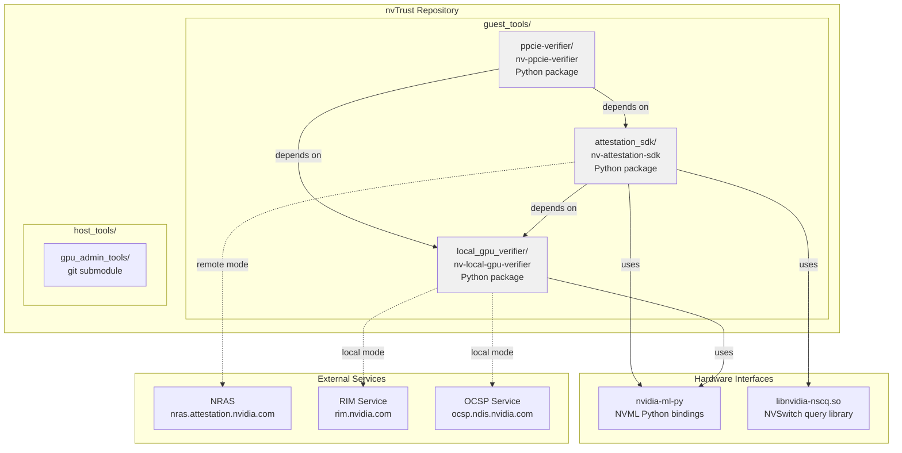
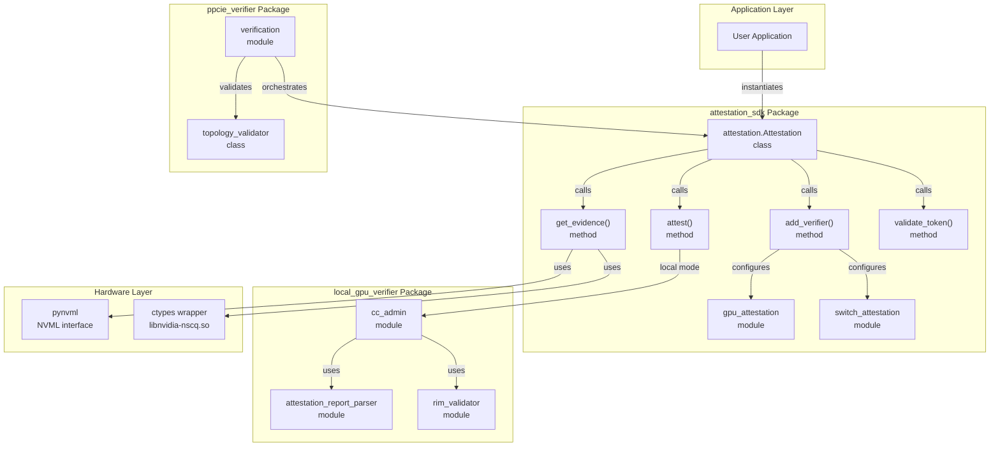
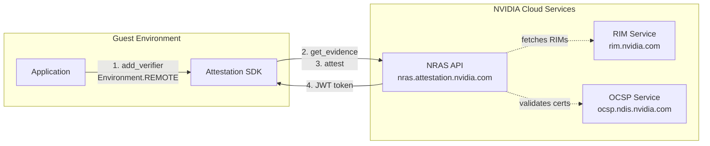
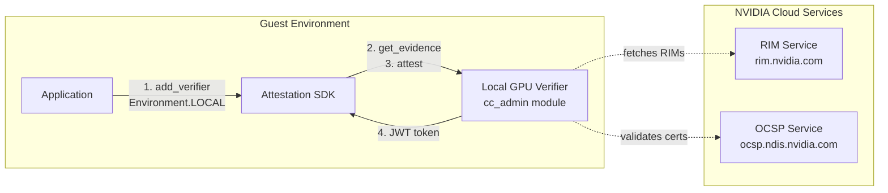
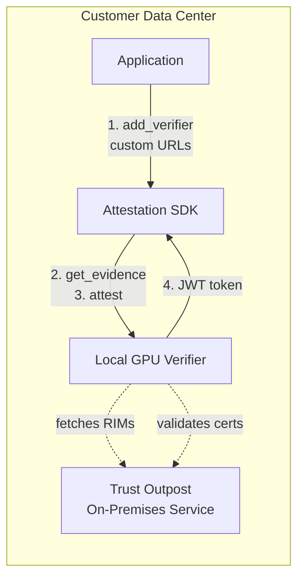
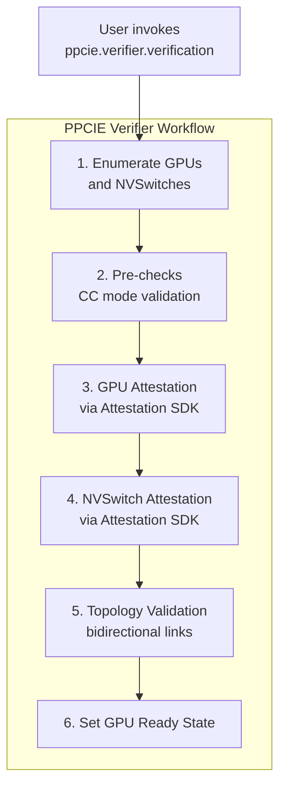

<!-- source: DeepWiki mcp.deepwiki.com · repo NVIDIA/nvtrust · page 1 Overview · fetched 2026-10-26 -->

# Overview

<details>
<summary>Relevant source files</summary>

The following files were used as context for generating this wiki page:

- [README.md](README.md)
- [guest_tools/README.md](guest_tools/README.md)
- [guest_tools/ppcie-verifier/README.md](guest_tools/ppcie-verifier/README.md)

</details>


This document introduces the nvTrust repository, explaining its role in GPU attestation for confidential computing and providing a high-level summary of its components. For detailed architectural patterns, see [Architecture](#1.1). For fundamental terminology and trust models, see [Key Concepts](#1.2). For package-specific details, see [Package Overview](#1.3).

**Sources:** [README.md:1-33](), [guest_tools/README.md:1-125]()

## What is nvTrust?

nvTrust is a collection of ancillary software tools for implementing and validating NVIDIA Trusted Computing Solutions on NVIDIA hardware. The repository focuses specifically on **attestation** - the cryptographic verification process that ensures the integrity and security of confidential computing environments running on NVIDIA GPUs.

The repository provides Python-based tools that enable users to:
- Collect cryptographic evidence from NVIDIA GPUs and NVSwitches
- Verify hardware and firmware measurements against known-good reference values
- Validate that devices are properly configured for confidential computing workloads
- Generate attestation tokens for integration with broader security frameworks

**Sources:** [README.md:1-6](), [README.md:15-21]()

## Confidential Computing Context

NVIDIA Confidential Computing provides a solution for securely processing data and code in use, preventing unauthorized users from both access and modification. When running AI training or inference workloads, both the input data (which may contain personally identifiable information or enterprise secrets) and the trained model (which represents valuable intellectual property) must be protected.

GPU attestation serves as the foundation for establishing trust in confidential computing environments by cryptographically proving:
- The GPU hardware is genuine NVIDIA hardware
- The GPU firmware has not been tampered with
- The GPU is configured in the correct confidential computing mode
- The system topology matches expected secure configurations

**Sources:** [README.md:15-21](), [guest_tools/ppcie-verifier/README.md:17-25]()

## Repository Structure and Main Components

The nvTrust repository is organized into the following primary components:



**Main Components:**

| Component | Package Name | Purpose |
|-----------|-------------|---------|
| **Attestation SDK** | `nv-attestation-sdk` | Primary library for integrating attestation capabilities into applications. Provides high-level API for evidence collection and verification. |
| **Local GPU Verifier** | `nv-local-gpu-verifier` | Tool and library for local GPU attestation. Performs cryptographic verification of GPU measurements without external service dependencies. |
| **PPCIE Verifier** | `nv-ppcie-verifier` | Orchestration tool for multi-GPU systems with NVSwitch interconnects. Verifies both GPU and switch attestation plus topology validation. |
| **GPU Admin Tools** | git submodule | Host-side administrative tools for GPU management (not covered in this documentation). |

**Sources:** [README.md:7-14](), [guest_tools/README.md:21-23](), [guest_tools/ppcie-verifier/README.md:68-73]()

## Attestation Workflow: Code Entity View

The following diagram shows how the main Python modules and classes interact during an attestation workflow:



**Key Code Entities:**

- `attestation.Attestation`: Main client class users instantiate to perform attestation [guest_tools/attestation_sdk/README.md]()
- `add_verifier()`: Method to configure attestation mode (LOCAL or REMOTE) for devices [guest_tools/README.md:32-34]()
- `get_evidence()`: Method to collect cryptographic evidence from hardware [guest_tools/README.md:36-39]()
- `attest()`: Method to perform verification of collected evidence [guest_tools/README.md:42-44]()
- `cc_admin`: Module containing local GPU verification logic [guest_tools/local_gpu_verifier/]()
- `verification`: Module implementing PPCIE orchestration workflow [guest_tools/ppcie-verifier/README.md:93-94]()

**Sources:** [guest_tools/README.md:28-44](), [guest_tools/README.md:75-81](), [guest_tools/README.md:94-101]()

## Deployment Models

nvTrust supports three attestation deployment models, each with different trust and operational characteristics:

### Model 1: Remote Attestation (NVIDIA-Managed)



- Evidence collection performed locally
- All verification performed by NVIDIA Remote Attestation Service (NRAS)
- Highest security and simplest integration
- Requires network connectivity to NVIDIA cloud services

**Sources:** [guest_tools/README.md:63-81]()

### Model 2: Local Attestation (Hybrid)



- Both evidence collection and verification performed locally
- Fetches reference measurements (RIMs) and certificate status from NVIDIA services
- Lower latency than remote mode
- Requires network connectivity to RIM and OCSP services

**Sources:** [guest_tools/README.md:83-101]()

### Model 3: Trust Outpost (On-Premises)



- Fully on-premises deployment
- Local caching of RIM and OCSP data
- Suitable for air-gapped environments or strict data sovereignty requirements
- Requires agreement with NVIDIA to access Trust Outpost

**Sources:** [guest_tools/README.md:103-108]()

## Multi-GPU Systems: PPCIE Mode

For multi-GPU systems with NVSwitch interconnects, the PPCIE Verifier provides orchestrated attestation and topology validation:



The PPCIE Verifier performs a 16-step verification process that includes:
- Device enumeration and pre-checks
- Individual attestation of all GPUs and NVSwitches
- Bidirectional topology validation (GPU-to-Switch and Switch-to-GPU links)
- Policy validation for all attestation results
- Final GPU ready state configuration

For details on the PPCIE workflow, see [PPCIE Verification](#5).

**Sources:** [guest_tools/ppcie-verifier/README.md:17-55](), [guest_tools/ppcie-verifier/README.md:93-94]()

## Supported Hardware

nvTrust supports attestation for:

| Hardware | Architectures | Requirements |
|----------|--------------|-------------|
| **NVIDIA GPUs** | Hopper (H100+), Blackwell | Confidential Computing capable, driver R575+ for Blackwell |
| **NVSwitches** | LS10 with PPCIE support | Requires NVIDIA Switch driver and Fabric Manager |

The system requires:
- Python >= 3.9
- NVIDIA GPU driver installed
- For multi-GPU systems: NVIDIA Fabric Manager installed
- For NVSwitch attestation: NVIDIA Switch driver installed

**Sources:** [guest_tools/ppcie-verifier/README.md:57-63]()

## Getting Started

To begin using nvTrust:

1. **Install the Attestation SDK** - This is the primary package that most users will need:
   ```bash
   pip install nv-attestation-sdk
   ```
   
   For detailed installation instructions, see [Installation and Setup](#2.1).

2. **For single-GPU attestation** - Use the Attestation SDK directly. See example code at [guest_tools/README.md:28-44]().

3. **For multi-GPU systems with NVSwitches** - Install the PPCIE Verifier:
   ```bash
   pip install nv-ppcie-verifier
   ```
   
   For PPCIE-specific setup, see [PPCIE Verification](#5).

4. **Run example tests** - Navigate to `guest_tools/attestation_sdk/tests/end_to_end/hardware/` and run:
   ```bash
   python LocalGPUTest.py
   # or
   python RemoteGPUTest.py
   ```

**Sources:** [guest_tools/README.md:20-59](), [guest_tools/ppcie-verifier/README.md:65-91]()

## Key Workflows Summary

| Workflow | Primary Tool | Use Case |
|----------|-------------|----------|
| **Single GPU Remote Attestation** | `attestation.Attestation` with `Environment.REMOTE` | Simplest integration, cloud-based verification |
| **Single GPU Local Attestation** | `attestation.Attestation` with `Environment.LOCAL` | Lower latency, hybrid cloud model |
| **Multi-GPU PPCIE Verification** | `ppcie.verifier.verification` module | HGX systems with 8 GPUs and 4 NVSwitches |
| **NVSwitch-Only Attestation** | `attestation.Attestation` with `Devices.SWITCH` | Switch interconnect verification |

For detailed workflow documentation, see [Attestation Workflow](#2.4).

**Sources:** [guest_tools/README.md:61-108](), [guest_tools/ppcie-verifier/README.md:93-108]()

## External Dependencies

nvTrust relies on several NVIDIA cloud services and external libraries:

**NVIDIA Services:**
- **NRAS** (`nras.attestation.nvidia.com`): Remote attestation verification service
- **RIM Service** (`rim.nvidia.com`): Reference Integrity Manifests for golden measurements
- **OCSP Service** (`ocsp.ndis.nvidia.com`): Certificate revocation checking

For service details, see [External Services](#6).

**Python Libraries:**
- `nvidia-ml-py`: Python bindings for NVML (NVIDIA Management Library)
- `cryptography`: Cryptographic operations for signature verification
- `PyJWT`: JSON Web Token generation and validation
- `lxml`, `signxml`: XML signature verification for RIM files

**Native Libraries:**
- `libnvidia-ml.so`: NVML driver library
- `libnvidia-nscq.so`: NVSwitch Query library

**Sources:** [guest_tools/ppcie-verifier/README.md:66-73]()

## Support and Contributing

- **Documentation**: [NVIDIA Confidential Computing Docs](https://docs.nvidia.com/confidential-computing/index.html)
- **Issues**: [GitHub Issues](https://github.com/NVIDIA/nvtrust/issues)
- **Email Support**: attestation-support@nvidia.com
- **Contributing**: See [Contributing and Licensing](#8)

The repository is licensed under Apache License v2.0 except where otherwise noted.

**Sources:** [README.md:23-33](), [guest_tools/README.md:119-124]()

---

