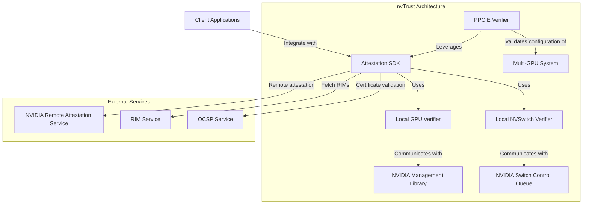
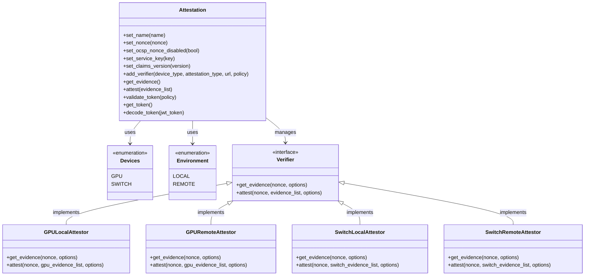
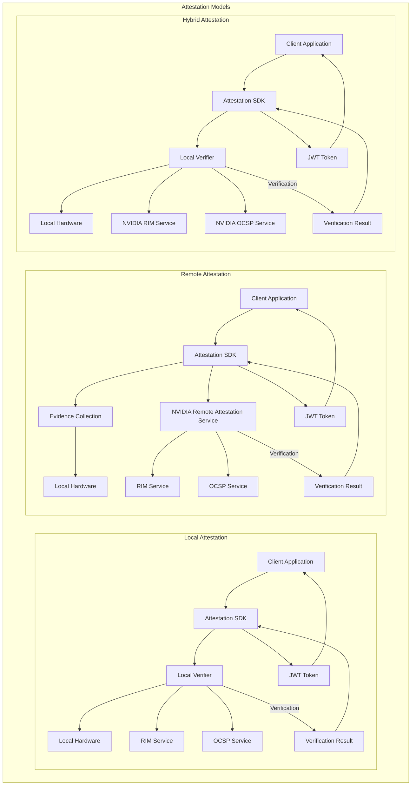
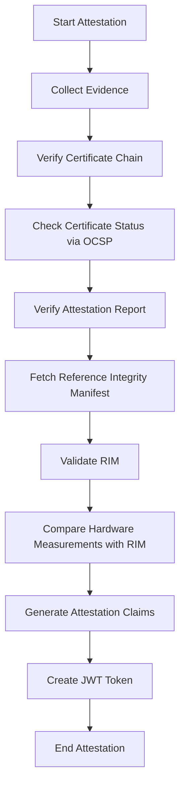
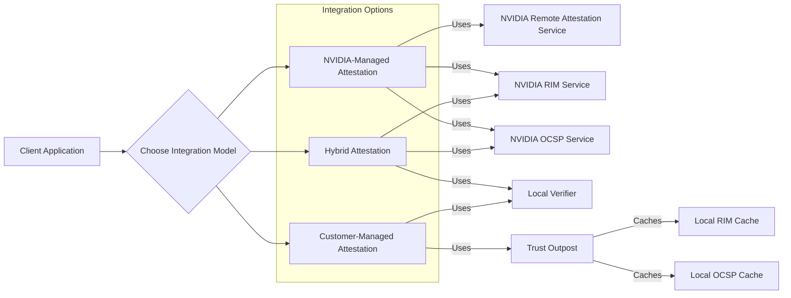

<!-- source: DeepWiki mcp.deepwiki.com · repo NVIDIA/nvtrust · page 1.1 Architecture · fetched 2026-10-26 -->

# Architecture

Relevant source files

The following files were used as context for generating this wiki page:

- [README.md](README.md)
- [guest_tools/README.md](guest_tools/README.md)
- [guest_tools/attestation_sdk/README.md](guest_tools/attestation_sdk/README.md)
- [guest_tools/ppcie-verifier/README.md](guest_tools/ppcie-verifier/README.md)
- [guest_tools/ppcie-verifier/pyproject.toml](guest_tools/ppcie-verifier/pyproject.toml)

This document explains the high-level architecture of the nvTrust system, highlighting the core components and their relationships. It provides a technical overview of how the different parts interact to enable GPU and NVSwitch attestation in confidential computing environments. For an introduction to nvTrust and its purpose, see [Overview](#1). For fundamental attestation concepts and terminology, see [Key Concepts](#1.2).

## System Architecture Overview

The nvTrust system is designed to provide comprehensive attestation capabilities for NVIDIA hardware components, particularly GPUs and NVSwitches, to ensure their integrity and security in confidential computing environments. The architecture follows a modular design approach that allows for flexibility in deployment and usage.

Diagram: High-level Component Overview of nvTrust Architecture

Sources: [README.md:1-29](), [guest_tools/attestation_sdk/README.md:1-45]()

## Core Components

### Attestation SDK

The Attestation SDK serves as the central component of the nvTrust system, providing a unified interface for applications to implement attestation capabilities. It supports both local and remote attestation for GPUs and NVSwitches.

Diagram: Attestation SDK Class Structure

Sources: [guest_tools/attestation_sdk/README.md:148-167]()

### Local GPU Verifier

The Local GPU Verifier is responsible for collecting evidence from GPUs and verifying their integrity locally. It interfaces with the NVIDIA Management Library (NVML) to communicate with the GPU hardware.

### Local NVSwitch Verifier

The Local NVSwitch Verifier performs attestation of NVSwitches in multi-GPU systems. It interfaces with the NVIDIA Switch Control Queue (NSCQ) to communicate with the NVSwitch hardware.

### PPCIE Verifier

The PPCIE Verifier validates the Protected PCIe configuration in multi-GPU systems, ensuring that the secure communication channels between GPUs and between GPUs and NVSwitches are properly established.

## Attestation Models

The nvTrust architecture supports three primary attestation models, each designed for different security requirements and operational environments.

Diagram: Attestation Models Flow

Sources: [guest_tools/README.md:61-108]()

### Local Attestation

In the local attestation model, both evidence collection and verification are performed locally on the system where the hardware is installed. This model is suitable for environments where internet connectivity is limited or where strict data sovereignty requirements exist.

### Remote Attestation

The remote attestation model involves collecting evidence locally but sending it to NVIDIA's Remote Attestation Service (NRAS) for verification. This approach provides the highest level of security as it leverages continually updated threat intelligence and verification capabilities from NVIDIA.

### Hybrid Attestation

The hybrid model balances local control with cloud-based support. Verification is performed locally, but the system still relies on NVIDIA's cloud services for Reference Integrity Manifests (RIMs) and Online Certificate Status Protocol (OCSP) validation.

| Feature | Local Attestation | Remote Attestation | Hybrid Attestation |
|---------|-------------------|-------------------|-------------------|
| Evidence Collection | Local | Local | Local |
| Verification | Local | NVIDIA Cloud | Local |
| RIM Source | Local or Cloud | NVIDIA Cloud | NVIDIA Cloud |
| OCSP Validation | Local or Cloud | NVIDIA Cloud | NVIDIA Cloud |
| Security Level | High | Highest | High |
| Cloud Dependency | Low | High | Medium |
| Best For | Air-gapped systems | Maximum security | Balanced approach |

Sources: [guest_tools/README.md:110-117]()

## Attestation Process

The attestation process follows a structured flow across all attestation models, with variations in where specific steps are executed.

Diagram: Attestation Process Flow

Sources: [guest_tools/attestation_sdk/README.md:80-90]()

### Evidence Collection

Evidence collection involves gathering cryptographic measurements and other security-relevant information from the hardware. This includes:

1. Attestation reports generated by the hardware
2. Certificate chains associated with the hardware
3. Driver and firmware versions
4. Hardware-specific security properties

### Verification

The verification process involves:

1. Certificate chain validation
2. OCSP certificate status checking
3. Attestation report validation, including nonce verification
4. RIM validation, including schema and signature verification
5. Comparison of hardware measurements against the RIM

### Token Generation

The result of the attestation process is a JWT token containing claims about the hardware's security state. This token can be validated against a policy to determine if the hardware meets the required security standards.

## Integration Options

The nvTrust architecture supports different integration options to meet various deployment scenarios and security requirements.

Diagram: Integration Options

Sources: [guest_tools/README.md:61-108]()

### NVIDIA-Managed Attestation

This option offers the highest level of security and operational simplicity by leveraging NVIDIA's cloud-based attestation services for comprehensive verification.

### Hybrid Attestation

This option balances local control with cloud-based support, allowing for local verification while still utilizing NVIDIA cloud services for RIM and OCSP validation.

### Customer-Managed Attestation

For organizations with strict data sovereignty requirements or air-gapped systems, NVIDIA offers Trust Outpost, an on-premises implementation that efficiently caches RIM and OCSP data.

## Conclusion

The nvTrust architecture provides a flexible and comprehensive solution for GPU and NVSwitch attestation in confidential computing environments. By supporting multiple attestation models and integration options, it can be adapted to meet a wide range of security requirements and operational constraints.

For more information on how to use the Attestation SDK and implement attestation in your applications, see [Attestation SDK](#2).

---

