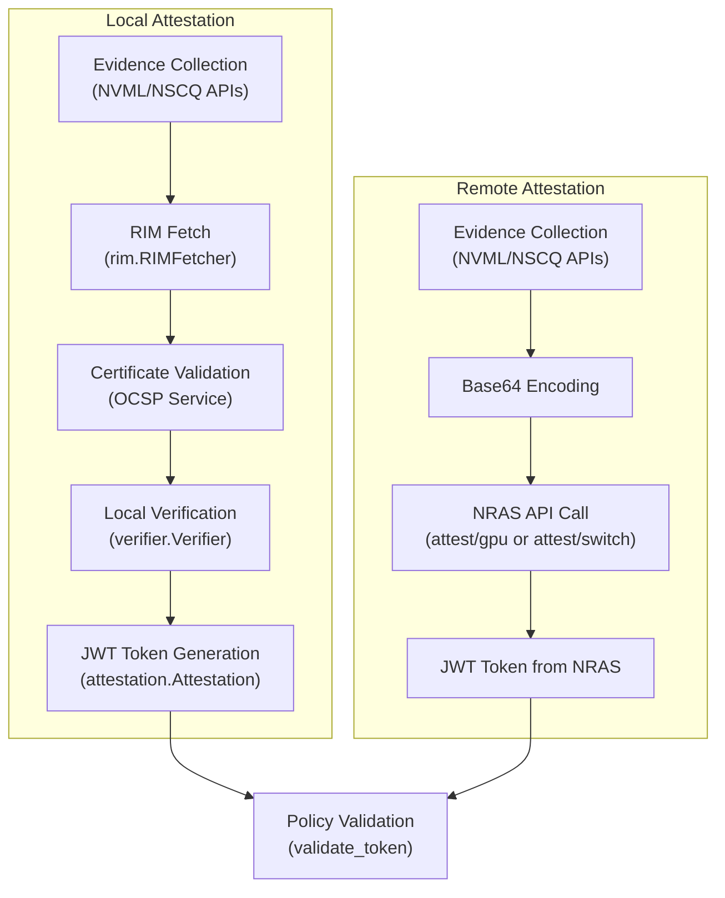
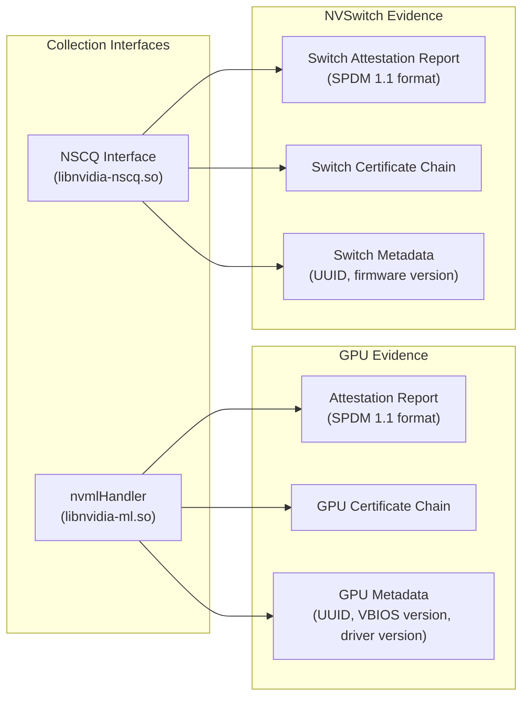
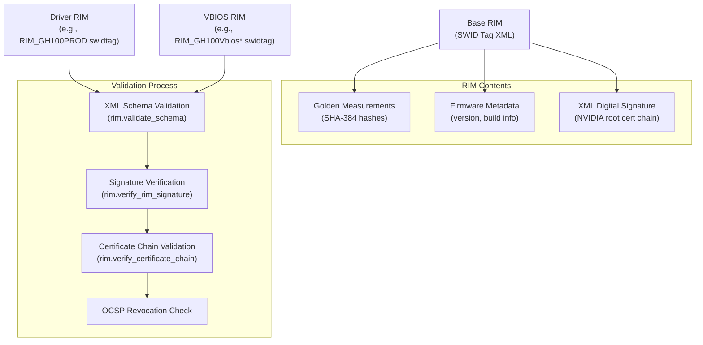
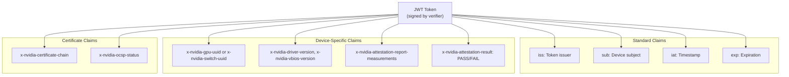
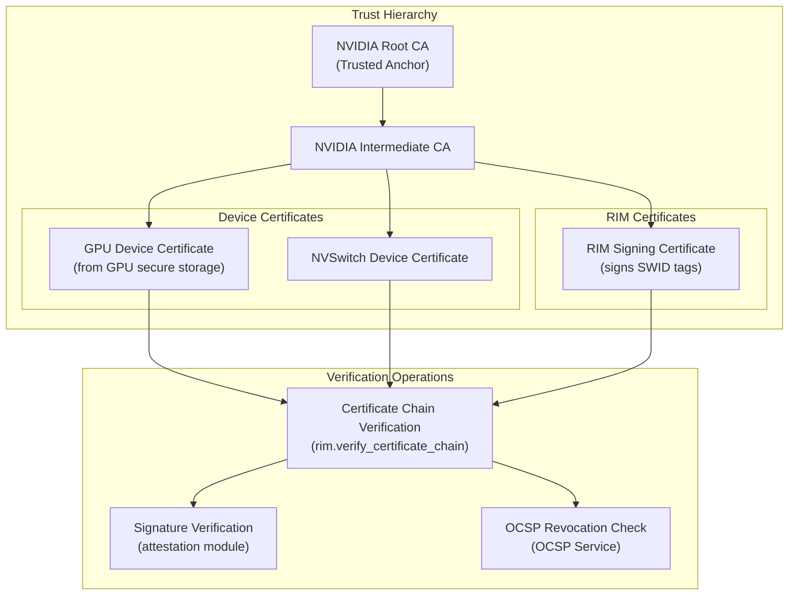
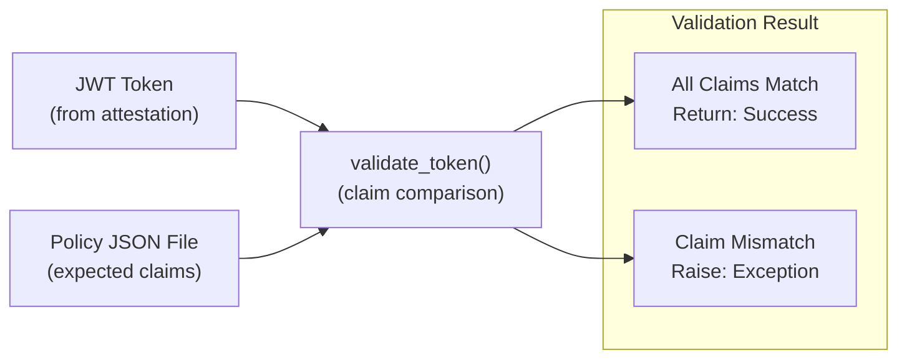
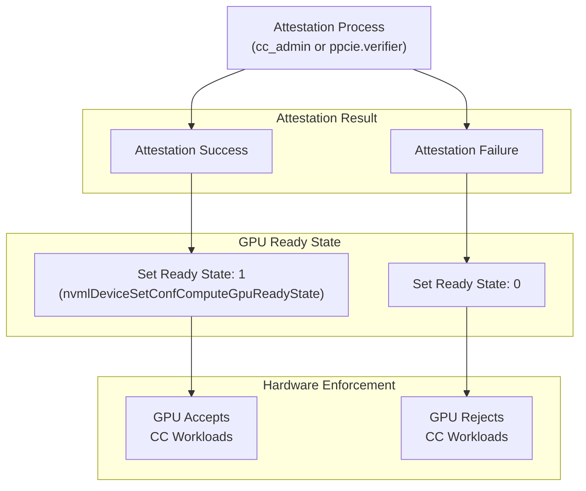
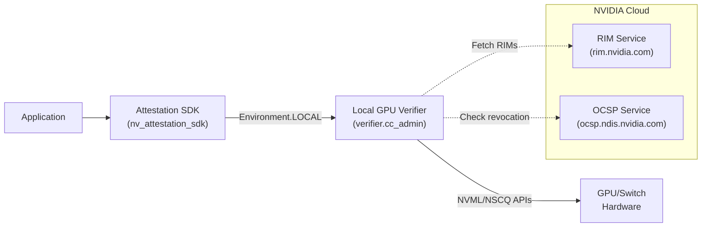
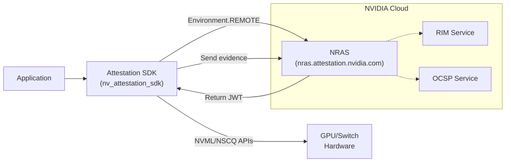

<!-- source: DeepWiki mcp.deepwiki.com · repo NVIDIA/nvtrust · page 1.2 Key Concepts · fetched 2026-10-26 -->

# Key Concepts

<details>
<summary>Relevant source files</summary>

The following files were used as context for generating this wiki page:

- [README.md](README.md)
- [guest_tools/README.md](guest_tools/README.md)
- [guest_tools/attestation_sdk/README.md](guest_tools/attestation_sdk/README.md)
- [guest_tools/gpu_verifiers/local_gpu_verifier/README.md](guest_tools/gpu_verifiers/local_gpu_verifier/README.md)
- [guest_tools/ppcie-verifier/README.md](guest_tools/ppcie-verifier/README.md)

</details>


This page defines the fundamental concepts, terminology, and technical foundations underlying the nvTrust attestation system. Understanding these concepts is essential for working with GPU and NVSwitch attestation in confidential computing environments.

For architectural overview and component relationships, see [Architecture](#1.1). For package-specific details, see [Package Overview](#1.3). For GPU attestation workflows, see [GPU Attestation](#3). For multi-GPU system verification, see [PPCIE Verification](#5).

## Attestation

Attestation is the process of cryptographically verifying that hardware and software components are in a known, trustworthy state. In the nvTrust system, attestation validates that GPUs and NVSwitches are running authentic NVIDIA firmware and are configured correctly for confidential computing workloads.

The attestation process consists of three main phases:

| Phase | Description | Code Components |
|-------|-------------|-----------------|
| **Evidence Collection** | Retrieve cryptographically signed measurements from hardware | `Attestation.get_evidence()`, `nvmlHandler` module |
| **Verification** | Validate signatures and compare runtime measurements against golden values | `verifier` module, NRAS API |
| **Policy Enforcement** | Check attestation claims against security requirements | `Attestation.validate_token()` |

### Attestation Modes

The system supports two verification modes:



**Local Attestation** performs all cryptographic verification on the client system using the `verifier.cc_admin` module. This mode requires access to RIM and OCSP services but executes verification logic locally, enabling air-gapped deployments when combined with Trust Outpost.

**Remote Attestation** sends evidence to NVIDIA's Remote Attestation Service (NRAS), which performs verification centrally and returns a signed JWT token. This mode uses the `attestation.Environment.REMOTE` configuration.

Sources: [guest_tools/attestation_sdk/README.md:27-33](), [guest_tools/README.md:25-44](), [guest_tools/gpu_verifiers/local_gpu_verifier/README.md:23-26]()

## Confidential Computing

Confidential computing protects data and code during execution, preventing unauthorized access or modification. NVIDIA GPUs with Confidential Computing (CC) capabilities provide hardware-enforced isolation for AI workloads processing sensitive data such as personally identifiable information (PII) or proprietary models.

The confidential computing security model relies on:

- **Hardware Root of Trust**: Immutable GPU ROM and secure key storage
- **Encrypted Memory**: GPU memory encryption preventing physical attacks
- **Attestation**: Cryptographic proof that the GPU is in a known secure state
- **GPU Ready State**: Hardware-level enforcement mechanism (see [GPU Ready State](#gpu-ready-state))

In multi-GPU systems, two operating modes are supported:

| Mode | Description | NVLink Traffic | Verifier Tool |
|------|-------------|----------------|---------------|
| **CC Mode** | Each GPU in separate confidential VM | Encrypted via Copy Engine | `cc_admin` |
| **PPCIE Mode** | All GPUs in single confidential VM, trusted NVLink fabric | Plaintext (trusted) | `ppcie.verifier` |

**Note**: Mixing CC and PPCIE modes is not supported - all GPUs must operate in the same mode.

Sources: [README.md:15-22](), [guest_tools/ppcie-verifier/README.md:17-26]()

## Evidence and Measurements

Evidence is the raw data collected from hardware that proves its current state. In nvTrust, evidence consists of:



**Measurements** are cryptographic hashes of firmware components included in the attestation report. Common measurement indices include:

| Index | Component | Description |
|-------|-----------|-------------|
| `0x0` | ROM | Immutable boot ROM |
| `0x1` | Driver | GPU driver version-specific measurements |
| `0x2` | VBIOS | Video BIOS firmware |
| `0xD` | Configuration | Runtime configuration state |

The `nvmlHandler` module uses NVML API calls to retrieve GPU attestation reports via `nvmlDeviceGetConfComputeGpuAttestationReport()`. For NVSwitches, the NSCQ library provides equivalent functionality through `nscq_session_gpu_attestation_report_get()`.

Sources: [guest_tools/gpu_verifiers/local_gpu_verifier/README.md:136-140](), [guest_tools/attestation_sdk/README.md:167-168]()

## Reference Integrity Manifests (RIMs)

Reference Integrity Manifests (RIMs) contain the golden measurements (expected cryptographic hashes) for authentic NVIDIA firmware. RIMs are distributed as SWID (Software Identification) tags that conform to the TCG RIM specification.

### RIM Structure



The `rim` module performs parsing, schema validation, and signature verification of RIM files. RIMs are fetched from the RIM Service at runtime or can be provided via the `--driver_rim` and `--vbios_rim` command-line options.

Key RIM validation functions:
- `rim.validate_schema()`: Validates XML structure against SWID schema
- `rim.verify_rim_signature()`: Verifies XML digital signature
- `rim.verify_certificate_chain()`: Validates RIM certificate chain to NVIDIA root

Sources: [guest_tools/gpu_verifiers/local_gpu_verifier/README.md:132-134](), [guest_tools/gpu_verifiers/local_gpu_verifier/README.md:111-117]()

## Attestation Reports (SPDM)

Attestation reports are cryptographically signed documents generated by the GPU hardware that contain runtime measurements. nvTrust uses the DMTF SPDM (Security Protocol and Data Model) 1.1 specification for attestation report format.

### SPDM Report Structure

| Field | Description | Verified By |
|-------|-------------|-------------|
| **Measurements** | SHA-384 hashes of firmware components (ROM, driver, VBIOS, config) | `attestation.Attestation` module |
| **Signature** | ECDSA P-384 signature over measurements and nonce | Hardware secure storage |
| **Nonce** | Cryptographic nonce for replay protection | Provided by verifier (`--nonce` option) |
| **Certificate Chain** | GPU certificate chain for signature verification | `rim.verify_certificate_chain()` |

The attestation report is retrieved from the GPU via `nvmlDeviceGetConfComputeGpuAttestationReport()` and parsed by the `attestation` module. The module extracts measurements and performs signature verification using the GPU's certificate chain.

```mermaid
graph LR
    Hardware["GPU Hardware<br/>(Secure Key Storage)"]
    Report["SPDM 1.1 Report<br/>(attestation.Attestation)"]
    Extract["Measurement Extraction<br/>(parse functions)"]
    Verify["Signature Verification<br/>(cryptography library)"]
    Compare["Measurement Comparison<br/>(verifier.Verifier)"]
    
    Hardware -->|"nvmlDeviceGetConfComputeGpuAttestationReport()"| Report
    Report --> Extract
    Extract --> Verify
    Verify --> Compare
    Compare -->|"Match against RIM"| Result["Attestation Result"]
```



Sources: [guest_tools/gpu_verifiers/local_gpu_verifier/README.md:136-137](), [guest_tools/attestation_sdk/README.md:162]()

## Claims and Tokens

After successful attestation, the system generates a JWT (JSON Web Token) containing **claims** - standardized assertions about the verified device state. Claims follow the Entity Attestation Token (EAT) format and are versioned for compatibility.

### Claims Versions

The system supports multiple claims versions for backward compatibility:

| SDK Version | Supported Claims Versions |
|-------------|---------------------------|
| v2.0.0 - v2.3.0 | 2.0 |
| v2.4.0 - v2.6.3 | 2.0, 3.0 (default) |

Claims version is configured via `Attestation.set_claims_version()` or the `--claims_version` command-line option.

### Common Claims Structure



The `Attestation.get_token()` method retrieves the JWT token after attestation. The `decode_token()` method decodes the JWT to inspect individual claims.

Sources: [guest_tools/attestation_sdk/README.md:131-152](), [guest_tools/attestation_sdk/README.md:170-174]()

## Trust Model and Certificate Chains

The nvTrust trust model is based on a hierarchical chain of trust rooted in NVIDIA's certificate authority.



### Certificate Validation

Certificate validation involves three checks:

1. **Chain Validation**: Verify that the device or RIM certificate chains back to the NVIDIA root CA using `rim.verify_certificate_chain()`.

2. **Signature Validation**: Verify that signatures (attestation report signatures, RIM XML signatures) are valid using the certificate's public key.

3. **Revocation Checking**: Query the OCSP (Online Certificate Status Protocol) service to ensure certificates have not been revoked. Certificates in `certificate_hold` status can be allowed via the `--allow_hold_cert` flag or `NV_ALLOW_HOLD_CERT` environment variable.

The root certificate for chain validation can be specified via `--rim_root_cert` option or defaults to embedded NVIDIA root certificates.

Sources: [guest_tools/gpu_verifiers/local_gpu_verifier/README.md:116-117](), [guest_tools/attestation_sdk/README.md:163-164](), [guest_tools/attestation_sdk/README.md:177-179]()

## Policy Validation

Policy validation checks attestation claims against expected values defined in a JSON policy file. This allows applications to enforce specific security requirements.

### Policy File Structure

Policy files specify expected claim values:

```json
{
  "x-nvidia-attestation-result": ["PASS"],
  "x-nvidia-driver-version": ["550.54.14"],
  "x-nvidia-vbios-version": ["96.00.89.00.01"],
  "x-nvidia-gpu-arch": ["HOPPER"]
}
```

The `Attestation.validate_token()` method compares actual claims from the JWT token against the policy file. Validation fails if any required claim does not match the expected values.

### Policy Validation Flow



Sample policy files are provided in [guest_tools/attestation_sdk/tests/policies/]().

Sources: [guest_tools/attestation_sdk/README.md:113-116](), [guest_tools/attestation_sdk/README.md:173]()

## Hardware Interfaces

nvTrust interacts with GPU and NVSwitch hardware through two primary interfaces:

### NVML (NVIDIA Management Library)

NVML provides the interface for GPU management and attestation operations. The `nvmlHandler` module wraps NVML API calls.

| Operation | NVML Function | Module Function |
|-----------|---------------|-----------------|
| Get GPU UUID | `nvmlDeviceGetUUID()` | `nvmlHandler.get_gpu_uuid()` |
| Get driver version | `nvmlSystemGetDriverVersion()` | `nvmlHandler.get_driver_version()` |
| Get attestation report | `nvmlDeviceGetConfComputeGpuAttestationReport()` | `nvmlHandler.get_attestation_report()` |
| Get GPU certificate | `nvmlDeviceGetConfComputeGpuCertificate()` | `nvmlHandler.get_gpu_certificate()` |
| Set GPU ready state | `nvmlDeviceSetConfComputeGpuReadyState()` | Used by `cc_admin` |

The Python binding `nvidia-ml-py` (version >= 12.535.77) provides access to the native `libnvidia-ml.so` library.

### NSCQ (NVSwitch Query Library)

NSCQ provides the interface for NVSwitch attestation and management. This is a C library (`libnvidia-nscq.so`) accessed via ctypes.

| Operation | NSCQ Function | Description |
|-----------|---------------|-------------|
| Initialize session | `nscq_session_create()` | Create NSCQ session handle |
| Get switch UUID | `nscq_session_uuid_get()` | Retrieve switch unique identifier |
| Get attestation report | `nscq_session_gpu_attestation_report_get()` | Fetch switch attestation report |
| Get certificate | `nscq_session_gpu_certificate_chain_get()` | Retrieve certificate chain |
| Close session | `nscq_session_destroy()` | Clean up session resources |

The NSCQ interface is accessed via constants like `NSCQ_ATTESTATION_CERT_CHAIN_PATH` and `NSCQ_ATTESTATION_REPORT_PATH`.

Sources: [guest_tools/gpu_verifiers/local_gpu_verifier/README.md:139-140](), [guest_tools/ppcie-verifier/README.md:62-63]()

## GPU Ready State

The GPU Ready State is a hardware-enforced gate that controls whether the GPU accepts confidential computing workloads. This provides defense-in-depth by ensuring that failed attestation prevents GPU usage at the hardware level.



**Important**: Setting the GPU ready state requires root privileges. The verifier tools must be run with `sudo` to modify the ready state. In user mode (`--user_mode` flag), attestation is performed but the ready state is not modified.

The GPU ready state is set by:
- `cc_admin` module for single-GPU and multi-GPU CC mode systems
- `ppcie.verifier.verification` for multi-GPU PPCIE mode systems

Sources: [guest_tools/gpu_verifiers/local_gpu_verifier/README.md:39-43](), [guest_tools/gpu_verifiers/local_gpu_verifier/README.md:113](), [guest_tools/ppcie-verifier/README.md:53-54]()

## Deployment Modes

The nvTrust system supports three deployment architectures for different security and operational requirements:

### Local Mode with Cloud Services (Hybrid)



Local mode performs cryptographic verification on the client but fetches RIMs and performs certificate revocation checks against NVIDIA cloud services.

### Remote Mode (Cloud-Managed)



Remote mode sends evidence to NRAS, which performs all verification and returns a signed JWT token.

### Trust Outpost (On-Premises)

Trust Outpost is an on-premises deployment that caches RIM and OCSP data locally, enabling air-gapped or data sovereignty-compliant deployments. Access requires agreement with NVIDIA.

| Feature | Local Mode | Remote Mode | Trust Outpost |
|---------|-----------|-------------|---------------|
| Verification Location | Client | NRAS | On-premises |
| RIM/OCSP Access | Internet required | Internet required | Local cache |
| Latency | Low | Moderate | Lowest |
| Air-gap Support | No | No | Yes |
| Configuration | `Environment.LOCAL` | `Environment.REMOTE` | `Environment.LOCAL` + custom URLs |

Sources: [guest_tools/README.md:61-117](), [guest_tools/attestation_sdk/README.md:84-90]()

---

