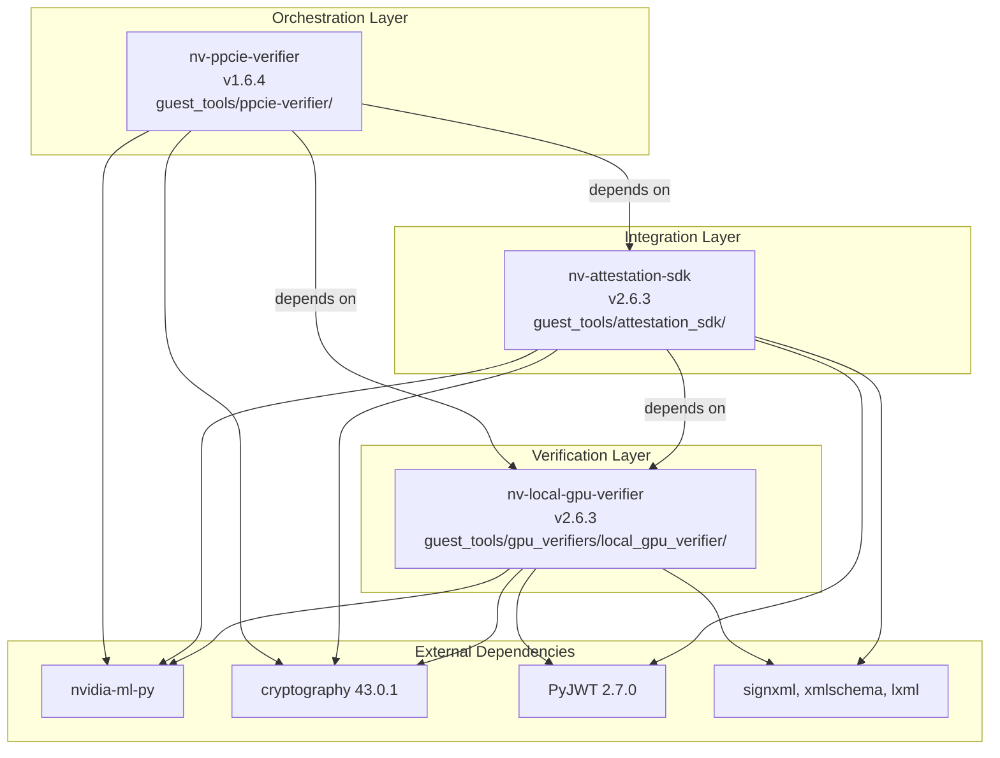
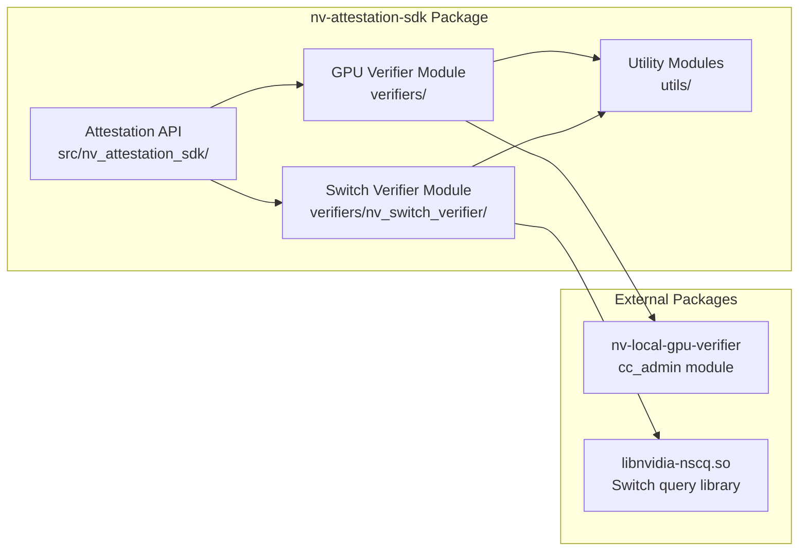
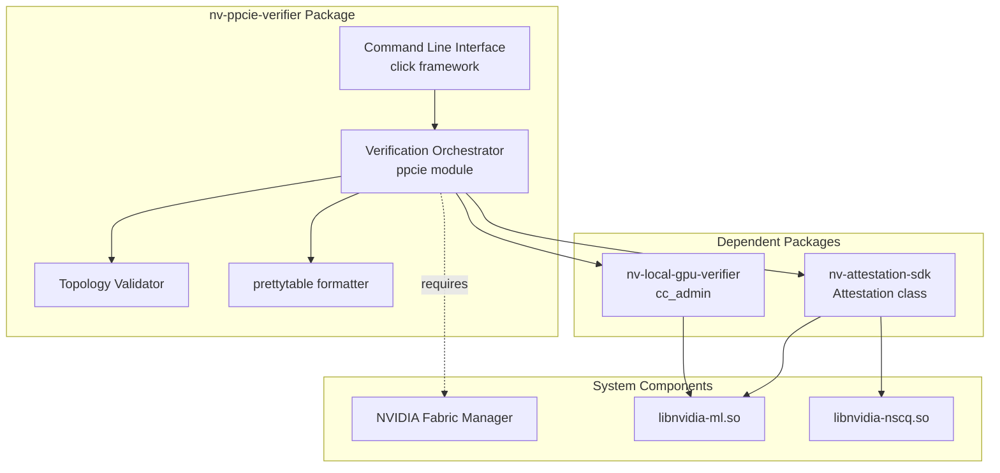

<!-- source: DeepWiki mcp.deepwiki.com · repo NVIDIA/nvtrust · page 1.3 Package Overview · fetched 2026-10-26 -->

# Package Overview

<details>
<summary>Relevant source files</summary>

The following files were used as context for generating this wiki page:

- [guest_tools/attestation_sdk/pyproject.toml](guest_tools/attestation_sdk/pyproject.toml)
- [guest_tools/gpu_verifiers/local_gpu_verifier/pyproject.toml](guest_tools/gpu_verifiers/local_gpu_verifier/pyproject.toml)
- [guest_tools/ppcie-verifier/pyproject.toml](guest_tools/ppcie-verifier/pyproject.toml)

</details>


## Purpose and Scope

This document provides an overview of the three primary Python packages in the nvTrust repository: `nv-attestation-sdk`, `nv-local-gpu-verifier`, and `nv-ppcie-verifier`. Each package serves a specific role in the GPU attestation ecosystem, with clear dependency relationships and distribution models. This page covers the package structure, versioning, dependency chains, and when to use each package.

For detailed information about installing and using these packages, see [Attestation SDK](#2), [Local GPU Verifier](#3.1), and [PPCIE Verification](#5). For the high-level system architecture, see [Architecture](#1.1).

---

## Package Hierarchy and Roles

The nvTrust repository contains three independently versioned packages that form a layered architecture. The dependency hierarchy flows from bottom to top, with the Local GPU Verifier at the foundation and the PPCIE Verifier at the orchestration layer.

### Package Dependency Structure



Sources: [guest_tools/ppcie-verifier/pyproject.toml:1-35](), [guest_tools/attestation_sdk/pyproject.toml:1-45](), [guest_tools/gpu_verifiers/local_gpu_verifier/pyproject.toml:1-37]()

---

## nv-local-gpu-verifier

The Local GPU Verifier is the foundational package that provides low-level GPU attestation capabilities. It operates as a standalone verifier with no dependencies on other nvTrust packages.

| Property | Value |
|----------|-------|
| **Package Name** | `nv-local-gpu-verifier` |
| **Version** | 2.6.3 |
| **Location** | `guest_tools/gpu_verifiers/local_gpu_verifier/` |
| **Python Requirement** | >= 3.7 |
| **License** | BSD-3-Clause |
| **Description** | Validates GPU measurements by comparing runtime measurements with authenticated golden measurements |

### Key Responsibilities

- Direct interaction with NVIDIA GPUs via NVML (`nvidia-ml-py`)
- Parsing and validation of GPU attestation reports
- Comparison of runtime measurements against Reference Integrity Manifests (RIMs)
- Certificate chain validation and OCSP checking
- JWT token generation with attestation claims
- SWID tag processing for golden measurements

### Core Dependencies

The package relies on cryptographic and XML processing libraries:

```
cryptography == 43.0.1      # Certificate and signature validation
ecdsa == 0.18.0              # Elliptic curve cryptography
lxml >= 4.9.1                # XML parsing
signxml == 3.2.0             # XML signature validation
xmlschema == 2.2.3           # SWID tag schema validation
pyOpenSSL == 24.2.1          # OpenSSL bindings
PyJWT == 2.7.0               # JWT token generation
nvidia-ml-py == 12.550.52    # NVML Python bindings
asn1 == 2.7.0                # ASN.1 parsing for certificates
```

### Package Data

The Local GPU Verifier includes bundled resources:

- Sample SWID tags (`samples/*.swidtag`)
- RIM XML schemas (`rim/*.xsd`)
- Sample attestation data (`samples/*.txt`)
- Root certificates (`certs/*.pem`)
- Test fixtures (`Tests/*/*.txt`)

Sources: [guest_tools/gpu_verifiers/local_gpu_verifier/pyproject.toml:1-37]()

---

## nv-attestation-sdk

The Attestation SDK provides a high-level API for integrating attestation capabilities into applications. It supports both local and remote attestation modes and provides a unified interface for GPU and NVSwitch attestation.

| Property | Value |
|----------|-------|
| **Package Name** | `nv-attestation-sdk` |
| **Version** | 2.6.3 |
| **Location** | `guest_tools/attestation_sdk/` |
| **Python Requirement** | >= 3.7 |
| **License** | OSI Approved :: Apache Software License |
| **Description** | Easy-to-use APIs for implementing attestation capabilities |

### Key Responsibilities

- High-level `Attestation` class API for evidence collection
- Orchestration of local GPU verification via `nv-local-gpu-verifier`
- Remote attestation via NRAS (NVIDIA Remote Attestation Service)
- NVSwitch attestation via NSCQ library interface
- Policy-based validation of attestation results
- Support for multiple attestation environments (local, remote)

### Architecture Mapping



### Dependencies

The SDK extends the Local GPU Verifier with additional capabilities:

```
nv-local-gpu-verifier = "2.6.3"  # Base GPU verification
pyjwt ~= 2.7.0                    # JWT handling
requests ~= 2.32.3                # HTTP client for NRAS
cryptography == 43.0.1            # Cryptographic operations
nvidia-ml-py >= 12.535.77         # NVML interface
```

The SDK also includes development and testing dependencies: `build`, `twine`, `pylint`, `pytest`, `pytest-cov`, `parameterized`.

Sources: [guest_tools/attestation_sdk/pyproject.toml:1-45]()

---

## nv-ppcie-verifier

The PPCIE Verifier is the highest-level orchestration tool designed for multi-GPU systems with NVSwitch interconnects. It implements a comprehensive 16-step verification workflow that validates both device attestation and physical topology.

| Property | Value |
|----------|-------|
| **Package Name** | `nv-ppcie-verifier` |
| **Version** | 1.6.4 |
| **Location** | `guest_tools/ppcie-verifier/` |
| **Python Requirement** | ^3.9 |
| **License** | OSI Approved :: Apache Software License |
| **Description** | Protected PCIE Verifier for multi-GPU systems |
| **Package Root** | `ppcie` |

### Key Responsibilities

- Orchestration of attestation for all GPUs and NVSwitches in a system
- Bidirectional topology validation (GPU→Switch and Switch→GPU)
- Sequential execution of 16 verification steps
- GPU Ready State management based on attestation results
- Command-line interface for system-wide attestation
- Timeout management for long-running operations
- Pretty-printed output for human-readable results

### Component Mapping



### Dependencies

The PPCIE Verifier depends on both other nvTrust packages:

```
nv-attestation-sdk = "2.6.3"       # Attestation orchestration
nv-local-gpu-verifier = "2.6.3"    # GPU verification
click = "8.1.7"                     # Command-line interface
prettytable ^= 3.10.0               # Formatted output
timeout-decorator = "0.5.0"         # Operation timeouts
dill = "0.3.8"                      # Pickle serialization
nvidia-ml-py ^= 12.550.52           # NVML interface
```

Additional dependencies include development tools: `pylint`, `black`, `pytest`, `pytest-cov`, `build`.

Sources: [guest_tools/ppcie-verifier/pyproject.toml:1-35]()

---

## Version Compatibility Matrix

The packages maintain strict version pinning to ensure compatibility. The current release versions are synchronized at 2.6.3 for the SDK and Local GPU Verifier, with PPCIE Verifier at 1.6.4.

| Package | Version | Depends On | Minimum Python |
|---------|---------|------------|----------------|
| `nv-local-gpu-verifier` | 2.6.3 | (none) | 3.7 |
| `nv-attestation-sdk` | 2.6.3 | `nv-local-gpu-verifier==2.6.3` | 3.7 |
| `nv-ppcie-verifier` | 1.6.4 | `nv-attestation-sdk==2.6.3`<br/>`nv-local-gpu-verifier==2.6.3` | 3.9 |

### Shared Dependencies

All three packages share a common cryptographic foundation:

| Dependency | GPU Verifier | Attestation SDK | PPCIE Verifier |
|------------|--------------|-----------------|----------------|
| `cryptography` | 43.0.1 | 43.0.1 | 43.0.1 |
| `PyJWT` | 2.7.0 | 2.7.0 | (inherited) |
| `signxml` | 3.2.0 | 3.2.0 | (inherited) |
| `xmlschema` | 2.2.3 | 2.2.3 | (inherited) |
| `pyOpenSSL` | 24.2.1 | 24.2.1 | (inherited) |
| `nvidia-ml-py` | 12.550.52 | >=12.535.77 | ^12.550.52 |

Sources: [guest_tools/ppcie-verifier/pyproject.toml:1-35](), [guest_tools/attestation_sdk/pyproject.toml:1-45](), [guest_tools/gpu_verifiers/local_gpu_verifier/pyproject.toml:1-37]()

---

## Package Selection Guide

Choose the appropriate package based on your use case:

### Use `nv-local-gpu-verifier` when:

- You need low-level GPU attestation without SDK overhead
- You're building custom verification tools
- You only need to verify individual GPUs
- You want to integrate GPU verification into a minimal environment
- You need direct control over verification parameters

### Use `nv-attestation-sdk` when:

- You're building applications that need attestation capabilities
- You need both local and remote attestation modes
- You want to attest both GPUs and NVSwitches
- You need a high-level API with policy validation
- You're integrating attestation into a confidential computing workload

### Use `nv-ppcie-verifier` when:

- You need to verify complete multi-GPU systems
- Your system includes NVSwitch interconnects
- You need topology validation
- You want a ready-to-use command-line tool
- You're validating PPCIE (Protected PCIe) configurations
- You need to manage GPU Ready State across multiple devices

---

## Build System and Packaging

All three packages use Python packaging tools but with different build systems:

### Local GPU Verifier

- Build system: `setuptools` (traditional)
- Configuration: `pyproject.toml` with `[project]` table
- Package data includes SWID tags, schemas, and certificates

### Attestation SDK

- Build system: `poetry-core` (modern)
- Configuration: `pyproject.toml` with `[tool.poetry]` table
- Test configuration: `pytest.ini_options` with custom Python path

### PPCIE Verifier

- Build system: `poetry-core` (modern)
- Configuration: `pyproject.toml` with `[tool.poetry]` table
- Package root: `ppcie` module

### Installation Methods

All packages can be installed via:

```bash
# From PyPI
pip install nv-local-gpu-verifier
pip install nv-attestation-sdk
pip install nv-ppcie-verifier

# From source (poetry-based packages)
cd guest_tools/attestation_sdk
poetry install

# From source (setuptools-based packages)
cd guest_tools/gpu_verifiers/local_gpu_verifier
pip install .
```

Sources: [guest_tools/ppcie-verifier/pyproject.toml:32-34](), [guest_tools/attestation_sdk/pyproject.toml:39-41](), [guest_tools/gpu_verifiers/local_gpu_verifier/pyproject.toml:1-37]()

---

## Package Metadata and Distribution

### Keywords and Classification

All packages share common keywords for discoverability:

- `confidential-computing`
- `attestation`
- `NVIDIA`
- `local-gpu-verifier` (or `verifier`)

The Local GPU Verifier includes additional PyPI classifiers:
- `Programming Language :: Python :: 3`
- `License :: OSI Approved :: BSD License`
- `Operating System :: OS Independent`

### Licensing

| Package | License |
|---------|---------|
| `nv-local-gpu-verifier` | BSD-3-Clause |
| `nv-attestation-sdk` | Apache License (OSI Approved) |
| `nv-ppcie-verifier` | Apache License (OSI Approved) |

Sources: [guest_tools/ppcie-verifier/pyproject.toml:6](), [guest_tools/attestation_sdk/pyproject.toml:1-12](), [guest_tools/gpu_verifiers/local_gpu_verifier/pyproject.toml:10-22]()

---

