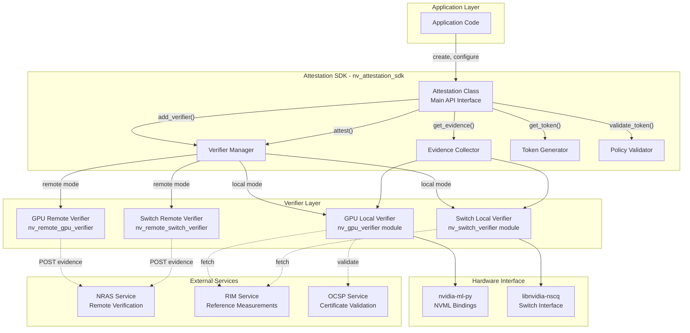
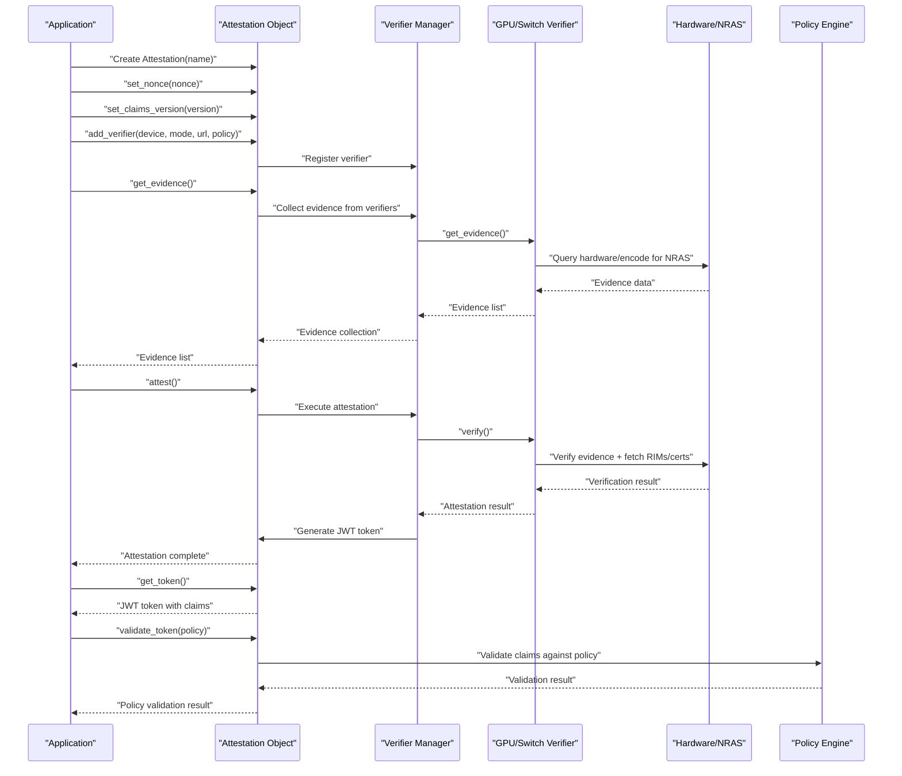
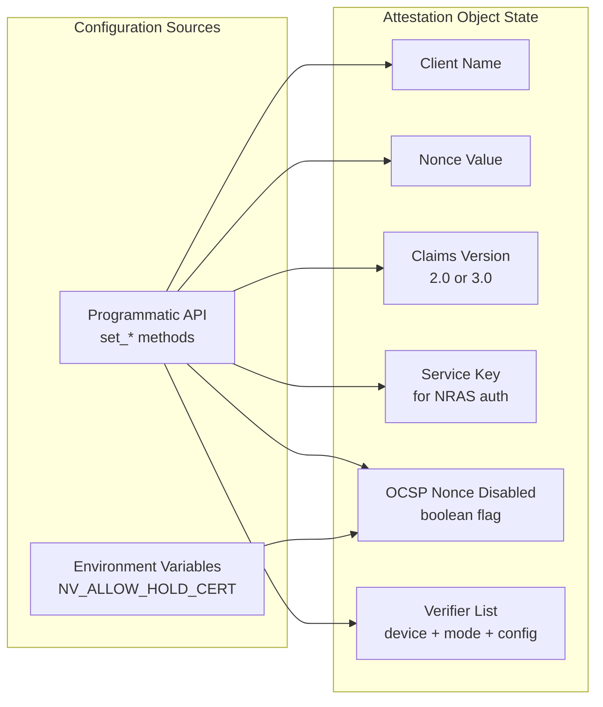
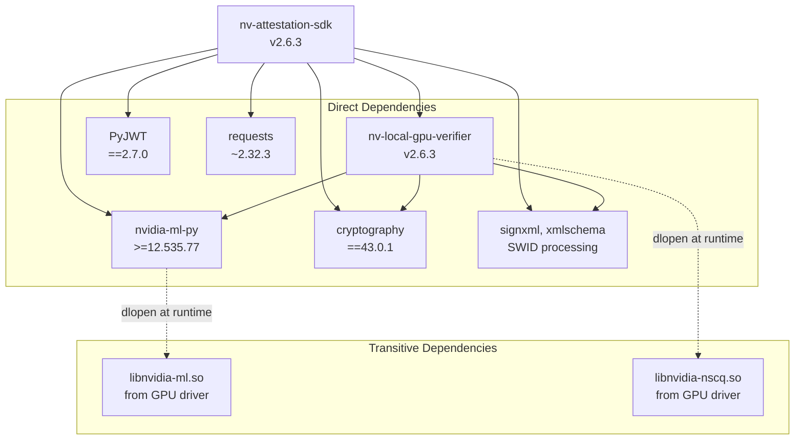

<!-- source: DeepWiki mcp.deepwiki.com · repo NVIDIA/nvtrust · page 2 Attestation SDK · fetched 2026-10-26 -->

# Attestation SDK

<details>
<summary>Relevant source files</summary>

The following files were used as context for generating this wiki page:

- [guest_tools/attestation_sdk/README.md](guest_tools/attestation_sdk/README.md)
- [guest_tools/attestation_sdk/pyproject.toml](guest_tools/attestation_sdk/pyproject.toml)

</details>


## Purpose and Scope

The Attestation SDK (`nv-attestation-sdk`) is a Python library that provides high-level APIs for integrating GPU and NVSwitch attestation capabilities into applications. It serves as the primary interface for developers to implement confidential computing attestation workflows, abstracting the complexity of evidence collection, verification, and token generation.

This document covers the SDK's architecture, API design, configuration, and integration patterns. For installation procedures, see [Installation and Setup](#2.1). For detailed API reference, see [API Reference](#2.2). For multi-GPU PPCIE verification workflows, see [PPCIE Verification](#5).

**Sources:** [guest_tools/attestation_sdk/README.md:1-4]()

## Overview

The Attestation SDK acts as an orchestration layer between applications and attestation verifiers. It supports two verification modes (local and remote) and two device types (GPU and NVSwitch), providing a unified interface regardless of the underlying verification mechanism. The SDK handles evidence collection, verifier management, token generation, and policy validation.

**Key Capabilities:**
- Local GPU attestation using NVML-based verification
- Remote GPU attestation via NVIDIA Remote Attestation Service (NRAS)
- Local NVSwitch attestation using NSCQ-based verification
- Remote NVSwitch attestation via NRAS
- JWT token generation with attestation claims
- Policy-based validation of attestation results
- Multi-device and multi-verifier orchestration

**Sources:** [guest_tools/attestation_sdk/README.md:27-32]()

## Architecture

### Component Structure



**Diagram: Attestation SDK Component Architecture**

The SDK follows a layered architecture where the `Attestation` class provides the public API, delegating to specialized internal components for verifier management, evidence collection, token generation, and policy validation. Verifiers are registered dynamically and can operate in local or remote modes.

**Sources:** [guest_tools/attestation_sdk/README.md:154-174]()

### Data Flow



**Diagram: Attestation SDK Workflow Sequence**

The typical workflow involves: (1) creating and configuring an `Attestation` object, (2) adding verifiers for specific devices and modes, (3) optionally collecting evidence, (4) executing attestation, (5) retrieving the JWT token, and (6) validating the token against a policy.

**Sources:** [guest_tools/attestation_sdk/README.md:82-90](), [guest_tools/attestation_sdk/README.md:154-174]()

## Core API

### Attestation Class

The `Attestation` class is the primary interface in the `nv_attestation_sdk.attestation` module. It provides methods for configuration, verifier management, attestation execution, and token handling.

**API Method Summary:**

| Method | Parameters | Description |
|--------|-----------|-------------|
| `Attestation(name)` | `name: str` | Constructor to create an Attestation object with an optional client name |
| `set_name(name)` | `name: str` | Set or update the client name |
| `set_nonce(nonce)` | `nonce: str` | Set a nonce value for replay protection |
| `set_ocsp_nonce_disabled(disabled)` | `disabled: bool` | Disable OCSP nonce inclusion (local GPU only, default: False) |
| `set_service_key(key)` | `key: str` | Set authentication key for remote attestation services |
| `set_claims_version(version)` | `version: str` | Set claims version ("2.0" or "3.0", default: "2.0") |
| `add_verifier(device, mode, url, policy)` | `device: Devices`<br/>`mode: Environment`<br/>`url: str`<br/>`policy: str` | Add a verifier for a specific device type and mode |
| `get_verifiers()` | None | Return list of configured verifiers |
| `get_evidence()` | None | Collect evidence from all verifiers |
| `attest()` | None | Execute attestation for all verifiers |
| `get_token()` | None | Retrieve JWT token containing attestation claims |
| `get_ocsp_nonce_disabled()` | None | Get OCSP nonce disabled flag |
| `get_claims_version()` | None | Get configured claims version |
| `validate_token(policy)` | `policy: str` | Validate token claims against a policy file |
| `decode_token(token)` | `token: str` | Decode JWT token to extract claims |

**Sources:** [guest_tools/attestation_sdk/README.md:156-174]()

### Enumerations

The SDK defines two key enumerations for verifier configuration:

**Devices Enumeration:**
- Represents the device type for attestation
- Values: `Devices.GPU`, `Devices.SWITCH`

**Environment Enumeration:**
- Represents the verification mode
- Values: `Environment.LOCAL`, `Environment.REMOTE`

These enumerations are used in the `add_verifier()` method to specify which type of verifier to instantiate.

**Sources:** [guest_tools/attestation_sdk/README.md:166]()

### Configuration Interface



**Diagram: Configuration Mechanism**

Configuration is provided through both environment variables and programmatic API calls. Environment variables affect behavior globally, while programmatic methods configure specific attestation object instances.

**Sources:** [guest_tools/attestation_sdk/README.md:175-179](), [guest_tools/attestation_sdk/README.md:162-165]()

## Dependencies

### Python Package Dependencies

The SDK has carefully versioned dependencies as defined in the project configuration:

| Dependency | Version | Purpose |
|------------|---------|---------|
| `python` | >=3.7 | Minimum Python runtime |
| `pyjwt` / `PyJWT` | ~2.7.0 / ==2.7.0 | JWT token generation and validation |
| `requests` | ~2.32.3 | HTTP client for NRAS communication |
| `cryptography` | ==43.0.1 | Cryptographic operations and certificate handling |
| `ecdsa` | ==0.18.0 | ECDSA signature verification |
| `signxml` | ==3.2.0 | XML signature validation for SWID tags |
| `xmlschema` | ==2.2.3 | XML schema validation |
| `pyOpenSSL` | ==24.2.1 | OpenSSL bindings for TLS and certificates |
| `nvidia-ml-py` | >=12.535.77 | NVML Python bindings for GPU interaction |
| `nv-local-gpu-verifier` | 2.6.3 | Local GPU verification module (core dependency) |

**Sources:** [guest_tools/attestation_sdk/pyproject.toml:14-31]()

### Dependency Graph



**Diagram: Attestation SDK Dependency Tree**

The SDK's most critical dependency is `nv-local-gpu-verifier`, which provides the local GPU attestation implementation. The SDK itself adds remote attestation capabilities, switch attestation, and a unified API layer on top of the local verifier.

**Sources:** [guest_tools/attestation_sdk/pyproject.toml:14-31](), [guest_tools/attestation_sdk/README.md:73-80]()

## Verifier Types

### GPU Verifiers

The SDK supports two GPU verifier types, instantiated based on the `Environment` parameter in `add_verifier()`:

**Local GPU Verifier (`nv_gpu_verifier`):**
- Performs verification on the local machine
- Uses `nvidia-ml-py` to query GPU hardware via NVML
- Fetches RIMs from the RIM service
- Validates certificate chains via OCSP
- Compares runtime measurements against golden measurements
- Implemented in the `nv-local-gpu-verifier` package
- See [Local GPU Verifier](#3.1) for detailed implementation

**Remote GPU Verifier (`nv_remote_gpu_verifier`):**
- Sends evidence to NRAS for remote verification
- Encodes evidence in base64 format
- Authenticates using service key
- Receives JWT token from NRAS
- See [Remote GPU Attestation](#3.2) for protocol details

**Sources:** [guest_tools/attestation_sdk/README.md:29-30]()

### Switch Verifiers

The SDK supports two NVSwitch verifier types for interconnect attestation:

**Local Switch Verifier (`nv_switch_verifier`):**
- Performs verification on the local machine
- Uses `libnvidia-nscq.so` to query NVSwitch hardware
- Fetches switch-specific RIMs from the RIM service
- Validates switch certificate chains
- Compares switch measurements against golden measurements
- Bundled with the Attestation SDK (unlike GPU verifier)
- See [Local NVSwitch Verifier](#4.1) for implementation details

**Remote Switch Verifier (`nv_remote_switch_verifier`):**
- Sends switch evidence to NRAS for remote verification
- Uses the same NRAS protocol as GPU attestation
- Receives JWT token with switch-specific claims
- See [Remote NVSwitch Attestation](#4.2) for details

**Sources:** [guest_tools/attestation_sdk/README.md:31-32](), [guest_tools/attestation_sdk/README.md:101-102]()

## Claims and Token Format

### JWT Token Structure

The SDK generates JWT (JSON Web Token) tokens containing attestation claims. The token structure follows the Entity Attestation Token (EAT) format with NVIDIA-specific extensions.

**Token Generation Flow:**
1. Verifiers execute attestation and produce verification results
2. Results are aggregated and formatted into claim structures
3. Claims are encoded as JWT payload
4. Token is signed (local mode) or received pre-signed (remote mode)
5. Application receives token via `get_token()` method

### Claims Versions

The SDK supports multiple claims versions for backward compatibility:

| SDK Version | Claims Versions Supported |
|-------------|---------------------------|
| v2.0.0 - v2.3.0 | 2.0 |
| v2.4.0 - v2.6.3 | 2.0, 3.0 |

Claims version is set via `set_claims_version(version)` and defaults to "2.0" if not specified. Different claims versions have different schemas and available claim fields.

**Sources:** [guest_tools/attestation_sdk/README.md:131-150](), [guest_tools/attestation_sdk/README.md:165]()

### Policy Validation

The `validate_token(policy)` method validates JWT claims against a policy file. Policy files are JSON documents that specify expected values for specific claims.

**Policy File Location:**
Sample policy files are provided in the SDK test suite for reference:
- [guest_tools/attestation_sdk/tests/policies/]()

Policy validation checks that token claims match the expected values defined in the policy, ensuring that the attestation result meets security requirements before allowing workload execution.

**Sources:** [guest_tools/attestation_sdk/README.md:113-116](), [guest_tools/attestation_sdk/README.md:173]()

## Configuration Options

### Environment Variables

The SDK respects the following environment variables for configuration:

| Variable | Values | Description |
|----------|--------|-------------|
| `NV_ALLOW_HOLD_CERT` | `true` / `false` | Enable attestation when OCSP reports certificate status as "certificate_hold". Defaults to `false`. |

This configuration affects behavior across all `Attestation` instances in the process and is primarily used for handling certificate lifecycle edge cases.

**Sources:** [guest_tools/attestation_sdk/README.md:175-179]()

### Programmatic Configuration

Configuration via the `Attestation` object API provides instance-specific settings:

**Service Key Configuration:**
- Set via `set_service_key(key)`
- Used to authenticate remote attestation service requests
- Required for remote mode verifiers to communicate with NRAS
- No valid service keys are publicly available; production deployments require NVIDIA-issued keys

**Claims Version Configuration:**
- Set via `set_claims_version(version)`
- Accepts "2.0" or "3.0"
- Defaults to "2.0" if not specified
- Determines the schema of claims in the generated JWT token
- Must be compatible with the SDK version in use

**Nonce Configuration:**
- Set via `set_nonce(nonce)`
- Provides replay protection by including a unique value in the attestation
- Recommended for production deployments
- Can be generated per-attestation or per-session depending on requirements

**OCSP Nonce Configuration:**
- Set via `set_ocsp_nonce_disabled(bool)`
- Controls whether OCSP requests include a nonce
- Only applicable for local GPU attestation
- Defaults to `false` (nonces are included)
- May need to be disabled for OCSP responders that don't support nonces

**Sources:** [guest_tools/attestation_sdk/README.md:162-172]()

## Integration Patterns

### Basic Local GPU Attestation

```python
from nv_attestation_sdk import attestation
from nv_attestation_sdk.attestation import Devices, Environment

# Create attestation object
attest = attestation.Attestation("my-client")

# Configure
attest.set_nonce("unique-nonce-value")
attest.set_claims_version("3.0")

# Add local GPU verifier
attest.add_verifier(
    Devices.GPU,
    Environment.LOCAL,
    "",  # no URL for local mode
    "path/to/policy.json"
)

# Execute attestation
attest.attest()

# Retrieve and validate token
token = attest.get_token()
validation_result = attest.validate_token("path/to/policy.json")
```

**Sources:** [guest_tools/attestation_sdk/README.md:84-86]()

### Remote GPU Attestation

```python
from nv_attestation_sdk import attestation
from nv_attestation_sdk.attestation import Devices, Environment

# Create and configure attestation object
attest = attestation.Attestation("my-client")
attest.set_service_key("your-service-key")
attest.set_nonce("unique-nonce-value")

# Add remote GPU verifier with NRAS URL
attest.add_verifier(
    Devices.GPU,
    Environment.REMOTE,
    "https://nras.attestation.nvidia.com/v3/attest/gpu",
    "path/to/policy.json"
)

# Execute remote attestation
attest.attest()

# Retrieve token (signed by NRAS)
token = attest.get_token()
```

**Sources:** [guest_tools/attestation_sdk/README.md:88-90]()

### Multi-Verifier Configuration

The SDK supports adding multiple verifiers to a single `Attestation` object, enabling combined GPU and switch attestation:

```python
from nv_attestation_sdk import attestation
from nv_attestation_sdk.attestation import Devices, Environment

attest = attestation.Attestation("multi-device-client")

# Add GPU verifier
attest.add_verifier(
    Devices.GPU,
    Environment.LOCAL,
    "",
    "gpu_policy.json"
)

# Add Switch verifier
attest.add_verifier(
    Devices.SWITCH,
    Environment.LOCAL,
    "",
    "switch_policy.json"
)

# Attest both devices
attest.attest()

# Get combined token
token = attest.get_token()
```

This pattern is commonly used in multi-GPU systems with NVSwitch interconnects, particularly in the PPCIE Verifier tool.

**Sources:** [guest_tools/attestation_sdk/README.md:166-167]()

## Version Compatibility

### Driver Requirements

The SDK requires compatible NVIDIA GPU drivers with confidential computing support:

- **General platforms:** Latest drivers recommended for optimal compatibility
- **Hopper H100+:** Drivers with CC/PPCIE support required
- **Blackwell platforms:** R575 or later required
- **RTX PRO 6000 Blackwell:** R580 or later required

The `nvidia-ml-py` dependency version (>=12.535.77) ensures compatibility with recent driver APIs.

**Sources:** [guest_tools/attestation_sdk/README.md:125-128]()

### Python Version

The SDK requires Python 3.7 or later, as specified in `pyproject.toml`. Python 3.8 is explicitly mentioned in the README for GPU attestation prerequisites, suggesting 3.8+ is recommended for production use.

**Sources:** [guest_tools/attestation_sdk/pyproject.toml:15](), [guest_tools/attestation_sdk/README.md:72]()

## Package Metadata

### Project Information

- **Package Name:** `nv-attestation-sdk`
- **Version:** 2.6.3
- **Distribution:** Available on PyPI and via source installation
- **Build System:** Poetry (poetry-core backend)
- **License:** Apache License v2.0 (except where otherwise noted)

**Sources:** [guest_tools/attestation_sdk/pyproject.toml:1-6](), [guest_tools/attestation_sdk/README.md:184-185]()

### Keywords and Classification

The package is classified with the following keywords for discoverability:
- `confidential-computing`
- `local-gpu-verifier`
- `attestation`
- `NVIDIA`

**Sources:** [guest_tools/attestation_sdk/pyproject.toml:7-12]()

---

