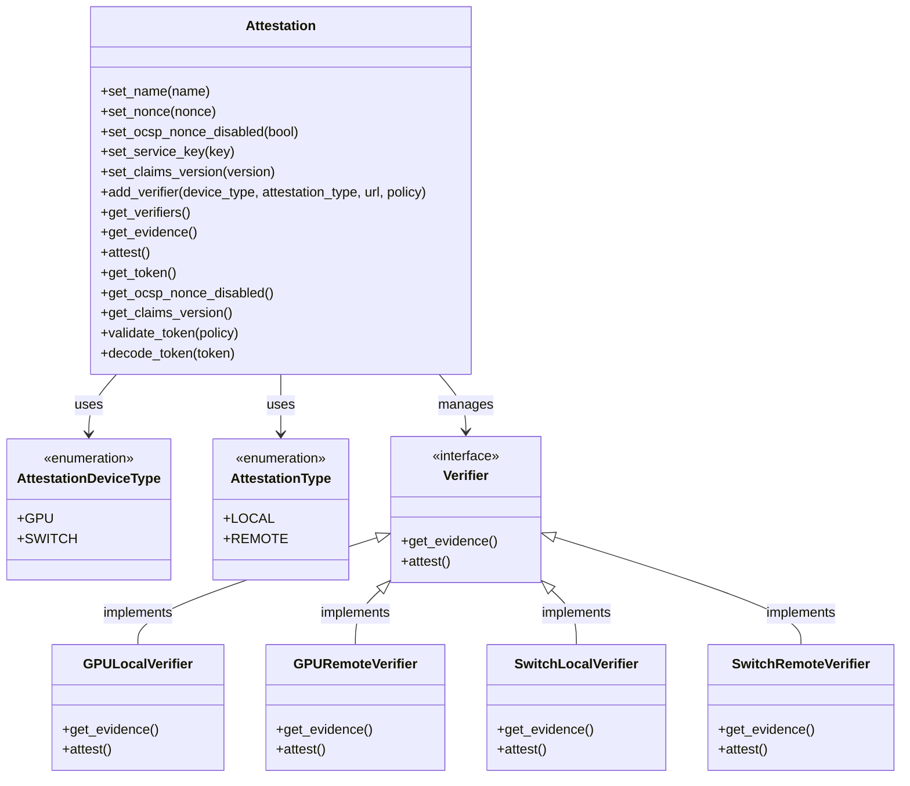
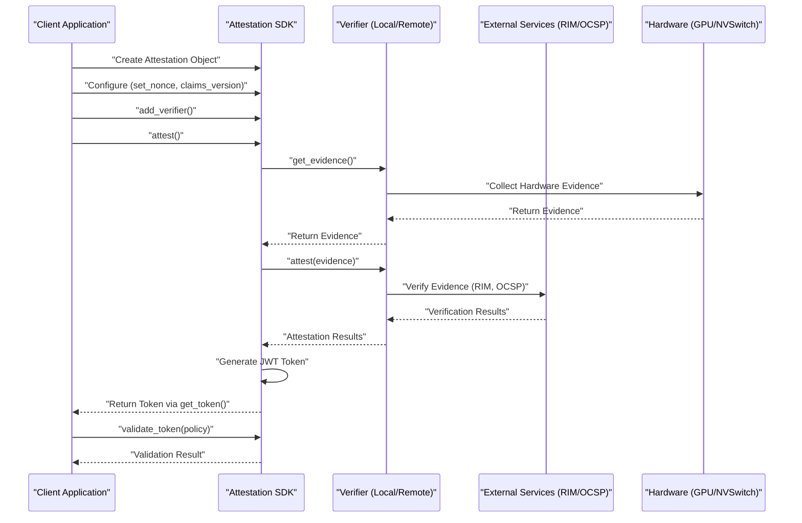
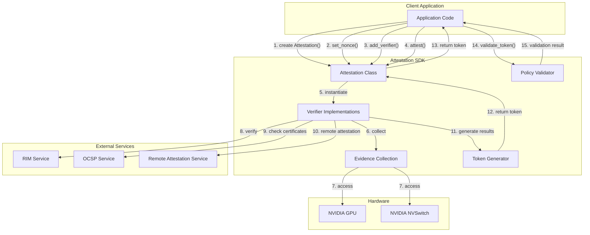

<!-- source: DeepWiki mcp.deepwiki.com · repo NVIDIA/nvtrust · page 2.2 API Reference · fetched 2026-10-26 -->

# API Reference

Relevant source files

The following files were used as context for generating this wiki page:

- [guest_tools/attestation_sdk/README.md](guest_tools/attestation_sdk/README.md)
- [guest_tools/attestation_sdk/src/nv_attestation_sdk/verifiers/nv_switch_verifier/rim/swidSchema2015.xsd](guest_tools/attestation_sdk/src/nv_attestation_sdk/verifiers/nv_switch_verifier/rim/swidSchema2015.xsd)
- [guest_tools/attestation_sdk/src/nv_attestation_sdk/verifiers/nv_switch_verifier/rim/xml.xsd](guest_tools/attestation_sdk/src/nv_attestation_sdk/verifiers/nv_switch_verifier/rim/xml.xsd)
- [guest_tools/attestation_sdk/tests/end_to_end/hardware/test_local_switch.py](guest_tools/attestation_sdk/tests/end_to_end/hardware/test_local_switch.py)
- [guest_tools/attestation_sdk/tests/end_to_end/hardware/test_remote_switch.py](guest_tools/attestation_sdk/tests/end_to_end/hardware/test_remote_switch.py)

This document provides a comprehensive reference for the NVIDIA Attestation SDK API, which enables developers to integrate attestation capabilities for NVIDIA GPUs and NVSwitches into their applications. It covers all public interfaces, methods, configurations, and usage patterns.

For installation instructions, see [Installation and Setup](#2.1).
For detailed configuration parameters, see [Configuration Options](#2.3).

## API Architecture

The following diagram shows the main components of the Attestation SDK API and their relationships:

Sources: [guest_tools/attestation_sdk/README.md:147-167]()

## Core Attestation Class Methods

The `Attestation` class is the main entry point for the SDK. It provides methods for configuring attestation settings, collecting evidence, and verifying attestation results.

| Method | Description |
|--------|-------------|
| `Attestation(name)` | Constructor that creates a new Attestation object with an optional name. |
| `set_name(name)` | Sets a name for the Attestation SDK client. |
| `set_nonce(nonce)` | Sets a nonce for attestation to prevent replay attacks. |
| `set_ocsp_nonce_disabled(bool)` | Flag to control whether to include a nonce when calling OCSP. Only applicable for local GPU attestation. False by default. |
| `set_service_key(key)` | Sets the service key used to authenticate remote service calls to attestation services. |
| `set_claims_version(version)` | Sets the claims version for attestation results. Defaults to 2.0 if not set. |
| `add_verifier(device_type, attestation_type, url, policy)` | Adds a specific type of verifier for the client object. |
| `get_verifiers()` | Retrieves the list of verifiers added to the client object. |
| `get_evidence()` | Retrieves evidence based on the attestation device and type. |
| `attest()` | Triggers the attestation process using the configured verifiers. |
| `get_token()` | Retrieves the attestation token containing claims for the attestation result. |
| `get_ocsp_nonce_disabled()` | Returns whether OCSP nonce is disabled. |
| `get_claims_version()` | Retrieves the claims version used by the client. |
| `validate_token(policy)` | Validates attestation claims against a specified policy. |
| `decode_token(token)` | Decodes a JWT token to extract the claims. |

Sources: [guest_tools/attestation_sdk/README.md:151-167]()

## Attestation Types

The SDK supports different device types and attestation methods:

1. **Device Types**:
   - `GPU` - For NVIDIA GPU attestation
   - `SWITCH` - For NVIDIA NVSwitch attestation

2. **Attestation Methods**:
   - `LOCAL` - Performs attestation locally using the local verifier
   - `REMOTE` - Performs attestation using NVIDIA's Remote Attestation Service (NRAS)

Sources: [guest_tools/attestation_sdk/README.md:27-32]()

## Attestation Flow

The following diagram illustrates the typical attestation process flow:

Sources: [guest_tools/attestation_sdk/README.md:84-111]()

## Configuration Options

The Attestation SDK can be configured using these environment variables:

| Environment Variable | Description | Default Value |
|----------------------|-------------|---------------|
| `NV_RIM_URL` | URL for the RIM (Reference Integrity Measurement) service | https://rim.attestation.nvidia.com/v1/rim/ |
| `NV_OCSP_URL` | URL for the OCSP (Online Certificate Status Protocol) service | https://ocsp.ndis.nvidia.com/ |
| `NV_NRAS_GPU_URL` | URL for the NVIDIA Remote Attestation Service for GPUs | https://nras.attestation.nvidia.com/v3/attest/gpu |
| `NV_NRAS_NVSWITCH_URL` | URL for the Remote Attestation Service for NVSwitches | https://nras.attestation.nvidia.com/v3/attest/switch |
| `NVIDIA_ATTESTATION_SERVICE_KEY` | Service key for authentication with NVIDIA services | None |
| `NV_ALLOW_HOLD_CERT` | Enable attestation if OCSP status of the certificate is 'certificate_hold' | false |

Sources: [guest_tools/attestation_sdk/src/nv_attestation_sdk/utils/config.py:1-29](), [guest_tools/attestation_sdk/README.md:168-172]()

## Sample Implementations

The SDK provides reference implementations for different attestation scenarios:

### GPU Attestation

- Local GPU Attestation: [guest_tools/attestation_sdk/tests/end_to_end/hardware/LocalGPUTest.py]()
- Remote GPU Attestation: [guest_tools/attestation_sdk/tests/end_to_end/hardware/RemoteGPUTest.py]()

Sources: [guest_tools/attestation_sdk/README.md:84-90]()

### NVSwitch Attestation

- Local NVSwitch Attestation: [guest_tools/attestation_sdk/tests/end_to_end/hardware/LocalSwitchTest.py]()
- Remote NVSwitch Attestation: [guest_tools/attestation_sdk/tests/end_to_end/hardware/RemoteSwitchTest.py]()

Sources: [guest_tools/attestation_sdk/README.md:105-111]()

## Claims and Policies

The SDK uses JSON Web Tokens (JWT) to represent attestation results as claims. These claims can be validated against policy files that define acceptable values.

Sample policy files for both local and remote attestation are available at:
[guest_tools/attestation_sdk/tests/policies/]()

For detailed information about claim structures and troubleshooting, see [Troubleshooting](#6).

Sources: [guest_tools/attestation_sdk/README.md:113-120]()

## Compatibility Matrix

This table shows SDK version compatibility with different claims versions:

| SDK version | Claims Version |
|-------------|----------------|
| v1.1.0 - v1.5.0 | N/A |
| v2.0.0 - v2.3.0 | 2.0 |
| v2.4.0 | 2.0, 3.0 |

Sources: [guest_tools/attestation_sdk/README.md:129-143]()

## API Usage in Attestation Flow

The following diagram shows how the API components interact within the complete attestation system:

Sources: [guest_tools/attestation_sdk/README.md:11-26](), [guest_tools/attestation_sdk/README.md:147-167]()

---

