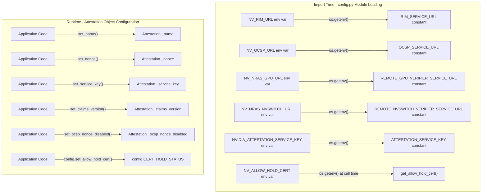
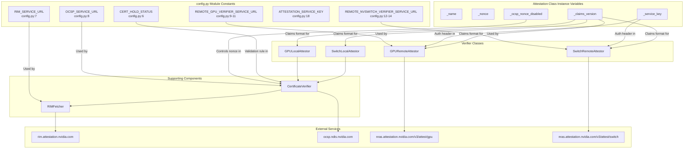
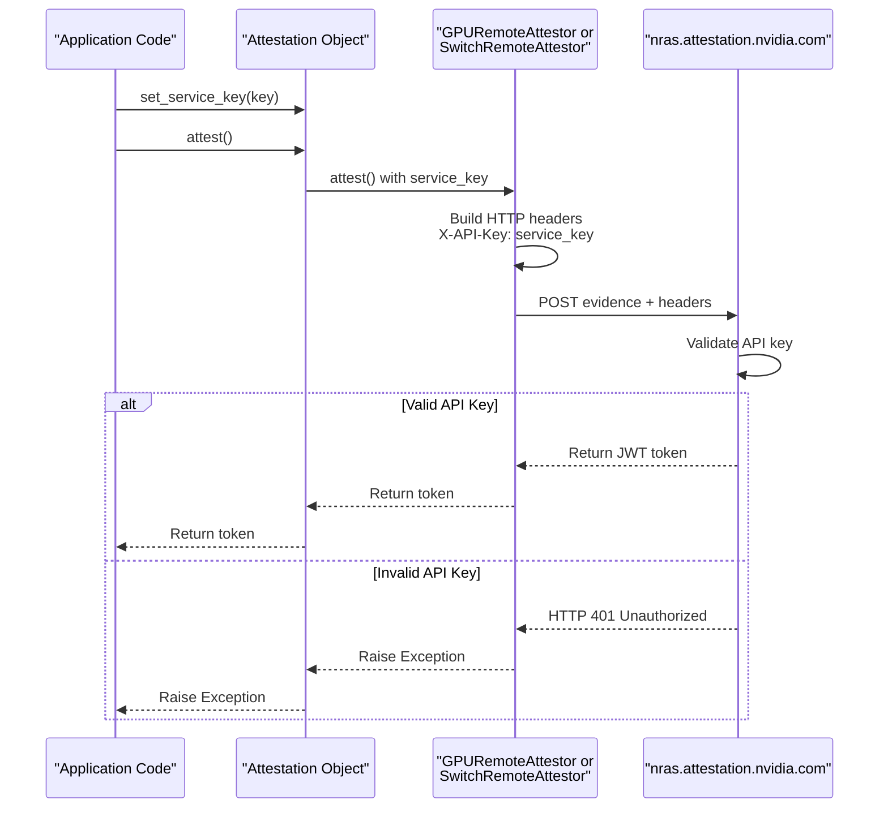
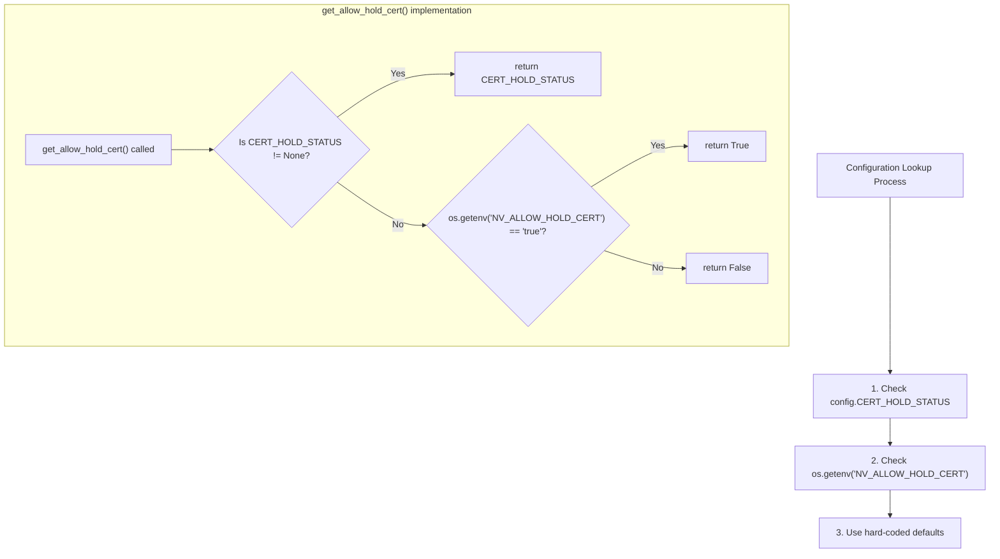

<!-- source: DeepWiki mcp.deepwiki.com · repo NVIDIA/nvtrust · page 2.3 Configuration Options · fetched 2026-10-26 -->

# Configuration Options

<details>
<summary>Relevant source files</summary>

The following files were used as context for generating this wiki page:

- [guest_tools/attestation_sdk/README.md](guest_tools/attestation_sdk/README.md)
- [guest_tools/attestation_sdk/src/nv_attestation_sdk/utils/config.py](guest_tools/attestation_sdk/src/nv_attestation_sdk/utils/config.py)

</details>


This page documents the configuration parameters and environment variables for the NVIDIA Attestation SDK within the nvTrust repository. Understanding these configuration options is essential for customizing the SDK's behavior, service endpoints, and security settings to meet your specific attestation requirements.

For information about using the SDK APIs, please refer to the [API Reference](#2.2).

## Environment Variables

The Attestation SDK uses environment variables as a primary configuration mechanism. These variables control service endpoints, authentication, and security behavior.

### Service URL Configuration

| Environment Variable | Description | Default Value |
|----------------------|-------------|---------------|
| NV_RIM_URL | URL for the Reference Integrity Measurements (RIM) service | https://rim.attestation.nvidia.com/v1/rim/ |
| NV_OCSP_URL | URL for the Online Certificate Status Protocol (OCSP) service | https://ocsp.ndis.nvidia.com/ |
| NV_NRAS_GPU_URL | URL for the NVIDIA Remote Attestation Service (NRAS) for GPU attestation | https://nras.attestation.nvidia.com/v3/attest/gpu |
| NV_NRAS_NVSWITCH_URL | URL for the NVIDIA Remote Attestation Service (NRAS) for NVSwitch attestation | https://nras.attestation.nvidia.com/v3/attest/switch |

Sources: [guest_tools/attestation_sdk/src/nv_attestation_sdk/utils/config.py:7-14]()

### Authentication Configuration

| Environment Variable | Description | Default Value |
|----------------------|-------------|---------------|
| NVIDIA_ATTESTATION_SERVICE_KEY | API key for accessing NVIDIA attestation services | None |

Sources: [guest_tools/attestation_sdk/src/nv_attestation_sdk/utils/config.py:18]()

### Security Configuration

| Environment Variable | Description | Default Value |
|----------------------|-------------|---------------|
| NV_ALLOW_HOLD_CERT | Whether to allow certificates with HOLD status | false |

Sources: [guest_tools/attestation_sdk/src/nv_attestation_sdk/utils/config.py:25-29]()

## Configuration Methods

The SDK provides two distinct methods for configuration: environment variables (read at module import time) and programmatic configuration (set at runtime via SDK API methods).

### Configuration Flow Diagram



Sources: 
- [guest_tools/attestation_sdk/src/nv_attestation_sdk/utils/config.py:4-29]()
- [guest_tools/attestation_sdk/README.md:161-173]()

### Programmatic Configuration via Attestation Class

The `Attestation` class provides methods to configure attestation parameters at runtime:

| Method | Parameter Type | Description | Default Value |
|--------|----------------|-------------|---------------|
| `set_name(name)` | str | Sets a name identifier for the Attestation SDK client | None |
| `set_nonce(nonce)` | bytes/str | Sets a nonce value for attestation requests | None |
| `set_ocsp_nonce_disabled(bool)` | bool | Flag to disable OCSP nonce in certificate validation (local GPU only) | False |
| `set_service_key(key)` | str | Sets the API key for remote attestation service authentication | None |
| `set_claims_version(version)` | str | Sets the claims version for attestation result format | "2.0" |
| `get_ocsp_nonce_disabled()` | - | Retrieves the current OCSP nonce disabled flag | - |
| `get_claims_version()` | - | Retrieves the current claims version | - |

Sources: [guest_tools/attestation_sdk/README.md:161-173]()

### Configuration via config Module Functions

The `nv_attestation_sdk.utils.config` module provides functions for global certificate validation behavior:

| Function | Description |
|----------|-------------|
| `set_allow_hold_cert(value)` | Sets whether to allow certificates with HOLD status during validation |
| `get_allow_hold_cert()` | Returns True if certificates with HOLD status are allowed, False otherwise |

Sources: [guest_tools/attestation_sdk/src/nv_attestation_sdk/utils/config.py:20-29]()

## Claims Version Configuration

The Attestation SDK supports multiple claims versions for attestation results. The claims version determines the structure and content of the JWT token returned by attestation.

### Claims Version Compatibility Matrix

The following table shows which claims versions are supported by each SDK version:

| SDK Version | Supported Claims Versions | Notes |
|-------------|--------------------------|-------|
| v1.1.0 - v1.5.0 | N/A | Claims versioning not supported |
| v2.0.0 - v2.3.0 | 2.0 | Claims v2.0 only |
| v2.4.0 - v2.6.2 | 2.0, 3.0 | Both versions supported |

**Default Claims Version:** If not explicitly set, the SDK defaults to claims version `2.0`.

Sources: [guest_tools/attestation_sdk/README.md:132-151]()

### Setting Claims Version

**Programmatically:**
```python
from nv_attestation_sdk import attestation

attest = attestation.Attestation()
attest.set_claims_version("3.0")  # Set to claims v3.0
```

**Retrieving Claims Version:**
```python
current_version = attest.get_claims_version()
print(f"Using claims version: {current_version}")
```

Sources: [guest_tools/attestation_sdk/README.md:165-172]()

## Configuration Mapping to SDK Components

The following diagram illustrates how configuration options flow from environment variables and API methods to SDK components and external services:

### Configuration to Component Mapping



Sources: 
- [guest_tools/attestation_sdk/src/nv_attestation_sdk/utils/config.py:6-18]()
- [guest_tools/attestation_sdk/README.md:161-173]()

### Service Key Authentication Flow

The `ATTESTATION_SERVICE_KEY` is used to authenticate requests to NRAS remote attestation services:



Sources: 
- [guest_tools/attestation_sdk/README.md:164]()
- [guest_tools/attestation_sdk/src/nv_attestation_sdk/utils/config.py:18]()

## Configuration Precedence

When configuring the Attestation SDK, there is a specific lookup priority for configuration values:



Sources: [guest_tools/attestation_sdk/src/nv_attestation_sdk/utils/config.py:24-29]()

## OCSP Configuration

Online Certificate Status Protocol (OCSP) is used to validate certificate revocation status. The SDK provides configuration options for OCSP behavior.

### OCSP Nonce Configuration

The OCSP nonce is a random value included in OCSP requests to prevent replay attacks. By default, the SDK includes a nonce in OCSP requests during local GPU attestation.

| Method | Description | Default |
|--------|-------------|---------|
| `set_ocsp_nonce_disabled(bool)` | Disable/enable OCSP nonce in certificate validation | False (nonce enabled) |
| `get_ocsp_nonce_disabled()` | Get current OCSP nonce setting | - |

**Note:** OCSP nonce configuration only applies to local GPU attestation. Remote attestation handles OCSP validation on the server side.

Sources: [guest_tools/attestation_sdk/README.md:163-171]()

### Certificate HOLD Status Handling

Certificates may have a revocation status of `certificate_hold`, indicating temporary suspension. The SDK can be configured to allow or reject certificates with this status.

**Environment Variable:**
```bash
export NV_ALLOW_HOLD_CERT="true"  # Allow certificates with HOLD status
```

**Programmatic Configuration:**
```python
from nv_attestation_sdk.utils.config import set_allow_hold_cert, get_allow_hold_cert

# Allow certificates with HOLD status
set_allow_hold_cert(True)

# Check current setting
allow_hold = get_allow_hold_cert()
```

**Configuration Precedence:**
1. If `set_allow_hold_cert()` has been called, use that value
2. Otherwise, check `NV_ALLOW_HOLD_CERT` environment variable
3. Default to `False` (reject certificates with HOLD status)

Sources: 
- [guest_tools/attestation_sdk/README.md:177-179]()
- [guest_tools/attestation_sdk/src/nv_attestation_sdk/utils/config.py:24-29]()

## Configuration Examples

### Complete Configuration Example

This example demonstrates all available configuration options:

```python
from nv_attestation_sdk import attestation
from nv_attestation_sdk.utils.config import set_allow_hold_cert

# Create attestation object
attest = attestation.Attestation(name="MyApplication")

# Alternative: Set name after creation
attest.set_name("MyApplication")

# Set nonce for attestation request
nonce = b"random_nonce_value_12345"
attest.set_nonce(nonce)

# Configure claims version (2.0 or 3.0)
attest.set_claims_version("3.0")

# For remote attestation: set service key
attest.set_service_key("your-api-key-from-nvidia")

# Disable OCSP nonce (local GPU attestation only)
attest.set_ocsp_nonce_disabled(False)  # Default is False (nonce enabled)

# Allow certificates with HOLD status
set_allow_hold_cert(True)

# Add verifier and perform attestation
# (see API Reference page 2.2 for add_verifier details)
```

Sources: [guest_tools/attestation_sdk/README.md:156-174]()

### Environment Variable Configuration

Set environment variables before running the application:

**Linux/macOS:**
```bash
# Service endpoint configuration
export NV_RIM_URL="https://custom-rim-service.example.com/v1/rim/"
export NV_OCSP_URL="https://custom-ocsp-service.example.com/"
export NV_NRAS_GPU_URL="https://custom-nras.example.com/v3/attest/gpu"
export NV_NRAS_NVSWITCH_URL="https://custom-nras.example.com/v3/attest/switch"

# Authentication
export NVIDIA_ATTESTATION_SERVICE_KEY="your-api-key"

# Security configuration
export NV_ALLOW_HOLD_CERT="true"

# Run your application
python3 my_attestation_app.py
```

**Windows:**
```cmd
set NV_RIM_URL=https://custom-rim-service.example.com/v1/rim/
set NV_OCSP_URL=https://custom-ocsp-service.example.com/
set NV_NRAS_GPU_URL=https://custom-nras.example.com/v3/attest/gpu
set NV_NRAS_NVSWITCH_URL=https://custom-nras.example.com/v3/attest/switch
set NVIDIA_ATTESTATION_SERVICE_KEY=your-api-key
set NV_ALLOW_HOLD_CERT=true

python my_attestation_app.py
```

Sources: [guest_tools/attestation_sdk/src/nv_attestation_sdk/utils/config.py:7-18]()

### Local vs Remote Attestation Configuration

**Local GPU Attestation (No Service Key Required):**
```python
from nv_attestation_sdk import attestation

attest = attestation.Attestation()
attest.set_claims_version("3.0")
attest.set_nonce(b"my_nonce")

# Add local GPU verifier
attest.add_verifier(
    attestation.Devices.GPU,
    attestation.Environment.LOCAL,
    "",  # No remote URL needed
    "policy.json"
)

# Perform attestation
attest.attest()
token = attest.get_token()
```

**Remote GPU Attestation (Service Key Required):**
```python
from nv_attestation_sdk import attestation

attest = attestation.Attestation()
attest.set_claims_version("3.0")
attest.set_nonce(b"my_nonce")
attest.set_service_key("your-nvidia-api-key")  # Required for remote

# Add remote GPU verifier
attest.add_verifier(
    attestation.Devices.GPU,
    attestation.Environment.REMOTE,
    "",  # Uses default NRAS URL from config
    "policy.json"
)

# Perform attestation
attest.attest()
token = attest.get_token()
```

Sources: 
- [guest_tools/attestation_sdk/README.md:84-90]()
- [guest_tools/attestation_sdk/README.md:164]()

## Dependencies

The Attestation SDK requires several Python packages to function correctly. These dependencies are defined in the project configuration:

| Dependency | Version | Purpose |
|------------|---------|---------|
| pyjwt / PyJWT | ~2.7.0 | JSON Web Token operations |
| requests | ~2.32.3 | HTTP requests to attestation services |
| cryptography | 43.0.1 | Cryptographic operations |
| ecdsa | 0.18.0 | ECDSA signature verification |
| signxml | 3.2.0 | XML signature handling |
| xmlschema | 2.2.3 | XML schema validation |
| pyOpenSSL | 24.2.1 | SSL/TLS functionality |
| nvidia-ml-py | >=12.535.77 | NVIDIA Management Library integration |
| nv-local-gpu-verifier | 2.4.0 | Local GPU verification |

Sources: [guest_tools/attestation_sdk/pyproject.toml:14-31]()

---

