<!-- source: DeepWiki mcp.deepwiki.com · repo NVIDIA/nvtrust · page 2.4 Attestation Workflow · fetched 2026-10-26 -->

# Attestation Workflow

<details>
<summary>Relevant source files</summary>

The following files were used as context for generating this wiki page:

- [guest_tools/attestation_sdk/README.md](guest_tools/attestation_sdk/README.md)
- [guest_tools/attestation_sdk/src/nv_attestation_sdk/gpu/attest_gpu_local.py](guest_tools/attestation_sdk/src/nv_attestation_sdk/gpu/attest_gpu_local.py)
- [guest_tools/attestation_sdk/src/nv_attestation_sdk/nvswitch/attest_nvswitch_local.py](guest_tools/attestation_sdk/src/nv_attestation_sdk/nvswitch/attest_nvswitch_local.py)
- [guest_tools/attestation_troubleshooting_guide.md](guest_tools/attestation_troubleshooting_guide.md)

</details>


## Purpose and Scope

This page describes the end-to-end attestation workflow implemented by the Attestation SDK, including evidence collection from hardware, attestation execution (local or remote), JWT token generation with claims, and policy validation. This workflow applies to both GPU and NVSwitch attestation.

For details about the SDK's API methods, see [API Reference](#2.2). For configuration options, see [Configuration Options](#2.3). For GPU-specific attestation details, see [GPU Attestation](#3). For NVSwitch-specific details, see [NVSwitch Attestation](#4). For the PPCIE multi-GPU orchestration workflow, see [PPCIE Verification](#5).

## Workflow Overview

The attestation workflow consists of four main phases that transform hardware measurements into validated security claims:

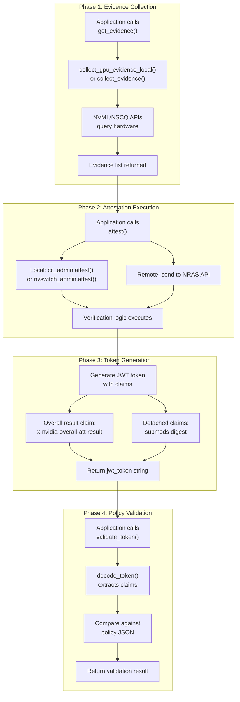

**Sources:** [guest_tools/attestation_sdk/README.md:82-108](), [guest_tools/attestation_sdk/src/nv_attestation_sdk/gpu/attest_gpu_local.py:17-79](), [guest_tools/attestation_sdk/src/nv_attestation_sdk/nvswitch/attest_nvswitch_local.py:17-80]()

## Phase 1: Evidence Collection

Evidence collection retrieves attestation-relevant data from hardware devices (GPUs or NVSwitches) including attestation reports, certificate chains, and device information.

### Evidence Collection Methods

| Device Type | Method | Implementation | Hardware Interface |
|-------------|--------|----------------|-------------------|
| GPU | `get_evidence()` | `attest_gpu_local.get_evidence()` | NVML via `nvidia-ml-py` |
| NVSwitch | `get_evidence()` | `attest_nvswitch_local.get_evidence()` | NSCQ via `libnvidia-nscq` |

### GPU Evidence Collection Flow

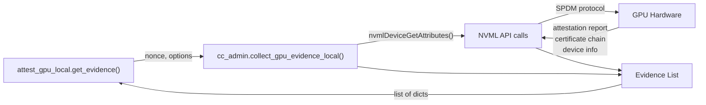

The `get_evidence()` function accepts a nonce and options dictionary, then calls `cc_admin.collect_gpu_evidence_local()` which queries the GPU via NVML to retrieve:
- Attestation report (SPDM GET_MEASUREMENTS response)
- Certificate chain (5 certificates for device authentication)
- Driver and vBIOS version information
- GPU architecture and UUID

**Sources:** [guest_tools/attestation_sdk/src/nv_attestation_sdk/gpu/attest_gpu_local.py:17-34]()

### NVSwitch Evidence Collection Flow

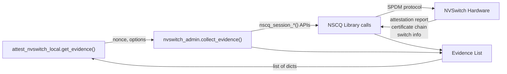

For switches, the process is similar but uses the NSCQ library instead of NVML. The `nvswitch_admin.collect_evidence()` function retrieves:
- Switch attestation report
- Switch certificate chain
- BIOS version information
- Switch architecture and physical ID

**Sources:** [guest_tools/attestation_sdk/src/nv_attestation_sdk/nvswitch/attest_nvswitch_local.py:17-36]()

## Phase 2: Attestation Execution

Attestation execution takes the collected evidence and performs cryptographic verification to determine if the device is in a trusted state. This can be done locally or remotely.

### Local vs Remote Attestation Modes

| Aspect | Local Attestation | Remote Attestation |
|--------|------------------|-------------------|
| Verification Location | Client machine | NRAS cloud service |
| Implementation | `cc_admin.attest()` / `nvswitch_admin.attest()` | HTTP POST to NRAS API |
| RIM Fetching | Client fetches from RIM service | NRAS fetches RIMs |
| OCSP Validation | Client performs OCSP queries | NRAS performs OCSP queries |
| Latency | Lower | Higher (network round-trip) |
| Air-gapped Support | Yes (with Trust Outpost) | No (requires internet) |

### Local Attestation Execution

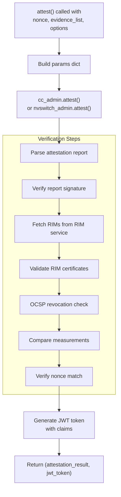

The `attest()` function constructs a parameters dictionary containing:

| Parameter | Source | Purpose |
|-----------|--------|---------|
| `nonce` | Input argument | Anti-replay protection |
| `rim_service_url` | Config or default `RIM_SERVICE_URL` | Where to fetch golden measurements |
| `ocsp_url` | Config or default `OCSP_SERVICE_URL` | Certificate revocation checking |
| `allow_hold_cert` | Environment `NV_ALLOW_HOLD_CERT` | Allow certificate_hold status |
| `ocsp_nonce_disabled` | Options or False | Skip nonce in OCSP requests |
| `claims_version` | Options or "2.0" | Claims schema version (2.0 or 3.0) |
| `service_key` | Options or config | Authentication for external services |

**Sources:** [guest_tools/attestation_sdk/src/nv_attestation_sdk/gpu/attest_gpu_local.py:37-73](), [guest_tools/attestation_sdk/src/nv_attestation_sdk/nvswitch/attest_nvswitch_local.py:39-74]()

### Error Handling in Attestation

If attestation fails due to exceptions, an error JWT token is generated:

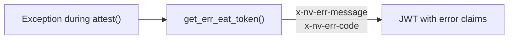

The error token contains:
- `x-nv-err-message`: Error description (e.g., "GPU_ATTESTATION_ERR", "NVSWITCH_ATTESTATION_ERR")
- `x-nv-err-code`: Numeric error code (default: 1)

These error tokens are encoded with a placeholder secret "secret" using HS256 algorithm.

**Sources:** [guest_tools/attestation_sdk/src/nv_attestation_sdk/gpu/attest_gpu_local.py:76-78](), [guest_tools/attestation_sdk/src/nv_attestation_sdk/nvswitch/attest_nvswitch_local.py:77-79]()

## Phase 3: Token Generation

Upon successful attestation, a JWT (JSON Web Token) is generated containing claims that represent the attestation results. The token structure follows the Entity Attestation Token (EAT) specification.

### JWT Token Structure

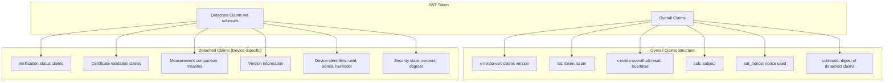

### Claims Version Support

The SDK supports two claims versions with different structures:

| Claims Version | SDK Versions | Key Differences |
|----------------|--------------|-----------------|
| 2.0 | v2.0.0 - v2.6.2 | Simplified certificate validation claims |
| 3.0 | v2.4.0+ | Detailed per-certificate expiration, status, OCSP status, revocation reasons |

### GPU Claims (Version 3.0)

Key GPU-specific claims include:

| Claim | Type | Purpose |
|-------|------|---------|
| `x-nvidia-overall-att-result` | boolean | Overall pass/fail result |
| `measres` | "success"/"fail" | Runtime vs golden measurements match |
| `x-nvidia-gpu-driver-version` | string | Verified driver version |
| `x-nvidia-gpu-vbios-version` | string | Verified vBIOS version |
| `x-nvidia-gpu-attestation-report-signature-verified` | boolean | Report signature valid |
| `x-nvidia-gpu-attestation-report-nonce-match` | boolean | Nonce anti-replay check |
| `x-nvidia-gpu-driver-rim-fetched` | boolean | Driver RIM retrieved |
| `x-nvidia-gpu-vbios-rim-fetched` | boolean | vBIOS RIM retrieved |
| `x-nvidia-gpu-arch-check` | boolean | Architecture supported |
| `secboot` | boolean | Secure boot enabled |
| `dbgstat` | "enabled"/"disabled" | Debug facilities state |

**Sources:** [guest_tools/attestation_troubleshooting_guide.md:28-75]()

### NVSwitch Claims (Version 3.0)

Switch attestation generates similar but switch-specific claims:

| Claim | Type | Purpose |
|-------|------|---------|
| `x-nvidia-overall-att-result` | boolean | Overall pass/fail result |
| `measres` | "success"/"fail" | Runtime vs golden measurements match |
| `x-nvidia-switch-bios-version` | string | Verified BIOS version |
| `x-nvidia-switch-attestation-report-signature-verified` | boolean | Report signature valid |
| `x-nvidia-switch-attestation-report-nonce-match` | boolean | Nonce anti-replay check |
| `x-nvidia-switch-bios-rim-fetched` | boolean | BIOS RIM retrieved |
| `x-nvidia-switch-arch-check` | string | Switch architecture (e.g., "LS10") |

**Sources:** [guest_tools/attestation_troubleshooting_guide.md:127-163]()

### Certificate Chain Claims (Version 3.0)

Version 3.0 introduces nested certificate chain claims for detailed validation status:

```
x-nvidia-gpu-attestation-report-cert-chain {
    "x-nvidia-cert-expiration-date": "2025-12-31T23:59:59Z",
    "x-nvidia-cert-status": "valid",
    "x-nvidia-cert-ocsp-status": "good",
    "x-nvidia-cert-revocation-reason": ""
}
```

The `x-nvidia-cert-status` field has values:
- `"valid"`: Certificate is valid, not expired, not revoked
- `"expired"`: Certificate has expired
- `"invalid"`: Certificate is not valid or unknown
- `"revoked"`: Certificate has been revoked

**Sources:** [guest_tools/attestation_troubleshooting_guide.md:46-47]()

## Phase 4: Policy Validation

After receiving a JWT token, applications validate it against a policy file to ensure the attestation results meet security requirements.

### Policy Validation Flow

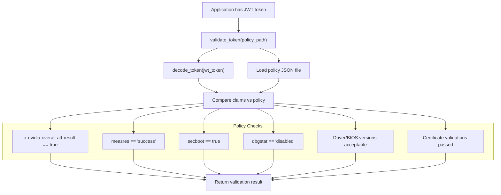

### Policy File Structure

Policy files are JSON documents that specify required claim values. A typical policy structure:

```json
{
  "x-nvidia-overall-att-result": true,
  "measres": "success",
  "secboot": true,
  "dbgstat": "disabled",
  "x-nvidia-gpu-arch-check": true
}
```

The SDK compares the actual claims in the JWT token against the expected values in the policy. All policy requirements must be satisfied for validation to pass.

**Sources:** [guest_tools/attestation_sdk/README.md:113-116]()

## Complete Workflow Integration

### Local GPU Attestation Example

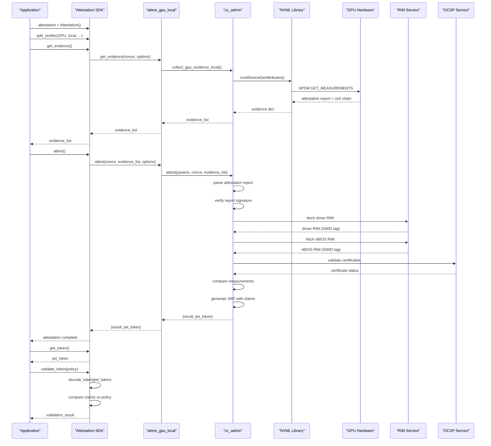

**Sources:** [guest_tools/attestation_sdk/README.md:84-86]()

### Remote GPU Attestation Example

For remote attestation, the workflow differs primarily in Phase 2 where evidence is sent to NRAS:

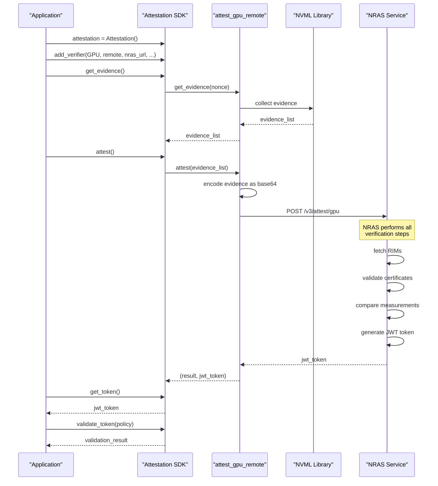

In remote mode:
- Evidence collection still happens locally via NVML
- Evidence is base64-encoded and sent to NRAS
- NRAS performs all verification steps (RIM fetching, certificate validation, measurement comparison)
- NRAS returns a signed JWT token
- Policy validation still happens client-side

**Sources:** [guest_tools/attestation_sdk/README.md:88-90]()

### NVSwitch Attestation Workflow

Switch attestation follows the same four-phase workflow but uses switch-specific evidence collection and verification:

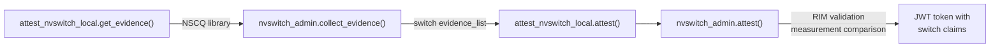

Key differences for switches:
- Uses NSCQ library instead of NVML
- Collects switch attestation reports and BIOS information
- Validates against switch BIOS RIMs (not driver/vBIOS RIMs)
- Generates switch-specific claims (`x-nvidia-switch-*`)

**Sources:** [guest_tools/attestation_sdk/README.md:105-107](), [guest_tools/attestation_sdk/src/nv_attestation_sdk/nvswitch/attest_nvswitch_local.py:1-80]()

## Workflow State Transitions

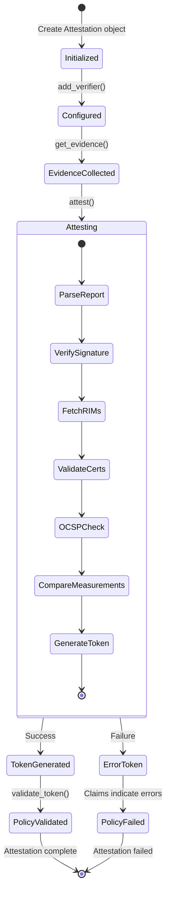

Each state transition represents a method call or internal processing step:

| State | Trigger | SDK Method | Next State |
|-------|---------|------------|------------|
| Initialized | Constructor | `Attestation(name)` | Configured |
| Configured | Add verifier | `add_verifier()` | EvidenceCollected |
| EvidenceCollected | Collect evidence | `get_evidence()` | Attesting |
| Attesting | Perform attestation | `attest()` | TokenGenerated or ErrorToken |
| TokenGenerated | Retrieve token | `get_token()` | PolicyValidated |
| PolicyValidated | Validate policy | `validate_token()` | Complete or Failed |

**Sources:** [guest_tools/attestation_sdk/README.md:154-174]()

## Configuration Parameters

The attestation workflow can be configured through environment variables and API options:

### Environment Variables

| Variable | Purpose | Default |
|----------|---------|---------|
| `NV_ALLOW_HOLD_CERT` | Allow certificate_hold status | `false` |

### Attestation Options Dictionary

The `options` or `attestation_options` dictionary passed to various methods supports:

| Key | Type | Purpose | Default |
|-----|------|---------|---------|
| `ppcie_mode` | boolean | PPCIE multi-GPU mode | `True` |
| `no_gpu_mode` | boolean | Test mode without GPU hardware | `False` |
| `rim_service_url` | string | RIM service endpoint | `RIM_SERVICE_URL` constant |
| `ocsp_url` | string | OCSP service endpoint | `OCSP_SERVICE_URL` constant |
| `ocsp_nonce_disabled` | boolean | Disable nonce in OCSP requests | `False` |
| `service_key` | string | Authentication key for services | `None` |
| `claims_version` | string | Claims schema version ("2.0" or "3.0") | `"2.0"` |

These options control the behavior of both evidence collection and attestation execution phases.

**Sources:** [guest_tools/attestation_sdk/README.md:175-179](), [guest_tools/attestation_sdk/src/nv_attestation_sdk/gpu/attest_gpu_local.py:51-66](), [guest_tools/attestation_sdk/src/nv_attestation_sdk/nvswitch/attest_nvswitch_local.py:53-67]()

---

