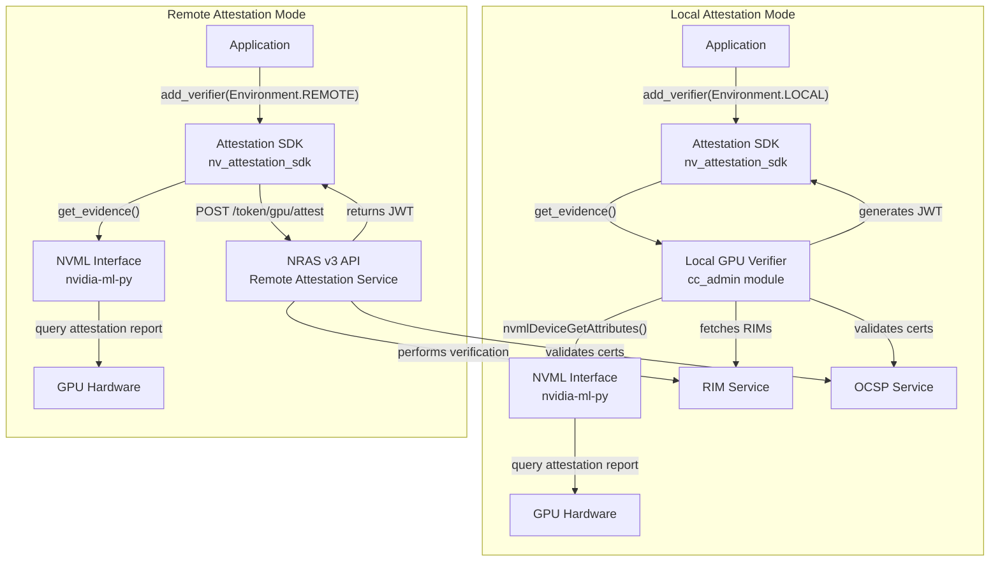
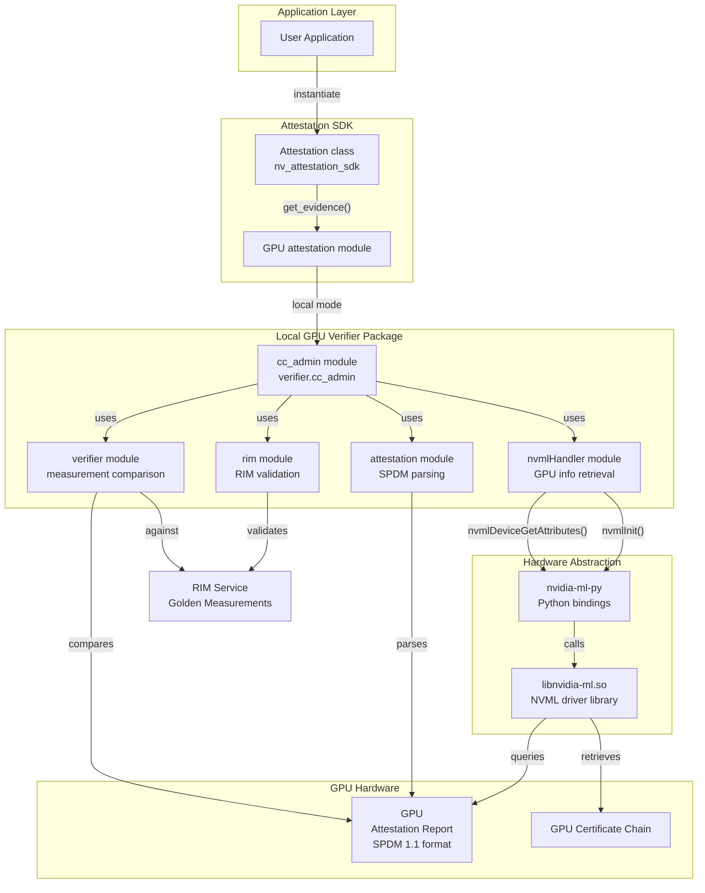
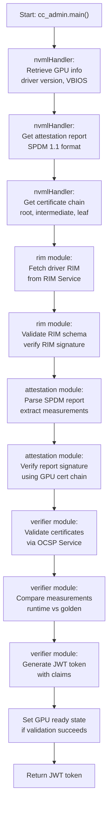

<!-- source: DeepWiki mcp.deepwiki.com · repo NVIDIA/nvtrust · page 3 GPU Attestation · fetched 2026-10-26 -->

# GPU Attestation

<details>
<summary>Relevant source files</summary>

The following files were used as context for generating this wiki page:

- [README.md](README.md)
- [guest_tools/README.md](guest_tools/README.md)
- [guest_tools/gpu_verifiers/local_gpu_verifier/README.md](guest_tools/gpu_verifiers/local_gpu_verifier/README.md)
- [guest_tools/ppcie-verifier/README.md](guest_tools/ppcie-verifier/README.md)

</details>


## Purpose and Scope

This page provides an overview of GPU attestation capabilities in the nvTrust repository. GPU attestation validates that NVIDIA GPU hardware and software configurations match their intended secure state by comparing runtime measurements against cryptographically signed golden measurements. This page covers supported GPU architectures, the two attestation modes (local and remote), evidence collection mechanisms, and the validation workflow.

For implementation details of the Local GPU Verifier tool, see [Local GPU Verifier](#3.1). For Remote GPU Attestation via NRAS, see [Remote GPU Attestation](#3.2). For multi-GPU systems with NVSwitch interconnects, see [PPCIE Verification](#5).

**Sources:** [README.md:3-21](), [guest_tools/README.md:1-45](), [guest_tools/gpu_verifiers/local_gpu_verifier/README.md:1-26]()

## Supported Hardware Architectures

GPU attestation is available for NVIDIA GPUs with Confidential Computing capabilities:

| Architecture | Example GPUs | Minimum Driver | Notes |
|--------------|-------------|----------------|-------|
| Hopper | H100 | R535+ | First generation with CC support |
| Blackwell | B100, B200 | R575+ | Requires attestation-specific CC-enabled drivers |

**System Requirements:**
- GPU SKU must include Confidential Compute (CC) mode capability
- NVIDIA GPU driver installed with appropriate version
- Python 3.8 or later for verifier tools

The GPU must be configured in Confidential Computing mode to generate attestation evidence. For multi-GPU systems, two configurations are supported:
1. All GPUs in CC mode (each assignable to separate Confidential VMs) - use standard GPU attestation
2. All GPUs in PPCIE mode (all assigned to one Confidential VM) - use PPCIE Verifier

**Sources:** [guest_tools/gpu_verifiers/local_gpu_verifier/README.md:28-32](), [guest_tools/ppcie-verifier/README.md:17-25]()

## Attestation Modes Overview

GPU attestation supports two verification modes that differ in where cryptographic validation occurs:



**Sources:** [guest_tools/README.md:62-101]()

### Local Attestation Mode

In local mode, the `cc_admin` module performs all verification steps on the host system:

1. Collects attestation evidence from GPU via NVML
2. Fetches Reference Integrity Manifests (RIMs) from RIM Service
3. Validates certificate chains via OCSP Service
4. Parses SPDM 1.1 attestation reports
5. Compares runtime measurements against golden measurements
6. Generates JWT token with attestation claims

The local verifier requires network access to RIM and OCSP services but performs cryptographic validation locally. This mode provides lower latency and can work in air-gapped environments when paired with Trust Outpost.

**Sources:** [guest_tools/gpu_verifiers/local_gpu_verifier/README.md:132-146](), [guest_tools/README.md:84-101]()

### Remote Attestation Mode

In remote mode, evidence collection occurs locally but verification is delegated to NRAS:

1. Collects attestation evidence from GPU via NVML
2. Encodes evidence as base64
3. Sends evidence to NRAS with service authentication key
4. NRAS performs verification (fetches RIMs, validates certificates, compares measurements)
5. NRAS returns JWT token with attestation claims

Remote mode centralizes verification logic, reducing client-side complexity. It requires network access to NRAS and valid service authentication credentials.

**Sources:** [guest_tools/README.md:62-81]()

### Mode Comparison

| Feature | Local Mode | Remote Mode |
|---------|------------|-------------|
| Verification Location | Host system | NRAS cloud service |
| Cryptographic Validation | Local | Remote |
| RIM/OCSP Access | Direct HTTP calls | Via NRAS |
| Latency | Lower | Higher (network round-trip) |
| Air-gap Support | Yes (with Trust Outpost) | No |
| Service Authentication | Not required | Service key required |
| Code Module | `verifier.cc_admin` | NRAS v3 API |

**Sources:** [guest_tools/README.md:109-117]()

## Evidence Collection Architecture

The following diagram shows the module hierarchy for GPU attestation evidence collection:



**Sources:** [guest_tools/gpu_verifiers/local_gpu_verifier/README.md:132-146]()

## Evidence Collection Process

The `nvmlHandler` module interfaces with NVML to collect GPU evidence:

**Key Information Retrieved:**
- GPU device handle via `nvmlDeviceGetHandleByIndex()`
- Driver version and VBIOS version
- GPU attestation report (SPDM 1.1 format)
- GPU certificate chain (root, intermediate, leaf certificates)
- Device attributes (UUID, architecture, SKU)

The attestation report contains cryptographically signed runtime measurements of GPU firmware components including:
- VBIOS (Video BIOS)
- Driver components
- GPU firmware modules

Each measurement is generated by the GPU hardware's secure boot process and signed with the GPU's private key stored in secure hardware storage.

**Sources:** [guest_tools/gpu_verifiers/local_gpu_verifier/README.md:139-140]()

## Measurement Validation Flow

The local GPU verifier implements a multi-stage validation process:



**Validation Steps:**

1. **RIM Authentication** - The `rim` module validates the Reference Integrity Manifest against the TCG RIM specification, performs XML schema validation, and verifies digital signatures using NVIDIA root certificates.

2. **Attestation Report Parsing** - The `attestation` module parses the SPDM 1.1 MEASUREMENT response message, extracting individual measurements for each GPU firmware component.

3. **Signature Verification** - The `attestation` module verifies the attestation report signature using the GPU's certificate chain, validating the cryptographic chain of trust from GPU hardware to NVIDIA root certificates.

4. **Certificate Validation** - The `verifier` module checks certificate revocation status via OCSP, ensuring no certificates in the chain have been revoked or are on hold (unless `--allow_hold_cert` is specified).

5. **Measurement Comparison** - The `verifier` module performs runtime comparison of measurements in the attestation report against golden measurements stored in the RIM, verifying each firmware component hash matches expected values.

6. **GPU Ready State** - If validation succeeds, the verifier sets the GPU ready state (requires root privileges), which acts as a hardware-level gate controlling whether the GPU accepts confidential workloads.

**Sources:** [guest_tools/gpu_verifiers/local_gpu_verifier/README.md:132-146]()

## JWT Token and Claims Structure

Both local and remote attestation produce a JWT (JSON Web Token) containing attestation claims. The token structure includes:

**Token Components:**
- **Header** - Algorithm and token type
- **Payload** - Attestation claims (measurements, validation results, timestamps)
- **Signature** - Cryptographic signature ensuring token integrity

**Claims Categories:**
- GPU hardware information (architecture, UUID, VBIOS version)
- Driver version and measurements
- Validation results for each firmware component
- Certificate validation status
- Attestation timestamp and nonce
- Overall attestation status

The JWT token can be validated against policy files that specify expected claim values. Policy validation is performed by the Attestation SDK's policy engine.

For detailed claims structure and troubleshooting, see the attestation troubleshooting guide referenced in the verifier documentation.

**Sources:** [guest_tools/gpu_verifiers/local_gpu_verifier/README.md:152-153]()

## Command-Line Interface

The Local GPU Verifier provides a command-line interface via the `cc_admin` module:

```bash
python3 -m verifier.cc_admin [OPTIONS]
```

**Key Options:**

| Option | Description | Default |
|--------|-------------|---------|
| `--driver_rim DRIVER_RIM` | Path to driver RIM file | `/usr/share/nvidia/rim/RIM_GH100PROD.swidtag` |
| `--vbios_rim VBIOS_RIM` | Path to VBIOS RIM file | Auto-detected from samples directory |
| `--user_mode` | Run without setting GPU ready state | Disabled (root mode) |
| `--nonce` | Specify nonce for attestation report | None |
| `--allow_hold_cert` | Continue if OCSP status is certificate_hold | Disabled |
| `--rim_service_url` | RIM Service URL | `https://rim.nvidia.com/rims/` |
| `--ocsp_url` | OCSP Service URL | `https://ocsp.ndis.nvidia.com/` |
| `--claims_version` | Claims format version (2.0 or 3.0) | 2.0 |

**User Mode vs Root Mode:**
- **Root mode** (default): Sets GPU ready state upon successful attestation, requiring `sudo` privileges
- **User mode** (`--user_mode`): Performs attestation without setting GPU ready state, suitable for validation without hardware enforcement

**Sources:** [guest_tools/gpu_verifiers/local_gpu_verifier/README.md:102-121]()

## Integration with Attestation SDK

GPU attestation integrates with the Attestation SDK through the `Attestation` class:

**Local Mode Example:**
```python
from nv_attestation_sdk import attestation

client = attestation.Attestation()
client.add_verifier(
    attestation.Devices.GPU,
    attestation.Environment.LOCAL,
    "",  # NRAS URL not needed
    "",  # Service key not needed
    ocsp_url,
    rim_url
)
evidence_list = client.get_evidence()
result = client.attest(evidence_list)
```

**Remote Mode Example:**
```python
from nv_attestation_sdk import attestation

client = attestation.Attestation()
client.add_verifier(
    attestation.Devices.GPU,
    attestation.Environment.REMOTE,
    nras_url,
    service_key
)
evidence_list = client.get_evidence()
result = client.attest(evidence_list)
```

The `add_verifier()` method registers the GPU attestation verifier with the specified mode. The `get_evidence()` method collects attestation evidence from all GPUs in the system. The `attest()` method performs verification and returns JWT tokens.

For detailed API reference, see [API Reference](#2.2). For complete workflow documentation, see [Attestation Workflow](#2.4).

**Sources:** [guest_tools/README.md:28-101]()

## Compatibility Considerations

**Driver Compatibility:**
- Use the latest GPU verifier version for optimal compatibility with recent drivers
- Blackwell architecture requires R575+ drivers with CC-enabled support
- Hopper architecture requires R535+ drivers

**Multi-GPU Systems:**
- The Local GPU Verifier supports both single-GPU and multi-GPU systems
- Each GPU is attested independently
- For systems with NVSwitch interconnects in PPCIE mode, use the PPCIE Verifier instead

**Python Version:**
- Requires Python 3.8 or later (Python 3.9+ recommended for PPCIE Verifier)

**Sources:** [guest_tools/gpu_verifiers/local_gpu_verifier/README.md:148-150]()

---

