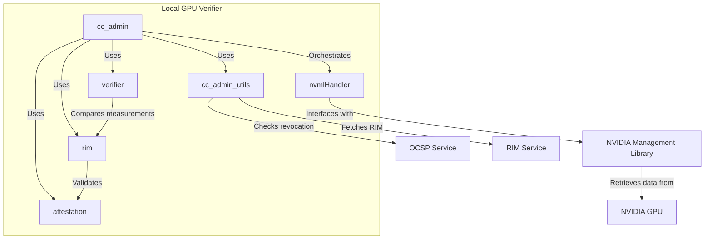
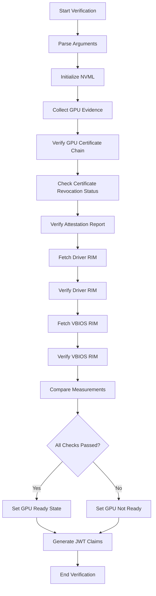
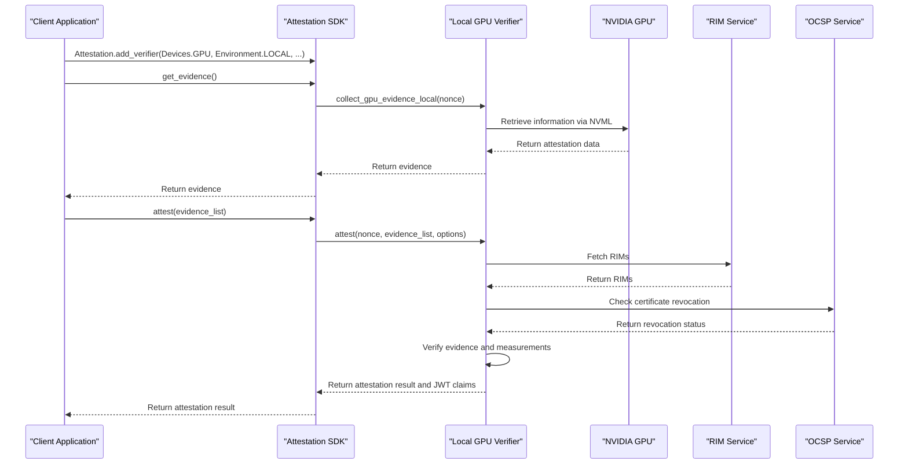

<!-- source: DeepWiki mcp.deepwiki.com · repo NVIDIA/nvtrust · page 3.1 Local GPU Verifier · fetched 2026-10-26 -->

# Local GPU Verifier

<details>
<summary>Relevant source files</summary>

The following files were used as context for generating this wiki page:

- [guest_tools/gpu_verifiers/local_gpu_verifier/README.md](guest_tools/gpu_verifiers/local_gpu_verifier/README.md)
- [guest_tools/gpu_verifiers/local_gpu_verifier/pyproject.toml](guest_tools/gpu_verifiers/local_gpu_verifier/pyproject.toml)

</details>


The Local GPU Verifier is a Python-based tool for validating NVIDIA GPU measurements by comparing authenticated attestation reports containing runtime measurements with authenticated golden measurements. It verifies that the software and hardware state of the GPU matches the intended state, ensuring the integrity of the GPU environment in confidential computing scenarios.

For information about remote GPU attestation, see [Remote GPU Attestation](#3.2).

## Overview

The Local GPU Verifier serves as a critical component in the nvTrust attestation framework, providing local verification capabilities for NVIDIA GPUs. It collects and verifies evidence from GPUs, validates certificates, verifies attestation reports, and compares measurements against Reference Integrity Manifests (RIMs) to determine if a GPU can be trusted.



Sources: [guest_tools/gpu_verifiers/local_gpu_verifier/README.md:25-26](), [guest_tools/gpu_verifiers/local_gpu_verifier/src/verifier/cc_admin.py:23-158]()

## System Requirements

The Local GPU Verifier has specific hardware and software requirements to operate:

| Requirement Type | Details |
|-----------------|---------|
| Hardware | NVIDIA Hopper H100 GPU or newer |
| Hardware | GPU SKU with Confidential Compute (CC) capability |
| Software | NVIDIA GPU driver installed |
| Software | Python 3.8 or later |

Sources: [guest_tools/gpu_verifiers/local_gpu_verifier/README.md:28-35]()

## Installation

The Local GPU Verifier can be installed using two methods:

### From Source

```
git clone https://github.com/NVIDIA/nvtrust.git
cd nvtrust/guest_tools/gpu_verifiers/local_gpu_verifier
pip3 install .
```

### From PyPI

```
pip3 install nv-local-gpu-verifier
```

**Note:** Root privileges are required only if you need to set the GPU Ready State based on attestation results.

Sources: [guest_tools/gpu_verifiers/local_gpu_verifier/README.md:37-62](), [guest_tools/gpu_verifiers/local_gpu_verifier/pyproject.toml:1-36]()

## Architecture and Components

The Local GPU Verifier consists of several key modules that work together to perform the attestation process:

```mermaid
classDiagram
    class CcAdmin {
        +collect_gpu_evidence()
        +attest()
        +init_nvml()
        +main()
    }
    
    class NvmlHandler {
        +get_attestation_report()
        +get_attestation_cert_chain()
        +get_driver_version()
        +get_vbios_version()
        +get_gpu_architecture()
        +get_uuid()
        +get_gpu_ready_state()
        +set_gpu_ready_state()
    }
    
    class AttestationReport {
        +verify_signature()
        +get_response_message()
        +get_request_message()
    }
    
    class RIM {
        +verify()
        +schema_validation()
        +verify_rim_signature()
    }
    
    class Verifier {
        +verify()
    }
    
    class CcAdminUtils {
        +verify_certificate_chain()
        +ocsp_certificate_chain_validation()
        +verify_attestation_report()
        +fetch_rim_file()
        +generate_nonce()
    }
    
    CcAdmin --> NvmlHandler : uses
    CcAdmin --> AttestationReport : validates
    CcAdmin --> RIM : validates
    CcAdmin --> Verifier : uses
    CcAdmin --> CcAdminUtils : uses
    
    NvmlHandler ..> "NVML API" : calls
    AttestationReport ..> "SPDM 1.1" : implements
    RIM ..> "TCG RIM Standard" : implements
```

### Module Details

1. **rim**
   - Parses and validates Reference Integrity Manifests (RIMs)
   - Performs schema validation against SWID tag and XML signature schemas
   - Verifies RIM signatures

2. **attestation**
   - Extracts measurements and signatures from attestation reports
   - Verifies signatures using DMTF's SPDM 1.1 measurement response format

3. **nvmlHandler**
   - Interfaces with NVIDIA Management Library (NVML) API
   - Retrieves GPU information including driver version, certificates, and attestation report

4. **verifier**
   - Compares runtime measurements from attestation reports against golden measurements in RIMs

5. **cc_admin**
   - Main orchestration module
   - Retrieves GPU info, attestation report, and RIMs
   - Coordinates the verification process

6. **cc_admin_utils**
   - Provides utility functions for certificate chain validation, OCSP checks, and RIM fetching

Sources: [guest_tools/gpu_verifiers/local_gpu_verifier/README.md:132-146](), [guest_tools/gpu_verifiers/local_gpu_verifier/src/verifier/cc_admin.py:67-66](), [guest_tools/gpu_verifiers/local_gpu_verifier/src/verifier/cc_admin_utils.py:74-595]()

## Verification Process

The Local GPU Verifier follows a detailed workflow to determine if a GPU can be trusted:



### Evidence Collection

The evidence collection phase gathers the necessary data from the GPU:

1. Initialize NVML library
2. Generate a 32-byte nonce for challenge-response
3. Collect GPU information through NVML API:
   - GPU model and unique ID
   - Driver version
   - VBIOS version
   - GPU certificate chain
   - Attestation report (which includes measured values)

Sources: [guest_tools/gpu_verifiers/local_gpu_verifier/src/verifier/cc_admin.py:181-224]()

### Certificate Chain Validation

Certificate chain validation ensures the authenticity of the GPU:

1. Validate the certificate chain structure
2. Verify each certificate's signature against its parent
3. Check certificate expiration dates
4. Verify OCSP status to check for revoked certificates
5. Extract and validate the FWID (Firmware ID) in the leaf certificate

Sources: [guest_tools/gpu_verifiers/local_gpu_verifier/src/verifier/cc_admin_utils.py:102-193](), [guest_tools/gpu_verifiers/local_gpu_verifier/src/verifier/cc_admin_utils.py:209-324]()

### Attestation Report Verification

The attestation report verification confirms the report's integrity:

1. Parse the SPDM attestation report
2. Verify that the nonce in the report matches the challenge nonce
3. Validate that the driver and VBIOS versions in the report match those retrieved from the GPU
4. Verify the signature of the attestation report using the GPU's leaf certificate

Sources: [guest_tools/gpu_verifiers/local_gpu_verifier/src/verifier/cc_admin_utils.py:471-558]()

### RIM Validation

The RIM validation process ensures the authenticity of reference measurements:

1. Fetch the Driver RIM (from local file or RIM service)
2. Validate the Driver RIM schema and signature
3. Fetch the VBIOS RIM (from local file or RIM service)
4. Validate the VBIOS RIM schema and signature
5. Verify that the RIM versions match the installed driver and VBIOS versions

Sources: [guest_tools/gpu_verifiers/local_gpu_verifier/src/verifier/cc_admin.py:446-544]()

### Measurement Comparison

The final step compares the actual measurements against the golden values:

1. Extract runtime measurements from the attestation report
2. Extract golden measurements from the validated RIMs
3. Compare measurements and verify they match
4. Set the GPU Ready State based on the verification result

Sources: [guest_tools/gpu_verifiers/local_gpu_verifier/src/verifier/cc_admin.py:546-602]()

## Integration with Attestation SDK

The Local GPU Verifier can be used both as a standalone tool and as part of the NVIDIA Attestation SDK. When used with the SDK, it's integrated through a standardized interface:



The integration points include:

1. `collect_gpu_evidence_local()` - Collects evidence from the GPU for local attestation
2. `attest()` - Performs the attestation with the collected evidence
3. Common configuration parameters including OCSP and RIM service URLs

Sources: [guest_tools/gpu_verifiers/local_gpu_verifier/src/verifier/cc_admin.py:227-238](), [guest_tools/attestation_sdk/src/nv_attestation_sdk/attestation.py:267-334]()

## Usage and Configuration Options

The Local GPU Verifier can be run directly from the command line:

```
python3 -m verifier.cc_admin [OPTIONS]
```

### Command-Line Options

| Option | Description |
|--------|-------------|
| `-h, --help` | Show help message and exit |
| `-v, --verbose` | Print more detailed output |
| `--test_no_gpu` | Run in test mode without a physical GPU |
| `--driver_rim DRIVER_RIM` | Path to the driver RIM file |
| `--vbios_rim VBIOS_RIM` | Path to the VBIOS RIM file |
| `--user_mode` | Run in user mode (without setting GPU Ready State) |
| `--allow_hold_cert` | Continue attestation if certificate status is 'certificate_hold' |
| `--nonce NONCE` | Specify a 32-byte nonce for attestation report |
| `--rim_root_cert RIM_ROOT_CERT` | Path to the root certificate for RIM verification |
| `--rim_service_url RIM_SERVICE_URL` | URL for the RIM service |
| `--ocsp_url OCSP_SERVICE_URL` | URL for the OCSP service |
| `--ocsp_nonce_disabled` | Disable nonce in OCSP requests |
| `--service-key SERVICE_KEY` | Service key for authenticating remote service calls |
| `--claims_version CLAIMS_VERSION` | Specify claims version (2.0 or 3.0) |

Sources: [guest_tools/gpu_verifiers/local_gpu_verifier/README.md:101-121](), [guest_tools/gpu_verifiers/local_gpu_verifier/src/verifier/cc_admin.py:87-153]()

## Claims and Reporting

After attestation, the Local GPU Verifier produces a JWT (JSON Web Token) that contains claims about the attestation result. These claims provide detailed information about the GPU, its configuration, and the attestation process.

### JWT Claims Structure

The JWT token contains claims that include:

1. Overall attestation result
2. GPU information (model, UUID, driver version, VBIOS version)
3. Certificate status information
4. Measurement verification results
5. Timestamp and attestation parameters

The claims follow a structured format that can be used by applications to make trust decisions. The format depends on the claims version selected (2.0 or 3.0).

Sources: [guest_tools/gpu_verifiers/local_gpu_verifier/src/verifier/cc_admin.py:597-599](), [guest_tools/gpu_verifiers/local_gpu_verifier/README.md:151-152]()

## GPU Ready State

One of the key functions of the Local GPU Verifier is to set the GPU Ready State based on the attestation result. The GPU Ready State determines whether the GPU can be used for confidential computing workloads:

- If attestation succeeds, the GPU is set to "READY"
- If attestation fails, the GPU is set to "NOT READY"
- In CC DevTools mode, the GPU is set to "READY" even if attestation fails

This mechanism ensures that only trusted GPUs are used for confidential computing workloads, helping to maintain the integrity of the confidential computing environment.

Sources: [guest_tools/gpu_verifiers/local_gpu_verifier/src/verifier/cc_admin.py:570-593]()

## Troubleshooting

For troubleshooting information, including common issues and their solutions, please refer to the [Attestation Troubleshooting Guide](#6).

Sources: [guest_tools/gpu_verifiers/local_gpu_verifier/README.md:151-152]()

---

