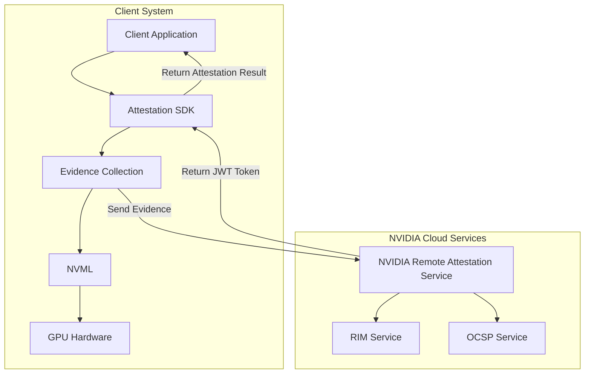
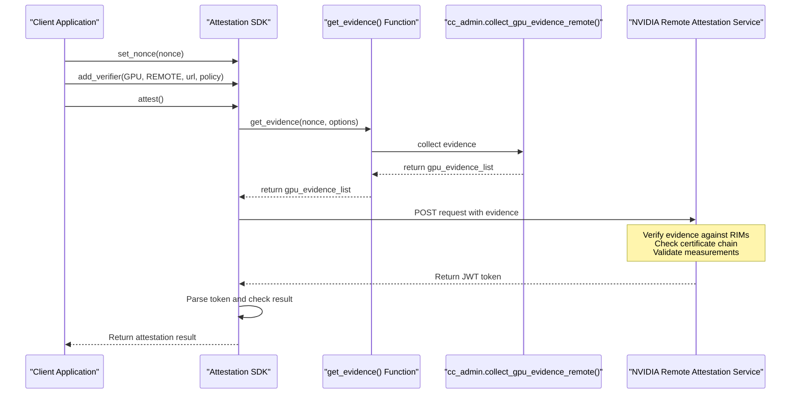
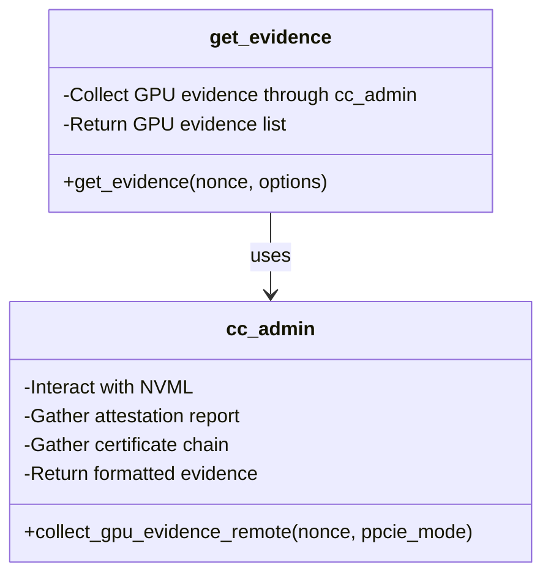
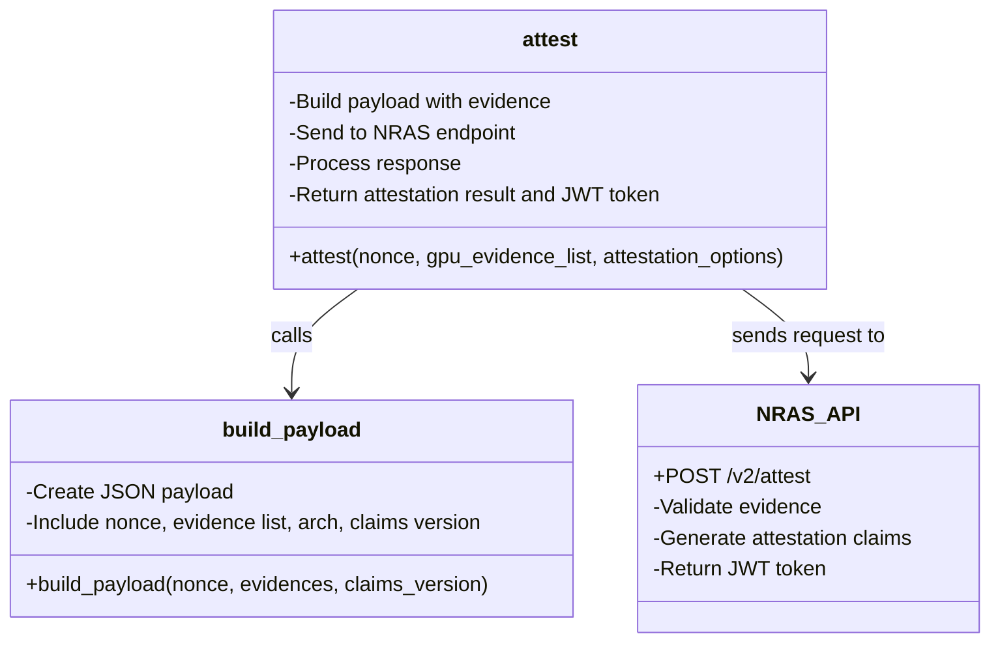
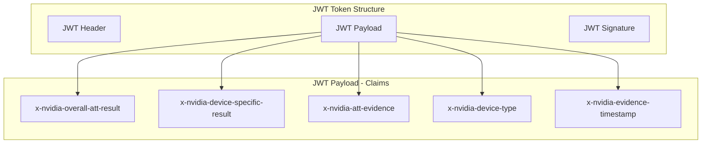

<!-- source: DeepWiki mcp.deepwiki.com · repo NVIDIA/nvtrust · page 3.2 Remote GPU Attestation · fetched 2026-10-26 -->

# Remote GPU Attestation

<details>
<summary>Relevant source files</summary>

The following files were used as context for generating this wiki page:

- [guest_tools/attestation_sdk/README.md](guest_tools/attestation_sdk/README.md)
- [guest_tools/attestation_sdk/src/nv_attestation_sdk/gpu/attest_gpu_local.py](guest_tools/attestation_sdk/src/nv_attestation_sdk/gpu/attest_gpu_local.py)
- [guest_tools/attestation_sdk/src/nv_attestation_sdk/nvswitch/attest_nvswitch_local.py](guest_tools/attestation_sdk/src/nv_attestation_sdk/nvswitch/attest_nvswitch_local.py)
- [guest_tools/attestation_troubleshooting_guide.md](guest_tools/attestation_troubleshooting_guide.md)

</details>


## Purpose and Scope

Remote GPU Attestation provides a mechanism to verify the integrity and authenticity of NVIDIA GPUs by collecting evidence locally but performing verification through NVIDIA Remote Attestation Service (NRAS). This approach allows for centralized and standardized verification logic while ensuring that attestation results are trusted and consistently applied.

For information about local GPU attestation where evidence collection and verification happen on the same system, see [Local GPU Verifier](#3.1).

## Architecture Overview

Remote GPU Attestation follows a client-server model where the client (running on the system with the GPU) collects evidence and sends it to NVIDIA's Remote Attestation Service for verification. The NRAS then performs comprehensive checks and returns a signed JWT token containing attestation claims.



Sources: [guest_tools/attestation_sdk/README.md:29-30](), [guest_tools/attestation_sdk/src/nv_attestation_sdk/gpu/attest_gpu_remote.py:4-6]()

## Components and Workflow

Remote GPU Attestation involves several components working together to provide a secure attestation mechanism:



Sources: [guest_tools/attestation_sdk/src/nv_attestation_sdk/gpu/attest_gpu_remote.py:20-39](), [guest_tools/attestation_sdk/src/nv_attestation_sdk/gpu/attest_gpu_remote.py:42-100]()

## Evidence Collection

The evidence collection process for remote attestation involves gathering all necessary information from the GPU via NVML. This evidence is later sent to NRAS for verification.



Sources: [guest_tools/attestation_sdk/src/nv_attestation_sdk/gpu/attest_gpu_remote.py:20-39]()

## Attestation Process

The attestation process involves sending the collected evidence to NRAS and validating the returned JWT token to determine if the attestation was successful.



Sources: [guest_tools/attestation_sdk/src/nv_attestation_sdk/gpu/attest_gpu_remote.py:42-100](), [guest_tools/attestation_sdk/src/nv_attestation_sdk/gpu/attest_gpu_remote.py:103-108]()

## Using Remote GPU Attestation

### Prerequisites

Before using Remote GPU Attestation, ensure:

1. You have a Confidential Virtual Machine with:
   - NVIDIA Hopper H100 (or later) GPU that supports Confidential Computing
   - NVIDIA GPU Driver with CC/PPCIE support
   - GPU SKU that supports Confidential Computing

2. Python 3.8 or later is installed

3. The Attestation SDK is installed:
   ```
   pip3 install nv-attestation-sdk
   ```

Sources: [guest_tools/attestation_sdk/README.md:65-80]()

### Implementation Example

Here's how to implement Remote GPU Attestation:

```python
from nv_attestation_sdk.attestation import Attestation, Devices, Environment

# Create an attestation object
att = Attestation("my_application")

# Set a nonce for verification freshness
att.set_nonce("12345678")

# Optionally set claims version (defaults to 2.0)
att.set_claims_version("2.0")

# Optionally set service key if you have one
att.set_service_key("your_service_key_here")

# Add a remote GPU verifier
verifier_url = "https://nras.nvidia.com/v2/attest"
policy_file = "path/to/policy.json"
att.add_verifier(Devices.GPU, Environment.REMOTE, verifier_url, policy_file)

# Perform attestation
attestation_successful = att.attest()

# Get the attestation token
if attestation_successful:
    token = att.get_token()
    # Use token for your application
```

Sources: [guest_tools/attestation_sdk/README.md:86-90]()

## Configuration Options

Remote GPU Attestation supports several configuration options:

| Configuration Parameter | Description |
|------------------------|-------------|
| verifier_url | URL of the NVIDIA Remote Attestation Service |
| service_key | Authentication key for NRAS (if required) |
| timeout | Request timeout in seconds (default: 30) |
| claims_version | Version of attestation claims to use (default: 2.0) |
| ppcie_mode | Whether to perform attestation in PPCIE mode |

Additionally, environment variables can be used to modify behavior:

| Environment Variable | Values | Description |
|----------------------|--------|-------------|
| NV_ALLOW_HOLD_CERT | true/false | Enable attestation if the OCSP revocation status of the certificate in the RIM files is 'certificate_hold'. Defaults to false. |

Sources: [guest_tools/attestation_sdk/src/nv_attestation_sdk/gpu/attest_gpu_remote.py:54-56](), [guest_tools/attestation_sdk/README.md:169-172]()

## JWT Token and Claims

The attestation result is returned as a JWT token that contains claims about the GPU's state. The token structure depends on the claims version specified during attestation:



The token can be decoded and validated against a policy to ensure specific security requirements are met.

Sources: [guest_tools/attestation_sdk/src/nv_attestation_sdk/gpu/attest_gpu_remote.py:81-86]()

## Error Handling and Troubleshooting

Remote GPU Attestation can fail for several reasons:

1. Network connectivity issues to NRAS
2. Invalid evidence format
3. GPU failing attestation checks
4. Invalid service key
5. Certificate revocation issues

When attestation fails, detailed error information is logged. For comprehensive troubleshooting information, see the Attestation Troubleshooting Guide.

Sources: [guest_tools/attestation_sdk/src/nv_attestation_sdk/gpu/attest_gpu_remote.py:90-99](), [guest_tools/attestation_sdk/README.md:115]()

## Implementation Details

Under the hood, Remote GPU Attestation works through these key functions:

1. `get_evidence(nonce, options)`: Collects evidence from the GPU
2. `attest(nonce, gpu_evidence_list, attestation_options)`: Sends evidence to NRAS and processes the response
3. `build_payload(nonce, evidences, claims_version)`: Constructs the JSON payload for the NRAS request

The Attestation SDK abstracts these operations through its high-level API, but understanding these functions can help with troubleshooting or custom implementations.

Sources: [guest_tools/attestation_sdk/src/nv_attestation_sdk/gpu/attest_gpu_remote.py:20-108]()

---

