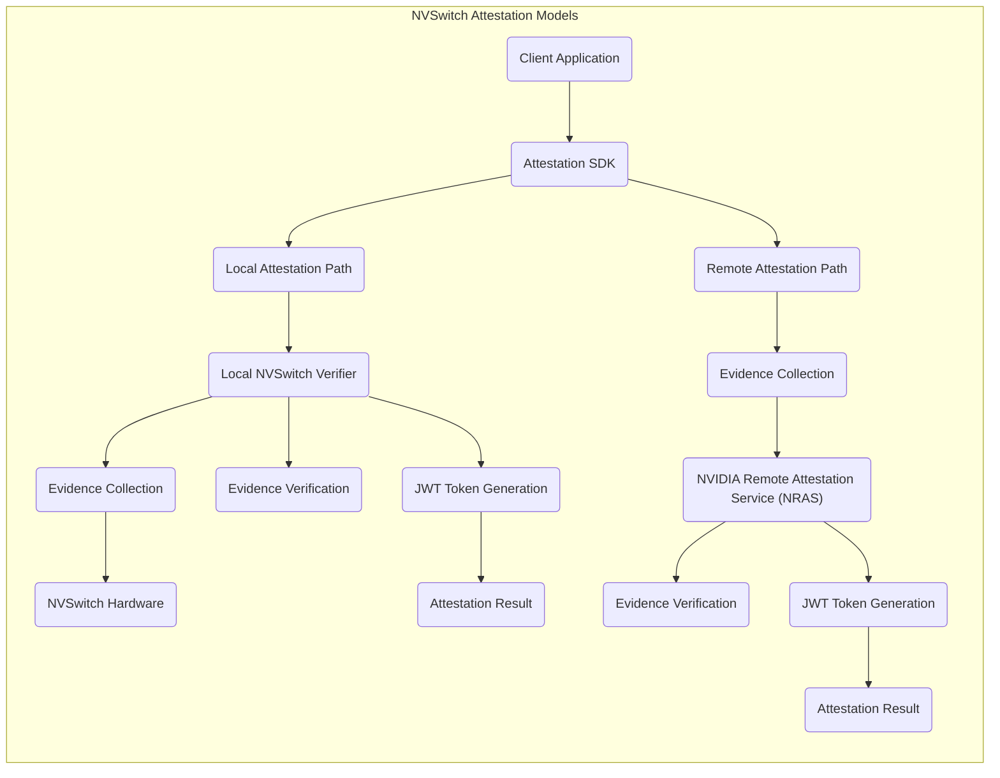
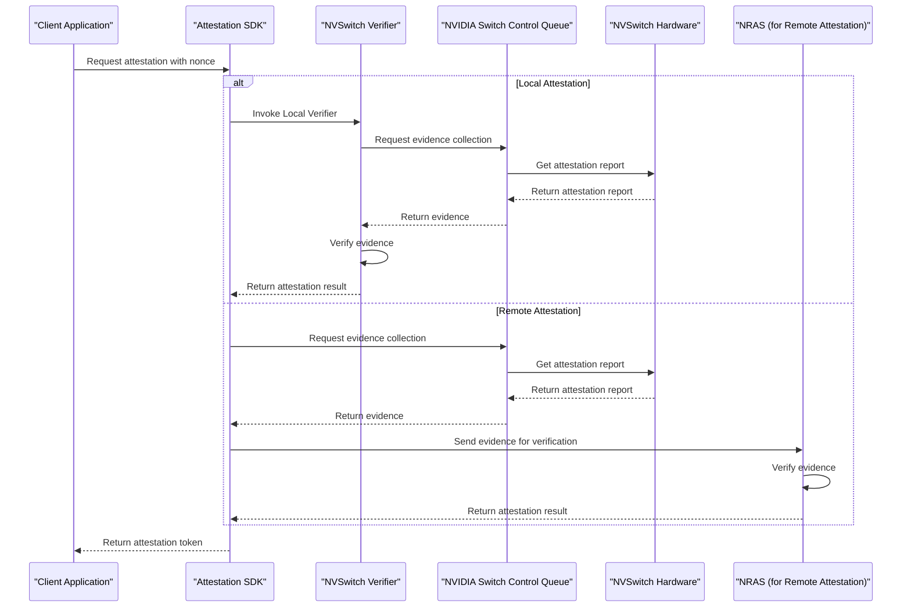
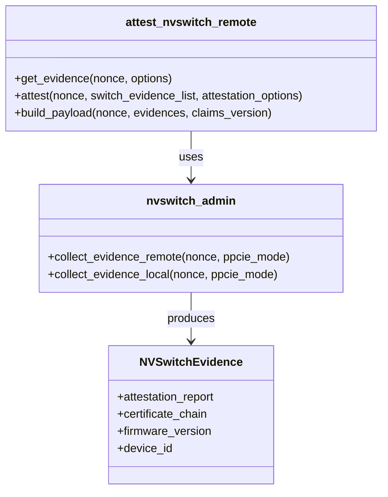
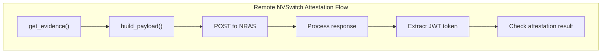
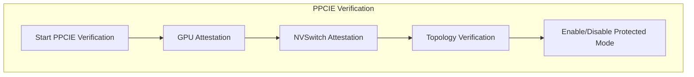
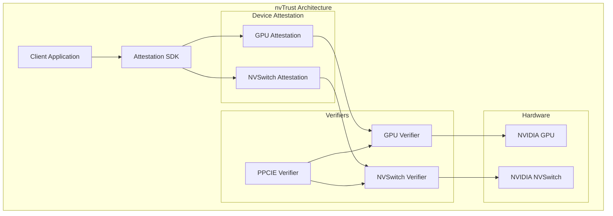

<!-- source: DeepWiki mcp.deepwiki.com · repo NVIDIA/nvtrust · page 4 NVSwitch Attestation · fetched 2026-10-26 -->

# NVSwitch Attestation

<details>
<summary>Relevant source files</summary>

The following files were used as context for generating this wiki page:

- [README.md](README.md)
- [guest_tools/README.md](guest_tools/README.md)
- [guest_tools/attestation_sdk/src/nv_attestation_sdk/verifiers/nv_switch_verifier/rim/swidSchema2015.xsd](guest_tools/attestation_sdk/src/nv_attestation_sdk/verifiers/nv_switch_verifier/rim/swidSchema2015.xsd)
- [guest_tools/attestation_sdk/src/nv_attestation_sdk/verifiers/nv_switch_verifier/rim/xml.xsd](guest_tools/attestation_sdk/src/nv_attestation_sdk/verifiers/nv_switch_verifier/rim/xml.xsd)
- [guest_tools/attestation_sdk/tests/end_to_end/hardware/test_local_switch.py](guest_tools/attestation_sdk/tests/end_to_end/hardware/test_local_switch.py)
- [guest_tools/attestation_sdk/tests/end_to_end/hardware/test_remote_switch.py](guest_tools/attestation_sdk/tests/end_to_end/hardware/test_remote_switch.py)
- [guest_tools/ppcie-verifier/README.md](guest_tools/ppcie-verifier/README.md)

</details>


## Purpose and Scope

This document provides comprehensive technical information about NVSwitch attestation within the NVIDIA Trust framework. NVSwitch attestation is the process of verifying the authenticity and integrity of NVIDIA NVSwitch hardware components, enabling secure communication in multi-GPU systems. For information about GPU attestation, see [GPU Attestation](#3), and for information about PPCIE verification which combines both GPU and NVSwitch attestation, see [PPCIE Verification](#5).

## NVSwitch Attestation Overview

NVSwitch attestation is a critical security component that allows users to verify the authenticity and integrity of NVSwitch hardware. Similar to GPU attestation, NVSwitch attestation can be performed either locally on the host machine or remotely via NVIDIA's Remote Attestation Service (NRAS).



Sources: [guest_tools/attestation_sdk/src/nv_attestation_sdk/nvswitch/attest_nvswitch_remote.py:4-6]()

The attestation process involves:

1. **Evidence Collection**: Gathering cryptographic measurements and state information from the NVSwitch
2. **Verification**: Validating the evidence against known-good values (Reference Integrity Manifests or RIMs)
3. **Result Generation**: Creating a signed attestation token containing claims about the NVSwitch's state

## NVSwitch Attestation Process

The following diagram illustrates the detailed process flow for NVSwitch attestation:



Sources: [guest_tools/attestation_sdk/src/nv_attestation_sdk/nvswitch/attest_nvswitch_remote.py:22-41](), [guest_tools/attestation_sdk/src/nv_attestation_sdk/nvswitch/attest_nvswitch_remote.py:43-97]()

## Evidence Collection

Evidence collection is the first step in the attestation process and involves gathering cryptographic measurements from the NVSwitch hardware. The type of evidence collected includes:

- Attestation reports signed by the NVSwitch
- Certificate chains proving the authenticity of signing keys
- Firmware version information
- Unique device identifiers



Sources: [guest_tools/attestation_sdk/src/nv_attestation_sdk/nvswitch/attest_nvswitch_remote.py:22-41]()

The evidence collection process varies slightly between local and remote attestation:

- For **Local Attestation**: Evidence is collected and verified on the local machine
- For **Remote Attestation**: Evidence is collected locally but sent to NRAS for verification

## Remote NVSwitch Attestation

Remote attestation delegates the verification process to NVIDIA's Remote Attestation Service (NRAS). The process involves:

1. Collecting evidence locally using the `get_evidence()` function
2. Building an attestation payload using the `build_payload()` function
3. Sending the payload to NRAS via HTTPS
4. Processing the response and extracting the attestation token



Sources: [guest_tools/attestation_sdk/src/nv_attestation_sdk/nvswitch/attest_nvswitch_remote.py:43-97](), [guest_tools/attestation_sdk/src/nv_attestation_sdk/nvswitch/attest_nvswitch_remote.py:100-105]()

The remote attestation process requires:

- A valid nonce for freshness
- Service authentication keys
- HTTPS communication with NRAS
- Proper handling of JWT tokens

## Attestation Results and Token Structure

The result of the attestation process is a JWT (JSON Web Token) containing claims about the NVSwitch's state. Key information in the token includes:

| Claim | Description |
|-------|-------------|
| x-nvidia-overall-att-result | Boolean indicating overall attestation success or failure |
| x-nvidia-device-id | Unique identifier for the attested NVSwitch |
| x-nvidia-firmware-version | Firmware version running on the NVSwitch |
| x-nvidia-certificate-info | Information about the certificate chain |
| x-nvidia-nonce | The nonce used during attestation (to prevent replay attacks) |
| x-nvidia-attestation-report | Detailed attestation report information |

Sources: [guest_tools/attestation_sdk/src/nv_attestation_sdk/nvswitch/attest_nvswitch_remote.py:79-85]()

## Integration with PPCIE Verification

NVSwitch attestation is a critical component of Protected PCIe (PPCIE) verification, which ensures secure communication between multiple GPUs in a system. The PPCIE verification process combines both GPU and NVSwitch attestation to verify the entire communication path.



For more details on this integration, see [PPCIE Verification](#5).

Sources: [guest_tools/attestation_sdk/src/nv_attestation_sdk/nvswitch/attest_nvswitch_remote.py:33-36]()

## API Reference

The NVSwitch attestation API consists of the following key functions:

### Remote Attestation Functions

```
get_evidence(nonce, options)
```
Collects evidence from the NVSwitch for remote attestation. Takes a nonce parameter for freshness and an options dictionary that can include PPCIE mode settings.

```
attest(nonce, switch_evidence_list, attestation_options)
```
Sends the collected evidence to NRAS for verification and processes the response. Configuration options include:
- `verifier_url`: URL of the NRAS endpoint
- `timeout`: Request timeout in seconds
- `service_key`: Authentication key for NRAS
- `claims_version`: Version of the claims format

```
build_payload(nonce, evidences, claims_version)
```
Constructs the JSON payload to send to NRAS, including the nonce, evidence list, architecture type, and claims version.

Sources: [guest_tools/attestation_sdk/src/nv_attestation_sdk/nvswitch/attest_nvswitch_remote.py:22-41](), [guest_tools/attestation_sdk/src/nv_attestation_sdk/nvswitch/attest_nvswitch_remote.py:43-97](), [guest_tools/attestation_sdk/src/nv_attestation_sdk/nvswitch/attest_nvswitch_remote.py:100-105]()

## NVSwitch Attestation in the nvTrust Architecture

The following diagram illustrates how NVSwitch attestation fits into the broader nvTrust architecture:



NVSwitch attestation complements GPU attestation to provide a comprehensive security solution for NVIDIA hardware. Together, these attestation mechanisms enable confidential computing environments by ensuring the integrity and authenticity of both computation and communication components.

Sources: [guest_tools/attestation_sdk/src/nv_attestation_sdk/nvswitch/attest_nvswitch_remote.py:4-6]()

---

