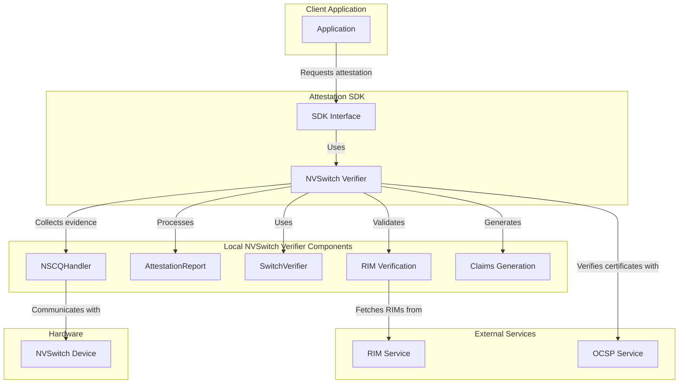
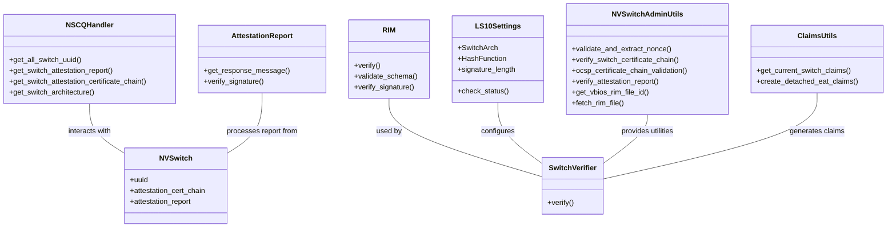
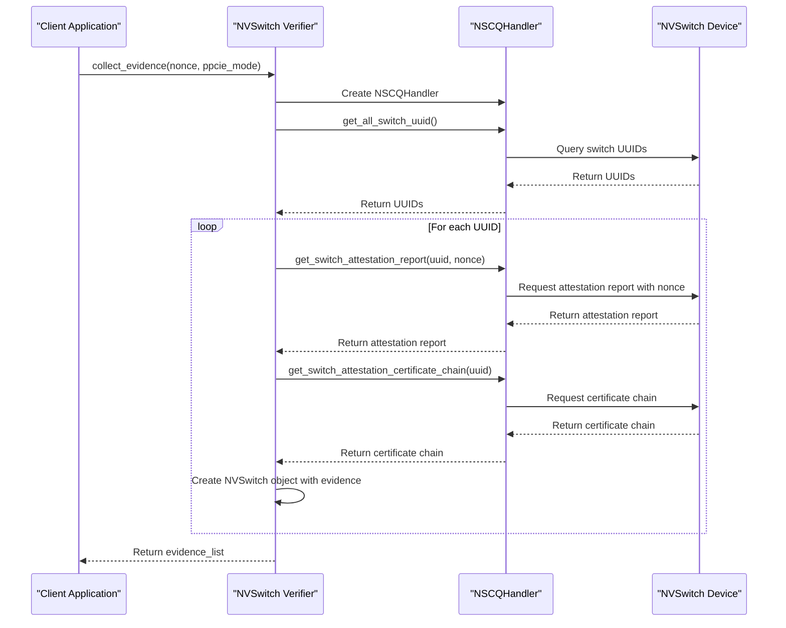
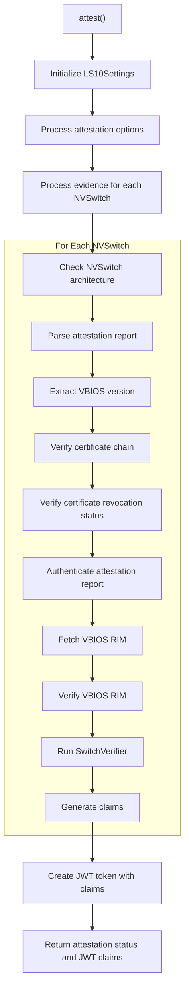

<!-- source: DeepWiki mcp.deepwiki.com · repo NVIDIA/nvtrust · page 4.1 Local NVSwitch Verifier · fetched 2026-10-26 -->

# Local NVSwitch Verifier

Relevant source files

The following files were used as context for generating this wiki page:

- [guest_tools/attestation_sdk/src/nv_attestation_sdk/gpu/attest_gpu_local.py](guest_tools/attestation_sdk/src/nv_attestation_sdk/gpu/attest_gpu_local.py)
- [guest_tools/attestation_sdk/src/nv_attestation_sdk/nvswitch/attest_nvswitch_local.py](guest_tools/attestation_sdk/src/nv_attestation_sdk/nvswitch/attest_nvswitch_local.py)
- [guest_tools/attestation_sdk/src/nv_attestation_sdk/verifiers/nv_switch_verifier/rim/swidSchema2015.xsd](guest_tools/attestation_sdk/src/nv_attestation_sdk/verifiers/nv_switch_verifier/rim/swidSchema2015.xsd)
- [guest_tools/attestation_sdk/src/nv_attestation_sdk/verifiers/nv_switch_verifier/rim/xml.xsd](guest_tools/attestation_sdk/src/nv_attestation_sdk/verifiers/nv_switch_verifier/rim/xml.xsd)
- [guest_tools/attestation_sdk/tests/end_to_end/hardware/test_local_switch.py](guest_tools/attestation_sdk/tests/end_to_end/hardware/test_local_switch.py)
- [guest_tools/attestation_sdk/tests/end_to_end/hardware/test_remote_switch.py](guest_tools/attestation_sdk/tests/end_to_end/hardware/test_remote_switch.py)
- [guest_tools/attestation_troubleshooting_guide.md](guest_tools/attestation_troubleshooting_guide.md)

## Purpose and Scope
This document describes the Local NVSwitch Verifier component within the NVIDIA nvTrust system. The Local NVSwitch Verifier is responsible for performing attestation of NVIDIA NVSwitch devices on the local system to verify their integrity and trustworthiness. For information about remote attestation of NVSwitches, see [Remote NVSwitch Attestation](#4.2).

## Architecture Overview

The Local NVSwitch Verifier interacts with NVSwitch devices through the NSCQ (NVIDIA Switch Control Queue) interface to collect attestation evidence, verify this evidence against Reference Integrity Manifests (RIMs), and generate attestation claims.

Sources: [guest_tools/attestation_sdk/src/nv_attestation_sdk/verifiers/nv_switch_verifier/nvswitch_admin.py:62-119]()

## Key Components

Sources: [guest_tools/attestation_sdk/src/nv_attestation_sdk/verifiers/nv_switch_verifier/nvswitch_admin.py:31-53](), [guest_tools/attestation_sdk/src/nv_attestation_sdk/verifiers/nv_switch_verifier/config.py:41-394]()

## Evidence Collection Process

The Local NVSwitch Verifier starts by collecting evidence from NVSwitch devices, which is handled by the `collect_evidence()` function:

Sources: [guest_tools/attestation_sdk/src/nv_attestation_sdk/verifiers/nv_switch_verifier/nvswitch_admin.py:78-119]()

## Attestation Process

The attestation process is handled by the `attest()` function, which verifies the collected evidence and produces attestation claims:

Sources: [guest_tools/attestation_sdk/src/nv_attestation_sdk/verifiers/nv_switch_verifier/nvswitch_admin.py:122-347]()

## Verification Steps

The NVSwitch verification process includes several critical steps:

1. **Architecture Verification**: Confirms the NVSwitch has a supported architecture (LS10)
2. **Certificate Chain Validation**: Verifies the authenticity of the attestation certificate chain
3. **OCSP Validation**: Checks if certificates have been revoked using the Online Certificate Status Protocol
4. **Attestation Report Verification**:
   - Validates the signature of the attestation report
   - Verifies the nonce to prevent replay attacks
   - Extracts and validates the VBIOS version
5. **RIM Validation**:
   - Fetches the appropriate VBIOS RIM either from the RIM service or local file
   - Validates the RIM's schema and signature
   - Compares measurements from the attestation report against the RIM

The verification status for each step is tracked in the `LS10Settings` object, which provides a comprehensive `check_status()` method to determine the overall attestation result.

Sources: [guest_tools/attestation_sdk/src/nv_attestation_sdk/verifiers/nv_switch_verifier/config.py:338-364]()

## Configuration Options

The Local NVSwitch Verifier supports several configuration options:

| Option | Description | Default |
|--------|-------------|---------|
| `vbios_rim` | Path to a local VBIOS RIM file | `None` (fetched from RIM service) |
| `rim_service_url` | URL of the RIM service | Implementation-defined |
| `ocsp_url` | URL of the OCSP service | Implementation-defined |
| `allow_hold_cert` | Whether to allow certificates with "certificate_hold" status | `False` |
| `claims_version` | Version of claims format (2.0 or 3.0) | "2.0" |
| `ocsp_nonce_disabled` | Disable OCSP nonce for environments that don't support it | `False` |
| `service_key` | Service key for accessing remote services | `None` |

Sources: [guest_tools/attestation_sdk/src/nv_attestation_sdk/verifiers/nv_switch_verifier/nvswitch_admin.py:151-164](), [guest_tools/attestation_sdk/src/nv_attestation_sdk/verifiers/nv_switch_verifier/config.py:75-99]()

## Attestation Claims and JWT Token

After successful verification, the NVSwitch Verifier generates attestation claims for each NVSwitch and combines them into a JWT (JSON Web Token). The claims include:

1. Overall attestation status (pass/fail)
2. NVSwitch UUID
3. Hardware model
4. VBIOS version
5. Certificate status
6. Verification timestamp
7. Any warnings that occurred during verification

The JWT token is created using the `create_detached_eat_claims()` method of the `ClaimsUtils` class.

Sources: [guest_tools/attestation_sdk/src/nv_attestation_sdk/verifiers/nv_switch_verifier/nvswitch_admin.py:344]()

## Integration with Attestation SDK

The Local NVSwitch Verifier integrates with the NVIDIA Attestation SDK through two primary methods:

1. `collect_evidence()` - Gathers attestation evidence from local NVSwitch devices
2. `attest()` - Verifies the evidence and produces attestation claims

For remote attestation, the SDK also uses `collect_evidence_remote()`, which formats the evidence appropriately for transmission to the NVIDIA Remote Attestation Service.

Sources: [guest_tools/attestation_sdk/src/nv_attestation_sdk/verifiers/nv_switch_verifier/nvswitch_admin.py:63-76]()

## Error Handling

The Local NVSwitch Verifier implements comprehensive error handling for various failure scenarios:

| Error Type | Description | Effect on Attestation |
|------------|-------------|----------------------|
| `NoSwitchFoundError` | No NVSwitches were detected | Attestation fails immediately |
| `UnsupportedSwitchException` | NVSwitch architecture not supported | Attestation fails for that switch |
| `CertChainVerificationFailureError` | Certificate chain validation failed | Attestation fails for that switch |
| `AttestationReportVerificationError` | Attestation report verification failed | Attestation fails for that switch |
| `RIMFetchError` | Failed to fetch RIM from service | Attestation fails for that switch |
| `RIMVerificationFailureError` | RIM validation failed | Attestation fails for that switch |
| `InvalidClaimsVersionError` | Unsupported claims version | Attestation fails immediately |

Sources: [guest_tools/attestation_sdk/src/nv_attestation_sdk/verifiers/nv_switch_verifier/nvswitch_admin.py:102-104](), [guest_tools/attestation_sdk/src/nv_attestation_sdk/verifiers/nv_switch_verifier/nvswitch_admin.py:154-156]()

## Limitations

The Local NVSwitch Verifier has several limitations to be aware of:

1. Currently, only LS10 architecture NVSwitches are supported (SwitchArch = 2)
2. PPCIE mode is not supported for NVSwitch attestation
3. Network connectivity is required for RIM and OCSP services unless local RIM files are provided
4. The verifier requires appropriate permissions to access the NSCQ interface

Sources: [guest_tools/attestation_sdk/src/nv_attestation_sdk/verifiers/nv_switch_verifier/config.py:372](), [guest_tools/attestation_sdk/src/nv_attestation_sdk/verifiers/nv_switch_verifier/nvswitch_admin.py:85-89]()

---

