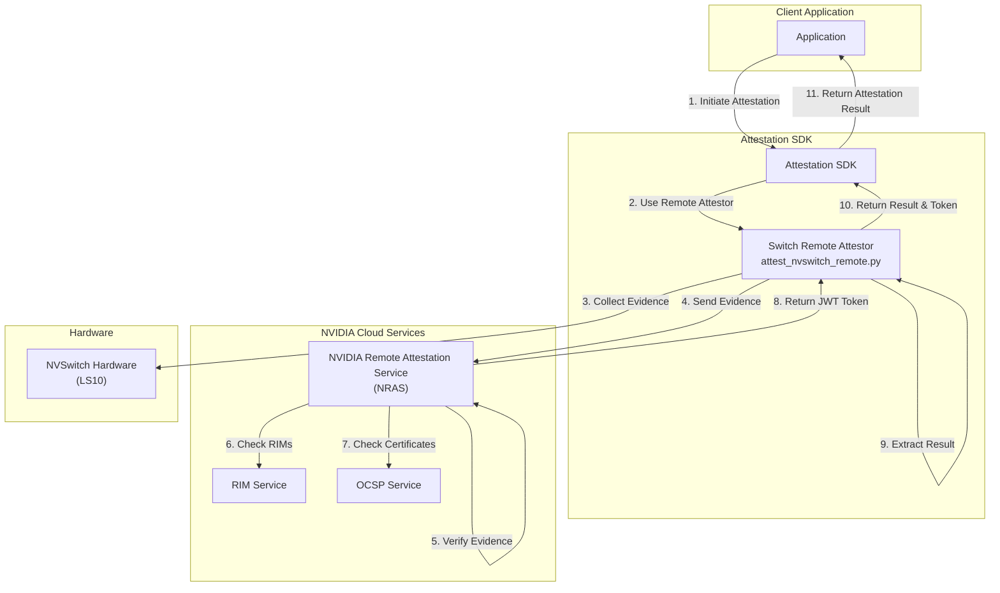
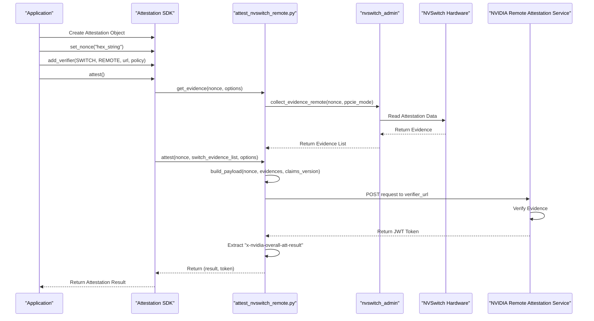
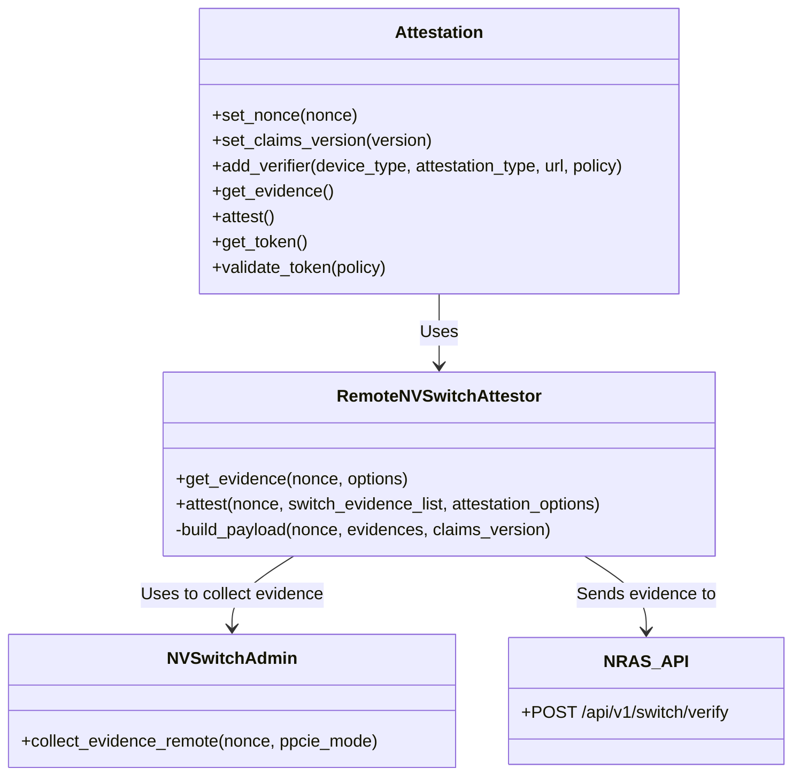

<!-- source: DeepWiki mcp.deepwiki.com · repo NVIDIA/nvtrust · page 4.2 Remote NVSwitch Attestation · fetched 2026-10-26 -->

# Remote NVSwitch Attestation

<details>
<summary>Relevant source files</summary>

The following files were used as context for generating this wiki page:

- [guest_tools/attestation_sdk/README.md](guest_tools/attestation_sdk/README.md)
- [guest_tools/attestation_sdk/src/nv_attestation_sdk/verifiers/nv_switch_verifier/rim/swidSchema2015.xsd](guest_tools/attestation_sdk/src/nv_attestation_sdk/verifiers/nv_switch_verifier/rim/swidSchema2015.xsd)
- [guest_tools/attestation_sdk/src/nv_attestation_sdk/verifiers/nv_switch_verifier/rim/xml.xsd](guest_tools/attestation_sdk/src/nv_attestation_sdk/verifiers/nv_switch_verifier/rim/xml.xsd)
- [guest_tools/attestation_sdk/tests/end_to_end/hardware/test_local_switch.py](guest_tools/attestation_sdk/tests/end_to_end/hardware/test_local_switch.py)
- [guest_tools/attestation_sdk/tests/end_to_end/hardware/test_remote_switch.py](guest_tools/attestation_sdk/tests/end_to_end/hardware/test_remote_switch.py)

</details>


## Purpose and Scope

This document describes the Remote NVSwitch Attestation feature of the NVIDIA Attestation SDK. Remote NVSwitch Attestation enables applications to verify the authenticity and integrity of NVIDIA NVSwitch hardware by delegating the verification process to the NVIDIA Remote Attestation Service (NRAS).

Unlike Local NVSwitch Attestation (see [Local NVSwitch Verifier](#4.1)), which performs verification on the local machine, Remote NVSwitch Attestation sends the collected evidence to NRAS for verification. This approach reduces computational requirements on the client side and provides access to the latest Reference Integrity Measurements (RIMs) maintained by NVIDIA.

## Architecture Overview

### High-Level Architecture



Sources: [guest_tools/attestation_sdk/README.md:29-32](), [guest_tools/attestation_sdk/src/nv_attestation_sdk/nvswitch/attest_nvswitch_remote.py:3-106]()

### Key Components

1. **Attestation SDK**: Client-side library providing APIs for applications to perform attestation
2. **Switch Remote Attestor**: Component within the SDK that collects NVSwitch evidence and communicates with NRAS
3. **NVIDIA Remote Attestation Service (NRAS)**: Cloud service that verifies evidence against Reference Integrity Measurements
4. **RIM Service**: Provides reference measurements for NVSwitch firmware and components
5. **OCSP Service**: Checks the status of certificates used in the attestation process

## Attestation Process Flow



Sources: [guest_tools/attestation_sdk/src/nv_attestation_sdk/nvswitch/attest_nvswitch_remote.py:22-97]()

The attestation process follows these steps:

1. Application creates an `Attestation` object and configures it with a nonce and remote NVSwitch verifier
2. Application initiates attestation through the SDK
3. SDK collects evidence from the NVSwitch hardware using `collect_evidence_remote`
4. Evidence is sent to NRAS along with the nonce, architecture ("LS10"), and claims version
5. NRAS verifies the evidence and returns a JWT token containing attestation claims
6. SDK extracts the attestation result from the token and returns it to the application

## Prerequisites

To use Remote NVSwitch Attestation, you need:

1. A Confidential Virtual Machine with multiple GPUs connected by nvSwitch:
   - LS10 Switch supporting PPCIE mode
   - NvSwitch Driver with PPCIE support
   - GPU SKU that supports Confidential Computing

2. Attestation SDK installed
3. Network connectivity to NRAS endpoints

Sources: [guest_tools/attestation_sdk/README.md:96-99]()

## Configuration Options

The Remote NVSwitch Attestation can be configured through the Attestation SDK's API and environment variables:

| Configuration | Description | Default |
|---------------|-------------|---------|
| `NV_ALLOW_HOLD_CERT` | Enable attestation if OCSP status is 'certificate_hold' | `false` |
| `REMOTE_NVSWITCH_VERIFIER_SERVICE_URL` | URL of the NRAS endpoint | - |
| `ATTESTATION_SERVICE_KEY` | Service key for authenticating with NRAS | - |

Sources: [guest_tools/attestation_sdk/README.md:169-172](), [guest_tools/attestation_sdk/src/nv_attestation_sdk/nvswitch/attest_nvswitch_remote.py:13-15]()

## Implementation Details

### Code Architecture



Sources: [guest_tools/attestation_sdk/src/nv_attestation_sdk/nvswitch/attest_nvswitch_remote.py:22-105]()

### Key Functions

#### `get_evidence(nonce, options)`
Collects evidence from the NVSwitch hardware.
- `nonce`: String nonce for freshness
- `options`: Dictionary containing:
  - `ppcie_mode`: Flag for PPCIE mode

Source: [guest_tools/attestation_sdk/src/nv_attestation_sdk/nvswitch/attest_nvswitch_remote.py:22-41]()

#### `attest(nonce, gpu_evidence_list, attestation_options)`
Sends evidence to NRAS and processes the result.
- `nonce`: String nonce for freshness
- `gpu_evidence_list`: List of evidence collected from NVSwitch
- `attestation_options`: Dictionary containing:
  - `verifier_url`: NRAS endpoint URL (default: `REMOTE_NVSWITCH_VERIFIER_SERVICE_URL`)
  - `timeout`: Request timeout in seconds (default: 30)
  - `service_key`: Authentication key for NRAS
  - `claims_version`: Claims format version (default: "2.0")

Source: [guest_tools/attestation_sdk/src/nv_attestation_sdk/nvswitch/attest_nvswitch_remote.py:43-97]()

#### `build_payload(nonce, evidences, claims_version)`
Builds the payload for the NRAS request.
- `nonce`: String nonce for freshness
- `evidences`: List of evidence collected from NVSwitch
- `claims_version`: Claims format version

Source: [guest_tools/attestation_sdk/src/nv_attestation_sdk/nvswitch/attest_nvswitch_remote.py:100-105]()

## Usage Example

Here's an example of how to use Remote NVSwitch Attestation:

```python
from nv_attestation_sdk import attestation
from nv_attestation_sdk.utils.types import AttestationDeviceType, AttestationType

# Create an Attestation object
att = attestation.Attestation("MyApplication")

# Set a nonce for freshness
att.set_nonce("1234567890abcdef")

# Set claims version (optional, defaults to "2.0")
att.set_claims_version("2.0")

# Add a remote NVSwitch verifier
att.add_verifier(
    AttestationDeviceType.SWITCH,
    AttestationType.REMOTE,
    "https://nras.nvidia.com/api/v1/switch/verify",
    "path/to/policy.json"
)

# Perform attestation
result = att.attest()

if result:
    # Get the attestation token
    token = att.get_token()
    print("Attestation successful!")
else:
    print("Attestation failed!")
```

For a complete implementation example, refer to the sample code in the nvTrust repository at:
[guest_tools/attestation_sdk/tests/end_to_end/hardware/RemoteSwitchTest.py]().

Sources: [guest_tools/attestation_sdk/README.md:109-111]()

## Troubleshooting

Common issues specific to Remote NVSwitch Attestation include:

1. **Network Connectivity Issues**: Ensure your environment can connect to NRAS endpoints.

2. **Service Key Authentication**: Verify the service key is valid and properly configured.

3. **Certificate Status**: If attestation fails due to certificate status, consider using the `NV_ALLOW_HOLD_CERT` configuration if appropriate for your security requirements.

4. **Timeout Issues**: If NRAS requests time out, consider increasing the timeout value in the attestation options.

5. **Incorrect Claims Version**: Ensure you're using a supported claims version.

For more troubleshooting information, refer to the [Troubleshooting](#6) page or the Attestation Troubleshooting Guide.

Sources: [guest_tools/attestation_sdk/README.md:113-115]()

## Related Pages

- [Attestation SDK Overview](#2)
- [Local NVSwitch Verifier](#4.1)
- [Remote GPU Attestation](#3.2)
- [Troubleshooting](#6)

---

