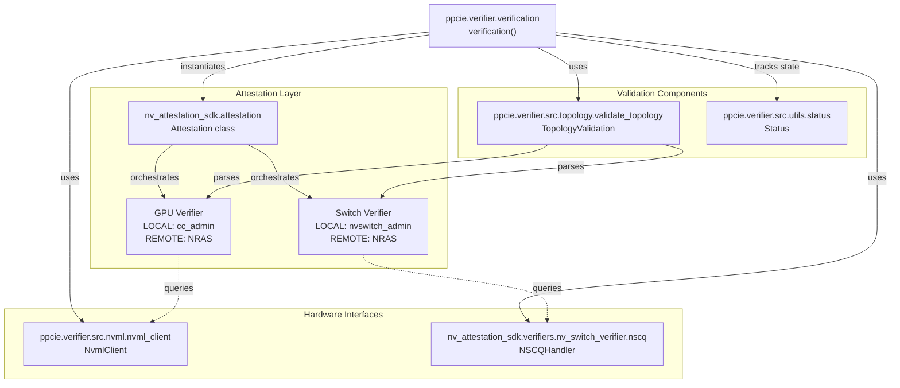
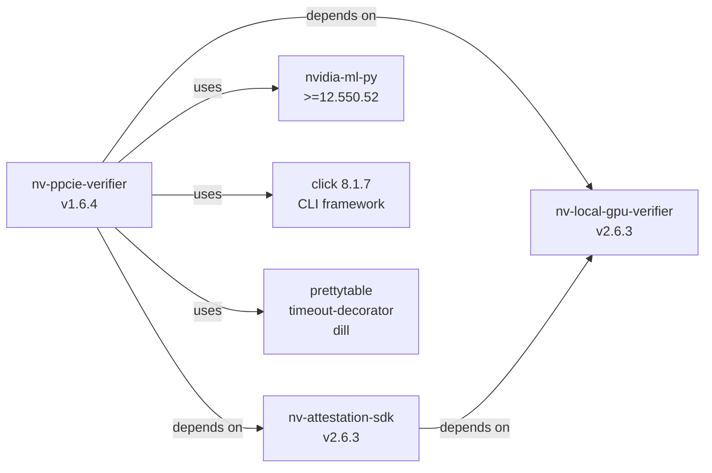
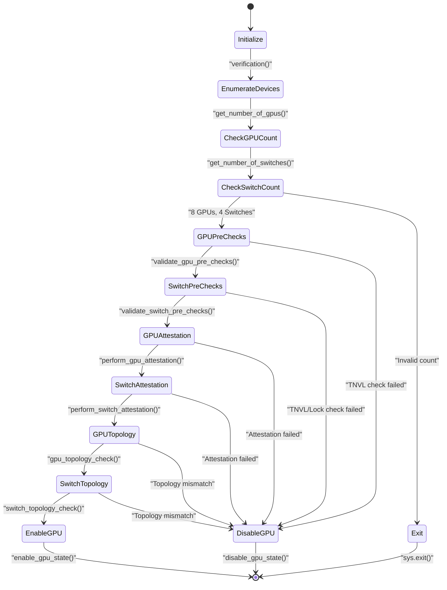
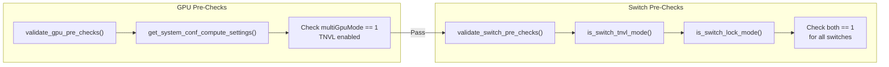
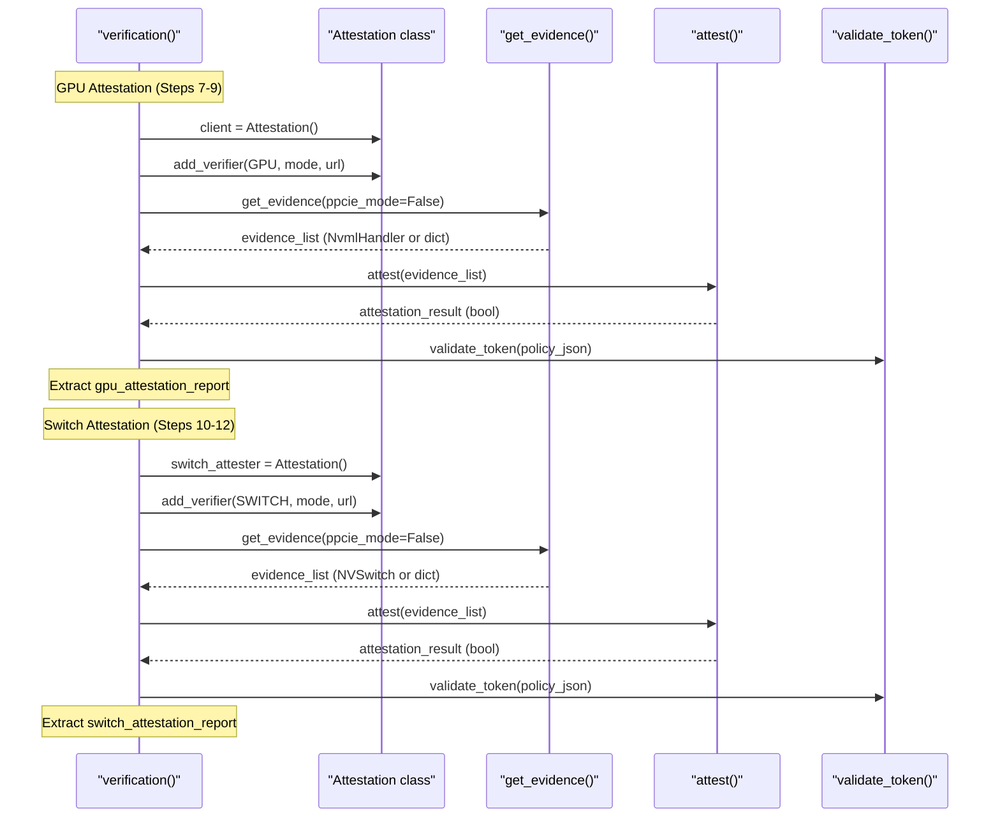
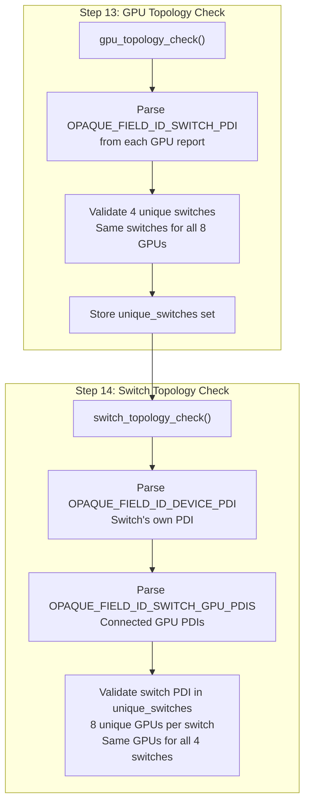
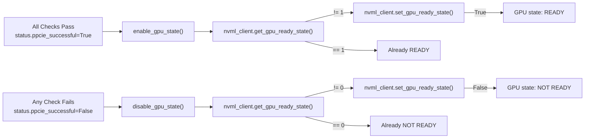
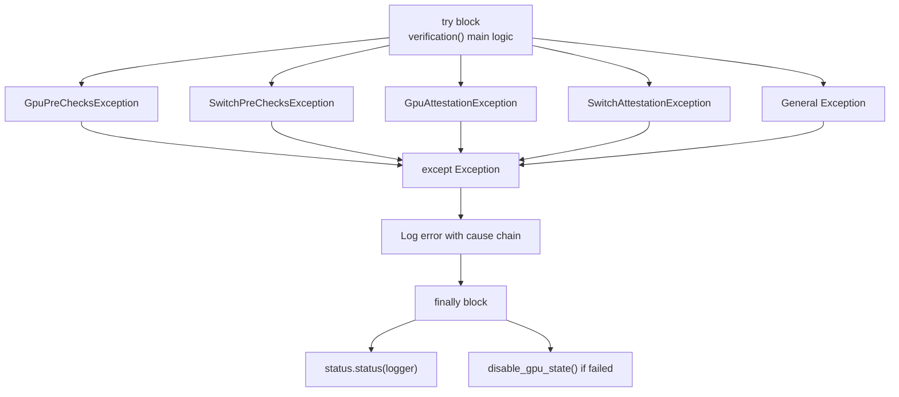
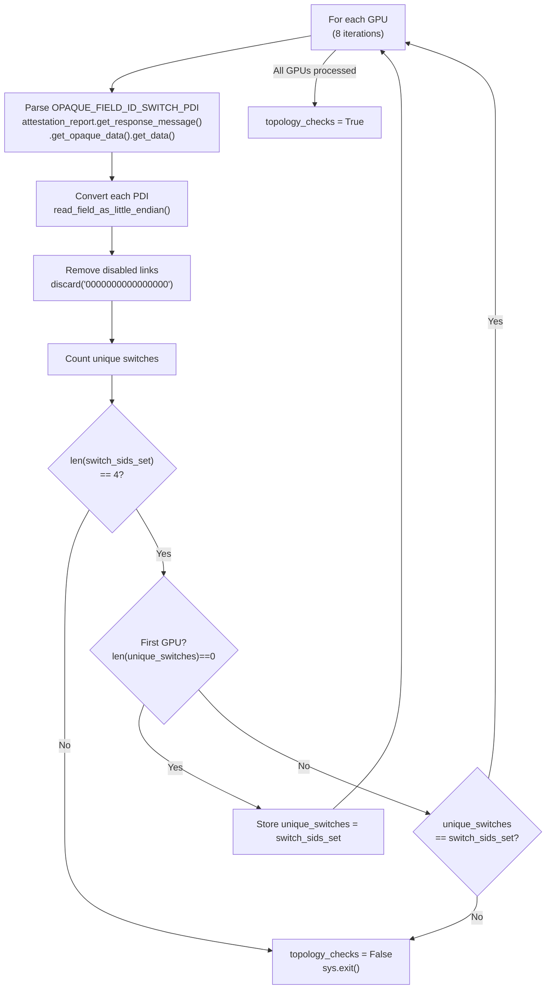
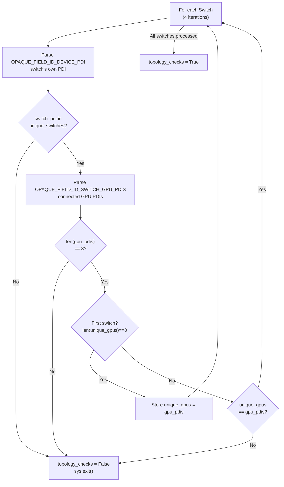

<!-- source: DeepWiki mcp.deepwiki.com · repo NVIDIA/nvtrust · page 5 PPCIE Verification · fetched 2026-10-26 -->

# PPCIE Verification

<details>
<summary>Relevant source files</summary>

The following files were used as context for generating this wiki page:

- [README.md](README.md)
- [guest_tools/README.md](guest_tools/README.md)
- [guest_tools/ppcie-verifier/README.md](guest_tools/ppcie-verifier/README.md)
- [guest_tools/ppcie-verifier/ppcie/verifier/src/topology/validate_topology.py](guest_tools/ppcie-verifier/ppcie/verifier/src/topology/validate_topology.py)
- [guest_tools/ppcie-verifier/ppcie/verifier/verification.py](guest_tools/ppcie-verifier/ppcie/verifier/verification.py)
- [guest_tools/ppcie-verifier/pyproject.toml](guest_tools/ppcie-verifier/pyproject.toml)
- [guest_tools/ppcie-verifier/tests/test_validate_topology.py](guest_tools/ppcie-verifier/tests/test_validate_topology.py)

</details>


## Purpose and Scope

PPCIE (Protected PCIE) Verification is a tool for validating multi-GPU confidential computing systems where all GPUs are configured in PPCIE mode and assigned to a single Confidential Virtual Machine. In PPCIE mode, NVLink interconnects are trusted to carry plain-text data between GPUs, eliminating the encryption/decryption overhead of the GPU Copy Engine (CE) while preserving confidential computing guarantees.

This page covers the PPCIE Verifier tool (`nv-ppcie-verifier`), its 16-step verification workflow, topology validation logic, and GPU ready state management. For information about attestation of individual GPUs in standard Confidential Computing mode, see [GPU Attestation](#3). For details on NVSwitch attestation, see [NVSwitch Attestation](#4). For installation instructions, see [Installation and Setup](#5.1). For the verification workflow details, see [Verification Workflow](#5.2).

**Sources**: [guest_tools/ppcie-verifier/README.md:1-55](), [guest_tools/ppcie-verifier/ppcie/verifier/verification.py:1-473]()

## System Requirements and Constraints

The PPCIE Verifier tool enforces strict system configuration requirements:

| Requirement | Value | Validation Point |
|-------------|-------|------------------|
| Number of GPUs | Exactly 8 | [verification.py:120-123]() |
| Number of NVSwitches | Exactly 4 | [verification.py:120-123]() |
| GPU Configuration | All in PPCIE mode (TNVL enabled) | [verification.py:322-347]() |
| Switch Configuration | TNVL + Lock mode enabled | [verification.py:421-468]() |
| VM Assignment | All GPUs in single tenant/VM | System requirement |
| Python Version | >= 3.9 | [pyproject.toml:11]() |
| Driver | NVIDIA GPU Driver installed | System requirement |
| Fabric Manager | NVIDIA Fabric Manager installed | System requirement |

The tool validates that GPUs and switches meet these requirements before proceeding with attestation. Both GPU and switch attestation modes (LOCAL or REMOTE) must match.

**Sources**: [guest_tools/ppcie-verifier/README.md:57-63](), [guest_tools/ppcie-verifier/ppcie/verifier/verification.py:120-128]()

## Architecture and Component Dependencies

### Component Hierarchy

The PPCIE Verifier orchestrates multiple lower-level components to perform end-to-end verification:



**Sources**: [guest_tools/ppcie-verifier/ppcie/verifier/verification.py:16-42](), [guest_tools/ppcie-verifier/pyproject.toml:29-30]()

### Package Dependencies



The PPCIE Verifier depends on the Attestation SDK for orchestrating GPU and switch attestation, and on the Local GPU Verifier for local attestation capabilities. The switch verifier is embedded within the Attestation SDK and does not require separate installation.

**Sources**: [guest_tools/ppcie-verifier/pyproject.toml:10-30](), [guest_tools/ppcie-verifier/README.md:66-73]()

## 16-Step Verification Workflow

The PPCIE verification process follows a strictly ordered 16-step workflow. Failure at any step prevents progression to subsequent steps and disables the GPU ready state.

### Workflow State Machine



**Sources**: [guest_tools/ppcie-verifier/README.md:36-55](), [guest_tools/ppcie-verifier/ppcie/verifier/verification.py:48-173]()

### Detailed Step Descriptions

#### Steps 1-4: Initialization and Device Enumeration

| Step | Function | Purpose | Exit Conditions |
|------|----------|---------|-----------------|
| 1 | `verification()` | Parse command-line arguments | Invalid arguments |
| 2 | `get_number_of_gpus()` | Enumerate GPUs via `NvmlClient` | 0 GPUs or count != 8 |
| 3 | `get_number_of_switches()` | Enumerate switches via `NSCQHandler` | 0 switches or count != 4 |
| 4 | Mode validation | Verify GPU and switch modes match | Mismatched modes |

**Implementation**: [verification.py:113-128]()

#### Steps 5-6: Pre-Checks



**GPU Pre-Check Details**:
- Validates `multiGpuMode == 1` indicating TNVL (Trusted NVLink) is enabled
- Uses `NvmlClient.get_system_conf_compute_settings()` to query system state
- **Implementation**: [verification.py:322-347]()

**Switch Pre-Check Details**:
- Validates TNVL mode (`is_switch_tnvl_mode() == 1`) for each switch
- Validates Lock mode (`is_switch_lock_mode() == 1`) for each switch
- Iterates through all switch UUIDs
- **Implementation**: [verification.py:421-468]()

**Sources**: [guest_tools/ppcie-verifier/ppcie/verifier/verification.py:322-468]()

#### Steps 7-12: Attestation Phase

The attestation phase collects evidence from devices and verifies it either locally or remotely:



**GPU Attestation Implementation**: [verification.py:248-319]()
- Creates `Attestation()` client with generated nonce
- Adds GPU verifier with mode (LOCAL/REMOTE) and service URLs
- Collects evidence: `NvmlHandler` objects (LOCAL) or base64-encoded dicts (REMOTE)
- Validates results against policy file: `data/NVGPU{mode}Policy_claims_{version}.json`

**Switch Attestation Implementation**: [verification.py:350-418]()
- Creates new `Attestation()` client for switches
- Adds SWITCH verifier with matching mode
- Collects evidence: `NVSwitch` objects (LOCAL) or base64-encoded dicts (REMOTE)
- Validates results against policy file: `data/NVSwitch{mode}Policy_claims_{version}.json`

**Sources**: [guest_tools/ppcie-verifier/ppcie/verifier/verification.py:248-418]()

#### Steps 13-14: Topology Validation

Topology validation ensures bidirectional connectivity between GPUs and switches using Platform Device Identifiers (PDIs) embedded in attestation reports.



**GPU Topology Check** ([validate_topology.py:140-210]()):
- Parses `OPAQUE_FIELD_ID_SWITCH_PDI` from each GPU attestation report
- Converts PDIs from little-endian binary to hexadecimal strings using `read_field_as_little_endian()`
- Validates exactly 4 unique switch PDIs per GPU (excluding disabled links `0000000000000000`)
- Ensures all 8 GPUs report the same 4 switch PDIs
- Stores validated switch PDIs in `self.unique_switches`

**Switch Topology Check** ([validate_topology.py:75-138]()):
- Parses `OPAQUE_FIELD_ID_DEVICE_PDI` (switch's own PDI)
- Verifies switch PDI exists in `self.unique_switches` from GPU topology check
- Parses `OPAQUE_FIELD_ID_SWITCH_GPU_PDIS` (connected GPU PDIs)
- Validates exactly 8 unique GPU PDIs per switch
- Ensures all 4 switches report the same 8 GPU PDIs

**Sources**: [guest_tools/ppcie-verifier/ppcie/verifier/src/topology/validate_topology.py:65-210](), [guest_tools/ppcie-verifier/tests/test_validate_topology.py:22-86]()

#### Steps 15-16: GPU Ready State Management

The final steps set the GPU ready state based on verification results:



**Enable GPU State** ([verification.py:193-206]()):
- Checks current state with `nvml_client.get_gpu_ready_state()`
- Sets state to `True` if not already set (value != 1)
- Only called when `status.ppcie_successful == True`

**Disable GPU State** ([verification.py:176-190]()):
- Checks current state and disables if set (value != 0)
- Called when any verification step fails
- Ensures GPUs cannot be used for confidential workloads

The GPU ready state is a hardware-level enforcement mechanism that gates whether GPUs accept confidential computing workloads.

**Sources**: [guest_tools/ppcie-verifier/ppcie/verifier/verification.py:154-207]()

## Configuration Options

The PPCIE Verifier accepts command-line arguments for configuration. All options are parsed in the `verification()` function using `argparse.ArgumentParser`.

### Required Arguments

| Argument | Type | Values | Description |
|----------|------|--------|-------------|
| `--gpu-attestation-mode` | Required | `LOCAL`, `REMOTE` | GPU attestation mode ([verification.py:59-64]()) |
| `--switch-attestation-mode` | Required | `LOCAL`, `REMOTE` | Switch attestation mode ([verification.py:65-70]()) |

**Constraint**: Both modes must match ([verification.py:125-128]())

### Optional Arguments

| Argument | Type | Default | Description |
|----------|------|---------|-------------|
| `--log` | Choice | None | Log level: `DEBUG`, `INFO`, `WARNING`, `ERROR`, `TRACE`, `CRITICAL` ([verification.py:71-75]()) |
| `--allow-hold-cert` | Flag | `False` | Continue attestation if certificate OCSP status is "hold" ([verification.py:76-81]()) |
| `--ocsp-nonce-disabled` | Flag | `False` | Disable nonce in OCSP requests ([verification.py:82-86]()) |
| `--ocsp-url` | String | `OCSP_SERVICE_URL` | Custom OCSP service URL ([verification.py:87-91]()) |
| `--rim-url` | String | `RIM_SERVICE_URL` | Custom RIM service URL ([verification.py:92-96]()) |
| `--service_key` | String | `ATTESTATION_SERVICE_KEY` | Service key for remote attestation ([verification.py:97-101]()) |
| `--claims-version` | Choice | `"2.0"` | Claims version: `"2.0"` or `"3.0"` ([verification.py:102-108]()) |

### Configuration Usage in Code

Configuration values are passed to the Attestation SDK during verifier setup:

```python
# GPU Attestation Configuration (verification.py:260-274)
client = attestation.Attestation()
client.set_nonce(generate_nonce())
client.set_name("HGX-node")
client.set_claims_version(args.get("claims_version") or "2.0")
client.set_ocsp_nonce_disabled(args["ocsp_nonce_disabled"])
client.set_service_key(args.get('service_key') or ATTESTATION_SERVICE_KEY)
client.add_verifier(
    dev=attestation.Devices.GPU,
    env=attestation.Environment[attestation_mode],
    url=REMOTE_GPU_VERIFIER_SERVICE_URL,
    evidence="",
    ocsp_url=args.get("ocsp_url") or OCSP_SERVICE_URL,
    rim_url=args.get("rim_url") or RIM_SERVICE_URL,
)
```

**Sources**: [guest_tools/ppcie-verifier/ppcie/verifier/verification.py:44-109](), [guest_tools/ppcie-verifier/README.md:96-108]()

## Status Tracking and Error Handling

### Status Object

The `Status` class tracks the success/failure of each verification stage:

| Attribute | Type | Description | Set By |
|-----------|------|-------------|--------|
| `gpu_pre_checks` | bool | GPU TNVL validation result | `validate_gpu_pre_checks()` |
| `switch_pre_checks` | bool | Switch TNVL/Lock validation result | `validate_switch_pre_checks()` |
| `gpu_attestation` | bool | GPU attestation result | `perform_gpu_attestation()` |
| `switch_attestation` | bool | Switch attestation result | `perform_switch_attestation()` |
| `topology_checks` | bool | Topology validation result | `gpu_topology_check()`, `switch_topology_check()` |
| `ppcie_successful` | bool | Overall verification result | `verification()` |

**Sources**: [guest_tools/ppcie-verifier/ppcie/verifier/src/utils/status.py]() (referenced), [guest_tools/ppcie-verifier/ppcie/verifier/verification.py:57-172]()

### Exception Handling



All exceptions are caught at the top level ([verification.py:162-171]()):
- Logs exception type and message
- Traverses exception cause chain (`e.__cause__`) for detailed diagnostics
- Calls `status.status(logger)` to report final state
- Ensures GPU ready state is disabled on failure

**Critical Exit Points**:
- Invalid device count: [verification.py:120-123]()
- Mismatched attestation modes: [verification.py:125-128]()
- Pre-check failures: [verification.py:338-346](), [verification.py:443-467]()
- Attestation failures: [verification.py:293-294](), [verification.py:315-317](), [verification.py:392-393](), [verification.py:414-417]()
- Topology check failures: [verification.py:89-91](), [verification.py:104-106](), [verification.py:121-129]()

All exit points call `sys.exit()` after logging errors and updating status.

**Sources**: [guest_tools/ppcie-verifier/ppcie/verifier/verification.py:31-37](), [guest_tools/ppcie-verifier/ppcie/verifier/verification.py:162-173]()

## Topology Validation Deep Dive

### Opaque Data Field Structure

Attestation reports contain opaque data fields with Platform Device Identifiers (PDIs) encoded in little-endian format:

| Field Name | Source | Content | Format |
|------------|--------|---------|--------|
| `OPAQUE_FIELD_ID_SWITCH_PDI` | GPU Report | PDIs of connected switches | Array of 8-byte binary values |
| `OPAQUE_FIELD_ID_DEVICE_PDI` | Switch Report | Switch's own PDI | 8-byte binary value |
| `OPAQUE_FIELD_ID_SWITCH_GPU_PDIS` | Switch Report | PDIs of connected GPUs | Tuple of 8-byte binary values |

**Little-Endian Conversion** ([validate_topology.py:37-54]()):
```python
def read_field_as_little_endian(binary_data):
    """Converts little-endian binary to hexadecimal string"""
    x = str()
    for i in range(len(binary_data)):
        temp = binary_data[i : i + 1]
        x = temp.hex() + x  # Reverse byte order
    return x
```

### GPU-to-Switch Validation Logic



**Key Validation Points**:
1. Each GPU must report exactly 4 unique switch PDIs ([validate_topology.py:176-183]())
2. Disabled NVLink connections (PDI `0000000000000000`) are filtered out ([validate_topology.py:171]())
3. All 8 GPUs must report the same 4 switch PDIs ([validate_topology.py:186-204]())

**Sources**: [guest_tools/ppcie-verifier/ppcie/verifier/src/topology/validate_topology.py:140-210]()

### Switch-to-GPU Validation Logic



**Key Validation Points**:
1. Switch's own PDI must exist in `unique_switches` from GPU validation ([validate_topology.py:100-106]())
2. Each switch must report exactly 8 unique GPU PDIs ([validate_topology.py:116-124]())
3. All 4 switches must report the same 8 GPU PDIs ([validate_topology.py:125-129]())

**Sources**: [guest_tools/ppcie-verifier/ppcie/verifier/src/topology/validate_topology.py:75-138]()

## Usage Examples

### Basic Usage

```bash
# Local attestation for both GPUs and switches
python3 -m ppcie.verifier.verification \
    --gpu-attestation-mode=LOCAL \
    --switch-attestation-mode=LOCAL

# Remote attestation with debug logging
python3 -m ppcie.verifier.verification \
    --gpu-attestation-mode=REMOTE \
    --switch-attestation-mode=REMOTE \
    --log=DEBUG \
    --service_key=<your-service-key>
```

### Advanced Configuration

```bash
# Custom RIM/OCSP URLs with certificate hold allowance
python3 -m ppcie.verifier.verification \
    --gpu-attestation-mode=LOCAL \
    --switch-attestation-mode=LOCAL \
    --rim-url=https://custom-rim.example.com/rims/ \
    --ocsp-url=https://custom-ocsp.example.com/ \
    --allow-hold-cert \
    --ocsp-nonce-disabled

# Using claims version 3.0
python3 -m ppcie.verifier.verification \
    --gpu-attestation-mode=LOCAL \
    --switch-attestation-mode=LOCAL \
    --claims-version=3.0
```

**Sources**: [guest_tools/ppcie-verifier/README.md:93-94]()

## Common Issues and Troubleshooting

### Installation Issues

| Error | Solution | Reference |
|-------|----------|-----------|
| `ModuleNotFoundError: No module named 'nv_attestation_sdk'` | Delete venv and reinstall using installer script | [README.md:112-114]() |
| `WARNING: Ignoring invalid distribution ~v-attestation-sdk` | Clean up corrupted packages: `rm -rf $(ls -l <site-packages> \| grep '~' \| awk '{print $9}')` | [README.md:115-119]() |

### Runtime Issues

| Error | Cause | Solution | Reference |
|-------|-------|----------|-----------|
| `The nvmlInit call timed out` | NVML library initialization failure | Reinstall NVIDIA GPU driver and Fabric Manager | [README.md:122-124]() |
| `NSCQWarning: NSCQ_RC_WARNING_RDT_INIT_FAILURE` | Incompatible switch driver version | Install switch driver compatible with GPU driver | [README.md:125-127]() |
| `Number of GPUs/Switches do not meet required configuration` | Invalid device count | Ensure exactly 8 GPUs and 4 switches | [verification.py:121-123]() |
| `GPU attestation mode and Switch attestation mode should be same` | Mismatched modes | Use same mode (LOCAL or REMOTE) for both | [verification.py:125-128]() |
| `TNVL is not enabled for all GPUs` | GPU not in PPCIE mode | Configure all GPUs for PPCIE/TNVL mode | [verification.py:338-342]() |
| `TNVL mode for switch is not enabled` | Switch not configured | Enable TNVL mode on all switches | [verification.py:439-445]() |
| `Lock mode for switch is not enabled` | Switch not locked | Enable Lock mode on all switches | [verification.py:453-459]() |
| Topology check failures | Incorrect physical connections or disabled links | Verify NVLink cable connections match expected topology | [validate_topology.py:177-183](), [validate_topology.py:116-124]() |

### Debugging Tips

1. **Enable Debug Logging**: Use `--log=DEBUG` to see detailed execution flow
2. **Check Device Enumeration**: Verify GPU and switch counts in initial logs
3. **Examine Status Object**: Final status report shows which stage failed
4. **Review GPU Ready State**: Check if GPUs are enabled/disabled correctly
5. **Validate Topology**: Ensure all NVLink connections are active (no `0000000000000000` PDIs except for genuinely disabled links)

**Sources**: [guest_tools/ppcie-verifier/README.md:109-128]()

---

