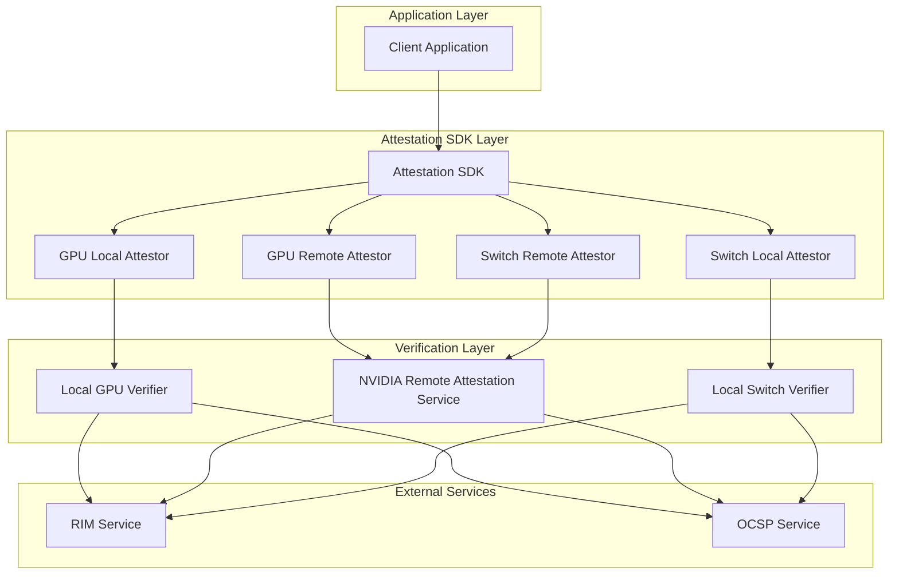
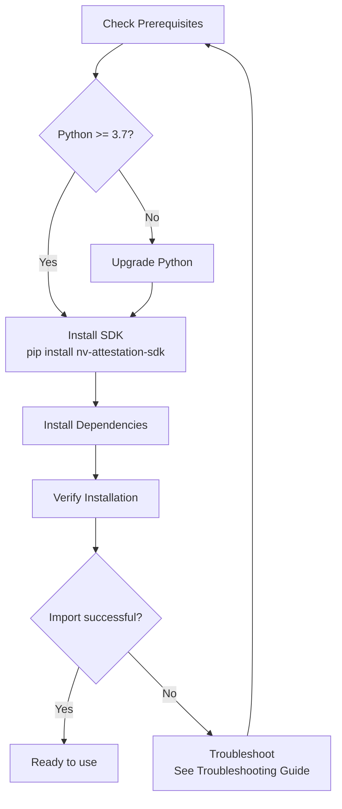
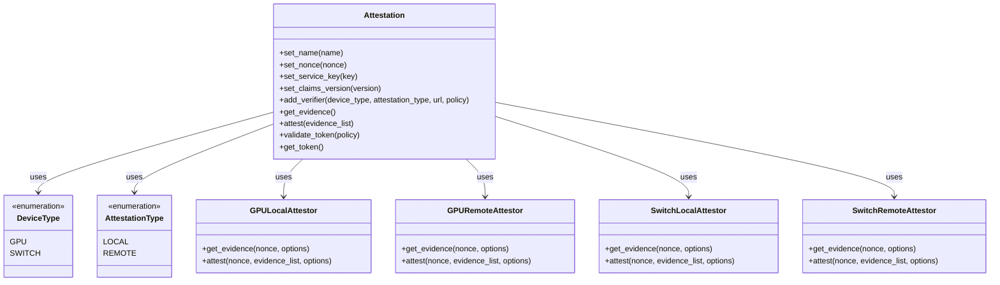

<!-- source: DeepWiki mcp.deepwiki.com · repo NVIDIA/nvtrust · page 5.1 Installation and Setup · fetched 2026-10-26 -->

# Installation and Setup

<details>
<summary>Relevant source files</summary>

The following files were used as context for generating this wiki page:

- [guest_tools/attestation_sdk/README.md](guest_tools/attestation_sdk/README.md)
- [guest_tools/attestation_sdk/pyproject.toml](guest_tools/attestation_sdk/pyproject.toml)

</details>


This document provides instructions for installing and configuring the NVIDIA Attestation SDK, a component of the nvTrust system that enables developers to implement attestation capabilities in their applications. For API usage details, refer to the [API Reference](#2.2).

## Overview

The Attestation SDK serves as the primary interface for applications to perform both local and remote attestation of NVIDIA GPUs and NVSwitches. The SDK abstracts the complexities of the attestation process and provides a consistent API across different device types and attestation methods.

**Attestation SDK in the nvTrust Ecosystem**



Sources: [guest_tools/attestation_sdk/pyproject.toml:1-44]()

## Prerequisites

Before installing the Attestation SDK, ensure your system meets the following requirements:

### Software Requirements

* Python 3.7 or later
* pip package manager
* Access to NVIDIA hardware for attestation (GPUs and/or NVSwitches)
* NVIDIA GPU drivers installed

### Hardware Requirements

* NVIDIA GPUs with attestation capabilities
* For NVSwitch attestation: Systems with NVSwitch hardware

## Installation Methods

The Attestation SDK can be installed using Python's package manager, pip.

### Installing with pip

The recommended way to install the Attestation SDK is directly from PyPI:

```bash
pip install nv-attestation-sdk
```

This will automatically install all required dependencies.

**Installation Process Flow**



Sources: [guest_tools/attestation_sdk/pyproject.toml:14-30]()

### Dependencies

The Attestation SDK requires the following major dependencies, which are automatically installed by pip:

| Dependency | Version | Purpose |
|------------|---------|---------|
| PyJWT | ~2.7.0 | JWT token handling for attestation results |
| requests | ~2.32.3 | HTTP requests to remote services |
| cryptography | ==43.0.1 | Cryptographic operations |
| ecdsa | ==0.18.0 | ECDSA signature verification |
| signxml | ==3.2.0 | XML signature handling |
| xmlschema | ==2.2.3 | XML schema validation |
| pyOpenSSL | ==24.2.1 | SSL/TLS functionality |
| nvidia-ml-py | >=12.535.77 | NVIDIA Management Library Python bindings |
| nv-local-gpu-verifier | 2.4.0 | Local GPU verification component |

Sources: [guest_tools/attestation_sdk/pyproject.toml:14-30]()

## SDK Architecture

The Attestation SDK is organized into modules that handle different aspects of the attestation process. Understanding this architecture helps with proper configuration and usage.

**SDK Component Architecture**



Sources: [guest_tools/attestation_sdk/dist/nv_attestation_sdk-1.4.0.tar.gz](), [guest_tools/attestation_sdk/dist/nv_attestation_sdk-1.4.0-py3-none-any.whl]()

## Configuration

After installation, you may need to configure the Attestation SDK based on your specific environment and requirements.

### Basic Configuration

Most basic configuration can be performed through the SDK's API. The main configuration points include:

1. **Setting the attestation name** - Identifies your application in the attestation process
2. **Configuring the nonce** - Used to prevent replay attacks
3. **Specifying attestation policy** - Determines verification requirements
4. **Adding verifiers** - Configures which devices to attest and how

### Environment Variables

The SDK may check for certain environment variables to modify its behavior:

| Variable Name | Purpose | Default |
|---------------|---------|---------|
| `NV_ATTESTATION_DEBUG` | Enable debug logging | Not set (disabled) |
| `NV_ATTESTATION_RIM_PATH` | Custom path to RIM files | System default |
| `NV_ATTESTATION_CERT_PATH` | Custom path to certificate files | System default |

Sources: [guest_tools/attestation_sdk/dist/nv_attestation_sdk-1.4.0.tar.gz]()

## Verification of Installation

To verify that the Attestation SDK is installed correctly, you can run a simple Python script that imports the main module:

```python
import nv_attestation_sdk

# Check the version
print(f"Attestation SDK version: {nv_attestation_sdk.__version__}")

# Create an attestation object
attestation = nv_attestation_sdk.Attestation()
print("Attestation SDK successfully imported")
```

If the import succeeds without errors, the SDK is installed correctly.

## Next Steps

Once you have successfully installed and configured the Attestation SDK, you can:

1. Learn how to use the API in detail by referring to the [API Reference](#2.2)
2. Explore [GPU Attestation](#3) for details on attesting GPU devices
3. Learn about [NVSwitch Attestation](#4) for NVSwitch attestation
4. See the [PPCIE Verification](#5) guide for multi-GPU system verification

For any issues encountered during installation or setup, consult the [Troubleshooting Guide](#6).

---

