<!-- source: DeepWiki mcp.deepwiki.com · repo NVIDIA/nvtrust · page 5.2 Verification Workflow · fetched 2026-10-26 -->

# Verification Workflow

Relevant source files

The following files were used as context for generating this wiki page:

- [README.md](README.md)
- [guest_tools/README.md](guest_tools/README.md)
- [guest_tools/ppcie-verifier/README.md](guest_tools/ppcie-verifier/README.md)
- [guest_tools/ppcie-verifier/ppcie/verifier/src/topology/validate_topology.py](guest_tools/ppcie-verifier/ppcie/verifier/src/topology/validate_topology.py)
- [guest_tools/ppcie-verifier/ppcie/verifier/verification.py](guest_tools/ppcie-verifier/ppcie/verifier/verification.py)
- [guest_tools/ppcie-verifier/tests/test_validate_topology.py](guest_tools/ppcie-verifier/tests/test_validate_topology.py)

## Purpose and Scope

This document describes the end-to-end verification workflow executed by the PPCIE Verifier tool. The workflow orchestrates GPU and NVSwitch attestation across multiple stages, culminating in topology validation and GPU ready state management. This page focuses on the sequential execution flow and control logic within the `verification()` function.

For installation and command-line usage, see [Installation and Setup](#5.1). For detailed topology validation algorithms, see [Topology Validation](#5.3). For GPU attestation internals, see [Local GPU Verifier Internals](#3.1.1). For NVSwitch attestation specifics, see [NVSwitch Attestation](#4).

---

## Workflow Overview

The PPCIE Verifier performs a 16-step verification process that validates both GPUs and NVSwitches in a multi-GPU confidential computing system. The workflow is implemented in the `verification()` function and uses the `Status` class to track the state of each verification stage.

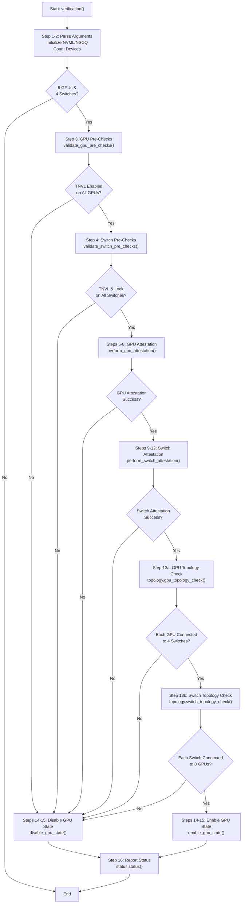

**Sources:** [guest_tools/ppcie-verifier/ppcie/verifier/verification.py:48-173](), [guest_tools/ppcie-verifier/README.md:36-55]()

---

## Verification Stages

The workflow is organized into five major stages, each represented by a field in the `Status` class:

| Stage | Status Field | Function | Success Criteria |
|-------|-------------|----------|------------------|
| **Stage 1** | `gpu_pre_checks` | `validate_gpu_pre_checks()` | All GPUs have TNVL (Trusted NVLink) mode enabled |
| **Stage 2** | `switch_pre_checks` | `validate_switch_pre_checks()` | All switches have TNVL and Lock mode enabled |
| **Stage 3** | `gpu_attestation` | `perform_gpu_attestation()` | All GPU attestation reports verify successfully |
| **Stage 4** | `switch_attestation` | `perform_switch_attestation()` | All switch attestation reports verify successfully |
| **Stage 5** | `topology_checks` | `TopologyValidation.gpu_topology_check()` and `TopologyValidation.switch_topology_check()` | Bidirectional topology validation passes |
| **Final** | `ppcie_successful` | Set based on all stages | All stages pass and GPU ready state is enabled |

**Sources:** [guest_tools/ppcie-verifier/ppcie/verifier/verification.py:48-173](), [guest_tools/ppcie-verifier/ppcie/verifier/src/utils/status.py]()

---

## Detailed Step-by-Step Process

### Steps 1-2: Initialization and System Enumeration

The workflow begins by parsing command-line arguments and initializing hardware interfaces:

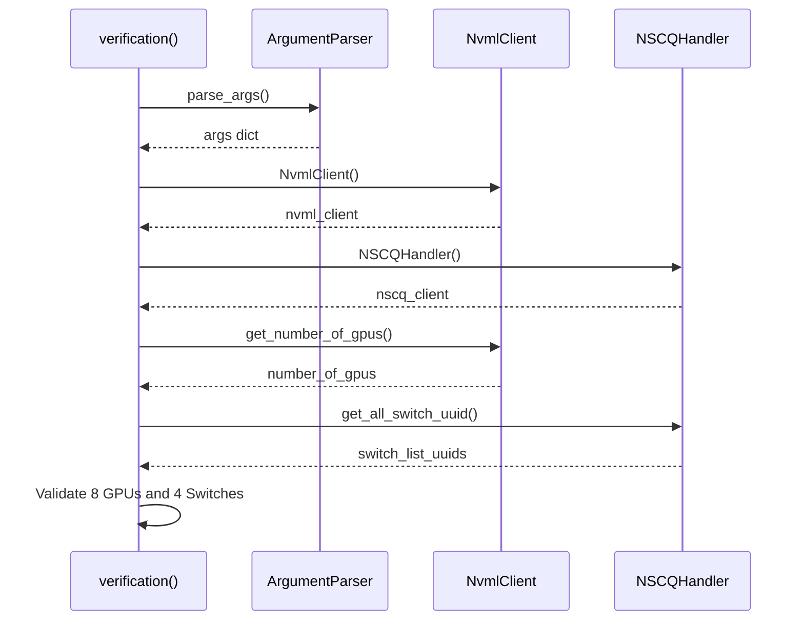

**Key Arguments:**
- `--gpu-attestation-mode`: Must be "LOCAL" or "REMOTE"
- `--switch-attestation-mode`: Must be "LOCAL" or "REMOTE"
- `--allow-hold-cert`: Continue if certificate is on hold
- `--ocsp-nonce-disabled`: Disable nonce in OCSP requests
- `--claims-version`: Version of attestation claims ("2.0" or "3.0")
- `--service_key`: Authentication key for remote services

The system validates that both modes are identical and that exactly 8 GPUs and 4 switches are present.

**Sources:** [guest_tools/ppcie-verifier/ppcie/verifier/verification.py:59-128](), [guest_tools/ppcie-verifier/ppcie/verifier/verification.py:224-237](), [guest_tools/ppcie-verifier/ppcie/verifier/verification.py:209-221]()

### Step 3: GPU Pre-Checks

The `validate_gpu_pre_checks()` function verifies that all GPUs have confidential computing enabled:

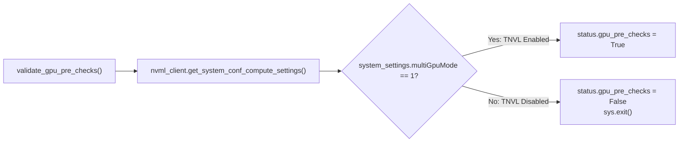

**TNVL Mode:** Trusted NVLink mode ensures that inter-GPU communication is encrypted. The `multiGpuMode` field must equal 1 for all GPUs in the system.

**Sources:** [guest_tools/ppcie-verifier/ppcie/verifier/verification.py:322-347](), [guest_tools/ppcie-verifier/ppcie/verifier/verification.py:130-134]()

### Step 4: Switch Pre-Checks

The `validate_switch_pre_checks()` function validates each switch's security configuration:

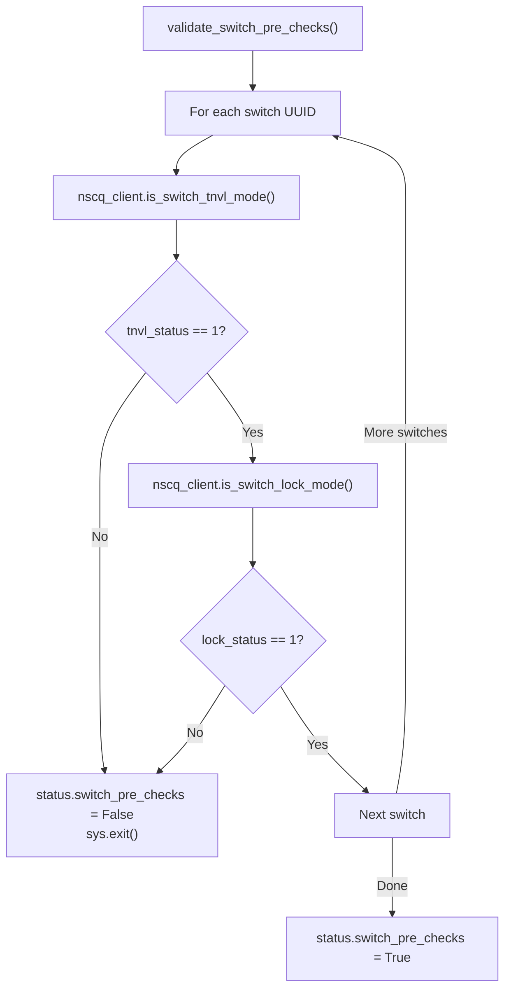

**Switch Requirements:**
- **TNVL Mode:** Encrypted NVLink traffic between switch and GPUs
- **Lock Mode:** Prevents unauthorized configuration changes

**Sources:** [guest_tools/ppcie-verifier/ppcie/verifier/verification.py:421-468](), [guest_tools/ppcie-verifier/ppcie/verifier/verification.py:131-134]()

### Steps 5-8: GPU Attestation

The `perform_gpu_attestation()` function orchestrates GPU attestation through the Attestation SDK:

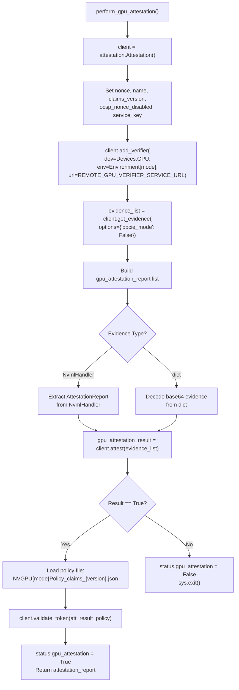

**Evidence Processing:**
- **LOCAL mode:** Evidence is `NvmlHandler` object containing raw attestation report
- **REMOTE mode:** Evidence is dict with base64-encoded attestation report

**Policy Validation:** The JWT token is validated against policy files in the `data/` directory. Policy files specify expected claims for different attestation modes and claim versions.

**Sources:** [guest_tools/ppcie-verifier/ppcie/verifier/verification.py:248-319](), [guest_tools/ppcie-verifier/ppcie/verifier/verification.py:136-138]()

### Steps 9-12: Switch Attestation

The `perform_switch_attestation()` function mirrors GPU attestation for NVSwitches:

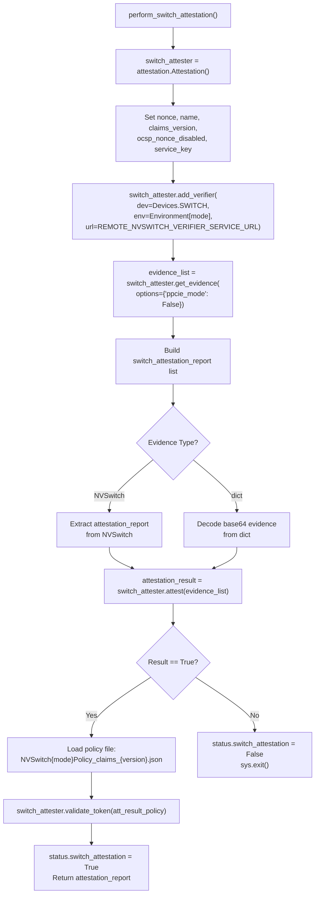

**Sources:** [guest_tools/ppcie-verifier/ppcie/verifier/verification.py:350-418](), [guest_tools/ppcie-verifier/ppcie/verifier/verification.py:140-142]()

### Step 13: Topology Validation

Topology validation occurs in two phases, executed by the `TopologyValidation` class:

**Phase 1: GPU Topology Check**

The `gpu_topology_check()` method validates that each GPU is connected to exactly 4 unique switches:

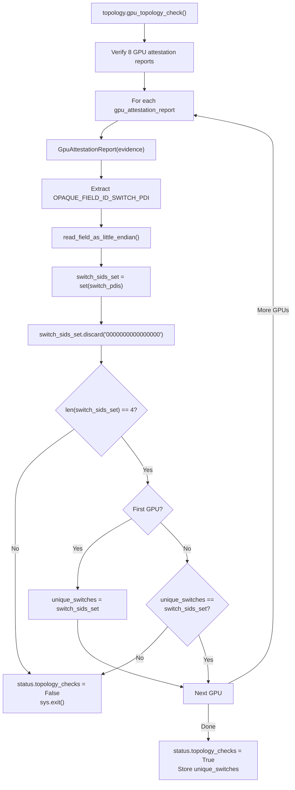

**Phase 2: Switch Topology Check**

The `switch_topology_check()` method validates that each switch is connected to exactly 8 unique GPUs:

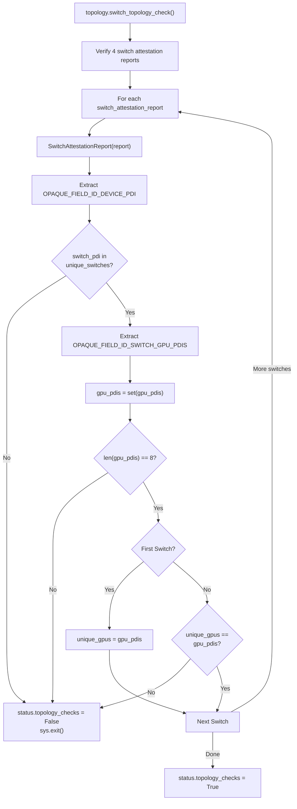

**Topology Validation Criteria:**
- All 8 GPUs must be connected to the same 4 unique switches
- All 4 switches must be connected to the same 8 unique GPUs
- Disabled links (PDI = 0000000000000000) are ignored

**Sources:** [guest_tools/ppcie-verifier/ppcie/verifier/src/topology/validate_topology.py:65-211](), [guest_tools/ppcie-verifier/ppcie/verifier/verification.py:144-151]()

### Steps 14-15: GPU Ready State Management

Based on the overall verification result, the GPU ready state is set or cleared:

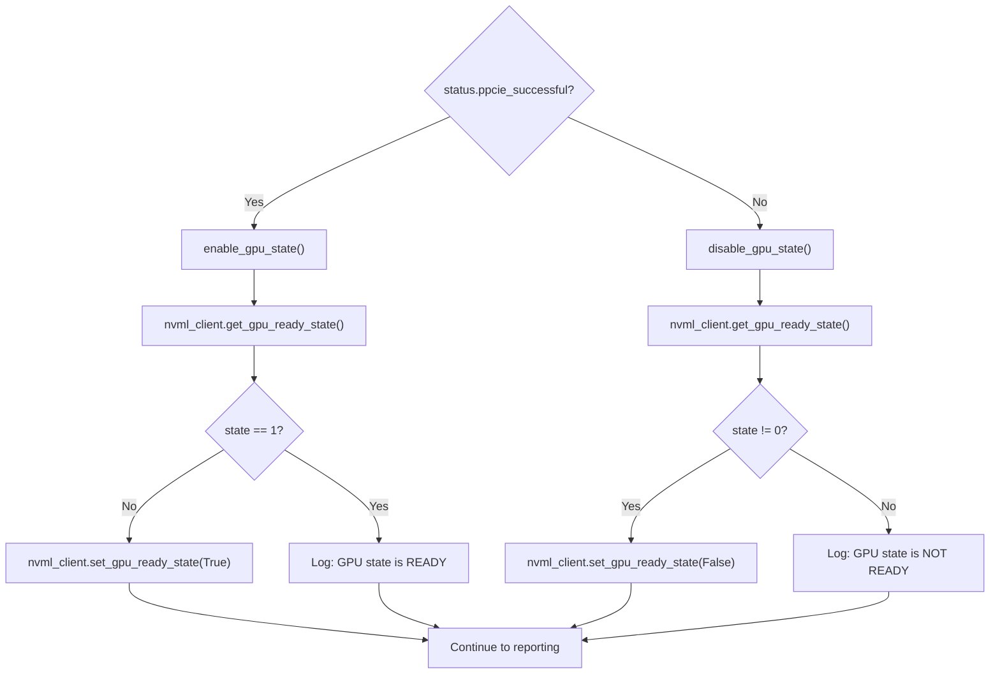

**GPU Ready State:** This is a hardware-level flag that controls whether the GPU accepts workloads. It acts as a hardware enforcement mechanism for attestation results.

**Sources:** [guest_tools/ppcie-verifier/ppcie/verifier/verification.py:153-158](), [guest_tools/ppcie-verifier/ppcie/verifier/verification.py:176-206]()

### Step 16: Status Reporting

The final step reports the status of all verification stages:

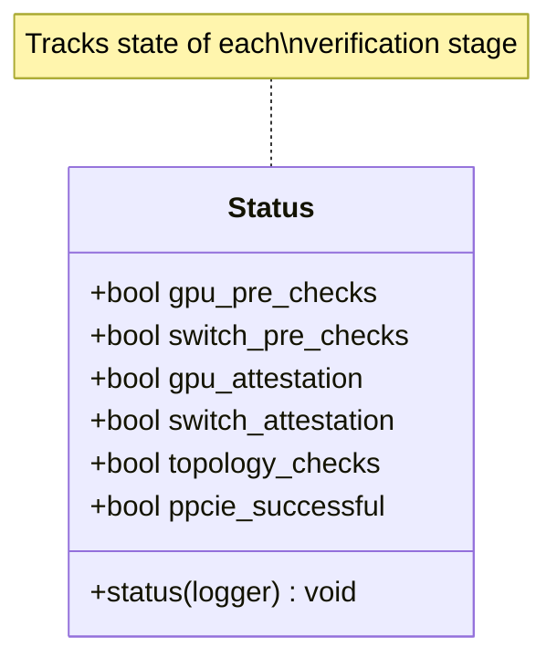

The `status.status()` method logs the results of each stage, providing visibility into which stage failed if the overall verification was unsuccessful.

**Sources:** [guest_tools/ppcie-verifier/ppcie/verifier/verification.py:172](), [guest_tools/ppcie-verifier/ppcie/verifier/src/utils/status.py]()

---

## Code Flow Mapping

This diagram maps the high-level workflow stages to specific code entities:

```mermaid
graph TB
    subgraph "Entry Point"
        Main["verification():<br/>verification.py:48"]
    end
    
    subgraph "Initialization Stage"
        ArgParse["ArgumentParser:<br/>verification.py:44-109"]
        NVMLInit["NvmlClient():<br/>nvml_client.py"]
        NSCQInit["NSCQHandler():<br/>nscq.py"]
        CountGPU["get_number_of_gpus():<br/>verification.py:224"]
        CountSwitch["get_number_of_switches():<br/>verification.py:209"]
    end
    
    subgraph "Pre-Check Stage"
        GPUPreCheck["validate_gpu_pre_checks():<br/>verification.py:322"]
        SwitchPreCheck["validate_switch_pre_checks():<br/>verification.py:421"]
        SysConfCheck["get_system_conf_compute_settings():<br/>nvml_client.py"]
        TNVLCheck["is_switch_tnvl_mode():<br/>nscq.py"]
        LockCheck["is_switch_lock_mode():<br/>nscq.py"]
    end
    
    subgraph "Attestation Stage"
        GPUAttest["perform_gpu_attestation():<br/>verification.py:248"]
        SwitchAttest["perform_switch_attestation():<br/>verification.py:350"]
        AttSDK["attestation.Attestation:<br/>nv_attestation_sdk"]
        AddVerifier["add_verifier():<br/>attestation.py"]
        GetEvidence["get_evidence():<br/>attestation.py"]
        Attest["attest():<br/>attestation.py"]
        ValidateToken["validate_token():<br/>attestation.py"]
    end
    
    subgraph "Topology Stage"
        TopoClass["TopologyValidation:<br/>validate_topology.py:65"]
        GPUTopo["gpu_topology_check():<br/>validate_topology.py:140"]
        SwitchTopo["switch_topology_check():<br/>validate_topology.py:75"]
        GpuAttReport["GpuAttestationReport:<br/>attestation.py"]
        SwitchAttReport["SwitchAttestationReport:<br/>attestation.py"]
    end
    
    subgraph "State Management Stage"
        EnableState["enable_gpu_state():<br/>verification.py:193"]
        DisableState["disable_gpu_state():<br/>verification.py:176"]
        GetGPUState["get_gpu_ready_state():<br/>nvml_client.py"]
        SetGPUState["set_gpu_ready_state():<br/>nvml_client.py"]
    end
    
    subgraph "Status Stage"
        StatusClass["Status:<br/>status.py"]
        StatusReport["status.status():<br/>status.py"]
    end

    Main --> ArgParse
    Main --> NVMLInit
    Main --> NSCQInit
    Main --> CountGPU
    Main --> CountSwitch
    Main --> GPUPreCheck
    Main --> SwitchPreCheck
    Main --> GPUAttest
    Main --> SwitchAttest
    Main --> TopoClass
    Main --> EnableState
    Main --> DisableState
    Main --> StatusReport
    
    GPUPreCheck --> SysConfCheck
    SwitchPreCheck --> TNVLCheck
    SwitchPreCheck --> LockCheck
    
    GPUAttest --> AttSDK
    SwitchAttest --> AttSDK
    AttSDK --> AddVerifier
    AttSDK --> GetEvidence
    AttSDK --> Attest
    AttSDK --> ValidateToken
    
    TopoClass --> GPUTopo
    TopoClass --> SwitchTopo
    GPUTopo --> GpuAttReport
    SwitchTopo --> SwitchAttReport
    
    EnableState --> GetGPUState
    EnableState --> SetGPUState
    DisableState --> GetGPUState
    DisableState --> SetGPUState
```

**Sources:** [guest_tools/ppcie-verifier/ppcie/verifier/verification.py:48-473](), [guest_tools/ppcie-verifier/ppcie/verifier/src/topology/validate_topology.py]()

---

## Error Handling and Exit Behavior

The verification workflow uses `sys.exit()` for immediate termination when critical failures occur. This ensures that subsequent stages do not execute if prerequisites fail:

| Exit Location | Condition | Status Fields Set |
|--------------|-----------|-------------------|
| [verification.py:123]() | Not 8 GPUs and 4 switches | None |
| [verification.py:127]() | GPU and switch modes differ | None |
| [verification.py:342]() | TNVL not enabled on GPU | `gpu_pre_checks = False` |
| [verification.py:345]() | Exception in GPU pre-checks | `gpu_pre_checks = False` |
| [verification.py:444-458]() | TNVL/Lock not enabled on switch | `switch_pre_checks = False` |
| [verification.py:294]() | Invalid evidence type for GPU | `gpu_attestation = False` |
| [verification.py:317]() | Exception in GPU attestation | `gpu_attestation = False` |
| [verification.py:393]() | Invalid evidence type for switch | `switch_attestation = False` |
| [verification.py:417]() | Exception in switch attestation | `switch_attestation = False` |
| [validate_topology.py:91-205]() | Topology validation failure | `topology_checks = False` |

Before exiting, the `finally` block always executes:
1. `status.status(logger)` - Reports the status of all stages
2. `logger.info("PPCIE: End of PPCIE Verification Tool")` - Final log message

**Sources:** [guest_tools/ppcie-verifier/ppcie/verifier/verification.py:162-173]()

---

## Configuration Impact on Workflow

The command-line arguments affect workflow behavior at multiple points:

```mermaid
graph TB
    subgraph "Argument Processing"
        ArgMode["--gpu-attestation-mode<br/>--switch-attestation-mode"]
        ArgClaims["--claims-version"]
        ArgOCSP["--ocsp-nonce-disabled"]
        ArgServiceKey["--service_key"]
        ArgCertHold["--allow-hold-cert"]
        ArgURLs["--rim-url<br/>--ocsp-url"]
    end
    
    subgraph "Workflow Impact"
        ModeCheck["Modes must match<br/>verification.py:125-128"]
        AddVerifierGPU["client.add_verifier()<br/>env=Environment[mode]<br/>verification.py:267-274"]
        AddVerifierSwitch["switch_attester.add_verifier()<br/>env=Environment[mode]<br/>verification.py:369-376"]
        SetClaims["client.set_claims_version()<br/>verification.py:263,365"]
        SetOCSP["client.set_ocsp_nonce_disabled()<br/>verification.py:264,366"]
        SetServiceKey["client.set_service_key()<br/>verification.py:265,367"]
        SetHoldCert["set_allow_hold_cert()<br/>verification.py:124"]
        PolicyFile["Load policy file:<br/>{Device}{Mode}Policy_claims_{version}.json<br/>verification.py:303,402"]
    end

    ArgMode --> ModeCheck
    ArgMode --> AddVerifierGPU
    ArgMode --> AddVerifierSwitch
    ArgClaims --> SetClaims
    ArgClaims --> PolicyFile
    ArgOCSP --> SetOCSP
    ArgServiceKey --> SetServiceKey
    ArgCertHold --> SetHoldCert
    ArgURLs --> AddVerifierGPU
    ArgURLs --> AddVerifierSwitch
    ArgMode --> PolicyFile
```

**Policy File Selection:** The policy file path is constructed using the attestation mode and claims version:
- Local GPU (v2.0): `data/NVGPULocalPolicy_claims_2.0.json`
- Remote GPU (v2.0): `data/NVGPURemotePolicy_claims_2.0.json`
- Local Switch (v2.0): `data/NVSwitchLocalPolicy_claims_2.0.json`
- Remote Switch (v2.0): `data/NVSwitchRemotePolicy_claims_2.0.json`

Similar files exist for claims version 3.0.

**Sources:** [guest_tools/ppcie-verifier/ppcie/verifier/verification.py:59-109](), [guest_tools/ppcie-verifier/ppcie/verifier/verification.py:124-128](), [guest_tools/ppcie-verifier/ppcie/verifier/verification.py:303](), [guest_tools/ppcie-verifier/ppcie/verifier/verification.py:402]()

---

## Attestation Report Flow

This diagram shows how attestation reports flow through the system:

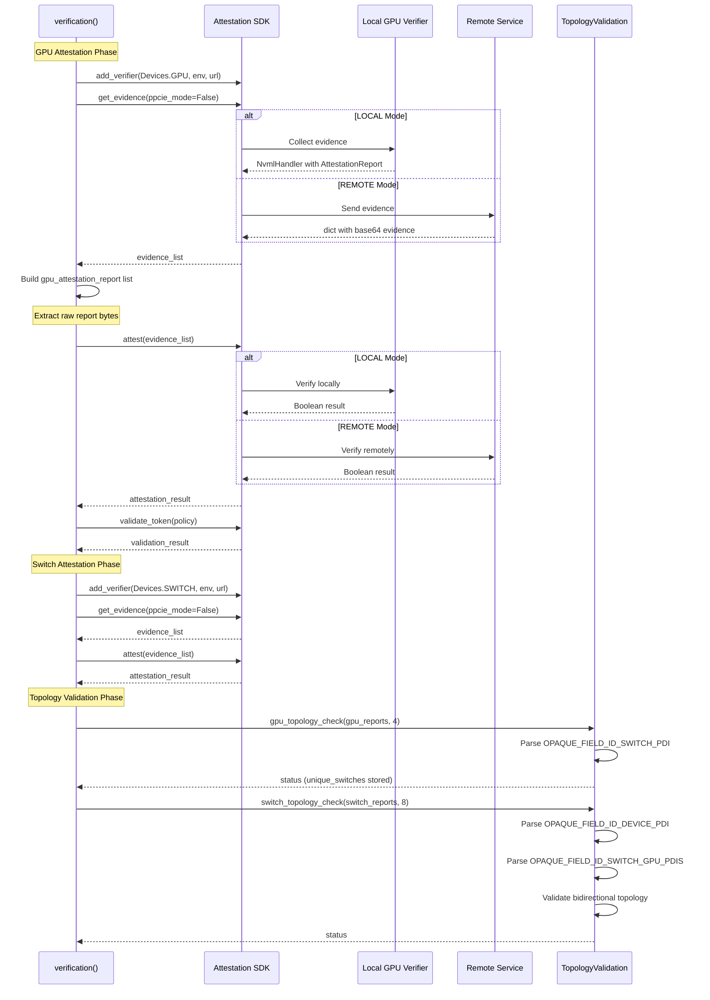

**Sources:** [guest_tools/ppcie-verifier/ppcie/verifier/verification.py:248-319](), [guest_tools/ppcie-verifier/ppcie/verifier/verification.py:350-418](), [guest_tools/ppcie-verifier/ppcie/verifier/verification.py:144-151]()

---

## Summary

The PPCIE Verification Workflow orchestrates a comprehensive 16-step process that validates the security configuration, attestation, and topology of multi-GPU systems with NVSwitch interconnects. The workflow is implemented as a linear progression through five major stages, with immediate termination on failure and GPU ready state management as the final enforcement mechanism. The `Status` class tracks progress through each stage, and the `verification()` function in [verification.py:48-473]() serves as the central orchestrator for all verification activities.

---

