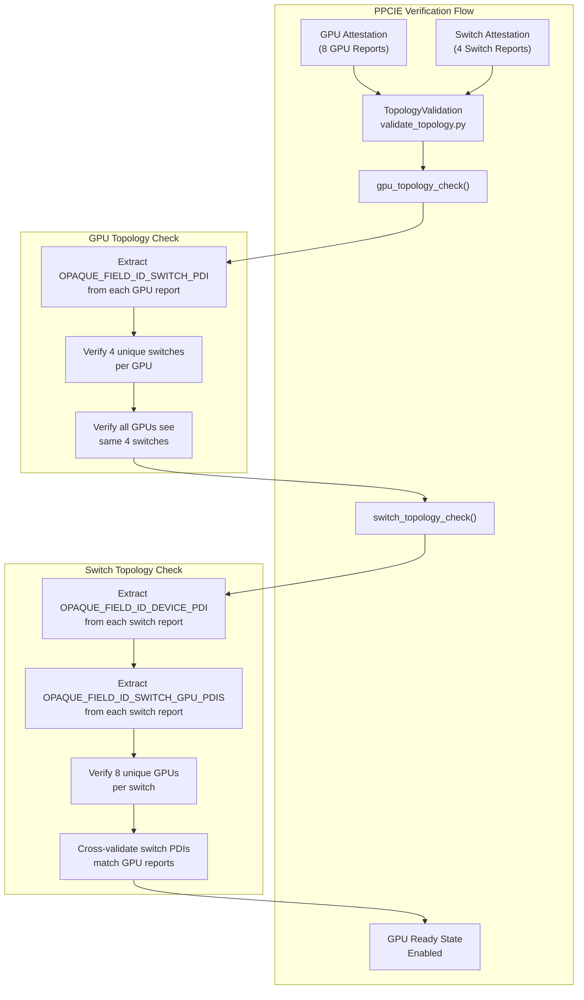
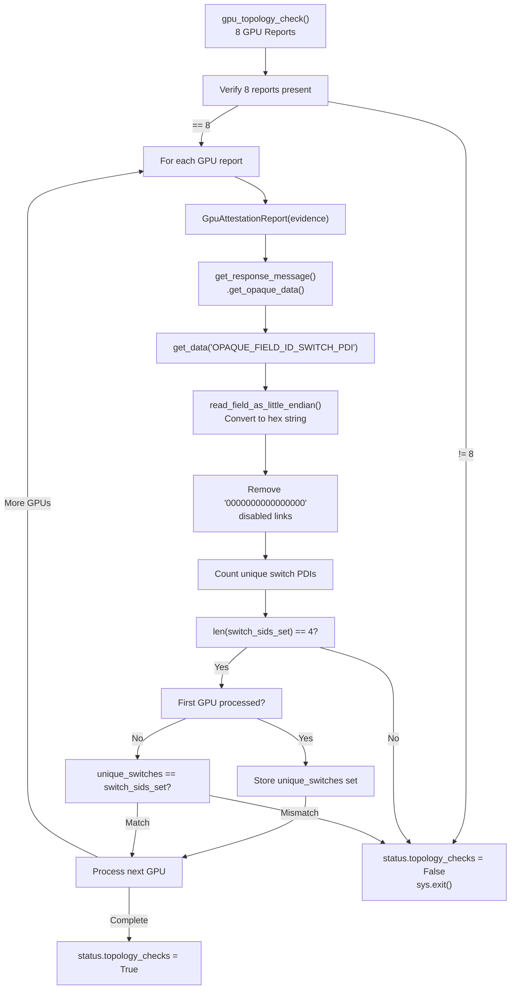
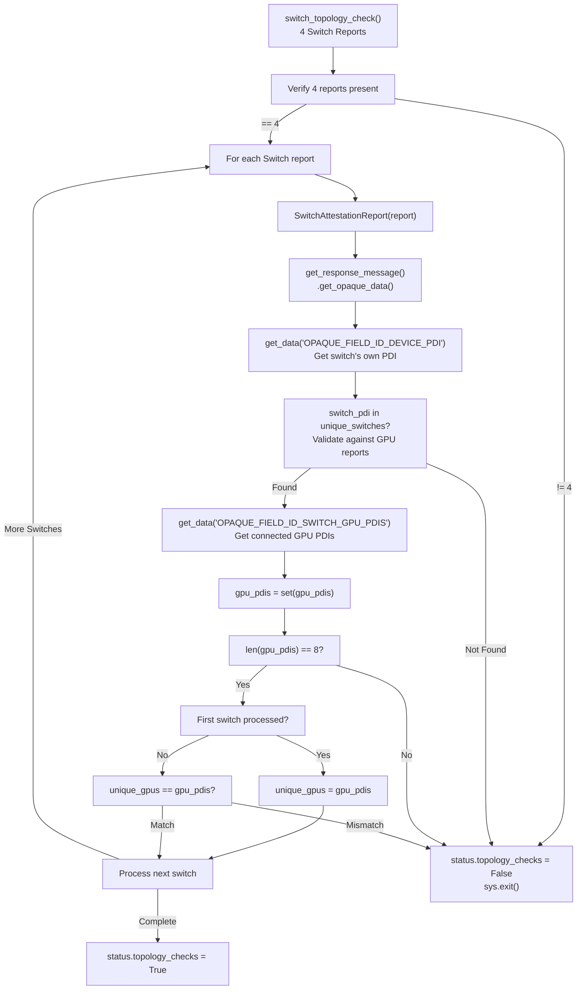
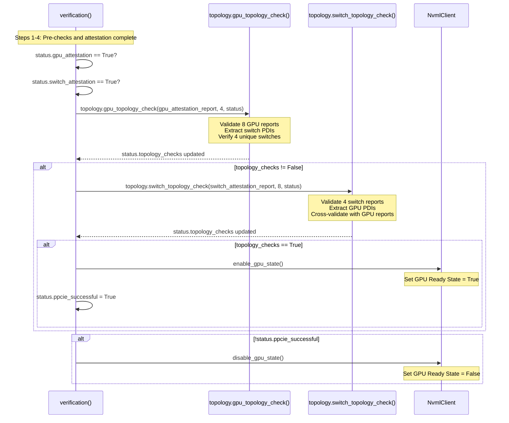
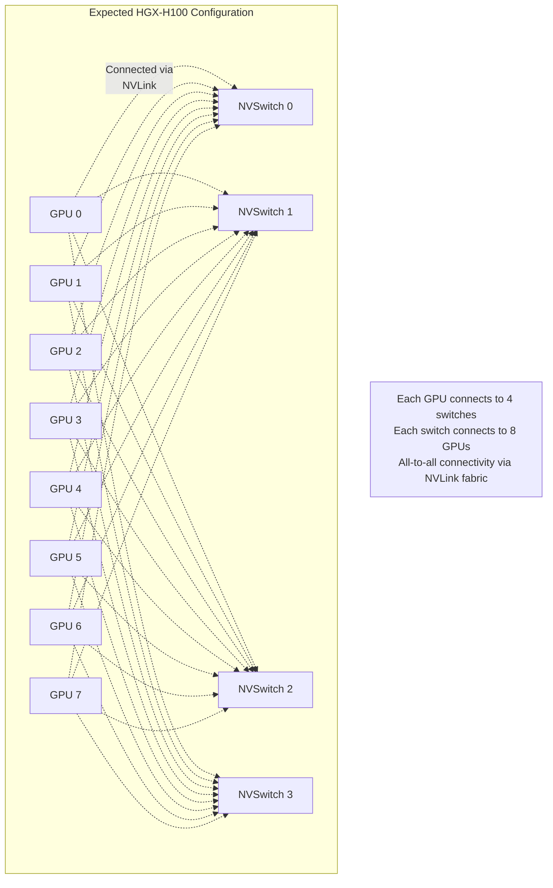

<!-- source: DeepWiki mcp.deepwiki.com · repo NVIDIA/nvtrust · page 5.3 Topology Validation · fetched 2026-10-26 -->

# Topology Validation

<details>
<summary>Relevant source files</summary>

The following files were used as context for generating this wiki page:

- [guest_tools/ppcie-verifier/ppcie/verifier/src/topology/validate_topology.py](guest_tools/ppcie-verifier/ppcie/verifier/src/topology/validate_topology.py)
- [guest_tools/ppcie-verifier/ppcie/verifier/verification.py](guest_tools/ppcie-verifier/ppcie/verifier/verification.py)
- [guest_tools/ppcie-verifier/tests/test_validate_topology.py](guest_tools/ppcie-verifier/tests/test_validate_topology.py)

</details>


## Purpose and Scope

Topology Validation is a critical component of the PPCIE verification workflow that ensures correct physical interconnections between GPUs and NVSwitches in multi-GPU confidential computing systems. This validation step verifies that each GPU is connected to the expected set of NVSwitches and vice versa, using cryptographically-signed attestation reports as the source of truth.

This page documents the bidirectional topology validation logic that occurs after successful GPU and switch attestation. For information about the overall PPCIE verification workflow, see [Verification Workflow](#5.2). For details on GPU attestation evidence collection, see [GPU Attestation](#3). For NVSwitch attestation, see [NVSwitch Attestation](#4).

**Sources**: [guest_tools/ppcie-verifier/ppcie/verifier/src/topology/validate_topology.py:1-211](), [guest_tools/ppcie-verifier/ppcie/verifier/verification.py:144-152]()

## Bidirectional Validation Approach

Topology validation performs two complementary checks to ensure bidirectional consistency:

1. **GPU → Switch Validation**: Verifies each GPU attestation report contains references to exactly 4 unique NVSwitches
2. **Switch → GPU Validation**: Verifies each NVSwitch attestation report contains references to exactly 8 unique GPUs

The validation ensures that the physical topology matches the expected HGX configuration and that all devices report a consistent view of the interconnect fabric.



**Sources**: [guest_tools/ppcie-verifier/ppcie/verifier/src/topology/validate_topology.py:65-211](), [guest_tools/ppcie-verifier/ppcie/verifier/verification.py:144-152]()

## TopologyValidation Class

The `TopologyValidation` class in [guest_tools/ppcie-verifier/ppcie/verifier/src/topology/validate_topology.py:65-211]() orchestrates the validation process. It maintains state across both validation phases to enable cross-validation between GPU and switch reports.

### Class Attributes

| Attribute | Type | Purpose |
|-----------|------|---------|
| `opaque_data_field` | `dict` | Dictionary for storing extracted opaque data fields |
| `unique_switches` | `set` | Set of unique switch PDIs found during GPU topology check |
| `unique_gpus` | `set` | Set of unique GPU PDIs found during switch topology check |

### Key Methods

| Method | Purpose | Expected Configuration |
|--------|---------|----------------------|
| `gpu_topology_check()` | Validates GPU-to-switch connections | 8 GPU reports, each connected to 4 switches |
| `switch_topology_check()` | Validates switch-to-GPU connections | 4 switch reports, each connected to 8 GPUs |

**Sources**: [guest_tools/ppcie-verifier/ppcie/verifier/src/topology/validate_topology.py:65-73]()

## GPU Topology Validation

The `gpu_topology_check()` method validates that each GPU is connected to the correct set of NVSwitches by extracting and analyzing switch PDIs (Physical Device Identifiers) from GPU attestation reports.

### Workflow Diagram



**Sources**: [guest_tools/ppcie-verifier/ppcie/verifier/src/topology/validate_topology.py:140-210]()

### Opaque Data Field Extraction

GPU attestation reports contain opaque data fields that encode physical topology information. The `OPAQUE_FIELD_ID_SWITCH_PDI` field contains an array of PDIs representing the NVSwitches connected to each GPU.

```mermaid
graph LR
    subgraph "GPU Attestation Report Structure"
        AttReport["attestation_report<br/>(bytes)"]
        GpuAttObj["GpuAttestationReport(evidence, settings)"]
        RespMsg["get_response_message()"]
        OpaqueData["get_opaque_data()"]
        SwitchPDIs["get_data('OPAQUE_FIELD_ID_SWITCH_PDI')<br/>Returns: List[bytes]"]
    end
    
    subgraph "PDI Processing"
        ByteArray["switch_pdis_in_evidence<br/>List of 8-byte PDIs"]
        LEConvert["read_field_as_little_endian()<br/>Converts bytes to hex string"]
        HexStrings["switch_pdis: List[str]<br/>e.g., '90fd48d7b3c6b940'"]
        UniqueSet["switch_sids_set: set<br/>Remove duplicates and zeros"]
    end
    
    AttReport --> GpuAttObj
    GpuAttObj --> RespMsg
    RespMsg --> OpaqueData
    OpaqueData --> SwitchPDIs
    SwitchPDIs --> ByteArray
    ByteArray --> LEConvert
    LEConvert --> HexStrings
    HexStrings --> UniqueSet
```



**Sources**: [guest_tools/ppcie-verifier/ppcie/verifier/src/topology/validate_topology.py:159-168]()

### Little-Endian Conversion

The `read_field_as_little_endian()` helper function converts multi-byte binary PDI data from little-endian byte order to a hexadecimal string representation. This is necessary because the attestation report encodes PDIs in little-endian format.

```python
# Example from test case:
# Input: b'\x90\xfdH\xd7\xb3\xc6\xb9@'
# Output: '40b9c6b3d7h48fd90' (reversed byte order)
```

**Sources**: [guest_tools/ppcie-verifier/ppcie/verifier/src/topology/validate_topology.py:37-54]()

### Disabled Link Handling

GPUs may have fewer than the maximum number of switch connections due to disabled links. The validation logic filters out disabled links, represented by the PDI value `0000000000000000`, before counting unique switches.

**Sources**: [guest_tools/ppcie-verifier/ppcie/verifier/src/topology/validate_topology.py:169-172](), [guest_tools/ppcie-verifier/tests/test_validate_topology.py:71-86]()

### Consistency Verification

After processing the first GPU's attestation report, the validation stores the set of unique switch PDIs in `self.unique_switches`. For each subsequent GPU, it verifies that the extracted switch PDIs match this stored set, ensuring all GPUs are connected to the same 4 NVSwitches.

**Sources**: [guest_tools/ppcie-verifier/ppcie/verifier/src/topology/validate_topology.py:186-204]()

## Switch Topology Validation

The `switch_topology_check()` method validates that each NVSwitch is connected to all 8 GPUs and that the switch PDIs reported by switches match those found in GPU attestation reports.

### Workflow Diagram



**Sources**: [guest_tools/ppcie-verifier/ppcie/verifier/src/topology/validate_topology.py:75-138]()

### Opaque Data Fields in Switch Reports

Switch attestation reports contain two relevant opaque data fields:

| Field ID | Type | Content |
|----------|------|---------|
| `OPAQUE_FIELD_ID_DEVICE_PDI` | `bytes` | The switch's own PDI (8 bytes) |
| `OPAQUE_FIELD_ID_SWITCH_GPU_PDIS` | `List[bytes]` | PDIs of all connected GPUs |

**Sources**: [guest_tools/ppcie-verifier/ppcie/verifier/src/topology/validate_topology.py:94-111]()

### Cross-Validation Logic

The switch topology check performs cross-validation between GPU and switch reports:

1. **Switch PDI Verification**: The switch's own PDI (from `OPAQUE_FIELD_ID_DEVICE_PDI`) must exist in the `unique_switches` set that was populated during GPU topology validation
2. **GPU PDI Collection**: The list of GPU PDIs (from `OPAQUE_FIELD_ID_SWITCH_GPU_PDIS`) must contain exactly 8 unique entries
3. **Consistency Check**: All switches must report the same set of 8 GPU PDIs

If a switch PDI is not found in the `unique_switches` set, it indicates a mismatch between what GPUs report seeing and what switches report being.

**Sources**: [guest_tools/ppcie-verifier/ppcie/verifier/src/topology/validate_topology.py:100-106]()

## Integration with PPCIE Verification Workflow

Topology validation is invoked in the main verification workflow after successful GPU and switch attestation.



**Sources**: [guest_tools/ppcie-verifier/ppcie/verifier/verification.py:136-158]()

### Status Object Updates

The `Status` object tracks the success or failure of each validation stage. Topology validation updates `status.topology_checks`:

- Set to `True` only if both GPU and switch topology checks pass
- Set to `False` if any check fails
- Used to determine whether to enable GPU Ready State

**Sources**: [guest_tools/ppcie-verifier/ppcie/verifier/src/topology/validate_topology.py:136-210]()

## Error Conditions and Diagnostics

### Common Error Scenarios

| Error Condition | Detection Point | Error Message Pattern |
|----------------|-----------------|----------------------|
| Wrong number of GPU reports | `gpu_topology_check()` line 153 | "We do not have the required number of evidences...found X evidences" |
| Wrong number of switch reports | `switch_topology_check()` line 88 | "We do not have the required number of evidences...found X evidences" |
| GPU not connected to 4 switches | `gpu_topology_check()` line 176 | "Expected to have 4 unique switches...but found X" |
| Inconsistent switch PDIs across GPUs | `gpu_topology_check()` line 192 | "We do not have unique switches connected to every GPU" |
| Switch PDI mismatch | `switch_topology_check()` line 100 | "Switch PDI...is different than expected PDIs in gpu attestation report" |
| Switch not connected to 8 GPUs | `switch_topology_check()` line 116 | "Switches are not connected to the expected number of GPUs" |
| Inconsistent GPU PDIs across switches | `switch_topology_check()` line 125 | "We do not have unique GPUs connected to every Switch" |

**Sources**: [guest_tools/ppcie-verifier/ppcie/verifier/src/topology/validate_topology.py:153-210]()

### Expected HGX Configuration

The topology validation enforces the following hardware configuration:



**Sources**: [guest_tools/ppcie-verifier/ppcie/verifier/verification.py:117-123]()

### Diagnostic Logging

The topology validation module provides detailed debug logging throughout the validation process:

- Switch PDI extraction and conversion to hex strings
- Unique switch set comparison
- GPU PDI extraction from switch reports
- Cross-validation results

These logs can be enabled using the `--log=DEBUG` command-line argument when running the PPCIE verifier.

**Sources**: [guest_tools/ppcie-verifier/ppcie/verifier/src/topology/validate_topology.py:31-32](), [guest_tools/ppcie-verifier/ppcie/verifier/verification.py:72-75]()

---

