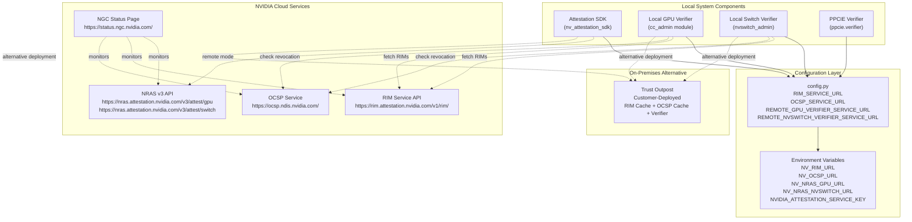
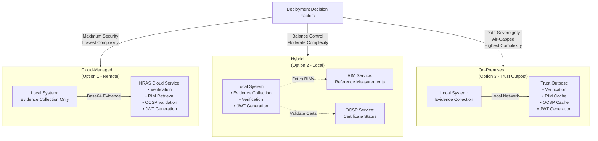
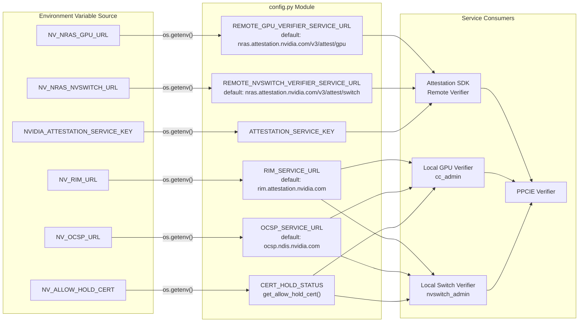

<!-- source: DeepWiki mcp.deepwiki.com · repo NVIDIA/nvtrust · page 6 External Services · fetched 2026-10-26 -->

# External Services

<details>
<summary>Relevant source files</summary>

The following files were used as context for generating this wiki page:

- [README.md](README.md)
- [guest_tools/README.md](guest_tools/README.md)
- [guest_tools/attestation_sdk/src/nv_attestation_sdk/utils/config.py](guest_tools/attestation_sdk/src/nv_attestation_sdk/utils/config.py)
- [guest_tools/ppcie-verifier/README.md](guest_tools/ppcie-verifier/README.md)
- [guest_tools/rims/rim_service/README.md](guest_tools/rims/rim_service/README.md)

</details>


This document provides an overview of the external NVIDIA services that the nvTrust attestation system depends on for remote verification, certificate validation, and reference measurement retrieval. This page covers the architecture, deployment models, and configuration options for these services. For detailed documentation of individual services, see [NRAS Service](#6.1), [RIM Service](#6.2), [OCSP Service](#6.3), and [Trust Outpost](#6.4).

## Purpose and Scope

The nvTrust attestation tools can operate in both local and remote modes. While local verification performs cryptographic validation on the host system, it still requires access to external services for obtaining reference measurements and validating certificate revocation status. Remote verification delegates the entire attestation workflow to NVIDIA's cloud infrastructure. This document describes these external service dependencies, their roles in the attestation workflow, and the available deployment options.

## Service Architecture

The nvTrust ecosystem integrates with three primary external NVIDIA services and one optional on-premises deployment:

| Service | Purpose | Default URL | Environment Variable |
|---------|---------|-------------|---------------------|
| NRAS | Remote GPU/Switch attestation | `https://nras.attestation.nvidia.com/v3/attest/` | `NV_NRAS_GPU_URL`, `NV_NRAS_NVSWITCH_URL` |
| RIM Service | Reference Integrity Manifest retrieval | `https://rim.attestation.nvidia.com/v1/rim/` | `NV_RIM_URL` |
| OCSP Service | Certificate revocation checking | `https://ocsp.ndis.nvidia.com/` | `NV_OCSP_URL` |
| Trust Outpost | On-premises attestation infrastructure | Customer-deployed | Configurable per deployment |

Sources: [guest_tools/attestation_sdk/src/nv_attestation_sdk/utils/config.py:1-29]()

### External Service Integration Architecture



**Diagram: External Service Integration Architecture**

This diagram shows how local nvTrust components interact with external services through the configuration layer, and the alternative Trust Outpost deployment option.

Sources: [guest_tools/attestation_sdk/src/nv_attestation_sdk/utils/config.py:1-29](), [guest_tools/README.md:61-108]()

## Deployment Models

The nvTrust system supports three deployment models that differ in their reliance on external NVIDIA cloud services:

### Cloud-Managed Attestation (Option 1)

In this model, the local system only collects evidence from hardware, and all verification is performed remotely by NRAS. NRAS handles RIM retrieval, certificate validation, measurement comparison, and JWT token generation.

**Service Dependencies:**
- NRAS: Required for remote attestation
- RIM Service: Accessed by NRAS (transparent to client)
- OCSP Service: Accessed by NRAS (transparent to client)

**Configuration:**
```python
# Remote attestation configuration
client = attestation.Attestation()
client.add_verifier(
    attestation.Devices.GPU, 
    attestation.Environment.REMOTE, 
    NRAS_URL, 
    ""
)
```

Sources: [guest_tools/README.md:63-81]()

### Hybrid Attestation (Option 2)

In this model, the local system performs cryptographic verification and measurement comparison, but relies on NVIDIA cloud services for RIM retrieval and certificate validation.

**Service Dependencies:**
- RIM Service: Required for fetching reference measurements
- OCSP Service: Required for certificate revocation checking
- NRAS: Not used

**Configuration:**
```python
# Local attestation with cloud RIM/OCSP
client = attestation.Attestation()
client.add_verifier(
    attestation.Devices.GPU, 
    attestation.Environment.LOCAL, 
    "", 
    "", 
    OCSP_URL, 
    RIM_URL
)
```

Sources: [guest_tools/README.md:83-101]()

### On-Premises Attestation (Option 3 - Trust Outpost)

In this model, all attestation infrastructure is deployed on-premises. Trust Outpost provides local caching of RIM and OCSP data and can operate in air-gapped environments or with strict data sovereignty requirements.

**Service Dependencies:**
- Trust Outpost: Required for all attestation operations
- NVIDIA Cloud Services: Not required during operation (may be used for periodic updates)

**Use Cases:**
- Air-gapped environments
- Data sovereignty requirements
- High-scale deployments with local control
- Reduced external network dependencies

Sources: [guest_tools/README.md:103-108]()

### Deployment Model Comparison



**Diagram: Attestation Deployment Models**

This diagram compares the three deployment models and their architectural differences.

Sources: [guest_tools/README.md:61-117]()

## Service Configuration

All external service URLs are configurable through environment variables, with default values pointing to NVIDIA's cloud infrastructure. The configuration system is implemented in the `config.py` module.

### Configuration Variables

The following configuration options control external service integration:

| Configuration | Environment Variable | Default Value | Used By |
|--------------|---------------------|---------------|---------|
| GPU Remote Attestation URL | `NV_NRAS_GPU_URL` | `https://nras.attestation.nvidia.com/v3/attest/gpu` | Remote GPU attestation |
| Switch Remote Attestation URL | `NV_NRAS_NVSWITCH_URL` | `https://nras.attestation.nvidia.com/v3/attest/switch` | Remote switch attestation |
| RIM Service URL | `NV_RIM_URL` | `https://rim.attestation.nvidia.com/v1/rim/` | Local verification, RIM retrieval |
| OCSP Service URL | `NV_OCSP_URL` | `https://ocsp.ndis.nvidia.com/` | Certificate validation |
| Attestation Service Key | `NVIDIA_ATTESTATION_SERVICE_KEY` | None | NRAS authentication |
| Allow Held Certificates | `NV_ALLOW_HOLD_CERT` | `false` | OCSP certificate hold handling |

Sources: [guest_tools/attestation_sdk/src/nv_attestation_sdk/utils/config.py:6-29]()

### URL Configuration Implementation



**Diagram: Configuration Flow from Environment to Components**

This diagram shows how environment variables flow through the `config.py` module to various attestation components.

Sources: [guest_tools/attestation_sdk/src/nv_attestation_sdk/utils/config.py:1-29]()

### Command-Line Configuration Options

The PPCIE Verifier tool accepts command-line arguments for overriding service URLs:

```bash
# Override RIM service URL
python3 -m ppcie.verifier.verification \
    --rim-url https://custom-rim-server.example.com/rims/

# Override OCSP service URL  
python3 -m ppcie.verifier.verification \
    --ocsp-url https://custom-ocsp-server.example.com/

# Provide service key for NRAS authentication
python3 -m ppcie.verifier.verification \
    --service-key your-service-key-here

# Allow certificate hold status during OCSP validation
python3 -m ppcie.verifier.verification \
    --allow-hold-cert
```

Sources: [guest_tools/ppcie-verifier/README.md:103-107]()

## Service Health and Status Monitoring

NVIDIA provides a status page for monitoring the health of cloud attestation services:

**NGC Status Page**: https://status.ngc.nvidia.com/

This page provides real-time status information for:
- NRAS (Remote Attestation Service)
- RIM Service
- OCSP Service

Users are recommended to check this page before troubleshooting attestation failures to determine if external service availability is a contributing factor.

Sources: [guest_tools/README.md:23]()

## Service Authentication

### NRAS Service Key

Remote attestation via NRAS requires authentication through a service key. The key is provided through the `NVIDIA_ATTESTATION_SERVICE_KEY` environment variable or the `--service-key` command-line argument.

**Implementation:**
```python
# From config.py
ATTESTATION_SERVICE_KEY = os.getenv("NVIDIA_ATTESTATION_SERVICE_KEY")
```

**Note:** As of the current implementation, valid service keys must be obtained through NVIDIA. Using an invalid or missing service key will result in attestation failure.

Sources: [guest_tools/attestation_sdk/src/nv_attestation_sdk/utils/config.py:18](), [guest_tools/ppcie-verifier/README.md:107]()

### Trust Outpost Access

Access to Trust Outpost requires appropriate agreements with NVIDIA. Organizations interested in deploying Trust Outpost should contact attestation-support@nvidia.com to request participation in the program.

Sources: [guest_tools/README.md:105]()

## Service Dependency Matrix

The following table summarizes which external services are required for different attestation modes:

| Attestation Mode | Device Type | NRAS | RIM Service | OCSP Service | Trust Outpost |
|-----------------|-------------|------|-------------|--------------|---------------|
| Remote | GPU | Required | Used by NRAS | Used by NRAS | N/A |
| Remote | NVSwitch | Required | Used by NRAS | Used by NRAS | N/A |
| Local | GPU | N/A | Required | Required | N/A |
| Local | NVSwitch | N/A | Required | Required | N/A |
| Trust Outpost | GPU | N/A | Via Outpost | Via Outpost | Required |
| Trust Outpost | NVSwitch | N/A | Via Outpost | Via Outpost | Required |

Sources: [guest_tools/README.md:61-117](), [guest_tools/ppcie-verifier/README.md:39-54]()

## Network Requirements

For proper operation, the attestation system requires network connectivity to external services based on the deployment model:

### Cloud-Managed and Hybrid Deployments

- **Outbound HTTPS (TCP 443)** to:
  - `nras.attestation.nvidia.com` (NRAS service)
  - `rim.attestation.nvidia.com` (RIM service)  
  - `ocsp.ndis.nvidia.com` (OCSP service)
  - `status.ngc.nvidia.com` (status monitoring, optional)

### Trust Outpost Deployments

- **Outbound HTTPS (TCP 443)** to Trust Outpost deployment (customer-specific URL)
- External NVIDIA services may be accessed by Trust Outpost for periodic updates (deployment-specific)

Sources: [guest_tools/attestation_sdk/src/nv_attestation_sdk/utils/config.py:7-14]()

## Error Handling and Fallback

When external services are unavailable, the attestation system will fail with appropriate error messages. The system does not implement automatic fallback between deployment models.

**Troubleshooting Steps:**
1. Verify network connectivity to service URLs
2. Check the NGC Status Page for service availability
3. Verify environment variables are correctly configured
4. For NRAS, ensure service key is valid and properly configured
5. Review attestation logs for specific error messages

For detailed troubleshooting procedures, see [Troubleshooting](#7).

Sources: [guest_tools/ppcie-verifier/README.md:109-128]()

---

