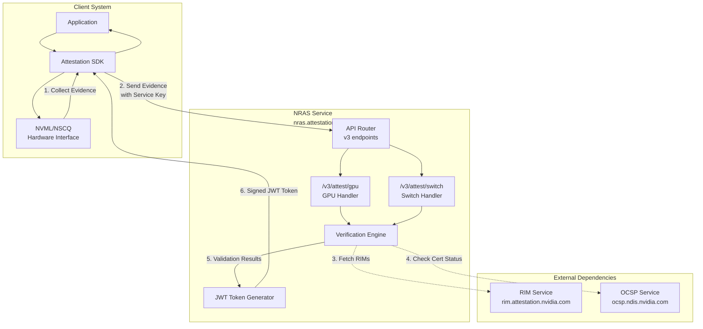
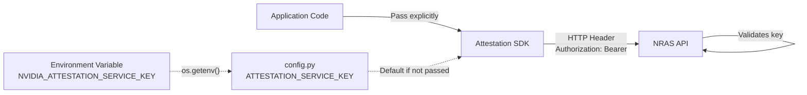
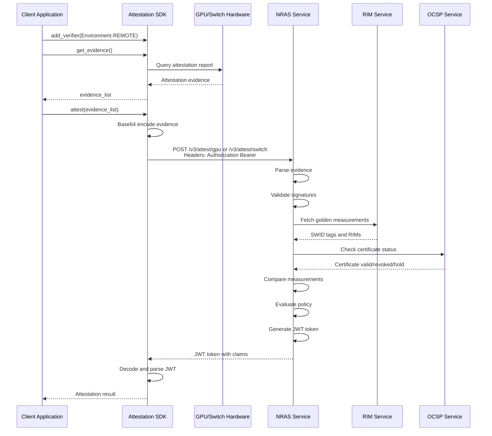
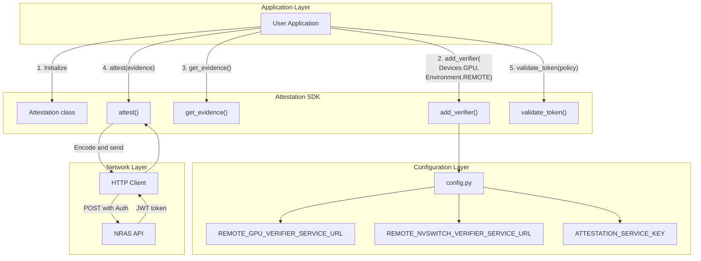

<!-- source: DeepWiki mcp.deepwiki.com · repo NVIDIA/nvtrust · page 6.1 NRAS Service · fetched 2026-10-26 -->

# NRAS Service

<details>
<summary>Relevant source files</summary>

The following files were used as context for generating this wiki page:

- [README.md](README.md)
- [guest_tools/README.md](guest_tools/README.md)
- [guest_tools/attestation_sdk/src/nv_attestation_sdk/utils/config.py](guest_tools/attestation_sdk/src/nv_attestation_sdk/utils/config.py)
- [guest_tools/ppcie-verifier/README.md](guest_tools/ppcie-verifier/README.md)

</details>


## Purpose and Scope

This document describes the NVIDIA Remote Attestation Service (NRAS), a cloud-based attestation verification service that validates GPU and NVSwitch evidence remotely. NRAS provides centralized attestation verification by accepting evidence from client systems, performing cryptographic validation against Reference Integrity Manifests (RIMs), checking certificate status via OCSP, and returning signed JWT tokens containing attestation results.

For information about local attestation alternatives, see [Local GPU Verifier](#3.1) and [Local NVSwitch Verifier](#4.1). For information about RIM and OCSP services that NRAS depends on, see [RIM Service](#6.2) and [OCSP Service](#6.3). For on-premises alternatives to NRAS, see [Trust Outpost](#6.4).

Sources: [guest_tools/README.md:1-125](), [README.md:1-33]()

## Service Overview

NRAS is an NVIDIA-managed cloud service that centralizes attestation verification logic. Instead of performing attestation locally on the client system, applications can send collected evidence to NRAS, which handles all verification steps including signature validation, certificate chain verification, OCSP checking, and measurement comparison against golden RIMs.

The service operates at the URL `https://nras.attestation.nvidia.com` and provides a v3 API with separate endpoints for GPU and NVSwitch attestation.



**NRAS Remote Attestation Architecture**

Sources: [guest_tools/README.md:63-81](), [guest_tools/attestation_sdk/src/nv_attestation_sdk/utils/config.py:1-29](), [guest_tools/ppcie-verifier/README.md:45-49]()

## API Endpoints

NRAS exposes two primary v3 API endpoints for attestation verification:

| Endpoint | Purpose | Evidence Type |
|----------|---------|---------------|
| `/v3/attest/gpu` | GPU attestation verification | GPU attestation reports (SPDM format) |
| `/v3/attest/switch` | NVSwitch attestation verification | NVSwitch attestation reports |

The base URL and endpoint paths are configured in the Attestation SDK through environment variables:

```
REMOTE_GPU_VERIFIER_SERVICE_URL
Default: https://nras.attestation.nvidia.com/v3/attest/gpu

REMOTE_NVSWITCH_VERIFIER_SERVICE_URL
Default: https://nras.attestation.nvidia.com/v3/attest/switch
```

These URLs can be overridden by setting the `NV_NRAS_GPU_URL` and `NV_NRAS_NVSWITCH_URL` environment variables respectively.

Sources: [guest_tools/attestation_sdk/src/nv_attestation_sdk/utils/config.py:9-14]()

## Authentication

NRAS requires authentication via a service key for all attestation requests. The service key is provided through the `NVIDIA_ATTESTATION_SERVICE_KEY` environment variable or passed programmatically to the Attestation SDK.



**NRAS Authentication Flow**

The service key is included in the HTTP request headers when making attestation calls. Without a valid service key, NRAS will reject the attestation request.

**Note**: As documented in the PPCIE verifier, no valid service keys have been publicly distributed yet. Using an invalid key will result in attestation failure.

Sources: [guest_tools/attestation_sdk/src/nv_attestation_sdk/utils/config.py:18](), [guest_tools/ppcie-verifier/README.md:107]()

## Remote Attestation Workflow

The remote attestation workflow orchestrated by NRAS follows a structured process:



**Remote Attestation Sequence Diagram**

### Workflow Steps

1. **Evidence Collection**: Client collects attestation evidence from hardware using NVML (GPUs) or NSCQ (NVSwitches)
2. **Evidence Encoding**: The Attestation SDK encodes evidence in Base64 format
3. **Service Authentication**: Service key is attached to the request
4. **Evidence Transmission**: Encoded evidence is sent to the appropriate NRAS endpoint
5. **Remote Verification**: NRAS performs all verification steps:
   - Parses the attestation report
   - Validates cryptographic signatures
   - Fetches golden measurements from RIM service
   - Checks certificate revocation status via OCSP
   - Compares runtime measurements against golden values
6. **Token Generation**: NRAS generates a signed JWT token containing attestation claims
7. **Result Return**: JWT token is returned to the client
8. **Policy Validation**: Client validates token claims against policy file (optional)

Sources: [guest_tools/README.md:28-44](), [guest_tools/ppcie-verifier/README.md:45-49]()

## Request and Response Format

### Request Format

The NRAS API accepts POST requests with the following structure:

**HTTP Headers:**
```
Content-Type: application/json
Authorization: Bearer <NVIDIA_ATTESTATION_SERVICE_KEY>
```

**Request Body:**
The request body contains the Base64-encoded attestation evidence collected from the hardware. The exact structure depends on the device type (GPU or NVSwitch) and includes the raw attestation report, certificate chains, and other supporting data.

### Response Format

NRAS returns a JWT token as the response. The token contains:

**JWT Header:**
- Algorithm: Signature algorithm used
- Token type: JWT

**JWT Payload (Claims):**
The payload contains attestation-specific claims that vary based on the claims version (2.0 or 3.0). Common claims include:
- Device measurements and their validation status
- Certificate validation results
- Policy evaluation results
- Timestamp information
- Device identifiers

The JWT is signed by NRAS and can be validated using NVIDIA's public keys.

Sources: [guest_tools/ppcie-verifier/README.md:108]()

## Integration with Attestation SDK

The Attestation SDK provides a high-level interface for interacting with NRAS through the `attestation.Environment.REMOTE` mode.



**SDK Integration Architecture**

### Example Usage

```python
# Initialize client
client = attestation.Attestation()

# Add remote GPU verifier
client.add_verifier(
    attestation.Devices.GPU,
    attestation.Environment.REMOTE,
    NRAS_URL,  # GPU endpoint
    ""         # Empty string for remote mode
)

# Collect evidence from hardware
evidence_list = client.get_evidence()

# Send to NRAS for verification
client.attest(evidence_list)

# Validate results against policy
client.validate_token(policy)
```

Sources: [guest_tools/README.md:73-81](), [guest_tools/README.md:32-44]()

## Service Configuration

### Environment Variables

NRAS service configuration is managed through environment variables:

| Variable | Purpose | Default Value |
|----------|---------|---------------|
| `NV_NRAS_GPU_URL` | GPU attestation endpoint | `https://nras.attestation.nvidia.com/v3/attest/gpu` |
| `NV_NRAS_NVSWITCH_URL` | NVSwitch attestation endpoint | `https://nras.attestation.nvidia.com/v3/attest/switch` |
| `NVIDIA_ATTESTATION_SERVICE_KEY` | Authentication service key | None (must be provided) |

### PPCIE Verifier Configuration

When using NRAS with the PPCIE Verifier tool, specify remote attestation mode:

```bash
python3 -m ppcie.verifier.verification \
    --gpu-attestation-mode=REMOTE \
    --switch-attestation-mode=REMOTE \
    --service-key=<YOUR_SERVICE_KEY>
```

Additional PPCIE options affecting NRAS usage:

| Option | Description |
|--------|-------------|
| `--service-key` | Service key for NRAS authentication |
| `--claims-version` | Claims version for attestation results (2.0 or 3.0) |

Sources: [guest_tools/attestation_sdk/src/nv_attestation_sdk/utils/config.py:1-29](), [guest_tools/ppcie-verifier/README.md:94-108]()

## Differences from Local Attestation

The following table compares remote (NRAS) versus local attestation:

| Aspect | Remote (NRAS) | Local |
|--------|---------------|-------|
| **Verification Location** | NVIDIA cloud service | Client system |
| **Verification Logic** | Centralized at NRAS | Distributed to clients |
| **Network Dependency** | Required for every attestation | Only for RIM/OCSP fetching |
| **Client Complexity** | Lower (offloads verification) | Higher (performs verification) |
| **Latency** | Higher (network round-trip) | Lower (local processing) |
| **Air-Gapped Support** | No (requires internet) | Yes (with Trust Outpost) |
| **Service Key Requirement** | Yes | No |
| **RIM Service Interaction** | NRAS fetches RIMs | Client fetches RIMs |
| **OCSP Checking** | NRAS performs check | Client performs check |
| **Certificate Validation** | NRAS validates | Client validates |
| **Measurement Comparison** | NRAS compares | Client compares |

```mermaid
graph TB
    subgraph RemoteMode["Remote Attestation via NRAS"]
        R_Client["Client System"]
        R_Evidence["Collect Evidence"]
        R_Encode["Base64 Encode"]
        R_Send["Send to NRAS"]
        R_NRAS["NRAS Service"]
        R_Verify["NRAS Verifies:<br/>- Signatures<br/>- Certificates<br/>- Measurements"]
        R_Token["JWT Token"]
        
        R_Client --> R_Evidence
        R_Evidence --> R_Encode
        R_Encode --> R_Send
        R_Send --> R_NRAS
        R_NRAS --> R_Verify
        R_Verify --> R_Token
        R_Token --> R_Client
    end
    
    subgraph LocalMode["Local Attestation"]
        L_Client["Client System"]
        L_Evidence["Collect Evidence"]
        L_Parse["Parse Report"]
        L_FetchRIM["Fetch RIMs"]
        L_CheckOCSP["Check OCSP"]
        L_Verify["Verify Locally:<br/>- Signatures<br/>- Certificates<br/>- Measurements"]
        L_Token["JWT Token"]
        
        L_Client --> L_Evidence
        L_Evidence --> L_Parse
        L_Parse --> L_FetchRIM
        L_FetchRIM --> L_CheckOCSP
        L_CheckOCSP --> L_Verify
        L_Verify --> L_Token
        L_Token --> L_Client
    end
```



**Remote vs Local Attestation Comparison**

### When to Use Remote Attestation (NRAS)

**Advantages:**
- Lower client-side complexity
- Centralized verification logic (easier updates)
- No need to implement cryptographic validation locally
- Consistent verification across all clients
- Lower storage requirements (no local RIM cache)

**Disadvantages:**
- Requires internet connectivity
- Higher latency per attestation
- Dependency on NVIDIA service availability
- Requires service key management
- Cannot operate in air-gapped environments

### When to Use Local Attestation

**Advantages:**
- Lower latency
- Works in air-gapped environments (with Trust Outpost)
- No service key required
- Reduced dependency on external services
- Fine-grained control over verification process

**Disadvantages:**
- Higher client-side complexity
- Requires local implementation of verification logic
- Must manage RIM and OCSP service connectivity
- Verification code must be updated locally

Sources: [guest_tools/README.md:63-118](), [guest_tools/ppcie-verifier/README.md:27-54]()

## Service Availability

NRAS is part of NVIDIA's cloud infrastructure. Service status can be monitored at the [NVIDIA NGC Status Page](https://status.ngc.nvidia.com/).

The service provides high availability and is designed for production workloads. However, organizations with strict uptime requirements or air-gapped deployments should consider the local attestation mode or Trust Outpost deployment model.

Sources: [guest_tools/README.md:23](), [guest_tools/README.md:105-106]()

---

