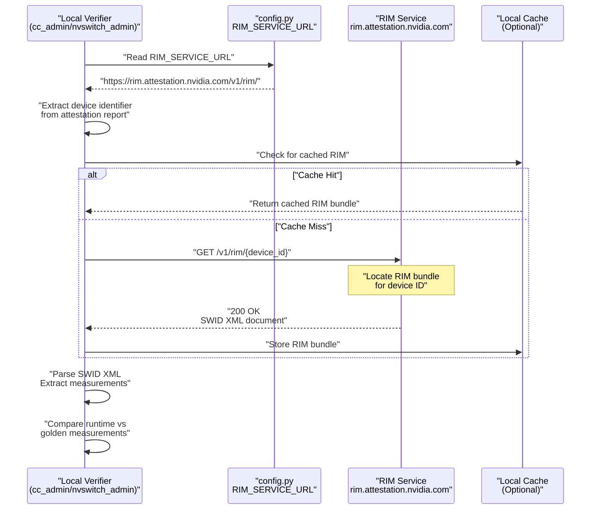
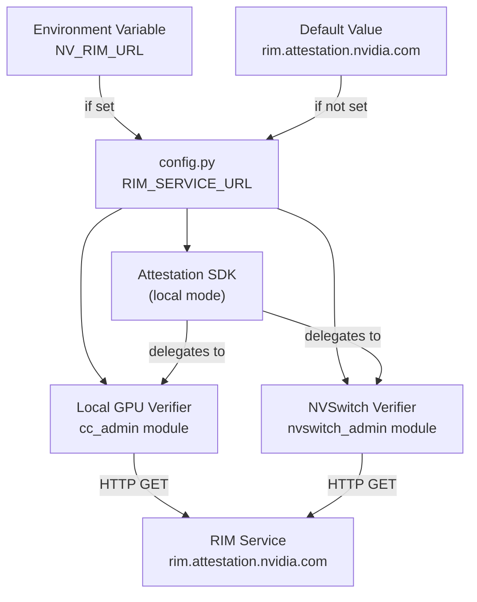
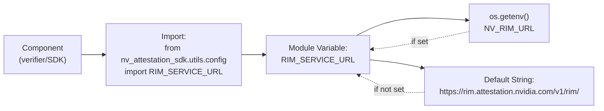

<!-- source: DeepWiki mcp.deepwiki.com · repo NVIDIA/nvtrust · page 6.2 RIM Service · fetched 2026-10-26 -->

# RIM Service

<details>
<summary>Relevant source files</summary>

The following files were used as context for generating this wiki page:

- [guest_tools/attestation_sdk/src/nv_attestation_sdk/utils/config.py](guest_tools/attestation_sdk/src/nv_attestation_sdk/utils/config.py)
- [guest_tools/rims/rim_service/README.md](guest_tools/rims/rim_service/README.md)

</details>


## Purpose and Scope

The RIM Service is an external NVIDIA file-hosting service that provides Reference Integrity Manifests (RIMs) for GPU and NVSwitch attestation. These manifests contain golden measurements that attestation verifiers use to validate the integrity of hardware firmware and software components during the attestation process.

This document describes the RIM Service's configuration, API interactions, and integration points within the nvTrust attestation infrastructure. For information about how RIMs are used during verification, see [Local GPU Verifier Internals](#3.1.1). For remote attestation workflows that also fetch RIMs, see [NRAS Service](#6.1).

**Sources:** [guest_tools/rims/rim_service/README.md:1-12]()

---

## Service Overview

The RIM Service provides a mechanism for secure transfers of RIM bundles requested by attestation platforms. When performing local attestation, verifiers fetch RIM bundles from this service to obtain the expected measurements for comparison against runtime measurements collected from hardware. In remote attestation mode, the NRAS service fetches RIMs on behalf of the client.

### Service Configuration

The RIM Service URL is configured through an environment variable with a default value:

| Configuration Parameter | Environment Variable | Default Value |
|------------------------|---------------------|---------------|
| RIM Service Base URL | `NV_RIM_URL` | `https://rim.attestation.nvidia.com/v1/rim/` |

The service URL is read from the configuration module at application startup.

**Sources:** [guest_tools/attestation_sdk/src/nv_attestation_sdk/utils/config.py:7]()

---

## Reference Integrity Manifests

### What are RIMs?

Reference Integrity Manifests (RIMs) are cryptographically signed XML documents that contain golden measurements for hardware and firmware components. They follow the ISO/IEC 19770-2:2015 Software Identification (SWID) tag standard and include:

- **Component measurements**: Hash values for firmware, VBIOS, and other software components
- **Hardware identifiers**: Device IDs, subsystem IDs, and architecture information
- **Signature data**: NVIDIA's cryptographic signature ensuring authenticity
- **Versioning information**: Firmware versions and build metadata

### RIM Bundle Structure

A RIM bundle retrieved from the service is an XML document conforming to the SWID tag schema. The bundle includes:

```
├── SoftwareIdentity (root element)
│   ├── Entity (vendor information)
│   ├── Meta (measurement metadata)
│   ├── Payload (measurement values)
│   │   ├── Resource (individual component)
│   │   │   ├── File (component identifier)
│   │   │   └── Hash (expected measurement)
│   └── Signature (cryptographic signature)
```

During verification, the attestation report's runtime measurements are extracted and compared against the corresponding hash values in the RIM bundle.

**Sources:** [guest_tools/rims/rim_service/README.md:5]()

---

## API Interaction Pattern

### Request Flow

The following diagram illustrates how nvTrust components request RIM bundles from the RIM Service:



**Sources:** [guest_tools/attestation_sdk/src/nv_attestation_sdk/utils/config.py:7](), [guest_tools/rims/rim_service/README.md:10-12]()

### Request Format

The RIM Service API uses HTTP GET requests to retrieve RIM bundles. The general request pattern is:

```
GET https://rim.attestation.nvidia.com/v1/rim/{id}
```

Where `{id}` is a device identifier extracted from the attestation report. The identifier format varies by device type:
- **GPU**: Combination of device ID, subsystem ID, and architecture
- **NVSwitch**: Switch-specific identifier derived from attestation evidence

### Response Format

The service returns SWID-compliant XML documents with content type `application/xml` or `application/swid+xml`. A successful response has HTTP status code 200, while failures return appropriate error codes (404 for not found, 500 for server errors).

**Sources:** [guest_tools/rims/rim_service/README.md:10-12]()

---

## Integration with nvTrust Components

### Configuration Module Integration

The RIM Service URL is centrally managed in the configuration module and accessed by all components that need to fetch RIMs:



**Sources:** [guest_tools/attestation_sdk/src/nv_attestation_sdk/utils/config.py:7]()

### Local Verification Workflow

During local attestation, the verification workflow interacts with the RIM Service as follows:

| Step | Component | Action | RIM Service Interaction |
|------|-----------|--------|------------------------|
| 1 | Hardware | Generate attestation report | None |
| 2 | Verifier | Collect evidence via NVML/NSCQ | None |
| 3 | Verifier | Parse attestation report | None |
| 4 | Verifier | Extract device identifier | None |
| 5 | Verifier | **Fetch RIM bundle** | **GET /v1/rim/{id}** |
| 6 | Verifier | Parse SWID XML | None |
| 7 | Verifier | Extract golden measurements | None |
| 8 | Verifier | Compare runtime vs golden | None |
| 9 | Verifier | Generate JWT with results | None |

The RIM fetch is a critical step that must succeed for local attestation to complete. Network failures or unavailable RIMs will cause attestation to fail.

**Sources:** [guest_tools/attestation_sdk/src/nv_attestation_sdk/utils/config.py:7]()

---

## Service URL Configuration Details

### Environment Variable Override

The RIM Service URL can be overridden for testing, on-premises deployments, or alternative service endpoints:

```bash
# Use NVIDIA's production RIM Service (default)
# No configuration needed

# Override for testing environment
export NV_RIM_URL="https://rim.test.nvidia.com/v1/rim/"

# Override for on-premises Trust Outpost
export NV_RIM_URL="https://trust-outpost.internal/v1/rim/"
```

### Configuration Access Pattern

Components access the RIM Service URL through the configuration module:



The configuration is evaluated at module import time, so changing the environment variable after import requires reloading the configuration module.

**Sources:** [guest_tools/attestation_sdk/src/nv_attestation_sdk/utils/config.py:7]()

---

## RIM Service vs NRAS Interaction

### Local vs Remote RIM Fetching

The distinction between local and remote attestation affects where RIM fetching occurs:

```mermaid
graph TB
    subgraph "Local Attestation Mode"
        LocalClient["Client Application"]
        LocalVerifier["Local GPU/Switch Verifier"]
        LocalRIM["RIM Service"]
        
        LocalClient -->|"1. Initiate attestation"| LocalVerifier
        LocalVerifier -->|"2. Fetch RIM bundle"| LocalRIM
        LocalRIM -->|"3. Return SWID XML"| LocalVerifier
        LocalVerifier -->|"4. Return JWT token"| LocalClient
    end
    
    subgraph "Remote Attestation Mode"
        RemoteClient["Client Application"]
        NRAS["NRAS Service"]
        RemoteRIM["RIM Service"]
        
        RemoteClient -->|"1. Send evidence"| NRAS
        NRAS -->|"2. Fetch RIM bundle"| RemoteRIM
        RemoteRIM -->|"3. Return SWID XML"| NRAS
        NRAS -->|"4. Return JWT token"| RemoteClient
    end
```



In **local mode**, the client verifier directly fetches RIMs from the RIM Service. In **remote mode**, NRAS fetches RIMs on behalf of the client, and the client only sends evidence to NRAS.

**Sources:** [guest_tools/attestation_sdk/src/nv_attestation_sdk/utils/config.py:7-13]()

---

## Trust Outpost Integration

When deploying nvTrust in air-gapped environments or with data sovereignty requirements, the Trust Outpost provides an on-premises alternative to NVIDIA's cloud-based RIM Service. The configuration mechanism remains identical—only the URL changes:

| Deployment Type | RIM Service URL | Configuration |
|----------------|----------------|---------------|
| Cloud (Default) | `https://rim.attestation.nvidia.com/v1/rim/` | No configuration needed |
| On-Premises Trust Outpost | Organization-specific URL | Set `NV_RIM_URL` environment variable |
| Testing | Test environment URL | Set `NV_RIM_URL` environment variable |

The Trust Outpost mirrors the RIM Service API, ensuring compatibility with all nvTrust components without code changes. For more information about Trust Outpost deployment, see [Trust Outpost](#6.4).

**Sources:** [guest_tools/attestation_sdk/src/nv_attestation_sdk/utils/config.py:7](), [guest_tools/rims/rim_service/README.md:1-12]()

---

## Error Handling

### Common RIM Service Errors

Verifiers must handle various failure scenarios when interacting with the RIM Service:

| Error Condition | HTTP Status | Verifier Behavior |
|----------------|-------------|-------------------|
| RIM not found for device | 404 Not Found | Fail attestation with specific error message |
| Service temporarily unavailable | 503 Service Unavailable | Retry with exponential backoff |
| Network connectivity failure | Connection timeout/refused | Fail attestation, log network error |
| Invalid device identifier | 400 Bad Request | Fail attestation, check evidence parsing |
| Authentication failure | 401/403 | Fail attestation, check service credentials |

When RIM fetching fails, local attestation cannot proceed because golden measurements are required for comparison. The verifier will return an error status in the JWT token or raise an exception, depending on the component's error handling strategy.

**Sources:** [guest_tools/attestation_sdk/src/nv_attestation_sdk/utils/config.py:7](), [guest_tools/rims/rim_service/README.md:10-12]()

---

## Documentation References

For complete API specifications and detailed usage examples, refer to:

- **Official Documentation**: [NVIDIA RIM Service Documentation](https://docs.attestation.nvidia.com/RIM/rim_introduction.html)
- **API Reference**: [NVIDIA RIM Service API Documentation](https://docs.attestation.nvidia.com/api-docs/rim.html#get-/v1/rim/-id-)

**Sources:** [guest_tools/rims/rim_service/README.md:7-12]()

---

