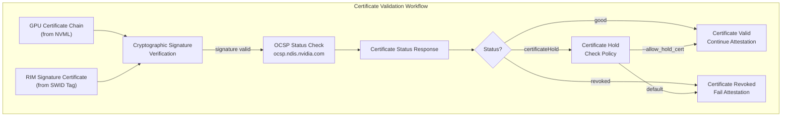
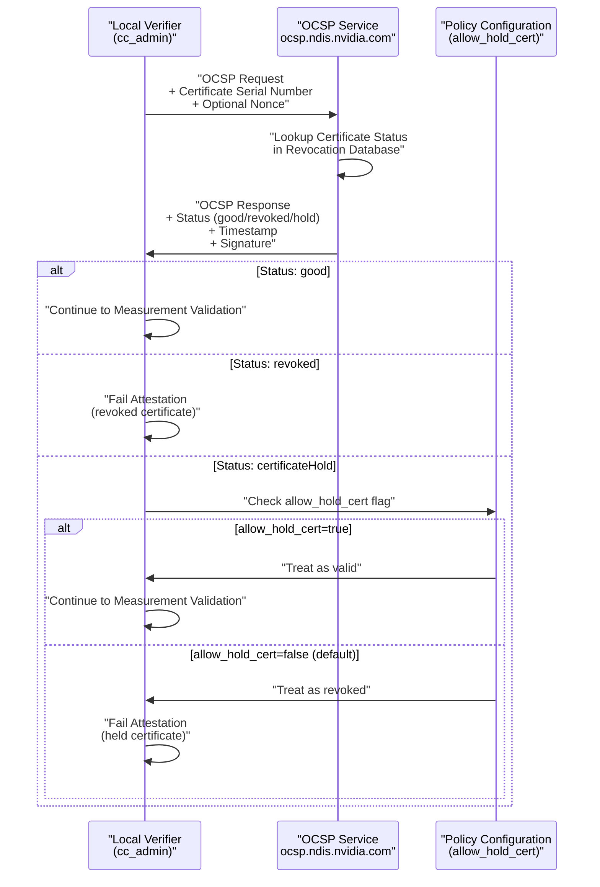
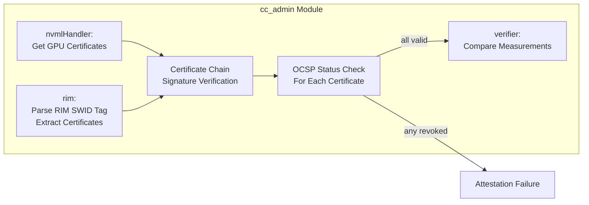
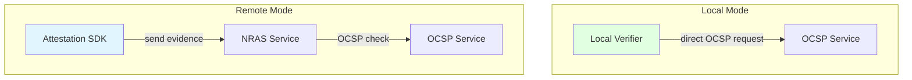

<!-- source: DeepWiki mcp.deepwiki.com · repo NVIDIA/nvtrust · page 6.3 OCSP Service · fetched 2026-10-26 -->

# OCSP Service

<details>
<summary>Relevant source files</summary>

The following files were used as context for generating this wiki page:

- [guest_tools/attestation_sdk/src/nv_attestation_sdk/utils/config.py](guest_tools/attestation_sdk/src/nv_attestation_sdk/utils/config.py)
- [guest_tools/gpu_verifiers/local_gpu_verifier/README.md](guest_tools/gpu_verifiers/local_gpu_verifier/README.md)

</details>


## Purpose and Scope

This document describes the OCSP (Online Certificate Status Protocol) Service used by nvTrust attestation components to validate certificate revocation status. The OCSP Service is a critical component in the attestation security chain, ensuring that certificates used in GPU and NVSwitch attestation have not been revoked by NVIDIA.

This page covers the OCSP service endpoint configuration, certificate status checking workflow, handling of certificate hold status, and integration points within the local verifiers. For information about other external services, see [NRAS Service](#6.1) and [RIM Service](#6.2).

**Sources:** [guest_tools/gpu_verifiers/local_gpu_verifier/README.md:114-120](), [guest_tools/attestation_sdk/src/nv_attestation_sdk/utils/config.py:1-29]()

---

## OCSP Protocol Overview

OCSP (Online Certificate Status Protocol) is defined in RFC 6960 and provides a real-time mechanism for checking the revocation status of X.509 certificates. In the nvTrust attestation workflow, OCSP validation ensures that:

1. **GPU Certificate Chains** retrieved via NVML have not been revoked
2. **RIM Signature Certificates** used to sign Reference Integrity Manifests remain valid
3. **Certificate Chain Validation** completes successfully before comparing measurements

The OCSP check is performed during the certificate validation phase, after signature verification but before measurement comparison.



**Sources:** [guest_tools/gpu_verifiers/local_gpu_verifier/README.md:114](), [guest_tools/attestation_sdk/src/nv_attestation_sdk/utils/config.py:8]()

---

## Service Configuration

### Default Endpoint

The OCSP service is hosted at NVIDIA's certificate validation infrastructure:

| Configuration | Value |
|--------------|-------|
| **Default URL** | `https://ocsp.ndis.nvidia.com/` |
| **Protocol** | OCSP over HTTPS |
| **Service Operator** | NVIDIA Device Identity Services (NDIS) |

**Sources:** [guest_tools/attestation_sdk/src/nv_attestation_sdk/utils/config.py:8]()

### Configuration Methods

The OCSP service URL can be configured through multiple mechanisms:

#### Environment Variable Configuration

```bash
export NV_OCSP_URL="https://ocsp.ndis.nvidia.com/"
```

The `OCSP_SERVICE_URL` constant is initialized from the environment variable `NV_OCSP_URL` at [guest_tools/attestation_sdk/src/nv_attestation_sdk/utils/config.py:8]():

```python
OCSP_SERVICE_URL = os.getenv("NV_OCSP_URL", "https://ocsp.ndis.nvidia.com/")
```

#### Command-Line Configuration

For the Local GPU Verifier, the OCSP URL can be specified via command-line argument:

```bash
python3 -m verifier.cc_admin --ocsp_url https://ocsp.ndis.nvidia.com/
```

**Sources:** [guest_tools/gpu_verifiers/local_gpu_verifier/README.md:118-119](), [guest_tools/attestation_sdk/src/nv_attestation_sdk/utils/config.py:8]()

---

## Certificate Status Responses

The OCSP service returns one of three standard certificate status responses:

| Status | Description | Attestation Behavior |
|--------|-------------|---------------------|
| **good** | Certificate is valid and not revoked | Attestation continues |
| **revoked** | Certificate has been permanently revoked | Attestation fails immediately |
| **certificateHold** | Certificate is temporarily suspended | Configurable (see below) |



**Sources:** [guest_tools/gpu_verifiers/local_gpu_verifier/README.md:114]()

---

## Certificate Hold Status

The `certificateHold` status is a temporary suspension state defined in RFC 5280. This status is used when a certificate needs to be temporarily disabled without permanent revocation.

### Default Behavior

By default, certificates in `certificateHold` status are treated as invalid and cause attestation to fail. This conservative approach ensures maximum security.

### Allowing Certificate Hold

The `--allow_hold_cert` flag enables attestation to proceed even when certificates are in hold status:

```bash
python3 -m verifier.cc_admin --allow_hold_cert
```

### Configuration Management

The certificate hold policy is managed through a global configuration state:

[guest_tools/attestation_sdk/src/nv_attestation_sdk/utils/config.py:6-29]()

```python
CERT_HOLD_STATUS = None

def set_allow_hold_cert(value):
    global CERT_HOLD_STATUS
    CERT_HOLD_STATUS = value

def get_allow_hold_cert():
    global CERT_HOLD_STATUS
    if CERT_HOLD_STATUS is not None:
        return CERT_HOLD_STATUS
    else:
        return os.getenv("NV_ALLOW_HOLD_CERT") == "true"
```

The configuration uses a three-tier precedence:
1. **Programmatically set value** via `set_allow_hold_cert()` (highest priority)
2. **Environment variable** `NV_ALLOW_HOLD_CERT=true`
3. **Default behavior** (disallow hold certificates)

### Use Cases for Allow Hold

Certificates may be placed in hold status during:
- Security investigation periods
- Planned maintenance windows
- Temporary operational issues
- Grace periods for certificate rotation

**Sources:** [guest_tools/gpu_verifiers/local_gpu_verifier/README.md:114](), [guest_tools/attestation_sdk/src/nv_attestation_sdk/utils/config.py:6-29]()

---

## OCSP Nonce

OCSP nonces are cryptographic random values included in OCSP requests to prevent replay attacks. The nonce is echoed back in the OCSP response, proving the response is fresh.

### Nonce Configuration

The Local GPU Verifier supports disabling OCSP nonces via the `--ocsp_nonce_disabled` flag:

```bash
python3 -m verifier.cc_admin --ocsp_nonce_disabled
```

| Configuration | Nonce Behavior |
|--------------|----------------|
| Default | Nonce included in OCSP request |
| `--ocsp_nonce_disabled` | No nonce included in OCSP request |

### When to Disable Nonces

Nonces should only be disabled in specific scenarios:
- **OCSP responder does not support nonces** - Some OCSP implementations reject requests with nonces
- **Caching requirements** - Cached OCSP responses cannot contain request-specific nonces
- **Performance optimization** - In high-volume scenarios where replay protection is handled at a higher layer

**Note:** Disabling nonces reduces protection against replay attacks. The OCSP response timestamp should still be validated.

**Sources:** [guest_tools/gpu_verifiers/local_gpu_verifier/README.md:119-120]()

---

## Integration with Attestation Components

### Local GPU Verifier Integration

The Local GPU Verifier performs OCSP checks during the certificate validation phase of the attestation workflow. The integration points include:

1. **GPU Certificate Chain Validation** - Certificates retrieved from NVML API
2. **Driver RIM Certificate Validation** - Certificates in the driver SWID tag signature
3. **VBIOS RIM Certificate Validation** - Certificates in the VBIOS SWID tag signature



**Sources:** [guest_tools/gpu_verifiers/local_gpu_verifier/README.md:132-147]()

### Local NVSwitch Verifier Integration

The NVSwitch verifier follows a similar pattern, validating certificates in switch attestation reports and RIM files against the OCSP service before proceeding to measurement comparison.

**Sources:** [guest_tools/gpu_verifiers/local_gpu_verifier/README.md:1-159]()

### Remote Attestation Flow

In remote attestation mode (via NRAS), the OCSP check is performed by the NRAS service rather than the local client. The client only needs to ensure proper configuration is passed to NRAS. See [NRAS Service](#6.1) for details on remote verification.



**Sources:** [guest_tools/attestation_sdk/src/nv_attestation_sdk/utils/config.py:8-14]()

---

## Configuration Reference Table

| Configuration Item | Environment Variable | CLI Flag | Default Value | Scope |
|-------------------|---------------------|----------|---------------|-------|
| OCSP Service URL | `NV_OCSP_URL` | `--ocsp_url` | `https://ocsp.ndis.nvidia.com/` | Local verification |
| Allow Hold Certificates | `NV_ALLOW_HOLD_CERT` | `--allow_hold_cert` | `false` | Local verification |
| Disable OCSP Nonce | N/A | `--ocsp_nonce_disabled` | `false` | Local GPU verification only |

**Sources:** [guest_tools/gpu_verifiers/local_gpu_verifier/README.md:114-120](), [guest_tools/attestation_sdk/src/nv_attestation_sdk/utils/config.py:6-29]()

---

## Error Scenarios

### Network Connectivity Failures

If the OCSP service cannot be reached due to network issues, the attestation will fail. The verifier requires successful certificate validation before proceeding to measurement comparison.

### OCSP Response Validation Failures

OCSP responses are cryptographically signed. If the signature validation fails or the response is malformed, attestation fails.

### Certificate Status: Revoked

When any certificate in the validation chain is revoked, attestation fails immediately regardless of measurement values.

### Certificate Status: Hold (Default Policy)

With default settings, certificates in `certificateHold` status cause attestation to fail. To allow attestation with held certificates, use the `--allow_hold_cert` flag.

**Sources:** [guest_tools/gpu_verifiers/local_gpu_verifier/README.md:152-153]()

---

## Trust Outpost Alternative

For air-gapped or on-premises deployments, the Trust Outpost provides local OCSP services along with RIM and NRAS functionality. See [Trust Outpost](#6.4) for deployment details.

**Sources:** Architecture diagrams

---

