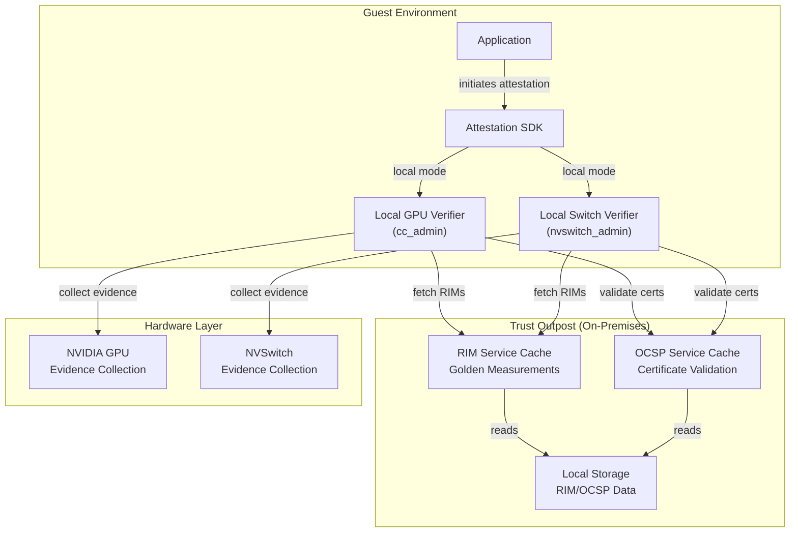
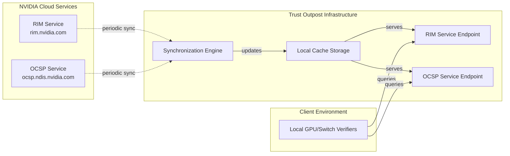
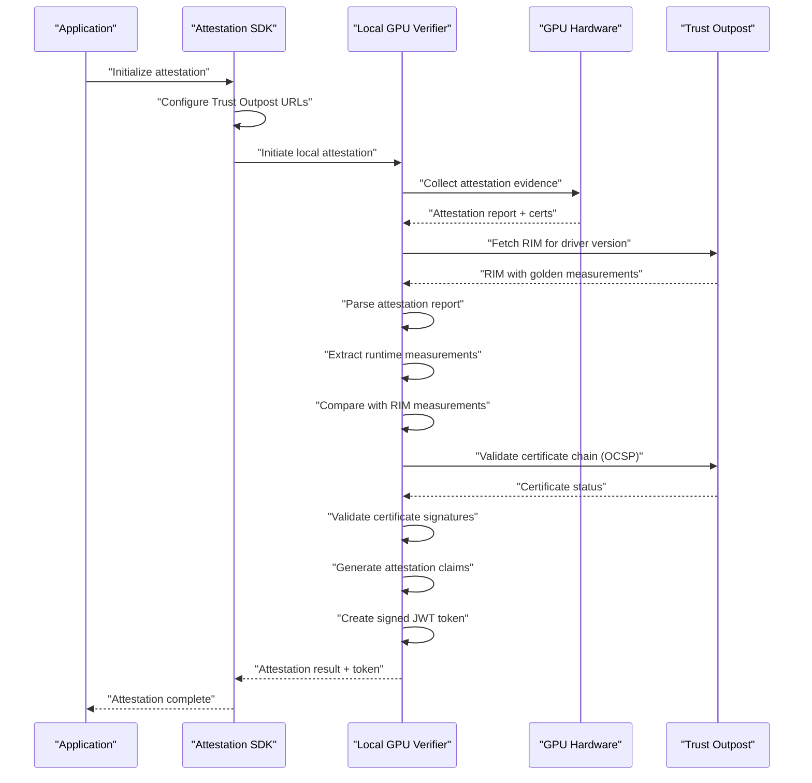

<!-- source: DeepWiki mcp.deepwiki.com · repo NVIDIA/nvtrust · page 6.4 Trust Outpost · fetched 2026-10-26 -->

# Trust Outpost

<details>
<summary>Relevant source files</summary>

The following files were used as context for generating this wiki page:

- [README.md](README.md)
- [guest_tools/README.md](guest_tools/README.md)
- [guest_tools/attestation_sdk/README.md](guest_tools/attestation_sdk/README.md)
- [guest_tools/ppcie-verifier/README.md](guest_tools/ppcie-verifier/README.md)

</details>


Trust Outpost is an on-premises GPU attestation solution that provides local caching and serving of Reference Integrity Manifests (RIMs) and OCSP certificate validation services. It enables fully customer-managed attestation deployments suitable for air-gapped environments or organizations with strict data sovereignty requirements.

This page covers the architecture, deployment model, and integration of Trust Outpost with the nvTrust attestation tools. For information about cloud-based attestation using NRAS, see [NRAS Service](#6.1). For details on RIM and OCSP services in cloud deployments, see [RIM Service](#6.2) and [OCSP Service](#6.3).

## Overview

Trust Outpost serves as a drop-in replacement for NVIDIA's cloud-hosted attestation infrastructure, specifically replacing the RIM Service and OCSP Service components. It does not replace NRAS for remote attestation; instead, it enables local attestation workflows by providing the necessary reference measurements and certificate validation locally.

The solution is designed for high-scale deployments where:
- Internet connectivity to NVIDIA cloud services is limited or prohibited
- Data sovereignty regulations require on-premises attestation infrastructure
- Air-gapped environments need attestation capabilities
- Organizations require enhanced local control over attestation processes

Sources: [guest_tools/README.md:103-106]()

## Architecture and Deployment Model

Trust Outpost integrates into the local attestation workflow by providing services that would normally be accessed via NVIDIA's cloud infrastructure:



**Trust Outpost Deployment Architecture**

In this deployment model, the Attestation SDK and Local GPU/Switch Verifiers operate in `LOCAL` mode but connect to Trust Outpost endpoints instead of NVIDIA cloud services. Trust Outpost maintains cached copies of RIM files and OCSP responses, serving them to attestation clients within the organization's network perimeter.

Sources: [guest_tools/README.md:103-108](), [README.md:1-33]()

## Services Provided

### RIM Service Caching

Trust Outpost provides a local RIM service endpoint that caches Reference Integrity Manifests (RIMs) for GPU drivers and VBIOS versions deployed in the environment. These RIMs contain the golden measurements used to validate attestation reports.

**Key Characteristics:**
- Caches SWID (Software Identification) tags with signed measurements
- Serves RIMs for specific driver versions and GPU architectures
- Reduces latency for RIM retrieval during attestation
- Eliminates dependency on internet connectivity for measurement validation

**Integration Points:**
- Local GPU Verifier queries Trust Outpost RIM endpoint via `--rim-url` configuration
- Trust Outpost URL replaces the default `https://rim.nvidia.com/rims/` endpoint
- Same API contract as cloud RIM service

### OCSP Certificate Validation

Trust Outpost caches OCSP (Online Certificate Status Protocol) responses for certificate revocation checking. This enables local validation of GPU certificate chains without external OCSP queries.

**Key Characteristics:**
- Caches certificate revocation status responses
- Validates GPU certificate chains locally
- Handles certificate hold status based on policy configuration
- Refreshes OCSP data periodically to maintain current revocation status

**Integration Points:**
- Local GPU Verifier queries Trust Outpost OCSP endpoint via `--ocsp-url` configuration
- Trust Outpost URL replaces the default `https://ocsp.ndis.nvidia.com/` endpoint
- Supports nonce-based and non-nonce OCSP queries

Sources: [guest_tools/README.md:86-102](), [guest_tools/attestation_sdk/README.md:177-179]()

## Configuration and Integration

### SDK Configuration for Trust Outpost

The Attestation SDK and associated verifiers must be configured to point to Trust Outpost endpoints instead of NVIDIA cloud services. This is accomplished through URL configuration parameters.

**Attestation SDK Configuration:**

```python
# Example configuration for Trust Outpost integration
# (Conceptual code showing parameter usage)

import nv_attestation_sdk.attestation as attestation

client = attestation.Attestation()

# Configure for local attestation with Trust Outpost endpoints
client.add_verifier(
    attestation.Devices.GPU,
    attestation.Environment.LOCAL,
    rim_service_url="https://trust-outpost.internal/rims/",
    ocsp_service_url="https://trust-outpost.internal/ocsp/"
)

evidence_list = client.get_evidence()
client.attest(evidence_list)
```

The SDK accepts Trust Outpost URLs through the same parameters used for cloud services, enabling seamless switching between deployment models.

Sources: [guest_tools/README.md:93-101]()

### PPCIE Verifier Configuration

The PPCIE Verifier supports Trust Outpost through command-line options for RIM and OCSP service URLs:

| Option | Description | Example Value |
|--------|-------------|---------------|
| `--rim-url` | URL for Trust Outpost RIM service | `https://trust-outpost.internal/rims/` |
| `--ocsp-url` | URL for Trust Outpost OCSP service | `https://trust-outpost.internal/ocsp/` |
| `--gpu-attestation-mode` | Must be set to `LOCAL` | `LOCAL` |
| `--switch-attestation-mode` | Must be set to `LOCAL` | `LOCAL` |

**Example Usage:**

```bash
python3 -m ppcie.verifier.verification \
    --gpu-attestation-mode=LOCAL \
    --switch-attestation-mode=LOCAL \
    --rim-url=https://trust-outpost.internal/rims/ \
    --ocsp-url=https://trust-outpost.internal/ocsp/
```

Sources: [guest_tools/ppcie-verifier/README.md:96-108]()

### Local GPU Verifier Configuration

The Local GPU Verifier interfaces with Trust Outpost through environment variables or programmatic configuration:

| Environment Variable | Purpose | Trust Outpost Example |
|---------------------|---------|----------------------|
| RIM service URL | Configure RIM endpoint | `https://trust-outpost.internal/rims/` |
| OCSP service URL | Configure OCSP endpoint | `https://trust-outpost.internal/ocsp/` |
| `NV_ALLOW_HOLD_CERT` | Allow certificates on hold | `true` or `false` |

The Local GPU Verifier (`cc_admin` module) fetches RIMs and performs OCSP validation against Trust Outpost endpoints during the attestation workflow.

Sources: [guest_tools/attestation_sdk/README.md:175-179]()

## Deployment Requirements

### Access and Prerequisites

Trust Outpost access requires appropriate agreements with NVIDIA, as it involves distribution of NVIDIA's reference measurements and certificate infrastructure to customer premises.

**Access Requirements:**
- Formal agreement with NVIDIA for Trust Outpost deployment
- Contact NVIDIA at attestation-support@nvidia.com to request participation
- Licensing and support agreements for on-premises deployment

**Technical Prerequisites:**
- Network infrastructure to host Trust Outpost services
- Storage capacity for RIM and OCSP cache data
- Network connectivity from attestation clients to Trust Outpost endpoints
- Administrative access to configure attestation client URL parameters

### Data Synchronization

Trust Outpost requires periodic synchronization with NVIDIA services to maintain up-to-date RIM files and OCSP responses:



**Trust Outpost Synchronization Model**

The synchronization engine maintains current RIM files for deployed GPU driver versions and refreshes OCSP responses before they expire. Synchronization may occur over controlled internet connections or through offline data transfer mechanisms for fully air-gapped deployments.

Sources: [guest_tools/README.md:103-108]()

## Comparison: Cloud vs. Trust Outpost Attestation

The following table compares cloud-based and Trust Outpost deployment models:

| Characteristic | Cloud-Based (NRAS/RIM/OCSP) | Trust Outpost |
|----------------|----------------------------|---------------|
| **Network Requirements** | Internet access to NVIDIA services | Local network access only |
| **Data Sovereignty** | Data transits to NVIDIA cloud | All data remains on-premises |
| **Latency** | Subject to internet latency | Local network latency |
| **Availability** | Dependent on NVIDIA service uptime | Controlled by customer infrastructure |
| **Deployment Complexity** | Low - use default URLs | Moderate - requires infrastructure deployment |
| **Maintenance** | Managed by NVIDIA | Managed by customer |
| **Air-Gap Support** | Not supported | Supported with offline sync |
| **Access Requirements** | Public (with service key for NRAS) | Requires NVIDIA agreement |
| **Attestation Mode** | LOCAL or REMOTE | LOCAL only |

Trust Outpost enables the same cryptographic verification and policy enforcement as cloud-based attestation but shifts the operational responsibility and control to the customer's infrastructure.

Sources: [guest_tools/README.md:109-118]()

## Attestation Workflow with Trust Outpost

The attestation workflow with Trust Outpost follows the local attestation pattern with Trust Outpost endpoints:



**Local Attestation Workflow with Trust Outpost**

The workflow performs all cryptographic validation locally, using Trust Outpost only for reference data (RIMs) and certificate status (OCSP). No attestation evidence or sensitive workload data is transmitted to Trust Outpost or external services.

Sources: [guest_tools/README.md:84-102]()

## Use Cases

### Air-Gapped Environments

Trust Outpost enables GPU attestation in fully air-gapped networks where no internet connectivity is available. RIM files and OCSP data are synchronized offline:

1. NVIDIA provides RIM and OCSP data packages on physical media or secure transfer
2. Customer deploys packages to Trust Outpost infrastructure
3. Attestation clients operate entirely within air-gap using Trust Outpost

### Data Sovereignty Requirements

Organizations subject to data sovereignty regulations can ensure that all attestation operations and data remain within jurisdictional boundaries:

- Trust Outpost infrastructure deployed in compliant datacenter
- No attestation evidence crosses organizational or national boundaries
- Complete audit trail of attestation operations maintained locally

### High-Scale Deployments

Large-scale confidential computing deployments benefit from Trust Outpost's caching capabilities:

- Reduced load on NVIDIA cloud services
- Consistent low-latency attestation across large GPU fleets
- Centralized management of RIM and OCSP data for the organization
- Resilience against external service disruptions

### Multi-GPU PPCIE Deployments

Trust Outpost fully supports PPCIE verification workflows for multi-GPU systems with NVSwitch interconnects:

- Local attestation of all GPUs and NVSwitches
- Topology validation performed locally
- No dependency on cloud services for high-throughput interconnect verification

Sources: [guest_tools/README.md:103-108](), [guest_tools/ppcie-verifier/README.md:1-55]()

## Security Considerations

Trust Outpost shifts the security perimeter from NVIDIA's cloud infrastructure to customer-managed infrastructure. Organizations deploying Trust Outpost must ensure:

**Infrastructure Security:**
- Secure deployment of Trust Outpost service endpoints
- Access control and authentication for RIM/OCSP endpoints
- Network isolation and firewall rules
- Monitoring and logging of attestation service requests

**Data Integrity:**
- Verification of RIM file authenticity during synchronization
- Secure channels for data transfer from NVIDIA to Trust Outpost
- Protection against tampering with cached RIM and OCSP data

**Operational Security:**
- Timely synchronization of updated RIM files and OCSP responses
- Certificate expiration monitoring and renewal processes
- Incident response procedures for compromised certificates or measurements

The cryptographic trust model remains unchanged - Trust Outpost serves signed data from NVIDIA, and the Local GPU Verifier validates NVIDIA's signatures using NVIDIA root certificates embedded in the verifier code.

Sources: [guest_tools/attestation_sdk/README.md:1-188]()

## Obtaining Trust Outpost Access

Trust Outpost is available through NVIDIA's attestation partnership program. To request access:

1. Contact NVIDIA attestation support: attestation-support@nvidia.com
2. Describe your deployment requirements and use case
3. Work with NVIDIA to establish appropriate agreements
4. Receive Trust Outpost deployment packages and documentation
5. Deploy Trust Outpost infrastructure in your environment
6. Configure attestation clients with Trust Outpost endpoints

Organizations interested in Trust Outpost should be prepared to discuss:
- Scale of deployment (number of GPUs/systems)
- Network topology and connectivity constraints
- Data sovereignty or air-gap requirements
- Support and maintenance expectations

Sources: [guest_tools/README.md:103-108]()

---

