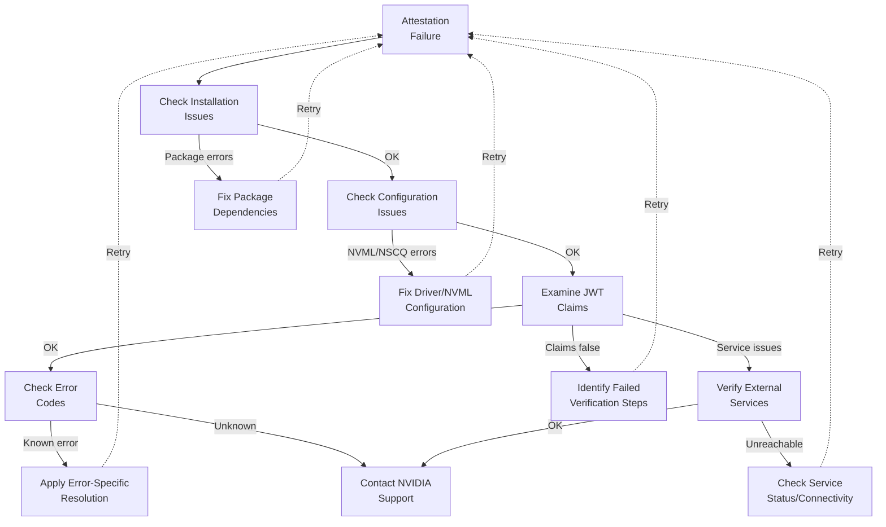
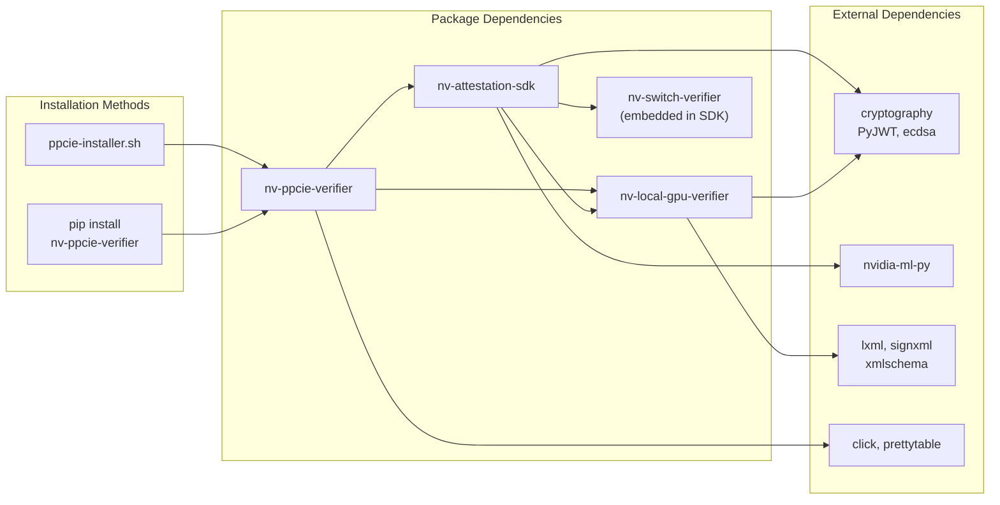
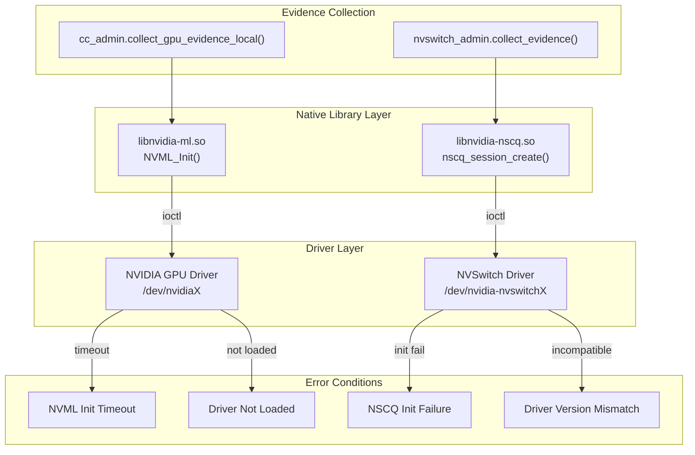
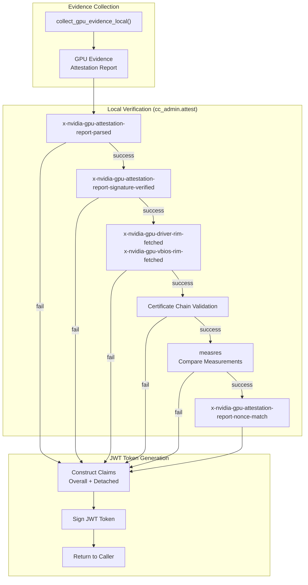
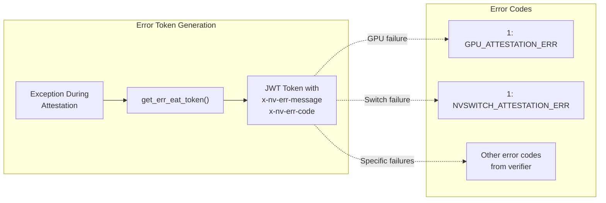
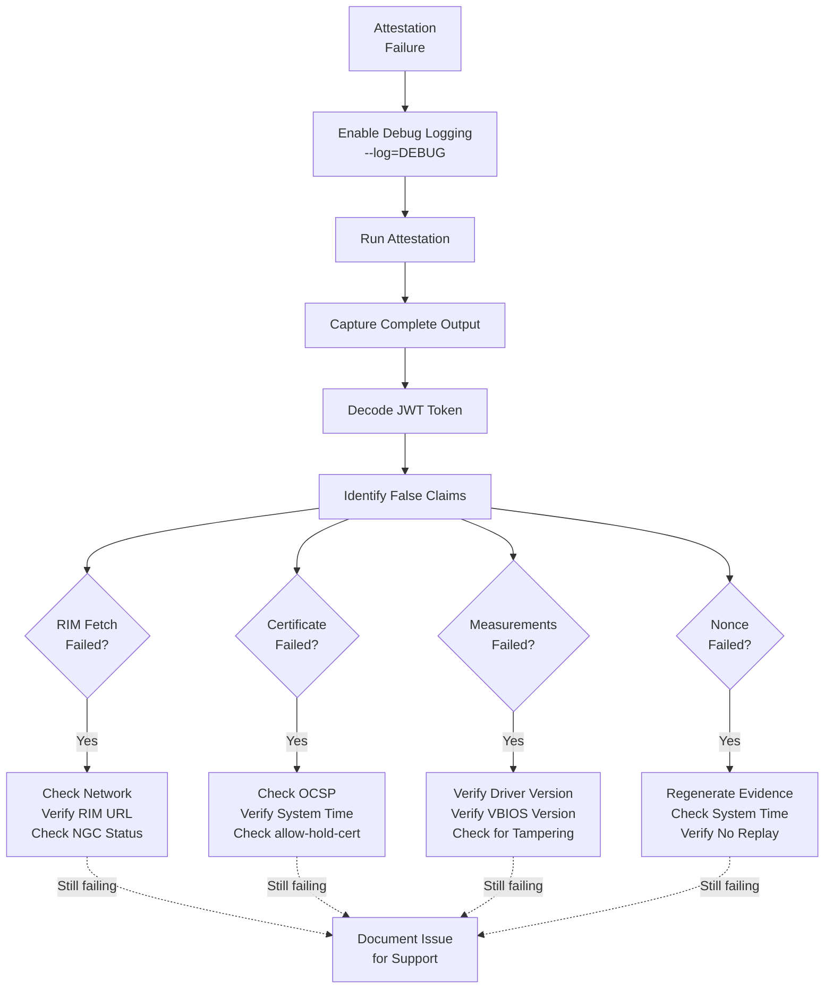

<!-- source: DeepWiki mcp.deepwiki.com · repo NVIDIA/nvtrust · page 7 Troubleshooting · fetched 2026-10-26 -->

# Troubleshooting

<details>
<summary>Relevant source files</summary>

The following files were used as context for generating this wiki page:

- [README.md](README.md)
- [guest_tools/README.md](guest_tools/README.md)
- [guest_tools/attestation_sdk/src/nv_attestation_sdk/gpu/attest_gpu_local.py](guest_tools/attestation_sdk/src/nv_attestation_sdk/gpu/attest_gpu_local.py)
- [guest_tools/attestation_sdk/src/nv_attestation_sdk/nvswitch/attest_nvswitch_local.py](guest_tools/attestation_sdk/src/nv_attestation_sdk/nvswitch/attest_nvswitch_local.py)
- [guest_tools/attestation_troubleshooting_guide.md](guest_tools/attestation_troubleshooting_guide.md)
- [guest_tools/ppcie-verifier/README.md](guest_tools/ppcie-verifier/README.md)

</details>


This document provides comprehensive troubleshooting guidance for NVIDIA GPU and NVSwitch attestation. It covers common issues, error codes, claims interpretation, and diagnostic procedures to help you identify and resolve problems with attestation workflows.

For information about configuring attestation, see [Attestation SDK Configuration](#2.3). For details on the attestation workflow itself, see [Attestation Workflow](#2.4).

## Troubleshooting Workflow

The following diagram illustrates the systematic approach to diagnosing attestation issues:



Sources: [guest_tools/attestation_troubleshooting_guide.md:1-612](), [guest_tools/ppcie-verifier/README.md:109-128]()

## Installation Issues

### ModuleNotFoundError

**Symptom**: `ModuleNotFoundError: No module named 'nv_attestation_sdk'` when running attestation tools.

**Root Cause**: The attestation SDK packages were not properly installed or the Python virtual environment is corrupted.

**Resolution**:
1. Delete the existing virtual environment: `rm -rf venv`
2. Reinstall packages using the installer script:
   ```bash
   cd nvtrust/guest_tools/ppcie-verifier/install
   source ppcie-installer.sh
   ```

Sources: [guest_tools/ppcie-verifier/README.md:112-114]()

### Invalid Distribution Warnings

**Symptom**: `WARNING: Ignoring invalid distribution ~v-attestation-sdk <site-package-directory>`

**Root Cause**: Previously failed package installations left corrupted metadata in the Python site-packages directory.

**Resolution**:
1. Clean up corrupted packages:
   ```bash
   rm -rf $(ls -l <site-packages-directory> | grep '~' | awk '{print $9}')
   ```
2. Retry installation

Sources: [guest_tools/ppcie-verifier/README.md:115-119]()

### Dependency Installation Flow



Sources: [guest_tools/ppcie-verifier/README.md:65-90]()

## Configuration Issues

### NVML Initialization Failure

**Symptom**: `The nvmlInit call timed out.` or `Error in Initializing NVML library. Please install the drivers again and re-try`

**Root Cause**: NVML library (`libnvidia-ml.so`) is not properly initialized, indicating driver issues.

**Resolution**:
1. Verify NVIDIA driver is installed: `nvidia-smi`
2. Check driver version meets requirements (R575+ for Blackwell)
3. Reinstall NVIDIA GPU driver
4. Reinstall Fabric Manager if using multi-GPU systems
5. Restart the system

**Code Reference**: The error originates from [guest_tools/attestation_sdk/src/nv_attestation_sdk/gpu/attest_gpu_local.py:27-34](), where `cc_admin.collect_gpu_evidence_local()` calls NVML functions.

Sources: [guest_tools/ppcie-verifier/README.md:122-124]()

### NSCQ Initialization Warning

**Symptom**: `NSCQWarning: NSCQ_RC_WARNING_RDT_INIT_FAILURE`

**Root Cause**: The NSCQ library (`libnvidia-nscq.so`) cannot initialize, typically due to incompatible NVSwitch driver version.

**Resolution**:
1. Verify NVSwitch driver version is compatible with GPU driver
2. Install the correct NVSwitch driver version
3. Restart Fabric Manager

**Code Reference**: This warning occurs during evidence collection in [guest_tools/attestation_sdk/src/nv_attestation_sdk/nvswitch/attest_nvswitch_local.py:31](), when `nvswitch_admin.collect_evidence()` is called.

Sources: [guest_tools/ppcie-verifier/README.md:125-127]()

### Hardware Interface Error Flow



Sources: [guest_tools/attestation_sdk/src/nv_attestation_sdk/gpu/attest_gpu_local.py:17-34](), [guest_tools/attestation_sdk/src/nv_attestation_sdk/nvswitch/attest_nvswitch_local.py:17-36]()

## Understanding JWT Claims

Attestation results are returned as JWT (JSON Web Token) with claims indicating the success or failure of specific verification steps. The claims structure varies by version (2.0 vs 3.0) and device type (GPU vs NVSwitch).

### GPU Claims Structure

#### Overall Claims (Both Versions)

| Claim | Description | Type |
|-------|-------------|------|
| `x-nvidia-ver` | Claims version (e.g., "2.0", "3.0") | String |
| `iss` | Claims issuer (e.g., "NV-Local-GPU-Verifier", "NRAS") | String |
| `x-nvidia-overall-att-result` | Overall attestation success/failure | Boolean |
| `sub` | Subject of the claims | String |
| `eat_nonce` | Nonce used for attestation | String |
| `submods` | Contains digest of detached claims-set | Object |

Sources: [guest_tools/attestation_troubleshooting_guide.md:26-87]()

#### Critical GPU Claims

The following table lists the most critical GPU claims that indicate common failure points:

| Claim | Purpose | Failure Indication |
|-------|---------|-------------------|
| `x-nvidia-gpu-attestation-report-parsed` | Attestation report parsing | Report is malformed or corrupted |
| `x-nvidia-gpu-attestation-report-signature-verified` | Cryptographic signature validation | Report signature is invalid |
| `x-nvidia-gpu-driver-rim-fetched` | Driver RIM retrieval | Cannot connect to RIM service |
| `x-nvidia-gpu-vbios-rim-fetched` | VBIOS RIM retrieval | Cannot connect to RIM service |
| `x-nvidia-gpu-driver-rim-signature-verified` | Driver RIM signature validation | RIM signature invalid or cert issues |
| `x-nvidia-gpu-vbios-rim-signature-verified` | VBIOS RIM signature validation | RIM signature invalid or cert issues |
| `measres` | Measurements comparison | Runtime measurements don't match golden values |
| `x-nvidia-gpu-attestation-report-nonce-match` | Nonce verification | Nonce mismatch indicates replay attack |

Sources: [guest_tools/attestation_troubleshooting_guide.md:28-119]()

### NVSwitch Claims Structure

NVSwitch attestation follows a similar pattern with device-specific claims:

| Claim | Purpose | Failure Indication |
|-------|---------|-------------------|
| `x-nvidia-switch-attestation-report-parsed` | Switch report parsing | Report is malformed |
| `x-nvidia-switch-attestation-report-signature-verified` | Signature validation | Invalid signature |
| `x-nvidia-switch-bios-rim-fetched` | BIOS RIM retrieval | Cannot connect to RIM service |
| `x-nvidia-switch-bios-rim-signature-verified` | BIOS RIM signature | Signature or certificate issues |
| `measres` | Measurements comparison | Runtime vs golden mismatch |
| `x-nvidia-switch-attestation-report-nonce-match` | Nonce verification | Replay attack indicator |

Sources: [guest_tools/attestation_troubleshooting_guide.md:123-178]()

### Claims Version Differences (3.0 vs 2.0)

Version 3.0 introduces more granular certificate chain validation:

**Version 3.0 Enhancements**:
- Nested certificate chain claims with detailed status information
- Separate claims for certificate expiration, status, OCSP status, and revocation reason
- Example: `x-nvidia-gpu-attestation-report-cert-chain` contains:
  - `x-nvidia-cert-expiration-date` (ISO 8601 format)
  - `x-nvidia-cert-status` (valid/expired/invalid/revoked)
  - `x-nvidia-cert-ocsp-status` (good/revoked/unknown)
  - `x-nvidia-cert-revocation-reason` (if revoked)

**Version 2.0**:
- Consolidated certificate validation claims
- Single boolean for overall certificate chain validation
- Example: `x-nvidia-gpu-attestation-report-cert-chain-validated` (true/false)

To specify claims version, use the `--claims-version` option when running tools:
```bash
python3 -m ppcie.verifier.verification --gpu-attestation-mode=LOCAL --claims-version="3.0"
```

Sources: [guest_tools/attestation_troubleshooting_guide.md:28-178](), [guest_tools/ppcie-verifier/README.md:108]()

### Claims Verification Flow



Sources: [guest_tools/attestation_sdk/src/nv_attestation_sdk/gpu/attest_gpu_local.py:37-73](), [guest_tools/attestation_troubleshooting_guide.md:28-119]()

## Common Error Scenarios

### Certificate Revocation Issues

**Scenario 1: Certificate Hold Status**

**Symptoms**:
- Attestation completes but returns warning
- Claim `x-nvidia-attestation-warning` is present
- OCSP status shows "CERT_HOLD"

**Explanation**: Certificates may be temporarily placed on hold during firmware updates or security reviews. This is not necessarily a security issue.

**Resolution**:
- Use `--allow-hold-cert` flag to proceed with attestation
- Monitor NVIDIA NGC Status Page for updates
- If persistent, contact NVIDIA support

**Command Example**:
```bash
python3 -m ppcie.verifier.verification --gpu-attestation-mode=LOCAL --allow-hold-cert
```

Sources: [guest_tools/attestation_troubleshooting_guide.md:179-283](), [guest_tools/ppcie-verifier/README.md:103]()

**Scenario 2: Certificate Expired**

**Symptoms**:
- Attestation fails
- Claim `x-nvidia-cert-status` shows "expired"
- Certificate chain validation fails

**Resolution**:
- Update GPU firmware/VBIOS to latest version
- Update NVIDIA driver to latest version
- Verify system clock is correct

Sources: [guest_tools/attestation_troubleshooting_guide.md:44-56]()

### Measurement Mismatch

**Symptom**: Claim `measres` shows "fail"

**Root Causes**:
1. Driver version mismatch between running system and RIM
2. VBIOS version mismatch
3. Firmware corruption
4. Modified/tampered firmware

**Diagnostic Steps**:
1. Verify driver version matches RIM:
   - Check claim `x-nvidia-gpu-driver-version`
   - Compare with expected driver version
   - Check claim `x-nvidia-gpu-driver-rim-version-match`

2. Verify VBIOS version matches RIM:
   - Check claim `x-nvidia-gpu-vbios-version`
   - Check claim `x-nvidia-gpu-vbios-rim-version-match`

3. Check for index conflicts:
   - Verify claim `x-nvidia-gpu-vbios-index-no-conflict` is true

**Resolution**:
- Update driver to match expected version
- Update VBIOS if version mismatch detected
- If measurements still fail, firmware may be corrupted or tampered

Sources: [guest_tools/attestation_troubleshooting_guide.md:58-66]()

### RIM Service Connection Failures

**Symptoms**:
- Claims `x-nvidia-gpu-driver-rim-fetched` or `x-nvidia-gpu-vbios-rim-fetched` are false
- Error messages about network connectivity

**Root Causes**:
1. Network connectivity issues
2. RIM service outage
3. Incorrect RIM service URL
4. Firewall blocking access

**Resolution**:
1. Check NVIDIA NGC Status Page at https://status.ngc.nvidia.com/
2. Verify network connectivity: `curl https://rim.nvidia.com/rims/`
3. Check firewall rules allow HTTPS to rim.nvidia.com
4. Use custom RIM URL if using Trust Outpost:
   ```bash
   --rim-url https://your-outpost.example.com/rims/
   ```
5. For air-gapped environments, deploy Trust Outpost (see [Trust Outpost](#6.4))

Sources: [guest_tools/attestation_troubleshooting_guide.md:63-64](), [guest_tools/ppcie-verifier/README.md:104]()

### OCSP Service Issues

**Symptoms**:
- Certificate validation failures
- Claims related to OCSP status show "unknown"
- Timeout errors

**Resolution**:
1. Check NVIDIA NGC Status Page for OCSP service status
2. Verify connectivity: `curl https://ocsp.ndis.nvidia.com/`
3. Use custom OCSP URL if needed:
   ```bash
   --ocsp-url https://your-ocsp-endpoint.example.com/
   ```
4. Disable OCSP nonce for compatibility (local GPU attestation only):
   ```bash
   --ocsp-nonce-disabled
   ```

Sources: [guest_tools/ppcie-verifier/README.md:105-106]()

### Nonce Mismatch

**Symptom**: Claim `x-nvidia-gpu-attestation-report-nonce-match` is false

**Root Cause**: This indicates a potential replay attack or synchronization issue between evidence collection and verification.

**Security Implications**: This is a critical security failure. The attestation report may be stale or replayed.

**Resolution**:
- Regenerate evidence with fresh nonce
- Verify system time is correct
- Check for concurrent attestation processes
- If persistent, investigate potential security compromise

Sources: [guest_tools/attestation_troubleshooting_guide.md:62]()

## Error Code Reference

### Local Verifier Error Codes

The local verifier tools (`cc_admin` and `nvswitch_admin`) return error codes embedded in JWT tokens when attestation fails:



**Code References**:
- GPU error token generation: [guest_tools/attestation_sdk/src/nv_attestation_sdk/gpu/attest_gpu_local.py:76-78]()
- NVSwitch error token generation: [guest_tools/attestation_sdk/src/nv_attestation_sdk/nvswitch/attest_nvswitch_local.py:77-79]()

Sources: [guest_tools/attestation_sdk/src/nv_attestation_sdk/gpu/attest_gpu_local.py:72-78](), [guest_tools/attestation_sdk/src/nv_attestation_sdk/nvswitch/attest_nvswitch_local.py:72-79]()

### NRAS Error Codes

When using remote attestation mode, NRAS (NVIDIA Remote Attestation Service) may return specific error codes. For a complete list of NRAS error codes, refer to the attestation troubleshooting guide.

Common NRAS errors include:
- Authentication failures (invalid service key)
- Malformed evidence
- Service unavailability
- Rate limiting

Sources: [guest_tools/attestation_troubleshooting_guide.md:501-607]()

## Diagnostic Procedures

### Collecting Diagnostic Information

When reporting issues to NVIDIA support, collect the following information:

**System Information**:
```bash
# GPU information
nvidia-smi -q

# Driver version
cat /proc/driver/nvidia/version

# Fabric Manager status (multi-GPU systems)
systemctl status nvidia-fabricmanager

# NVSwitch information (if applicable)
nvidia-smi nvlink --status
```

**Attestation Output**:
```bash
# Run with debug logging
python3 -m ppcie.verifier.verification \
  --gpu-attestation-mode=LOCAL \
  --switch-attestation-mode=LOCAL \
  --log=DEBUG
```

**JWT Token Claims**:
- Save the complete JWT token output
- Decode using https://jwt.io or:
  ```python
  import jwt
  decoded = jwt.decode(token, options={"verify_signature": False})
  print(json.dumps(decoded, indent=2))
  ```

Sources: [README.md:31-33]()

### Step-by-Step Debug Workflow



Sources: [guest_tools/ppcie-verifier/README.md:102-108](), [guest_tools/attestation_troubleshooting_guide.md:1-612]()

### Testing External Service Connectivity

Use the following methods to verify connectivity to NVIDIA services:

**RIM Service**:
```bash
# Test basic connectivity
curl -I https://rim.nvidia.com/rims/

# Test fetching a specific RIM (example)
curl https://rim.nvidia.com/rims/<rim-path>
```

**OCSP Service**:
```bash
# Test basic connectivity
curl -I https://ocsp.ndis.nvidia.com/

# Test OCSP with OpenSSL (if certificate available)
openssl ocsp -issuer issuer.pem -cert cert.pem \
  -url https://ocsp.ndis.nvidia.com/ -resp_text
```

**NRAS Service** (requires service key):
```bash
# Test basic connectivity
curl -I https://nras.attestation.nvidia.com/

# Check NGC status page
curl https://status.ngc.nvidia.com/
```

Sources: [guest_tools/README.md:23]()

## PPCIE-Specific Troubleshooting

PPCIE verification involves multiple GPUs and NVSwitches, introducing additional complexity:

### Topology Validation Failures

**Symptoms**:
- PPCIE verification fails at topology check step
- Individual GPU/switch attestation succeeds
- Error messages about unexpected topology

**Root Causes**:
1. Incorrect GPU-to-NVSwitch connections
2. Missing or misconfigured NVLinks
3. Fabric Manager not running
4. Partial system configuration

**Resolution**:
1. Verify Fabric Manager is running: `systemctl status nvidia-fabricmanager`
2. Check NVLink status: `nvidia-smi nvlink --status`
3. Verify expected topology configuration matches actual hardware
4. Restart Fabric Manager if needed

Sources: [guest_tools/ppcie-verifier/README.md:1-55]()

### Partial System Attestation

**Scenario**: Some GPUs or switches fail attestation while others succeed.

**Diagnostic Approach**:
1. Check which devices failed from PPCIE output
2. Run individual device attestation:
   ```bash
   # Test specific GPU
   python3 -m verifier.cc_admin --test-local-gpu --gpu-index=<index>
   
   # Test specific switch
   python3 -m nv_attestation_sdk.verifiers.nv_switch_verifier.nvswitch_admin \
     --switch-index=<index>
   ```
3. Compare claims between passing and failing devices
4. Check for driver version mismatches across devices

Sources: [guest_tools/ppcie-verifier/README.md:36-54]()

### GPU Ready State Issues

**Symptom**: PPCIE verifier completes but GPU ready state not set correctly.

**Root Cause**: PPCIE verifier must run with root privileges to set GPU ready state.

**Resolution**:
1. Ensure running as root: `sudo -i`
2. Verify root access before installation
3. Check that step 15 "GPU ready state is set" completes

Sources: [guest_tools/ppcie-verifier/README.md:53-54](), [guest_tools/ppcie-verifier/README.md:76-78]()

## Reporting Issues to NVIDIA

When you need to escalate an issue to NVIDIA support, follow these steps:

### Required Information

Provide the following when reporting issues:

**System Configuration**:
- Hardware model (HGX, DGX, etc.)
- GPU model and count
- NVSwitch model and count (if applicable)
- Driver version
- VBIOS version
- Firmware versions

**Software Configuration**:
- Python version
- Package versions (`pip list | grep nv-`)
- Operating system and kernel version
- Attestation SDK version
- Claims version used

**Attestation Details**:
- Complete JWT token (both overall and detached claims)
- Full debug logs (`--log=DEBUG`)
- Evidence collection output
- Policy file (if using custom policy)

**Error Information**:
- Complete error messages
- Stack traces
- Specific claims that failed
- Error codes from JWT token

### Contact Information

- **GitHub Issues**: https://github.com/NVIDIA/nvtrust/issues
- **Email Support**: attestation-support@nvidia.com
- **NGC Status Page**: https://status.ngc.nvidia.com/

### Before Contacting Support

1. Review this troubleshooting guide
2. Check the NGC Status Page for known issues
3. Verify you're using the latest package versions
4. Attempt basic diagnostic steps
5. Collect all required information listed above

Sources: [README.md:31-33](), [guest_tools/README.md:123-124](), [guest_tools/attestation_troubleshooting_guide.md:608-612]()

## Quick Reference Tables

### Critical Claims Checklist

| Check | Claim Name | Expected | If False, Check |
|-------|-----------|----------|-----------------|
| 1 | `x-nvidia-overall-att-result` | true | Review all other claims |
| 2 | `x-nvidia-gpu-attestation-report-parsed` | true | Report format/corruption |
| 3 | `x-nvidia-gpu-attestation-report-signature-verified` | true | Certificate chain |
| 4 | `x-nvidia-gpu-driver-rim-fetched` | true | Network/RIM service |
| 5 | `x-nvidia-gpu-vbios-rim-fetched` | true | Network/RIM service |
| 6 | `x-nvidia-gpu-driver-rim-signature-verified` | true | RIM certificates |
| 7 | `x-nvidia-gpu-vbios-rim-signature-verified` | true | RIM certificates |
| 8 | `measres` | "success" | Driver/VBIOS version |
| 9 | `x-nvidia-gpu-attestation-report-nonce-match` | true | Security issue |
| 10 | `x-nvidia-attestation-warning` | absent/false | Check --allow-hold-cert |

Sources: [guest_tools/attestation_troubleshooting_guide.md:28-119]()

### Common Error Messages Quick Reference

| Error Message | Component | Solution |
|--------------|-----------|----------|
| `ModuleNotFoundError: No module named 'nv_attestation_sdk'` | Installation | Delete venv, reinstall packages |
| `The nvmlInit call timed out` | NVML | Reinstall GPU driver |
| `NSCQWarning: NSCQ_RC_WARNING_RDT_INIT_FAILURE` | NSCQ | Install compatible switch driver |
| `WARNING: Ignoring invalid distribution ~v-*` | Installation | Clean site-packages, reinstall |
| Certificate chain validation failed | Certificates | Check OCSP service, system time |
| Cannot connect to RIM service | Network | Check NGC status, firewall |
| Measurements comparison failed | Firmware | Verify driver/VBIOS versions |
| Nonce mismatch | Security | Regenerate evidence, check time |

Sources: [guest_tools/ppcie-verifier/README.md:109-128](), [guest_tools/attestation_troubleshooting_guide.md:179-283]()

---

