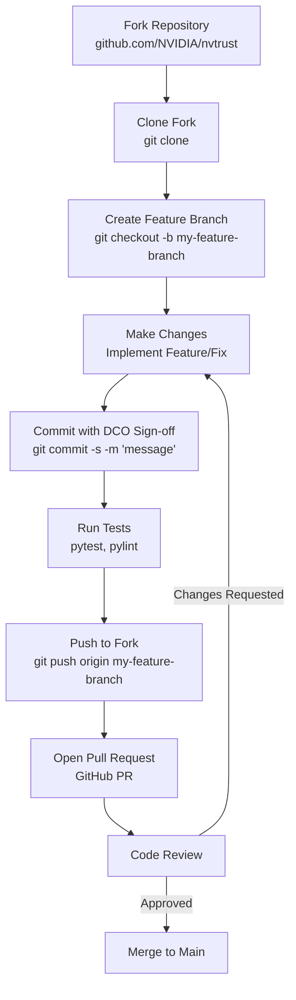
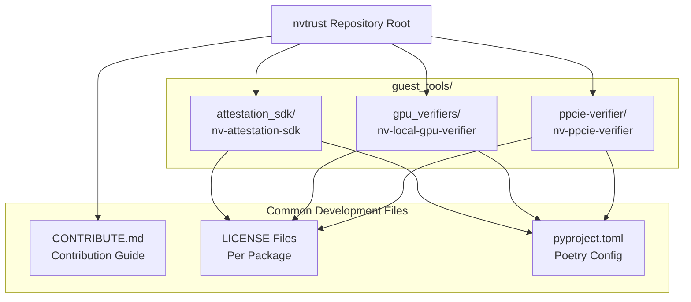
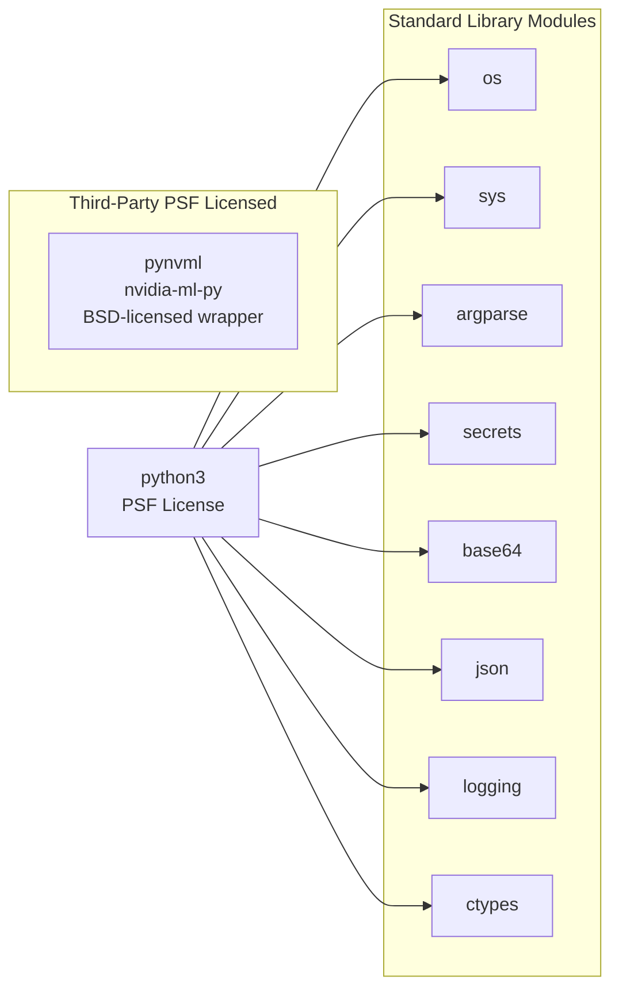
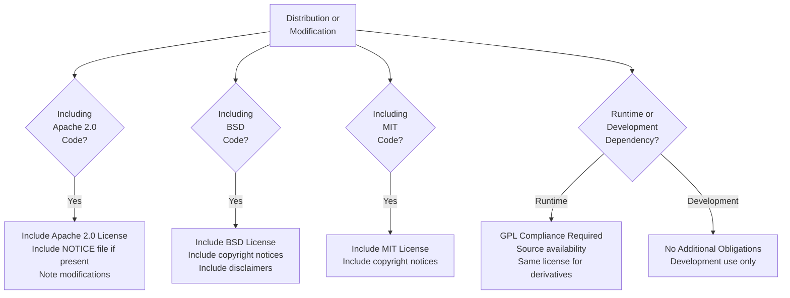

<!-- source: DeepWiki mcp.deepwiki.com · repo NVIDIA/nvtrust · page 8 Contributing and Licensing · fetched 2026-10-26 -->

# Contributing and Licensing

<details>
<summary>Relevant source files</summary>

The following files were used as context for generating this wiki page:

- [CONTRIBUTE.md](CONTRIBUTE.md)
- [guest_tools/ppcie-verifier/LICENSE](guest_tools/ppcie-verifier/LICENSE)
- [guest_tools/ppcie-verifier/ppcie/__init__.py](guest_tools/ppcie-verifier/ppcie/__init__.py)

</details>


This document provides information for contributors to the nvTrust repository, including the contribution process, Developer Certificate of Origin (DCO) requirements, coding standards, and licensing details for the codebase and its dependencies. For information about installation and usage of the tools, see [Package Overview](#1.3). For troubleshooting during development, see [Troubleshooting](#7).

---

## Contributing to nvTrust

The nvTrust repository welcomes community contributions for bug fixes, improvements, and new features. All contributions must follow the Developer Certificate of Origin (DCO) requirements and adhere to the project's coding standards.

### Reporting Issues

Issues, bug reports, and feature requests should be submitted through the GitHub Issues page at https://github.com/NVIDIA/nvtrust/issues. When reporting issues:

- Provide a clear and descriptive title
- Include detailed steps to reproduce the issue
- Specify the environment (OS, Python version, GPU driver version, GPU architecture)
- Include relevant log output or error messages
- For attestation failures, include claim verification results if available

**Sources:** [CONTRIBUTE.md:8-14]()

### Contribution Workflow

The standard contribution process follows the fork-and-pull-request model:



**Contribution Workflow Diagram**

**Sources:** [CONTRIBUTE.md:17-31]()

### Developer Certificate of Origin (DCO)

All commits must be signed off to certify that the contributor has the right to submit the contribution under the project's open source license. This is enforced through the Developer Certificate of Origin (DCO) version 1.1.

#### DCO Sign-off Process

Commits must include a sign-off line appended to the commit message:

```bash
git commit -s -m "Add cool feature."
```

This appends the following to the commit message:

```
Signed-off-by: Your Name <your@email.com>
```

The sign-off certifies that:

| Certification | Description |
|---------------|-------------|
| **(a)** Original Work | The contribution was created in whole or in part by the contributor and they have the right to submit it under the open source license |
| **(b)** Based on Prior Work | The contribution is based on previous work covered under an appropriate open source license, and the contributor has the right to submit modifications |
| **(c)** Provided by Another | The contribution was provided by someone who certified (a), (b), or (c) and has not been modified |
| **(d)** Public Record | The contributor understands the contribution is public and will be maintained indefinitely with all associated metadata |

Pull requests containing commits without DCO sign-off will not be accepted.

**Sources:** [CONTRIBUTE.md:60-101]()

### Coding Guidelines

To maintain code quality and consistency across the nvTrust codebase:

| Guideline | Description |
|-----------|-------------|
| **Code Style** | Follow the existing code style in each package (Python PEP 8 conventions) |
| **Commit Messages** | Write clear, concise commit messages describing the change and rationale |
| **Comments** | Include comments explaining the intent, especially for complex attestation logic |
| **Testing** | Run existing tests and add new tests for new functionality (pytest framework) |
| **No Regressions** | Ensure changes do not introduce new issues or break existing functionality |

Development dependencies include `black` (code formatting), `pylint` (linting), and `pytest` (testing framework).

**Sources:** [CONTRIBUTE.md:33-40](), [guest_tools/ppcie-verifier/LICENSE:89-117]()

### Code of Conduct

The project adheres to the Contributor Covenant Code of Conduct version 2.0 to ensure a positive and inclusive community. All participants are expected to:

- Be respectful and professional in all interactions
- Welcome diverse perspectives and experiences
- Accept constructive criticism gracefully
- Focus on what is best for the community
- Show empathy towards other community members

**Sources:** [CONTRIBUTE.md:42-44]()

---

## Repository Structure and Development Setup

### Getting Started with Development

```bash
# Clone the repository
git clone https://github.com/NVIDIA/nvtrust.git

# Navigate to project directory
cd nvtrust

# Install a specific package for development
cd guest_tools/attestation_sdk
poetry install

# Run tests
pytest

# Run linting
pylint nv_attestation_sdk
```

### Package Structure for Contributions



**Repository Package Structure**

Each package ([guest_tools/attestation_sdk](), [guest_tools/gpu_verifiers](), [guest_tools/ppcie-verifier]()) is a standalone Poetry project with its own:
- `pyproject.toml` - Package metadata and dependencies
- `LICENSE` - License file with dependency attributions
- Test suite (`tests/` directory)
- Source code with SPDX license headers

**Sources:** [CONTRIBUTE.md:46-58](), [guest_tools/ppcie-verifier/ppcie/__init__.py:1-14]()

---

## Licensing

### Main Project License

The nvTrust codebase is licensed under the **Apache License, Version 2.0**. All source files include SPDX license headers:

```python
# SPDX-FileCopyrightText: Copyright (c) 2021-2025 NVIDIA CORPORATION & AFFILIATES. All rights reserved.
# SPDX-License-Identifier: Apache-2.0
```

The Apache 2.0 license grants users the rights to:
- Use the software for any purpose
- Modify the source code
- Distribute original or modified versions
- Patent use (with termination clause for patent litigation)

The license requires:
- Inclusion of the license text in distributions
- Notice of modifications to files
- Retention of copyright, patent, trademark, and attribution notices

**Sources:** [guest_tools/ppcie-verifier/ppcie/__init__.py:1-14](), [guest_tools/ppcie-verifier/LICENSE:140-346]()

### Dependency Licenses

The nvTrust packages depend on numerous open source libraries, each with their own licensing terms. The following table summarizes the major license categories:

| License Type | Dependencies | Key Terms |
|--------------|--------------|-----------|
| **Python Software Foundation License** | Python 3.9+, standard library modules (os, sys, argparse, json, logging, ctypes) | Permissive, attribution required |
| **BSD 3-Clause** | pynvml (nvidia-ml-py), click, dill, prettytable, cryptography | Permissive, no endorsement clause |
| **MIT License** | black, build, poetry, pytest, timeout-decorator, tomlkit, urllib3, wheel, pytest-cov, setuptools | Very permissive, attribution required |
| **Apache 2.0** | cryptography | Permissive, patent grant, trademark restrictions |
| **GPL v2.0** | pylint, astroid | Copyleft, derivative works must use GPL |
| **Mozilla Public License 2.0** | pathspec | Weak copyleft, file-level licensing |

**Sources:** [guest_tools/ppcie-verifier/LICENSE:1-1129]()

### Dependency License Details

#### Python Software Foundation Licensed Components

The following Python standard library components are used:



**Python Standard Library Components**

**pynvml** is specifically noted with its own copyright:
- Copyright (c) 2011-2021, NVIDIA Corporation
- Licensed under BSD 3-Clause terms

**Sources:** [guest_tools/ppcie-verifier/LICENSE:4-36](), [guest_tools/ppcie-verifier/LICENSE:363-364]()

#### MIT Licensed Dependencies

| Package | Copyright Holder | Purpose |
|---------|------------------|---------|
| **black** | Copyright (c) 2018 Łukasz Langa | Code formatting |
| **build** | Copyright © 2019 Filipe Laíns | Package building |
| **poetry** | Copyright (c) 2018-present Sébastien Eustace | Dependency management |
| **pytest** | Copyright (c) 2004 Holger Krekel and others | Testing framework |
| **timeout-decorator** | Copyright (c) 2012 Daniel Holth and contributors | Timeout functionality |
| **tomlkit** | Copyright (c) 2018 Sébastien Eustace | TOML parsing |
| **urllib3** | Copyright (c) 2008-2020 Andrey Petrov and contributors | HTTP client |
| **wheel** | Copyright (c) 2012 Daniel Holth and contributors | Package distribution |
| **pytest-cov** | Copyright (c) 2010 Holger Krekel and others | Test coverage |

**Sources:** [guest_tools/ppcie-verifier/LICENSE:86-135]()

#### BSD Licensed Dependencies

| Package | Purpose | Specific License |
|---------|---------|------------------|
| **click** | CLI framework | BSD, Copyright 2014 Pallets |
| **dill** | Serialization | BSD, Copyright (c) 2004-2016 California Institute of Technology |
| **nvidia-ml-py** | NVML Python bindings | BSD, Copyright (c) 2020, NVIDIA Corporation |
| **prettytable** | Table formatting | BSD, Copyright (c) 2009-2014 Luke Maurits |
| **cryptography** | Cryptographic operations | BSD/Apache dual license |

**Sources:** [guest_tools/ppcie-verifier/LICENSE:351-398]()

#### Apache 2.0 Licensed Dependencies

The **cryptography** library is licensed under Apache License 2.0, which provides:
- Patent grant to users
- Termination clause if patent litigation is initiated
- Requirement to include NOTICE file if present
- Permission to add additional license terms for modifications

**Sources:** [guest_tools/ppcie-verifier/LICENSE:140-346]()

#### GPL v2.0 Licensed Dependencies

**pylint** and **astroid** are licensed under GNU General Public License v2.0. These are development dependencies used for linting and do not create copyleft obligations for the distributed software, as:
- They are used only during development (not linked into distributed code)
- They are not part of the runtime dependencies
- The GPL v2.0 does not impose requirements on mere aggregation with GPL software

**Sources:** [guest_tools/ppcie-verifier/LICENSE:402-749]()

#### Mozilla Public License 2.0 Dependencies

**pathspec** is licensed under MPL 2.0, a weak copyleft license that:
- Applies at the file level (not the entire codebase)
- Allows combination with other licenses
- Requires source availability only for modified MPL-licensed files
- Permits use in proprietary larger works

**Sources:** [guest_tools/ppcie-verifier/LICENSE:753-1129]()

### License Compliance Requirements

When distributing or modifying nvTrust packages, the following compliance requirements apply:



**License Compliance Decision Tree**

**Summary of Obligations:**

1. **Always include** the LICENSE file from each package being distributed
2. **Retain** all SPDX license headers in source files
3. **Document** any modifications to files
4. **Include** copyright notices for all dependencies
5. **Do not** remove or alter existing license notices
6. **Provide** source code if required by copyleft licenses (GPL)

**Sources:** [guest_tools/ppcie-verifier/LICENSE:1-1129]()

---

## Contact and Support

For questions about contributing or licensing:

- Open an issue on GitHub: https://github.com/NVIDIA/nvtrust/issues
- Review existing issues and discussions
- Contact the maintainers through GitHub

The maintainers will respond to contribution questions and provide guidance on licensing compliance issues.

**Sources:** [CONTRIBUTE.md:103-108]()