# Page: Overview

# Overview

<details>
<summary>Relevant source files</summary>

The following files were used as context for generating this wiki page:

- [README.md](README.md)
- [guest_tools/README.md](guest_tools/README.md)
- [guest_tools/ppcie-verifier/README.md](guest_tools/ppcie-verifier/README.md)

</details>


This document introduces the nvTrust repository, explaining its role in GPU attestation for confidential computing and providing a high-level summary of its components. For detailed architectural patterns, see [Architecture](#1.1). For fundamental terminology and trust models, see [Key Concepts](#1.2). For package-specific details, see [Package Overview](#1.3).

**Sources:** [README.md:1-33](), [guest_tools/README.md:1-125]()

## What is nvTrust?

nvTrust is a collection of ancillary software tools for implementing and validating NVIDIA Trusted Computing Solutions on NVIDIA hardware. The repository focuses specifically on **attestation** - the cryptographic verification process that ensures the integrity and security of confidential computing environments running on NVIDIA GPUs.

The repository provides Python-based tools that enable users to:
- Collect cryptographic evidence from NVIDIA GPUs and NVSwitches
- Verify hardware and firmware measurements against known-good reference values
- Validate that devices are properly configured for confidential computing workloads
- Generate attestation tokens for integration with broader security frameworks

**Sources:** [README.md:1-6](), [README.md:15-21]()

## Confidential Computing Context

NVIDIA Confidential Computing provides a solution for securely processing data and code in use, preventing unauthorized users from both access and modification. When running AI training or inference workloads, both the input data (which may contain personally identifiable information or enterprise secrets) and the trained model (which represents valuable intellectual property) must be protected.

GPU attestation serves as the foundation for establishing trust in confidential computing environments by cryptographically proving:
- The GPU hardware is genuine NVIDIA hardware
- The GPU firmware has not been tampered with
- The GPU is configured in the correct confidential computing mode
- The system topology matches expected secure configurations

**Sources:** [README.md:15-21](), [guest_tools/ppcie-verifier/README.md:17-25]()

## Repository Structure and Main Components

The nvTrust repository is organized into the following primary components:

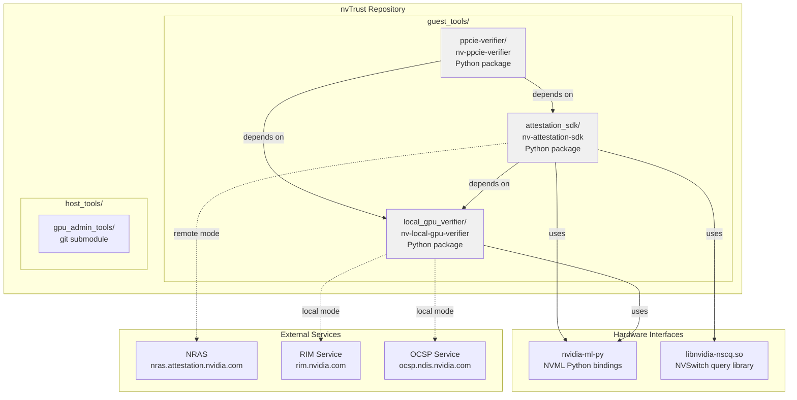

**Main Components:**

| Component | Package Name | Purpose |
|-----------|-------------|---------|
| **Attestation SDK** | `nv-attestation-sdk` | Primary library for integrating attestation capabilities into applications. Provides high-level API for evidence collection and verification. |
| **Local GPU Verifier** | `nv-local-gpu-verifier` | Tool and library for local GPU attestation. Performs cryptographic verification of GPU measurements without external service dependencies. |
| **PPCIE Verifier** | `nv-ppcie-verifier` | Orchestration tool for multi-GPU systems with NVSwitch interconnects. Verifies both GPU and switch attestation plus topology validation. |
| **GPU Admin Tools** | git submodule | Host-side administrative tools for GPU management (not covered in this documentation). |

**Sources:** [README.md:7-14](), [guest_tools/README.md:21-23](), [guest_tools/ppcie-verifier/README.md:68-73]()

## Attestation Workflow: Code Entity View

The following diagram shows how the main Python modules and classes interact during an attestation workflow:

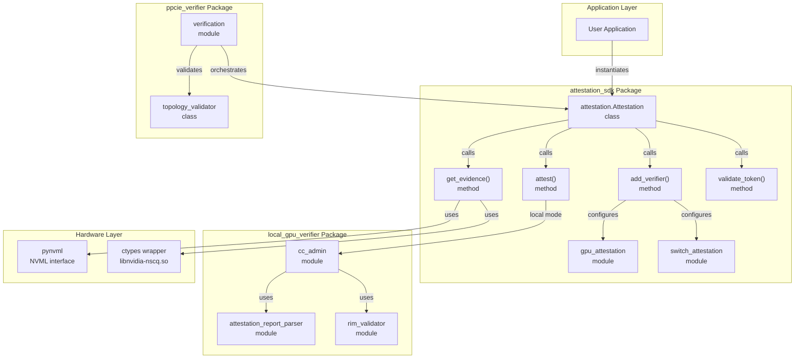

**Key Code Entities:**

- `attestation.Attestation`: Main client class users instantiate to perform attestation [guest_tools/attestation_sdk/README.md]()
- `add_verifier()`: Method to configure attestation mode (LOCAL or REMOTE) for devices [guest_tools/README.md:32-34]()
- `get_evidence()`: Method to collect cryptographic evidence from hardware [guest_tools/README.md:36-39]()
- `attest()`: Method to perform verification of collected evidence [guest_tools/README.md:42-44]()
- `cc_admin`: Module containing local GPU verification logic [guest_tools/local_gpu_verifier/]()
- `verification`: Module implementing PPCIE orchestration workflow [guest_tools/ppcie-verifier/README.md:93-94]()

**Sources:** [guest_tools/README.md:28-44](), [guest_tools/README.md:75-81](), [guest_tools/README.md:94-101]()

## Deployment Models

nvTrust supports three attestation deployment models, each with different trust and operational characteristics:

### Model 1: Remote Attestation (NVIDIA-Managed)

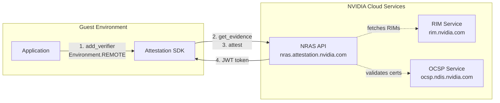

- Evidence collection performed locally
- All verification performed by NVIDIA Remote Attestation Service (NRAS)
- Highest security and simplest integration
- Requires network connectivity to NVIDIA cloud services

**Sources:** [guest_tools/README.md:63-81]()

### Model 2: Local Attestation (Hybrid)

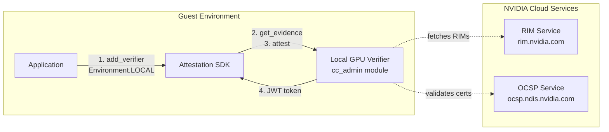

- Both evidence collection and verification performed locally
- Fetches reference measurements (RIMs) and certificate status from NVIDIA services
- Lower latency than remote mode
- Requires network connectivity to RIM and OCSP services

**Sources:** [guest_tools/README.md:83-101]()

### Model 3: Trust Outpost (On-Premises)

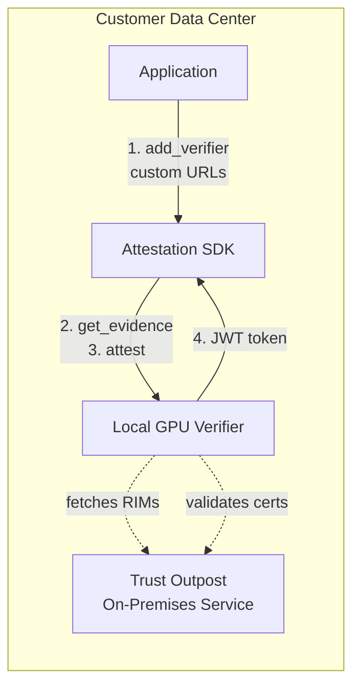

- Fully on-premises deployment
- Local caching of RIM and OCSP data
- Suitable for air-gapped environments or strict data sovereignty requirements
- Requires agreement with NVIDIA to access Trust Outpost

**Sources:** [guest_tools/README.md:103-108]()

## Multi-GPU Systems: PPCIE Mode

For multi-GPU systems with NVSwitch interconnects, the PPCIE Verifier provides orchestrated attestation and topology validation:

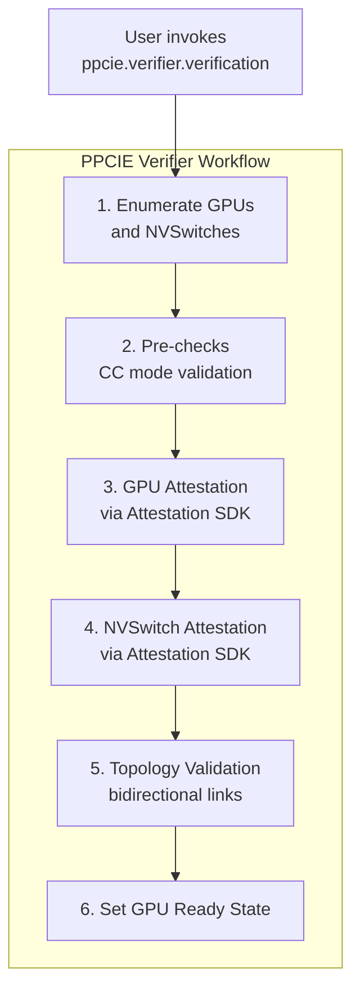

The PPCIE Verifier performs a 16-step verification process that includes:
- Device enumeration and pre-checks
- Individual attestation of all GPUs and NVSwitches
- Bidirectional topology validation (GPU-to-Switch and Switch-to-GPU links)
- Policy validation for all attestation results
- Final GPU ready state configuration

For details on the PPCIE workflow, see [PPCIE Verification](#5).

**Sources:** [guest_tools/ppcie-verifier/README.md:17-55](), [guest_tools/ppcie-verifier/README.md:93-94]()

## Supported Hardware

nvTrust supports attestation for:

| Hardware | Architectures | Requirements |
|----------|--------------|-------------|
| **NVIDIA GPUs** | Hopper (H100+), Blackwell | Confidential Computing capable, driver R575+ for Blackwell |
| **NVSwitches** | LS10 with PPCIE support | Requires NVIDIA Switch driver and Fabric Manager |

The system requires:
- Python >= 3.9
- NVIDIA GPU driver installed
- For multi-GPU systems: NVIDIA Fabric Manager installed
- For NVSwitch attestation: NVIDIA Switch driver installed

**Sources:** [guest_tools/ppcie-verifier/README.md:57-63]()

## Getting Started

To begin using nvTrust:

1. **Install the Attestation SDK** - This is the primary package that most users will need:
   ```bash
   pip install nv-attestation-sdk
   ```
   
   For detailed installation instructions, see [Installation and Setup](#2.1).

2. **For single-GPU attestation** - Use the Attestation SDK directly. See example code at [guest_tools/README.md:28-44]().

3. **For multi-GPU systems with NVSwitches** - Install the PPCIE Verifier:
   ```bash
   pip install nv-ppcie-verifier
   ```
   
   For PPCIE-specific setup, see [PPCIE Verification](#5).

4. **Run example tests** - Navigate to `guest_tools/attestation_sdk/tests/end_to_end/hardware/` and run:
   ```bash
   python LocalGPUTest.py
   # or
   python RemoteGPUTest.py
   ```

**Sources:** [guest_tools/README.md:20-59](), [guest_tools/ppcie-verifier/README.md:65-91]()

## Key Workflows Summary

| Workflow | Primary Tool | Use Case |
|----------|-------------|----------|
| **Single GPU Remote Attestation** | `attestation.Attestation` with `Environment.REMOTE` | Simplest integration, cloud-based verification |
| **Single GPU Local Attestation** | `attestation.Attestation` with `Environment.LOCAL` | Lower latency, hybrid cloud model |
| **Multi-GPU PPCIE Verification** | `ppcie.verifier.verification` module | HGX systems with 8 GPUs and 4 NVSwitches |
| **NVSwitch-Only Attestation** | `attestation.Attestation` with `Devices.SWITCH` | Switch interconnect verification |

For detailed workflow documentation, see [Attestation Workflow](#2.4).

**Sources:** [guest_tools/README.md:61-108](), [guest_tools/ppcie-verifier/README.md:93-108]()

## External Dependencies

nvTrust relies on several NVIDIA cloud services and external libraries:

**NVIDIA Services:**
- **NRAS** (`nras.attestation.nvidia.com`): Remote attestation verification service
- **RIM Service** (`rim.nvidia.com`): Reference Integrity Manifests for golden measurements
- **OCSP Service** (`ocsp.ndis.nvidia.com`): Certificate revocation checking

For service details, see [External Services](#6).

**Python Libraries:**
- `nvidia-ml-py`: Python bindings for NVML (NVIDIA Management Library)
- `cryptography`: Cryptographic operations for signature verification
- `PyJWT`: JSON Web Token generation and validation
- `lxml`, `signxml`: XML signature verification for RIM files

**Native Libraries:**
- `libnvidia-ml.so`: NVML driver library
- `libnvidia-nscq.so`: NVSwitch Query library

**Sources:** [guest_tools/ppcie-verifier/README.md:66-73]()

## Support and Contributing

- **Documentation**: [NVIDIA Confidential Computing Docs](https://docs.nvidia.com/confidential-computing/index.html)
- **Issues**: [GitHub Issues](https://github.com/NVIDIA/nvtrust/issues)
- **Email Support**: attestation-support@nvidia.com
- **Contributing**: See [Contributing and Licensing](#8)

The repository is licensed under Apache License v2.0 except where otherwise noted.

**Sources:** [README.md:23-33](), [guest_tools/README.md:119-124]()

---

# Page: Architecture

# Architecture

<details>
<summary>Relevant source files</summary>

The following files were used as context for generating this wiki page:

- [README.md](README.md)
- [guest_tools/README.md](guest_tools/README.md)
- [guest_tools/attestation_sdk/README.md](guest_tools/attestation_sdk/README.md)
- [guest_tools/ppcie-verifier/README.md](guest_tools/ppcie-verifier/README.md)
- [guest_tools/ppcie-verifier/pyproject.toml](guest_tools/ppcie-verifier/pyproject.toml)

</details>


This document explains the high-level architecture of the nvTrust system, highlighting the core components and their relationships. It provides a technical overview of how the different parts interact to enable GPU and NVSwitch attestation in confidential computing environments. For an introduction to nvTrust and its purpose, see [Overview](#1). For fundamental attestation concepts and terminology, see [Key Concepts](#1.2).

## System Architecture Overview

The nvTrust system is designed to provide comprehensive attestation capabilities for NVIDIA hardware components, particularly GPUs and NVSwitches, to ensure their integrity and security in confidential computing environments. The architecture follows a modular design approach that allows for flexibility in deployment and usage.

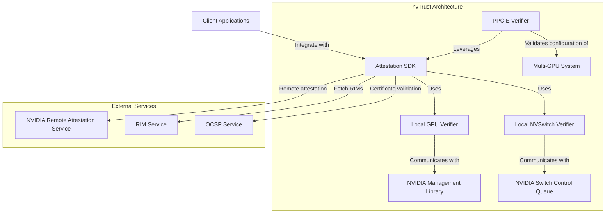

Diagram: High-level Component Overview of nvTrust Architecture

Sources: [README.md:1-29](), [guest_tools/attestation_sdk/README.md:1-45]()

## Core Components

### Attestation SDK

The Attestation SDK serves as the central component of the nvTrust system, providing a unified interface for applications to implement attestation capabilities. It supports both local and remote attestation for GPUs and NVSwitches.

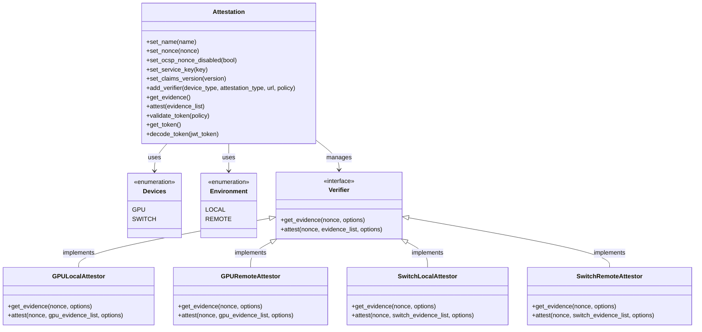

Diagram: Attestation SDK Class Structure

Sources: [guest_tools/attestation_sdk/README.md:148-167]()

### Local GPU Verifier

The Local GPU Verifier is responsible for collecting evidence from GPUs and verifying their integrity locally. It interfaces with the NVIDIA Management Library (NVML) to communicate with the GPU hardware.

### Local NVSwitch Verifier

The Local NVSwitch Verifier performs attestation of NVSwitches in multi-GPU systems. It interfaces with the NVIDIA Switch Control Queue (NSCQ) to communicate with the NVSwitch hardware.

### PPCIE Verifier

The PPCIE Verifier validates the Protected PCIe configuration in multi-GPU systems, ensuring that the secure communication channels between GPUs and between GPUs and NVSwitches are properly established.

## Attestation Models

The nvTrust architecture supports three primary attestation models, each designed for different security requirements and operational environments.

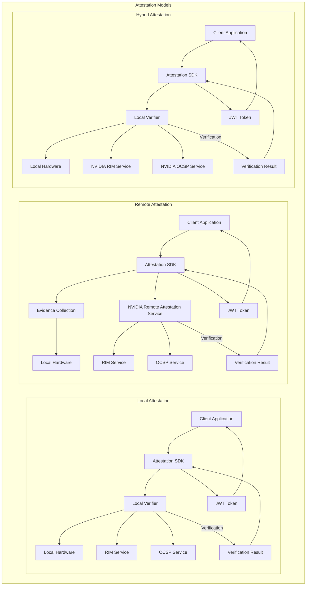

Diagram: Attestation Models Flow

Sources: [guest_tools/README.md:61-108]()

### Local Attestation

In the local attestation model, both evidence collection and verification are performed locally on the system where the hardware is installed. This model is suitable for environments where internet connectivity is limited or where strict data sovereignty requirements exist.

### Remote Attestation

The remote attestation model involves collecting evidence locally but sending it to NVIDIA's Remote Attestation Service (NRAS) for verification. This approach provides the highest level of security as it leverages continually updated threat intelligence and verification capabilities from NVIDIA.

### Hybrid Attestation

The hybrid model balances local control with cloud-based support. Verification is performed locally, but the system still relies on NVIDIA's cloud services for Reference Integrity Manifests (RIMs) and Online Certificate Status Protocol (OCSP) validation.

| Feature | Local Attestation | Remote Attestation | Hybrid Attestation |
|---------|-------------------|-------------------|-------------------|
| Evidence Collection | Local | Local | Local |
| Verification | Local | NVIDIA Cloud | Local |
| RIM Source | Local or Cloud | NVIDIA Cloud | NVIDIA Cloud |
| OCSP Validation | Local or Cloud | NVIDIA Cloud | NVIDIA Cloud |
| Security Level | High | Highest | High |
| Cloud Dependency | Low | High | Medium |
| Best For | Air-gapped systems | Maximum security | Balanced approach |

Sources: [guest_tools/README.md:110-117]()

## Attestation Process

The attestation process follows a structured flow across all attestation models, with variations in where specific steps are executed.

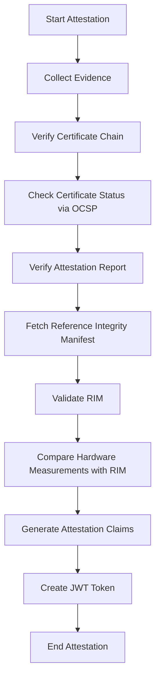

Diagram: Attestation Process Flow

Sources: [guest_tools/attestation_sdk/README.md:80-90]()

### Evidence Collection

Evidence collection involves gathering cryptographic measurements and other security-relevant information from the hardware. This includes:

1. Attestation reports generated by the hardware
2. Certificate chains associated with the hardware
3. Driver and firmware versions
4. Hardware-specific security properties

### Verification

The verification process involves:

1. Certificate chain validation
2. OCSP certificate status checking
3. Attestation report validation, including nonce verification
4. RIM validation, including schema and signature verification
5. Comparison of hardware measurements against the RIM

### Token Generation

The result of the attestation process is a JWT token containing claims about the hardware's security state. This token can be validated against a policy to determine if the hardware meets the required security standards.

## Integration Options

The nvTrust architecture supports different integration options to meet various deployment scenarios and security requirements.

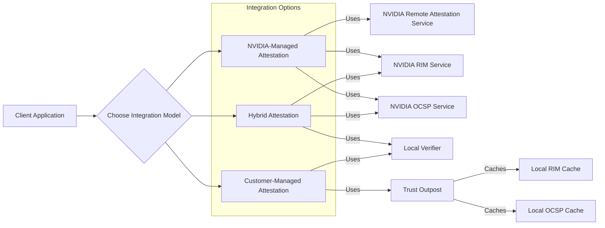

Diagram: Integration Options

Sources: [guest_tools/README.md:61-108]()

### NVIDIA-Managed Attestation

This option offers the highest level of security and operational simplicity by leveraging NVIDIA's cloud-based attestation services for comprehensive verification.

### Hybrid Attestation

This option balances local control with cloud-based support, allowing for local verification while still utilizing NVIDIA cloud services for RIM and OCSP validation.

### Customer-Managed Attestation

For organizations with strict data sovereignty requirements or air-gapped systems, NVIDIA offers Trust Outpost, an on-premises implementation that efficiently caches RIM and OCSP data.

## Conclusion

The nvTrust architecture provides a flexible and comprehensive solution for GPU and NVSwitch attestation in confidential computing environments. By supporting multiple attestation models and integration options, it can be adapted to meet a wide range of security requirements and operational constraints.

For more information on how to use the Attestation SDK and implement attestation in your applications, see [Attestation SDK](#2).

---

# Page: Key Concepts

# Key Concepts

<details>
<summary>Relevant source files</summary>

The following files were used as context for generating this wiki page:

- [README.md](README.md)
- [guest_tools/README.md](guest_tools/README.md)
- [guest_tools/attestation_sdk/README.md](guest_tools/attestation_sdk/README.md)
- [guest_tools/gpu_verifiers/local_gpu_verifier/README.md](guest_tools/gpu_verifiers/local_gpu_verifier/README.md)
- [guest_tools/ppcie-verifier/README.md](guest_tools/ppcie-verifier/README.md)

</details>


This page defines the fundamental concepts, terminology, and technical foundations underlying the nvTrust attestation system. Understanding these concepts is essential for working with GPU and NVSwitch attestation in confidential computing environments.

For architectural overview and component relationships, see [Architecture](#1.1). For package-specific details, see [Package Overview](#1.3). For GPU attestation workflows, see [GPU Attestation](#3). For multi-GPU system verification, see [PPCIE Verification](#5).

## Attestation

Attestation is the process of cryptographically verifying that hardware and software components are in a known, trustworthy state. In the nvTrust system, attestation validates that GPUs and NVSwitches are running authentic NVIDIA firmware and are configured correctly for confidential computing workloads.

The attestation process consists of three main phases:

| Phase | Description | Code Components |
|-------|-------------|-----------------|
| **Evidence Collection** | Retrieve cryptographically signed measurements from hardware | `Attestation.get_evidence()`, `nvmlHandler` module |
| **Verification** | Validate signatures and compare runtime measurements against golden values | `verifier` module, NRAS API |
| **Policy Enforcement** | Check attestation claims against security requirements | `Attestation.validate_token()` |

### Attestation Modes

The system supports two verification modes:

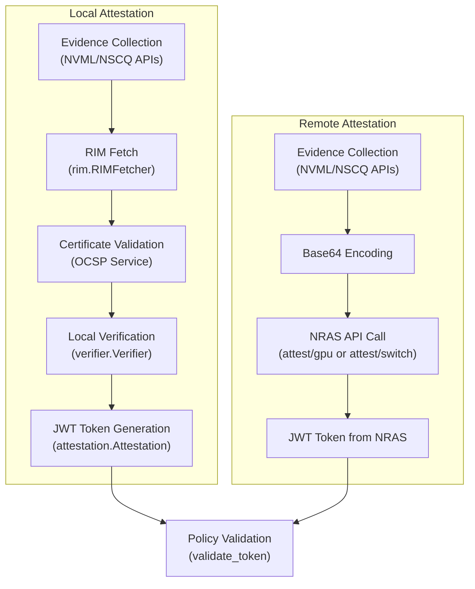

**Local Attestation** performs all cryptographic verification on the client system using the `verifier.cc_admin` module. This mode requires access to RIM and OCSP services but executes verification logic locally, enabling air-gapped deployments when combined with Trust Outpost.

**Remote Attestation** sends evidence to NVIDIA's Remote Attestation Service (NRAS), which performs verification centrally and returns a signed JWT token. This mode uses the `attestation.Environment.REMOTE` configuration.

Sources: [guest_tools/attestation_sdk/README.md:27-33](), [guest_tools/README.md:25-44](), [guest_tools/gpu_verifiers/local_gpu_verifier/README.md:23-26]()

## Confidential Computing

Confidential computing protects data and code during execution, preventing unauthorized access or modification. NVIDIA GPUs with Confidential Computing (CC) capabilities provide hardware-enforced isolation for AI workloads processing sensitive data such as personally identifiable information (PII) or proprietary models.

The confidential computing security model relies on:

- **Hardware Root of Trust**: Immutable GPU ROM and secure key storage
- **Encrypted Memory**: GPU memory encryption preventing physical attacks
- **Attestation**: Cryptographic proof that the GPU is in a known secure state
- **GPU Ready State**: Hardware-level enforcement mechanism (see [GPU Ready State](#gpu-ready-state))

In multi-GPU systems, two operating modes are supported:

| Mode | Description | NVLink Traffic | Verifier Tool |
|------|-------------|----------------|---------------|
| **CC Mode** | Each GPU in separate confidential VM | Encrypted via Copy Engine | `cc_admin` |
| **PPCIE Mode** | All GPUs in single confidential VM, trusted NVLink fabric | Plaintext (trusted) | `ppcie.verifier` |

**Note**: Mixing CC and PPCIE modes is not supported - all GPUs must operate in the same mode.

Sources: [README.md:15-22](), [guest_tools/ppcie-verifier/README.md:17-26]()

## Evidence and Measurements

Evidence is the raw data collected from hardware that proves its current state. In nvTrust, evidence consists of:

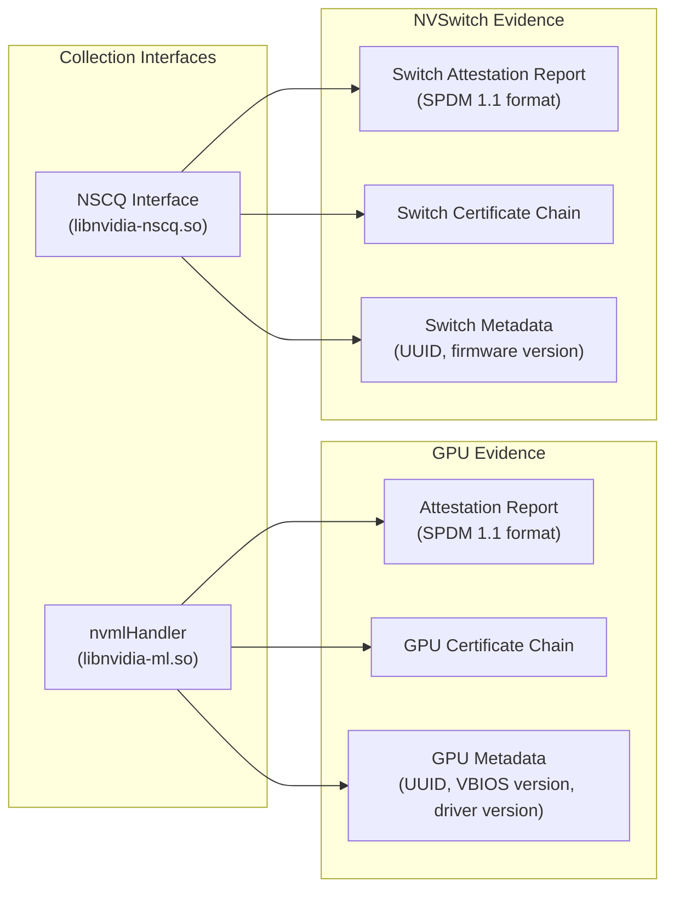

**Measurements** are cryptographic hashes of firmware components included in the attestation report. Common measurement indices include:

| Index | Component | Description |
|-------|-----------|-------------|
| `0x0` | ROM | Immutable boot ROM |
| `0x1` | Driver | GPU driver version-specific measurements |
| `0x2` | VBIOS | Video BIOS firmware |
| `0xD` | Configuration | Runtime configuration state |

The `nvmlHandler` module uses NVML API calls to retrieve GPU attestation reports via `nvmlDeviceGetConfComputeGpuAttestationReport()`. For NVSwitches, the NSCQ library provides equivalent functionality through `nscq_session_gpu_attestation_report_get()`.

Sources: [guest_tools/gpu_verifiers/local_gpu_verifier/README.md:136-140](), [guest_tools/attestation_sdk/README.md:167-168]()

## Reference Integrity Manifests (RIMs)

Reference Integrity Manifests (RIMs) contain the golden measurements (expected cryptographic hashes) for authentic NVIDIA firmware. RIMs are distributed as SWID (Software Identification) tags that conform to the TCG RIM specification.

### RIM Structure

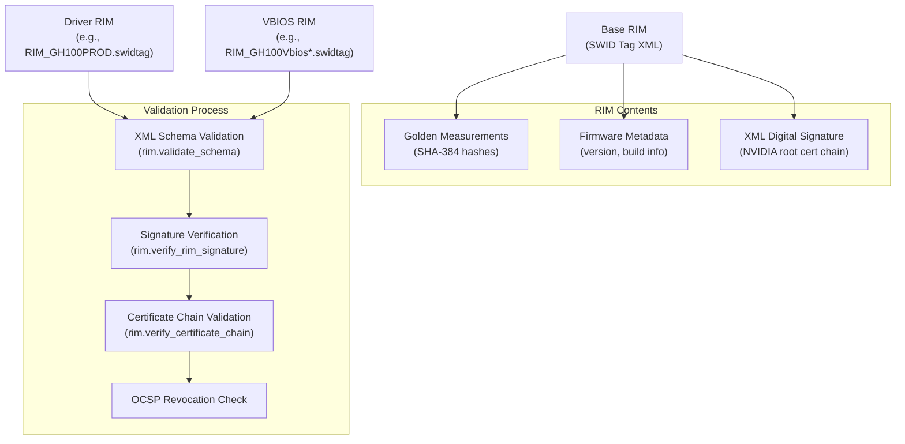

The `rim` module performs parsing, schema validation, and signature verification of RIM files. RIMs are fetched from the RIM Service at runtime or can be provided via the `--driver_rim` and `--vbios_rim` command-line options.

Key RIM validation functions:
- `rim.validate_schema()`: Validates XML structure against SWID schema
- `rim.verify_rim_signature()`: Verifies XML digital signature
- `rim.verify_certificate_chain()`: Validates RIM certificate chain to NVIDIA root

Sources: [guest_tools/gpu_verifiers/local_gpu_verifier/README.md:132-134](), [guest_tools/gpu_verifiers/local_gpu_verifier/README.md:111-117]()

## Attestation Reports (SPDM)

Attestation reports are cryptographically signed documents generated by the GPU hardware that contain runtime measurements. nvTrust uses the DMTF SPDM (Security Protocol and Data Model) 1.1 specification for attestation report format.

### SPDM Report Structure

| Field | Description | Verified By |
|-------|-------------|-------------|
| **Measurements** | SHA-384 hashes of firmware components (ROM, driver, VBIOS, config) | `attestation.Attestation` module |
| **Signature** | ECDSA P-384 signature over measurements and nonce | Hardware secure storage |
| **Nonce** | Cryptographic nonce for replay protection | Provided by verifier (`--nonce` option) |
| **Certificate Chain** | GPU certificate chain for signature verification | `rim.verify_certificate_chain()` |

The attestation report is retrieved from the GPU via `nvmlDeviceGetConfComputeGpuAttestationReport()` and parsed by the `attestation` module. The module extracts measurements and performs signature verification using the GPU's certificate chain.

```mermaid
graph LR
    Hardware["GPU Hardware<br/>(Secure Key Storage)"]
    Report["SPDM 1.1 Report<br/>(attestation.Attestation)"]
    Extract["Measurement Extraction<br/>(parse functions)"]
    Verify["Signature Verification<br/>(cryptography library)"]
    Compare["Measurement Comparison<br/>(verifier.Verifier)"]
    
    Hardware -->|"nvmlDeviceGetConfComputeGpuAttestationReport()"| Report
    Report --> Extract
    Extract --> Verify
    Verify --> Compare
    Compare -->|"Match against RIM"| Result["Attestation Result"]
```

Sources: [guest_tools/gpu_verifiers/local_gpu_verifier/README.md:136-137](), [guest_tools/attestation_sdk/README.md:162]()

## Claims and Tokens

After successful attestation, the system generates a JWT (JSON Web Token) containing **claims** - standardized assertions about the verified device state. Claims follow the Entity Attestation Token (EAT) format and are versioned for compatibility.

### Claims Versions

The system supports multiple claims versions for backward compatibility:

| SDK Version | Supported Claims Versions |
|-------------|---------------------------|
| v2.0.0 - v2.3.0 | 2.0 |
| v2.4.0 - v2.6.3 | 2.0, 3.0 (default) |

Claims version is configured via `Attestation.set_claims_version()` or the `--claims_version` command-line option.

### Common Claims Structure

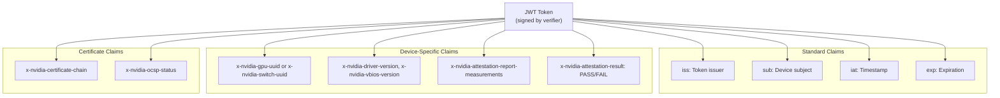

The `Attestation.get_token()` method retrieves the JWT token after attestation. The `decode_token()` method decodes the JWT to inspect individual claims.

Sources: [guest_tools/attestation_sdk/README.md:131-152](), [guest_tools/attestation_sdk/README.md:170-174]()

## Trust Model and Certificate Chains

The nvTrust trust model is based on a hierarchical chain of trust rooted in NVIDIA's certificate authority.

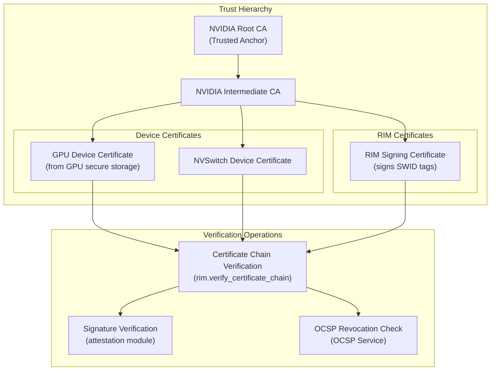

### Certificate Validation

Certificate validation involves three checks:

1. **Chain Validation**: Verify that the device or RIM certificate chains back to the NVIDIA root CA using `rim.verify_certificate_chain()`.

2. **Signature Validation**: Verify that signatures (attestation report signatures, RIM XML signatures) are valid using the certificate's public key.

3. **Revocation Checking**: Query the OCSP (Online Certificate Status Protocol) service to ensure certificates have not been revoked. Certificates in `certificate_hold` status can be allowed via the `--allow_hold_cert` flag or `NV_ALLOW_HOLD_CERT` environment variable.

The root certificate for chain validation can be specified via `--rim_root_cert` option or defaults to embedded NVIDIA root certificates.

Sources: [guest_tools/gpu_verifiers/local_gpu_verifier/README.md:116-117](), [guest_tools/attestation_sdk/README.md:163-164](), [guest_tools/attestation_sdk/README.md:177-179]()

## Policy Validation

Policy validation checks attestation claims against expected values defined in a JSON policy file. This allows applications to enforce specific security requirements.

### Policy File Structure

Policy files specify expected claim values:

```json
{
  "x-nvidia-attestation-result": ["PASS"],
  "x-nvidia-driver-version": ["550.54.14"],
  "x-nvidia-vbios-version": ["96.00.89.00.01"],
  "x-nvidia-gpu-arch": ["HOPPER"]
}
```

The `Attestation.validate_token()` method compares actual claims from the JWT token against the policy file. Validation fails if any required claim does not match the expected values.

### Policy Validation Flow

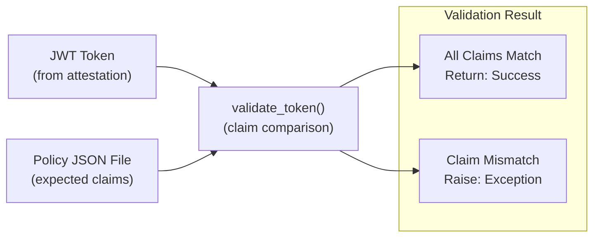

Sample policy files are provided in [guest_tools/attestation_sdk/tests/policies/]().

Sources: [guest_tools/attestation_sdk/README.md:113-116](), [guest_tools/attestation_sdk/README.md:173]()

## Hardware Interfaces

nvTrust interacts with GPU and NVSwitch hardware through two primary interfaces:

### NVML (NVIDIA Management Library)

NVML provides the interface for GPU management and attestation operations. The `nvmlHandler` module wraps NVML API calls.

| Operation | NVML Function | Module Function |
|-----------|---------------|-----------------|
| Get GPU UUID | `nvmlDeviceGetUUID()` | `nvmlHandler.get_gpu_uuid()` |
| Get driver version | `nvmlSystemGetDriverVersion()` | `nvmlHandler.get_driver_version()` |
| Get attestation report | `nvmlDeviceGetConfComputeGpuAttestationReport()` | `nvmlHandler.get_attestation_report()` |
| Get GPU certificate | `nvmlDeviceGetConfComputeGpuCertificate()` | `nvmlHandler.get_gpu_certificate()` |
| Set GPU ready state | `nvmlDeviceSetConfComputeGpuReadyState()` | Used by `cc_admin` |

The Python binding `nvidia-ml-py` (version >= 12.535.77) provides access to the native `libnvidia-ml.so` library.

### NSCQ (NVSwitch Query Library)

NSCQ provides the interface for NVSwitch attestation and management. This is a C library (`libnvidia-nscq.so`) accessed via ctypes.

| Operation | NSCQ Function | Description |
|-----------|---------------|-------------|
| Initialize session | `nscq_session_create()` | Create NSCQ session handle |
| Get switch UUID | `nscq_session_uuid_get()` | Retrieve switch unique identifier |
| Get attestation report | `nscq_session_gpu_attestation_report_get()` | Fetch switch attestation report |
| Get certificate | `nscq_session_gpu_certificate_chain_get()` | Retrieve certificate chain |
| Close session | `nscq_session_destroy()` | Clean up session resources |

The NSCQ interface is accessed via constants like `NSCQ_ATTESTATION_CERT_CHAIN_PATH` and `NSCQ_ATTESTATION_REPORT_PATH`.

Sources: [guest_tools/gpu_verifiers/local_gpu_verifier/README.md:139-140](), [guest_tools/ppcie-verifier/README.md:62-63]()

## GPU Ready State

The GPU Ready State is a hardware-enforced gate that controls whether the GPU accepts confidential computing workloads. This provides defense-in-depth by ensuring that failed attestation prevents GPU usage at the hardware level.

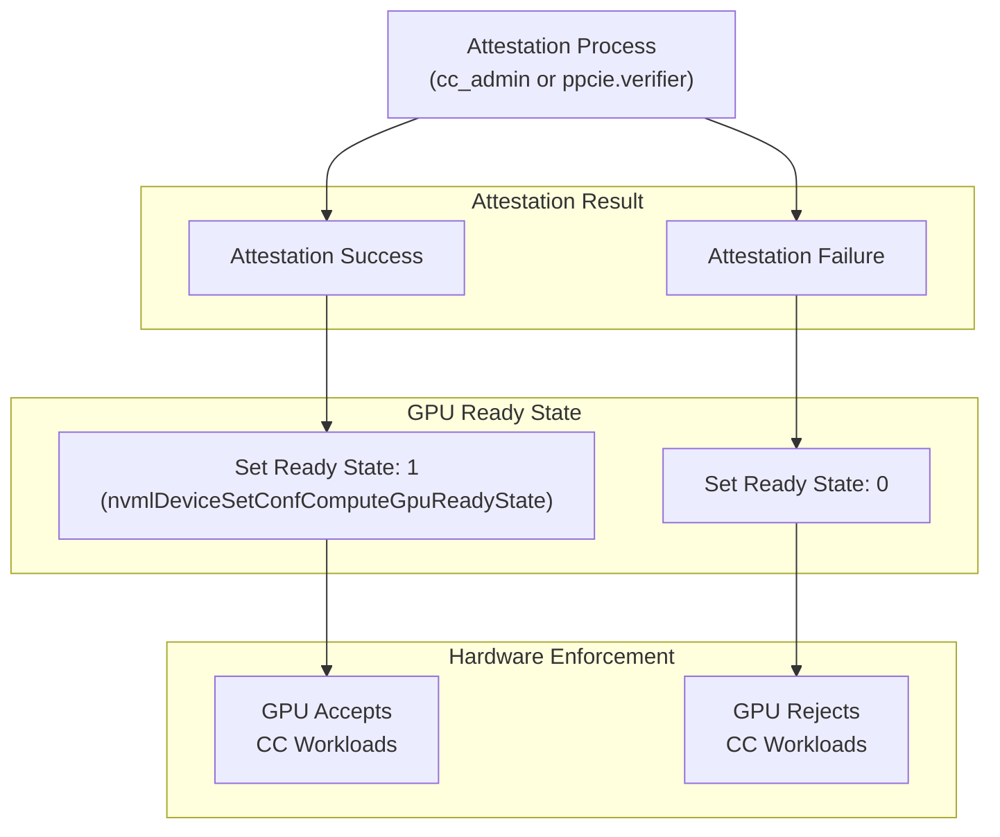

**Important**: Setting the GPU ready state requires root privileges. The verifier tools must be run with `sudo` to modify the ready state. In user mode (`--user_mode` flag), attestation is performed but the ready state is not modified.

The GPU ready state is set by:
- `cc_admin` module for single-GPU and multi-GPU CC mode systems
- `ppcie.verifier.verification` for multi-GPU PPCIE mode systems

Sources: [guest_tools/gpu_verifiers/local_gpu_verifier/README.md:39-43](), [guest_tools/gpu_verifiers/local_gpu_verifier/README.md:113](), [guest_tools/ppcie-verifier/README.md:53-54]()

## Deployment Modes

The nvTrust system supports three deployment architectures for different security and operational requirements:

### Local Mode with Cloud Services (Hybrid)

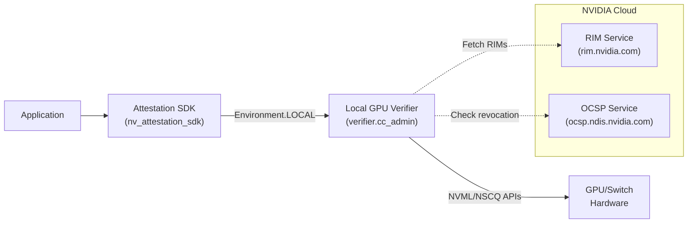

Local mode performs cryptographic verification on the client but fetches RIMs and performs certificate revocation checks against NVIDIA cloud services.

### Remote Mode (Cloud-Managed)

```mermaid
graph LR
    App["Application"]
    SDK["Attestation SDK<br/>(nv_attestation_sdk)"]
    
    subgraph "NVIDIA Cloud"
        NRAS["NRAS<br/>(nras.attestation.nvidia.com)"]
        RIMService["RIM Service"]
        OCSPService["OCSP Service"]
    end
    
    Hardware["GPU/Switch<br/>Hardware"]
    
    App --> SDK
    SDK -->|"Environment.REMOTE"| NRAS
    SDK -->|"NVML/NSCQ APIs"| Hardware
    SDK -->|"Send evidence"| NRAS
    NRAS -.-> RIMService
    NRAS -.-> OCSPService
    NRAS -->|"Return JWT"| SDK
```

Remote mode sends evidence to NRAS, which performs all verification and returns a signed JWT token.

### Trust Outpost (On-Premises)

Trust Outpost is an on-premises deployment that caches RIM and OCSP data locally, enabling air-gapped or data sovereignty-compliant deployments. Access requires agreement with NVIDIA.

| Feature | Local Mode | Remote Mode | Trust Outpost |
|---------|-----------|-------------|---------------|
| Verification Location | Client | NRAS | On-premises |
| RIM/OCSP Access | Internet required | Internet required | Local cache |
| Latency | Low | Moderate | Lowest |
| Air-gap Support | No | No | Yes |
| Configuration | `Environment.LOCAL` | `Environment.REMOTE` | `Environment.LOCAL` + custom URLs |

Sources: [guest_tools/README.md:61-117](), [guest_tools/attestation_sdk/README.md:84-90]()

---

# Page: Package Overview

# Package Overview

<details>
<summary>Relevant source files</summary>

The following files were used as context for generating this wiki page:

- [guest_tools/attestation_sdk/pyproject.toml](guest_tools/attestation_sdk/pyproject.toml)
- [guest_tools/gpu_verifiers/local_gpu_verifier/pyproject.toml](guest_tools/gpu_verifiers/local_gpu_verifier/pyproject.toml)
- [guest_tools/ppcie-verifier/pyproject.toml](guest_tools/ppcie-verifier/pyproject.toml)

</details>


## Purpose and Scope

This document provides an overview of the three primary Python packages in the nvTrust repository: `nv-attestation-sdk`, `nv-local-gpu-verifier`, and `nv-ppcie-verifier`. Each package serves a specific role in the GPU attestation ecosystem, with clear dependency relationships and distribution models. This page covers the package structure, versioning, dependency chains, and when to use each package.

For detailed information about installing and using these packages, see [Attestation SDK](#2), [Local GPU Verifier](#3.1), and [PPCIE Verification](#5). For the high-level system architecture, see [Architecture](#1.1).

---

## Package Hierarchy and Roles

The nvTrust repository contains three independently versioned packages that form a layered architecture. The dependency hierarchy flows from bottom to top, with the Local GPU Verifier at the foundation and the PPCIE Verifier at the orchestration layer.

### Package Dependency Structure

```mermaid
graph TB
    subgraph "Orchestration Layer"
        PPCIE["nv-ppcie-verifier<br/>v1.6.4<br/>guest_tools/ppcie-verifier/"]
    end
    
    subgraph "Integration Layer"
        SDK["nv-attestation-sdk<br/>v2.6.3<br/>guest_tools/attestation_sdk/"]
    end
    
    subgraph "Verification Layer"
        GPU["nv-local-gpu-verifier<br/>v2.6.3<br/>guest_tools/gpu_verifiers/local_gpu_verifier/"]
    end
    
    subgraph "External Dependencies"
        NVML["nvidia-ml-py"]
        Crypto["cryptography 43.0.1"]
        JWT["PyJWT 2.7.0"]
        XML["signxml, xmlschema, lxml"]
    end
    
    PPCIE -->|"depends on"| SDK
    PPCIE -->|"depends on"| GPU
    SDK -->|"depends on"| GPU
    
    PPCIE --> NVML
    SDK --> NVML
    GPU --> NVML
    
    PPCIE --> Crypto
    SDK --> Crypto
    GPU --> Crypto
    
    GPU --> JWT
    SDK --> JWT
    
    GPU --> XML
    SDK --> XML
```

Sources: [guest_tools/ppcie-verifier/pyproject.toml:1-35](), [guest_tools/attestation_sdk/pyproject.toml:1-45](), [guest_tools/gpu_verifiers/local_gpu_verifier/pyproject.toml:1-37]()

---

## nv-local-gpu-verifier

The Local GPU Verifier is the foundational package that provides low-level GPU attestation capabilities. It operates as a standalone verifier with no dependencies on other nvTrust packages.

| Property | Value |
|----------|-------|
| **Package Name** | `nv-local-gpu-verifier` |
| **Version** | 2.6.3 |
| **Location** | `guest_tools/gpu_verifiers/local_gpu_verifier/` |
| **Python Requirement** | >= 3.7 |
| **License** | BSD-3-Clause |
| **Description** | Validates GPU measurements by comparing runtime measurements with authenticated golden measurements |

### Key Responsibilities

- Direct interaction with NVIDIA GPUs via NVML (`nvidia-ml-py`)
- Parsing and validation of GPU attestation reports
- Comparison of runtime measurements against Reference Integrity Manifests (RIMs)
- Certificate chain validation and OCSP checking
- JWT token generation with attestation claims
- SWID tag processing for golden measurements

### Core Dependencies

The package relies on cryptographic and XML processing libraries:

```
cryptography == 43.0.1      # Certificate and signature validation
ecdsa == 0.18.0              # Elliptic curve cryptography
lxml >= 4.9.1                # XML parsing
signxml == 3.2.0             # XML signature validation
xmlschema == 2.2.3           # SWID tag schema validation
pyOpenSSL == 24.2.1          # OpenSSL bindings
PyJWT == 2.7.0               # JWT token generation
nvidia-ml-py == 12.550.52    # NVML Python bindings
asn1 == 2.7.0                # ASN.1 parsing for certificates
```

### Package Data

The Local GPU Verifier includes bundled resources:

- Sample SWID tags (`samples/*.swidtag`)
- RIM XML schemas (`rim/*.xsd`)
- Sample attestation data (`samples/*.txt`)
- Root certificates (`certs/*.pem`)
- Test fixtures (`Tests/*/*.txt`)

Sources: [guest_tools/gpu_verifiers/local_gpu_verifier/pyproject.toml:1-37]()

---

## nv-attestation-sdk

The Attestation SDK provides a high-level API for integrating attestation capabilities into applications. It supports both local and remote attestation modes and provides a unified interface for GPU and NVSwitch attestation.

| Property | Value |
|----------|-------|
| **Package Name** | `nv-attestation-sdk` |
| **Version** | 2.6.3 |
| **Location** | `guest_tools/attestation_sdk/` |
| **Python Requirement** | >= 3.7 |
| **License** | OSI Approved :: Apache Software License |
| **Description** | Easy-to-use APIs for implementing attestation capabilities |

### Key Responsibilities

- High-level `Attestation` class API for evidence collection
- Orchestration of local GPU verification via `nv-local-gpu-verifier`
- Remote attestation via NRAS (NVIDIA Remote Attestation Service)
- NVSwitch attestation via NSCQ library interface
- Policy-based validation of attestation results
- Support for multiple attestation environments (local, remote)

### Architecture Mapping

```mermaid
graph LR
    subgraph "nv-attestation-sdk Package"
        API["Attestation API<br/>src/nv_attestation_sdk/"]
        GPUVerifier["GPU Verifier Module<br/>verifiers/"]
        SwitchVerifier["Switch Verifier Module<br/>verifiers/nv_switch_verifier/"]
        Utils["Utility Modules<br/>utils/"]
    end
    
    subgraph "External Packages"
        LocalGPU["nv-local-gpu-verifier<br/>cc_admin module"]
        NSCQ["libnvidia-nscq.so<br/>Switch query library"]
    end
    
    API --> GPUVerifier
    API --> SwitchVerifier
    GPUVerifier --> LocalGPU
    SwitchVerifier --> NSCQ
    GPUVerifier --> Utils
    SwitchVerifier --> Utils
```

### Dependencies

The SDK extends the Local GPU Verifier with additional capabilities:

```
nv-local-gpu-verifier = "2.6.3"  # Base GPU verification
pyjwt ~= 2.7.0                    # JWT handling
requests ~= 2.32.3                # HTTP client for NRAS
cryptography == 43.0.1            # Cryptographic operations
nvidia-ml-py >= 12.535.77         # NVML interface
```

The SDK also includes development and testing dependencies: `build`, `twine`, `pylint`, `pytest`, `pytest-cov`, `parameterized`.

Sources: [guest_tools/attestation_sdk/pyproject.toml:1-45]()

---

## nv-ppcie-verifier

The PPCIE Verifier is the highest-level orchestration tool designed for multi-GPU systems with NVSwitch interconnects. It implements a comprehensive 16-step verification workflow that validates both device attestation and physical topology.

| Property | Value |
|----------|-------|
| **Package Name** | `nv-ppcie-verifier` |
| **Version** | 1.6.4 |
| **Location** | `guest_tools/ppcie-verifier/` |
| **Python Requirement** | ^3.9 |
| **License** | OSI Approved :: Apache Software License |
| **Description** | Protected PCIE Verifier for multi-GPU systems |
| **Package Root** | `ppcie` |

### Key Responsibilities

- Orchestration of attestation for all GPUs and NVSwitches in a system
- Bidirectional topology validation (GPU→Switch and Switch→GPU)
- Sequential execution of 16 verification steps
- GPU Ready State management based on attestation results
- Command-line interface for system-wide attestation
- Timeout management for long-running operations
- Pretty-printed output for human-readable results

### Component Mapping

```mermaid
graph TB
    subgraph "nv-ppcie-verifier Package"
        CLI["Command Line Interface<br/>click framework"]
        Orchestrator["Verification Orchestrator<br/>ppcie module"]
        Topology["Topology Validator"]
        Output["prettytable formatter"]
    end
    
    subgraph "Dependent Packages"
        SDK["nv-attestation-sdk<br/>Attestation class"]
        GPU["nv-local-gpu-verifier<br/>cc_admin"]
    end
    
    subgraph "System Components"
        FabricMgr["NVIDIA Fabric Manager"]
        NVML_LIB["libnvidia-ml.so"]
        NSCQ_LIB["libnvidia-nscq.so"]
    end
    
    CLI --> Orchestrator
    Orchestrator --> Topology
    Orchestrator --> SDK
    Orchestrator --> GPU
    Orchestrator --> Output
    
    SDK --> NVML_LIB
    GPU --> NVML_LIB
    SDK --> NSCQ_LIB
    
    Orchestrator -.->|"requires"| FabricMgr
```

### Dependencies

The PPCIE Verifier depends on both other nvTrust packages:

```
nv-attestation-sdk = "2.6.3"       # Attestation orchestration
nv-local-gpu-verifier = "2.6.3"    # GPU verification
click = "8.1.7"                     # Command-line interface
prettytable ^= 3.10.0               # Formatted output
timeout-decorator = "0.5.0"         # Operation timeouts
dill = "0.3.8"                      # Pickle serialization
nvidia-ml-py ^= 12.550.52           # NVML interface
```

Additional dependencies include development tools: `pylint`, `black`, `pytest`, `pytest-cov`, `build`.

Sources: [guest_tools/ppcie-verifier/pyproject.toml:1-35]()

---

## Version Compatibility Matrix

The packages maintain strict version pinning to ensure compatibility. The current release versions are synchronized at 2.6.3 for the SDK and Local GPU Verifier, with PPCIE Verifier at 1.6.4.

| Package | Version | Depends On | Minimum Python |
|---------|---------|------------|----------------|
| `nv-local-gpu-verifier` | 2.6.3 | (none) | 3.7 |
| `nv-attestation-sdk` | 2.6.3 | `nv-local-gpu-verifier==2.6.3` | 3.7 |
| `nv-ppcie-verifier` | 1.6.4 | `nv-attestation-sdk==2.6.3`<br/>`nv-local-gpu-verifier==2.6.3` | 3.9 |

### Shared Dependencies

All three packages share a common cryptographic foundation:

| Dependency | GPU Verifier | Attestation SDK | PPCIE Verifier |
|------------|--------------|-----------------|----------------|
| `cryptography` | 43.0.1 | 43.0.1 | 43.0.1 |
| `PyJWT` | 2.7.0 | 2.7.0 | (inherited) |
| `signxml` | 3.2.0 | 3.2.0 | (inherited) |
| `xmlschema` | 2.2.3 | 2.2.3 | (inherited) |
| `pyOpenSSL` | 24.2.1 | 24.2.1 | (inherited) |
| `nvidia-ml-py` | 12.550.52 | >=12.535.77 | ^12.550.52 |

Sources: [guest_tools/ppcie-verifier/pyproject.toml:1-35](), [guest_tools/attestation_sdk/pyproject.toml:1-45](), [guest_tools/gpu_verifiers/local_gpu_verifier/pyproject.toml:1-37]()

---

## Package Selection Guide

Choose the appropriate package based on your use case:

### Use `nv-local-gpu-verifier` when:

- You need low-level GPU attestation without SDK overhead
- You're building custom verification tools
- You only need to verify individual GPUs
- You want to integrate GPU verification into a minimal environment
- You need direct control over verification parameters

### Use `nv-attestation-sdk` when:

- You're building applications that need attestation capabilities
- You need both local and remote attestation modes
- You want to attest both GPUs and NVSwitches
- You need a high-level API with policy validation
- You're integrating attestation into a confidential computing workload

### Use `nv-ppcie-verifier` when:

- You need to verify complete multi-GPU systems
- Your system includes NVSwitch interconnects
- You need topology validation
- You want a ready-to-use command-line tool
- You're validating PPCIE (Protected PCIe) configurations
- You need to manage GPU Ready State across multiple devices

---

## Build System and Packaging

All three packages use Python packaging tools but with different build systems:

### Local GPU Verifier

- Build system: `setuptools` (traditional)
- Configuration: `pyproject.toml` with `[project]` table
- Package data includes SWID tags, schemas, and certificates

### Attestation SDK

- Build system: `poetry-core` (modern)
- Configuration: `pyproject.toml` with `[tool.poetry]` table
- Test configuration: `pytest.ini_options` with custom Python path

### PPCIE Verifier

- Build system: `poetry-core` (modern)
- Configuration: `pyproject.toml` with `[tool.poetry]` table
- Package root: `ppcie` module

### Installation Methods

All packages can be installed via:

```bash
# From PyPI
pip install nv-local-gpu-verifier
pip install nv-attestation-sdk
pip install nv-ppcie-verifier

# From source (poetry-based packages)
cd guest_tools/attestation_sdk
poetry install

# From source (setuptools-based packages)
cd guest_tools/gpu_verifiers/local_gpu_verifier
pip install .
```

Sources: [guest_tools/ppcie-verifier/pyproject.toml:32-34](), [guest_tools/attestation_sdk/pyproject.toml:39-41](), [guest_tools/gpu_verifiers/local_gpu_verifier/pyproject.toml:1-37]()

---

## Package Metadata and Distribution

### Keywords and Classification

All packages share common keywords for discoverability:

- `confidential-computing`
- `attestation`
- `NVIDIA`
- `local-gpu-verifier` (or `verifier`)

The Local GPU Verifier includes additional PyPI classifiers:
- `Programming Language :: Python :: 3`
- `License :: OSI Approved :: BSD License`
- `Operating System :: OS Independent`

### Licensing

| Package | License |
|---------|---------|
| `nv-local-gpu-verifier` | BSD-3-Clause |
| `nv-attestation-sdk` | Apache License (OSI Approved) |
| `nv-ppcie-verifier` | Apache License (OSI Approved) |

Sources: [guest_tools/ppcie-verifier/pyproject.toml:6](), [guest_tools/attestation_sdk/pyproject.toml:1-12](), [guest_tools/gpu_verifiers/local_gpu_verifier/pyproject.toml:10-22]()

---

# Page: Attestation SDK

# Attestation SDK

<details>
<summary>Relevant source files</summary>

The following files were used as context for generating this wiki page:

- [guest_tools/attestation_sdk/README.md](guest_tools/attestation_sdk/README.md)
- [guest_tools/attestation_sdk/pyproject.toml](guest_tools/attestation_sdk/pyproject.toml)

</details>


## Purpose and Scope

The Attestation SDK (`nv-attestation-sdk`) is a Python library that provides high-level APIs for integrating GPU and NVSwitch attestation capabilities into applications. It serves as the primary interface for developers to implement confidential computing attestation workflows, abstracting the complexity of evidence collection, verification, and token generation.

This document covers the SDK's architecture, API design, configuration, and integration patterns. For installation procedures, see [Installation and Setup](#2.1). For detailed API reference, see [API Reference](#2.2). For multi-GPU PPCIE verification workflows, see [PPCIE Verification](#5).

**Sources:** [guest_tools/attestation_sdk/README.md:1-4]()

## Overview

The Attestation SDK acts as an orchestration layer between applications and attestation verifiers. It supports two verification modes (local and remote) and two device types (GPU and NVSwitch), providing a unified interface regardless of the underlying verification mechanism. The SDK handles evidence collection, verifier management, token generation, and policy validation.

**Key Capabilities:**
- Local GPU attestation using NVML-based verification
- Remote GPU attestation via NVIDIA Remote Attestation Service (NRAS)
- Local NVSwitch attestation using NSCQ-based verification
- Remote NVSwitch attestation via NRAS
- JWT token generation with attestation claims
- Policy-based validation of attestation results
- Multi-device and multi-verifier orchestration

**Sources:** [guest_tools/attestation_sdk/README.md:27-32]()

## Architecture

### Component Structure

```mermaid
graph TB
    subgraph "Application Layer"
        App["Application Code"]
    end
    
    subgraph "Attestation SDK - nv_attestation_sdk"
        Attestation["Attestation Class<br/>Main API Interface"]
        VerifierMgr["Verifier Manager"]
        EvidenceCollector["Evidence Collector"]
        TokenGen["Token Generator"]
        PolicyEngine["Policy Validator"]
    end
    
    subgraph "Verifier Layer"
        GPULocal["GPU Local Verifier<br/>nv_gpu_verifier module"]
        GPURemote["GPU Remote Verifier<br/>nv_remote_gpu_verifier"]
        SwitchLocal["Switch Local Verifier<br/>nv_switch_verifier module"]
        SwitchRemote["Switch Remote Verifier<br/>nv_remote_switch_verifier"]
    end
    
    subgraph "Hardware Interface"
        NVML["nvidia-ml-py<br/>NVML Bindings"]
        NSCQ["libnvidia-nscq<br/>Switch Interface"]
    end
    
    subgraph "External Services"
        NRAS["NRAS Service<br/>Remote Verification"]
        RIM["RIM Service<br/>Reference Measurements"]
        OCSP["OCSP Service<br/>Certificate Validation"]
    end
    
    App -->|"create, configure"| Attestation
    Attestation -->|"add_verifier()"| VerifierMgr
    Attestation -->|"get_evidence()"| EvidenceCollector
    Attestation -->|"attest()"| VerifierMgr
    Attestation -->|"get_token()"| TokenGen
    Attestation -->|"validate_token()"| PolicyEngine
    
    VerifierMgr -->|"local mode"| GPULocal
    VerifierMgr -->|"remote mode"| GPURemote
    VerifierMgr -->|"local mode"| SwitchLocal
    VerifierMgr -->|"remote mode"| SwitchRemote
    
    EvidenceCollector --> GPULocal
    EvidenceCollector --> SwitchLocal
    
    GPULocal --> NVML
    SwitchLocal --> NSCQ
    
    GPURemote -.->|"POST evidence"| NRAS
    SwitchRemote -.->|"POST evidence"| NRAS
    GPULocal -.->|"fetch"| RIM
    GPULocal -.->|"validate"| OCSP
    SwitchLocal -.->|"fetch"| RIM
```

**Diagram: Attestation SDK Component Architecture**

The SDK follows a layered architecture where the `Attestation` class provides the public API, delegating to specialized internal components for verifier management, evidence collection, token generation, and policy validation. Verifiers are registered dynamically and can operate in local or remote modes.

**Sources:** [guest_tools/attestation_sdk/README.md:154-174]()

### Data Flow

```mermaid
sequenceDiagram
    participant App as "Application"
    participant SDK as "Attestation Object"
    participant VerMgr as "Verifier Manager"
    participant Verifier as "GPU/Switch Verifier"
    participant HW as "Hardware/NRAS"
    participant Policy as "Policy Engine"
    
    App->>SDK: "Create Attestation(name)"
    App->>SDK: "set_nonce(nonce)"
    App->>SDK: "set_claims_version(version)"
    App->>SDK: "add_verifier(device, mode, url, policy)"
    SDK->>VerMgr: "Register verifier"
    
    App->>SDK: "get_evidence()"
    SDK->>VerMgr: "Collect evidence from verifiers"
    VerMgr->>Verifier: "get_evidence()"
    Verifier->>HW: "Query hardware/encode for NRAS"
    HW-->>Verifier: "Evidence data"
    Verifier-->>VerMgr: "Evidence list"
    VerMgr-->>SDK: "Evidence collection"
    SDK-->>App: "Evidence list"
    
    App->>SDK: "attest()"
    SDK->>VerMgr: "Execute attestation"
    VerMgr->>Verifier: "verify()"
    Verifier->>HW: "Verify evidence + fetch RIMs/certs"
    HW-->>Verifier: "Verification result"
    Verifier-->>VerMgr: "Attestation result"
    VerMgr->>SDK: "Generate JWT token"
    SDK-->>App: "Attestation complete"
    
    App->>SDK: "get_token()"
    SDK-->>App: "JWT token with claims"
    
    App->>SDK: "validate_token(policy)"
    SDK->>Policy: "Validate claims against policy"
    Policy-->>SDK: "Validation result"
    SDK-->>App: "Policy validation result"
```

**Diagram: Attestation SDK Workflow Sequence**

The typical workflow involves: (1) creating and configuring an `Attestation` object, (2) adding verifiers for specific devices and modes, (3) optionally collecting evidence, (4) executing attestation, (5) retrieving the JWT token, and (6) validating the token against a policy.

**Sources:** [guest_tools/attestation_sdk/README.md:82-90](), [guest_tools/attestation_sdk/README.md:154-174]()

## Core API

### Attestation Class

The `Attestation` class is the primary interface in the `nv_attestation_sdk.attestation` module. It provides methods for configuration, verifier management, attestation execution, and token handling.

**API Method Summary:**

| Method | Parameters | Description |
|--------|-----------|-------------|
| `Attestation(name)` | `name: str` | Constructor to create an Attestation object with an optional client name |
| `set_name(name)` | `name: str` | Set or update the client name |
| `set_nonce(nonce)` | `nonce: str` | Set a nonce value for replay protection |
| `set_ocsp_nonce_disabled(disabled)` | `disabled: bool` | Disable OCSP nonce inclusion (local GPU only, default: False) |
| `set_service_key(key)` | `key: str` | Set authentication key for remote attestation services |
| `set_claims_version(version)` | `version: str` | Set claims version ("2.0" or "3.0", default: "2.0") |
| `add_verifier(device, mode, url, policy)` | `device: Devices`<br/>`mode: Environment`<br/>`url: str`<br/>`policy: str` | Add a verifier for a specific device type and mode |
| `get_verifiers()` | None | Return list of configured verifiers |
| `get_evidence()` | None | Collect evidence from all verifiers |
| `attest()` | None | Execute attestation for all verifiers |
| `get_token()` | None | Retrieve JWT token containing attestation claims |
| `get_ocsp_nonce_disabled()` | None | Get OCSP nonce disabled flag |
| `get_claims_version()` | None | Get configured claims version |
| `validate_token(policy)` | `policy: str` | Validate token claims against a policy file |
| `decode_token(token)` | `token: str` | Decode JWT token to extract claims |

**Sources:** [guest_tools/attestation_sdk/README.md:156-174]()

### Enumerations

The SDK defines two key enumerations for verifier configuration:

**Devices Enumeration:**
- Represents the device type for attestation
- Values: `Devices.GPU`, `Devices.SWITCH`

**Environment Enumeration:**
- Represents the verification mode
- Values: `Environment.LOCAL`, `Environment.REMOTE`

These enumerations are used in the `add_verifier()` method to specify which type of verifier to instantiate.

**Sources:** [guest_tools/attestation_sdk/README.md:166]()

### Configuration Interface

```mermaid
graph LR
    subgraph "Configuration Sources"
        EnvVars["Environment Variables<br/>NV_ALLOW_HOLD_CERT"]
        ProgrammaticAPI["Programmatic API<br/>set_* methods"]
    end
    
    subgraph "Attestation Object State"
        Name["Client Name"]
        Nonce["Nonce Value"]
        ClaimsVer["Claims Version<br/>2.0 or 3.0"]
        ServiceKey["Service Key<br/>for NRAS auth"]
        OCSPNonce["OCSP Nonce Disabled<br/>boolean flag"]
        Verifiers["Verifier List<br/>device + mode + config"]
    end
    
    EnvVars --> OCSPNonce
    ProgrammaticAPI --> Name
    ProgrammaticAPI --> Nonce
    ProgrammaticAPI --> ClaimsVer
    ProgrammaticAPI --> ServiceKey
    ProgrammaticAPI --> OCSPNonce
    ProgrammaticAPI --> Verifiers
```

**Diagram: Configuration Mechanism**

Configuration is provided through both environment variables and programmatic API calls. Environment variables affect behavior globally, while programmatic methods configure specific attestation object instances.

**Sources:** [guest_tools/attestation_sdk/README.md:175-179](), [guest_tools/attestation_sdk/README.md:162-165]()

## Dependencies

### Python Package Dependencies

The SDK has carefully versioned dependencies as defined in the project configuration:

| Dependency | Version | Purpose |
|------------|---------|---------|
| `python` | >=3.7 | Minimum Python runtime |
| `pyjwt` / `PyJWT` | ~2.7.0 / ==2.7.0 | JWT token generation and validation |
| `requests` | ~2.32.3 | HTTP client for NRAS communication |
| `cryptography` | ==43.0.1 | Cryptographic operations and certificate handling |
| `ecdsa` | ==0.18.0 | ECDSA signature verification |
| `signxml` | ==3.2.0 | XML signature validation for SWID tags |
| `xmlschema` | ==2.2.3 | XML schema validation |
| `pyOpenSSL` | ==24.2.1 | OpenSSL bindings for TLS and certificates |
| `nvidia-ml-py` | >=12.535.77 | NVML Python bindings for GPU interaction |
| `nv-local-gpu-verifier` | 2.6.3 | Local GPU verification module (core dependency) |

**Sources:** [guest_tools/attestation_sdk/pyproject.toml:14-31]()

### Dependency Graph

```mermaid
graph TB
    SDK["nv-attestation-sdk<br/>v2.6.3"]
    
    subgraph "Direct Dependencies"
        LGPU["nv-local-gpu-verifier<br/>v2.6.3"]
        NVML["nvidia-ml-py<br/>>=12.535.77"]
        Crypto["cryptography<br/>==43.0.1"]
        JWT["PyJWT<br/>==2.7.0"]
        Requests["requests<br/>~2.32.3"]
        XML["signxml, xmlschema<br/>SWID processing"]
    end
    
    subgraph "Transitive Dependencies"
        DriverLib["libnvidia-ml.so<br/>from GPU driver"]
        NVSCQLib["libnvidia-nscq.so<br/>from GPU driver"]
    end
    
    SDK --> LGPU
    SDK --> NVML
    SDK --> Crypto
    SDK --> JWT
    SDK --> Requests
    SDK --> XML
    
    LGPU --> NVML
    LGPU --> Crypto
    LGPU --> XML
    
    NVML -.->|"dlopen at runtime"| DriverLib
    LGPU -.->|"dlopen at runtime"| NVSCQLib
```

**Diagram: Attestation SDK Dependency Tree**

The SDK's most critical dependency is `nv-local-gpu-verifier`, which provides the local GPU attestation implementation. The SDK itself adds remote attestation capabilities, switch attestation, and a unified API layer on top of the local verifier.

**Sources:** [guest_tools/attestation_sdk/pyproject.toml:14-31](), [guest_tools/attestation_sdk/README.md:73-80]()

## Verifier Types

### GPU Verifiers

The SDK supports two GPU verifier types, instantiated based on the `Environment` parameter in `add_verifier()`:

**Local GPU Verifier (`nv_gpu_verifier`):**
- Performs verification on the local machine
- Uses `nvidia-ml-py` to query GPU hardware via NVML
- Fetches RIMs from the RIM service
- Validates certificate chains via OCSP
- Compares runtime measurements against golden measurements
- Implemented in the `nv-local-gpu-verifier` package
- See [Local GPU Verifier](#3.1) for detailed implementation

**Remote GPU Verifier (`nv_remote_gpu_verifier`):**
- Sends evidence to NRAS for remote verification
- Encodes evidence in base64 format
- Authenticates using service key
- Receives JWT token from NRAS
- See [Remote GPU Attestation](#3.2) for protocol details

**Sources:** [guest_tools/attestation_sdk/README.md:29-30]()

### Switch Verifiers

The SDK supports two NVSwitch verifier types for interconnect attestation:

**Local Switch Verifier (`nv_switch_verifier`):**
- Performs verification on the local machine
- Uses `libnvidia-nscq.so` to query NVSwitch hardware
- Fetches switch-specific RIMs from the RIM service
- Validates switch certificate chains
- Compares switch measurements against golden measurements
- Bundled with the Attestation SDK (unlike GPU verifier)
- See [Local NVSwitch Verifier](#4.1) for implementation details

**Remote Switch Verifier (`nv_remote_switch_verifier`):**
- Sends switch evidence to NRAS for remote verification
- Uses the same NRAS protocol as GPU attestation
- Receives JWT token with switch-specific claims
- See [Remote NVSwitch Attestation](#4.2) for details

**Sources:** [guest_tools/attestation_sdk/README.md:31-32](), [guest_tools/attestation_sdk/README.md:101-102]()

## Claims and Token Format

### JWT Token Structure

The SDK generates JWT (JSON Web Token) tokens containing attestation claims. The token structure follows the Entity Attestation Token (EAT) format with NVIDIA-specific extensions.

**Token Generation Flow:**
1. Verifiers execute attestation and produce verification results
2. Results are aggregated and formatted into claim structures
3. Claims are encoded as JWT payload
4. Token is signed (local mode) or received pre-signed (remote mode)
5. Application receives token via `get_token()` method

### Claims Versions

The SDK supports multiple claims versions for backward compatibility:

| SDK Version | Claims Versions Supported |
|-------------|---------------------------|
| v2.0.0 - v2.3.0 | 2.0 |
| v2.4.0 - v2.6.3 | 2.0, 3.0 |

Claims version is set via `set_claims_version(version)` and defaults to "2.0" if not specified. Different claims versions have different schemas and available claim fields.

**Sources:** [guest_tools/attestation_sdk/README.md:131-150](), [guest_tools/attestation_sdk/README.md:165]()

### Policy Validation

The `validate_token(policy)` method validates JWT claims against a policy file. Policy files are JSON documents that specify expected values for specific claims.

**Policy File Location:**
Sample policy files are provided in the SDK test suite for reference:
- [guest_tools/attestation_sdk/tests/policies/]()

Policy validation checks that token claims match the expected values defined in the policy, ensuring that the attestation result meets security requirements before allowing workload execution.

**Sources:** [guest_tools/attestation_sdk/README.md:113-116](), [guest_tools/attestation_sdk/README.md:173]()

## Configuration Options

### Environment Variables

The SDK respects the following environment variables for configuration:

| Variable | Values | Description |
|----------|--------|-------------|
| `NV_ALLOW_HOLD_CERT` | `true` / `false` | Enable attestation when OCSP reports certificate status as "certificate_hold". Defaults to `false`. |

This configuration affects behavior across all `Attestation` instances in the process and is primarily used for handling certificate lifecycle edge cases.

**Sources:** [guest_tools/attestation_sdk/README.md:175-179]()

### Programmatic Configuration

Configuration via the `Attestation` object API provides instance-specific settings:

**Service Key Configuration:**
- Set via `set_service_key(key)`
- Used to authenticate remote attestation service requests
- Required for remote mode verifiers to communicate with NRAS
- No valid service keys are publicly available; production deployments require NVIDIA-issued keys

**Claims Version Configuration:**
- Set via `set_claims_version(version)`
- Accepts "2.0" or "3.0"
- Defaults to "2.0" if not specified
- Determines the schema of claims in the generated JWT token
- Must be compatible with the SDK version in use

**Nonce Configuration:**
- Set via `set_nonce(nonce)`
- Provides replay protection by including a unique value in the attestation
- Recommended for production deployments
- Can be generated per-attestation or per-session depending on requirements

**OCSP Nonce Configuration:**
- Set via `set_ocsp_nonce_disabled(bool)`
- Controls whether OCSP requests include a nonce
- Only applicable for local GPU attestation
- Defaults to `false` (nonces are included)
- May need to be disabled for OCSP responders that don't support nonces

**Sources:** [guest_tools/attestation_sdk/README.md:162-172]()

## Integration Patterns

### Basic Local GPU Attestation

```python
from nv_attestation_sdk import attestation
from nv_attestation_sdk.attestation import Devices, Environment

# Create attestation object
attest = attestation.Attestation("my-client")

# Configure
attest.set_nonce("unique-nonce-value")
attest.set_claims_version("3.0")

# Add local GPU verifier
attest.add_verifier(
    Devices.GPU,
    Environment.LOCAL,
    "",  # no URL for local mode
    "path/to/policy.json"
)

# Execute attestation
attest.attest()

# Retrieve and validate token
token = attest.get_token()
validation_result = attest.validate_token("path/to/policy.json")
```

**Sources:** [guest_tools/attestation_sdk/README.md:84-86]()

### Remote GPU Attestation

```python
from nv_attestation_sdk import attestation
from nv_attestation_sdk.attestation import Devices, Environment

# Create and configure attestation object
attest = attestation.Attestation("my-client")
attest.set_service_key("your-service-key")
attest.set_nonce("unique-nonce-value")

# Add remote GPU verifier with NRAS URL
attest.add_verifier(
    Devices.GPU,
    Environment.REMOTE,
    "https://nras.attestation.nvidia.com/v3/attest/gpu",
    "path/to/policy.json"
)

# Execute remote attestation
attest.attest()

# Retrieve token (signed by NRAS)
token = attest.get_token()
```

**Sources:** [guest_tools/attestation_sdk/README.md:88-90]()

### Multi-Verifier Configuration

The SDK supports adding multiple verifiers to a single `Attestation` object, enabling combined GPU and switch attestation:

```python
from nv_attestation_sdk import attestation
from nv_attestation_sdk.attestation import Devices, Environment

attest = attestation.Attestation("multi-device-client")

# Add GPU verifier
attest.add_verifier(
    Devices.GPU,
    Environment.LOCAL,
    "",
    "gpu_policy.json"
)

# Add Switch verifier
attest.add_verifier(
    Devices.SWITCH,
    Environment.LOCAL,
    "",
    "switch_policy.json"
)

# Attest both devices
attest.attest()

# Get combined token
token = attest.get_token()
```

This pattern is commonly used in multi-GPU systems with NVSwitch interconnects, particularly in the PPCIE Verifier tool.

**Sources:** [guest_tools/attestation_sdk/README.md:166-167]()

## Version Compatibility

### Driver Requirements

The SDK requires compatible NVIDIA GPU drivers with confidential computing support:

- **General platforms:** Latest drivers recommended for optimal compatibility
- **Hopper H100+:** Drivers with CC/PPCIE support required
- **Blackwell platforms:** R575 or later required
- **RTX PRO 6000 Blackwell:** R580 or later required

The `nvidia-ml-py` dependency version (>=12.535.77) ensures compatibility with recent driver APIs.

**Sources:** [guest_tools/attestation_sdk/README.md:125-128]()

### Python Version

The SDK requires Python 3.7 or later, as specified in `pyproject.toml`. Python 3.8 is explicitly mentioned in the README for GPU attestation prerequisites, suggesting 3.8+ is recommended for production use.

**Sources:** [guest_tools/attestation_sdk/pyproject.toml:15](), [guest_tools/attestation_sdk/README.md:72]()

## Package Metadata

### Project Information

- **Package Name:** `nv-attestation-sdk`
- **Version:** 2.6.3
- **Distribution:** Available on PyPI and via source installation
- **Build System:** Poetry (poetry-core backend)
- **License:** Apache License v2.0 (except where otherwise noted)

**Sources:** [guest_tools/attestation_sdk/pyproject.toml:1-6](), [guest_tools/attestation_sdk/README.md:184-185]()

### Keywords and Classification

The package is classified with the following keywords for discoverability:
- `confidential-computing`
- `local-gpu-verifier`
- `attestation`
- `NVIDIA`

**Sources:** [guest_tools/attestation_sdk/pyproject.toml:7-12]()

---

# Page: Installation and Setup

# Installation and Setup

<details>
<summary>Relevant source files</summary>

The following files were used as context for generating this wiki page:

- [guest_tools/attestation_sdk/README.md](guest_tools/attestation_sdk/README.md)
- [guest_tools/attestation_sdk/pyproject.toml](guest_tools/attestation_sdk/pyproject.toml)

</details>


This document provides instructions for installing and configuring the NVIDIA Attestation SDK, a component of the nvTrust system that enables developers to implement attestation capabilities in their applications. For API usage details, refer to the [API Reference](#2.2).

## Overview

The Attestation SDK serves as the primary interface for applications to perform both local and remote attestation of NVIDIA GPUs and NVSwitches. The SDK abstracts the complexities of the attestation process and provides a consistent API across different device types and attestation methods.

**Attestation SDK in the nvTrust Ecosystem**

```mermaid
graph TD
    subgraph "Application Layer"
        Client["Client Application"]
    end
    
    subgraph "Attestation SDK Layer"
        SDK["Attestation SDK"]
        GPULocal["GPU Local Attestor"]
        GPURemote["GPU Remote Attestor"]
        SwitchLocal["Switch Local Attestor"]
        SwitchRemote["Switch Remote Attestor"]
    end
    
    subgraph "Verification Layer"
        LGV["Local GPU Verifier"]
        NRAS["NVIDIA Remote Attestation Service"]
        LSV["Local Switch Verifier"]
    end
    
    subgraph "External Services"
        RIM["RIM Service"]
        OCSP["OCSP Service"]
    end
    
    Client --> SDK
    SDK --> GPULocal
    SDK --> GPURemote
    SDK --> SwitchLocal
    SDK --> SwitchRemote
    
    GPULocal --> LGV
    GPURemote --> NRAS
    SwitchLocal --> LSV
    SwitchRemote --> NRAS
    
    LGV --> RIM
    NRAS --> RIM
    LSV --> RIM
    
    LGV --> OCSP
    NRAS --> OCSP
    LSV --> OCSP
```

Sources: [guest_tools/attestation_sdk/pyproject.toml:1-44]()

## Prerequisites

Before installing the Attestation SDK, ensure your system meets the following requirements:

### Software Requirements

* Python 3.7 or later
* pip package manager
* Access to NVIDIA hardware for attestation (GPUs and/or NVSwitches)
* NVIDIA GPU drivers installed

### Hardware Requirements

* NVIDIA GPUs with attestation capabilities
* For NVSwitch attestation: Systems with NVSwitch hardware

## Installation Methods

The Attestation SDK can be installed using Python's package manager, pip.

### Installing with pip

The recommended way to install the Attestation SDK is directly from PyPI:

```bash
pip install nv-attestation-sdk
```

This will automatically install all required dependencies.

**Installation Process Flow**

```mermaid
flowchart TD
    A["Check Prerequisites"] --> B{"Python >= 3.7?"}
    B -->|Yes| C["Install SDK\npip install nv-attestation-sdk"]
    B -->|No| D["Upgrade Python"]
    D --> C
    C --> E["Install Dependencies"]
    E --> F["Verify Installation"]
    F --> G{"Import successful?"}
    G -->|Yes| H["Ready to use"]
    G -->|No| I["Troubleshoot\nSee Troubleshooting Guide"]
    I --> A
```

Sources: [guest_tools/attestation_sdk/pyproject.toml:14-30]()

### Dependencies

The Attestation SDK requires the following major dependencies, which are automatically installed by pip:

| Dependency | Version | Purpose |
|------------|---------|---------|
| PyJWT | ~2.7.0 | JWT token handling for attestation results |
| requests | ~2.32.3 | HTTP requests to remote services |
| cryptography | ==43.0.1 | Cryptographic operations |
| ecdsa | ==0.18.0 | ECDSA signature verification |
| signxml | ==3.2.0 | XML signature handling |
| xmlschema | ==2.2.3 | XML schema validation |
| pyOpenSSL | ==24.2.1 | SSL/TLS functionality |
| nvidia-ml-py | >=12.535.77 | NVIDIA Management Library Python bindings |
| nv-local-gpu-verifier | 2.4.0 | Local GPU verification component |

Sources: [guest_tools/attestation_sdk/pyproject.toml:14-30]()

## SDK Architecture

The Attestation SDK is organized into modules that handle different aspects of the attestation process. Understanding this architecture helps with proper configuration and usage.

**SDK Component Architecture**

```mermaid
classDiagram
    class Attestation {
        +set_name(name)
        +set_nonce(nonce)
        +set_service_key(key)
        +set_claims_version(version)
        +add_verifier(device_type, attestation_type, url, policy)
        +get_evidence()
        +attest(evidence_list)
        +validate_token(policy)
        +get_token()
    }
    
    class DeviceType {
        <<enumeration>>
        GPU
        SWITCH
    }
    
    class AttestationType {
        <<enumeration>>
        LOCAL
        REMOTE
    }
    
    class GPULocalAttestor {
        +get_evidence(nonce, options)
        +attest(nonce, evidence_list, options)
    }
    
    class GPURemoteAttestor {
        +get_evidence(nonce, options)
        +attest(nonce, evidence_list, options)
    }
    
    class SwitchLocalAttestor {
        +get_evidence(nonce, options)
        +attest(nonce, evidence_list, options)
    }
    
    class SwitchRemoteAttestor {
        +get_evidence(nonce, options)
        +attest(nonce, evidence_list, options)
    }
    
    Attestation --> DeviceType : uses
    Attestation --> AttestationType : uses
    Attestation --> GPULocalAttestor : uses
    Attestation --> GPURemoteAttestor : uses
    Attestation --> SwitchLocalAttestor : uses
    Attestation --> SwitchRemoteAttestor : uses
```

Sources: [guest_tools/attestation_sdk/dist/nv_attestation_sdk-1.4.0.tar.gz](), [guest_tools/attestation_sdk/dist/nv_attestation_sdk-1.4.0-py3-none-any.whl]()

## Configuration

After installation, you may need to configure the Attestation SDK based on your specific environment and requirements.

### Basic Configuration

Most basic configuration can be performed through the SDK's API. The main configuration points include:

1. **Setting the attestation name** - Identifies your application in the attestation process
2. **Configuring the nonce** - Used to prevent replay attacks
3. **Specifying attestation policy** - Determines verification requirements
4. **Adding verifiers** - Configures which devices to attest and how

### Environment Variables

The SDK may check for certain environment variables to modify its behavior:

| Variable Name | Purpose | Default |
|---------------|---------|---------|
| `NV_ATTESTATION_DEBUG` | Enable debug logging | Not set (disabled) |
| `NV_ATTESTATION_RIM_PATH` | Custom path to RIM files | System default |
| `NV_ATTESTATION_CERT_PATH` | Custom path to certificate files | System default |

Sources: [guest_tools/attestation_sdk/dist/nv_attestation_sdk-1.4.0.tar.gz]()

## Verification of Installation

To verify that the Attestation SDK is installed correctly, you can run a simple Python script that imports the main module:

```python
import nv_attestation_sdk

# Check the version
print(f"Attestation SDK version: {nv_attestation_sdk.__version__}")

# Create an attestation object
attestation = nv_attestation_sdk.Attestation()
print("Attestation SDK successfully imported")
```

If the import succeeds without errors, the SDK is installed correctly.

## Next Steps

Once you have successfully installed and configured the Attestation SDK, you can:

1. Learn how to use the API in detail by referring to the [API Reference](#2.2)
2. Explore [GPU Attestation](#3) for details on attesting GPU devices
3. Learn about [NVSwitch Attestation](#4) for NVSwitch attestation
4. See the [PPCIE Verification](#5) guide for multi-GPU system verification

For any issues encountered during installation or setup, consult the [Troubleshooting Guide](#6).

---

# Page: API Reference

# API Reference

<details>
<summary>Relevant source files</summary>

The following files were used as context for generating this wiki page:

- [guest_tools/attestation_sdk/README.md](guest_tools/attestation_sdk/README.md)
- [guest_tools/attestation_sdk/src/nv_attestation_sdk/verifiers/nv_switch_verifier/rim/swidSchema2015.xsd](guest_tools/attestation_sdk/src/nv_attestation_sdk/verifiers/nv_switch_verifier/rim/swidSchema2015.xsd)
- [guest_tools/attestation_sdk/src/nv_attestation_sdk/verifiers/nv_switch_verifier/rim/xml.xsd](guest_tools/attestation_sdk/src/nv_attestation_sdk/verifiers/nv_switch_verifier/rim/xml.xsd)
- [guest_tools/attestation_sdk/tests/end_to_end/hardware/test_local_switch.py](guest_tools/attestation_sdk/tests/end_to_end/hardware/test_local_switch.py)
- [guest_tools/attestation_sdk/tests/end_to_end/hardware/test_remote_switch.py](guest_tools/attestation_sdk/tests/end_to_end/hardware/test_remote_switch.py)

</details>


This document provides a comprehensive reference for the NVIDIA Attestation SDK API, which enables developers to integrate attestation capabilities for NVIDIA GPUs and NVSwitches into their applications. It covers all public interfaces, methods, configurations, and usage patterns.

For installation instructions, see [Installation and Setup](#2.1).
For detailed configuration parameters, see [Configuration Options](#2.3).

## API Architecture

The following diagram shows the main components of the Attestation SDK API and their relationships:

```mermaid
classDiagram
    class Attestation {
        +set_name(name)
        +set_nonce(nonce)
        +set_ocsp_nonce_disabled(bool)
        +set_service_key(key)
        +set_claims_version(version)
        +add_verifier(device_type, attestation_type, url, policy)
        +get_verifiers()
        +get_evidence()
        +attest()
        +get_token()
        +get_ocsp_nonce_disabled()
        +get_claims_version()
        +validate_token(policy)
        +decode_token(token)
    }
    
    class AttestationDeviceType {
        <<enumeration>>
        +GPU
        +SWITCH
    }
    
    class AttestationType {
        <<enumeration>>
        +LOCAL
        +REMOTE
    }
    
    class Verifier {
        <<interface>>
        +get_evidence()
        +attest()
    }
    
    class GPULocalVerifier {
        +get_evidence()
        +attest()
    }
    
    class GPURemoteVerifier {
        +get_evidence()
        +attest()
    }
    
    class SwitchLocalVerifier {
        +get_evidence()
        +attest()
    }
    
    class SwitchRemoteVerifier {
        +get_evidence()
        +attest()
    }
    
    Attestation --> AttestationDeviceType : uses
    Attestation --> AttestationType : uses
    Attestation --> Verifier : manages
    
    Verifier <|-- GPULocalVerifier : implements
    Verifier <|-- GPURemoteVerifier : implements
    Verifier <|-- SwitchLocalVerifier : implements
    Verifier <|-- SwitchRemoteVerifier : implements
```

Sources: [guest_tools/attestation_sdk/README.md:147-167]()

## Core Attestation Class Methods

The `Attestation` class is the main entry point for the SDK. It provides methods for configuring attestation settings, collecting evidence, and verifying attestation results.

| Method | Description |
|--------|-------------|
| `Attestation(name)` | Constructor that creates a new Attestation object with an optional name. |
| `set_name(name)` | Sets a name for the Attestation SDK client. |
| `set_nonce(nonce)` | Sets a nonce for attestation to prevent replay attacks. |
| `set_ocsp_nonce_disabled(bool)` | Flag to control whether to include a nonce when calling OCSP. Only applicable for local GPU attestation. False by default. |
| `set_service_key(key)` | Sets the service key used to authenticate remote service calls to attestation services. |
| `set_claims_version(version)` | Sets the claims version for attestation results. Defaults to 2.0 if not set. |
| `add_verifier(device_type, attestation_type, url, policy)` | Adds a specific type of verifier for the client object. |
| `get_verifiers()` | Retrieves the list of verifiers added to the client object. |
| `get_evidence()` | Retrieves evidence based on the attestation device and type. |
| `attest()` | Triggers the attestation process using the configured verifiers. |
| `get_token()` | Retrieves the attestation token containing claims for the attestation result. |
| `get_ocsp_nonce_disabled()` | Returns whether OCSP nonce is disabled. |
| `get_claims_version()` | Retrieves the claims version used by the client. |
| `validate_token(policy)` | Validates attestation claims against a specified policy. |
| `decode_token(token)` | Decodes a JWT token to extract the claims. |

Sources: [guest_tools/attestation_sdk/README.md:151-167]()

## Attestation Types

The SDK supports different device types and attestation methods:

1. **Device Types**:
   - `GPU` - For NVIDIA GPU attestation
   - `SWITCH` - For NVIDIA NVSwitch attestation

2. **Attestation Methods**:
   - `LOCAL` - Performs attestation locally using the local verifier
   - `REMOTE` - Performs attestation using NVIDIA's Remote Attestation Service (NRAS)

Sources: [guest_tools/attestation_sdk/README.md:27-32]()

## Attestation Flow

The following diagram illustrates the typical attestation process flow:

```mermaid
sequenceDiagram
    participant Client as "Client Application"
    participant SDK as "Attestation SDK"
    participant Verifier as "Verifier (Local/Remote)"
    participant Services as "External Services (RIM/OCSP)"
    participant Hardware as "Hardware (GPU/NVSwitch)"
    
    Client->>SDK: "Create Attestation Object"
    Client->>SDK: "Configure (set_nonce, claims_version)"
    Client->>SDK: "add_verifier()"
    Client->>SDK: "attest()"
    
    SDK->>Verifier: "get_evidence()"
    Verifier->>Hardware: "Collect Hardware Evidence"
    Hardware-->>Verifier: "Return Evidence"
    Verifier-->>SDK: "Return Evidence"
    
    SDK->>Verifier: "attest(evidence)"
    Verifier->>Services: "Verify Evidence (RIM, OCSP)"
    Services-->>Verifier: "Verification Results"
    Verifier-->>SDK: "Attestation Results"
    
    SDK->>SDK: "Generate JWT Token"
    SDK-->>Client: "Return Token via get_token()"
    
    Client->>SDK: "validate_token(policy)"
    SDK-->>Client: "Validation Result"
```

Sources: [guest_tools/attestation_sdk/README.md:84-111]()

## Configuration Options

The Attestation SDK can be configured using these environment variables:

| Environment Variable | Description | Default Value |
|----------------------|-------------|---------------|
| `NV_RIM_URL` | URL for the RIM (Reference Integrity Measurement) service | https://rim.attestation.nvidia.com/v1/rim/ |
| `NV_OCSP_URL` | URL for the OCSP (Online Certificate Status Protocol) service | https://ocsp.ndis.nvidia.com/ |
| `NV_NRAS_GPU_URL` | URL for the NVIDIA Remote Attestation Service for GPUs | https://nras.attestation.nvidia.com/v3/attest/gpu |
| `NV_NRAS_NVSWITCH_URL` | URL for the Remote Attestation Service for NVSwitches | https://nras.attestation.nvidia.com/v3/attest/switch |
| `NVIDIA_ATTESTATION_SERVICE_KEY` | Service key for authentication with NVIDIA services | None |
| `NV_ALLOW_HOLD_CERT` | Enable attestation if OCSP status of the certificate is 'certificate_hold' | false |

Sources: [guest_tools/attestation_sdk/src/nv_attestation_sdk/utils/config.py:1-29](), [guest_tools/attestation_sdk/README.md:168-172]()

## Sample Implementations

The SDK provides reference implementations for different attestation scenarios:

### GPU Attestation

- Local GPU Attestation: [guest_tools/attestation_sdk/tests/end_to_end/hardware/LocalGPUTest.py]()
- Remote GPU Attestation: [guest_tools/attestation_sdk/tests/end_to_end/hardware/RemoteGPUTest.py]()

Sources: [guest_tools/attestation_sdk/README.md:84-90]()

### NVSwitch Attestation

- Local NVSwitch Attestation: [guest_tools/attestation_sdk/tests/end_to_end/hardware/LocalSwitchTest.py]()
- Remote NVSwitch Attestation: [guest_tools/attestation_sdk/tests/end_to_end/hardware/RemoteSwitchTest.py]()

Sources: [guest_tools/attestation_sdk/README.md:105-111]()

## Claims and Policies

The SDK uses JSON Web Tokens (JWT) to represent attestation results as claims. These claims can be validated against policy files that define acceptable values.

Sample policy files for both local and remote attestation are available at:
[guest_tools/attestation_sdk/tests/policies/]()

For detailed information about claim structures and troubleshooting, see [Troubleshooting](#6).

Sources: [guest_tools/attestation_sdk/README.md:113-120]()

## Compatibility Matrix

This table shows SDK version compatibility with different claims versions:

| SDK version | Claims Version |
|-------------|----------------|
| v1.1.0 - v1.5.0 | N/A |
| v2.0.0 - v2.3.0 | 2.0 |
| v2.4.0 | 2.0, 3.0 |

Sources: [guest_tools/attestation_sdk/README.md:129-143]()

## API Usage in Attestation Flow

The following diagram shows how the API components interact within the complete attestation system:

```mermaid
flowchart TD
    subgraph "Client Application"
        ClientApp["Application Code"]
    end
    
    subgraph "Attestation SDK"
        AttestClass["Attestation Class"]
        Verifiers["Verifier Implementations"]
        Evidence["Evidence Collection"]
        TokenGen["Token Generator"]
        PolicyV["Policy Validator"]
    end
    
    subgraph "External Services"
        RIM["RIM Service"]
        OCSP["OCSP Service"]
        NRAS["Remote Attestation Service"]
    end
    
    subgraph "Hardware"
        GPU["NVIDIA GPU"]
        Switch["NVIDIA NVSwitch"]
    end
    
    ClientApp -->|"1. create Attestation()"| AttestClass
    ClientApp -->|"2. set_nonce()"| AttestClass
    ClientApp -->|"3. add_verifier()"| AttestClass
    ClientApp -->|"4. attest()"| AttestClass
    
    AttestClass -->|"5. instantiate"| Verifiers
    Verifiers -->|"6. collect"| Evidence
    Evidence -->|"7. access"| GPU
    Evidence -->|"7. access"| Switch
    
    Verifiers -->|"8. verify"| RIM
    Verifiers -->|"9. check certificates"| OCSP
    Verifiers -->|"10. remote attestation"| NRAS
    
    Verifiers -->|"11. generate results"| TokenGen
    TokenGen -->|"12. return token"| AttestClass
    AttestClass -->|"13. return token"| ClientApp
    
    ClientApp -->|"14. validate_token()"| PolicyV
    PolicyV -->|"15. validation result"| ClientApp
```

Sources: [guest_tools/attestation_sdk/README.md:11-26](), [guest_tools/attestation_sdk/README.md:147-167]()

---

# Page: Configuration Options

# Configuration Options

<details>
<summary>Relevant source files</summary>

The following files were used as context for generating this wiki page:

- [guest_tools/attestation_sdk/README.md](guest_tools/attestation_sdk/README.md)
- [guest_tools/attestation_sdk/src/nv_attestation_sdk/utils/config.py](guest_tools/attestation_sdk/src/nv_attestation_sdk/utils/config.py)

</details>


This page documents the configuration parameters and environment variables for the NVIDIA Attestation SDK within the nvTrust repository. Understanding these configuration options is essential for customizing the SDK's behavior, service endpoints, and security settings to meet your specific attestation requirements.

For information about using the SDK APIs, please refer to the [API Reference](#2.2).

## Environment Variables

The Attestation SDK uses environment variables as a primary configuration mechanism. These variables control service endpoints, authentication, and security behavior.

### Service URL Configuration

| Environment Variable | Description | Default Value |
|----------------------|-------------|---------------|
| NV_RIM_URL | URL for the Reference Integrity Measurements (RIM) service | https://rim.attestation.nvidia.com/v1/rim/ |
| NV_OCSP_URL | URL for the Online Certificate Status Protocol (OCSP) service | https://ocsp.ndis.nvidia.com/ |
| NV_NRAS_GPU_URL | URL for the NVIDIA Remote Attestation Service (NRAS) for GPU attestation | https://nras.attestation.nvidia.com/v3/attest/gpu |
| NV_NRAS_NVSWITCH_URL | URL for the NVIDIA Remote Attestation Service (NRAS) for NVSwitch attestation | https://nras.attestation.nvidia.com/v3/attest/switch |

Sources: [guest_tools/attestation_sdk/src/nv_attestation_sdk/utils/config.py:7-14]()

### Authentication Configuration

| Environment Variable | Description | Default Value |
|----------------------|-------------|---------------|
| NVIDIA_ATTESTATION_SERVICE_KEY | API key for accessing NVIDIA attestation services | None |

Sources: [guest_tools/attestation_sdk/src/nv_attestation_sdk/utils/config.py:18]()

### Security Configuration

| Environment Variable | Description | Default Value |
|----------------------|-------------|---------------|
| NV_ALLOW_HOLD_CERT | Whether to allow certificates with HOLD status | false |

Sources: [guest_tools/attestation_sdk/src/nv_attestation_sdk/utils/config.py:25-29]()

## Configuration Methods

The SDK provides two distinct methods for configuration: environment variables (read at module import time) and programmatic configuration (set at runtime via SDK API methods).

### Configuration Flow Diagram

```mermaid
graph TD
    subgraph "Import Time - config.py Module Loading"
        E1["NV_RIM_URL env var"] -->|"os.getenv()"| C1["RIM_SERVICE_URL constant"]
        E2["NV_OCSP_URL env var"] -->|"os.getenv()"| C2["OCSP_SERVICE_URL constant"]
        E3["NV_NRAS_GPU_URL env var"] -->|"os.getenv()"| C3["REMOTE_GPU_VERIFIER_SERVICE_URL constant"]
        E4["NV_NRAS_NVSWITCH_URL env var"] -->|"os.getenv()"| C4["REMOTE_NVSWITCH_VERIFIER_SERVICE_URL constant"]
        E5["NVIDIA_ATTESTATION_SERVICE_KEY env var"] -->|"os.getenv()"| C5["ATTESTATION_SERVICE_KEY constant"]
        E6["NV_ALLOW_HOLD_CERT env var"] -->|"os.getenv() at call time"| F1["get_allow_hold_cert()"]
    end
    
    subgraph "Runtime - Attestation Object Configuration"
        A1["Application Code"] -->|"set_name()"| O1["Attestation._name"]
        A2["Application Code"] -->|"set_nonce()"| O2["Attestation._nonce"]
        A3["Application Code"] -->|"set_service_key()"| O3["Attestation._service_key"]
        A4["Application Code"] -->|"set_claims_version()"| O4["Attestation._claims_version"]
        A5["Application Code"] -->|"set_ocsp_nonce_disabled()"| O5["Attestation._ocsp_nonce_disabled"]
        A6["Application Code"] -->|"config.set_allow_hold_cert()"| O6["config.CERT_HOLD_STATUS"]
    end
```

Sources: 
- [guest_tools/attestation_sdk/src/nv_attestation_sdk/utils/config.py:4-29]()
- [guest_tools/attestation_sdk/README.md:161-173]()

### Programmatic Configuration via Attestation Class

The `Attestation` class provides methods to configure attestation parameters at runtime:

| Method | Parameter Type | Description | Default Value |
|--------|----------------|-------------|---------------|
| `set_name(name)` | str | Sets a name identifier for the Attestation SDK client | None |
| `set_nonce(nonce)` | bytes/str | Sets a nonce value for attestation requests | None |
| `set_ocsp_nonce_disabled(bool)` | bool | Flag to disable OCSP nonce in certificate validation (local GPU only) | False |
| `set_service_key(key)` | str | Sets the API key for remote attestation service authentication | None |
| `set_claims_version(version)` | str | Sets the claims version for attestation result format | "2.0" |
| `get_ocsp_nonce_disabled()` | - | Retrieves the current OCSP nonce disabled flag | - |
| `get_claims_version()` | - | Retrieves the current claims version | - |

Sources: [guest_tools/attestation_sdk/README.md:161-173]()

### Configuration via config Module Functions

The `nv_attestation_sdk.utils.config` module provides functions for global certificate validation behavior:

| Function | Description |
|----------|-------------|
| `set_allow_hold_cert(value)` | Sets whether to allow certificates with HOLD status during validation |
| `get_allow_hold_cert()` | Returns True if certificates with HOLD status are allowed, False otherwise |

Sources: [guest_tools/attestation_sdk/src/nv_attestation_sdk/utils/config.py:20-29]()

## Claims Version Configuration

The Attestation SDK supports multiple claims versions for attestation results. The claims version determines the structure and content of the JWT token returned by attestation.

### Claims Version Compatibility Matrix

The following table shows which claims versions are supported by each SDK version:

| SDK Version | Supported Claims Versions | Notes |
|-------------|--------------------------|-------|
| v1.1.0 - v1.5.0 | N/A | Claims versioning not supported |
| v2.0.0 - v2.3.0 | 2.0 | Claims v2.0 only |
| v2.4.0 - v2.6.2 | 2.0, 3.0 | Both versions supported |

**Default Claims Version:** If not explicitly set, the SDK defaults to claims version `2.0`.

Sources: [guest_tools/attestation_sdk/README.md:132-151]()

### Setting Claims Version

**Programmatically:**
```python
from nv_attestation_sdk import attestation

attest = attestation.Attestation()
attest.set_claims_version("3.0")  # Set to claims v3.0
```

**Retrieving Claims Version:**
```python
current_version = attest.get_claims_version()
print(f"Using claims version: {current_version}")
```

Sources: [guest_tools/attestation_sdk/README.md:165-172]()

## Configuration Mapping to SDK Components

The following diagram illustrates how configuration options flow from environment variables and API methods to SDK components and external services:

### Configuration to Component Mapping

```mermaid
graph TB
    subgraph "config.py Module Constants"
        RIM_URL["RIM_SERVICE_URL<br/>config.py:7"]
        OCSP_URL["OCSP_SERVICE_URL<br/>config.py:8"]
        GPU_URL["REMOTE_GPU_VERIFIER_SERVICE_URL<br/>config.py:9-11"]
        SWITCH_URL["REMOTE_NVSWITCH_VERIFIER_SERVICE_URL<br/>config.py:12-14"]
        SVC_KEY["ATTESTATION_SERVICE_KEY<br/>config.py:18"]
        HOLD_CERT["CERT_HOLD_STATUS<br/>config.py:6"]
    end
    
    subgraph "Attestation Class Instance Variables"
        ATT_NAME["_name"]
        ATT_NONCE["_nonce"]
        ATT_SVC_KEY["_service_key"]
        ATT_CLAIMS["_claims_version"]
        ATT_OCSP["_ocsp_nonce_disabled"]
    end
    
    subgraph "Verifier Classes"
        GPU_LOCAL["GPULocalAttestor"]
        GPU_REMOTE["GPURemoteAttestor"]
        SWITCH_LOCAL["SwitchLocalAttestor"]
        SWITCH_REMOTE["SwitchRemoteAttestor"]
    end
    
    subgraph "Supporting Components"
        CERT_VERIFIER["CertificateVerifier"]
        RIM_FETCHER["RIMFetcher"]
    end
    
    subgraph "External Services"
        RIM_SVC["rim.attestation.nvidia.com"]
        OCSP_SVC["ocsp.ndis.nvidia.com"]
        NRAS_GPU["nras.attestation.nvidia.com/v3/attest/gpu"]
        NRAS_SWITCH["nras.attestation.nvidia.com/v3/attest/switch"]
    end
    
    RIM_URL -->|"Used by"| RIM_FETCHER
    OCSP_URL -->|"Used by"| CERT_VERIFIER
    GPU_URL -->|"Used by"| GPU_REMOTE
    SWITCH_URL -->|"Used by"| SWITCH_REMOTE
    
    ATT_SVC_KEY -->|"Auth header in"| GPU_REMOTE
    ATT_SVC_KEY -->|"Auth header in"| SWITCH_REMOTE
    ATT_CLAIMS -->|"Claims format for"| GPU_LOCAL
    ATT_CLAIMS -->|"Claims format for"| GPU_REMOTE
    ATT_CLAIMS -->|"Claims format for"| SWITCH_LOCAL
    ATT_CLAIMS -->|"Claims format for"| SWITCH_REMOTE
    ATT_OCSP -->|"Controls nonce in"| CERT_VERIFIER
    HOLD_CERT -->|"Validation rule in"| CERT_VERIFIER
    
    GPU_LOCAL --> CERT_VERIFIER
    SWITCH_LOCAL --> CERT_VERIFIER
    GPU_REMOTE --> NRAS_GPU
    SWITCH_REMOTE --> NRAS_SWITCH
    
    CERT_VERIFIER --> RIM_FETCHER
    RIM_FETCHER --> RIM_SVC
    CERT_VERIFIER --> OCSP_SVC
```

Sources: 
- [guest_tools/attestation_sdk/src/nv_attestation_sdk/utils/config.py:6-18]()
- [guest_tools/attestation_sdk/README.md:161-173]()

### Service Key Authentication Flow

The `ATTESTATION_SERVICE_KEY` is used to authenticate requests to NRAS remote attestation services:

```mermaid
sequenceDiagram
    participant App as "Application Code"
    participant Att as "Attestation Object"
    participant Remote as "GPURemoteAttestor or<br/>SwitchRemoteAttestor"
    participant NRAS as "nras.attestation.nvidia.com"
    
    App->>Att: set_service_key(key)
    App->>Att: attest()
    Att->>Remote: attest() with service_key
    Remote->>Remote: Build HTTP headers<br/>X-API-Key: service_key
    Remote->>NRAS: POST evidence + headers
    NRAS->>NRAS: Validate API key
    alt Valid API Key
        NRAS-->>Remote: Return JWT token
        Remote-->>Att: Return token
        Att-->>App: Return token
    else Invalid API Key
        NRAS-->>Remote: HTTP 401 Unauthorized
        Remote-->>Att: Raise Exception
        Att-->>App: Raise Exception
    end
```

Sources: 
- [guest_tools/attestation_sdk/README.md:164]()
- [guest_tools/attestation_sdk/src/nv_attestation_sdk/utils/config.py:18]()

## Configuration Precedence

When configuring the Attestation SDK, there is a specific lookup priority for configuration values:

```mermaid
flowchart TD
    Start["Configuration Lookup Process"] --> RuntimeCheck["1. Check config.CERT_HOLD_STATUS"]
    RuntimeCheck --> EnvCheck["2. Check os.getenv('NV_ALLOW_HOLD_CERT')"]
    EnvCheck --> DefaultCheck["3. Use hard-coded defaults"]
    
    subgraph "get_allow_hold_cert() implementation"
        A["get_allow_hold_cert() called"] --> B{"Is CERT_HOLD_STATUS != None?"}
        B -->|"Yes"| C["return CERT_HOLD_STATUS"]
        B -->|"No"| D{"os.getenv('NV_ALLOW_HOLD_CERT') == 'true'?"}
        D -->|"Yes"| E["return True"]
        D -->|"No"| F["return False"]
    end
```

Sources: [guest_tools/attestation_sdk/src/nv_attestation_sdk/utils/config.py:24-29]()

## OCSP Configuration

Online Certificate Status Protocol (OCSP) is used to validate certificate revocation status. The SDK provides configuration options for OCSP behavior.

### OCSP Nonce Configuration

The OCSP nonce is a random value included in OCSP requests to prevent replay attacks. By default, the SDK includes a nonce in OCSP requests during local GPU attestation.

| Method | Description | Default |
|--------|-------------|---------|
| `set_ocsp_nonce_disabled(bool)` | Disable/enable OCSP nonce in certificate validation | False (nonce enabled) |
| `get_ocsp_nonce_disabled()` | Get current OCSP nonce setting | - |

**Note:** OCSP nonce configuration only applies to local GPU attestation. Remote attestation handles OCSP validation on the server side.

Sources: [guest_tools/attestation_sdk/README.md:163-171]()

### Certificate HOLD Status Handling

Certificates may have a revocation status of `certificate_hold`, indicating temporary suspension. The SDK can be configured to allow or reject certificates with this status.

**Environment Variable:**
```bash
export NV_ALLOW_HOLD_CERT="true"  # Allow certificates with HOLD status
```

**Programmatic Configuration:**
```python
from nv_attestation_sdk.utils.config import set_allow_hold_cert, get_allow_hold_cert

# Allow certificates with HOLD status
set_allow_hold_cert(True)

# Check current setting
allow_hold = get_allow_hold_cert()
```

**Configuration Precedence:**
1. If `set_allow_hold_cert()` has been called, use that value
2. Otherwise, check `NV_ALLOW_HOLD_CERT` environment variable
3. Default to `False` (reject certificates with HOLD status)

Sources: 
- [guest_tools/attestation_sdk/README.md:177-179]()
- [guest_tools/attestation_sdk/src/nv_attestation_sdk/utils/config.py:24-29]()

## Configuration Examples

### Complete Configuration Example

This example demonstrates all available configuration options:

```python
from nv_attestation_sdk import attestation
from nv_attestation_sdk.utils.config import set_allow_hold_cert

# Create attestation object
attest = attestation.Attestation(name="MyApplication")

# Alternative: Set name after creation
attest.set_name("MyApplication")

# Set nonce for attestation request
nonce = b"random_nonce_value_12345"
attest.set_nonce(nonce)

# Configure claims version (2.0 or 3.0)
attest.set_claims_version("3.0")

# For remote attestation: set service key
attest.set_service_key("your-api-key-from-nvidia")

# Disable OCSP nonce (local GPU attestation only)
attest.set_ocsp_nonce_disabled(False)  # Default is False (nonce enabled)

# Allow certificates with HOLD status
set_allow_hold_cert(True)

# Add verifier and perform attestation
# (see API Reference page 2.2 for add_verifier details)
```

Sources: [guest_tools/attestation_sdk/README.md:156-174]()

### Environment Variable Configuration

Set environment variables before running the application:

**Linux/macOS:**
```bash
# Service endpoint configuration
export NV_RIM_URL="https://custom-rim-service.example.com/v1/rim/"
export NV_OCSP_URL="https://custom-ocsp-service.example.com/"
export NV_NRAS_GPU_URL="https://custom-nras.example.com/v3/attest/gpu"
export NV_NRAS_NVSWITCH_URL="https://custom-nras.example.com/v3/attest/switch"

# Authentication
export NVIDIA_ATTESTATION_SERVICE_KEY="your-api-key"

# Security configuration
export NV_ALLOW_HOLD_CERT="true"

# Run your application
python3 my_attestation_app.py
```

**Windows:**
```cmd
set NV_RIM_URL=https://custom-rim-service.example.com/v1/rim/
set NV_OCSP_URL=https://custom-ocsp-service.example.com/
set NV_NRAS_GPU_URL=https://custom-nras.example.com/v3/attest/gpu
set NV_NRAS_NVSWITCH_URL=https://custom-nras.example.com/v3/attest/switch
set NVIDIA_ATTESTATION_SERVICE_KEY=your-api-key
set NV_ALLOW_HOLD_CERT=true

python my_attestation_app.py
```

Sources: [guest_tools/attestation_sdk/src/nv_attestation_sdk/utils/config.py:7-18]()

### Local vs Remote Attestation Configuration

**Local GPU Attestation (No Service Key Required):**
```python
from nv_attestation_sdk import attestation

attest = attestation.Attestation()
attest.set_claims_version("3.0")
attest.set_nonce(b"my_nonce")

# Add local GPU verifier
attest.add_verifier(
    attestation.Devices.GPU,
    attestation.Environment.LOCAL,
    "",  # No remote URL needed
    "policy.json"
)

# Perform attestation
attest.attest()
token = attest.get_token()
```

**Remote GPU Attestation (Service Key Required):**
```python
from nv_attestation_sdk import attestation

attest = attestation.Attestation()
attest.set_claims_version("3.0")
attest.set_nonce(b"my_nonce")
attest.set_service_key("your-nvidia-api-key")  # Required for remote

# Add remote GPU verifier
attest.add_verifier(
    attestation.Devices.GPU,
    attestation.Environment.REMOTE,
    "",  # Uses default NRAS URL from config
    "policy.json"
)

# Perform attestation
attest.attest()
token = attest.get_token()
```

Sources: 
- [guest_tools/attestation_sdk/README.md:84-90]()
- [guest_tools/attestation_sdk/README.md:164]()

## Dependencies

The Attestation SDK requires several Python packages to function correctly. These dependencies are defined in the project configuration:

| Dependency | Version | Purpose |
|------------|---------|---------|
| pyjwt / PyJWT | ~2.7.0 | JSON Web Token operations |
| requests | ~2.32.3 | HTTP requests to attestation services |
| cryptography | 43.0.1 | Cryptographic operations |
| ecdsa | 0.18.0 | ECDSA signature verification |
| signxml | 3.2.0 | XML signature handling |
| xmlschema | 2.2.3 | XML schema validation |
| pyOpenSSL | 24.2.1 | SSL/TLS functionality |
| nvidia-ml-py | >=12.535.77 | NVIDIA Management Library integration |
| nv-local-gpu-verifier | 2.4.0 | Local GPU verification |

Sources: [guest_tools/attestation_sdk/pyproject.toml:14-31]()

---

# Page: Attestation Workflow

# Attestation Workflow

<details>
<summary>Relevant source files</summary>

The following files were used as context for generating this wiki page:

- [guest_tools/attestation_sdk/README.md](guest_tools/attestation_sdk/README.md)
- [guest_tools/attestation_sdk/src/nv_attestation_sdk/gpu/attest_gpu_local.py](guest_tools/attestation_sdk/src/nv_attestation_sdk/gpu/attest_gpu_local.py)
- [guest_tools/attestation_sdk/src/nv_attestation_sdk/nvswitch/attest_nvswitch_local.py](guest_tools/attestation_sdk/src/nv_attestation_sdk/nvswitch/attest_nvswitch_local.py)
- [guest_tools/attestation_troubleshooting_guide.md](guest_tools/attestation_troubleshooting_guide.md)

</details>


## Purpose and Scope

This page describes the end-to-end attestation workflow implemented by the Attestation SDK, including evidence collection from hardware, attestation execution (local or remote), JWT token generation with claims, and policy validation. This workflow applies to both GPU and NVSwitch attestation.

For details about the SDK's API methods, see [API Reference](#2.2). For configuration options, see [Configuration Options](#2.3). For GPU-specific attestation details, see [GPU Attestation](#3). For NVSwitch-specific details, see [NVSwitch Attestation](#4). For the PPCIE multi-GPU orchestration workflow, see [PPCIE Verification](#5).

## Workflow Overview

The attestation workflow consists of four main phases that transform hardware measurements into validated security claims:

```mermaid
graph TB
    subgraph "Phase 1: Evidence Collection"
        A1["Application calls<br/>get_evidence()"]
        A2["collect_gpu_evidence_local()<br/>or collect_evidence()"]
        A3["NVML/NSCQ APIs<br/>query hardware"]
        A4["Evidence list returned"]
        
        A1 --> A2
        A2 --> A3
        A3 --> A4
    end
    
    subgraph "Phase 2: Attestation Execution"
        B1["Application calls<br/>attest()"]
        B2["Local: cc_admin.attest()<br/>or nvswitch_admin.attest()"]
        B3["Remote: send to NRAS API"]
        B4["Verification logic executes"]
        
        B1 --> B2
        B1 --> B3
        B2 --> B4
        B3 --> B4
    end
    
    subgraph "Phase 3: Token Generation"
        C1["Generate JWT token<br/>with claims"]
        C2["Overall result claim:<br/>x-nvidia-overall-att-result"]
        C3["Detached claims:<br/>submods digest"]
        C4["Return jwt_token string"]
        
        C1 --> C2
        C1 --> C3
        C2 --> C4
        C3 --> C4
    end
    
    subgraph "Phase 4: Policy Validation"
        D1["Application calls<br/>validate_token()"]
        D2["decode_token()<br/>extracts claims"]
        D3["Compare against<br/>policy JSON"]
        D4["Return validation result"]
        
        D1 --> D2
        D2 --> D3
        D3 --> D4
    end
    
    A4 --> B1
    B4 --> C1
    C4 --> D1
```

**Sources:** [guest_tools/attestation_sdk/README.md:82-108](), [guest_tools/attestation_sdk/src/nv_attestation_sdk/gpu/attest_gpu_local.py:17-79](), [guest_tools/attestation_sdk/src/nv_attestation_sdk/nvswitch/attest_nvswitch_local.py:17-80]()

## Phase 1: Evidence Collection

Evidence collection retrieves attestation-relevant data from hardware devices (GPUs or NVSwitches) including attestation reports, certificate chains, and device information.

### Evidence Collection Methods

| Device Type | Method | Implementation | Hardware Interface |
|-------------|--------|----------------|-------------------|
| GPU | `get_evidence()` | `attest_gpu_local.get_evidence()` | NVML via `nvidia-ml-py` |
| NVSwitch | `get_evidence()` | `attest_nvswitch_local.get_evidence()` | NSCQ via `libnvidia-nscq` |

### GPU Evidence Collection Flow

```mermaid
graph LR
    A["attest_gpu_local.get_evidence()"]
    B["cc_admin.collect_gpu_evidence_local()"]
    C["NVML API calls"]
    D["GPU Hardware"]
    E["Evidence List"]
    
    A -->|"nonce, options"| B
    B -->|"nvmlDeviceGetAttributes()"| C
    C -->|"SPDM protocol"| D
    D -->|"attestation report<br/>certificate chain<br/>device info"| C
    C --> E
    B --> E
    E -->|"list of dicts"| A
```

The `get_evidence()` function accepts a nonce and options dictionary, then calls `cc_admin.collect_gpu_evidence_local()` which queries the GPU via NVML to retrieve:
- Attestation report (SPDM GET_MEASUREMENTS response)
- Certificate chain (5 certificates for device authentication)
- Driver and vBIOS version information
- GPU architecture and UUID

**Sources:** [guest_tools/attestation_sdk/src/nv_attestation_sdk/gpu/attest_gpu_local.py:17-34]()

### NVSwitch Evidence Collection Flow

```mermaid
graph LR
    A["attest_nvswitch_local.get_evidence()"]
    B["nvswitch_admin.collect_evidence()"]
    C["NSCQ Library calls"]
    D["NVSwitch Hardware"]
    E["Evidence List"]
    
    A -->|"nonce, options"| B
    B -->|"nscq_session_*() APIs"| C
    C -->|"SPDM protocol"| D
    D -->|"attestation report<br/>certificate chain<br/>switch info"| C
    C --> E
    B --> E
    E -->|"list of dicts"| A
```

For switches, the process is similar but uses the NSCQ library instead of NVML. The `nvswitch_admin.collect_evidence()` function retrieves:
- Switch attestation report
- Switch certificate chain
- BIOS version information
- Switch architecture and physical ID

**Sources:** [guest_tools/attestation_sdk/src/nv_attestation_sdk/nvswitch/attest_nvswitch_local.py:17-36]()

## Phase 2: Attestation Execution

Attestation execution takes the collected evidence and performs cryptographic verification to determine if the device is in a trusted state. This can be done locally or remotely.

### Local vs Remote Attestation Modes

| Aspect | Local Attestation | Remote Attestation |
|--------|------------------|-------------------|
| Verification Location | Client machine | NRAS cloud service |
| Implementation | `cc_admin.attest()` / `nvswitch_admin.attest()` | HTTP POST to NRAS API |
| RIM Fetching | Client fetches from RIM service | NRAS fetches RIMs |
| OCSP Validation | Client performs OCSP queries | NRAS performs OCSP queries |
| Latency | Lower | Higher (network round-trip) |
| Air-gapped Support | Yes (with Trust Outpost) | No (requires internet) |

### Local Attestation Execution

```mermaid
graph TB
    A["attest() called with<br/>nonce, evidence_list, options"]
    B["Build params dict"]
    C["cc_admin.attest()<br/>or nvswitch_admin.attest()"]
    
    subgraph "Verification Steps"
        D1["Parse attestation report"]
        D2["Verify report signature"]
        D3["Fetch RIMs from RIM service"]
        D4["Validate RIM certificates"]
        D5["OCSP revocation check"]
        D6["Compare measurements"]
        D7["Verify nonce match"]
    end
    
    E["Generate JWT token<br/>with claims"]
    F["Return (attestation_result, jwt_token)"]
    
    A --> B
    B --> C
    C --> D1
    D1 --> D2
    D2 --> D3
    D3 --> D4
    D4 --> D5
    D5 --> D6
    D6 --> D7
    D7 --> E
    E --> F
```

The `attest()` function constructs a parameters dictionary containing:

| Parameter | Source | Purpose |
|-----------|--------|---------|
| `nonce` | Input argument | Anti-replay protection |
| `rim_service_url` | Config or default `RIM_SERVICE_URL` | Where to fetch golden measurements |
| `ocsp_url` | Config or default `OCSP_SERVICE_URL` | Certificate revocation checking |
| `allow_hold_cert` | Environment `NV_ALLOW_HOLD_CERT` | Allow certificate_hold status |
| `ocsp_nonce_disabled` | Options or False | Skip nonce in OCSP requests |
| `claims_version` | Options or "2.0" | Claims schema version (2.0 or 3.0) |
| `service_key` | Options or config | Authentication for external services |

**Sources:** [guest_tools/attestation_sdk/src/nv_attestation_sdk/gpu/attest_gpu_local.py:37-73](), [guest_tools/attestation_sdk/src/nv_attestation_sdk/nvswitch/attest_nvswitch_local.py:39-74]()

### Error Handling in Attestation

If attestation fails due to exceptions, an error JWT token is generated:

```mermaid
graph LR
    A["Exception during attest()"]
    B["get_err_eat_token()"]
    C["JWT with error claims"]
    
    A --> B
    B -->|"x-nv-err-message<br/>x-nv-err-code"| C
```

The error token contains:
- `x-nv-err-message`: Error description (e.g., "GPU_ATTESTATION_ERR", "NVSWITCH_ATTESTATION_ERR")
- `x-nv-err-code`: Numeric error code (default: 1)

These error tokens are encoded with a placeholder secret "secret" using HS256 algorithm.

**Sources:** [guest_tools/attestation_sdk/src/nv_attestation_sdk/gpu/attest_gpu_local.py:76-78](), [guest_tools/attestation_sdk/src/nv_attestation_sdk/nvswitch/attest_nvswitch_local.py:77-79]()

## Phase 3: Token Generation

Upon successful attestation, a JWT (JSON Web Token) is generated containing claims that represent the attestation results. The token structure follows the Entity Attestation Token (EAT) specification.

### JWT Token Structure

```mermaid
graph TB
    subgraph "JWT Token"
        A["Overall Claims"]
        B["Detached Claims via submods"]
    end
    
    subgraph "Overall Claims Structure"
        C1["x-nvidia-ver: claims version"]
        C2["iss: token issuer"]
        C3["x-nvidia-overall-att-result: true/false"]
        C4["sub: subject"]
        C5["eat_nonce: nonce used"]
        C6["submods: digest of detached claims"]
    end
    
    subgraph "Detached Claims (Device-Specific)"
        D1["Verification status claims"]
        D2["Certificate validation claims"]
        D3["Measurement comparison: measres"]
        D4["Version information"]
        D5["Device identifiers: ueid, oemid, hwmodel"]
        D6["Security state: secboot, dbgstat"]
    end
    
    A --> C1
    A --> C2
    A --> C3
    A --> C4
    A --> C5
    A --> C6
    
    B --> D1
    B --> D2
    B --> D3
    B --> D4
    B --> D5
    B --> D6
```

### Claims Version Support

The SDK supports two claims versions with different structures:

| Claims Version | SDK Versions | Key Differences |
|----------------|--------------|-----------------|
| 2.0 | v2.0.0 - v2.6.2 | Simplified certificate validation claims |
| 3.0 | v2.4.0+ | Detailed per-certificate expiration, status, OCSP status, revocation reasons |

### GPU Claims (Version 3.0)

Key GPU-specific claims include:

| Claim | Type | Purpose |
|-------|------|---------|
| `x-nvidia-overall-att-result` | boolean | Overall pass/fail result |
| `measres` | "success"/"fail" | Runtime vs golden measurements match |
| `x-nvidia-gpu-driver-version` | string | Verified driver version |
| `x-nvidia-gpu-vbios-version` | string | Verified vBIOS version |
| `x-nvidia-gpu-attestation-report-signature-verified` | boolean | Report signature valid |
| `x-nvidia-gpu-attestation-report-nonce-match` | boolean | Nonce anti-replay check |
| `x-nvidia-gpu-driver-rim-fetched` | boolean | Driver RIM retrieved |
| `x-nvidia-gpu-vbios-rim-fetched` | boolean | vBIOS RIM retrieved |
| `x-nvidia-gpu-arch-check` | boolean | Architecture supported |
| `secboot` | boolean | Secure boot enabled |
| `dbgstat` | "enabled"/"disabled" | Debug facilities state |

**Sources:** [guest_tools/attestation_troubleshooting_guide.md:28-75]()

### NVSwitch Claims (Version 3.0)

Switch attestation generates similar but switch-specific claims:

| Claim | Type | Purpose |
|-------|------|---------|
| `x-nvidia-overall-att-result` | boolean | Overall pass/fail result |
| `measres` | "success"/"fail" | Runtime vs golden measurements match |
| `x-nvidia-switch-bios-version` | string | Verified BIOS version |
| `x-nvidia-switch-attestation-report-signature-verified` | boolean | Report signature valid |
| `x-nvidia-switch-attestation-report-nonce-match` | boolean | Nonce anti-replay check |
| `x-nvidia-switch-bios-rim-fetched` | boolean | BIOS RIM retrieved |
| `x-nvidia-switch-arch-check` | string | Switch architecture (e.g., "LS10") |

**Sources:** [guest_tools/attestation_troubleshooting_guide.md:127-163]()

### Certificate Chain Claims (Version 3.0)

Version 3.0 introduces nested certificate chain claims for detailed validation status:

```
x-nvidia-gpu-attestation-report-cert-chain {
    "x-nvidia-cert-expiration-date": "2025-12-31T23:59:59Z",
    "x-nvidia-cert-status": "valid",
    "x-nvidia-cert-ocsp-status": "good",
    "x-nvidia-cert-revocation-reason": ""
}
```

The `x-nvidia-cert-status` field has values:
- `"valid"`: Certificate is valid, not expired, not revoked
- `"expired"`: Certificate has expired
- `"invalid"`: Certificate is not valid or unknown
- `"revoked"`: Certificate has been revoked

**Sources:** [guest_tools/attestation_troubleshooting_guide.md:46-47]()

## Phase 4: Policy Validation

After receiving a JWT token, applications validate it against a policy file to ensure the attestation results meet security requirements.

### Policy Validation Flow

```mermaid
graph TB
    A["Application has JWT token"]
    B["validate_token(policy_path)"]
    C["decode_token(jwt_token)"]
    D["Load policy JSON file"]
    E["Compare claims vs policy"]
    
    subgraph "Policy Checks"
        F1["x-nvidia-overall-att-result == true"]
        F2["measres == 'success'"]
        F3["secboot == true"]
        F4["dbgstat == 'disabled'"]
        F5["Driver/BIOS versions acceptable"]
        F6["Certificate validations passed"]
    end
    
    G["Return validation result"]
    
    A --> B
    B --> C
    B --> D
    C --> E
    D --> E
    E --> F1
    E --> F2
    E --> F3
    E --> F4
    E --> F5
    E --> F6
    F1 --> G
    F2 --> G
    F3 --> G
    F4 --> G
    F5 --> G
    F6 --> G
```

### Policy File Structure

Policy files are JSON documents that specify required claim values. A typical policy structure:

```json
{
  "x-nvidia-overall-att-result": true,
  "measres": "success",
  "secboot": true,
  "dbgstat": "disabled",
  "x-nvidia-gpu-arch-check": true
}
```

The SDK compares the actual claims in the JWT token against the expected values in the policy. All policy requirements must be satisfied for validation to pass.

**Sources:** [guest_tools/attestation_sdk/README.md:113-116]()

## Complete Workflow Integration

### Local GPU Attestation Example

```mermaid
sequenceDiagram
    participant App as "Application"
    participant SDK as "Attestation SDK"
    participant GPU_Local as "attest_gpu_local"
    participant cc_admin as "cc_admin"
    participant NVML as "NVML Library"
    participant GPU as "GPU Hardware"
    participant RIM_Svc as "RIM Service"
    participant OCSP_Svc as "OCSP Service"
    
    App->>SDK: attestation = Attestation()
    App->>SDK: add_verifier(GPU, local, ...)
    App->>SDK: get_evidence()
    SDK->>GPU_Local: get_evidence(nonce, options)
    GPU_Local->>cc_admin: collect_gpu_evidence_local()
    cc_admin->>NVML: nvmlDeviceGetAttributes()
    NVML->>GPU: SPDM GET_MEASUREMENTS
    GPU-->>NVML: attestation report + cert chain
    NVML-->>cc_admin: evidence dict
    cc_admin-->>GPU_Local: evidence_list
    GPU_Local-->>SDK: evidence_list
    SDK-->>App: evidence_list
    
    App->>SDK: attest()
    SDK->>GPU_Local: attest(nonce, evidence_list, options)
    GPU_Local->>cc_admin: attest(params, nonce, evidence_list)
    cc_admin->>cc_admin: parse attestation report
    cc_admin->>cc_admin: verify report signature
    cc_admin->>RIM_Svc: fetch driver RIM
    RIM_Svc-->>cc_admin: driver RIM (SWID tag)
    cc_admin->>RIM_Svc: fetch vBIOS RIM
    RIM_Svc-->>cc_admin: vBIOS RIM (SWID tag)
    cc_admin->>OCSP_Svc: validate certificates
    OCSP_Svc-->>cc_admin: certificate status
    cc_admin->>cc_admin: compare measurements
    cc_admin->>cc_admin: generate JWT with claims
    cc_admin-->>GPU_Local: (result, jwt_token)
    GPU_Local-->>SDK: (result, jwt_token)
    SDK-->>App: attestation complete
    
    App->>SDK: get_token()
    SDK-->>App: jwt_token
    App->>SDK: validate_token(policy)
    SDK->>SDK: decode_token(jwt_token)
    SDK->>SDK: compare claims vs policy
    SDK-->>App: validation_result
```

**Sources:** [guest_tools/attestation_sdk/README.md:84-86]()

### Remote GPU Attestation Example

For remote attestation, the workflow differs primarily in Phase 2 where evidence is sent to NRAS:

```mermaid
sequenceDiagram
    participant App as "Application"
    participant SDK as "Attestation SDK"
    participant GPU_Remote as "attest_gpu_remote"
    participant NVML as "NVML Library"
    participant NRAS as "NRAS Service"
    
    App->>SDK: attestation = Attestation()
    App->>SDK: add_verifier(GPU, remote, nras_url, ...)
    App->>SDK: get_evidence()
    SDK->>GPU_Remote: get_evidence(nonce)
    GPU_Remote->>NVML: collect evidence
    NVML-->>GPU_Remote: evidence_list
    GPU_Remote-->>SDK: evidence_list
    
    App->>SDK: attest()
    SDK->>GPU_Remote: attest(evidence_list)
    GPU_Remote->>GPU_Remote: encode evidence as base64
    GPU_Remote->>NRAS: POST /v3/attest/gpu
    Note over NRAS: NRAS performs all<br/>verification steps
    NRAS->>NRAS: fetch RIMs
    NRAS->>NRAS: validate certificates
    NRAS->>NRAS: compare measurements
    NRAS->>NRAS: generate JWT token
    NRAS-->>GPU_Remote: jwt_token
    GPU_Remote-->>SDK: (result, jwt_token)
    
    App->>SDK: get_token()
    SDK-->>App: jwt_token
    App->>SDK: validate_token(policy)
    SDK-->>App: validation_result
```

In remote mode:
- Evidence collection still happens locally via NVML
- Evidence is base64-encoded and sent to NRAS
- NRAS performs all verification steps (RIM fetching, certificate validation, measurement comparison)
- NRAS returns a signed JWT token
- Policy validation still happens client-side

**Sources:** [guest_tools/attestation_sdk/README.md:88-90]()

### NVSwitch Attestation Workflow

Switch attestation follows the same four-phase workflow but uses switch-specific evidence collection and verification:

```mermaid
graph LR
    A["attest_nvswitch_local.get_evidence()"]
    B["nvswitch_admin.collect_evidence()"]
    C["attest_nvswitch_local.attest()"]
    D["nvswitch_admin.attest()"]
    E["JWT token with<br/>switch claims"]
    
    A -->|"NSCQ library"| B
    B -->|"switch evidence_list"| C
    C --> D
    D -->|"RIM validation<br/>measurement comparison"| E
```

Key differences for switches:
- Uses NSCQ library instead of NVML
- Collects switch attestation reports and BIOS information
- Validates against switch BIOS RIMs (not driver/vBIOS RIMs)
- Generates switch-specific claims (`x-nvidia-switch-*`)

**Sources:** [guest_tools/attestation_sdk/README.md:105-107](), [guest_tools/attestation_sdk/src/nv_attestation_sdk/nvswitch/attest_nvswitch_local.py:1-80]()

## Workflow State Transitions

```mermaid
stateDiagram-v2
    [*] --> Initialized: Create Attestation object
    Initialized --> Configured: add_verifier()
    Configured --> EvidenceCollected: get_evidence()
    EvidenceCollected --> Attesting: attest()
    
    state Attesting {
        [*] --> ParseReport
        ParseReport --> VerifySignature
        VerifySignature --> FetchRIMs
        FetchRIMs --> ValidateCerts
        ValidateCerts --> OCSPCheck
        OCSPCheck --> CompareMeasurements
        CompareMeasurements --> GenerateToken
        GenerateToken --> [*]
    }
    
    Attesting --> TokenGenerated: Success
    Attesting --> ErrorToken: Failure
    
    TokenGenerated --> PolicyValidated: validate_token()
    ErrorToken --> PolicyFailed: Claims indicate errors
    
    PolicyValidated --> [*]: Attestation complete
    PolicyFailed --> [*]: Attestation failed
```

Each state transition represents a method call or internal processing step:

| State | Trigger | SDK Method | Next State |
|-------|---------|------------|------------|
| Initialized | Constructor | `Attestation(name)` | Configured |
| Configured | Add verifier | `add_verifier()` | EvidenceCollected |
| EvidenceCollected | Collect evidence | `get_evidence()` | Attesting |
| Attesting | Perform attestation | `attest()` | TokenGenerated or ErrorToken |
| TokenGenerated | Retrieve token | `get_token()` | PolicyValidated |
| PolicyValidated | Validate policy | `validate_token()` | Complete or Failed |

**Sources:** [guest_tools/attestation_sdk/README.md:154-174]()

## Configuration Parameters

The attestation workflow can be configured through environment variables and API options:

### Environment Variables

| Variable | Purpose | Default |
|----------|---------|---------|
| `NV_ALLOW_HOLD_CERT` | Allow certificate_hold status | `false` |

### Attestation Options Dictionary

The `options` or `attestation_options` dictionary passed to various methods supports:

| Key | Type | Purpose | Default |
|-----|------|---------|---------|
| `ppcie_mode` | boolean | PPCIE multi-GPU mode | `True` |
| `no_gpu_mode` | boolean | Test mode without GPU hardware | `False` |
| `rim_service_url` | string | RIM service endpoint | `RIM_SERVICE_URL` constant |
| `ocsp_url` | string | OCSP service endpoint | `OCSP_SERVICE_URL` constant |
| `ocsp_nonce_disabled` | boolean | Disable nonce in OCSP requests | `False` |
| `service_key` | string | Authentication key for services | `None` |
| `claims_version` | string | Claims schema version ("2.0" or "3.0") | `"2.0"` |

These options control the behavior of both evidence collection and attestation execution phases.

**Sources:** [guest_tools/attestation_sdk/README.md:175-179](), [guest_tools/attestation_sdk/src/nv_attestation_sdk/gpu/attest_gpu_local.py:51-66](), [guest_tools/attestation_sdk/src/nv_attestation_sdk/nvswitch/attest_nvswitch_local.py:53-67]()

---

# Page: GPU Attestation

# GPU Attestation

<details>
<summary>Relevant source files</summary>

The following files were used as context for generating this wiki page:

- [README.md](README.md)
- [guest_tools/README.md](guest_tools/README.md)
- [guest_tools/gpu_verifiers/local_gpu_verifier/README.md](guest_tools/gpu_verifiers/local_gpu_verifier/README.md)
- [guest_tools/ppcie-verifier/README.md](guest_tools/ppcie-verifier/README.md)

</details>


## Purpose and Scope

This page provides an overview of GPU attestation capabilities in the nvTrust repository. GPU attestation validates that NVIDIA GPU hardware and software configurations match their intended secure state by comparing runtime measurements against cryptographically signed golden measurements. This page covers supported GPU architectures, the two attestation modes (local and remote), evidence collection mechanisms, and the validation workflow.

For implementation details of the Local GPU Verifier tool, see [Local GPU Verifier](#3.1). For Remote GPU Attestation via NRAS, see [Remote GPU Attestation](#3.2). For multi-GPU systems with NVSwitch interconnects, see [PPCIE Verification](#5).

**Sources:** [README.md:3-21](), [guest_tools/README.md:1-45](), [guest_tools/gpu_verifiers/local_gpu_verifier/README.md:1-26]()

## Supported Hardware Architectures

GPU attestation is available for NVIDIA GPUs with Confidential Computing capabilities:

| Architecture | Example GPUs | Minimum Driver | Notes |
|--------------|-------------|----------------|-------|
| Hopper | H100 | R535+ | First generation with CC support |
| Blackwell | B100, B200 | R575+ | Requires attestation-specific CC-enabled drivers |

**System Requirements:**
- GPU SKU must include Confidential Compute (CC) mode capability
- NVIDIA GPU driver installed with appropriate version
- Python 3.8 or later for verifier tools

The GPU must be configured in Confidential Computing mode to generate attestation evidence. For multi-GPU systems, two configurations are supported:
1. All GPUs in CC mode (each assignable to separate Confidential VMs) - use standard GPU attestation
2. All GPUs in PPCIE mode (all assigned to one Confidential VM) - use PPCIE Verifier

**Sources:** [guest_tools/gpu_verifiers/local_gpu_verifier/README.md:28-32](), [guest_tools/ppcie-verifier/README.md:17-25]()

## Attestation Modes Overview

GPU attestation supports two verification modes that differ in where cryptographic validation occurs:

```mermaid
graph TB
    subgraph "Local Attestation Mode"
        LocalClient["Application"]
        LocalSDK["Attestation SDK<br/>nv_attestation_sdk"]
        LocalVerifier["Local GPU Verifier<br/>cc_admin module"]
        LocalNVML["NVML Interface<br/>nvidia-ml-py"]
        LocalGPU["GPU Hardware"]
        
        LocalClient -->|"add_verifier(Environment.LOCAL)"| LocalSDK
        LocalSDK -->|"get_evidence()"| LocalVerifier
        LocalVerifier -->|"nvmlDeviceGetAttributes()"| LocalNVML
        LocalNVML -->|"query attestation report"| LocalGPU
        LocalVerifier -->|"fetches RIMs"| RIMService["RIM Service"]
        LocalVerifier -->|"validates certs"| OCSPService["OCSP Service"]
        LocalVerifier -->|"generates JWT"| LocalSDK
    end
    
    subgraph "Remote Attestation Mode"
        RemoteClient["Application"]
        RemoteSDK["Attestation SDK<br/>nv_attestation_sdk"]
        RemoteNVML["NVML Interface<br/>nvidia-ml-py"]
        RemoteGPU["GPU Hardware"]
        NRAS["NRAS v3 API<br/>Remote Attestation Service"]
        
        RemoteClient -->|"add_verifier(Environment.REMOTE)"| RemoteSDK
        RemoteSDK -->|"get_evidence()"| RemoteNVML
        RemoteNVML -->|"query attestation report"| RemoteGPU
        RemoteSDK -->|"POST /token/gpu/attest"| NRAS
        NRAS -->|"performs verification"| RIMService
        NRAS -->|"validates certs"| OCSPService
        NRAS -->|"returns JWT"| RemoteSDK
    end
```

**Sources:** [guest_tools/README.md:62-101]()

### Local Attestation Mode

In local mode, the `cc_admin` module performs all verification steps on the host system:

1. Collects attestation evidence from GPU via NVML
2. Fetches Reference Integrity Manifests (RIMs) from RIM Service
3. Validates certificate chains via OCSP Service
4. Parses SPDM 1.1 attestation reports
5. Compares runtime measurements against golden measurements
6. Generates JWT token with attestation claims

The local verifier requires network access to RIM and OCSP services but performs cryptographic validation locally. This mode provides lower latency and can work in air-gapped environments when paired with Trust Outpost.

**Sources:** [guest_tools/gpu_verifiers/local_gpu_verifier/README.md:132-146](), [guest_tools/README.md:84-101]()

### Remote Attestation Mode

In remote mode, evidence collection occurs locally but verification is delegated to NRAS:

1. Collects attestation evidence from GPU via NVML
2. Encodes evidence as base64
3. Sends evidence to NRAS with service authentication key
4. NRAS performs verification (fetches RIMs, validates certificates, compares measurements)
5. NRAS returns JWT token with attestation claims

Remote mode centralizes verification logic, reducing client-side complexity. It requires network access to NRAS and valid service authentication credentials.

**Sources:** [guest_tools/README.md:62-81]()

### Mode Comparison

| Feature | Local Mode | Remote Mode |
|---------|------------|-------------|
| Verification Location | Host system | NRAS cloud service |
| Cryptographic Validation | Local | Remote |
| RIM/OCSP Access | Direct HTTP calls | Via NRAS |
| Latency | Lower | Higher (network round-trip) |
| Air-gap Support | Yes (with Trust Outpost) | No |
| Service Authentication | Not required | Service key required |
| Code Module | `verifier.cc_admin` | NRAS v3 API |

**Sources:** [guest_tools/README.md:109-117]()

## Evidence Collection Architecture

The following diagram shows the module hierarchy for GPU attestation evidence collection:

```mermaid
graph TB
    subgraph "Application Layer"
        App["User Application"]
    end
    
    subgraph "Attestation SDK"
        SDK_API["Attestation class<br/>nv_attestation_sdk"]
        SDK_GPU["GPU attestation module"]
    end
    
    subgraph "Local GPU Verifier Package"
        CCAdmin["cc_admin module<br/>verifier.cc_admin"]
        NVMLHandler["nvmlHandler module<br/>GPU info retrieval"]
        AttModule["attestation module<br/>SPDM parsing"]
        RIMModule["rim module<br/>RIM validation"]
        VerifierModule["verifier module<br/>measurement comparison"]
    end
    
    subgraph "Hardware Abstraction"
        NVML_Py["nvidia-ml-py<br/>Python bindings"]
        NVML_Lib["libnvidia-ml.so<br/>NVML driver library"]
    end
    
    subgraph "GPU Hardware"
        GPU["GPU<br/>Attestation Report<br/>SPDM 1.1 format"]
        Certs["GPU Certificate Chain"]
    end
    
    App -->|"instantiate"| SDK_API
    SDK_API -->|"get_evidence()"| SDK_GPU
    SDK_GPU -->|"local mode"| CCAdmin
    
    CCAdmin -->|"uses"| NVMLHandler
    CCAdmin -->|"uses"| AttModule
    CCAdmin -->|"uses"| RIMModule
    CCAdmin -->|"uses"| VerifierModule
    
    NVMLHandler -->|"nvmlInit()"| NVML_Py
    NVMLHandler -->|"nvmlDeviceGetAttributes()"| NVML_Py
    NVML_Py -->|"calls"| NVML_Lib
    NVML_Lib -->|"queries"| GPU
    NVML_Lib -->|"retrieves"| Certs
    
    AttModule -->|"parses"| GPU
    RIMModule -->|"validates"| RIMService["RIM Service<br/>Golden Measurements"]
    VerifierModule -->|"compares"| GPU
    VerifierModule -->|"against"| RIMService
```

**Sources:** [guest_tools/gpu_verifiers/local_gpu_verifier/README.md:132-146]()

## Evidence Collection Process

The `nvmlHandler` module interfaces with NVML to collect GPU evidence:

**Key Information Retrieved:**
- GPU device handle via `nvmlDeviceGetHandleByIndex()`
- Driver version and VBIOS version
- GPU attestation report (SPDM 1.1 format)
- GPU certificate chain (root, intermediate, leaf certificates)
- Device attributes (UUID, architecture, SKU)

The attestation report contains cryptographically signed runtime measurements of GPU firmware components including:
- VBIOS (Video BIOS)
- Driver components
- GPU firmware modules

Each measurement is generated by the GPU hardware's secure boot process and signed with the GPU's private key stored in secure hardware storage.

**Sources:** [guest_tools/gpu_verifiers/local_gpu_verifier/README.md:139-140]()

## Measurement Validation Flow

The local GPU verifier implements a multi-stage validation process:

```mermaid
graph TD
    Start["Start: cc_admin.main()"]
    
    GetInfo["nvmlHandler:<br/>Retrieve GPU info<br/>driver version, VBIOS"]
    
    GetReport["nvmlHandler:<br/>Get attestation report<br/>SPDM 1.1 format"]
    
    GetCerts["nvmlHandler:<br/>Get certificate chain<br/>root, intermediate, leaf"]
    
    FetchRIM["rim module:<br/>Fetch driver RIM<br/>from RIM Service"]
    
    ValidateRIM["rim module:<br/>Validate RIM schema<br/>verify RIM signature"]
    
    ParseReport["attestation module:<br/>Parse SPDM report<br/>extract measurements"]
    
    VerifySig["attestation module:<br/>Verify report signature<br/>using GPU cert chain"]
    
    ValidateCerts["verifier module:<br/>Validate certificates<br/>via OCSP Service"]
    
    CompareM["verifier module:<br/>Compare measurements<br/>runtime vs golden"]
    
    GenJWT["verifier module:<br/>Generate JWT token<br/>with claims"]
    
    SetReady["Set GPU ready state<br/>if validation succeeds"]
    
    End["Return JWT token"]
    
    Start --> GetInfo
    GetInfo --> GetReport
    GetReport --> GetCerts
    GetCerts --> FetchRIM
    FetchRIM --> ValidateRIM
    ValidateRIM --> ParseReport
    ParseReport --> VerifySig
    VerifySig --> ValidateCerts
    ValidateCerts --> CompareM
    CompareM --> GenJWT
    GenJWT --> SetReady
    SetReady --> End
```

**Validation Steps:**

1. **RIM Authentication** - The `rim` module validates the Reference Integrity Manifest against the TCG RIM specification, performs XML schema validation, and verifies digital signatures using NVIDIA root certificates.

2. **Attestation Report Parsing** - The `attestation` module parses the SPDM 1.1 MEASUREMENT response message, extracting individual measurements for each GPU firmware component.

3. **Signature Verification** - The `attestation` module verifies the attestation report signature using the GPU's certificate chain, validating the cryptographic chain of trust from GPU hardware to NVIDIA root certificates.

4. **Certificate Validation** - The `verifier` module checks certificate revocation status via OCSP, ensuring no certificates in the chain have been revoked or are on hold (unless `--allow_hold_cert` is specified).

5. **Measurement Comparison** - The `verifier` module performs runtime comparison of measurements in the attestation report against golden measurements stored in the RIM, verifying each firmware component hash matches expected values.

6. **GPU Ready State** - If validation succeeds, the verifier sets the GPU ready state (requires root privileges), which acts as a hardware-level gate controlling whether the GPU accepts confidential workloads.

**Sources:** [guest_tools/gpu_verifiers/local_gpu_verifier/README.md:132-146]()

## JWT Token and Claims Structure

Both local and remote attestation produce a JWT (JSON Web Token) containing attestation claims. The token structure includes:

**Token Components:**
- **Header** - Algorithm and token type
- **Payload** - Attestation claims (measurements, validation results, timestamps)
- **Signature** - Cryptographic signature ensuring token integrity

**Claims Categories:**
- GPU hardware information (architecture, UUID, VBIOS version)
- Driver version and measurements
- Validation results for each firmware component
- Certificate validation status
- Attestation timestamp and nonce
- Overall attestation status

The JWT token can be validated against policy files that specify expected claim values. Policy validation is performed by the Attestation SDK's policy engine.

For detailed claims structure and troubleshooting, see the attestation troubleshooting guide referenced in the verifier documentation.

**Sources:** [guest_tools/gpu_verifiers/local_gpu_verifier/README.md:152-153]()

## Command-Line Interface

The Local GPU Verifier provides a command-line interface via the `cc_admin` module:

```bash
python3 -m verifier.cc_admin [OPTIONS]
```

**Key Options:**

| Option | Description | Default |
|--------|-------------|---------|
| `--driver_rim DRIVER_RIM` | Path to driver RIM file | `/usr/share/nvidia/rim/RIM_GH100PROD.swidtag` |
| `--vbios_rim VBIOS_RIM` | Path to VBIOS RIM file | Auto-detected from samples directory |
| `--user_mode` | Run without setting GPU ready state | Disabled (root mode) |
| `--nonce` | Specify nonce for attestation report | None |
| `--allow_hold_cert` | Continue if OCSP status is certificate_hold | Disabled |
| `--rim_service_url` | RIM Service URL | `https://rim.nvidia.com/rims/` |
| `--ocsp_url` | OCSP Service URL | `https://ocsp.ndis.nvidia.com/` |
| `--claims_version` | Claims format version (2.0 or 3.0) | 2.0 |

**User Mode vs Root Mode:**
- **Root mode** (default): Sets GPU ready state upon successful attestation, requiring `sudo` privileges
- **User mode** (`--user_mode`): Performs attestation without setting GPU ready state, suitable for validation without hardware enforcement

**Sources:** [guest_tools/gpu_verifiers/local_gpu_verifier/README.md:102-121]()

## Integration with Attestation SDK

GPU attestation integrates with the Attestation SDK through the `Attestation` class:

**Local Mode Example:**
```python
from nv_attestation_sdk import attestation

client = attestation.Attestation()
client.add_verifier(
    attestation.Devices.GPU,
    attestation.Environment.LOCAL,
    "",  # NRAS URL not needed
    "",  # Service key not needed
    ocsp_url,
    rim_url
)
evidence_list = client.get_evidence()
result = client.attest(evidence_list)
```

**Remote Mode Example:**
```python
from nv_attestation_sdk import attestation

client = attestation.Attestation()
client.add_verifier(
    attestation.Devices.GPU,
    attestation.Environment.REMOTE,
    nras_url,
    service_key
)
evidence_list = client.get_evidence()
result = client.attest(evidence_list)
```

The `add_verifier()` method registers the GPU attestation verifier with the specified mode. The `get_evidence()` method collects attestation evidence from all GPUs in the system. The `attest()` method performs verification and returns JWT tokens.

For detailed API reference, see [API Reference](#2.2). For complete workflow documentation, see [Attestation Workflow](#2.4).

**Sources:** [guest_tools/README.md:28-101]()

## Compatibility Considerations

**Driver Compatibility:**
- Use the latest GPU verifier version for optimal compatibility with recent drivers
- Blackwell architecture requires R575+ drivers with CC-enabled support
- Hopper architecture requires R535+ drivers

**Multi-GPU Systems:**
- The Local GPU Verifier supports both single-GPU and multi-GPU systems
- Each GPU is attested independently
- For systems with NVSwitch interconnects in PPCIE mode, use the PPCIE Verifier instead

**Python Version:**
- Requires Python 3.8 or later (Python 3.9+ recommended for PPCIE Verifier)

**Sources:** [guest_tools/gpu_verifiers/local_gpu_verifier/README.md:148-150]()

---

# Page: Local GPU Verifier

# Local GPU Verifier

<details>
<summary>Relevant source files</summary>

The following files were used as context for generating this wiki page:

- [guest_tools/gpu_verifiers/local_gpu_verifier/README.md](guest_tools/gpu_verifiers/local_gpu_verifier/README.md)
- [guest_tools/gpu_verifiers/local_gpu_verifier/pyproject.toml](guest_tools/gpu_verifiers/local_gpu_verifier/pyproject.toml)

</details>


The Local GPU Verifier is a Python-based tool for validating NVIDIA GPU measurements by comparing authenticated attestation reports containing runtime measurements with authenticated golden measurements. It verifies that the software and hardware state of the GPU matches the intended state, ensuring the integrity of the GPU environment in confidential computing scenarios.

For information about remote GPU attestation, see [Remote GPU Attestation](#3.2).

## Overview

The Local GPU Verifier serves as a critical component in the nvTrust attestation framework, providing local verification capabilities for NVIDIA GPUs. It collects and verifies evidence from GPUs, validates certificates, verifies attestation reports, and compares measurements against Reference Integrity Manifests (RIMs) to determine if a GPU can be trusted.

```mermaid
flowchart TB
    subgraph "Local GPU Verifier"
        CC["cc_admin"]
        NV["nvmlHandler"]
        AT["attestation"]
        RIM["rim"]
        VR["verifier"]
        CC_UTILS["cc_admin_utils"]
    end
    
    GPU["NVIDIA GPU"]
    NVML["NVIDIA Management Library"]
    OCSP["OCSP Service"]
    RIM_SVC["RIM Service"]
    
    CC -->|"Orchestrates"| NV
    CC -->|"Uses"| AT
    CC -->|"Uses"| RIM
    CC -->|"Uses"| VR
    CC -->|"Uses"| CC_UTILS
    
    NV -->|"Interfaces with"| NVML
    NVML -->|"Retrieves data from"| GPU
    
    CC_UTILS -->|"Fetches RIM"| RIM_SVC
    CC_UTILS -->|"Checks revocation"| OCSP
    
    RIM -->|"Validates"| AT
    VR -->|"Compares measurements"| RIM
```

Sources: [guest_tools/gpu_verifiers/local_gpu_verifier/README.md:25-26](), [guest_tools/gpu_verifiers/local_gpu_verifier/src/verifier/cc_admin.py:23-158]()

## System Requirements

The Local GPU Verifier has specific hardware and software requirements to operate:

| Requirement Type | Details |
|-----------------|---------|
| Hardware | NVIDIA Hopper H100 GPU or newer |
| Hardware | GPU SKU with Confidential Compute (CC) capability |
| Software | NVIDIA GPU driver installed |
| Software | Python 3.8 or later |

Sources: [guest_tools/gpu_verifiers/local_gpu_verifier/README.md:28-35]()

## Installation

The Local GPU Verifier can be installed using two methods:

### From Source

```
git clone https://github.com/NVIDIA/nvtrust.git
cd nvtrust/guest_tools/gpu_verifiers/local_gpu_verifier
pip3 install .
```

### From PyPI

```
pip3 install nv-local-gpu-verifier
```

**Note:** Root privileges are required only if you need to set the GPU Ready State based on attestation results.

Sources: [guest_tools/gpu_verifiers/local_gpu_verifier/README.md:37-62](), [guest_tools/gpu_verifiers/local_gpu_verifier/pyproject.toml:1-36]()

## Architecture and Components

The Local GPU Verifier consists of several key modules that work together to perform the attestation process:

```mermaid
classDiagram
    class CcAdmin {
        +collect_gpu_evidence()
        +attest()
        +init_nvml()
        +main()
    }
    
    class NvmlHandler {
        +get_attestation_report()
        +get_attestation_cert_chain()
        +get_driver_version()
        +get_vbios_version()
        +get_gpu_architecture()
        +get_uuid()
        +get_gpu_ready_state()
        +set_gpu_ready_state()
    }
    
    class AttestationReport {
        +verify_signature()
        +get_response_message()
        +get_request_message()
    }
    
    class RIM {
        +verify()
        +schema_validation()
        +verify_rim_signature()
    }
    
    class Verifier {
        +verify()
    }
    
    class CcAdminUtils {
        +verify_certificate_chain()
        +ocsp_certificate_chain_validation()
        +verify_attestation_report()
        +fetch_rim_file()
        +generate_nonce()
    }
    
    CcAdmin --> NvmlHandler : uses
    CcAdmin --> AttestationReport : validates
    CcAdmin --> RIM : validates
    CcAdmin --> Verifier : uses
    CcAdmin --> CcAdminUtils : uses
    
    NvmlHandler ..> "NVML API" : calls
    AttestationReport ..> "SPDM 1.1" : implements
    RIM ..> "TCG RIM Standard" : implements
```

### Module Details

1. **rim**
   - Parses and validates Reference Integrity Manifests (RIMs)
   - Performs schema validation against SWID tag and XML signature schemas
   - Verifies RIM signatures

2. **attestation**
   - Extracts measurements and signatures from attestation reports
   - Verifies signatures using DMTF's SPDM 1.1 measurement response format

3. **nvmlHandler**
   - Interfaces with NVIDIA Management Library (NVML) API
   - Retrieves GPU information including driver version, certificates, and attestation report

4. **verifier**
   - Compares runtime measurements from attestation reports against golden measurements in RIMs

5. **cc_admin**
   - Main orchestration module
   - Retrieves GPU info, attestation report, and RIMs
   - Coordinates the verification process

6. **cc_admin_utils**
   - Provides utility functions for certificate chain validation, OCSP checks, and RIM fetching

Sources: [guest_tools/gpu_verifiers/local_gpu_verifier/README.md:132-146](), [guest_tools/gpu_verifiers/local_gpu_verifier/src/verifier/cc_admin.py:67-66](), [guest_tools/gpu_verifiers/local_gpu_verifier/src/verifier/cc_admin_utils.py:74-595]()

## Verification Process

The Local GPU Verifier follows a detailed workflow to determine if a GPU can be trusted:

```mermaid
flowchart TD
    Start[Start Verification] --> ParseArgs[Parse Arguments]
    ParseArgs --> InitNVML[Initialize NVML]
    InitNVML --> CollectEvidence[Collect GPU Evidence]
    CollectEvidence --> VerifyGPUCertChain[Verify GPU Certificate Chain]
    VerifyGPUCertChain --> CheckOCSP[Check Certificate Revocation Status]
    CheckOCSP --> VerifyAttestationReport[Verify Attestation Report]
    VerifyAttestationReport --> FetchDriverRIM[Fetch Driver RIM]
    FetchDriverRIM --> VerifyDriverRIM[Verify Driver RIM]
    VerifyDriverRIM --> FetchVBIOSRIM[Fetch VBIOS RIM]
    FetchVBIOSRIM --> VerifyVBIOSRIM[Verify VBIOS RIM]
    VerifyVBIOSRIM --> CompareMeasurements[Compare Measurements]
    CompareMeasurements --> CheckResult{All Checks Passed?}
    CheckResult -->|Yes| SetGPUReady[Set GPU Ready State]
    CheckResult -->|No| SetGPUNotReady[Set GPU Not Ready]
    SetGPUReady --> GenerateClaims[Generate JWT Claims]
    SetGPUNotReady --> GenerateClaims
    GenerateClaims --> End[End Verification]
```

### Evidence Collection

The evidence collection phase gathers the necessary data from the GPU:

1. Initialize NVML library
2. Generate a 32-byte nonce for challenge-response
3. Collect GPU information through NVML API:
   - GPU model and unique ID
   - Driver version
   - VBIOS version
   - GPU certificate chain
   - Attestation report (which includes measured values)

Sources: [guest_tools/gpu_verifiers/local_gpu_verifier/src/verifier/cc_admin.py:181-224]()

### Certificate Chain Validation

Certificate chain validation ensures the authenticity of the GPU:

1. Validate the certificate chain structure
2. Verify each certificate's signature against its parent
3. Check certificate expiration dates
4. Verify OCSP status to check for revoked certificates
5. Extract and validate the FWID (Firmware ID) in the leaf certificate

Sources: [guest_tools/gpu_verifiers/local_gpu_verifier/src/verifier/cc_admin_utils.py:102-193](), [guest_tools/gpu_verifiers/local_gpu_verifier/src/verifier/cc_admin_utils.py:209-324]()

### Attestation Report Verification

The attestation report verification confirms the report's integrity:

1. Parse the SPDM attestation report
2. Verify that the nonce in the report matches the challenge nonce
3. Validate that the driver and VBIOS versions in the report match those retrieved from the GPU
4. Verify the signature of the attestation report using the GPU's leaf certificate

Sources: [guest_tools/gpu_verifiers/local_gpu_verifier/src/verifier/cc_admin_utils.py:471-558]()

### RIM Validation

The RIM validation process ensures the authenticity of reference measurements:

1. Fetch the Driver RIM (from local file or RIM service)
2. Validate the Driver RIM schema and signature
3. Fetch the VBIOS RIM (from local file or RIM service)
4. Validate the VBIOS RIM schema and signature
5. Verify that the RIM versions match the installed driver and VBIOS versions

Sources: [guest_tools/gpu_verifiers/local_gpu_verifier/src/verifier/cc_admin.py:446-544]()

### Measurement Comparison

The final step compares the actual measurements against the golden values:

1. Extract runtime measurements from the attestation report
2. Extract golden measurements from the validated RIMs
3. Compare measurements and verify they match
4. Set the GPU Ready State based on the verification result

Sources: [guest_tools/gpu_verifiers/local_gpu_verifier/src/verifier/cc_admin.py:546-602]()

## Integration with Attestation SDK

The Local GPU Verifier can be used both as a standalone tool and as part of the NVIDIA Attestation SDK. When used with the SDK, it's integrated through a standardized interface:

```mermaid
sequenceDiagram
    participant Client as "Client Application"
    participant SDK as "Attestation SDK"
    participant LGV as "Local GPU Verifier"
    participant GPU as "NVIDIA GPU"
    participant RIM as "RIM Service"
    participant OCSP as "OCSP Service"
    
    Client->>SDK: Attestation.add_verifier(Devices.GPU, Environment.LOCAL, ...)
    Client->>SDK: get_evidence()
    SDK->>LGV: collect_gpu_evidence_local(nonce)
    LGV->>GPU: Retrieve information via NVML
    GPU-->>LGV: Return attestation data
    LGV-->>SDK: Return evidence
    SDK-->>Client: Return evidence
    
    Client->>SDK: attest(evidence_list)
    SDK->>LGV: attest(nonce, evidence_list, options)
    LGV->>RIM: Fetch RIMs
    RIM-->>LGV: Return RIMs
    LGV->>OCSP: Check certificate revocation
    OCSP-->>LGV: Return revocation status
    LGV->>LGV: Verify evidence and measurements
    LGV-->>SDK: Return attestation result and JWT claims
    SDK-->>Client: Return attestation result
```

The integration points include:

1. `collect_gpu_evidence_local()` - Collects evidence from the GPU for local attestation
2. `attest()` - Performs the attestation with the collected evidence
3. Common configuration parameters including OCSP and RIM service URLs

Sources: [guest_tools/gpu_verifiers/local_gpu_verifier/src/verifier/cc_admin.py:227-238](), [guest_tools/attestation_sdk/src/nv_attestation_sdk/attestation.py:267-334]()

## Usage and Configuration Options

The Local GPU Verifier can be run directly from the command line:

```
python3 -m verifier.cc_admin [OPTIONS]
```

### Command-Line Options

| Option | Description |
|--------|-------------|
| `-h, --help` | Show help message and exit |
| `-v, --verbose` | Print more detailed output |
| `--test_no_gpu` | Run in test mode without a physical GPU |
| `--driver_rim DRIVER_RIM` | Path to the driver RIM file |
| `--vbios_rim VBIOS_RIM` | Path to the VBIOS RIM file |
| `--user_mode` | Run in user mode (without setting GPU Ready State) |
| `--allow_hold_cert` | Continue attestation if certificate status is 'certificate_hold' |
| `--nonce NONCE` | Specify a 32-byte nonce for attestation report |
| `--rim_root_cert RIM_ROOT_CERT` | Path to the root certificate for RIM verification |
| `--rim_service_url RIM_SERVICE_URL` | URL for the RIM service |
| `--ocsp_url OCSP_SERVICE_URL` | URL for the OCSP service |
| `--ocsp_nonce_disabled` | Disable nonce in OCSP requests |
| `--service-key SERVICE_KEY` | Service key for authenticating remote service calls |
| `--claims_version CLAIMS_VERSION` | Specify claims version (2.0 or 3.0) |

Sources: [guest_tools/gpu_verifiers/local_gpu_verifier/README.md:101-121](), [guest_tools/gpu_verifiers/local_gpu_verifier/src/verifier/cc_admin.py:87-153]()

## Claims and Reporting

After attestation, the Local GPU Verifier produces a JWT (JSON Web Token) that contains claims about the attestation result. These claims provide detailed information about the GPU, its configuration, and the attestation process.

### JWT Claims Structure

The JWT token contains claims that include:

1. Overall attestation result
2. GPU information (model, UUID, driver version, VBIOS version)
3. Certificate status information
4. Measurement verification results
5. Timestamp and attestation parameters

The claims follow a structured format that can be used by applications to make trust decisions. The format depends on the claims version selected (2.0 or 3.0).

Sources: [guest_tools/gpu_verifiers/local_gpu_verifier/src/verifier/cc_admin.py:597-599](), [guest_tools/gpu_verifiers/local_gpu_verifier/README.md:151-152]()

## GPU Ready State

One of the key functions of the Local GPU Verifier is to set the GPU Ready State based on the attestation result. The GPU Ready State determines whether the GPU can be used for confidential computing workloads:

- If attestation succeeds, the GPU is set to "READY"
- If attestation fails, the GPU is set to "NOT READY"
- In CC DevTools mode, the GPU is set to "READY" even if attestation fails

This mechanism ensures that only trusted GPUs are used for confidential computing workloads, helping to maintain the integrity of the confidential computing environment.

Sources: [guest_tools/gpu_verifiers/local_gpu_verifier/src/verifier/cc_admin.py:570-593]()

## Troubleshooting

For troubleshooting information, including common issues and their solutions, please refer to the [Attestation Troubleshooting Guide](#6).

Sources: [guest_tools/gpu_verifiers/local_gpu_verifier/README.md:151-152]()

---

# Page: Local GPU Verifier Internals

# Local GPU Verifier Internals

<details>
<summary>Relevant source files</summary>

The following files were used as context for generating this wiki page:

- [guest_tools/gpu_verifiers/local_gpu_verifier/src/verifier/attestation/spdm_msrt_resp_msg.py](guest_tools/gpu_verifiers/local_gpu_verifier/src/verifier/attestation/spdm_msrt_resp_msg.py)
- [guest_tools/gpu_verifiers/local_gpu_verifier/src/verifier/cc_admin.py](guest_tools/gpu_verifiers/local_gpu_verifier/src/verifier/cc_admin.py)
- [guest_tools/gpu_verifiers/local_gpu_verifier/src/verifier/config.py](guest_tools/gpu_verifiers/local_gpu_verifier/src/verifier/config.py)
- [guest_tools/gpu_verifiers/local_gpu_verifier/src/verifier/nvml/__init__.py](guest_tools/gpu_verifiers/local_gpu_verifier/src/verifier/nvml/__init__.py)
- [guest_tools/ppcie-verifier/tests/test_verification.py](guest_tools/ppcie-verifier/tests/test_verification.py)

</details>


## Purpose and Scope

This document provides a technical deep dive into the internal workings of the Local GPU Verifier component of the nvTrust system. It explains the core components, data flow, and implementation details that enable secure local attestation of NVIDIA GPUs. For information on using the Local GPU Verifier as a tool, see [Local GPU Verifier](#3.1).

## Overview

The Local GPU Verifier is responsible for collecting and verifying measurement evidence from NVIDIA GPUs to ensure they are in a trusted state. It works by communicating with the GPU through NVML, collecting attestation reports, validating them against Reference Integrity Manifests (RIMs), and verifying cryptographic signatures and certificate chains.

```mermaid
graph TD
    subgraph "Local GPU Verifier Architecture"
        Client["Client Application"] --> LGV["Local GPU Verifier"]
        LGV --> NVML["NVML Interface"]
        LGV --> SPDMParser["SPDM Response Parser"]
        LGV --> RIMHandler["RIM Handler"]
        LGV --> CertValidator["Certificate Validator"]
        
        NVML --> GPU["NVIDIA GPU"]
        RIMHandler --> RIMService["RIM Service"]
        CertValidator --> OCSPService["OCSP Service"]
    end
```

Sources:
- [guest_tools/gpu_verifiers/local_gpu_verifier/src/verifier/nvml/__init__.py:77-342]()
- [guest_tools/gpu_verifiers/local_gpu_verifier/src/verifier/rim/__init__.py:64-516]()
- [guest_tools/gpu_verifiers/local_gpu_verifier/src/verifier/attestation/spdm_msrt_resp_msg.py:39-715]()

## Core Components

### NVML Interface

The NVML Interface serves as the communication layer between the Local GPU Verifier and the physical GPU hardware. It uses NVIDIA's Management Library to:

1. Initialize and close connections to the GPU
2. Fetch GPU metadata (driver version, VBIOS version, UUID)
3. Retrieve attestation reports from the GPU
4. Set the GPU's confidential computing ready state

```mermaid
classDiagram
    class NvmlHandler {
        -Index: int
        -Handles: list
        -UUID: str
        -DriverVersion: str
        -VbiosVersion: str
        -GPUArchitecture: int
        -AttestationReport: bytes
        -CertificateChains: GpuCertificateChains
        +init_nvml()
        +close_nvml()
        +get_number_of_gpus()
        +fetch_attestation_report(index, nonce)
        +set_gpu_ready_state(state)
        +is_cc_enabled()
        +is_ppcie_mode_enabled()
        +get_driver_version()
        +get_vbios_version()
        +get_uuid()
        +get_attestation_cert_chain()
        +get_attestation_report()
    }
```

Sources:
- [guest_tools/gpu_verifiers/local_gpu_verifier/src/verifier/nvml/__init__.py:77-342]()

### SPDM Measurement Response Parser

The SPDM Measurement Response Parser component handles parsing of Security Protocol and Data Model (SPDM) response messages received from the GPU through NVML. It includes several classes that parse and represent different aspects of the attestation evidence:

```mermaid
classDiagram
    class SpdmMeasurementResponseMessage {
        -SPDMVersion: bytes
        -RequestResponseCode: bytes
        -Param1: bytes
        -Param2: bytes
        -NumberOfBlocks: int
        -MeasurementRecordLength: int
        -MeasurementRecord: MeasurementRecord
        -Nonce: bytes
        -OpaqueLength: int
        -OpaqueData: OpaqueData
        -Signature: bytes
        +parse(response, settings)
        +get_measurement_record()
        +get_opaque_data()
        +get_nonce()
        +get_signature()
    }
    
    class MeasurementRecord {
        -NumberOfBlocks: int
        -MeasurementBlocks: dict
        +parse(binary_data, settings)
        +get_measurements()
    }
    
    class DmtfMeasurement {
        -DMTFSpecMeasurementValueType: int
        -DMTFSpecMeasurementValueSize: int
        -DMTFSpecMeasurementValue: bytes
        +parse(measurement_data)
        +get_measurement_value()
    }
    
    class OpaqueData {
        -OpaqueDataField: dict
        +parse(binary_data)
        +get_data(field_name)
    }
    
    SpdmMeasurementResponseMessage *-- MeasurementRecord
    SpdmMeasurementResponseMessage *-- OpaqueData
    MeasurementRecord *-- DmtfMeasurement
```

Sources:
- [guest_tools/gpu_verifiers/local_gpu_verifier/src/verifier/attestation/spdm_msrt_resp_msg.py:39-146]()
- [guest_tools/gpu_verifiers/local_gpu_verifier/src/verifier/attestation/spdm_msrt_resp_msg.py:147-254]()
- [guest_tools/gpu_verifiers/local_gpu_verifier/src/verifier/attestation/spdm_msrt_resp_msg.py:257-411]()
- [guest_tools/gpu_verifiers/local_gpu_verifier/src/verifier/attestation/spdm_msrt_resp_msg.py:413-715]()

### RIM (Reference Integrity Manifest) Handler

The RIM Handler component processes and validates Reference Integrity Manifests, which contain "golden measurements" that the verifier uses to validate the measurements received from the GPU:

```mermaid
classDiagram
    class RIM {
        -rim_name: str
        -root: Element
        -colloquialVersion: str
        -measurements_obj: dict
        +read(base_RIM_path, content)
        +validate_schema(schema_path)
        +verify_signature(settings)
        +extract_certificates()
        +get_colloquial_version()
        +parse_measurements(settings)
        +get_measurements()
        +verify(version, settings, schema_path)
    }
    
    class GoldenMeasurement {
        -component: str
        -values: list
        -name: str
        -index: int
        -size: int
        -alternatives: int
        -active: bool
        +get_value_at_index(index)
        +get_number_of_alternatives()
    }
    
    RIM *-- GoldenMeasurement
```

Sources:
- [guest_tools/gpu_verifiers/local_gpu_verifier/src/verifier/rim/__init__.py:64-516]()

## Attestation Flow

The complete attestation flow within the Local GPU Verifier involves multiple steps that ensure the integrity and authenticity of the GPU:

```mermaid
sequenceDiagram
    participant Client as "Client Application"
    participant LGV as "Local GPU Verifier"
    participant NVML as "NVML Interface"
    participant GPU as "NVIDIA GPU"
    participant RIMService as "RIM Service"
    participant OCSP as "OCSP Service"
    
    Client->>LGV: Request Attestation
    LGV->>LGV: Generate Nonce
    
    LGV->>NVML: Initialize NVML
    NVML->>GPU: Connect
    
    LGV->>NVML: Get GPU Metadata
    NVML->>GPU: Request Information
    GPU-->>NVML: Return Metadata
    NVML-->>LGV: GPU Info (Driver & VBIOS versions)
    
    LGV->>NVML: Fetch Attestation Report
    NVML->>GPU: Request Report with Nonce
    GPU-->>NVML: Return SPDM Measurement Response
    NVML-->>LGV: Raw Attestation Report
    
    LGV->>LGV: Parse SPDM Response
    
    LGV->>RIMService: Fetch Driver RIM
    RIMService-->>LGV: Driver RIM
    LGV->>LGV: Validate Driver RIM
    LGV->>LGV: Verify Driver RIM Signature
    
    LGV->>RIMService: Fetch VBIOS RIM
    RIMService-->>LGV: VBIOS RIM
    LGV->>LGV: Validate VBIOS RIM
    LGV->>LGV: Verify VBIOS RIM Signature
    
    LGV->>OCSP: Verify GPU Certificate Chain
    OCSP-->>LGV: Certificate Status
    
    LGV->>OCSP: Verify RIM Certificate Chains
    OCSP-->>LGV: Certificate Status
    
    LGV->>LGV: Compare Measurements with Golden Values
    
    LGV-->>Client: Attestation Result
```

Sources:
- [guest_tools/gpu_verifiers/local_gpu_verifier/src/verifier/nvml/__init__.py:77-342]()
- [guest_tools/gpu_verifiers/local_gpu_verifier/src/verifier/attestation/spdm_msrt_resp_msg.py:413-715]()
- [guest_tools/gpu_verifiers/local_gpu_verifier/src/verifier/rim/__init__.py:136-297]()

## Key Verification Steps

### 1. Attestation Report Collection

The verifier uses NVML to fetch an attestation report from the GPU. This report contains cryptographic measurements of the GPU firmware and hardware components:

1. The verifier generates a unique nonce
2. It calls `nvmlDeviceGetConfComputeGpuAttestationReport` via the NVML interface
3. The GPU creates an attestation report containing the nonce and signed measurements
4. The report is returned to the verifier as a SPDM measurement response

Sources:
- [guest_tools/gpu_verifiers/local_gpu_verifier/src/verifier/nvml/__init__.py:179-220]()

### 2. SPDM Response Parsing

The attestation report is parsed to extract:

1. Measurement blocks containing cryptographic measurements of GPU components
2. Opaque data containing additional GPU information (driver version, VBIOS version, etc.)
3. The signature that authenticates the report
4. The nonce that ensures freshness

This parsing is handled by the `SpdmMeasurementResponseMessage` class hierarchy.

Sources:
- [guest_tools/gpu_verifiers/local_gpu_verifier/src/verifier/attestation/spdm_msrt_resp_msg.py:413-715]()

### 3. RIM Validation

For both driver and VBIOS, the verifier:

1. Fetches the appropriate RIM from a RIM service
2. Validates the RIM's XML schema
3. Extracts and verifies the RIM's certificate chain
4. Validates the RIM's signature
5. Parses the RIM to extract golden measurements

Sources:
- [guest_tools/gpu_verifiers/local_gpu_verifier/src/verifier/rim/__init__.py:382-484]()

### 4. Measurement Comparison

The verifier compares the measurements from the GPU attestation report with the golden measurements from the RIMs:

1. For each measurement index, it checks if the value matches any of the alternative golden values
2. It verifies that all required measurements are present
3. It ensures that the measurements match the expected driver and VBIOS versions

Sources:
- [guest_tools/gpu_verifiers/local_gpu_verifier/src/verifier/rim/__init__.py:296-365]()

### 5. Certificate Chain Validation

The verifier validates all certificate chains involved in the attestation process:

1. The certificate chain from the GPU attestation report
2. The certificate chains from the driver and VBIOS RIMs
3. For each certificate, it checks validity dates and OCSP revocation status

This ensures that all cryptographic material used in the attestation process is valid and trustworthy.

Sources:
- [guest_tools/gpu_verifiers/local_gpu_verifier/src/verifier/rim/__init__.py:434-478]()

## Data Structures

### SPDM Measurement Response

The SPDM GET_MEASUREMENT response has the following structure:

| Field | Size (bytes) | Description |
|-------|--------------|-------------|
| SPDMVersion | 1 | SPDM protocol version |
| RequestResponseCode | 1 | Response code |
| Param1 | 1 | Parameter 1 |
| Param2 | 1 | Parameter 2 |
| NumberOfBlocks | 1 | Number of measurement blocks |
| MeasurementRecordLength | 3 | Length of measurement record in bytes |
| MeasurementRecord | Variable | The measurement blocks |
| Nonce | 32 | Random nonce for freshness |
| OpaqueLength | 2 | Length of opaque data in bytes |
| OpaqueData | Variable | Additional GPU information |
| Signature | 64 | Signature authenticating the response |

Sources:
- [guest_tools/gpu_verifiers/local_gpu_verifier/src/verifier/attestation/spdm_msrt_resp_msg.py:413-440]()

### Measurement Block

Each measurement block in the SPDM response has this structure:

| Field | Size (bytes) | Description |
|-------|--------------|-------------|
| Index | 1 | Measurement index |
| MeasurementSpecification | 1 | Specification type (DMTF = 1) |
| MeasurementSize | 2 | Size of measurement data in bytes |
| Measurement | Variable | The measurement data |

Sources:
- [guest_tools/gpu_verifiers/local_gpu_verifier/src/verifier/attestation/spdm_msrt_resp_msg.py:147-161]()

### DMTF Measurement

When the measurement specification is DMTF, each measurement has this structure:

| Field | Size (bytes) | Description |
|-------|--------------|-------------|
| DMTFSpecMeasurementValueType | 1 | Type of measurement |
| DMTFSpecMeasurementValueSize | 2 | Size of measurement value in bytes |
| DMTFSpecMeasurementValue | Variable | The measurement value |

Sources:
- [guest_tools/gpu_verifiers/local_gpu_verifier/src/verifier/attestation/spdm_msrt_resp_msg.py:39-51]()

### Opaque Data

Opaque data consists of multiple fields with this structure:

| Field | Size (bytes) | Description |
|-------|--------------|-------------|
| DataType | 2 | Type of data (e.g., driver version = 3, VBIOS version = 6) |
| DataSize | 2 | Size of data in bytes |
| Data | Variable | The data content |

Sources:
- [guest_tools/gpu_verifiers/local_gpu_verifier/src/verifier/attestation/spdm_msrt_resp_msg.py:257-296]()

## Conclusion

The Local GPU Verifier provides a comprehensive mechanism for attesting the integrity and authenticity of NVIDIA GPUs. By using industry-standard protocols like SPDM and the TCG Reference Integrity Manifest format, it provides a robust and secure way to verify that GPUs are in a trusted state before they are used for confidential computing workloads.

---

# Page: Remote GPU Attestation

# Remote GPU Attestation

<details>
<summary>Relevant source files</summary>

The following files were used as context for generating this wiki page:

- [guest_tools/attestation_sdk/README.md](guest_tools/attestation_sdk/README.md)
- [guest_tools/attestation_sdk/src/nv_attestation_sdk/gpu/attest_gpu_local.py](guest_tools/attestation_sdk/src/nv_attestation_sdk/gpu/attest_gpu_local.py)
- [guest_tools/attestation_sdk/src/nv_attestation_sdk/nvswitch/attest_nvswitch_local.py](guest_tools/attestation_sdk/src/nv_attestation_sdk/nvswitch/attest_nvswitch_local.py)
- [guest_tools/attestation_troubleshooting_guide.md](guest_tools/attestation_troubleshooting_guide.md)

</details>


## Purpose and Scope

Remote GPU Attestation provides a mechanism to verify the integrity and authenticity of NVIDIA GPUs by collecting evidence locally but performing verification through NVIDIA Remote Attestation Service (NRAS). This approach allows for centralized and standardized verification logic while ensuring that attestation results are trusted and consistently applied.

For information about local GPU attestation where evidence collection and verification happen on the same system, see [Local GPU Verifier](#3.1).

## Architecture Overview

Remote GPU Attestation follows a client-server model where the client (running on the system with the GPU) collects evidence and sends it to NVIDIA's Remote Attestation Service for verification. The NRAS then performs comprehensive checks and returns a signed JWT token containing attestation claims.

```mermaid
flowchart TD
    subgraph "Client System"
        A["Client Application"] --> B["Attestation SDK"]
        B --> C["Evidence Collection"]
        C --> D["NVML"]
        D --> E["GPU Hardware"]
    end

    subgraph "NVIDIA Cloud Services"
        F["NVIDIA Remote Attestation Service"]
        G["RIM Service"]
        H["OCSP Service"]
        F --> G
        F --> H
    end

    C -->|"Send Evidence"| F
    F -->|"Return JWT Token"| B
    B -->|"Return Attestation Result"| A
```

Sources: [guest_tools/attestation_sdk/README.md:29-30](), [guest_tools/attestation_sdk/src/nv_attestation_sdk/gpu/attest_gpu_remote.py:4-6]()

## Components and Workflow

Remote GPU Attestation involves several components working together to provide a secure attestation mechanism:

```mermaid
sequenceDiagram
    participant APP as "Client Application"
    participant SDK as "Attestation SDK"
    participant EVID as "get_evidence() Function"
    participant NVML as "cc_admin.collect_gpu_evidence_remote()"
    participant NRAS as "NVIDIA Remote Attestation Service"
    
    APP->>SDK: set_nonce(nonce)
    APP->>SDK: add_verifier(GPU, REMOTE, url, policy)
    APP->>SDK: attest()
    SDK->>EVID: get_evidence(nonce, options)
    EVID->>NVML: collect evidence
    NVML-->>EVID: return gpu_evidence_list
    EVID-->>SDK: return gpu_evidence_list
    SDK->>NRAS: POST request with evidence
    Note over NRAS: Verify evidence against RIMs<br>Check certificate chain<br>Validate measurements
    NRAS-->>SDK: Return JWT token
    SDK->>SDK: Parse token and check result
    SDK-->>APP: Return attestation result
```

Sources: [guest_tools/attestation_sdk/src/nv_attestation_sdk/gpu/attest_gpu_remote.py:20-39](), [guest_tools/attestation_sdk/src/nv_attestation_sdk/gpu/attest_gpu_remote.py:42-100]()

## Evidence Collection

The evidence collection process for remote attestation involves gathering all necessary information from the GPU via NVML. This evidence is later sent to NRAS for verification.

```mermaid
classDiagram
    class get_evidence {
        +get_evidence(nonce, options)
        -Collect GPU evidence through cc_admin
        -Return GPU evidence list
    }
    
    class cc_admin {
        +collect_gpu_evidence_remote(nonce, ppcie_mode)
        -Interact with NVML
        -Gather attestation report
        -Gather certificate chain
        -Return formatted evidence
    }
    
    get_evidence --> cc_admin: uses
```

Sources: [guest_tools/attestation_sdk/src/nv_attestation_sdk/gpu/attest_gpu_remote.py:20-39]()

## Attestation Process

The attestation process involves sending the collected evidence to NRAS and validating the returned JWT token to determine if the attestation was successful.

```mermaid
classDiagram
    class attest {
        +attest(nonce, gpu_evidence_list, attestation_options)
        -Build payload with evidence
        -Send to NRAS endpoint
        -Process response
        -Return attestation result and JWT token
    }
    
    class build_payload {
        +build_payload(nonce, evidences, claims_version)
        -Create JSON payload
        -Include nonce, evidence list, arch, claims version
    }
    
    class NRAS_API {
        +POST /v2/attest
        -Validate evidence
        -Generate attestation claims
        -Return JWT token
    }
    
    attest --> build_payload: calls
    attest --> NRAS_API: sends request to
```

Sources: [guest_tools/attestation_sdk/src/nv_attestation_sdk/gpu/attest_gpu_remote.py:42-100](), [guest_tools/attestation_sdk/src/nv_attestation_sdk/gpu/attest_gpu_remote.py:103-108]()

## Using Remote GPU Attestation

### Prerequisites

Before using Remote GPU Attestation, ensure:

1. You have a Confidential Virtual Machine with:
   - NVIDIA Hopper H100 (or later) GPU that supports Confidential Computing
   - NVIDIA GPU Driver with CC/PPCIE support
   - GPU SKU that supports Confidential Computing

2. Python 3.8 or later is installed

3. The Attestation SDK is installed:
   ```
   pip3 install nv-attestation-sdk
   ```

Sources: [guest_tools/attestation_sdk/README.md:65-80]()

### Implementation Example

Here's how to implement Remote GPU Attestation:

```python
from nv_attestation_sdk.attestation import Attestation, Devices, Environment

# Create an attestation object
att = Attestation("my_application")

# Set a nonce for verification freshness
att.set_nonce("12345678")

# Optionally set claims version (defaults to 2.0)
att.set_claims_version("2.0")

# Optionally set service key if you have one
att.set_service_key("your_service_key_here")

# Add a remote GPU verifier
verifier_url = "https://nras.nvidia.com/v2/attest"
policy_file = "path/to/policy.json"
att.add_verifier(Devices.GPU, Environment.REMOTE, verifier_url, policy_file)

# Perform attestation
attestation_successful = att.attest()

# Get the attestation token
if attestation_successful:
    token = att.get_token()
    # Use token for your application
```

Sources: [guest_tools/attestation_sdk/README.md:86-90]()

## Configuration Options

Remote GPU Attestation supports several configuration options:

| Configuration Parameter | Description |
|------------------------|-------------|
| verifier_url | URL of the NVIDIA Remote Attestation Service |
| service_key | Authentication key for NRAS (if required) |
| timeout | Request timeout in seconds (default: 30) |
| claims_version | Version of attestation claims to use (default: 2.0) |
| ppcie_mode | Whether to perform attestation in PPCIE mode |

Additionally, environment variables can be used to modify behavior:

| Environment Variable | Values | Description |
|----------------------|--------|-------------|
| NV_ALLOW_HOLD_CERT | true/false | Enable attestation if the OCSP revocation status of the certificate in the RIM files is 'certificate_hold'. Defaults to false. |

Sources: [guest_tools/attestation_sdk/src/nv_attestation_sdk/gpu/attest_gpu_remote.py:54-56](), [guest_tools/attestation_sdk/README.md:169-172]()

## JWT Token and Claims

The attestation result is returned as a JWT token that contains claims about the GPU's state. The token structure depends on the claims version specified during attestation:

```mermaid
graph TD
    subgraph "JWT Token Structure"
        A["JWT Header"]
        B["JWT Payload"]
        C["JWT Signature"]
    end
    
    subgraph "JWT Payload - Claims"
        D["x-nvidia-overall-att-result"]
        E["x-nvidia-device-specific-result"]
        F["x-nvidia-att-evidence"]
        G["x-nvidia-device-type"]
        H["x-nvidia-evidence-timestamp"]
    end
    
    B --> D
    B --> E
    B --> F
    B --> G
    B --> H
```

The token can be decoded and validated against a policy to ensure specific security requirements are met.

Sources: [guest_tools/attestation_sdk/src/nv_attestation_sdk/gpu/attest_gpu_remote.py:81-86]()

## Error Handling and Troubleshooting

Remote GPU Attestation can fail for several reasons:

1. Network connectivity issues to NRAS
2. Invalid evidence format
3. GPU failing attestation checks
4. Invalid service key
5. Certificate revocation issues

When attestation fails, detailed error information is logged. For comprehensive troubleshooting information, see the Attestation Troubleshooting Guide.

Sources: [guest_tools/attestation_sdk/src/nv_attestation_sdk/gpu/attest_gpu_remote.py:90-99](), [guest_tools/attestation_sdk/README.md:115]()

## Implementation Details

Under the hood, Remote GPU Attestation works through these key functions:

1. `get_evidence(nonce, options)`: Collects evidence from the GPU
2. `attest(nonce, gpu_evidence_list, attestation_options)`: Sends evidence to NRAS and processes the response
3. `build_payload(nonce, evidences, claims_version)`: Constructs the JSON payload for the NRAS request

The Attestation SDK abstracts these operations through its high-level API, but understanding these functions can help with troubleshooting or custom implementations.

Sources: [guest_tools/attestation_sdk/src/nv_attestation_sdk/gpu/attest_gpu_remote.py:20-108]()

---

# Page: NVSwitch Attestation

# NVSwitch Attestation

<details>
<summary>Relevant source files</summary>

The following files were used as context for generating this wiki page:

- [README.md](README.md)
- [guest_tools/README.md](guest_tools/README.md)
- [guest_tools/attestation_sdk/src/nv_attestation_sdk/verifiers/nv_switch_verifier/rim/swidSchema2015.xsd](guest_tools/attestation_sdk/src/nv_attestation_sdk/verifiers/nv_switch_verifier/rim/swidSchema2015.xsd)
- [guest_tools/attestation_sdk/src/nv_attestation_sdk/verifiers/nv_switch_verifier/rim/xml.xsd](guest_tools/attestation_sdk/src/nv_attestation_sdk/verifiers/nv_switch_verifier/rim/xml.xsd)
- [guest_tools/attestation_sdk/tests/end_to_end/hardware/test_local_switch.py](guest_tools/attestation_sdk/tests/end_to_end/hardware/test_local_switch.py)
- [guest_tools/attestation_sdk/tests/end_to_end/hardware/test_remote_switch.py](guest_tools/attestation_sdk/tests/end_to_end/hardware/test_remote_switch.py)
- [guest_tools/ppcie-verifier/README.md](guest_tools/ppcie-verifier/README.md)

</details>


## Purpose and Scope

This document provides comprehensive technical information about NVSwitch attestation within the NVIDIA Trust framework. NVSwitch attestation is the process of verifying the authenticity and integrity of NVIDIA NVSwitch hardware components, enabling secure communication in multi-GPU systems. For information about GPU attestation, see [GPU Attestation](#3), and for information about PPCIE verification which combines both GPU and NVSwitch attestation, see [PPCIE Verification](#5).

## NVSwitch Attestation Overview

NVSwitch attestation is a critical security component that allows users to verify the authenticity and integrity of NVSwitch hardware. Similar to GPU attestation, NVSwitch attestation can be performed either locally on the host machine or remotely via NVIDIA's Remote Attestation Service (NRAS).

```mermaid
flowchart TD
    subgraph "NVSwitch Attestation Models"
        direction TB
        Client("Client Application") --> SDK("Attestation SDK")
        
        SDK --> LocalPath("Local Attestation Path")
        SDK --> RemotePath("Remote Attestation Path")
        
        LocalPath --> LocalVerifier("Local NVSwitch Verifier")
        RemotePath --> RemoteEvidence("Evidence Collection")
        RemoteEvidence --> NRAS("NVIDIA Remote Attestation Service (NRAS)")
        
        LocalVerifier --> EvidenceCollection("Evidence Collection")
        EvidenceCollection --> SwitchHardware("NVSwitch Hardware")
        LocalVerifier --> Verification("Evidence Verification")
        LocalVerifier --> JWT1("JWT Token Generation")
        
        NRAS --> RemoteVerification("Evidence Verification")
        NRAS --> JWT2("JWT Token Generation")
        
        JWT1 --> Result1("Attestation Result")
        JWT2 --> Result2("Attestation Result")
    end
```

Sources: [guest_tools/attestation_sdk/src/nv_attestation_sdk/nvswitch/attest_nvswitch_remote.py:4-6]()

The attestation process involves:

1. **Evidence Collection**: Gathering cryptographic measurements and state information from the NVSwitch
2. **Verification**: Validating the evidence against known-good values (Reference Integrity Manifests or RIMs)
3. **Result Generation**: Creating a signed attestation token containing claims about the NVSwitch's state

## NVSwitch Attestation Process

The following diagram illustrates the detailed process flow for NVSwitch attestation:

```mermaid
sequenceDiagram
    participant Client as "Client Application"
    participant SDK as "Attestation SDK"
    participant Verifier as "NVSwitch Verifier"
    participant NSCQ as "NVIDIA Switch Control Queue"
    participant NVSwitch as "NVSwitch Hardware"
    participant NRAS as "NRAS (for Remote Attestation)"
    
    Client->>SDK: Request attestation with nonce
    
    alt Local Attestation
        SDK->>Verifier: Invoke Local Verifier
        Verifier->>NSCQ: Request evidence collection
        NSCQ->>NVSwitch: Get attestation report
        NVSwitch-->>NSCQ: Return attestation report
        NSCQ-->>Verifier: Return evidence
        Verifier->>Verifier: Verify evidence
        Verifier-->>SDK: Return attestation result
    else Remote Attestation
        SDK->>NSCQ: Request evidence collection
        NSCQ->>NVSwitch: Get attestation report
        NVSwitch-->>NSCQ: Return attestation report
        NSCQ-->>SDK: Return evidence
        SDK->>NRAS: Send evidence for verification
        NRAS->>NRAS: Verify evidence
        NRAS-->>SDK: Return attestation result
    end
    
    SDK-->>Client: Return attestation token
```

Sources: [guest_tools/attestation_sdk/src/nv_attestation_sdk/nvswitch/attest_nvswitch_remote.py:22-41](), [guest_tools/attestation_sdk/src/nv_attestation_sdk/nvswitch/attest_nvswitch_remote.py:43-97]()

## Evidence Collection

Evidence collection is the first step in the attestation process and involves gathering cryptographic measurements from the NVSwitch hardware. The type of evidence collected includes:

- Attestation reports signed by the NVSwitch
- Certificate chains proving the authenticity of signing keys
- Firmware version information
- Unique device identifiers

```mermaid
classDiagram
    class nvswitch_admin {
        +collect_evidence_remote(nonce, ppcie_mode)
        +collect_evidence_local(nonce, ppcie_mode)
    }
    
    class NVSwitchEvidence {
        +attestation_report
        +certificate_chain
        +firmware_version
        +device_id
    }
    
    class attest_nvswitch_remote {
        +get_evidence(nonce, options)
        +attest(nonce, switch_evidence_list, attestation_options)
        +build_payload(nonce, evidences, claims_version)
    }
    
    attest_nvswitch_remote --> nvswitch_admin : uses
    nvswitch_admin --> NVSwitchEvidence : produces
```

Sources: [guest_tools/attestation_sdk/src/nv_attestation_sdk/nvswitch/attest_nvswitch_remote.py:22-41]()

The evidence collection process varies slightly between local and remote attestation:

- For **Local Attestation**: Evidence is collected and verified on the local machine
- For **Remote Attestation**: Evidence is collected locally but sent to NRAS for verification

## Remote NVSwitch Attestation

Remote attestation delegates the verification process to NVIDIA's Remote Attestation Service (NRAS). The process involves:

1. Collecting evidence locally using the `get_evidence()` function
2. Building an attestation payload using the `build_payload()` function
3. Sending the payload to NRAS via HTTPS
4. Processing the response and extracting the attestation token

```mermaid
flowchart TD
    subgraph "Remote NVSwitch Attestation Flow"
        getEvidence["get_evidence()"]
        buildPayload["build_payload()"]
        requestNRAS["POST to NRAS"]
        processResponse["Process response"]
        extractToken["Extract JWT token"]
        verifyResult["Check attestation result"]
        
        getEvidence --> buildPayload
        buildPayload --> requestNRAS
        requestNRAS --> processResponse
        processResponse --> extractToken
        extractToken --> verifyResult
    end
```

Sources: [guest_tools/attestation_sdk/src/nv_attestation_sdk/nvswitch/attest_nvswitch_remote.py:43-97](), [guest_tools/attestation_sdk/src/nv_attestation_sdk/nvswitch/attest_nvswitch_remote.py:100-105]()

The remote attestation process requires:

- A valid nonce for freshness
- Service authentication keys
- HTTPS communication with NRAS
- Proper handling of JWT tokens

## Attestation Results and Token Structure

The result of the attestation process is a JWT (JSON Web Token) containing claims about the NVSwitch's state. Key information in the token includes:

| Claim | Description |
|-------|-------------|
| x-nvidia-overall-att-result | Boolean indicating overall attestation success or failure |
| x-nvidia-device-id | Unique identifier for the attested NVSwitch |
| x-nvidia-firmware-version | Firmware version running on the NVSwitch |
| x-nvidia-certificate-info | Information about the certificate chain |
| x-nvidia-nonce | The nonce used during attestation (to prevent replay attacks) |
| x-nvidia-attestation-report | Detailed attestation report information |

Sources: [guest_tools/attestation_sdk/src/nv_attestation_sdk/nvswitch/attest_nvswitch_remote.py:79-85]()

## Integration with PPCIE Verification

NVSwitch attestation is a critical component of Protected PCIe (PPCIE) verification, which ensures secure communication between multiple GPUs in a system. The PPCIE verification process combines both GPU and NVSwitch attestation to verify the entire communication path.

```mermaid
flowchart TD
    subgraph "PPCIE Verification"
        start["Start PPCIE Verification"]
        gpuAttestation["GPU Attestation"]
        switchAttestation["NVSwitch Attestation"]
        topologyCheck["Topology Verification"]
        result["Enable/Disable Protected Mode"]
        
        start --> gpuAttestation
        gpuAttestation --> switchAttestation
        switchAttestation --> topologyCheck
        topologyCheck --> result
    end
```

For more details on this integration, see [PPCIE Verification](#5).

Sources: [guest_tools/attestation_sdk/src/nv_attestation_sdk/nvswitch/attest_nvswitch_remote.py:33-36]()

## API Reference

The NVSwitch attestation API consists of the following key functions:

### Remote Attestation Functions

```
get_evidence(nonce, options)
```
Collects evidence from the NVSwitch for remote attestation. Takes a nonce parameter for freshness and an options dictionary that can include PPCIE mode settings.

```
attest(nonce, switch_evidence_list, attestation_options)
```
Sends the collected evidence to NRAS for verification and processes the response. Configuration options include:
- `verifier_url`: URL of the NRAS endpoint
- `timeout`: Request timeout in seconds
- `service_key`: Authentication key for NRAS
- `claims_version`: Version of the claims format

```
build_payload(nonce, evidences, claims_version)
```
Constructs the JSON payload to send to NRAS, including the nonce, evidence list, architecture type, and claims version.

Sources: [guest_tools/attestation_sdk/src/nv_attestation_sdk/nvswitch/attest_nvswitch_remote.py:22-41](), [guest_tools/attestation_sdk/src/nv_attestation_sdk/nvswitch/attest_nvswitch_remote.py:43-97](), [guest_tools/attestation_sdk/src/nv_attestation_sdk/nvswitch/attest_nvswitch_remote.py:100-105]()

## NVSwitch Attestation in the nvTrust Architecture

The following diagram illustrates how NVSwitch attestation fits into the broader nvTrust architecture:

```mermaid
flowchart TD
    subgraph "nvTrust Architecture"
        client["Client Application"]
        sdk["Attestation SDK"]
        
        subgraph "Device Attestation"
            gpuAtt["GPU Attestation"]
            switchAtt["NVSwitch Attestation"]
        end
        
        subgraph "Verifiers"
            gpuVerifier["GPU Verifier"]
            switchVerifier["NVSwitch Verifier"]
            ppcieVerifier["PPCIE Verifier"]
        end
        
        subgraph "Hardware"
            gpu["NVIDIA GPU"]
            nvswitch["NVIDIA NVSwitch"]
        end
        
        client --> sdk
        sdk --> gpuAtt
        sdk --> switchAtt
        
        gpuAtt --> gpuVerifier
        switchAtt --> switchVerifier
        
        gpuVerifier --> gpu
        switchVerifier --> nvswitch
        
        ppcieVerifier --> gpuVerifier
        ppcieVerifier --> switchVerifier
    end
```

NVSwitch attestation complements GPU attestation to provide a comprehensive security solution for NVIDIA hardware. Together, these attestation mechanisms enable confidential computing environments by ensuring the integrity and authenticity of both computation and communication components.

Sources: [guest_tools/attestation_sdk/src/nv_attestation_sdk/nvswitch/attest_nvswitch_remote.py:4-6]()

---

# Page: Local NVSwitch Verifier

# Local NVSwitch Verifier

<details>
<summary>Relevant source files</summary>

The following files were used as context for generating this wiki page:

- [guest_tools/attestation_sdk/src/nv_attestation_sdk/gpu/attest_gpu_local.py](guest_tools/attestation_sdk/src/nv_attestation_sdk/gpu/attest_gpu_local.py)
- [guest_tools/attestation_sdk/src/nv_attestation_sdk/nvswitch/attest_nvswitch_local.py](guest_tools/attestation_sdk/src/nv_attestation_sdk/nvswitch/attest_nvswitch_local.py)
- [guest_tools/attestation_sdk/src/nv_attestation_sdk/verifiers/nv_switch_verifier/rim/swidSchema2015.xsd](guest_tools/attestation_sdk/src/nv_attestation_sdk/verifiers/nv_switch_verifier/rim/swidSchema2015.xsd)
- [guest_tools/attestation_sdk/src/nv_attestation_sdk/verifiers/nv_switch_verifier/rim/xml.xsd](guest_tools/attestation_sdk/src/nv_attestation_sdk/verifiers/nv_switch_verifier/rim/xml.xsd)
- [guest_tools/attestation_sdk/tests/end_to_end/hardware/test_local_switch.py](guest_tools/attestation_sdk/tests/end_to_end/hardware/test_local_switch.py)
- [guest_tools/attestation_sdk/tests/end_to_end/hardware/test_remote_switch.py](guest_tools/attestation_sdk/tests/end_to_end/hardware/test_remote_switch.py)
- [guest_tools/attestation_troubleshooting_guide.md](guest_tools/attestation_troubleshooting_guide.md)

</details>


## Purpose and Scope
This document describes the Local NVSwitch Verifier component within the NVIDIA nvTrust system. The Local NVSwitch Verifier is responsible for performing attestation of NVIDIA NVSwitch devices on the local system to verify their integrity and trustworthiness. For information about remote attestation of NVSwitches, see [Remote NVSwitch Attestation](#4.2).

## Architecture Overview

The Local NVSwitch Verifier interacts with NVSwitch devices through the NSCQ (NVIDIA Switch Control Queue) interface to collect attestation evidence, verify this evidence against Reference Integrity Manifests (RIMs), and generate attestation claims.

```mermaid
graph TD
    subgraph "Client Application"
        App["Application"]
    end
    
    subgraph "Attestation SDK"
        SDK["SDK Interface"]
        SDK -->|Uses| NVSwVerifier["NVSwitch Verifier"]
    end
    
    subgraph "Local NVSwitch Verifier Components"
        NVSwVerifier -->|Collects evidence| NSCQ["NSCQHandler"]
        NVSwVerifier -->|Processes| AttReport["AttestationReport"]
        NVSwVerifier -->|Uses| SwitchVer["SwitchVerifier"]
        NVSwVerifier -->|Validates| RIM["RIM Verification"]
        NVSwVerifier -->|Generates| Claims["Claims Generation"]
    end
    
    subgraph "External Services"
        RIMService["RIM Service"]
        OCSPService["OCSP Service"]
    end
    
    subgraph "Hardware"
        NVSwitch["NVSwitch Device"]
    end
    
    App -->|Requests attestation| SDK
    NSCQ -->|Communicates with| NVSwitch
    RIM -->|Fetches RIMs from| RIMService
    NVSwVerifier -->|Verifies certificates with| OCSPService
```

Sources: [guest_tools/attestation_sdk/src/nv_attestation_sdk/verifiers/nv_switch_verifier/nvswitch_admin.py:62-119]()

## Key Components

```mermaid
classDiagram
    class NSCQHandler {
        +get_all_switch_uuid()
        +get_switch_attestation_report()
        +get_switch_attestation_certificate_chain()
        +get_switch_architecture()
    }
    
    class NVSwitch {
        +uuid
        +attestation_cert_chain
        +attestation_report
    }
    
    class AttestationReport {
        +get_response_message()
        +verify_signature()
    }
    
    class RIM {
        +verify()
        +validate_schema()
        +verify_signature()
    }
    
    class SwitchVerifier {
        +verify()
    }
    
    class LS10Settings {
        +SwitchArch
        +HashFunction
        +signature_length
        +check_status()
    }
    
    class NVSwitchAdminUtils {
        +validate_and_extract_nonce()
        +verify_switch_certificate_chain()
        +ocsp_certificate_chain_validation()
        +verify_attestation_report()
        +get_vbios_rim_file_id()
        +fetch_rim_file()
    }
    
    class ClaimsUtils {
        +get_current_switch_claims()
        +create_detached_eat_claims()
    }
    
    NSCQHandler -- NVSwitch : interacts with
    AttestationReport -- NVSwitch : processes report from
    RIM -- SwitchVerifier : used by
    LS10Settings -- SwitchVerifier : configures
    NVSwitchAdminUtils -- SwitchVerifier : provides utilities
    ClaimsUtils -- SwitchVerifier : generates claims
```

Sources: [guest_tools/attestation_sdk/src/nv_attestation_sdk/verifiers/nv_switch_verifier/nvswitch_admin.py:31-53](), [guest_tools/attestation_sdk/src/nv_attestation_sdk/verifiers/nv_switch_verifier/config.py:41-394]()

## Evidence Collection Process

The Local NVSwitch Verifier starts by collecting evidence from NVSwitch devices, which is handled by the `collect_evidence()` function:

```mermaid
sequenceDiagram
    participant Client as "Client Application"
    participant Verifier as "NVSwitch Verifier"
    participant NSCQ as "NSCQHandler"
    participant Switch as "NVSwitch Device"
    
    Client->>Verifier: collect_evidence(nonce, ppcie_mode)
    Verifier->>NSCQ: Create NSCQHandler
    Verifier->>NSCQ: get_all_switch_uuid()
    NSCQ->>Switch: Query switch UUIDs
    Switch-->>NSCQ: Return UUIDs
    NSCQ-->>Verifier: Return UUIDs
    
    loop For each UUID
        Verifier->>NSCQ: get_switch_attestation_report(uuid, nonce)
        NSCQ->>Switch: Request attestation report with nonce
        Switch-->>NSCQ: Return attestation report
        NSCQ-->>Verifier: Return attestation report
        
        Verifier->>NSCQ: get_switch_attestation_certificate_chain(uuid)
        NSCQ->>Switch: Request certificate chain
        Switch-->>NSCQ: Return certificate chain
        NSCQ-->>Verifier: Return certificate chain
        
        Verifier->>Verifier: Create NVSwitch object with evidence
    end
    
    Verifier-->>Client: Return evidence_list
```

Sources: [guest_tools/attestation_sdk/src/nv_attestation_sdk/verifiers/nv_switch_verifier/nvswitch_admin.py:78-119]()

## Attestation Process

The attestation process is handled by the `attest()` function, which verifies the collected evidence and produces attestation claims:

```mermaid
flowchart TD
    Start["attest()"] --> InitSettings["Initialize LS10Settings"]
    InitSettings --> ProcessSettings["Process attestation options"]
    ProcessSettings --> ProcessEvidence["Process evidence for each NVSwitch"]
    
    subgraph "For Each NVSwitch"
        CheckArch["Check NVSwitch architecture"]
        ParseReport["Parse attestation report"]
        ExtractVersion["Extract VBIOS version"]
        VerifyCerts["Verify certificate chain"]
        VerifyOCSP["Verify certificate revocation status"]
        AuthReport["Authenticate attestation report"]
        FetchRIM["Fetch VBIOS RIM"]
        VerifyRIM["Verify VBIOS RIM"]
        RunVerifier["Run SwitchVerifier"]
        GenerateClaims["Generate claims"]
    end
    
    ProcessEvidence --> CheckArch
    CheckArch --> ParseReport
    ParseReport --> ExtractVersion
    ExtractVersion --> VerifyCerts
    VerifyCerts --> VerifyOCSP
    VerifyOCSP --> AuthReport
    AuthReport --> FetchRIM
    FetchRIM --> VerifyRIM
    VerifyRIM --> RunVerifier
    RunVerifier --> GenerateClaims
    
    GenerateClaims --> CreateJWT["Create JWT token with claims"]
    CreateJWT --> ReturnResults["Return attestation status and JWT claims"]
```

Sources: [guest_tools/attestation_sdk/src/nv_attestation_sdk/verifiers/nv_switch_verifier/nvswitch_admin.py:122-347]()

## Verification Steps

The NVSwitch verification process includes several critical steps:

1. **Architecture Verification**: Confirms the NVSwitch has a supported architecture (LS10)
2. **Certificate Chain Validation**: Verifies the authenticity of the attestation certificate chain
3. **OCSP Validation**: Checks if certificates have been revoked using the Online Certificate Status Protocol
4. **Attestation Report Verification**:
   - Validates the signature of the attestation report
   - Verifies the nonce to prevent replay attacks
   - Extracts and validates the VBIOS version
5. **RIM Validation**:
   - Fetches the appropriate VBIOS RIM either from the RIM service or local file
   - Validates the RIM's schema and signature
   - Compares measurements from the attestation report against the RIM

The verification status for each step is tracked in the `LS10Settings` object, which provides a comprehensive `check_status()` method to determine the overall attestation result.

Sources: [guest_tools/attestation_sdk/src/nv_attestation_sdk/verifiers/nv_switch_verifier/config.py:338-364]()

## Configuration Options

The Local NVSwitch Verifier supports several configuration options:

| Option | Description | Default |
|--------|-------------|---------|
| `vbios_rim` | Path to a local VBIOS RIM file | `None` (fetched from RIM service) |
| `rim_service_url` | URL of the RIM service | Implementation-defined |
| `ocsp_url` | URL of the OCSP service | Implementation-defined |
| `allow_hold_cert` | Whether to allow certificates with "certificate_hold" status | `False` |
| `claims_version` | Version of claims format (2.0 or 3.0) | "2.0" |
| `ocsp_nonce_disabled` | Disable OCSP nonce for environments that don't support it | `False` |
| `service_key` | Service key for accessing remote services | `None` |

Sources: [guest_tools/attestation_sdk/src/nv_attestation_sdk/verifiers/nv_switch_verifier/nvswitch_admin.py:151-164](), [guest_tools/attestation_sdk/src/nv_attestation_sdk/verifiers/nv_switch_verifier/config.py:75-99]()

## Attestation Claims and JWT Token

After successful verification, the NVSwitch Verifier generates attestation claims for each NVSwitch and combines them into a JWT (JSON Web Token). The claims include:

1. Overall attestation status (pass/fail)
2. NVSwitch UUID
3. Hardware model
4. VBIOS version
5. Certificate status
6. Verification timestamp
7. Any warnings that occurred during verification

The JWT token is created using the `create_detached_eat_claims()` method of the `ClaimsUtils` class.

Sources: [guest_tools/attestation_sdk/src/nv_attestation_sdk/verifiers/nv_switch_verifier/nvswitch_admin.py:344]()

## Integration with Attestation SDK

The Local NVSwitch Verifier integrates with the NVIDIA Attestation SDK through two primary methods:

1. `collect_evidence()` - Gathers attestation evidence from local NVSwitch devices
2. `attest()` - Verifies the evidence and produces attestation claims

For remote attestation, the SDK also uses `collect_evidence_remote()`, which formats the evidence appropriately for transmission to the NVIDIA Remote Attestation Service.

Sources: [guest_tools/attestation_sdk/src/nv_attestation_sdk/verifiers/nv_switch_verifier/nvswitch_admin.py:63-76]()

## Error Handling

The Local NVSwitch Verifier implements comprehensive error handling for various failure scenarios:

| Error Type | Description | Effect on Attestation |
|------------|-------------|----------------------|
| `NoSwitchFoundError` | No NVSwitches were detected | Attestation fails immediately |
| `UnsupportedSwitchException` | NVSwitch architecture not supported | Attestation fails for that switch |
| `CertChainVerificationFailureError` | Certificate chain validation failed | Attestation fails for that switch |
| `AttestationReportVerificationError` | Attestation report verification failed | Attestation fails for that switch |
| `RIMFetchError` | Failed to fetch RIM from service | Attestation fails for that switch |
| `RIMVerificationFailureError` | RIM validation failed | Attestation fails for that switch |
| `InvalidClaimsVersionError` | Unsupported claims version | Attestation fails immediately |

Sources: [guest_tools/attestation_sdk/src/nv_attestation_sdk/verifiers/nv_switch_verifier/nvswitch_admin.py:102-104](), [guest_tools/attestation_sdk/src/nv_attestation_sdk/verifiers/nv_switch_verifier/nvswitch_admin.py:154-156]()

## Limitations

The Local NVSwitch Verifier has several limitations to be aware of:

1. Currently, only LS10 architecture NVSwitches are supported (SwitchArch = 2)
2. PPCIE mode is not supported for NVSwitch attestation
3. Network connectivity is required for RIM and OCSP services unless local RIM files are provided
4. The verifier requires appropriate permissions to access the NSCQ interface

Sources: [guest_tools/attestation_sdk/src/nv_attestation_sdk/verifiers/nv_switch_verifier/config.py:372](), [guest_tools/attestation_sdk/src/nv_attestation_sdk/verifiers/nv_switch_verifier/nvswitch_admin.py:85-89]()

---

# Page: NSCQ Library Interface

# NSCQ Library Interface

<details>
<summary>Relevant source files</summary>

The following files were used as context for generating this wiki page:

- [guest_tools/attestation_sdk/src/nv_attestation_sdk/verifiers/nv_switch_verifier/nscq/README.md](guest_tools/attestation_sdk/src/nv_attestation_sdk/verifiers/nv_switch_verifier/nscq/README.md)
- [guest_tools/attestation_sdk/src/nv_attestation_sdk/verifiers/nv_switch_verifier/nscq/nscq_attestation.h](guest_tools/attestation_sdk/src/nv_attestation_sdk/verifiers/nv_switch_verifier/nscq/nscq_attestation.h)
- [guest_tools/attestation_sdk/src/nv_attestation_sdk/verifiers/nv_switch_verifier/nscq/nscq_attestation_path.h](guest_tools/attestation_sdk/src/nv_attestation_sdk/verifiers/nv_switch_verifier/nscq/nscq_attestation_path.h)

</details>


## Purpose and Scope

This document provides a technical reference for the NSCQ (NVSwitch Configuration Query) C library interface, which enables attestation capabilities for NVIDIA NVSwitch devices. The NSCQ library (`libnvidia-nscq`) provides the low-level interface for querying switch configuration, collecting attestation evidence, and retrieving certificates from NVSwitch hardware.

This page focuses on the C library API, data structures, and constants exposed through header files. For information about using the NSCQ library through the Python-based NVSwitch verifier, see [Local NVSwitch Verifier](#4.1). For the broader context of switch attestation workflows, see [NVSwitch Attestation](#4).

**Sources:** [guest_tools/attestation_sdk/src/nv_attestation_sdk/verifiers/nv_switch_verifier/nscq/README.md:1-15]()

## Library Overview

The NSCQ library provides a session-based API for interacting with NVSwitch devices. The library exposes two primary header files:

| Header File | Purpose |
|-------------|---------|
| `nscq_attestation.h` | Core NSCQ operations, data types, session management, and API versioning |
| `nscq_attestation_path.h` | Pre-defined query path constants for accessing device properties |

The library operates through a session abstraction where clients create a session, query device information using path-based observations, and collect attestation evidence in binary format.

```mermaid
graph TB
    subgraph "Python Layer"
        PyNSCQ["pynscq.py<br/>Python Bindings"]
        SwitchVerifier["NVSwitch Verifier<br/>__init__.py"]
    end
    
    subgraph "C Library - libnvidia-nscq"
        SessionMgmt["nscq_session_create()<br/>nscq_session_destroy()"]
        PathQuery["nscq_session_path_observe()"]
        InputMgmt["nscq_session_set_input()"]
        UUIDUtils["nscq_uuid_to_label()"]
    end
    
    subgraph "Query Paths"
        DrvVersion["nscq_nvswitch_drv_version"]
        DeviceUUID["nscq_nvswitch_device_uuid_path"]
        AttReport["nscq_nvswitch_attestation_report"]
        Certificate["nscq_nvswitch_certificate"]
        PCIeMode["nscq_nvswitch_pcie_mode"]
        Arch["nscq_nvswitch_arch"]
    end
    
    subgraph "Hardware"
        NVSwitch["NVSwitch Device<br/>LS10 with PPCIE"]
    end
    
    SwitchVerifier -->|"uses"| PyNSCQ
    PyNSCQ -->|"ctypes FFI"| SessionMgmt
    PyNSCQ -->|"ctypes FFI"| PathQuery
    PyNSCQ -->|"ctypes FFI"| InputMgmt
    
    SessionMgmt -->|"opens session to"| NVSwitch
    PathQuery -->|"queries using"| DrvVersion
    PathQuery -->|"queries using"| DeviceUUID
    PathQuery -->|"queries using"| AttReport
    PathQuery -->|"queries using"| Certificate
    PathQuery -->|"queries using"| PCIeMode
    PathQuery -->|"queries using"| Arch
    
    DrvVersion -.->|"retrieves from"| NVSwitch
    DeviceUUID -.->|"retrieves from"| NVSwitch
    AttReport -.->|"retrieves from"| NVSwitch
    Certificate -.->|"retrieves from"| NVSwitch
```

**Sources:** [guest_tools/attestation_sdk/src/nv_attestation_sdk/verifiers/nv_switch_verifier/nscq/nscq_attestation.h:1-168](), [guest_tools/attestation_sdk/src/nv_attestation_sdk/verifiers/nv_switch_verifier/nscq/nscq_attestation_path.h:1-64](), [guest_tools/attestation_sdk/src/nv_attestation_sdk/verifiers/nv_switch_verifier/nscq/README.md:9-10]()

## API Versioning

The NSCQ library uses semantic versioning encoded as a 32-bit integer. The current API version is 2.0.0.

### Version Encoding

The API version is encoded using the `NSCQ_API_VERSION` macro:

```c
NSCQ_API_VERSION(major, minor, patch)
```

The encoding format stores major (8 bits), minor (12 bits), and patch (12 bits) components in a single `uint32_t` value:

| Bits | Field |
|------|-------|
| 31-24 | Major version (0-255) |
| 23-12 | Minor version (0-4095) |
| 11-0 | Patch version (0-4095) |

The library exposes a constant `nscq_api_version` that can be checked at runtime to verify compatibility.

**Sources:** [guest_tools/attestation_sdk/src/nv_attestation_sdk/verifiers/nv_switch_verifier/nscq/nscq_attestation.h:46-56]()

## Core Data Types

### Base Types

The library defines several fundamental types for API interaction:

| Type | Definition | Purpose |
|------|------------|---------|
| `nscq_rc_t` | `int8_t` | Return code type for all API functions |
| `nscq_session_t` | `struct nscq_session_st*` | Opaque session handle |
| `nscq_observer_t` | `struct nscq_observer_st*` | Opaque observer handle for path monitoring |
| `nscq_writer_t` | `struct nscq_writer_st*` | Opaque writer handle |
| `nscq_fn_t` | `void (*)(void)` | Generic function pointer type for callbacks |

**Sources:** [guest_tools/attestation_sdk/src/nv_attestation_sdk/verifiers/nv_switch_verifier/nscq/nscq_attestation.h:94-101]()

### Device Identification Types

#### UUID Structure

```c
typedef struct {
    uint8_t bytes[16];
} nscq_uuid_t;
```

Represents a 128-bit universally unique identifier for NVSwitch devices.

#### Label Structure

```c
typedef struct {
    char data[64];
} nscq_label_t;
```

A 64-byte character buffer for human-readable device labels. Used by `nscq_uuid_to_label()` to convert UUIDs to string representations.

#### Architecture Type

```c
typedef int8_t nscq_arch_t;
```

Identifies the NVSwitch architecture:

| Constant | Value | Architecture |
|----------|-------|--------------|
| `NSCQ_ARCH_SV10` | 0 | SV10 |
| `NSCQ_ARCH_LR10` | 1 | LR10 |
| `NSCQ_ARCH_LS10` | 2 | LS10 (with PPCIE support) |

**Sources:** [guest_tools/attestation_sdk/src/nv_attestation_sdk/verifiers/nv_switch_verifier/nscq/nscq_attestation.h:110-122]()

### TNVL Status Type

```c
typedef int8_t nscq_tnvl_status_t;
```

Indicates the Trusted NVLink (TNVL) security mode status:

| Constant | Value | Meaning |
|----------|-------|---------|
| `NSCQ_DEVICE_TNVL_MODE_UNKNOWN` | -1 | Status cannot be determined |
| `NSCQ_DEVICE_TNVL_MODE_DISABLED` | 0 | TNVL is disabled |
| `NSCQ_DEVICE_TNVL_MODE_ENABLED` | 1 | TNVL is enabled (secure mode) |
| `NSCQ_DEVICE_TNVL_MODE_FAILURE` | 2 | TNVL initialization failed |
| `NSCQ_DEVICE_TNVL_MODE_LOCKED` | 3 | TNVL is locked |

**Sources:** [guest_tools/attestation_sdk/src/nv_attestation_sdk/verifiers/nv_switch_verifier/nscq/nscq_attestation.h:124-130]()

## Attestation Data Structures

### Attestation Report Structure

```c
typedef struct {
    uint32_t report_size;
    uint8_t report[NSCQ_ATTESTATION_REPORT_SIZE];
} nscq_attestation_report_t;
```

Contains the SPDM attestation report generated by the NVSwitch device.

| Field | Type | Description |
|-------|------|-------------|
| `report_size` | `uint32_t` | Actual size of the attestation report in bytes |
| `report` | `uint8_t[8192]` | Binary buffer containing the SPDM attestation report |

The maximum report size is defined by `NSCQ_ATTESTATION_REPORT_SIZE` (0x2000 = 8192 bytes). The report includes device measurements, nonce, and cryptographic signatures.

The attestation report generation accepts a nonce for freshness, with the nonce size defined by `NSCQ_ATTESTATION_REPORT_NONCE_SIZE` (0x20 = 32 bytes).

**Sources:** [guest_tools/attestation_sdk/src/nv_attestation_sdk/verifiers/nv_switch_verifier/nscq/nscq_attestation.h:132-139]()

### Certificate Chain Structure

```c
typedef struct {
    uint8_t cert_chain[NSCQ_CERTIFICATE_CERT_CHAIN_MAX_SIZE];
    uint32_t cert_chain_size;
} nscq_attestation_certificate_t;
```

Contains the X.509 certificate chain for the NVSwitch device.

| Field | Type | Description |
|-------|------|-------------|
| `cert_chain` | `uint8_t[5120]` | Binary buffer containing DER-encoded certificates |
| `cert_chain_size` | `uint32_t` | Actual size of the certificate chain in bytes |

The maximum certificate chain size is defined by `NSCQ_CERTIFICATE_CERT_CHAIN_MAX_SIZE` (0x1400 = 5120 bytes). The certificate chain includes the device certificate and intermediate CA certificates up to the NVIDIA root.

```mermaid
graph LR
    subgraph "nscq_attestation_report_t"
        RS["report_size<br/>uint32_t"]
        RD["report[8192]<br/>uint8_t array"]
    end
    
    subgraph "nscq_attestation_certificate_t"
        CC["cert_chain[5120]<br/>uint8_t array"]
        CCS["cert_chain_size<br/>uint32_t"]
    end
    
    subgraph "Usage Flow"
        Session["nscq_session_t"]
        SetInput["nscq_session_set_input()<br/>provide nonce"]
        ObserveReport["nscq_session_path_observe()<br/>query attestation_report path"]
        ObserveCert["nscq_session_path_observe()<br/>query certificate path"]
    end
    
    Session --> SetInput
    SetInput --> ObserveReport
    SetInput --> ObserveCert
    ObserveReport --> RS
    ObserveReport --> RD
    ObserveCert --> CC
    ObserveCert --> CCS
```

**Sources:** [guest_tools/attestation_sdk/src/nv_attestation_sdk/verifiers/nv_switch_verifier/nscq/nscq_attestation.h:141-147]()

## Session Management

### Session Creation

```c
nscq_session_result_t nscq_session_create(uint32_t flags);
```

Creates a new NSCQ session for interacting with NVSwitch devices.

**Parameters:**
- `flags`: Session creation flags. Use `NSCQ_SESSION_CREATE_MOUNT_DEVICES` (0x1) to automatically mount device resources.

**Return Value:**
A `nscq_session_result_t` structure containing:
- `rc`: Return code indicating success or failure
- `session`: Opaque session handle if successful

### Session Destruction

```c
void nscq_session_destroy(nscq_session_t session);
```

Destroys a session and releases all associated resources.

**Parameters:**
- `session`: The session handle to destroy

### Result Type Pattern

The library uses a consistent result type pattern for functions that return values:

```c
typedef struct {
    nscq_rc_t rc;
    T value;
} nscq_<value>_result_t;
```

This allows both the return code and the actual result to be returned in a single structure.

```mermaid
stateDiagram-v2
    [*] --> SessionCreated: nscq_session_create()
    SessionCreated --> Observing: nscq_session_path_observe()
    SessionCreated --> InputSet: nscq_session_set_input()
    InputSet --> Observing: nscq_session_path_observe()
    Observing --> Observing: query more paths
    Observing --> [*]: nscq_session_destroy()
    
    note right of SessionCreated
        Session is created with
        NSCQ_SESSION_CREATE_MOUNT_DEVICES flag
    end note
    
    note right of InputSet
        Set nonce for attestation
        report generation
    end note
    
    note right of Observing
        Query paths like:
        - attestation_report
        - certificate
        - device UUID
    end note
```

**Sources:** [guest_tools/attestation_sdk/src/nv_attestation_sdk/verifiers/nv_switch_verifier/nscq/nscq_attestation.h:88-92](), [guest_tools/attestation_sdk/src/nv_attestation_sdk/verifiers/nv_switch_verifier/nscq/nscq_attestation.h:149-158]()

## Query Path Constants

The NSCQ library uses hierarchical path strings to query device properties. The `nscq_attestation_path.h` header defines string constants for standard queries.

### Path Format

Paths use a hierarchical format with placeholders for device identifiers:
- `{device}`: Placeholder for device index or identifier
- `{nvswitch}`: Placeholder for NVSwitch-specific identifier

### Pre-defined Path Constants

| Constant | Path String | Description |
|----------|-------------|-------------|
| `nscq_nvswitch_drv_version` | `/drv/nvswitch/version` | Driver version information |
| `nscq_nvswitch_device_uuid_path` | `/drv/nvswitch/{device}/uuid` | Device UUID (requires device substitution) |
| `nscq_nvswitch_arch` | `/{nvswitch}/id/arch` | Switch architecture (SV10/LR10/LS10) |
| `nscq_nvswitch_pcie_mode` | `/{nvswitch}/config/pcie_mode` | PCIe configuration mode |
| `nscq_nvswitch_attestation_report` | `/{nvswitch}/config/attestation_report` | SPDM attestation report (binary) |
| `nscq_nvswitch_certificate` | `/{nvswitch}/config/certificate` | X.509 certificate chain (DER) |

### Path Access Macro

The header provides a convenience macro for accessing path constants in both C and C++ code:

```c
NSCQ_PATH(path_name)
```

This macro expands to the appropriate path string constant with proper type casting.

```mermaid
graph TB
    subgraph "Path Hierarchy"
        Root["/"]
        Drv["/drv"]
        NVSwitch["/drv/nvswitch"]
        Device["/drv/nvswitch/{device}"]
        
        SwitchRoot["/{nvswitch}"]
        SwitchID["/{nvswitch}/id"]
        SwitchConfig["/{nvswitch}/config"]
    end
    
    subgraph "Driver Queries"
        DrvVer["nscq_nvswitch_drv_version<br/>/drv/nvswitch/version"]
        DevUUID["nscq_nvswitch_device_uuid_path<br/>/drv/nvswitch/{device}/uuid"]
    end
    
    subgraph "Device Queries"
        Arch["nscq_nvswitch_arch<br/>/{nvswitch}/id/arch"]
        PCIe["nscq_nvswitch_pcie_mode<br/>/{nvswitch}/config/pcie_mode"]
        AttRpt["nscq_nvswitch_attestation_report<br/>/{nvswitch}/config/attestation_report"]
        Cert["nscq_nvswitch_certificate<br/>/{nvswitch}/config/certificate"]
    end
    
    Root --> Drv
    Drv --> NVSwitch
    NVSwitch --> Device
    NVSwitch --> DrvVer
    Device --> DevUUID
    
    Root --> SwitchRoot
    SwitchRoot --> SwitchID
    SwitchRoot --> SwitchConfig
    SwitchID --> Arch
    SwitchConfig --> PCIe
    SwitchConfig --> AttRpt
    SwitchConfig --> Cert
```

**Sources:** [guest_tools/attestation_sdk/src/nv_attestation_sdk/verifiers/nv_switch_verifier/nscq/nscq_attestation_path.h:36-63]()

## Path Observation API

### Observing Path Values

```c
nscq_rc_t nscq_session_path_observe(
    nscq_session_t session,
    const char* path,
    nscq_fn_t callback,
    void* user_data,
    uint32_t flags
);
```

Queries a path and invokes a callback with the result.

**Parameters:**
- `session`: Active NSCQ session handle
- `path`: Path string (use path constants from `nscq_attestation_path.h`)
- `callback`: Function pointer to be called with the result (cast to `nscq_fn_t`)
- `user_data`: User-provided context pointer passed to callback
- `flags`: Reserved flags (currently unused)

**Callback Signature:**
The callback is cast internally to the appropriate type based on the path being observed. For binary data like attestation reports and certificates, the callback receives a pointer to the data structure.

### Setting Input Values

```c
nscq_rc_t nscq_session_set_input(
    nscq_session_t session,
    uint32_t input_id,
    void* data,
    uint32_t size
);
```

Sets input data for operations like attestation report generation.

**Parameters:**
- `session`: Active NSCQ session handle
- `input_id`: Input identifier (e.g., nonce for attestation)
- `data`: Pointer to input data buffer
- `size`: Size of input data in bytes

**Use Case:**
Before querying the attestation report path, clients must provide a 32-byte nonce using `nscq_session_set_input()`. This nonce is incorporated into the SPDM attestation report to ensure freshness.

**Sources:** [guest_tools/attestation_sdk/src/nv_attestation_sdk/verifiers/nv_switch_verifier/nscq/nscq_attestation.h:160-162]()

## Return Codes and Error Handling

### Return Code Type

All NSCQ functions return `nscq_rc_t` (an `int8_t`) with the following value ranges:

| Range | Category | Meaning |
|-------|----------|---------|
| 0 | Success | Operation completed successfully |
| 1-127 | Warning | Success with caveats |
| -128 to -1 | Error | Operation failed |

### Standard Return Codes

| Constant | Value | Description |
|----------|-------|-------------|
| `NSCQ_RC_SUCCESS` | 0 | Operation completed successfully |
| `NSCQ_RC_WARNING_RDT_INIT_FAILURE` | 1 | RDT initialization warning |
| `NSCQ_RC_ERROR_NOT_IMPLEMENTED` | -1 | Feature not implemented |
| `NSCQ_RC_ERROR_INVALID_UUID` | -2 | Invalid UUID provided |
| `NSCQ_RC_ERROR_RESOURCE_NOT_MOUNTABLE` | -3 | Resource cannot be mounted |
| `NSCQ_RC_ERROR_OVERFLOW` | -4 | Buffer overflow would occur |
| `NSCQ_RC_ERROR_UNEXPECTED_VALUE` | -5 | Unexpected value encountered |
| `NSCQ_RC_ERROR_UNSUPPORTED_DRV` | -6 | Unsupported driver version |
| `NSCQ_RC_ERROR_DRV` | -7 | Driver error |
| `NSCQ_RC_ERROR_TIMEOUT` | -8 | Operation timed out |
| `NSCQ_RC_ERROR_EXT` | -127 | Extended error (check details) |
| `NSCQ_RC_ERROR_UNSPECIFIED` | -128 | Unspecified error |

### Status Check Macros

The library provides macros for checking return code status:

```c
NSCQ_SUCCESS(result)  // Returns true if rc == 0
NSCQ_WARNING(result)  // Returns true if rc > 0
NSCQ_ERROR(result)    // Returns true if rc < 0
```

These macros work with both `nscq_rc_t` values and result structures (e.g., `nscq_session_result_t`) by dereferencing the first member.

```mermaid
graph TD
    FuncCall["NSCQ Function Call"]
    CheckRC["Check Return Code"]
    
    Success["NSCQ_SUCCESS<br/>rc == 0"]
    Warning["NSCQ_WARNING<br/>rc > 0"]
    Error["NSCQ_ERROR<br/>rc < 0"]
    
    HandleSuccess["Process result<br/>operation succeeded"]
    HandleWarning["Log warning<br/>proceed with caution"]
    HandleError["Error handling<br/>operation failed"]
    
    FuncCall --> CheckRC
    CheckRC --> Success
    CheckRC --> Warning
    CheckRC --> Error
    
    Success --> HandleSuccess
    Warning --> HandleWarning
    Error --> HandleError
    
    HandleWarning -.->|"can still proceed"| HandleSuccess
```

**Sources:** [guest_tools/attestation_sdk/src/nv_attestation_sdk/verifiers/nv_switch_verifier/nscq/nscq_attestation.h:58-86]()

## Utility Functions

### UUID to Label Conversion

```c
nscq_rc_t nscq_uuid_to_label(
    const nscq_uuid_t* uuid,
    nscq_label_t* label,
    uint32_t flags
);
```

Converts a binary UUID to a human-readable string representation.

**Parameters:**
- `uuid`: Pointer to `nscq_uuid_t` structure containing 16-byte UUID
- `label`: Pointer to `nscq_label_t` structure to receive string representation (64 bytes)
- `flags`: Reserved flags (currently unused)

**Return Value:**
- `NSCQ_RC_SUCCESS` on success
- Error code on failure

**Sources:** [guest_tools/attestation_sdk/src/nv_attestation_sdk/verifiers/nv_switch_verifier/nscq/nscq_attestation.h:153]()

## Python Integration

The NSCQ C library is accessed from Python through ctypes Foreign Function Interface (FFI) bindings. The Python wrapper (`pynscq.py`) provides a Pythonic interface to the C API while maintaining access to the low-level functionality.

### Integration Architecture

```mermaid
graph TB
    subgraph "Python Layer"
        Verifier["nvswitch_admin/__init__.py<br/>Switch Verifier Implementation"]
        PyNSCQ["pynscq.py<br/>Python Bindings"]
    end
    
    subgraph "ctypes FFI Layer"
        LoadLib["ctypes.CDLL<br/>Load libnvidia-nscq.so"]
        ArgTypes["Define argtypes and restypes"]
        Wrappers["Python wrapper functions"]
    end
    
    subgraph "C Library"
        LibNSCQ["libnvidia-nscq.so"]
        SessionAPI["nscq_session_create<br/>nscq_session_destroy"]
        PathAPI["nscq_session_path_observe<br/>nscq_session_set_input"]
    end
    
    subgraph "Data Structures"
        PyStructs["Python ctypes.Structure<br/>nscq_attestation_report_t<br/>nscq_attestation_certificate_t"]
    end
    
    Verifier -->|"imports"| PyNSCQ
    PyNSCQ -->|"uses"| LoadLib
    PyNSCQ -->|"defines"| ArgTypes
    PyNSCQ -->|"creates"| Wrappers
    PyNSCQ -->|"defines"| PyStructs
    
    LoadLib -.->|"dlopen"| LibNSCQ
    Wrappers -->|"calls"| SessionAPI
    Wrappers -->|"calls"| PathAPI
    PyStructs -.->|"maps to"| SessionAPI
    PyStructs -.->|"maps to"| PathAPI
```

### Key Integration Points

1. **Library Loading**: The Python bindings load `libnvidia-nscq.so` using `ctypes.CDLL`
2. **Structure Mapping**: C structures are mapped to Python `ctypes.Structure` classes with matching field layouts
3. **Function Signatures**: Python defines argument types (`argtypes`) and return types (`restype`) for C functions
4. **Session Management**: Python wrappers manage session lifecycle and handle resource cleanup
5. **Error Handling**: Return codes are checked and converted to Python exceptions when appropriate

The Python bindings are used by the NVSwitch verifier implementation to collect attestation evidence and certificates from switch hardware during the attestation workflow.

**Sources:** [guest_tools/attestation_sdk/src/nv_attestation_sdk/verifiers/nv_switch_verifier/nscq/README.md:9-10]()

## Library Installation

The NSCQ library is distributed as part of the NVIDIA driver package. To install `libnvidia-nscq`:

1. Install the NVIDIA GPU driver following the [Driver Installation Guide - NVSwitch](https://docs.nvidia.com/datacenter/tesla/driver-installation-guide/index.html#nvswitch)
2. The library is typically installed to `/usr/lib/x86_64-linux-gnu/libnvidia-nscq.so.1` or similar system library paths
3. Verify installation by checking for the library file:
   ```bash
   ldconfig -p | grep libnvidia-nscq
   ```

The library requires appropriate system permissions to access NVSwitch devices through the kernel driver.

**Sources:** [guest_tools/attestation_sdk/src/nv_attestation_sdk/verifiers/nv_switch_verifier/nscq/README.md:12-14]()

---

# Page: Remote NVSwitch Attestation

# Remote NVSwitch Attestation

<details>
<summary>Relevant source files</summary>

The following files were used as context for generating this wiki page:

- [guest_tools/attestation_sdk/README.md](guest_tools/attestation_sdk/README.md)
- [guest_tools/attestation_sdk/src/nv_attestation_sdk/verifiers/nv_switch_verifier/rim/swidSchema2015.xsd](guest_tools/attestation_sdk/src/nv_attestation_sdk/verifiers/nv_switch_verifier/rim/swidSchema2015.xsd)
- [guest_tools/attestation_sdk/src/nv_attestation_sdk/verifiers/nv_switch_verifier/rim/xml.xsd](guest_tools/attestation_sdk/src/nv_attestation_sdk/verifiers/nv_switch_verifier/rim/xml.xsd)
- [guest_tools/attestation_sdk/tests/end_to_end/hardware/test_local_switch.py](guest_tools/attestation_sdk/tests/end_to_end/hardware/test_local_switch.py)
- [guest_tools/attestation_sdk/tests/end_to_end/hardware/test_remote_switch.py](guest_tools/attestation_sdk/tests/end_to_end/hardware/test_remote_switch.py)

</details>


## Purpose and Scope

This document describes the Remote NVSwitch Attestation feature of the NVIDIA Attestation SDK. Remote NVSwitch Attestation enables applications to verify the authenticity and integrity of NVIDIA NVSwitch hardware by delegating the verification process to the NVIDIA Remote Attestation Service (NRAS).

Unlike Local NVSwitch Attestation (see [Local NVSwitch Verifier](#4.1)), which performs verification on the local machine, Remote NVSwitch Attestation sends the collected evidence to NRAS for verification. This approach reduces computational requirements on the client side and provides access to the latest Reference Integrity Measurements (RIMs) maintained by NVIDIA.

## Architecture Overview

### High-Level Architecture

```mermaid
graph TD
    subgraph "Client Application"
        App["Application"]
    end
    
    subgraph "Attestation SDK"
        AttSDK["Attestation SDK"]
        SwitchRemoteAttestor["Switch Remote Attestor<br>attest_nvswitch_remote.py"]
    end
    
    subgraph "NVIDIA Cloud Services"
        NRAS["NVIDIA Remote Attestation Service<br>(NRAS)"]
        RIMService["RIM Service"]
        OCSPService["OCSP Service"]
    end
    
    subgraph "Hardware"
        NVSwitch["NVSwitch Hardware<br>(LS10)"]
    end
    
    App -->|"1. Initiate Attestation"| AttSDK
    AttSDK -->|"2. Use Remote Attestor"| SwitchRemoteAttestor
    SwitchRemoteAttestor -->|"3. Collect Evidence"| NVSwitch
    SwitchRemoteAttestor -->|"4. Send Evidence"| NRAS
    NRAS -->|"5. Verify Evidence"| NRAS
    NRAS -->|"6. Check RIMs"| RIMService
    NRAS -->|"7. Check Certificates"| OCSPService
    NRAS -->|"8. Return JWT Token"| SwitchRemoteAttestor
    SwitchRemoteAttestor -->|"9. Extract Result"| SwitchRemoteAttestor
    SwitchRemoteAttestor -->|"10. Return Result & Token"| AttSDK
    AttSDK -->|"11. Return Attestation Result"| App
```

Sources: [guest_tools/attestation_sdk/README.md:29-32](), [guest_tools/attestation_sdk/src/nv_attestation_sdk/nvswitch/attest_nvswitch_remote.py:3-106]()

### Key Components

1. **Attestation SDK**: Client-side library providing APIs for applications to perform attestation
2. **Switch Remote Attestor**: Component within the SDK that collects NVSwitch evidence and communicates with NRAS
3. **NVIDIA Remote Attestation Service (NRAS)**: Cloud service that verifies evidence against Reference Integrity Measurements
4. **RIM Service**: Provides reference measurements for NVSwitch firmware and components
5. **OCSP Service**: Checks the status of certificates used in the attestation process

## Attestation Process Flow

```mermaid
sequenceDiagram
    participant App as "Application"
    participant SDK as "Attestation SDK"
    participant RemAtt as "attest_nvswitch_remote.py"
    participant NVAdmin as "nvswitch_admin"
    participant NVSwitch as "NVSwitch Hardware"
    participant NRAS as "NVIDIA Remote Attestation Service"
    
    App->>SDK: Create Attestation Object
    App->>SDK: set_nonce("hex_string")
    App->>SDK: add_verifier(SWITCH, REMOTE, url, policy)
    App->>SDK: attest()
    SDK->>RemAtt: get_evidence(nonce, options)
    RemAtt->>NVAdmin: collect_evidence_remote(nonce, ppcie_mode)
    NVAdmin->>NVSwitch: Read Attestation Data
    NVSwitch-->>NVAdmin: Return Evidence
    NVAdmin-->>RemAtt: Return Evidence List
    SDK->>RemAtt: attest(nonce, switch_evidence_list, options)
    RemAtt->>RemAtt: build_payload(nonce, evidences, claims_version)
    RemAtt->>NRAS: POST request to verifier_url
    NRAS->>NRAS: Verify Evidence
    NRAS-->>RemAtt: Return JWT Token
    RemAtt->>RemAtt: Extract "x-nvidia-overall-att-result"
    RemAtt-->>SDK: Return (result, token)
    SDK-->>App: Return Attestation Result
```

Sources: [guest_tools/attestation_sdk/src/nv_attestation_sdk/nvswitch/attest_nvswitch_remote.py:22-97]()

The attestation process follows these steps:

1. Application creates an `Attestation` object and configures it with a nonce and remote NVSwitch verifier
2. Application initiates attestation through the SDK
3. SDK collects evidence from the NVSwitch hardware using `collect_evidence_remote`
4. Evidence is sent to NRAS along with the nonce, architecture ("LS10"), and claims version
5. NRAS verifies the evidence and returns a JWT token containing attestation claims
6. SDK extracts the attestation result from the token and returns it to the application

## Prerequisites

To use Remote NVSwitch Attestation, you need:

1. A Confidential Virtual Machine with multiple GPUs connected by nvSwitch:
   - LS10 Switch supporting PPCIE mode
   - NvSwitch Driver with PPCIE support
   - GPU SKU that supports Confidential Computing

2. Attestation SDK installed
3. Network connectivity to NRAS endpoints

Sources: [guest_tools/attestation_sdk/README.md:96-99]()

## Configuration Options

The Remote NVSwitch Attestation can be configured through the Attestation SDK's API and environment variables:

| Configuration | Description | Default |
|---------------|-------------|---------|
| `NV_ALLOW_HOLD_CERT` | Enable attestation if OCSP status is 'certificate_hold' | `false` |
| `REMOTE_NVSWITCH_VERIFIER_SERVICE_URL` | URL of the NRAS endpoint | - |
| `ATTESTATION_SERVICE_KEY` | Service key for authenticating with NRAS | - |

Sources: [guest_tools/attestation_sdk/README.md:169-172](), [guest_tools/attestation_sdk/src/nv_attestation_sdk/nvswitch/attest_nvswitch_remote.py:13-15]()

## Implementation Details

### Code Architecture

```mermaid
classDiagram
    class Attestation {
        +set_nonce(nonce)
        +set_claims_version(version)
        +add_verifier(device_type, attestation_type, url, policy)
        +get_evidence()
        +attest()
        +get_token()
        +validate_token(policy)
    }
    
    class RemoteNVSwitchAttestor {
        +get_evidence(nonce, options)
        +attest(nonce, switch_evidence_list, attestation_options)
        -build_payload(nonce, evidences, claims_version)
    }
    
    class NVSwitchAdmin {
        +collect_evidence_remote(nonce, ppcie_mode)
    }
    
    class NRAS_API {
        +POST /api/v1/switch/verify
    }
    
    Attestation --> RemoteNVSwitchAttestor : Uses
    RemoteNVSwitchAttestor --> NVSwitchAdmin : Uses to collect evidence
    RemoteNVSwitchAttestor --> NRAS_API : Sends evidence to
```

Sources: [guest_tools/attestation_sdk/src/nv_attestation_sdk/nvswitch/attest_nvswitch_remote.py:22-105]()

### Key Functions

#### `get_evidence(nonce, options)`
Collects evidence from the NVSwitch hardware.
- `nonce`: String nonce for freshness
- `options`: Dictionary containing:
  - `ppcie_mode`: Flag for PPCIE mode

Source: [guest_tools/attestation_sdk/src/nv_attestation_sdk/nvswitch/attest_nvswitch_remote.py:22-41]()

#### `attest(nonce, gpu_evidence_list, attestation_options)`
Sends evidence to NRAS and processes the result.
- `nonce`: String nonce for freshness
- `gpu_evidence_list`: List of evidence collected from NVSwitch
- `attestation_options`: Dictionary containing:
  - `verifier_url`: NRAS endpoint URL (default: `REMOTE_NVSWITCH_VERIFIER_SERVICE_URL`)
  - `timeout`: Request timeout in seconds (default: 30)
  - `service_key`: Authentication key for NRAS
  - `claims_version`: Claims format version (default: "2.0")

Source: [guest_tools/attestation_sdk/src/nv_attestation_sdk/nvswitch/attest_nvswitch_remote.py:43-97]()

#### `build_payload(nonce, evidences, claims_version)`
Builds the payload for the NRAS request.
- `nonce`: String nonce for freshness
- `evidences`: List of evidence collected from NVSwitch
- `claims_version`: Claims format version

Source: [guest_tools/attestation_sdk/src/nv_attestation_sdk/nvswitch/attest_nvswitch_remote.py:100-105]()

## Usage Example

Here's an example of how to use Remote NVSwitch Attestation:

```python
from nv_attestation_sdk import attestation
from nv_attestation_sdk.utils.types import AttestationDeviceType, AttestationType

# Create an Attestation object
att = attestation.Attestation("MyApplication")

# Set a nonce for freshness
att.set_nonce("1234567890abcdef")

# Set claims version (optional, defaults to "2.0")
att.set_claims_version("2.0")

# Add a remote NVSwitch verifier
att.add_verifier(
    AttestationDeviceType.SWITCH,
    AttestationType.REMOTE,
    "https://nras.nvidia.com/api/v1/switch/verify",
    "path/to/policy.json"
)

# Perform attestation
result = att.attest()

if result:
    # Get the attestation token
    token = att.get_token()
    print("Attestation successful!")
else:
    print("Attestation failed!")
```

For a complete implementation example, refer to the sample code in the nvTrust repository at:
[guest_tools/attestation_sdk/tests/end_to_end/hardware/RemoteSwitchTest.py]().

Sources: [guest_tools/attestation_sdk/README.md:109-111]()

## Troubleshooting

Common issues specific to Remote NVSwitch Attestation include:

1. **Network Connectivity Issues**: Ensure your environment can connect to NRAS endpoints.

2. **Service Key Authentication**: Verify the service key is valid and properly configured.

3. **Certificate Status**: If attestation fails due to certificate status, consider using the `NV_ALLOW_HOLD_CERT` configuration if appropriate for your security requirements.

4. **Timeout Issues**: If NRAS requests time out, consider increasing the timeout value in the attestation options.

5. **Incorrect Claims Version**: Ensure you're using a supported claims version.

For more troubleshooting information, refer to the [Troubleshooting](#6) page or the Attestation Troubleshooting Guide.

Sources: [guest_tools/attestation_sdk/README.md:113-115]()

## Related Pages

- [Attestation SDK Overview](#2)
- [Local NVSwitch Verifier](#4.1)
- [Remote GPU Attestation](#3.2)
- [Troubleshooting](#6)

---

# Page: PPCIE Verification

# PPCIE Verification

<details>
<summary>Relevant source files</summary>

The following files were used as context for generating this wiki page:

- [README.md](README.md)
- [guest_tools/README.md](guest_tools/README.md)
- [guest_tools/ppcie-verifier/README.md](guest_tools/ppcie-verifier/README.md)
- [guest_tools/ppcie-verifier/ppcie/verifier/src/topology/validate_topology.py](guest_tools/ppcie-verifier/ppcie/verifier/src/topology/validate_topology.py)
- [guest_tools/ppcie-verifier/ppcie/verifier/verification.py](guest_tools/ppcie-verifier/ppcie/verifier/verification.py)
- [guest_tools/ppcie-verifier/pyproject.toml](guest_tools/ppcie-verifier/pyproject.toml)
- [guest_tools/ppcie-verifier/tests/test_validate_topology.py](guest_tools/ppcie-verifier/tests/test_validate_topology.py)

</details>


## Purpose and Scope

PPCIE (Protected PCIE) Verification is a tool for validating multi-GPU confidential computing systems where all GPUs are configured in PPCIE mode and assigned to a single Confidential Virtual Machine. In PPCIE mode, NVLink interconnects are trusted to carry plain-text data between GPUs, eliminating the encryption/decryption overhead of the GPU Copy Engine (CE) while preserving confidential computing guarantees.

This page covers the PPCIE Verifier tool (`nv-ppcie-verifier`), its 16-step verification workflow, topology validation logic, and GPU ready state management. For information about attestation of individual GPUs in standard Confidential Computing mode, see [GPU Attestation](#3). For details on NVSwitch attestation, see [NVSwitch Attestation](#4). For installation instructions, see [Installation and Setup](#5.1). For the verification workflow details, see [Verification Workflow](#5.2).

**Sources**: [guest_tools/ppcie-verifier/README.md:1-55](), [guest_tools/ppcie-verifier/ppcie/verifier/verification.py:1-473]()

## System Requirements and Constraints

The PPCIE Verifier tool enforces strict system configuration requirements:

| Requirement | Value | Validation Point |
|-------------|-------|------------------|
| Number of GPUs | Exactly 8 | [verification.py:120-123]() |
| Number of NVSwitches | Exactly 4 | [verification.py:120-123]() |
| GPU Configuration | All in PPCIE mode (TNVL enabled) | [verification.py:322-347]() |
| Switch Configuration | TNVL + Lock mode enabled | [verification.py:421-468]() |
| VM Assignment | All GPUs in single tenant/VM | System requirement |
| Python Version | >= 3.9 | [pyproject.toml:11]() |
| Driver | NVIDIA GPU Driver installed | System requirement |
| Fabric Manager | NVIDIA Fabric Manager installed | System requirement |

The tool validates that GPUs and switches meet these requirements before proceeding with attestation. Both GPU and switch attestation modes (LOCAL or REMOTE) must match.

**Sources**: [guest_tools/ppcie-verifier/README.md:57-63](), [guest_tools/ppcie-verifier/ppcie/verifier/verification.py:120-128]()

## Architecture and Component Dependencies

### Component Hierarchy

The PPCIE Verifier orchestrates multiple lower-level components to perform end-to-end verification:

```mermaid
graph TB
    PPCIE["ppcie.verifier.verification<br/>verification()"]
    
    subgraph "Attestation Layer"
        AttSDK["nv_attestation_sdk.attestation<br/>Attestation class"]
        GPU_Ver["GPU Verifier<br/>LOCAL: cc_admin<br/>REMOTE: NRAS"]
        Switch_Ver["Switch Verifier<br/>LOCAL: nvswitch_admin<br/>REMOTE: NRAS"]
    end
    
    subgraph "Hardware Interfaces"
        NVML["ppcie.verifier.src.nvml.nvml_client<br/>NvmlClient"]
        NSCQ["nv_attestation_sdk.verifiers.nv_switch_verifier.nscq<br/>NSCQHandler"]
    end
    
    subgraph "Validation Components"
        Topology["ppcie.verifier.src.topology.validate_topology<br/>TopologyValidation"]
        Status["ppcie.verifier.src.utils.status<br/>Status"]
    end
    
    PPCIE -->|"instantiates"| AttSDK
    PPCIE -->|"uses"| NVML
    PPCIE -->|"uses"| NSCQ
    PPCIE -->|"uses"| Topology
    PPCIE -->|"tracks state"| Status
    
    AttSDK -->|"orchestrates"| GPU_Ver
    AttSDK -->|"orchestrates"| Switch_Ver
    
    GPU_Ver -.->|"queries"| NVML
    Switch_Ver -.->|"queries"| NSCQ
    
    Topology -->|"parses"| GPU_Ver
    Topology -->|"parses"| Switch_Ver
```

**Sources**: [guest_tools/ppcie-verifier/ppcie/verifier/verification.py:16-42](), [guest_tools/ppcie-verifier/pyproject.toml:29-30]()

### Package Dependencies

```mermaid
graph LR
    PPCIE["nv-ppcie-verifier<br/>v1.6.4"]
    AttSDK["nv-attestation-sdk<br/>v2.6.3"]
    LocalGPU["nv-local-gpu-verifier<br/>v2.6.3"]
    
    PPCIE -->|"depends on"| AttSDK
    PPCIE -->|"depends on"| LocalGPU
    AttSDK -->|"depends on"| LocalGPU
    
    PPCIE -->|"uses"| NVML["nvidia-ml-py<br/>>=12.550.52"]
    PPCIE -->|"uses"| CLI["click 8.1.7<br/>CLI framework"]
    PPCIE -->|"uses"| Utils["prettytable<br/>timeout-decorator<br/>dill"]
```

The PPCIE Verifier depends on the Attestation SDK for orchestrating GPU and switch attestation, and on the Local GPU Verifier for local attestation capabilities. The switch verifier is embedded within the Attestation SDK and does not require separate installation.

**Sources**: [guest_tools/ppcie-verifier/pyproject.toml:10-30](), [guest_tools/ppcie-verifier/README.md:66-73]()

## 16-Step Verification Workflow

The PPCIE verification process follows a strictly ordered 16-step workflow. Failure at any step prevents progression to subsequent steps and disables the GPU ready state.

### Workflow State Machine

```mermaid
stateDiagram-v2
    [*] --> Initialize
    
    Initialize --> EnumerateDevices: "verification()"
    EnumerateDevices --> CheckGPUCount: "get_number_of_gpus()"
    CheckGPUCount --> CheckSwitchCount: "get_number_of_switches()"
    
    CheckSwitchCount --> GPUPreChecks: "8 GPUs, 4 Switches"
    CheckSwitchCount --> Exit: "Invalid count"
    
    GPUPreChecks --> SwitchPreChecks: "validate_gpu_pre_checks()"
    GPUPreChecks --> DisableGPU: "TNVL check failed"
    
    SwitchPreChecks --> GPUAttestation: "validate_switch_pre_checks()"
    SwitchPreChecks --> DisableGPU: "TNVL/Lock check failed"
    
    GPUAttestation --> SwitchAttestation: "perform_gpu_attestation()"
    GPUAttestation --> DisableGPU: "Attestation failed"
    
    SwitchAttestation --> GPUTopology: "perform_switch_attestation()"
    SwitchAttestation --> DisableGPU: "Attestation failed"
    
    GPUTopology --> SwitchTopology: "gpu_topology_check()"
    GPUTopology --> DisableGPU: "Topology mismatch"
    
    SwitchTopology --> EnableGPU: "switch_topology_check()"
    SwitchTopology --> DisableGPU: "Topology mismatch"
    
    EnableGPU --> [*]: "enable_gpu_state()"
    DisableGPU --> [*]: "disable_gpu_state()"
    Exit --> [*]: "sys.exit()"
```

**Sources**: [guest_tools/ppcie-verifier/README.md:36-55](), [guest_tools/ppcie-verifier/ppcie/verifier/verification.py:48-173]()

### Detailed Step Descriptions

#### Steps 1-4: Initialization and Device Enumeration

| Step | Function | Purpose | Exit Conditions |
|------|----------|---------|-----------------|
| 1 | `verification()` | Parse command-line arguments | Invalid arguments |
| 2 | `get_number_of_gpus()` | Enumerate GPUs via `NvmlClient` | 0 GPUs or count != 8 |
| 3 | `get_number_of_switches()` | Enumerate switches via `NSCQHandler` | 0 switches or count != 4 |
| 4 | Mode validation | Verify GPU and switch modes match | Mismatched modes |

**Implementation**: [verification.py:113-128]()

#### Steps 5-6: Pre-Checks

```mermaid
graph LR
    subgraph "GPU Pre-Checks"
        GPU1["validate_gpu_pre_checks()"]
        GPU2["get_system_conf_compute_settings()"]
        GPU3["Check multiGpuMode == 1<br/>TNVL enabled"]
    end
    
    subgraph "Switch Pre-Checks"
        SW1["validate_switch_pre_checks()"]
        SW2["is_switch_tnvl_mode()"]
        SW3["is_switch_lock_mode()"]
        SW4["Check both == 1<br/>for all switches"]
    end
    
    GPU1 --> GPU2
    GPU2 --> GPU3
    GPU3 -->|"Pass"| SW1
    
    SW1 --> SW2
    SW2 --> SW3
    SW3 --> SW4
```

**GPU Pre-Check Details**:
- Validates `multiGpuMode == 1` indicating TNVL (Trusted NVLink) is enabled
- Uses `NvmlClient.get_system_conf_compute_settings()` to query system state
- **Implementation**: [verification.py:322-347]()

**Switch Pre-Check Details**:
- Validates TNVL mode (`is_switch_tnvl_mode() == 1`) for each switch
- Validates Lock mode (`is_switch_lock_mode() == 1`) for each switch
- Iterates through all switch UUIDs
- **Implementation**: [verification.py:421-468]()

**Sources**: [guest_tools/ppcie-verifier/ppcie/verifier/verification.py:322-468]()

#### Steps 7-12: Attestation Phase

The attestation phase collects evidence from devices and verifies it either locally or remotely:

```mermaid
sequenceDiagram
    participant Verifier as "verification()"
    participant SDK as "Attestation class"
    participant Evidence as "get_evidence()"
    participant Attest as "attest()"
    participant Validate as "validate_token()"
    
    Note over Verifier: GPU Attestation (Steps 7-9)
    Verifier->>SDK: client = Attestation()
    Verifier->>SDK: add_verifier(GPU, mode, url)
    Verifier->>Evidence: get_evidence(ppcie_mode=False)
    Evidence-->>Verifier: evidence_list (NvmlHandler or dict)
    Verifier->>Attest: attest(evidence_list)
    Attest-->>Verifier: attestation_result (bool)
    Verifier->>Validate: validate_token(policy_json)
    Note over Verifier: Extract gpu_attestation_report
    
    Note over Verifier: Switch Attestation (Steps 10-12)
    Verifier->>SDK: switch_attester = Attestation()
    Verifier->>SDK: add_verifier(SWITCH, mode, url)
    Verifier->>Evidence: get_evidence(ppcie_mode=False)
    Evidence-->>Verifier: evidence_list (NVSwitch or dict)
    Verifier->>Attest: attest(evidence_list)
    Attest-->>Verifier: attestation_result (bool)
    Verifier->>Validate: validate_token(policy_json)
    Note over Verifier: Extract switch_attestation_report
```

**GPU Attestation Implementation**: [verification.py:248-319]()
- Creates `Attestation()` client with generated nonce
- Adds GPU verifier with mode (LOCAL/REMOTE) and service URLs
- Collects evidence: `NvmlHandler` objects (LOCAL) or base64-encoded dicts (REMOTE)
- Validates results against policy file: `data/NVGPU{mode}Policy_claims_{version}.json`

**Switch Attestation Implementation**: [verification.py:350-418]()
- Creates new `Attestation()` client for switches
- Adds SWITCH verifier with matching mode
- Collects evidence: `NVSwitch` objects (LOCAL) or base64-encoded dicts (REMOTE)
- Validates results against policy file: `data/NVSwitch{mode}Policy_claims_{version}.json`

**Sources**: [guest_tools/ppcie-verifier/ppcie/verifier/verification.py:248-418]()

#### Steps 13-14: Topology Validation

Topology validation ensures bidirectional connectivity between GPUs and switches using Platform Device Identifiers (PDIs) embedded in attestation reports.

```mermaid
graph TB
    subgraph "Step 13: GPU Topology Check"
        GPU_Check["gpu_topology_check()"]
        GPU_Parse["Parse OPAQUE_FIELD_ID_SWITCH_PDI<br/>from each GPU report"]
        GPU_Validate["Validate 4 unique switches<br/>Same switches for all 8 GPUs"]
        GPU_Store["Store unique_switches set"]
    end
    
    subgraph "Step 14: Switch Topology Check"
        Switch_Check["switch_topology_check()"]
        Switch_Parse1["Parse OPAQUE_FIELD_ID_DEVICE_PDI<br/>Switch's own PDI"]
        Switch_Parse2["Parse OPAQUE_FIELD_ID_SWITCH_GPU_PDIS<br/>Connected GPU PDIs"]
        Switch_Validate["Validate switch PDI in unique_switches<br/>8 unique GPUs per switch<br/>Same GPUs for all 4 switches"]
    end
    
    GPU_Check --> GPU_Parse
    GPU_Parse --> GPU_Validate
    GPU_Validate --> GPU_Store
    GPU_Store --> Switch_Check
    
    Switch_Check --> Switch_Parse1
    Switch_Parse1 --> Switch_Parse2
    Switch_Parse2 --> Switch_Validate
```

**GPU Topology Check** ([validate_topology.py:140-210]()):
- Parses `OPAQUE_FIELD_ID_SWITCH_PDI` from each GPU attestation report
- Converts PDIs from little-endian binary to hexadecimal strings using `read_field_as_little_endian()`
- Validates exactly 4 unique switch PDIs per GPU (excluding disabled links `0000000000000000`)
- Ensures all 8 GPUs report the same 4 switch PDIs
- Stores validated switch PDIs in `self.unique_switches`

**Switch Topology Check** ([validate_topology.py:75-138]()):
- Parses `OPAQUE_FIELD_ID_DEVICE_PDI` (switch's own PDI)
- Verifies switch PDI exists in `self.unique_switches` from GPU topology check
- Parses `OPAQUE_FIELD_ID_SWITCH_GPU_PDIS` (connected GPU PDIs)
- Validates exactly 8 unique GPU PDIs per switch
- Ensures all 4 switches report the same 8 GPU PDIs

**Sources**: [guest_tools/ppcie-verifier/ppcie/verifier/src/topology/validate_topology.py:65-210](), [guest_tools/ppcie-verifier/tests/test_validate_topology.py:22-86]()

#### Steps 15-16: GPU Ready State Management

The final steps set the GPU ready state based on verification results:

```mermaid
graph LR
    Success["All Checks Pass<br/>status.ppcie_successful=True"]
    Failure["Any Check Fails<br/>status.ppcie_successful=False"]
    
    Enable["enable_gpu_state()"]
    Disable["disable_gpu_state()"]
    
    GetState["nvml_client.get_gpu_ready_state()"]
    SetState["nvml_client.set_gpu_ready_state()"]
    
    Success --> Enable
    Failure --> Disable
    
    Enable --> GetState
    GetState -->|"!= 1"| SetState
    SetState -->|"True"| Done1["GPU state: READY"]
    GetState -->|"== 1"| Done2["Already READY"]
    
    Disable --> GetState2["nvml_client.get_gpu_ready_state()"]
    GetState2 -->|"!= 0"| SetState2["nvml_client.set_gpu_ready_state()"]
    SetState2 -->|"False"| Done3["GPU state: NOT READY"]
    GetState2 -->|"== 0"| Done4["Already NOT READY"]
```

**Enable GPU State** ([verification.py:193-206]()):
- Checks current state with `nvml_client.get_gpu_ready_state()`
- Sets state to `True` if not already set (value != 1)
- Only called when `status.ppcie_successful == True`

**Disable GPU State** ([verification.py:176-190]()):
- Checks current state and disables if set (value != 0)
- Called when any verification step fails
- Ensures GPUs cannot be used for confidential workloads

The GPU ready state is a hardware-level enforcement mechanism that gates whether GPUs accept confidential computing workloads.

**Sources**: [guest_tools/ppcie-verifier/ppcie/verifier/verification.py:154-207]()

## Configuration Options

The PPCIE Verifier accepts command-line arguments for configuration. All options are parsed in the `verification()` function using `argparse.ArgumentParser`.

### Required Arguments

| Argument | Type | Values | Description |
|----------|------|--------|-------------|
| `--gpu-attestation-mode` | Required | `LOCAL`, `REMOTE` | GPU attestation mode ([verification.py:59-64]()) |
| `--switch-attestation-mode` | Required | `LOCAL`, `REMOTE` | Switch attestation mode ([verification.py:65-70]()) |

**Constraint**: Both modes must match ([verification.py:125-128]())

### Optional Arguments

| Argument | Type | Default | Description |
|----------|------|---------|-------------|
| `--log` | Choice | None | Log level: `DEBUG`, `INFO`, `WARNING`, `ERROR`, `TRACE`, `CRITICAL` ([verification.py:71-75]()) |
| `--allow-hold-cert` | Flag | `False` | Continue attestation if certificate OCSP status is "hold" ([verification.py:76-81]()) |
| `--ocsp-nonce-disabled` | Flag | `False` | Disable nonce in OCSP requests ([verification.py:82-86]()) |
| `--ocsp-url` | String | `OCSP_SERVICE_URL` | Custom OCSP service URL ([verification.py:87-91]()) |
| `--rim-url` | String | `RIM_SERVICE_URL` | Custom RIM service URL ([verification.py:92-96]()) |
| `--service_key` | String | `ATTESTATION_SERVICE_KEY` | Service key for remote attestation ([verification.py:97-101]()) |
| `--claims-version` | Choice | `"2.0"` | Claims version: `"2.0"` or `"3.0"` ([verification.py:102-108]()) |

### Configuration Usage in Code

Configuration values are passed to the Attestation SDK during verifier setup:

```python
# GPU Attestation Configuration (verification.py:260-274)
client = attestation.Attestation()
client.set_nonce(generate_nonce())
client.set_name("HGX-node")
client.set_claims_version(args.get("claims_version") or "2.0")
client.set_ocsp_nonce_disabled(args["ocsp_nonce_disabled"])
client.set_service_key(args.get('service_key') or ATTESTATION_SERVICE_KEY)
client.add_verifier(
    dev=attestation.Devices.GPU,
    env=attestation.Environment[attestation_mode],
    url=REMOTE_GPU_VERIFIER_SERVICE_URL,
    evidence="",
    ocsp_url=args.get("ocsp_url") or OCSP_SERVICE_URL,
    rim_url=args.get("rim_url") or RIM_SERVICE_URL,
)
```

**Sources**: [guest_tools/ppcie-verifier/ppcie/verifier/verification.py:44-109](), [guest_tools/ppcie-verifier/README.md:96-108]()

## Status Tracking and Error Handling

### Status Object

The `Status` class tracks the success/failure of each verification stage:

| Attribute | Type | Description | Set By |
|-----------|------|-------------|--------|
| `gpu_pre_checks` | bool | GPU TNVL validation result | `validate_gpu_pre_checks()` |
| `switch_pre_checks` | bool | Switch TNVL/Lock validation result | `validate_switch_pre_checks()` |
| `gpu_attestation` | bool | GPU attestation result | `perform_gpu_attestation()` |
| `switch_attestation` | bool | Switch attestation result | `perform_switch_attestation()` |
| `topology_checks` | bool | Topology validation result | `gpu_topology_check()`, `switch_topology_check()` |
| `ppcie_successful` | bool | Overall verification result | `verification()` |

**Sources**: [guest_tools/ppcie-verifier/ppcie/verifier/src/utils/status.py]() (referenced), [guest_tools/ppcie-verifier/ppcie/verifier/verification.py:57-172]()

### Exception Handling

```mermaid
graph TB
    Try["try block<br/>verification() main logic"]
    Except["except Exception"]
    Finally["finally block"]
    
    GPU_Pre["GpuPreChecksException"]
    Switch_Pre["SwitchPreChecksException"]
    GPU_Att["GpuAttestationException"]
    Switch_Att["SwitchAttestationException"]
    General["General Exception"]
    
    Try --> GPU_Pre
    Try --> Switch_Pre
    Try --> GPU_Att
    Try --> Switch_Att
    Try --> General
    
    GPU_Pre --> Except
    Switch_Pre --> Except
    GPU_Att --> Except
    Switch_Att --> Except
    General --> Except
    
    Except --> Log["Log error with cause chain"]
    Log --> Finally
    Finally --> StatusReport["status.status(logger)"]
    Finally --> DisableGPU["disable_gpu_state() if failed"]
```

All exceptions are caught at the top level ([verification.py:162-171]()):
- Logs exception type and message
- Traverses exception cause chain (`e.__cause__`) for detailed diagnostics
- Calls `status.status(logger)` to report final state
- Ensures GPU ready state is disabled on failure

**Critical Exit Points**:
- Invalid device count: [verification.py:120-123]()
- Mismatched attestation modes: [verification.py:125-128]()
- Pre-check failures: [verification.py:338-346](), [verification.py:443-467]()
- Attestation failures: [verification.py:293-294](), [verification.py:315-317](), [verification.py:392-393](), [verification.py:414-417]()
- Topology check failures: [verification.py:89-91](), [verification.py:104-106](), [verification.py:121-129]()

All exit points call `sys.exit()` after logging errors and updating status.

**Sources**: [guest_tools/ppcie-verifier/ppcie/verifier/verification.py:31-37](), [guest_tools/ppcie-verifier/ppcie/verifier/verification.py:162-173]()

## Topology Validation Deep Dive

### Opaque Data Field Structure

Attestation reports contain opaque data fields with Platform Device Identifiers (PDIs) encoded in little-endian format:

| Field Name | Source | Content | Format |
|------------|--------|---------|--------|
| `OPAQUE_FIELD_ID_SWITCH_PDI` | GPU Report | PDIs of connected switches | Array of 8-byte binary values |
| `OPAQUE_FIELD_ID_DEVICE_PDI` | Switch Report | Switch's own PDI | 8-byte binary value |
| `OPAQUE_FIELD_ID_SWITCH_GPU_PDIS` | Switch Report | PDIs of connected GPUs | Tuple of 8-byte binary values |

**Little-Endian Conversion** ([validate_topology.py:37-54]()):
```python
def read_field_as_little_endian(binary_data):
    """Converts little-endian binary to hexadecimal string"""
    x = str()
    for i in range(len(binary_data)):
        temp = binary_data[i : i + 1]
        x = temp.hex() + x  # Reverse byte order
    return x
```

### GPU-to-Switch Validation Logic

```mermaid
graph TB
    Start["For each GPU<br/>(8 iterations)"]
    Parse["Parse OPAQUE_FIELD_ID_SWITCH_PDI<br/>attestation_report.get_response_message()<br/>.get_opaque_data().get_data()"]
    Convert["Convert each PDI<br/>read_field_as_little_endian()"]
    Filter["Remove disabled links<br/>discard('0000000000000000')"]
    Count["Count unique switches"]
    
    Check1{"len(switch_sids_set)<br/>== 4?"}
    Check2{"First GPU?<br/>len(unique_switches)==0"}
    Store["Store unique_switches = switch_sids_set"]
    Check3{"unique_switches<br/>== switch_sids_set?"}
    
    Success["topology_checks = True"]
    Fail["topology_checks = False<br/>sys.exit()"]
    
    Start --> Parse
    Parse --> Convert
    Convert --> Filter
    Filter --> Count
    Count --> Check1
    
    Check1 -->|"No"| Fail
    Check1 -->|"Yes"| Check2
    Check2 -->|"Yes"| Store
    Check2 -->|"No"| Check3
    Store --> Start
    Check3 -->|"No"| Fail
    Check3 -->|"Yes"| Start
    Start -->|"All GPUs processed"| Success
```

**Key Validation Points**:
1. Each GPU must report exactly 4 unique switch PDIs ([validate_topology.py:176-183]())
2. Disabled NVLink connections (PDI `0000000000000000`) are filtered out ([validate_topology.py:171]())
3. All 8 GPUs must report the same 4 switch PDIs ([validate_topology.py:186-204]())

**Sources**: [guest_tools/ppcie-verifier/ppcie/verifier/src/topology/validate_topology.py:140-210]()

### Switch-to-GPU Validation Logic

```mermaid
graph TB
    Start["For each Switch<br/>(4 iterations)"]
    Parse1["Parse OPAQUE_FIELD_ID_DEVICE_PDI<br/>switch's own PDI"]
    Parse2["Parse OPAQUE_FIELD_ID_SWITCH_GPU_PDIS<br/>connected GPU PDIs"]
    
    Check1{"switch_pdi in<br/>unique_switches?"}
    Check2{"len(gpu_pdis)<br/>== 8?"}
    Check3{"First switch?<br/>len(unique_gpus)==0"}
    Store["Store unique_gpus = gpu_pdis"]
    Check4{"unique_gpus<br/>== gpu_pdis?"}
    
    Success["topology_checks = True"]
    Fail["topology_checks = False<br/>sys.exit()"]
    
    Start --> Parse1
    Parse1 --> Check1
    Check1 -->|"No"| Fail
    Check1 -->|"Yes"| Parse2
    Parse2 --> Check2
    Check2 -->|"No"| Fail
    Check2 -->|"Yes"| Check3
    Check3 -->|"Yes"| Store
    Check3 -->|"No"| Check4
    Store --> Start
    Check4 -->|"No"| Fail
    Check4 -->|"Yes"| Start
    Start -->|"All switches processed"| Success
```

**Key Validation Points**:
1. Switch's own PDI must exist in `unique_switches` from GPU validation ([validate_topology.py:100-106]())
2. Each switch must report exactly 8 unique GPU PDIs ([validate_topology.py:116-124]())
3. All 4 switches must report the same 8 GPU PDIs ([validate_topology.py:125-129]())

**Sources**: [guest_tools/ppcie-verifier/ppcie/verifier/src/topology/validate_topology.py:75-138]()

## Usage Examples

### Basic Usage

```bash
# Local attestation for both GPUs and switches
python3 -m ppcie.verifier.verification \
    --gpu-attestation-mode=LOCAL \
    --switch-attestation-mode=LOCAL

# Remote attestation with debug logging
python3 -m ppcie.verifier.verification \
    --gpu-attestation-mode=REMOTE \
    --switch-attestation-mode=REMOTE \
    --log=DEBUG \
    --service_key=<your-service-key>
```

### Advanced Configuration

```bash
# Custom RIM/OCSP URLs with certificate hold allowance
python3 -m ppcie.verifier.verification \
    --gpu-attestation-mode=LOCAL \
    --switch-attestation-mode=LOCAL \
    --rim-url=https://custom-rim.example.com/rims/ \
    --ocsp-url=https://custom-ocsp.example.com/ \
    --allow-hold-cert \
    --ocsp-nonce-disabled

# Using claims version 3.0
python3 -m ppcie.verifier.verification \
    --gpu-attestation-mode=LOCAL \
    --switch-attestation-mode=LOCAL \
    --claims-version=3.0
```

**Sources**: [guest_tools/ppcie-verifier/README.md:93-94]()

## Common Issues and Troubleshooting

### Installation Issues

| Error | Solution | Reference |
|-------|----------|-----------|
| `ModuleNotFoundError: No module named 'nv_attestation_sdk'` | Delete venv and reinstall using installer script | [README.md:112-114]() |
| `WARNING: Ignoring invalid distribution ~v-attestation-sdk` | Clean up corrupted packages: `rm -rf $(ls -l <site-packages> \| grep '~' \| awk '{print $9}')` | [README.md:115-119]() |

### Runtime Issues

| Error | Cause | Solution | Reference |
|-------|-------|----------|-----------|
| `The nvmlInit call timed out` | NVML library initialization failure | Reinstall NVIDIA GPU driver and Fabric Manager | [README.md:122-124]() |
| `NSCQWarning: NSCQ_RC_WARNING_RDT_INIT_FAILURE` | Incompatible switch driver version | Install switch driver compatible with GPU driver | [README.md:125-127]() |
| `Number of GPUs/Switches do not meet required configuration` | Invalid device count | Ensure exactly 8 GPUs and 4 switches | [verification.py:121-123]() |
| `GPU attestation mode and Switch attestation mode should be same` | Mismatched modes | Use same mode (LOCAL or REMOTE) for both | [verification.py:125-128]() |
| `TNVL is not enabled for all GPUs` | GPU not in PPCIE mode | Configure all GPUs for PPCIE/TNVL mode | [verification.py:338-342]() |
| `TNVL mode for switch is not enabled` | Switch not configured | Enable TNVL mode on all switches | [verification.py:439-445]() |
| `Lock mode for switch is not enabled` | Switch not locked | Enable Lock mode on all switches | [verification.py:453-459]() |
| Topology check failures | Incorrect physical connections or disabled links | Verify NVLink cable connections match expected topology | [validate_topology.py:177-183](), [validate_topology.py:116-124]() |

### Debugging Tips

1. **Enable Debug Logging**: Use `--log=DEBUG` to see detailed execution flow
2. **Check Device Enumeration**: Verify GPU and switch counts in initial logs
3. **Examine Status Object**: Final status report shows which stage failed
4. **Review GPU Ready State**: Check if GPUs are enabled/disabled correctly
5. **Validate Topology**: Ensure all NVLink connections are active (no `0000000000000000` PDIs except for genuinely disabled links)

**Sources**: [guest_tools/ppcie-verifier/README.md:109-128]()

---

# Page: Installation and Setup

# Installation and Setup

<details>
<summary>Relevant source files</summary>

The following files were used as context for generating this wiki page:

- [README.md](README.md)
- [guest_tools/README.md](guest_tools/README.md)
- [guest_tools/ppcie-verifier/README.md](guest_tools/ppcie-verifier/README.md)
- [guest_tools/ppcie-verifier/pyproject.toml](guest_tools/ppcie-verifier/pyproject.toml)

</details>


This document provides detailed instructions for installing and setting up the PPCIE Verifier (`nv-ppcie-verifier`), a tool for verifying multi-GPU confidential computing systems with NVSwitch interconnects. The PPCIE Verifier validates that all GPUs and NVSwitches in an HGX system are properly configured for Protected PCIe (PPCIE) mode, which allows plain-text data transfer over NVLink interconnects within a trusted boundary.

For information about the PPCIE verification workflow and topology validation, see [Verification Workflow](#5.2) and [Topology Validation](#5.3). For details about GPU and NVSwitch attestation mechanisms, see [GPU Attestation](#3) and [NVSwitch Attestation](#4).

## Prerequisites

### Hardware Requirements

The PPCIE Verifier is designed for specific NVIDIA hardware configurations:

| Component | Requirement |
|-----------|-------------|
| System Type | HGX system with all GPUs assigned to a single tenant |
| GPUs | 8 GPUs (Hopper H100+ or Blackwell architecture) |
| NVSwitches | 4 NVSwitch units (LS10 with PPCIE support) |
| GPU Configuration | All GPUs must be in PPCIE mode (not standard CC mode) |
| VM Assignment | All GPUs must be assigned to one Confidential VM |

**Important**: PPCIE mode is distinct from standard Confidential Computing (CC) mode. In standard CC mode, each GPU can be assigned to separate VMs and all NVLink traffic is encrypted. In PPCIE mode, all GPUs share a single VM and NVLink traffic flows as plain-text within the trusted boundary. The two modes are mutually exclusive configurations.

Sources: [guest_tools/ppcie-verifier/README.md:18-25](), [guest_tools/ppcie-verifier/README.md:58]()

### Software Requirements

```mermaid
graph TB
    subgraph "System Requirements"
        Python["Python >= 3.9"]
        Git["git"]
        Driver["NVIDIA GPU Driver<br/>(R575+ for Blackwell)"]
        SwitchDriver["NVIDIA Switch Driver"]
        FabricMgr["NVIDIA Fabric Manager"]
    end
    
    subgraph "Operating System"
        Linux["Linux Operating System<br/>(root privileges required)"]
    end
    
    Python --> |"required by"| PPCIEPkg
    Git --> |"required for"| SourceInstall["Source Installation"]
    Driver --> |"provides"| NVML["libnvidia-ml.so"]
    SwitchDriver --> |"provides"| NSCQ["libnvidia-nscq.so"]
    FabricMgr --> |"manages"| MultiGPU["Multi-GPU Topology"]
    
    Linux --> |"required for"| AllComponents["All Components"]
    
    PPCIEPkg["nv-ppcie-verifier"]
    
    style Python fill:#f9f9f9
    style Driver fill:#f9f9f9
    style FabricMgr fill:#f9f9f9
```

**System Software Requirements:**

| Software | Version | Purpose |
|----------|---------|---------|
| Python | >= 3.9 | Runtime environment for PPCIE Verifier |
| git | Any recent version | Required for source installation method |
| NVIDIA GPU Driver | R575+ (for Blackwell) | Provides NVML library and GPU management |
| NVIDIA Switch Driver | Compatible with GPU driver | Provides NSCQ library for switch querying |
| NVIDIA Fabric Manager | Latest compatible version | Manages multi-GPU NVLink topology |

**Note**: Root privileges are required during installation and execution to set the GPU ready state, which is a hardware-level security control.

Sources: [guest_tools/ppcie-verifier/README.md:57-63](), [guest_tools/ppcie-verifier/pyproject.toml:11]()

## Package Dependencies

The PPCIE Verifier depends on two primary NVIDIA attestation packages and several Python libraries:

```mermaid
graph TB
    PPCIE["nv-ppcie-verifier<br/>v1.6.4"]
    
    subgraph "NVIDIA Packages"
        AttSDK["nv-attestation-sdk<br/>v2.6.3"]
        LocalGPU["nv-local-gpu-verifier<br/>v2.6.3"]
    end
    
    subgraph "Python Dependencies"
        Crypto["cryptography 43.0.1"]
        Click["click 8.1.7"]
        NVML["nvidia-ml-py >= 12.550.52"]
        Pretty["prettytable >= 3.10.0"]
        Dill["dill 0.3.8"]
        Timeout["timeout-decorator 0.5.0"]
    end
    
    subgraph "Development Dependencies"
        Pytest["pytest 8.1.1"]
        Pylint["pylint 3.1.0"]
        Black["black 24.3.0"]
        Coverage["pytest-cov >= 5.0.0"]
    end
    
    PPCIE -->|"requires"| AttSDK
    PPCIE -->|"requires"| LocalGPU
    AttSDK -->|"requires"| LocalGPU
    
    PPCIE --> Click
    PPCIE --> Pretty
    PPCIE --> Dill
    PPCIE --> Timeout
    
    AttSDK --> Crypto
    AttSDK --> NVML
    LocalGPU --> Crypto
    LocalGPU --> NVML
    
    PPCIE -.->|"dev only"| Pytest
    PPCIE -.->|"dev only"| Pylint
    PPCIE -.->|"dev only"| Black
    PPCIE -.->|"dev only"| Coverage
```

**Core Dependencies:**

- **nv-attestation-sdk**: Provides the `attestation.Attestation` class and device enumeration for coordinating attestation workflows
- **nv-local-gpu-verifier**: Contains the `cc_admin` module for local GPU attestation and the `nvswitch_admin` module for local NVSwitch attestation
- **cryptography**: Handles certificate validation, signature verification, and JWT token processing
- **click**: Provides command-line interface framework for the `ppcie.verifier.verification` module
- **nvidia-ml-py**: Python bindings for NVML library to query GPU state and properties
- **prettytable**: Formats verification results in tabular output
- **dill**: Enables serialization of Python objects for evidence collection
- **timeout-decorator**: Provides timeout handling for hardware queries that may hang

Sources: [guest_tools/ppcie-verifier/pyproject.toml:10-30](), [guest_tools/ppcie-verifier/README.md:66-72]()

## Installation Methods

The PPCIE Verifier offers two installation methods: an automated installer script or manual installation via PyPI.

### Installation Flow Diagram

```mermaid
flowchart TD
    Start["Start Installation"]
    
    ChooseMethod{"Choose Installation Method"}
    
    subgraph "Method 1: Installer Script"
        Clone1["git clone https://github.com/NVIDIA/nvtrust"]
        CDInstall["cd nvtrust/guest_tools/ppcie-verifier/install"]
        RunScript["source ppcie-installer.sh"]
        AutoVenv["Script creates virtual environment"]
        AutoInstall["Script installs all dependencies"]
    end
    
    subgraph "Method 2: PyPI Installation"
        CreateVenv["python3 -m venv venv"]
        ActivateVenv["source venv/bin/activate"]
        PipInstall["pip3 install nv-ppcie-verifier"]
        AutoDepend["PyPI automatically installs dependencies"]
    end
    
    Verify["Verify Installation:<br/>python3 -m ppcie.verifier.verification --help"]
    Complete["Installation Complete"]
    
    Start --> RootCheck["Elevate to root:<br/>sudo -i"]
    RootCheck --> ChooseMethod
    
    ChooseMethod -->|"Automated"| Clone1
    ChooseMethod -->|"Manual"| CreateVenv
    
    Clone1 --> CDInstall
    CDInstall --> RunScript
    RunScript --> AutoVenv
    AutoVenv --> AutoInstall
    
    CreateVenv --> ActivateVenv
    ActivateVenv --> PipInstall
    PipInstall --> AutoDepend
    
    AutoInstall --> Verify
    AutoDepend --> Verify
    
    Verify --> Complete
```

Sources: [guest_tools/ppcie-verifier/README.md:74-90]()

### Method 1: Using Installer Script (Recommended)

The installer script provides an automated setup process:

**Installation Steps:**

1. **Elevate to root privileges** (required for GPU ready state access):
   ```bash
   sudo -i
   ```

2. **Clone the repository**:
   ```bash
   git clone https://github.com/NVIDIA/nvtrust
   ```

3. **Navigate to the installer directory**:
   ```bash
   cd nvtrust/guest_tools/ppcie-verifier/install
   ```

4. **Execute the installer script**:
   ```bash
   source ppcie-installer.sh
   ```

The installer script performs the following operations:
- Creates a Python virtual environment
- Installs `nv-ppcie-verifier` and all dependencies
- Sets up the environment for immediate use

**Advantages:**
- Single command execution
- Automatic dependency resolution
- Virtual environment creation included

Sources: [guest_tools/ppcie-verifier/README.md:76-84]()

### Method 2: Using PyPI

Manual installation via PyPI provides more control over the environment:

**Installation Steps:**

1. **Elevate to root privileges**:
   ```bash
   sudo -i
   ```

2. **Create a Python virtual environment**:
   ```bash
   python3 -m venv venv
   ```

3. **Activate the virtual environment**:
   ```bash
   source venv/bin/activate
   ```

4. **Install the PPCIE Verifier package**:
   ```bash
   pip3 install nv-ppcie-verifier
   ```

PyPI installation automatically resolves and installs dependencies:
- `nv-attestation-sdk==2.6.3`
- `nv-local-gpu-verifier==2.6.3`
- All transitive dependencies specified in [guest_tools/ppcie-verifier/pyproject.toml:10-30]()

**Advantages:**
- Standard Python package management workflow
- Easy to integrate with existing virtual environments
- Version pinning and dependency management via pip

Sources: [guest_tools/ppcie-verifier/README.md:86-90]()

## Post-Installation Verification

After installation, verify that the PPCIE Verifier is properly installed and accessible:

### Command-Line Interface Verification

```bash
python3 -m ppcie.verifier.verification --help
```

This command invokes the `ppcie.verifier.verification` module, which contains the main entry point for the PPCIE Verifier tool. The module uses the `click` library to provide a command-line interface.

Expected output should display available command-line options including:
- `--gpu-attestation-mode`
- `--switch-attestation-mode`
- `--log`
- `--allow-hold-cert`
- `--rim-url`
- `--ocsp-url`
- `--service-key`
- `--claims-version`

### Dependency Verification

Verify that key dependencies are accessible:

```bash
python3 -c "import ppcie; import nv_attestation_sdk; import verifier.cc_admin; print('Dependencies OK')"
```

This checks that:
- The `ppcie` package is installed
- The `nv_attestation_sdk` module is accessible
- The `verifier.cc_admin` module (from `nv-local-gpu-verifier`) is available

Sources: [guest_tools/ppcie-verifier/README.md:93-94]()

## Basic Usage

The PPCIE Verifier is invoked via the Python module system:

```bash
python3 -m ppcie.verifier.verification \
    --gpu-attestation-mode=LOCAL \
    --switch-attestation-mode=LOCAL
```

### Command-Line Options

```mermaid
graph TB
    Verifier["ppcie.verifier.verification<br/>(Main Entry Point)"]
    
    subgraph "Attestation Mode Options"
        GPUMode["--gpu-attestation-mode<br/>(LOCAL or REMOTE)"]
        SwitchMode["--switch-attestation-mode<br/>(LOCAL or REMOTE)"]
    end
    
    subgraph "Service Configuration"
        RIMUrl["--rim-url<br/>(RIM Service URL)"]
        OCSPUrl["--ocsp-url<br/>(OCSP Service URL)"]
        ServiceKey["--service-key<br/>(Remote Auth Key)"]
    end
    
    subgraph "Operational Options"
        LogLevel["--log<br/>(DEBUG/INFO/WARNING/ERROR)"]
        AllowHold["--allow-hold-cert<br/>(Allow OCSP hold status)"]
        ClaimsVer["--claims-version<br/>(2.0 or 3.0)"]
        OCSPNonce["--ocsp-nonce-disabled<br/>(Disable OCSP nonce)"]
    end
    
    Verifier --> GPUMode
    Verifier --> SwitchMode
    Verifier --> RIMUrl
    Verifier --> OCSPUrl
    Verifier --> ServiceKey
    Verifier --> LogLevel
    Verifier --> AllowHold
    Verifier --> ClaimsVer
    Verifier --> OCSPNonce
```

**Attestation Mode Options:**

| Option | Values | Description | Default |
|--------|--------|-------------|---------|
| `--gpu-attestation-mode` | `LOCAL`, `REMOTE` | Specifies whether GPU attestation uses local verification (`cc_admin`) or remote NRAS service | Required |
| `--switch-attestation-mode` | `LOCAL`, `REMOTE` | Specifies whether NVSwitch attestation uses local verification (`nvswitch_admin`) or remote NRAS service | Required |

**Service Configuration Options:**

| Option | Format | Description | Required For |
|--------|--------|-------------|--------------|
| `--rim-url` | URL | RIM Service endpoint for fetching reference measurements (e.g., `https://rim.nvidia.com/rims/`) | Local attestation |
| `--ocsp-url` | URL | OCSP Service endpoint for certificate revocation checking (e.g., `https://ocsp.ndis.nvidia.com/`) | Local attestation |
| `--service-key` | String | Authentication key for NRAS remote attestation service | Remote attestation |

**Operational Options:**

| Option | Values | Description | Default |
|--------|--------|-------------|---------|
| `--log` | `DEBUG`, `INFO`, `WARNING`, `ERROR`, `TRACE`, `CRITICAL` | Sets logging verbosity level | `INFO` |
| `--allow-hold-cert` | Flag | Allows attestation to proceed when certificate OCSP status is "hold" | Disabled |
| `--claims-version` | `"2.0"`, `"3.0"` | Specifies attestation claims version format | `"2.0"` |
| `--ocsp-nonce-disabled` | Flag | Disables nonce inclusion in OCSP requests (local GPU attestation only) | Disabled |

Sources: [guest_tools/ppcie-verifier/README.md:96-108]()

## Example Usage Scenarios

### Scenario 1: Local Attestation (Hybrid Mode)

Local attestation performs verification on the host system using the `cc_admin` and `nvswitch_admin` modules, while fetching RIMs and OCSP data from NVIDIA cloud services:

```bash
python3 -m ppcie.verifier.verification \
    --gpu-attestation-mode=LOCAL \
    --switch-attestation-mode=LOCAL \
    --rim-url=https://rim.nvidia.com/rims/ \
    --ocsp-url=https://ocsp.ndis.nvidia.com/ \
    --log=INFO
```

This configuration:
- Uses `verifier.cc_admin` for GPU measurement validation
- Uses `nv_attestation_sdk.nvswitch.nvswitch_admin` for NVSwitch validation
- Fetches RIMs from NVIDIA's RIM Service
- Validates certificates via NVIDIA's OCSP Service
- Performs all cryptographic verification locally

### Scenario 2: Remote Attestation (Cloud-Managed)

Remote attestation sends evidence to NRAS, which performs all verification:

```bash
python3 -m ppcie.verifier.verification \
    --gpu-attestation-mode=REMOTE \
    --switch-attestation-mode=REMOTE \
    --service-key=YOUR_NRAS_KEY \
    --log=INFO
```

This configuration:
- Collects evidence locally via `nv_attestation_sdk`
- Sends evidence to NRAS service for verification
- NRAS performs all RIM comparison and certificate validation
- Returns JWT tokens with attestation results

### Scenario 3: Debug Mode with Certificate Hold

For troubleshooting scenarios where certificates may be on hold:

```bash
python3 -m ppcie.verifier.verification \
    --gpu-attestation-mode=LOCAL \
    --switch-attestation-mode=LOCAL \
    --allow-hold-cert \
    --log=DEBUG
```

This configuration enables detailed logging and allows attestation to proceed even if certificates have "hold" OCSP status.

Sources: [guest_tools/ppcie-verifier/README.md:93-108]()

## Environment Integration

### Python Module Structure

```mermaid
graph LR
    subgraph "Entry Point"
        MainModule["ppcie.verifier.verification<br/>(click CLI application)"]
    end
    
    subgraph "PPCIE Verifier Package"
        PPCIECore["ppcie.*<br/>(core modules)"]
    end
    
    subgraph "Attestation SDK"
        AttClient["nv_attestation_sdk.attestation.Attestation"]
        AttDevices["nv_attestation_sdk.attestation.Devices"]
        AttEnv["nv_attestation_sdk.attestation.Environment"]
    end
    
    subgraph "Local GPU Verifier"
        CCAdmin["verifier.cc_admin<br/>(GPU measurement validation)"]
    end
    
    subgraph "Switch Verifier"
        SwitchAdmin["nv_attestation_sdk.nvswitch.nvswitch_admin<br/>(Switch validation)"]
    end
    
    subgraph "Hardware Interfaces"
        NVML["nvidia_smi<br/>(GPU queries via NVML)"]
        NSCQ["libnvidia-nscq.so<br/>(Switch queries)"]
    end
    
    MainModule --> PPCIECore
    PPCIECore --> AttClient
    AttClient --> AttDevices
    AttClient --> AttEnv
    AttClient --> CCAdmin
    AttClient --> SwitchAdmin
    
    CCAdmin --> NVML
    SwitchAdmin --> NSCQ
```

The PPCIE Verifier integrates into the Python environment through the `ppcie` package, which depends on:
- `nv_attestation_sdk.attestation.Attestation` class for orchestration
- `verifier.cc_admin` module for GPU attestation
- `nv_attestation_sdk.nvswitch.nvswitch_admin` for NVSwitch attestation

Sources: [guest_tools/ppcie-verifier/pyproject.toml:8](), [guest_tools/ppcie-verifier/pyproject.toml:29-30]()

## Common Installation Issues

### Issue 1: Missing Module Dependencies

**Symptom:**
```
ModuleNotFoundError: No module named 'nv_attestation_sdk'
```

**Resolution:**
This typically occurs when using the installer script and the virtual environment creation failed. To resolve:

1. Remove the existing virtual environment:
   ```bash
   rm -rf venv
   ```

2. Re-run the installer script:
   ```bash
   cd nvtrust/guest_tools/ppcie-verifier/install
   source ppcie-installer.sh
   ```

Sources: [guest_tools/ppcie-verifier/README.md:112-114]()

### Issue 2: Corrupted Package Installation

**Symptom:**
```
WARNING: Ignoring invalid distribution ~v-attestation-sdk <site-package-directory>
```

**Resolution:**
Remove corrupted package directories and reinstall:

```bash
# Remove corrupted packages (those starting with ~)
rm -rf $(ls -l <site-packages-directory> | grep '~' | awk '{print $9}')

# Reinstall the package
pip3 install --force-reinstall nv-ppcie-verifier
```

Sources: [guest_tools/ppcie-verifier/README.md:115-119]()

### Issue 3: NVML Library Initialization Failure

**Symptom:**
```
The nvmlInit call timed out.
Error in Initializing NVML library. Please install the drivers again and re-try
```

**Resolution:**
This indicates issues with the NVIDIA GPU driver or Fabric Manager:

1. Reinstall the NVIDIA GPU driver (ensure R575+ for Blackwell)
2. Reinstall NVIDIA Fabric Manager
3. Reboot the system
4. Verify driver installation:
   ```bash
   nvidia-smi
   ```

Sources: [guest_tools/ppcie-verifier/README.md:122-124]()

### Issue 4: NSCQ Library Issues

**Symptom:**
```
NSCQWarning: NSCQ_RC_WARNING_RDT_INIT_FAILURE
```

**Resolution:**
This indicates version mismatch between GPU driver and NVSwitch driver:

1. Verify GPU driver version:
   ```bash
   nvidia-smi
   ```

2. Install compatible NVSwitch driver version
3. Ensure Fabric Manager is running:
   ```bash
   systemctl status nvidia-fabricmanager
   ```

Sources: [guest_tools/ppcie-verifier/README.md:125-127]()

## Security Considerations

### Root Privilege Requirement

The PPCIE Verifier requires root privileges for a specific security operation:

**GPU Ready State Management:**
- The verifier sets the GPU ready state after successful attestation
- This is a hardware-level security gate that controls GPU operation
- Only root can modify this state via NVML APIs
- This prevents unprivileged processes from bypassing attestation

**Best Practice:**
Run the verifier with elevated privileges only during attestation. For application integration, consider running attestation as a privileged service that provides attestation results to unprivileged application processes.

Sources: [guest_tools/ppcie-verifier/README.md:76-78]()

### Network Requirements

Depending on attestation mode, the system requires network access to NVIDIA services:

| Mode | Required Services | Network Endpoints |
|------|-------------------|-------------------|
| Local | RIM Service, OCSP Service | `rim.nvidia.com`, `ocsp.ndis.nvidia.com` |
| Remote | NRAS, RIM Service (via NRAS), OCSP Service (via NRAS) | `nras.attestation.nvidia.com` |

For air-gapped deployments or strict data sovereignty requirements, see [Trust Outpost](#6.4) for on-premises alternatives.

Sources: [guest_tools/README.md:104-108]()

---

# Page: Verification Workflow

# Verification Workflow

<details>
<summary>Relevant source files</summary>

The following files were used as context for generating this wiki page:

- [README.md](README.md)
- [guest_tools/README.md](guest_tools/README.md)
- [guest_tools/ppcie-verifier/README.md](guest_tools/ppcie-verifier/README.md)
- [guest_tools/ppcie-verifier/ppcie/verifier/src/topology/validate_topology.py](guest_tools/ppcie-verifier/ppcie/verifier/src/topology/validate_topology.py)
- [guest_tools/ppcie-verifier/ppcie/verifier/verification.py](guest_tools/ppcie-verifier/ppcie/verifier/verification.py)
- [guest_tools/ppcie-verifier/tests/test_validate_topology.py](guest_tools/ppcie-verifier/tests/test_validate_topology.py)

</details>


## Purpose and Scope

This document describes the end-to-end verification workflow executed by the PPCIE Verifier tool. The workflow orchestrates GPU and NVSwitch attestation across multiple stages, culminating in topology validation and GPU ready state management. This page focuses on the sequential execution flow and control logic within the `verification()` function.

For installation and command-line usage, see [Installation and Setup](#5.1). For detailed topology validation algorithms, see [Topology Validation](#5.3). For GPU attestation internals, see [Local GPU Verifier Internals](#3.1.1). For NVSwitch attestation specifics, see [NVSwitch Attestation](#4).

---

## Workflow Overview

The PPCIE Verifier performs a 16-step verification process that validates both GPUs and NVSwitches in a multi-GPU confidential computing system. The workflow is implemented in the `verification()` function and uses the `Status` class to track the state of each verification stage.

```mermaid
graph TB
    Start["Start: verification()"]
    Args["Step 1-2: Parse Arguments<br/>Initialize NVML/NSCQ<br/>Count Devices"]
    SysCheck{"8 GPUs &<br/>4 Switches?"}
    GpuPre["Step 3: GPU Pre-Checks<br/>validate_gpu_pre_checks()"]
    GpuPreOK{"TNVL Enabled<br/>on All GPUs?"}
    SwitchPre["Step 4: Switch Pre-Checks<br/>validate_switch_pre_checks()"]
    SwitchPreOK{"TNVL & Lock<br/>on All Switches?"}
    GpuAtt["Steps 5-8: GPU Attestation<br/>perform_gpu_attestation()"]
    GpuAttOK{"GPU Attestation<br/>Success?"}
    SwitchAtt["Steps 9-12: Switch Attestation<br/>perform_switch_attestation()"]
    SwitchAttOK{"Switch Attestation<br/>Success?"}
    GpuTopo["Step 13a: GPU Topology Check<br/>topology.gpu_topology_check()"]
    GpuTopoOK{"Each GPU Connected<br/>to 4 Switches?"}
    SwitchTopo["Step 13b: Switch Topology Check<br/>topology.switch_topology_check()"]
    SwitchTopoOK{"Each Switch Connected<br/>to 8 GPUs?"}
    Enable["Steps 14-15: Enable GPU State<br/>enable_gpu_state()"]
    Disable["Steps 14-15: Disable GPU State<br/>disable_gpu_state()"]
    Report["Step 16: Report Status<br/>status.status()"]
    End["End"]

    Start --> Args
    Args --> SysCheck
    SysCheck -->|No| End
    SysCheck -->|Yes| GpuPre
    GpuPre --> GpuPreOK
    GpuPreOK -->|No| Disable
    GpuPreOK -->|Yes| SwitchPre
    SwitchPre --> SwitchPreOK
    SwitchPreOK -->|No| Disable
    SwitchPreOK -->|Yes| GpuAtt
    GpuAtt --> GpuAttOK
    GpuAttOK -->|No| Disable
    GpuAttOK -->|Yes| SwitchAtt
    SwitchAtt --> SwitchAttOK
    SwitchAttOK -->|No| Disable
    SwitchAttOK -->|Yes| GpuTopo
    GpuTopo --> GpuTopoOK
    GpuTopoOK -->|No| Disable
    GpuTopoOK -->|Yes| SwitchTopo
    SwitchTopo --> SwitchTopoOK
    SwitchTopoOK -->|No| Disable
    SwitchTopoOK -->|Yes| Enable
    Enable --> Report
    Disable --> Report
    Report --> End
```

**Sources:** [guest_tools/ppcie-verifier/ppcie/verifier/verification.py:48-173](), [guest_tools/ppcie-verifier/README.md:36-55]()

---

## Verification Stages

The workflow is organized into five major stages, each represented by a field in the `Status` class:

| Stage | Status Field | Function | Success Criteria |
|-------|-------------|----------|------------------|
| **Stage 1** | `gpu_pre_checks` | `validate_gpu_pre_checks()` | All GPUs have TNVL (Trusted NVLink) mode enabled |
| **Stage 2** | `switch_pre_checks` | `validate_switch_pre_checks()` | All switches have TNVL and Lock mode enabled |
| **Stage 3** | `gpu_attestation` | `perform_gpu_attestation()` | All GPU attestation reports verify successfully |
| **Stage 4** | `switch_attestation` | `perform_switch_attestation()` | All switch attestation reports verify successfully |
| **Stage 5** | `topology_checks` | `TopologyValidation.gpu_topology_check()` and `TopologyValidation.switch_topology_check()` | Bidirectional topology validation passes |
| **Final** | `ppcie_successful` | Set based on all stages | All stages pass and GPU ready state is enabled |

**Sources:** [guest_tools/ppcie-verifier/ppcie/verifier/verification.py:48-173](), [guest_tools/ppcie-verifier/ppcie/verifier/src/utils/status.py]()

---

## Detailed Step-by-Step Process

### Steps 1-2: Initialization and System Enumeration

The workflow begins by parsing command-line arguments and initializing hardware interfaces:

```mermaid
sequenceDiagram
    participant Main as verification()
    participant Parser as ArgumentParser
    participant NVML as NvmlClient
    participant NSCQ as NSCQHandler

    Main->>Parser: parse_args()
    Parser-->>Main: args dict
    Main->>NVML: NvmlClient()
    NVML-->>Main: nvml_client
    Main->>NSCQ: NSCQHandler()
    NSCQ-->>Main: nscq_client
    Main->>NVML: get_number_of_gpus()
    NVML-->>Main: number_of_gpus
    Main->>NSCQ: get_all_switch_uuid()
    NSCQ-->>Main: switch_list_uuids
    Main->>Main: Validate 8 GPUs and 4 Switches
```

**Key Arguments:**
- `--gpu-attestation-mode`: Must be "LOCAL" or "REMOTE"
- `--switch-attestation-mode`: Must be "LOCAL" or "REMOTE"
- `--allow-hold-cert`: Continue if certificate is on hold
- `--ocsp-nonce-disabled`: Disable nonce in OCSP requests
- `--claims-version`: Version of attestation claims ("2.0" or "3.0")
- `--service_key`: Authentication key for remote services

The system validates that both modes are identical and that exactly 8 GPUs and 4 switches are present.

**Sources:** [guest_tools/ppcie-verifier/ppcie/verifier/verification.py:59-128](), [guest_tools/ppcie-verifier/ppcie/verifier/verification.py:224-237](), [guest_tools/ppcie-verifier/ppcie/verifier/verification.py:209-221]()

### Step 3: GPU Pre-Checks

The `validate_gpu_pre_checks()` function verifies that all GPUs have confidential computing enabled:

```mermaid
graph LR
    Start["validate_gpu_pre_checks()"]
    GetSettings["nvml_client.get_system_conf_compute_settings()"]
    CheckMode{"system_settings.multiGpuMode == 1?"}
    Success["status.gpu_pre_checks = True"]
    Failure["status.gpu_pre_checks = False<br/>sys.exit()"]

    Start --> GetSettings
    GetSettings --> CheckMode
    CheckMode -->|Yes: TNVL Enabled| Success
    CheckMode -->|No: TNVL Disabled| Failure
```

**TNVL Mode:** Trusted NVLink mode ensures that inter-GPU communication is encrypted. The `multiGpuMode` field must equal 1 for all GPUs in the system.

**Sources:** [guest_tools/ppcie-verifier/ppcie/verifier/verification.py:322-347](), [guest_tools/ppcie-verifier/ppcie/verifier/verification.py:130-134]()

### Step 4: Switch Pre-Checks

The `validate_switch_pre_checks()` function validates each switch's security configuration:

```mermaid
graph TB
    Start["validate_switch_pre_checks()"]
    Loop["For each switch UUID"]
    CheckTNVL["nscq_client.is_switch_tnvl_mode()"]
    TNVLOk{"tnvl_status == 1?"}
    CheckLock["nscq_client.is_switch_lock_mode()"]
    LockOk{"lock_status == 1?"}
    NextSwitch["Next switch"]
    Success["status.switch_pre_checks = True"]
    Failure["status.switch_pre_checks = False<br/>sys.exit()"]

    Start --> Loop
    Loop --> CheckTNVL
    CheckTNVL --> TNVLOk
    TNVLOk -->|No| Failure
    TNVLOk -->|Yes| CheckLock
    CheckLock --> LockOk
    LockOk -->|No| Failure
    LockOk -->|Yes| NextSwitch
    NextSwitch -->|More switches| Loop
    NextSwitch -->|Done| Success
```

**Switch Requirements:**
- **TNVL Mode:** Encrypted NVLink traffic between switch and GPUs
- **Lock Mode:** Prevents unauthorized configuration changes

**Sources:** [guest_tools/ppcie-verifier/ppcie/verifier/verification.py:421-468](), [guest_tools/ppcie-verifier/ppcie/verifier/verification.py:131-134]()

### Steps 5-8: GPU Attestation

The `perform_gpu_attestation()` function orchestrates GPU attestation through the Attestation SDK:

```mermaid
graph TB
    Start["perform_gpu_attestation()"]
    CreateClient["client = attestation.Attestation()"]
    SetParams["Set nonce, name, claims_version,<br/>ocsp_nonce_disabled, service_key"]
    AddVerifier["client.add_verifier(<br/>dev=Devices.GPU,<br/>env=Environment[mode],<br/>url=REMOTE_GPU_VERIFIER_SERVICE_URL)"]
    GetEvidence["evidence_list = client.get_evidence(<br/>options={'ppcie_mode': False})"]
    ProcessEvidence["Build gpu_attestation_report list"]
    EvidenceType{"Evidence Type?"}
    ProcessNVML["Extract AttestationReport<br/>from NvmlHandler"]
    ProcessDict["Decode base64 evidence<br/>from dict"]
    Attest["gpu_attestation_result = client.attest(evidence_list)"]
    AttestOK{"Result == True?"}
    LoadPolicy["Load policy file:<br/>NVGPU{mode}Policy_claims_{version}.json"]
    ValidateToken["client.validate_token(att_result_policy)"]
    Success["status.gpu_attestation = True<br/>Return attestation_report"]
    Failure["status.gpu_attestation = False<br/>sys.exit()"]

    Start --> CreateClient
    CreateClient --> SetParams
    SetParams --> AddVerifier
    AddVerifier --> GetEvidence
    GetEvidence --> ProcessEvidence
    ProcessEvidence --> EvidenceType
    EvidenceType -->|NvmlHandler| ProcessNVML
    EvidenceType -->|dict| ProcessDict
    ProcessNVML --> Attest
    ProcessDict --> Attest
    Attest --> AttestOK
    AttestOK -->|Yes| LoadPolicy
    AttestOK -->|No| Failure
    LoadPolicy --> ValidateToken
    ValidateToken --> Success
```

**Evidence Processing:**
- **LOCAL mode:** Evidence is `NvmlHandler` object containing raw attestation report
- **REMOTE mode:** Evidence is dict with base64-encoded attestation report

**Policy Validation:** The JWT token is validated against policy files in the `data/` directory. Policy files specify expected claims for different attestation modes and claim versions.

**Sources:** [guest_tools/ppcie-verifier/ppcie/verifier/verification.py:248-319](), [guest_tools/ppcie-verifier/ppcie/verifier/verification.py:136-138]()

### Steps 9-12: Switch Attestation

The `perform_switch_attestation()` function mirrors GPU attestation for NVSwitches:

```mermaid
graph TB
    Start["perform_switch_attestation()"]
    CreateClient["switch_attester = attestation.Attestation()"]
    SetParams["Set nonce, name, claims_version,<br/>ocsp_nonce_disabled, service_key"]
    AddVerifier["switch_attester.add_verifier(<br/>dev=Devices.SWITCH,<br/>env=Environment[mode],<br/>url=REMOTE_NVSWITCH_VERIFIER_SERVICE_URL)"]
    GetEvidence["evidence_list = switch_attester.get_evidence(<br/>options={'ppcie_mode': False})"]
    ProcessEvidence["Build switch_attestation_report list"]
    EvidenceType{"Evidence Type?"}
    ProcessNVSwitch["Extract attestation_report<br/>from NVSwitch"]
    ProcessDict["Decode base64 evidence<br/>from dict"]
    Attest["attestation_result = switch_attester.attest(evidence_list)"]
    AttestOK{"Result == True?"}
    LoadPolicy["Load policy file:<br/>NVSwitch{mode}Policy_claims_{version}.json"]
    ValidateToken["switch_attester.validate_token(att_result_policy)"]
    Success["status.switch_attestation = True<br/>Return attestation_report"]
    Failure["status.switch_attestation = False<br/>sys.exit()"]

    Start --> CreateClient
    CreateClient --> SetParams
    SetParams --> AddVerifier
    AddVerifier --> GetEvidence
    GetEvidence --> ProcessEvidence
    ProcessEvidence --> EvidenceType
    EvidenceType -->|NVSwitch| ProcessNVSwitch
    EvidenceType -->|dict| ProcessDict
    ProcessNVSwitch --> Attest
    ProcessDict --> Attest
    Attest --> AttestOK
    AttestOK -->|Yes| LoadPolicy
    AttestOK -->|No| Failure
    LoadPolicy --> ValidateToken
    ValidateToken --> Success
```

**Sources:** [guest_tools/ppcie-verifier/ppcie/verifier/verification.py:350-418](), [guest_tools/ppcie-verifier/ppcie/verifier/verification.py:140-142]()

### Step 13: Topology Validation

Topology validation occurs in two phases, executed by the `TopologyValidation` class:

**Phase 1: GPU Topology Check**

The `gpu_topology_check()` method validates that each GPU is connected to exactly 4 unique switches:

```mermaid
graph TB
    Start["topology.gpu_topology_check()"]
    Validate8["Verify 8 GPU attestation reports"]
    Loop["For each gpu_attestation_report"]
    Parse["GpuAttestationReport(evidence)"]
    Extract["Extract OPAQUE_FIELD_ID_SWITCH_PDI"]
    Convert["read_field_as_little_endian()"]
    BuildSet["switch_sids_set = set(switch_pdis)"]
    RemoveDisabled["switch_sids_set.discard('0000000000000000')"]
    CheckCount{"len(switch_sids_set) == 4?"}
    FirstGPU{"First GPU?"}
    SetUnique["unique_switches = switch_sids_set"]
    CompareUnique{"unique_switches ==<br/>switch_sids_set?"}
    NextGPU["Next GPU"]
    Success["status.topology_checks = True<br/>Store unique_switches"]
    Failure["status.topology_checks = False<br/>sys.exit()"]

    Start --> Validate8
    Validate8 --> Loop
    Loop --> Parse
    Parse --> Extract
    Extract --> Convert
    Convert --> BuildSet
    BuildSet --> RemoveDisabled
    RemoveDisabled --> CheckCount
    CheckCount -->|No| Failure
    CheckCount -->|Yes| FirstGPU
    FirstGPU -->|Yes| SetUnique
    FirstGPU -->|No| CompareUnique
    SetUnique --> NextGPU
    CompareUnique -->|No| Failure
    CompareUnique -->|Yes| NextGPU
    NextGPU -->|More GPUs| Loop
    NextGPU -->|Done| Success
```

**Phase 2: Switch Topology Check**

The `switch_topology_check()` method validates that each switch is connected to exactly 8 unique GPUs:

```mermaid
graph TB
    Start["topology.switch_topology_check()"]
    Validate4["Verify 4 switch attestation reports"]
    Loop["For each switch_attestation_report"]
    Parse["SwitchAttestationReport(report)"]
    ExtractPDI["Extract OPAQUE_FIELD_ID_DEVICE_PDI"]
    CheckPDI{"switch_pdi in<br/>unique_switches?"}
    ExtractGPUs["Extract OPAQUE_FIELD_ID_SWITCH_GPU_PDIS"]
    BuildSet["gpu_pdis = set(gpu_pdis)"]
    CheckCount{"len(gpu_pdis) == 8?"}
    FirstSwitch{"First Switch?"}
    SetGPUs["unique_gpus = gpu_pdis"]
    CompareGPUs{"unique_gpus ==<br/>gpu_pdis?"}
    NextSwitch["Next Switch"]
    Success["status.topology_checks = True"]
    Failure["status.topology_checks = False<br/>sys.exit()"]

    Start --> Validate4
    Validate4 --> Loop
    Loop --> Parse
    Parse --> ExtractPDI
    ExtractPDI --> CheckPDI
    CheckPDI -->|No| Failure
    CheckPDI -->|Yes| ExtractGPUs
    ExtractGPUs --> BuildSet
    BuildSet --> CheckCount
    CheckCount -->|No| Failure
    CheckCount -->|Yes| FirstSwitch
    FirstSwitch -->|Yes| SetGPUs
    FirstSwitch -->|No| CompareGPUs
    SetGPUs --> NextSwitch
    CompareGPUs -->|No| Failure
    CompareGPUs -->|Yes| NextSwitch
    NextSwitch -->|More switches| Loop
    NextSwitch -->|Done| Success
```

**Topology Validation Criteria:**
- All 8 GPUs must be connected to the same 4 unique switches
- All 4 switches must be connected to the same 8 unique GPUs
- Disabled links (PDI = 0000000000000000) are ignored

**Sources:** [guest_tools/ppcie-verifier/ppcie/verifier/src/topology/validate_topology.py:65-211](), [guest_tools/ppcie-verifier/ppcie/verifier/verification.py:144-151]()

### Steps 14-15: GPU Ready State Management

Based on the overall verification result, the GPU ready state is set or cleared:

```mermaid
graph TB
    CheckSuccess{"status.ppcie_successful?"}
    EnableFlow["enable_gpu_state()"]
    DisableFlow["disable_gpu_state()"]
    CheckCurrentEnable["nvml_client.get_gpu_ready_state()"]
    CurrentEnableState{"state == 1?"}
    SetEnable["nvml_client.set_gpu_ready_state(True)"]
    AlreadyEnable["Log: GPU state is READY"]
    CheckCurrentDisable["nvml_client.get_gpu_ready_state()"]
    CurrentDisableState{"state != 0?"}
    SetDisable["nvml_client.set_gpu_ready_state(False)"]
    AlreadyDisable["Log: GPU state is NOT READY"]
    End["Continue to reporting"]

    CheckSuccess -->|Yes| EnableFlow
    CheckSuccess -->|No| DisableFlow
    EnableFlow --> CheckCurrentEnable
    CheckCurrentEnable --> CurrentEnableState
    CurrentEnableState -->|No| SetEnable
    CurrentEnableState -->|Yes| AlreadyEnable
    SetEnable --> End
    AlreadyEnable --> End
    DisableFlow --> CheckCurrentDisable
    CheckCurrentDisable --> CurrentDisableState
    CurrentDisableState -->|Yes| SetDisable
    CurrentDisableState -->|No| AlreadyDisable
    SetDisable --> End
    AlreadyDisable --> End
```

**GPU Ready State:** This is a hardware-level flag that controls whether the GPU accepts workloads. It acts as a hardware enforcement mechanism for attestation results.

**Sources:** [guest_tools/ppcie-verifier/ppcie/verifier/verification.py:153-158](), [guest_tools/ppcie-verifier/ppcie/verifier/verification.py:176-206]()

### Step 16: Status Reporting

The final step reports the status of all verification stages:

```mermaid
classDiagram
    class Status {
        +bool gpu_pre_checks
        +bool switch_pre_checks
        +bool gpu_attestation
        +bool switch_attestation
        +bool topology_checks
        +bool ppcie_successful
        +status(logger) void
    }
    
    note for Status "Tracks state of each\nverification stage"
```

The `status.status()` method logs the results of each stage, providing visibility into which stage failed if the overall verification was unsuccessful.

**Sources:** [guest_tools/ppcie-verifier/ppcie/verifier/verification.py:172](), [guest_tools/ppcie-verifier/ppcie/verifier/src/utils/status.py]()

---

## Code Flow Mapping

This diagram maps the high-level workflow stages to specific code entities:

```mermaid
graph TB
    subgraph "Entry Point"
        Main["verification():<br/>verification.py:48"]
    end
    
    subgraph "Initialization Stage"
        ArgParse["ArgumentParser:<br/>verification.py:44-109"]
        NVMLInit["NvmlClient():<br/>nvml_client.py"]
        NSCQInit["NSCQHandler():<br/>nscq.py"]
        CountGPU["get_number_of_gpus():<br/>verification.py:224"]
        CountSwitch["get_number_of_switches():<br/>verification.py:209"]
    end
    
    subgraph "Pre-Check Stage"
        GPUPreCheck["validate_gpu_pre_checks():<br/>verification.py:322"]
        SwitchPreCheck["validate_switch_pre_checks():<br/>verification.py:421"]
        SysConfCheck["get_system_conf_compute_settings():<br/>nvml_client.py"]
        TNVLCheck["is_switch_tnvl_mode():<br/>nscq.py"]
        LockCheck["is_switch_lock_mode():<br/>nscq.py"]
    end
    
    subgraph "Attestation Stage"
        GPUAttest["perform_gpu_attestation():<br/>verification.py:248"]
        SwitchAttest["perform_switch_attestation():<br/>verification.py:350"]
        AttSDK["attestation.Attestation:<br/>nv_attestation_sdk"]
        AddVerifier["add_verifier():<br/>attestation.py"]
        GetEvidence["get_evidence():<br/>attestation.py"]
        Attest["attest():<br/>attestation.py"]
        ValidateToken["validate_token():<br/>attestation.py"]
    end
    
    subgraph "Topology Stage"
        TopoClass["TopologyValidation:<br/>validate_topology.py:65"]
        GPUTopo["gpu_topology_check():<br/>validate_topology.py:140"]
        SwitchTopo["switch_topology_check():<br/>validate_topology.py:75"]
        GpuAttReport["GpuAttestationReport:<br/>attestation.py"]
        SwitchAttReport["SwitchAttestationReport:<br/>attestation.py"]
    end
    
    subgraph "State Management Stage"
        EnableState["enable_gpu_state():<br/>verification.py:193"]
        DisableState["disable_gpu_state():<br/>verification.py:176"]
        GetGPUState["get_gpu_ready_state():<br/>nvml_client.py"]
        SetGPUState["set_gpu_ready_state():<br/>nvml_client.py"]
    end
    
    subgraph "Status Stage"
        StatusClass["Status:<br/>status.py"]
        StatusReport["status.status():<br/>status.py"]
    end

    Main --> ArgParse
    Main --> NVMLInit
    Main --> NSCQInit
    Main --> CountGPU
    Main --> CountSwitch
    Main --> GPUPreCheck
    Main --> SwitchPreCheck
    Main --> GPUAttest
    Main --> SwitchAttest
    Main --> TopoClass
    Main --> EnableState
    Main --> DisableState
    Main --> StatusReport
    
    GPUPreCheck --> SysConfCheck
    SwitchPreCheck --> TNVLCheck
    SwitchPreCheck --> LockCheck
    
    GPUAttest --> AttSDK
    SwitchAttest --> AttSDK
    AttSDK --> AddVerifier
    AttSDK --> GetEvidence
    AttSDK --> Attest
    AttSDK --> ValidateToken
    
    TopoClass --> GPUTopo
    TopoClass --> SwitchTopo
    GPUTopo --> GpuAttReport
    SwitchTopo --> SwitchAttReport
    
    EnableState --> GetGPUState
    EnableState --> SetGPUState
    DisableState --> GetGPUState
    DisableState --> SetGPUState
```

**Sources:** [guest_tools/ppcie-verifier/ppcie/verifier/verification.py:48-473](), [guest_tools/ppcie-verifier/ppcie/verifier/src/topology/validate_topology.py]()

---

## Error Handling and Exit Behavior

The verification workflow uses `sys.exit()` for immediate termination when critical failures occur. This ensures that subsequent stages do not execute if prerequisites fail:

| Exit Location | Condition | Status Fields Set |
|--------------|-----------|-------------------|
| [verification.py:123]() | Not 8 GPUs and 4 switches | None |
| [verification.py:127]() | GPU and switch modes differ | None |
| [verification.py:342]() | TNVL not enabled on GPU | `gpu_pre_checks = False` |
| [verification.py:345]() | Exception in GPU pre-checks | `gpu_pre_checks = False` |
| [verification.py:444-458]() | TNVL/Lock not enabled on switch | `switch_pre_checks = False` |
| [verification.py:294]() | Invalid evidence type for GPU | `gpu_attestation = False` |
| [verification.py:317]() | Exception in GPU attestation | `gpu_attestation = False` |
| [verification.py:393]() | Invalid evidence type for switch | `switch_attestation = False` |
| [verification.py:417]() | Exception in switch attestation | `switch_attestation = False` |
| [validate_topology.py:91-205]() | Topology validation failure | `topology_checks = False` |

Before exiting, the `finally` block always executes:
1. `status.status(logger)` - Reports the status of all stages
2. `logger.info("PPCIE: End of PPCIE Verification Tool")` - Final log message

**Sources:** [guest_tools/ppcie-verifier/ppcie/verifier/verification.py:162-173]()

---

## Configuration Impact on Workflow

The command-line arguments affect workflow behavior at multiple points:

```mermaid
graph TB
    subgraph "Argument Processing"
        ArgMode["--gpu-attestation-mode<br/>--switch-attestation-mode"]
        ArgClaims["--claims-version"]
        ArgOCSP["--ocsp-nonce-disabled"]
        ArgServiceKey["--service_key"]
        ArgCertHold["--allow-hold-cert"]
        ArgURLs["--rim-url<br/>--ocsp-url"]
    end
    
    subgraph "Workflow Impact"
        ModeCheck["Modes must match<br/>verification.py:125-128"]
        AddVerifierGPU["client.add_verifier()<br/>env=Environment[mode]<br/>verification.py:267-274"]
        AddVerifierSwitch["switch_attester.add_verifier()<br/>env=Environment[mode]<br/>verification.py:369-376"]
        SetClaims["client.set_claims_version()<br/>verification.py:263,365"]
        SetOCSP["client.set_ocsp_nonce_disabled()<br/>verification.py:264,366"]
        SetServiceKey["client.set_service_key()<br/>verification.py:265,367"]
        SetHoldCert["set_allow_hold_cert()<br/>verification.py:124"]
        PolicyFile["Load policy file:<br/>{Device}{Mode}Policy_claims_{version}.json<br/>verification.py:303,402"]
    end

    ArgMode --> ModeCheck
    ArgMode --> AddVerifierGPU
    ArgMode --> AddVerifierSwitch
    ArgClaims --> SetClaims
    ArgClaims --> PolicyFile
    ArgOCSP --> SetOCSP
    ArgServiceKey --> SetServiceKey
    ArgCertHold --> SetHoldCert
    ArgURLs --> AddVerifierGPU
    ArgURLs --> AddVerifierSwitch
    ArgMode --> PolicyFile
```

**Policy File Selection:** The policy file path is constructed using the attestation mode and claims version:
- Local GPU (v2.0): `data/NVGPULocalPolicy_claims_2.0.json`
- Remote GPU (v2.0): `data/NVGPURemotePolicy_claims_2.0.json`
- Local Switch (v2.0): `data/NVSwitchLocalPolicy_claims_2.0.json`
- Remote Switch (v2.0): `data/NVSwitchRemotePolicy_claims_2.0.json`

Similar files exist for claims version 3.0.

**Sources:** [guest_tools/ppcie-verifier/ppcie/verifier/verification.py:59-109](), [guest_tools/ppcie-verifier/ppcie/verifier/verification.py:124-128](), [guest_tools/ppcie-verifier/ppcie/verifier/verification.py:303](), [guest_tools/ppcie-verifier/ppcie/verifier/verification.py:402]()

---

## Attestation Report Flow

This diagram shows how attestation reports flow through the system:

```mermaid
sequenceDiagram
    participant Verifier as verification()
    participant SDK as Attestation SDK
    participant LocalGPU as Local GPU Verifier
    participant NRAS as Remote Service
    participant Topo as TopologyValidation

    Note over Verifier: GPU Attestation Phase
    Verifier->>SDK: add_verifier(Devices.GPU, env, url)
    Verifier->>SDK: get_evidence(ppcie_mode=False)
    alt LOCAL Mode
        SDK->>LocalGPU: Collect evidence
        LocalGPU-->>SDK: NvmlHandler with AttestationReport
    else REMOTE Mode
        SDK->>NRAS: Send evidence
        NRAS-->>SDK: dict with base64 evidence
    end
    SDK-->>Verifier: evidence_list
    
    Verifier->>Verifier: Build gpu_attestation_report list
    Note over Verifier: Extract raw report bytes
    
    Verifier->>SDK: attest(evidence_list)
    alt LOCAL Mode
        SDK->>LocalGPU: Verify locally
        LocalGPU-->>SDK: Boolean result
    else REMOTE Mode
        SDK->>NRAS: Verify remotely
        NRAS-->>SDK: Boolean result
    end
    SDK-->>Verifier: attestation_result
    
    Verifier->>SDK: validate_token(policy)
    SDK-->>Verifier: validation_result
    
    Note over Verifier: Switch Attestation Phase
    Verifier->>SDK: add_verifier(Devices.SWITCH, env, url)
    Verifier->>SDK: get_evidence(ppcie_mode=False)
    SDK-->>Verifier: evidence_list
    Verifier->>SDK: attest(evidence_list)
    SDK-->>Verifier: attestation_result
    
    Note over Verifier: Topology Validation Phase
    Verifier->>Topo: gpu_topology_check(gpu_reports, 4)
    Topo->>Topo: Parse OPAQUE_FIELD_ID_SWITCH_PDI
    Topo-->>Verifier: status (unique_switches stored)
    
    Verifier->>Topo: switch_topology_check(switch_reports, 8)
    Topo->>Topo: Parse OPAQUE_FIELD_ID_DEVICE_PDI
    Topo->>Topo: Parse OPAQUE_FIELD_ID_SWITCH_GPU_PDIS
    Topo->>Topo: Validate bidirectional topology
    Topo-->>Verifier: status
```

**Sources:** [guest_tools/ppcie-verifier/ppcie/verifier/verification.py:248-319](), [guest_tools/ppcie-verifier/ppcie/verifier/verification.py:350-418](), [guest_tools/ppcie-verifier/ppcie/verifier/verification.py:144-151]()

---

## Summary

The PPCIE Verification Workflow orchestrates a comprehensive 16-step process that validates the security configuration, attestation, and topology of multi-GPU systems with NVSwitch interconnects. The workflow is implemented as a linear progression through five major stages, with immediate termination on failure and GPU ready state management as the final enforcement mechanism. The `Status` class tracks progress through each stage, and the `verification()` function in [verification.py:48-473]() serves as the central orchestrator for all verification activities.

---

# Page: Topology Validation

# Topology Validation

<details>
<summary>Relevant source files</summary>

The following files were used as context for generating this wiki page:

- [guest_tools/ppcie-verifier/ppcie/verifier/src/topology/validate_topology.py](guest_tools/ppcie-verifier/ppcie/verifier/src/topology/validate_topology.py)
- [guest_tools/ppcie-verifier/ppcie/verifier/verification.py](guest_tools/ppcie-verifier/ppcie/verifier/verification.py)
- [guest_tools/ppcie-verifier/tests/test_validate_topology.py](guest_tools/ppcie-verifier/tests/test_validate_topology.py)

</details>


## Purpose and Scope

Topology Validation is a critical component of the PPCIE verification workflow that ensures correct physical interconnections between GPUs and NVSwitches in multi-GPU confidential computing systems. This validation step verifies that each GPU is connected to the expected set of NVSwitches and vice versa, using cryptographically-signed attestation reports as the source of truth.

This page documents the bidirectional topology validation logic that occurs after successful GPU and switch attestation. For information about the overall PPCIE verification workflow, see [Verification Workflow](#5.2). For details on GPU attestation evidence collection, see [GPU Attestation](#3). For NVSwitch attestation, see [NVSwitch Attestation](#4).

**Sources**: [guest_tools/ppcie-verifier/ppcie/verifier/src/topology/validate_topology.py:1-211](), [guest_tools/ppcie-verifier/ppcie/verifier/verification.py:144-152]()

## Bidirectional Validation Approach

Topology validation performs two complementary checks to ensure bidirectional consistency:

1. **GPU → Switch Validation**: Verifies each GPU attestation report contains references to exactly 4 unique NVSwitches
2. **Switch → GPU Validation**: Verifies each NVSwitch attestation report contains references to exactly 8 unique GPUs

The validation ensures that the physical topology matches the expected HGX configuration and that all devices report a consistent view of the interconnect fabric.

```mermaid
graph TB
    subgraph "PPCIE Verification Flow"
        GPUAtt["GPU Attestation<br/>(8 GPU Reports)"]
        SwitchAtt["Switch Attestation<br/>(4 Switch Reports)"]
        TopoVal["TopologyValidation<br/>validate_topology.py"]
        GPUCheck["gpu_topology_check()"]
        SwitchCheck["switch_topology_check()"]
        GPUReady["GPU Ready State<br/>Enabled"]
    end
    
    subgraph "GPU Topology Check"
        ExtractSwitchPDI["Extract OPAQUE_FIELD_ID_SWITCH_PDI<br/>from each GPU report"]
        VerifyUnique["Verify 4 unique switches<br/>per GPU"]
        CheckConsistency["Verify all GPUs see<br/>same 4 switches"]
    end
    
    subgraph "Switch Topology Check"
        ExtractDevPDI["Extract OPAQUE_FIELD_ID_DEVICE_PDI<br/>from each switch report"]
        ExtractGPUPDIs["Extract OPAQUE_FIELD_ID_SWITCH_GPU_PDIS<br/>from each switch report"]
        VerifyGPUCount["Verify 8 unique GPUs<br/>per switch"]
        CrossValidate["Cross-validate switch PDIs<br/>match GPU reports"]
    end
    
    GPUAtt --> TopoVal
    SwitchAtt --> TopoVal
    TopoVal --> GPUCheck
    GPUCheck --> ExtractSwitchPDI
    ExtractSwitchPDI --> VerifyUnique
    VerifyUnique --> CheckConsistency
    CheckConsistency --> SwitchCheck
    SwitchCheck --> ExtractDevPDI
    ExtractDevPDI --> ExtractGPUPDIs
    ExtractGPUPDIs --> VerifyGPUCount
    VerifyGPUCount --> CrossValidate
    CrossValidate --> GPUReady
```

**Sources**: [guest_tools/ppcie-verifier/ppcie/verifier/src/topology/validate_topology.py:65-211](), [guest_tools/ppcie-verifier/ppcie/verifier/verification.py:144-152]()

## TopologyValidation Class

The `TopologyValidation` class in [guest_tools/ppcie-verifier/ppcie/verifier/src/topology/validate_topology.py:65-211]() orchestrates the validation process. It maintains state across both validation phases to enable cross-validation between GPU and switch reports.

### Class Attributes

| Attribute | Type | Purpose |
|-----------|------|---------|
| `opaque_data_field` | `dict` | Dictionary for storing extracted opaque data fields |
| `unique_switches` | `set` | Set of unique switch PDIs found during GPU topology check |
| `unique_gpus` | `set` | Set of unique GPU PDIs found during switch topology check |

### Key Methods

| Method | Purpose | Expected Configuration |
|--------|---------|----------------------|
| `gpu_topology_check()` | Validates GPU-to-switch connections | 8 GPU reports, each connected to 4 switches |
| `switch_topology_check()` | Validates switch-to-GPU connections | 4 switch reports, each connected to 8 GPUs |

**Sources**: [guest_tools/ppcie-verifier/ppcie/verifier/src/topology/validate_topology.py:65-73]()

## GPU Topology Validation

The `gpu_topology_check()` method validates that each GPU is connected to the correct set of NVSwitches by extracting and analyzing switch PDIs (Physical Device Identifiers) from GPU attestation reports.

### Workflow Diagram

```mermaid
graph TD
    Start["gpu_topology_check()<br/>8 GPU Reports"]
    CheckCount["Verify 8 reports present"]
    IterateReports["For each GPU report"]
    CreateReport["GpuAttestationReport(evidence)"]
    ExtractOpaque["get_response_message()<br/>.get_opaque_data()"]
    GetSwitchPDI["get_data('OPAQUE_FIELD_ID_SWITCH_PDI')"]
    ConvertLE["read_field_as_little_endian()<br/>Convert to hex string"]
    FilterDisabled["Remove '0000000000000000'<br/>disabled links"]
    CountUnique["Count unique switch PDIs"]
    Verify4["len(switch_sids_set) == 4?"]
    FirstGPU["First GPU processed?"]
    StoreUnique["Store unique_switches set"]
    CompareUnique["unique_switches == switch_sids_set?"]
    NextGPU["Process next GPU"]
    Success["status.topology_checks = True"]
    Failure["status.topology_checks = False<br/>sys.exit()"]
    
    Start --> CheckCount
    CheckCount -->|"!= 8"| Failure
    CheckCount -->|"== 8"| IterateReports
    IterateReports --> CreateReport
    CreateReport --> ExtractOpaque
    ExtractOpaque --> GetSwitchPDI
    GetSwitchPDI --> ConvertLE
    ConvertLE --> FilterDisabled
    FilterDisabled --> CountUnique
    CountUnique --> Verify4
    Verify4 -->|No| Failure
    Verify4 -->|Yes| FirstGPU
    FirstGPU -->|Yes| StoreUnique
    FirstGPU -->|No| CompareUnique
    StoreUnique --> NextGPU
    CompareUnique -->|Match| NextGPU
    CompareUnique -->|Mismatch| Failure
    NextGPU -->|More GPUs| IterateReports
    NextGPU -->|Complete| Success
```

**Sources**: [guest_tools/ppcie-verifier/ppcie/verifier/src/topology/validate_topology.py:140-210]()

### Opaque Data Field Extraction

GPU attestation reports contain opaque data fields that encode physical topology information. The `OPAQUE_FIELD_ID_SWITCH_PDI` field contains an array of PDIs representing the NVSwitches connected to each GPU.

```mermaid
graph LR
    subgraph "GPU Attestation Report Structure"
        AttReport["attestation_report<br/>(bytes)"]
        GpuAttObj["GpuAttestationReport(evidence, settings)"]
        RespMsg["get_response_message()"]
        OpaqueData["get_opaque_data()"]
        SwitchPDIs["get_data('OPAQUE_FIELD_ID_SWITCH_PDI')<br/>Returns: List[bytes]"]
    end
    
    subgraph "PDI Processing"
        ByteArray["switch_pdis_in_evidence<br/>List of 8-byte PDIs"]
        LEConvert["read_field_as_little_endian()<br/>Converts bytes to hex string"]
        HexStrings["switch_pdis: List[str]<br/>e.g., '90fd48d7b3c6b940'"]
        UniqueSet["switch_sids_set: set<br/>Remove duplicates and zeros"]
    end
    
    AttReport --> GpuAttObj
    GpuAttObj --> RespMsg
    RespMsg --> OpaqueData
    OpaqueData --> SwitchPDIs
    SwitchPDIs --> ByteArray
    ByteArray --> LEConvert
    LEConvert --> HexStrings
    HexStrings --> UniqueSet
```

**Sources**: [guest_tools/ppcie-verifier/ppcie/verifier/src/topology/validate_topology.py:159-168]()

### Little-Endian Conversion

The `read_field_as_little_endian()` helper function converts multi-byte binary PDI data from little-endian byte order to a hexadecimal string representation. This is necessary because the attestation report encodes PDIs in little-endian format.

```python
# Example from test case:
# Input: b'\x90\xfdH\xd7\xb3\xc6\xb9@'
# Output: '40b9c6b3d7h48fd90' (reversed byte order)
```

**Sources**: [guest_tools/ppcie-verifier/ppcie/verifier/src/topology/validate_topology.py:37-54]()

### Disabled Link Handling

GPUs may have fewer than the maximum number of switch connections due to disabled links. The validation logic filters out disabled links, represented by the PDI value `0000000000000000`, before counting unique switches.

**Sources**: [guest_tools/ppcie-verifier/ppcie/verifier/src/topology/validate_topology.py:169-172](), [guest_tools/ppcie-verifier/tests/test_validate_topology.py:71-86]()

### Consistency Verification

After processing the first GPU's attestation report, the validation stores the set of unique switch PDIs in `self.unique_switches`. For each subsequent GPU, it verifies that the extracted switch PDIs match this stored set, ensuring all GPUs are connected to the same 4 NVSwitches.

**Sources**: [guest_tools/ppcie-verifier/ppcie/verifier/src/topology/validate_topology.py:186-204]()

## Switch Topology Validation

The `switch_topology_check()` method validates that each NVSwitch is connected to all 8 GPUs and that the switch PDIs reported by switches match those found in GPU attestation reports.

### Workflow Diagram

```mermaid
graph TD
    Start["switch_topology_check()<br/>4 Switch Reports"]
    CheckCount["Verify 4 reports present"]
    IterateReports["For each Switch report"]
    CreateReport["SwitchAttestationReport(report)"]
    ExtractOpaque["get_response_message()<br/>.get_opaque_data()"]
    GetDevPDI["get_data('OPAQUE_FIELD_ID_DEVICE_PDI')<br/>Get switch's own PDI"]
    CheckSwitchPDI["switch_pdi in unique_switches?<br/>Validate against GPU reports"]
    GetGPUPDIs["get_data('OPAQUE_FIELD_ID_SWITCH_GPU_PDIS')<br/>Get connected GPU PDIs"]
    ConvertToSet["gpu_pdis = set(gpu_pdis)"]
    Count8["len(gpu_pdis) == 8?"]
    FirstSwitch["First switch processed?"]
    StoreGPUs["unique_gpus = gpu_pdis"]
    CompareGPUs["unique_gpus == gpu_pdis?"]
    NextSwitch["Process next switch"]
    Success["status.topology_checks = True"]
    Failure["status.topology_checks = False<br/>sys.exit()"]
    
    Start --> CheckCount
    CheckCount -->|"!= 4"| Failure
    CheckCount -->|"== 4"| IterateReports
    IterateReports --> CreateReport
    CreateReport --> ExtractOpaque
    ExtractOpaque --> GetDevPDI
    GetDevPDI --> CheckSwitchPDI
    CheckSwitchPDI -->|Not Found| Failure
    CheckSwitchPDI -->|Found| GetGPUPDIs
    GetGPUPDIs --> ConvertToSet
    ConvertToSet --> Count8
    Count8 -->|No| Failure
    Count8 -->|Yes| FirstSwitch
    FirstSwitch -->|Yes| StoreGPUs
    FirstSwitch -->|No| CompareGPUs
    StoreGPUs --> NextSwitch
    CompareGPUs -->|Match| NextSwitch
    CompareGPUs -->|Mismatch| Failure
    NextSwitch -->|More Switches| IterateReports
    NextSwitch -->|Complete| Success
```

**Sources**: [guest_tools/ppcie-verifier/ppcie/verifier/src/topology/validate_topology.py:75-138]()

### Opaque Data Fields in Switch Reports

Switch attestation reports contain two relevant opaque data fields:

| Field ID | Type | Content |
|----------|------|---------|
| `OPAQUE_FIELD_ID_DEVICE_PDI` | `bytes` | The switch's own PDI (8 bytes) |
| `OPAQUE_FIELD_ID_SWITCH_GPU_PDIS` | `List[bytes]` | PDIs of all connected GPUs |

**Sources**: [guest_tools/ppcie-verifier/ppcie/verifier/src/topology/validate_topology.py:94-111]()

### Cross-Validation Logic

The switch topology check performs cross-validation between GPU and switch reports:

1. **Switch PDI Verification**: The switch's own PDI (from `OPAQUE_FIELD_ID_DEVICE_PDI`) must exist in the `unique_switches` set that was populated during GPU topology validation
2. **GPU PDI Collection**: The list of GPU PDIs (from `OPAQUE_FIELD_ID_SWITCH_GPU_PDIS`) must contain exactly 8 unique entries
3. **Consistency Check**: All switches must report the same set of 8 GPU PDIs

If a switch PDI is not found in the `unique_switches` set, it indicates a mismatch between what GPUs report seeing and what switches report being.

**Sources**: [guest_tools/ppcie-verifier/ppcie/verifier/src/topology/validate_topology.py:100-106]()

## Integration with PPCIE Verification Workflow

Topology validation is invoked in the main verification workflow after successful GPU and switch attestation.

```mermaid
sequenceDiagram
    participant V as verification()
    participant TGpu as topology.gpu_topology_check()
    participant TSwitch as topology.switch_topology_check()
    participant NVML as NvmlClient
    
    Note over V: Steps 1-4: Pre-checks and attestation complete
    
    V->>V: status.gpu_attestation == True?
    V->>V: status.switch_attestation == True?
    
    V->>TGpu: topology.gpu_topology_check(gpu_attestation_report, 4, status)
    Note over TGpu: Validate 8 GPU reports<br/>Extract switch PDIs<br/>Verify 4 unique switches
    TGpu-->>V: status.topology_checks updated
    
    alt topology_checks != False
        V->>TSwitch: topology.switch_topology_check(switch_attestation_report, 8, status)
        Note over TSwitch: Validate 4 switch reports<br/>Extract GPU PDIs<br/>Cross-validate with GPU reports
        TSwitch-->>V: status.topology_checks updated
        
        alt topology_checks == True
            V->>NVML: enable_gpu_state()
            Note over NVML: Set GPU Ready State = True
            V->>V: status.ppcie_successful = True
        end
    end
    
    alt !status.ppcie_successful
        V->>NVML: disable_gpu_state()
        Note over NVML: Set GPU Ready State = False
    end
```

**Sources**: [guest_tools/ppcie-verifier/ppcie/verifier/verification.py:136-158]()

### Status Object Updates

The `Status` object tracks the success or failure of each validation stage. Topology validation updates `status.topology_checks`:

- Set to `True` only if both GPU and switch topology checks pass
- Set to `False` if any check fails
- Used to determine whether to enable GPU Ready State

**Sources**: [guest_tools/ppcie-verifier/ppcie/verifier/src/topology/validate_topology.py:136-210]()

## Error Conditions and Diagnostics

### Common Error Scenarios

| Error Condition | Detection Point | Error Message Pattern |
|----------------|-----------------|----------------------|
| Wrong number of GPU reports | `gpu_topology_check()` line 153 | "We do not have the required number of evidences...found X evidences" |
| Wrong number of switch reports | `switch_topology_check()` line 88 | "We do not have the required number of evidences...found X evidences" |
| GPU not connected to 4 switches | `gpu_topology_check()` line 176 | "Expected to have 4 unique switches...but found X" |
| Inconsistent switch PDIs across GPUs | `gpu_topology_check()` line 192 | "We do not have unique switches connected to every GPU" |
| Switch PDI mismatch | `switch_topology_check()` line 100 | "Switch PDI...is different than expected PDIs in gpu attestation report" |
| Switch not connected to 8 GPUs | `switch_topology_check()` line 116 | "Switches are not connected to the expected number of GPUs" |
| Inconsistent GPU PDIs across switches | `switch_topology_check()` line 125 | "We do not have unique GPUs connected to every Switch" |

**Sources**: [guest_tools/ppcie-verifier/ppcie/verifier/src/topology/validate_topology.py:153-210]()

### Expected HGX Configuration

The topology validation enforces the following hardware configuration:

```mermaid
graph TB
    subgraph "Expected HGX-H100 Configuration"
        GPU0["GPU 0"]
        GPU1["GPU 1"]
        GPU2["GPU 2"]
        GPU3["GPU 3"]
        GPU4["GPU 4"]
        GPU5["GPU 5"]
        GPU6["GPU 6"]
        GPU7["GPU 7"]
        
        SW0["NVSwitch 0"]
        SW1["NVSwitch 1"]
        SW2["NVSwitch 2"]
        SW3["NVSwitch 3"]
    end
    
    GPU0 -.->|"Connected via<br/>NVLink"| SW0
    GPU0 -.-> SW1
    GPU0 -.-> SW2
    GPU0 -.-> SW3
    
    GPU1 -.-> SW0
    GPU1 -.-> SW1
    GPU1 -.-> SW2
    GPU1 -.-> SW3
    
    GPU2 -.-> SW0
    GPU2 -.-> SW1
    GPU2 -.-> SW2
    GPU2 -.-> SW3
    
    GPU3 -.-> SW0
    GPU3 -.-> SW1
    GPU3 -.-> SW2
    GPU3 -.-> SW3
    
    GPU4 -.-> SW0
    GPU4 -.-> SW1
    GPU4 -.-> SW2
    GPU4 -.-> SW3
    
    GPU5 -.-> SW0
    GPU5 -.-> SW1
    GPU5 -.-> SW2
    GPU5 -.-> SW3
    
    GPU6 -.-> SW0
    GPU6 -.-> SW1
    GPU6 -.-> SW2
    GPU6 -.-> SW3
    
    GPU7 -.-> SW0
    GPU7 -.-> SW1
    GPU7 -.-> SW2
    GPU7 -.-> SW3
    
    Note1["Each GPU connects to 4 switches<br/>Each switch connects to 8 GPUs<br/>All-to-all connectivity via NVLink fabric"]
```

**Sources**: [guest_tools/ppcie-verifier/ppcie/verifier/verification.py:117-123]()

### Diagnostic Logging

The topology validation module provides detailed debug logging throughout the validation process:

- Switch PDI extraction and conversion to hex strings
- Unique switch set comparison
- GPU PDI extraction from switch reports
- Cross-validation results

These logs can be enabled using the `--log=DEBUG` command-line argument when running the PPCIE verifier.

**Sources**: [guest_tools/ppcie-verifier/ppcie/verifier/src/topology/validate_topology.py:31-32](), [guest_tools/ppcie-verifier/ppcie/verifier/verification.py:72-75]()

---

# Page: External Services

# External Services

<details>
<summary>Relevant source files</summary>

The following files were used as context for generating this wiki page:

- [README.md](README.md)
- [guest_tools/README.md](guest_tools/README.md)
- [guest_tools/attestation_sdk/src/nv_attestation_sdk/utils/config.py](guest_tools/attestation_sdk/src/nv_attestation_sdk/utils/config.py)
- [guest_tools/ppcie-verifier/README.md](guest_tools/ppcie-verifier/README.md)
- [guest_tools/rims/rim_service/README.md](guest_tools/rims/rim_service/README.md)

</details>


This document provides an overview of the external NVIDIA services that the nvTrust attestation system depends on for remote verification, certificate validation, and reference measurement retrieval. This page covers the architecture, deployment models, and configuration options for these services. For detailed documentation of individual services, see [NRAS Service](#6.1), [RIM Service](#6.2), [OCSP Service](#6.3), and [Trust Outpost](#6.4).

## Purpose and Scope

The nvTrust attestation tools can operate in both local and remote modes. While local verification performs cryptographic validation on the host system, it still requires access to external services for obtaining reference measurements and validating certificate revocation status. Remote verification delegates the entire attestation workflow to NVIDIA's cloud infrastructure. This document describes these external service dependencies, their roles in the attestation workflow, and the available deployment options.

## Service Architecture

The nvTrust ecosystem integrates with three primary external NVIDIA services and one optional on-premises deployment:

| Service | Purpose | Default URL | Environment Variable |
|---------|---------|-------------|---------------------|
| NRAS | Remote GPU/Switch attestation | `https://nras.attestation.nvidia.com/v3/attest/` | `NV_NRAS_GPU_URL`, `NV_NRAS_NVSWITCH_URL` |
| RIM Service | Reference Integrity Manifest retrieval | `https://rim.attestation.nvidia.com/v1/rim/` | `NV_RIM_URL` |
| OCSP Service | Certificate revocation checking | `https://ocsp.ndis.nvidia.com/` | `NV_OCSP_URL` |
| Trust Outpost | On-premises attestation infrastructure | Customer-deployed | Configurable per deployment |

Sources: [guest_tools/attestation_sdk/src/nv_attestation_sdk/utils/config.py:1-29]()

### External Service Integration Architecture

```mermaid
graph TB
    subgraph LocalSystem["Local System Components"]
        AttSDK["Attestation SDK<br/>(nv_attestation_sdk)"]
        LocalGPU["Local GPU Verifier<br/>(cc_admin module)"]
        LocalSwitch["Local Switch Verifier<br/>(nvswitch_admin)"]
        PPCIE["PPCIE Verifier<br/>(ppcie.verifier)"]
    end
    
    subgraph ConfigLayer["Configuration Layer"]
        ConfigPy["config.py<br/>RIM_SERVICE_URL<br/>OCSP_SERVICE_URL<br/>REMOTE_GPU_VERIFIER_SERVICE_URL<br/>REMOTE_NVSWITCH_VERIFIER_SERVICE_URL"]
        EnvVars["Environment Variables<br/>NV_RIM_URL<br/>NV_OCSP_URL<br/>NV_NRAS_GPU_URL<br/>NV_NRAS_NVSWITCH_URL<br/>NVIDIA_ATTESTATION_SERVICE_KEY"]
    end
    
    subgraph NVIDIACloud["NVIDIA Cloud Services"]
        NRAS["NRAS v3 API<br/>https://nras.attestation.nvidia.com/v3/attest/gpu<br/>https://nras.attestation.nvidia.com/v3/attest/switch"]
        RIMSvc["RIM Service API<br/>https://rim.attestation.nvidia.com/v1/rim/"]
        OCSPSvc["OCSP Service<br/>https://ocsp.ndis.nvidia.com/"]
        NGCStatus["NGC Status Page<br/>https://status.ngc.nvidia.com/"]
    end
    
    subgraph OnPremises["On-Premises Alternative"]
        TrustOutpost["Trust Outpost<br/>Customer-Deployed<br/>RIM Cache + OCSP Cache + Verifier"]
    end
    
    AttSDK --> ConfigPy
    LocalGPU --> ConfigPy
    LocalSwitch --> ConfigPy
    PPCIE --> ConfigPy
    ConfigPy --> EnvVars
    
    AttSDK -.->|"remote mode"| NRAS
    LocalGPU -.->|"fetch RIMs"| RIMSvc
    LocalSwitch -.->|"fetch RIMs"| RIMSvc
    LocalGPU -.->|"check revocation"| OCSPSvc
    LocalSwitch -.->|"check revocation"| OCSPSvc
    
    AttSDK -.->|"alternative deployment"| TrustOutpost
    LocalGPU -.->|"alternative deployment"| TrustOutpost
    LocalSwitch -.->|"alternative deployment"| TrustOutpost
    
    NGCStatus -.->|"monitors"| NRAS
    NGCStatus -.->|"monitors"| RIMSvc
    NGCStatus -.->|"monitors"| OCSPSvc
```

**Diagram: External Service Integration Architecture**

This diagram shows how local nvTrust components interact with external services through the configuration layer, and the alternative Trust Outpost deployment option.

Sources: [guest_tools/attestation_sdk/src/nv_attestation_sdk/utils/config.py:1-29](), [guest_tools/README.md:61-108]()

## Deployment Models

The nvTrust system supports three deployment models that differ in their reliance on external NVIDIA cloud services:

### Cloud-Managed Attestation (Option 1)

In this model, the local system only collects evidence from hardware, and all verification is performed remotely by NRAS. NRAS handles RIM retrieval, certificate validation, measurement comparison, and JWT token generation.

**Service Dependencies:**
- NRAS: Required for remote attestation
- RIM Service: Accessed by NRAS (transparent to client)
- OCSP Service: Accessed by NRAS (transparent to client)

**Configuration:**
```python
# Remote attestation configuration
client = attestation.Attestation()
client.add_verifier(
    attestation.Devices.GPU, 
    attestation.Environment.REMOTE, 
    NRAS_URL, 
    ""
)
```

Sources: [guest_tools/README.md:63-81]()

### Hybrid Attestation (Option 2)

In this model, the local system performs cryptographic verification and measurement comparison, but relies on NVIDIA cloud services for RIM retrieval and certificate validation.

**Service Dependencies:**
- RIM Service: Required for fetching reference measurements
- OCSP Service: Required for certificate revocation checking
- NRAS: Not used

**Configuration:**
```python
# Local attestation with cloud RIM/OCSP
client = attestation.Attestation()
client.add_verifier(
    attestation.Devices.GPU, 
    attestation.Environment.LOCAL, 
    "", 
    "", 
    OCSP_URL, 
    RIM_URL
)
```

Sources: [guest_tools/README.md:83-101]()

### On-Premises Attestation (Option 3 - Trust Outpost)

In this model, all attestation infrastructure is deployed on-premises. Trust Outpost provides local caching of RIM and OCSP data and can operate in air-gapped environments or with strict data sovereignty requirements.

**Service Dependencies:**
- Trust Outpost: Required for all attestation operations
- NVIDIA Cloud Services: Not required during operation (may be used for periodic updates)

**Use Cases:**
- Air-gapped environments
- Data sovereignty requirements
- High-scale deployments with local control
- Reduced external network dependencies

Sources: [guest_tools/README.md:103-108]()

### Deployment Model Comparison

```mermaid
graph TB
    subgraph CloudManaged["Cloud-Managed<br/>(Option 1 - Remote)"]
        CM_Local["Local System:<br/>Evidence Collection Only"]
        CM_Cloud["NRAS Cloud Service:<br/>• Verification<br/>• RIM Retrieval<br/>• OCSP Validation<br/>• JWT Generation"]
        CM_Local -->|"Base64 Evidence"| CM_Cloud
    end
    
    subgraph Hybrid["Hybrid<br/>(Option 2 - Local)"]
        H_Local["Local System:<br/>• Evidence Collection<br/>• Verification<br/>• JWT Generation"]
        H_RIM["RIM Service:<br/>Reference Measurements"]
        H_OCSP["OCSP Service:<br/>Certificate Status"]
        H_Local -.->|"Fetch RIMs"| H_RIM
        H_Local -.->|"Validate Certs"| H_OCSP
    end
    
    subgraph OnPrem["On-Premises<br/>(Option 3 - Trust Outpost)"]
        OP_Local["Local System:<br/>Evidence Collection"]
        OP_Outpost["Trust Outpost:<br/>• Verification<br/>• RIM Cache<br/>• OCSP Cache<br/>• JWT Generation"]
        OP_Local -->|"Local Network"| OP_Outpost
    end
    
    Decision["Deployment Decision Factors"]
    
    Decision -->|"Maximum Security<br/>Lowest Complexity"| CloudManaged
    Decision -->|"Balance Control<br/>Moderate Complexity"| Hybrid
    Decision -->|"Data Sovereignty<br/>Air-Gapped<br/>Highest Complexity"| OnPrem
```

**Diagram: Attestation Deployment Models**

This diagram compares the three deployment models and their architectural differences.

Sources: [guest_tools/README.md:61-117]()

## Service Configuration

All external service URLs are configurable through environment variables, with default values pointing to NVIDIA's cloud infrastructure. The configuration system is implemented in the `config.py` module.

### Configuration Variables

The following configuration options control external service integration:

| Configuration | Environment Variable | Default Value | Used By |
|--------------|---------------------|---------------|---------|
| GPU Remote Attestation URL | `NV_NRAS_GPU_URL` | `https://nras.attestation.nvidia.com/v3/attest/gpu` | Remote GPU attestation |
| Switch Remote Attestation URL | `NV_NRAS_NVSWITCH_URL` | `https://nras.attestation.nvidia.com/v3/attest/switch` | Remote switch attestation |
| RIM Service URL | `NV_RIM_URL` | `https://rim.attestation.nvidia.com/v1/rim/` | Local verification, RIM retrieval |
| OCSP Service URL | `NV_OCSP_URL` | `https://ocsp.ndis.nvidia.com/` | Certificate validation |
| Attestation Service Key | `NVIDIA_ATTESTATION_SERVICE_KEY` | None | NRAS authentication |
| Allow Held Certificates | `NV_ALLOW_HOLD_CERT` | `false` | OCSP certificate hold handling |

Sources: [guest_tools/attestation_sdk/src/nv_attestation_sdk/utils/config.py:6-29]()

### URL Configuration Implementation

```mermaid
graph LR
    subgraph EnvVarSource["Environment Variable Source"]
        NV_RIM["NV_RIM_URL"]
        NV_OCSP["NV_OCSP_URL"]
        NV_NRAS_GPU["NV_NRAS_GPU_URL"]
        NV_NRAS_SWITCH["NV_NRAS_NVSWITCH_URL"]
        NV_SERVICE_KEY["NVIDIA_ATTESTATION_SERVICE_KEY"]
        NV_ALLOW_HOLD["NV_ALLOW_HOLD_CERT"]
    end
    
    subgraph ConfigModule["config.py Module"]
        RIM_VAR["RIM_SERVICE_URL<br/>default: rim.attestation.nvidia.com"]
        OCSP_VAR["OCSP_SERVICE_URL<br/>default: ocsp.ndis.nvidia.com"]
        GPU_VAR["REMOTE_GPU_VERIFIER_SERVICE_URL<br/>default: nras.attestation.nvidia.com/v3/attest/gpu"]
        SWITCH_VAR["REMOTE_NVSWITCH_VERIFIER_SERVICE_URL<br/>default: nras.attestation.nvidia.com/v3/attest/switch"]
        KEY_VAR["ATTESTATION_SERVICE_KEY"]
        CERT_VAR["CERT_HOLD_STATUS<br/>get_allow_hold_cert()"]
    end
    
    subgraph Consumers["Service Consumers"]
        LocalGPUVerifier["Local GPU Verifier<br/>cc_admin"]
        LocalSwitchVerifier["Local Switch Verifier<br/>nvswitch_admin"]
        AttSDK["Attestation SDK<br/>Remote Verifier"]
        PPCIETool["PPCIE Verifier"]
    end
    
    NV_RIM -->|"os.getenv()"| RIM_VAR
    NV_OCSP -->|"os.getenv()"| OCSP_VAR
    NV_NRAS_GPU -->|"os.getenv()"| GPU_VAR
    NV_NRAS_SWITCH -->|"os.getenv()"| SWITCH_VAR
    NV_SERVICE_KEY -->|"os.getenv()"| KEY_VAR
    NV_ALLOW_HOLD -->|"os.getenv()"| CERT_VAR
    
    RIM_VAR --> LocalGPUVerifier
    RIM_VAR --> LocalSwitchVerifier
    OCSP_VAR --> LocalGPUVerifier
    OCSP_VAR --> LocalSwitchVerifier
    GPU_VAR --> AttSDK
    SWITCH_VAR --> AttSDK
    KEY_VAR --> AttSDK
    CERT_VAR --> LocalGPUVerifier
    CERT_VAR --> LocalSwitchVerifier
    
    AttSDK --> PPCIETool
    LocalGPUVerifier --> PPCIETool
    LocalSwitchVerifier --> PPCIETool
```

**Diagram: Configuration Flow from Environment to Components**

This diagram shows how environment variables flow through the `config.py` module to various attestation components.

Sources: [guest_tools/attestation_sdk/src/nv_attestation_sdk/utils/config.py:1-29]()

### Command-Line Configuration Options

The PPCIE Verifier tool accepts command-line arguments for overriding service URLs:

```bash
# Override RIM service URL
python3 -m ppcie.verifier.verification \
    --rim-url https://custom-rim-server.example.com/rims/

# Override OCSP service URL  
python3 -m ppcie.verifier.verification \
    --ocsp-url https://custom-ocsp-server.example.com/

# Provide service key for NRAS authentication
python3 -m ppcie.verifier.verification \
    --service-key your-service-key-here

# Allow certificate hold status during OCSP validation
python3 -m ppcie.verifier.verification \
    --allow-hold-cert
```

Sources: [guest_tools/ppcie-verifier/README.md:103-107]()

## Service Health and Status Monitoring

NVIDIA provides a status page for monitoring the health of cloud attestation services:

**NGC Status Page**: https://status.ngc.nvidia.com/

This page provides real-time status information for:
- NRAS (Remote Attestation Service)
- RIM Service
- OCSP Service

Users are recommended to check this page before troubleshooting attestation failures to determine if external service availability is a contributing factor.

Sources: [guest_tools/README.md:23]()

## Service Authentication

### NRAS Service Key

Remote attestation via NRAS requires authentication through a service key. The key is provided through the `NVIDIA_ATTESTATION_SERVICE_KEY` environment variable or the `--service-key` command-line argument.

**Implementation:**
```python
# From config.py
ATTESTATION_SERVICE_KEY = os.getenv("NVIDIA_ATTESTATION_SERVICE_KEY")
```

**Note:** As of the current implementation, valid service keys must be obtained through NVIDIA. Using an invalid or missing service key will result in attestation failure.

Sources: [guest_tools/attestation_sdk/src/nv_attestation_sdk/utils/config.py:18](), [guest_tools/ppcie-verifier/README.md:107]()

### Trust Outpost Access

Access to Trust Outpost requires appropriate agreements with NVIDIA. Organizations interested in deploying Trust Outpost should contact attestation-support@nvidia.com to request participation in the program.

Sources: [guest_tools/README.md:105]()

## Service Dependency Matrix

The following table summarizes which external services are required for different attestation modes:

| Attestation Mode | Device Type | NRAS | RIM Service | OCSP Service | Trust Outpost |
|-----------------|-------------|------|-------------|--------------|---------------|
| Remote | GPU | Required | Used by NRAS | Used by NRAS | N/A |
| Remote | NVSwitch | Required | Used by NRAS | Used by NRAS | N/A |
| Local | GPU | N/A | Required | Required | N/A |
| Local | NVSwitch | N/A | Required | Required | N/A |
| Trust Outpost | GPU | N/A | Via Outpost | Via Outpost | Required |
| Trust Outpost | NVSwitch | N/A | Via Outpost | Via Outpost | Required |

Sources: [guest_tools/README.md:61-117](), [guest_tools/ppcie-verifier/README.md:39-54]()

## Network Requirements

For proper operation, the attestation system requires network connectivity to external services based on the deployment model:

### Cloud-Managed and Hybrid Deployments

- **Outbound HTTPS (TCP 443)** to:
  - `nras.attestation.nvidia.com` (NRAS service)
  - `rim.attestation.nvidia.com` (RIM service)  
  - `ocsp.ndis.nvidia.com` (OCSP service)
  - `status.ngc.nvidia.com` (status monitoring, optional)

### Trust Outpost Deployments

- **Outbound HTTPS (TCP 443)** to Trust Outpost deployment (customer-specific URL)
- External NVIDIA services may be accessed by Trust Outpost for periodic updates (deployment-specific)

Sources: [guest_tools/attestation_sdk/src/nv_attestation_sdk/utils/config.py:7-14]()

## Error Handling and Fallback

When external services are unavailable, the attestation system will fail with appropriate error messages. The system does not implement automatic fallback between deployment models.

**Troubleshooting Steps:**
1. Verify network connectivity to service URLs
2. Check the NGC Status Page for service availability
3. Verify environment variables are correctly configured
4. For NRAS, ensure service key is valid and properly configured
5. Review attestation logs for specific error messages

For detailed troubleshooting procedures, see [Troubleshooting](#7).

Sources: [guest_tools/ppcie-verifier/README.md:109-128]()

---

# Page: NRAS Service

# NRAS Service

<details>
<summary>Relevant source files</summary>

The following files were used as context for generating this wiki page:

- [README.md](README.md)
- [guest_tools/README.md](guest_tools/README.md)
- [guest_tools/attestation_sdk/src/nv_attestation_sdk/utils/config.py](guest_tools/attestation_sdk/src/nv_attestation_sdk/utils/config.py)
- [guest_tools/ppcie-verifier/README.md](guest_tools/ppcie-verifier/README.md)

</details>


## Purpose and Scope

This document describes the NVIDIA Remote Attestation Service (NRAS), a cloud-based attestation verification service that validates GPU and NVSwitch evidence remotely. NRAS provides centralized attestation verification by accepting evidence from client systems, performing cryptographic validation against Reference Integrity Manifests (RIMs), checking certificate status via OCSP, and returning signed JWT tokens containing attestation results.

For information about local attestation alternatives, see [Local GPU Verifier](#3.1) and [Local NVSwitch Verifier](#4.1). For information about RIM and OCSP services that NRAS depends on, see [RIM Service](#6.2) and [OCSP Service](#6.3). For on-premises alternatives to NRAS, see [Trust Outpost](#6.4).

Sources: [guest_tools/README.md:1-125](), [README.md:1-33]()

## Service Overview

NRAS is an NVIDIA-managed cloud service that centralizes attestation verification logic. Instead of performing attestation locally on the client system, applications can send collected evidence to NRAS, which handles all verification steps including signature validation, certificate chain verification, OCSP checking, and measurement comparison against golden RIMs.

The service operates at the URL `https://nras.attestation.nvidia.com` and provides a v3 API with separate endpoints for GPU and NVSwitch attestation.

```mermaid
graph TB
    subgraph ClientSystem["Client System"]
        App["Application"]
        SDK["Attestation SDK"]
        NVML["NVML/NSCQ<br/>Hardware Interface"]
    end
    
    subgraph NRAS["NRAS Service<br/>nras.attestation.nvidia.com"]
        Router["API Router<br/>v3 endpoints"]
        GPUHandler["/v3/attest/gpu<br/>GPU Handler"]
        SwitchHandler["/v3/attest/switch<br/>Switch Handler"]
        Verifier["Verification Engine"]
        TokenGen["JWT Token Generator"]
    end
    
    subgraph Dependencies["External Dependencies"]
        RIMSvc["RIM Service<br/>rim.attestation.nvidia.com"]
        OCSPSvc["OCSP Service<br/>ocsp.ndis.nvidia.com"]
    end
    
    App --> SDK
    SDK --> NVML
    NVML -->|"1. Collect Evidence"| SDK
    SDK -->|"2. Send Evidence<br/>with Service Key"| Router
    
    Router --> GPUHandler
    Router --> SwitchHandler
    
    GPUHandler --> Verifier
    SwitchHandler --> Verifier
    
    Verifier -.->|"3. Fetch RIMs"| RIMSvc
    Verifier -.->|"4. Check Cert Status"| OCSPSvc
    
    Verifier -->|"5. Validation Results"| TokenGen
    TokenGen -->|"6. Signed JWT Token"| SDK
    SDK --> App
```

**NRAS Remote Attestation Architecture**

Sources: [guest_tools/README.md:63-81](), [guest_tools/attestation_sdk/src/nv_attestation_sdk/utils/config.py:1-29](), [guest_tools/ppcie-verifier/README.md:45-49]()

## API Endpoints

NRAS exposes two primary v3 API endpoints for attestation verification:

| Endpoint | Purpose | Evidence Type |
|----------|---------|---------------|
| `/v3/attest/gpu` | GPU attestation verification | GPU attestation reports (SPDM format) |
| `/v3/attest/switch` | NVSwitch attestation verification | NVSwitch attestation reports |

The base URL and endpoint paths are configured in the Attestation SDK through environment variables:

```
REMOTE_GPU_VERIFIER_SERVICE_URL
Default: https://nras.attestation.nvidia.com/v3/attest/gpu

REMOTE_NVSWITCH_VERIFIER_SERVICE_URL
Default: https://nras.attestation.nvidia.com/v3/attest/switch
```

These URLs can be overridden by setting the `NV_NRAS_GPU_URL` and `NV_NRAS_NVSWITCH_URL` environment variables respectively.

Sources: [guest_tools/attestation_sdk/src/nv_attestation_sdk/utils/config.py:9-14]()

## Authentication

NRAS requires authentication via a service key for all attestation requests. The service key is provided through the `NVIDIA_ATTESTATION_SERVICE_KEY` environment variable or passed programmatically to the Attestation SDK.

```mermaid
graph LR
    App["Application Code"]
    EnvVar["Environment Variable<br/>NVIDIA_ATTESTATION_SERVICE_KEY"]
    ConfigModule["config.py<br/>ATTESTATION_SERVICE_KEY"]
    SDK["Attestation SDK"]
    NRAS["NRAS API"]
    
    EnvVar -.->|"os.getenv()"| ConfigModule
    App -->|"Pass explicitly"| SDK
    ConfigModule -.->|"Default if not passed"| SDK
    SDK -->|"HTTP Header<br/>Authorization: Bearer"| NRAS
    NRAS -->|"Validates key"| NRAS
```

**NRAS Authentication Flow**

The service key is included in the HTTP request headers when making attestation calls. Without a valid service key, NRAS will reject the attestation request.

**Note**: As documented in the PPCIE verifier, no valid service keys have been publicly distributed yet. Using an invalid key will result in attestation failure.

Sources: [guest_tools/attestation_sdk/src/nv_attestation_sdk/utils/config.py:18](), [guest_tools/ppcie-verifier/README.md:107]()

## Remote Attestation Workflow

The remote attestation workflow orchestrated by NRAS follows a structured process:

```mermaid
sequenceDiagram
    participant Client as Client Application
    participant SDK as Attestation SDK
    participant HW as GPU/Switch Hardware
    participant NRAS as NRAS Service
    participant RIM as RIM Service
    participant OCSP as OCSP Service
    
    Client->>SDK: add_verifier(Environment.REMOTE)
    Client->>SDK: get_evidence()
    SDK->>HW: Query attestation report
    HW-->>SDK: Attestation evidence
    SDK-->>Client: evidence_list
    
    Client->>SDK: attest(evidence_list)
    SDK->>SDK: Base64 encode evidence
    SDK->>NRAS: POST /v3/attest/gpu or /v3/attest/switch<br/>Headers: Authorization Bearer
    
    NRAS->>NRAS: Parse evidence
    NRAS->>NRAS: Validate signatures
    NRAS->>RIM: Fetch golden measurements
    RIM-->>NRAS: SWID tags and RIMs
    NRAS->>OCSP: Check certificate status
    OCSP-->>NRAS: Certificate valid/revoked/hold
    
    NRAS->>NRAS: Compare measurements
    NRAS->>NRAS: Evaluate policy
    NRAS->>NRAS: Generate JWT token
    NRAS-->>SDK: JWT token with claims
    
    SDK->>SDK: Decode and parse JWT
    SDK-->>Client: Attestation result
```

**Remote Attestation Sequence Diagram**

### Workflow Steps

1. **Evidence Collection**: Client collects attestation evidence from hardware using NVML (GPUs) or NSCQ (NVSwitches)
2. **Evidence Encoding**: The Attestation SDK encodes evidence in Base64 format
3. **Service Authentication**: Service key is attached to the request
4. **Evidence Transmission**: Encoded evidence is sent to the appropriate NRAS endpoint
5. **Remote Verification**: NRAS performs all verification steps:
   - Parses the attestation report
   - Validates cryptographic signatures
   - Fetches golden measurements from RIM service
   - Checks certificate revocation status via OCSP
   - Compares runtime measurements against golden values
6. **Token Generation**: NRAS generates a signed JWT token containing attestation claims
7. **Result Return**: JWT token is returned to the client
8. **Policy Validation**: Client validates token claims against policy file (optional)

Sources: [guest_tools/README.md:28-44](), [guest_tools/ppcie-verifier/README.md:45-49]()

## Request and Response Format

### Request Format

The NRAS API accepts POST requests with the following structure:

**HTTP Headers:**
```
Content-Type: application/json
Authorization: Bearer <NVIDIA_ATTESTATION_SERVICE_KEY>
```

**Request Body:**
The request body contains the Base64-encoded attestation evidence collected from the hardware. The exact structure depends on the device type (GPU or NVSwitch) and includes the raw attestation report, certificate chains, and other supporting data.

### Response Format

NRAS returns a JWT token as the response. The token contains:

**JWT Header:**
- Algorithm: Signature algorithm used
- Token type: JWT

**JWT Payload (Claims):**
The payload contains attestation-specific claims that vary based on the claims version (2.0 or 3.0). Common claims include:
- Device measurements and their validation status
- Certificate validation results
- Policy evaluation results
- Timestamp information
- Device identifiers

The JWT is signed by NRAS and can be validated using NVIDIA's public keys.

Sources: [guest_tools/ppcie-verifier/README.md:108]()

## Integration with Attestation SDK

The Attestation SDK provides a high-level interface for interacting with NRAS through the `attestation.Environment.REMOTE` mode.

```mermaid
graph TB
    subgraph Application["Application Layer"]
        AppCode["User Application"]
    end
    
    subgraph SDK["Attestation SDK"]
        AttClass["Attestation class"]
        AddVerifier["add_verifier()"]
        GetEvidence["get_evidence()"]
        AttestMethod["attest()"]
        ValidateToken["validate_token()"]
    end
    
    subgraph ConfigLayer["Configuration Layer"]
        Config["config.py"]
        NRAS_GPU_URL["REMOTE_GPU_VERIFIER_SERVICE_URL"]
        NRAS_SWITCH_URL["REMOTE_NVSWITCH_VERIFIER_SERVICE_URL"]
        ServiceKey["ATTESTATION_SERVICE_KEY"]
    end
    
    subgraph Network["Network Layer"]
        HTTPClient["HTTP Client"]
        NRAS["NRAS API"]
    end
    
    AppCode -->|"1. Initialize"| AttClass
    AppCode -->|"2. add_verifier(<br/>Devices.GPU,<br/>Environment.REMOTE)"| AddVerifier
    
    AddVerifier --> Config
    Config --> NRAS_GPU_URL
    Config --> NRAS_SWITCH_URL
    Config --> ServiceKey
    
    AppCode -->|"3. get_evidence()"| GetEvidence
    AppCode -->|"4. attest(evidence)"| AttestMethod
    
    AttestMethod -->|"Encode and send"| HTTPClient
    HTTPClient -->|"POST with Auth"| NRAS
    NRAS -->|"JWT token"| HTTPClient
    HTTPClient --> AttestMethod
    
    AppCode -->|"5. validate_token(policy)"| ValidateToken
```

**SDK Integration Architecture**

### Example Usage

```python
# Initialize client
client = attestation.Attestation()

# Add remote GPU verifier
client.add_verifier(
    attestation.Devices.GPU,
    attestation.Environment.REMOTE,
    NRAS_URL,  # GPU endpoint
    ""         # Empty string for remote mode
)

# Collect evidence from hardware
evidence_list = client.get_evidence()

# Send to NRAS for verification
client.attest(evidence_list)

# Validate results against policy
client.validate_token(policy)
```

Sources: [guest_tools/README.md:73-81](), [guest_tools/README.md:32-44]()

## Service Configuration

### Environment Variables

NRAS service configuration is managed through environment variables:

| Variable | Purpose | Default Value |
|----------|---------|---------------|
| `NV_NRAS_GPU_URL` | GPU attestation endpoint | `https://nras.attestation.nvidia.com/v3/attest/gpu` |
| `NV_NRAS_NVSWITCH_URL` | NVSwitch attestation endpoint | `https://nras.attestation.nvidia.com/v3/attest/switch` |
| `NVIDIA_ATTESTATION_SERVICE_KEY` | Authentication service key | None (must be provided) |

### PPCIE Verifier Configuration

When using NRAS with the PPCIE Verifier tool, specify remote attestation mode:

```bash
python3 -m ppcie.verifier.verification \
    --gpu-attestation-mode=REMOTE \
    --switch-attestation-mode=REMOTE \
    --service-key=<YOUR_SERVICE_KEY>
```

Additional PPCIE options affecting NRAS usage:

| Option | Description |
|--------|-------------|
| `--service-key` | Service key for NRAS authentication |
| `--claims-version` | Claims version for attestation results (2.0 or 3.0) |

Sources: [guest_tools/attestation_sdk/src/nv_attestation_sdk/utils/config.py:1-29](), [guest_tools/ppcie-verifier/README.md:94-108]()

## Differences from Local Attestation

The following table compares remote (NRAS) versus local attestation:

| Aspect | Remote (NRAS) | Local |
|--------|---------------|-------|
| **Verification Location** | NVIDIA cloud service | Client system |
| **Verification Logic** | Centralized at NRAS | Distributed to clients |
| **Network Dependency** | Required for every attestation | Only for RIM/OCSP fetching |
| **Client Complexity** | Lower (offloads verification) | Higher (performs verification) |
| **Latency** | Higher (network round-trip) | Lower (local processing) |
| **Air-Gapped Support** | No (requires internet) | Yes (with Trust Outpost) |
| **Service Key Requirement** | Yes | No |
| **RIM Service Interaction** | NRAS fetches RIMs | Client fetches RIMs |
| **OCSP Checking** | NRAS performs check | Client performs check |
| **Certificate Validation** | NRAS validates | Client validates |
| **Measurement Comparison** | NRAS compares | Client compares |

```mermaid
graph TB
    subgraph RemoteMode["Remote Attestation via NRAS"]
        R_Client["Client System"]
        R_Evidence["Collect Evidence"]
        R_Encode["Base64 Encode"]
        R_Send["Send to NRAS"]
        R_NRAS["NRAS Service"]
        R_Verify["NRAS Verifies:<br/>- Signatures<br/>- Certificates<br/>- Measurements"]
        R_Token["JWT Token"]
        
        R_Client --> R_Evidence
        R_Evidence --> R_Encode
        R_Encode --> R_Send
        R_Send --> R_NRAS
        R_NRAS --> R_Verify
        R_Verify --> R_Token
        R_Token --> R_Client
    end
    
    subgraph LocalMode["Local Attestation"]
        L_Client["Client System"]
        L_Evidence["Collect Evidence"]
        L_Parse["Parse Report"]
        L_FetchRIM["Fetch RIMs"]
        L_CheckOCSP["Check OCSP"]
        L_Verify["Verify Locally:<br/>- Signatures<br/>- Certificates<br/>- Measurements"]
        L_Token["JWT Token"]
        
        L_Client --> L_Evidence
        L_Evidence --> L_Parse
        L_Parse --> L_FetchRIM
        L_FetchRIM --> L_CheckOCSP
        L_CheckOCSP --> L_Verify
        L_Verify --> L_Token
        L_Token --> L_Client
    end
```

**Remote vs Local Attestation Comparison**

### When to Use Remote Attestation (NRAS)

**Advantages:**
- Lower client-side complexity
- Centralized verification logic (easier updates)
- No need to implement cryptographic validation locally
- Consistent verification across all clients
- Lower storage requirements (no local RIM cache)

**Disadvantages:**
- Requires internet connectivity
- Higher latency per attestation
- Dependency on NVIDIA service availability
- Requires service key management
- Cannot operate in air-gapped environments

### When to Use Local Attestation

**Advantages:**
- Lower latency
- Works in air-gapped environments (with Trust Outpost)
- No service key required
- Reduced dependency on external services
- Fine-grained control over verification process

**Disadvantages:**
- Higher client-side complexity
- Requires local implementation of verification logic
- Must manage RIM and OCSP service connectivity
- Verification code must be updated locally

Sources: [guest_tools/README.md:63-118](), [guest_tools/ppcie-verifier/README.md:27-54]()

## Service Availability

NRAS is part of NVIDIA's cloud infrastructure. Service status can be monitored at the [NVIDIA NGC Status Page](https://status.ngc.nvidia.com/).

The service provides high availability and is designed for production workloads. However, organizations with strict uptime requirements or air-gapped deployments should consider the local attestation mode or Trust Outpost deployment model.

Sources: [guest_tools/README.md:23](), [guest_tools/README.md:105-106]()

---

# Page: RIM Service

# RIM Service

<details>
<summary>Relevant source files</summary>

The following files were used as context for generating this wiki page:

- [guest_tools/attestation_sdk/src/nv_attestation_sdk/utils/config.py](guest_tools/attestation_sdk/src/nv_attestation_sdk/utils/config.py)
- [guest_tools/rims/rim_service/README.md](guest_tools/rims/rim_service/README.md)

</details>


## Purpose and Scope

The RIM Service is an external NVIDIA file-hosting service that provides Reference Integrity Manifests (RIMs) for GPU and NVSwitch attestation. These manifests contain golden measurements that attestation verifiers use to validate the integrity of hardware firmware and software components during the attestation process.

This document describes the RIM Service's configuration, API interactions, and integration points within the nvTrust attestation infrastructure. For information about how RIMs are used during verification, see [Local GPU Verifier Internals](#3.1.1). For remote attestation workflows that also fetch RIMs, see [NRAS Service](#6.1).

**Sources:** [guest_tools/rims/rim_service/README.md:1-12]()

---

## Service Overview

The RIM Service provides a mechanism for secure transfers of RIM bundles requested by attestation platforms. When performing local attestation, verifiers fetch RIM bundles from this service to obtain the expected measurements for comparison against runtime measurements collected from hardware. In remote attestation mode, the NRAS service fetches RIMs on behalf of the client.

### Service Configuration

The RIM Service URL is configured through an environment variable with a default value:

| Configuration Parameter | Environment Variable | Default Value |
|------------------------|---------------------|---------------|
| RIM Service Base URL | `NV_RIM_URL` | `https://rim.attestation.nvidia.com/v1/rim/` |

The service URL is read from the configuration module at application startup.

**Sources:** [guest_tools/attestation_sdk/src/nv_attestation_sdk/utils/config.py:7]()

---

## Reference Integrity Manifests

### What are RIMs?

Reference Integrity Manifests (RIMs) are cryptographically signed XML documents that contain golden measurements for hardware and firmware components. They follow the ISO/IEC 19770-2:2015 Software Identification (SWID) tag standard and include:

- **Component measurements**: Hash values for firmware, VBIOS, and other software components
- **Hardware identifiers**: Device IDs, subsystem IDs, and architecture information
- **Signature data**: NVIDIA's cryptographic signature ensuring authenticity
- **Versioning information**: Firmware versions and build metadata

### RIM Bundle Structure

A RIM bundle retrieved from the service is an XML document conforming to the SWID tag schema. The bundle includes:

```
├── SoftwareIdentity (root element)
│   ├── Entity (vendor information)
│   ├── Meta (measurement metadata)
│   ├── Payload (measurement values)
│   │   ├── Resource (individual component)
│   │   │   ├── File (component identifier)
│   │   │   └── Hash (expected measurement)
│   └── Signature (cryptographic signature)
```

During verification, the attestation report's runtime measurements are extracted and compared against the corresponding hash values in the RIM bundle.

**Sources:** [guest_tools/rims/rim_service/README.md:5]()

---

## API Interaction Pattern

### Request Flow

The following diagram illustrates how nvTrust components request RIM bundles from the RIM Service:

```mermaid
sequenceDiagram
    participant Verifier as "Local Verifier<br/>(cc_admin/nvswitch_admin)"
    participant Config as "config.py<br/>RIM_SERVICE_URL"
    participant RIMService as "RIM Service<br/>rim.attestation.nvidia.com"
    participant Cache as "Local Cache<br/>(Optional)"

    Verifier->>Config: "Read RIM_SERVICE_URL"
    Config-->>Verifier: "https://rim.attestation.nvidia.com/v1/rim/"
    
    Verifier->>Verifier: "Extract device identifier<br/>from attestation report"
    
    Verifier->>Cache: "Check for cached RIM"
    alt "Cache Hit"
        Cache-->>Verifier: "Return cached RIM bundle"
    else "Cache Miss"
        Verifier->>RIMService: "GET /v1/rim/{device_id}"
        Note over RIMService: "Locate RIM bundle<br/>for device ID"
        RIMService-->>Verifier: "200 OK<br/>SWID XML document"
        Verifier->>Cache: "Store RIM bundle"
    end
    
    Verifier->>Verifier: "Parse SWID XML<br/>Extract measurements"
    Verifier->>Verifier: "Compare runtime vs<br/>golden measurements"
```

**Sources:** [guest_tools/attestation_sdk/src/nv_attestation_sdk/utils/config.py:7](), [guest_tools/rims/rim_service/README.md:10-12]()

### Request Format

The RIM Service API uses HTTP GET requests to retrieve RIM bundles. The general request pattern is:

```
GET https://rim.attestation.nvidia.com/v1/rim/{id}
```

Where `{id}` is a device identifier extracted from the attestation report. The identifier format varies by device type:
- **GPU**: Combination of device ID, subsystem ID, and architecture
- **NVSwitch**: Switch-specific identifier derived from attestation evidence

### Response Format

The service returns SWID-compliant XML documents with content type `application/xml` or `application/swid+xml`. A successful response has HTTP status code 200, while failures return appropriate error codes (404 for not found, 500 for server errors).

**Sources:** [guest_tools/rims/rim_service/README.md:10-12]()

---

## Integration with nvTrust Components

### Configuration Module Integration

The RIM Service URL is centrally managed in the configuration module and accessed by all components that need to fetch RIMs:

```mermaid
graph TB
    ConfigModule["config.py<br/>RIM_SERVICE_URL"]
    EnvVar["Environment Variable<br/>NV_RIM_URL"]
    DefaultValue["Default Value<br/>rim.attestation.nvidia.com"]
    
    LocalGPU["Local GPU Verifier<br/>cc_admin module"]
    LocalSwitch["NVSwitch Verifier<br/>nvswitch_admin module"]
    AttestationSDK["Attestation SDK<br/>(local mode)"]
    
    EnvVar -->|"if set"| ConfigModule
    DefaultValue -->|"if not set"| ConfigModule
    
    ConfigModule --> LocalGPU
    ConfigModule --> LocalSwitch
    ConfigModule --> AttestationSDK
    
    LocalGPU -->|"HTTP GET"| RIMService["RIM Service<br/>rim.attestation.nvidia.com"]
    LocalSwitch -->|"HTTP GET"| RIMService
    AttestationSDK -->|"delegates to"| LocalGPU
    AttestationSDK -->|"delegates to"| LocalSwitch
```

**Sources:** [guest_tools/attestation_sdk/src/nv_attestation_sdk/utils/config.py:7]()

### Local Verification Workflow

During local attestation, the verification workflow interacts with the RIM Service as follows:

| Step | Component | Action | RIM Service Interaction |
|------|-----------|--------|------------------------|
| 1 | Hardware | Generate attestation report | None |
| 2 | Verifier | Collect evidence via NVML/NSCQ | None |
| 3 | Verifier | Parse attestation report | None |
| 4 | Verifier | Extract device identifier | None |
| 5 | Verifier | **Fetch RIM bundle** | **GET /v1/rim/{id}** |
| 6 | Verifier | Parse SWID XML | None |
| 7 | Verifier | Extract golden measurements | None |
| 8 | Verifier | Compare runtime vs golden | None |
| 9 | Verifier | Generate JWT with results | None |

The RIM fetch is a critical step that must succeed for local attestation to complete. Network failures or unavailable RIMs will cause attestation to fail.

**Sources:** [guest_tools/attestation_sdk/src/nv_attestation_sdk/utils/config.py:7]()

---

## Service URL Configuration Details

### Environment Variable Override

The RIM Service URL can be overridden for testing, on-premises deployments, or alternative service endpoints:

```bash
# Use NVIDIA's production RIM Service (default)
# No configuration needed

# Override for testing environment
export NV_RIM_URL="https://rim.test.nvidia.com/v1/rim/"

# Override for on-premises Trust Outpost
export NV_RIM_URL="https://trust-outpost.internal/v1/rim/"
```

### Configuration Access Pattern

Components access the RIM Service URL through the configuration module:

```mermaid
graph LR
    Component["Component<br/>(verifier/SDK)"]
    ConfigImport["Import:<br/>from nv_attestation_sdk.utils.config<br/>import RIM_SERVICE_URL"]
    ConfigVar["Module Variable:<br/>RIM_SERVICE_URL"]
    OSGetenv["os.getenv()<br/>NV_RIM_URL"]
    Default["Default String:<br/>https://rim.attestation.nvidia.com/v1/rim/"]
    
    Component --> ConfigImport
    ConfigImport --> ConfigVar
    ConfigVar --> OSGetenv
    ConfigVar --> Default
    OSGetenv -.->|"if set"| ConfigVar
    Default -.->|"if not set"| ConfigVar
```

The configuration is evaluated at module import time, so changing the environment variable after import requires reloading the configuration module.

**Sources:** [guest_tools/attestation_sdk/src/nv_attestation_sdk/utils/config.py:7]()

---

## RIM Service vs NRAS Interaction

### Local vs Remote RIM Fetching

The distinction between local and remote attestation affects where RIM fetching occurs:

```mermaid
graph TB
    subgraph "Local Attestation Mode"
        LocalClient["Client Application"]
        LocalVerifier["Local GPU/Switch Verifier"]
        LocalRIM["RIM Service"]
        
        LocalClient -->|"1. Initiate attestation"| LocalVerifier
        LocalVerifier -->|"2. Fetch RIM bundle"| LocalRIM
        LocalRIM -->|"3. Return SWID XML"| LocalVerifier
        LocalVerifier -->|"4. Return JWT token"| LocalClient
    end
    
    subgraph "Remote Attestation Mode"
        RemoteClient["Client Application"]
        NRAS["NRAS Service"]
        RemoteRIM["RIM Service"]
        
        RemoteClient -->|"1. Send evidence"| NRAS
        NRAS -->|"2. Fetch RIM bundle"| RemoteRIM
        RemoteRIM -->|"3. Return SWID XML"| NRAS
        NRAS -->|"4. Return JWT token"| RemoteClient
    end
```

In **local mode**, the client verifier directly fetches RIMs from the RIM Service. In **remote mode**, NRAS fetches RIMs on behalf of the client, and the client only sends evidence to NRAS.

**Sources:** [guest_tools/attestation_sdk/src/nv_attestation_sdk/utils/config.py:7-13]()

---

## Trust Outpost Integration

When deploying nvTrust in air-gapped environments or with data sovereignty requirements, the Trust Outpost provides an on-premises alternative to NVIDIA's cloud-based RIM Service. The configuration mechanism remains identical—only the URL changes:

| Deployment Type | RIM Service URL | Configuration |
|----------------|----------------|---------------|
| Cloud (Default) | `https://rim.attestation.nvidia.com/v1/rim/` | No configuration needed |
| On-Premises Trust Outpost | Organization-specific URL | Set `NV_RIM_URL` environment variable |
| Testing | Test environment URL | Set `NV_RIM_URL` environment variable |

The Trust Outpost mirrors the RIM Service API, ensuring compatibility with all nvTrust components without code changes. For more information about Trust Outpost deployment, see [Trust Outpost](#6.4).

**Sources:** [guest_tools/attestation_sdk/src/nv_attestation_sdk/utils/config.py:7](), [guest_tools/rims/rim_service/README.md:1-12]()

---

## Error Handling

### Common RIM Service Errors

Verifiers must handle various failure scenarios when interacting with the RIM Service:

| Error Condition | HTTP Status | Verifier Behavior |
|----------------|-------------|-------------------|
| RIM not found for device | 404 Not Found | Fail attestation with specific error message |
| Service temporarily unavailable | 503 Service Unavailable | Retry with exponential backoff |
| Network connectivity failure | Connection timeout/refused | Fail attestation, log network error |
| Invalid device identifier | 400 Bad Request | Fail attestation, check evidence parsing |
| Authentication failure | 401/403 | Fail attestation, check service credentials |

When RIM fetching fails, local attestation cannot proceed because golden measurements are required for comparison. The verifier will return an error status in the JWT token or raise an exception, depending on the component's error handling strategy.

**Sources:** [guest_tools/attestation_sdk/src/nv_attestation_sdk/utils/config.py:7](), [guest_tools/rims/rim_service/README.md:10-12]()

---

## Documentation References

For complete API specifications and detailed usage examples, refer to:

- **Official Documentation**: [NVIDIA RIM Service Documentation](https://docs.attestation.nvidia.com/RIM/rim_introduction.html)
- **API Reference**: [NVIDIA RIM Service API Documentation](https://docs.attestation.nvidia.com/api-docs/rim.html#get-/v1/rim/-id-)

**Sources:** [guest_tools/rims/rim_service/README.md:7-12]()

---

# Page: OCSP Service

# OCSP Service

<details>
<summary>Relevant source files</summary>

The following files were used as context for generating this wiki page:

- [guest_tools/attestation_sdk/src/nv_attestation_sdk/utils/config.py](guest_tools/attestation_sdk/src/nv_attestation_sdk/utils/config.py)
- [guest_tools/gpu_verifiers/local_gpu_verifier/README.md](guest_tools/gpu_verifiers/local_gpu_verifier/README.md)

</details>


## Purpose and Scope

This document describes the OCSP (Online Certificate Status Protocol) Service used by nvTrust attestation components to validate certificate revocation status. The OCSP Service is a critical component in the attestation security chain, ensuring that certificates used in GPU and NVSwitch attestation have not been revoked by NVIDIA.

This page covers the OCSP service endpoint configuration, certificate status checking workflow, handling of certificate hold status, and integration points within the local verifiers. For information about other external services, see [NRAS Service](#6.1) and [RIM Service](#6.2).

**Sources:** [guest_tools/gpu_verifiers/local_gpu_verifier/README.md:114-120](), [guest_tools/attestation_sdk/src/nv_attestation_sdk/utils/config.py:1-29]()

---

## OCSP Protocol Overview

OCSP (Online Certificate Status Protocol) is defined in RFC 6960 and provides a real-time mechanism for checking the revocation status of X.509 certificates. In the nvTrust attestation workflow, OCSP validation ensures that:

1. **GPU Certificate Chains** retrieved via NVML have not been revoked
2. **RIM Signature Certificates** used to sign Reference Integrity Manifests remain valid
3. **Certificate Chain Validation** completes successfully before comparing measurements

The OCSP check is performed during the certificate validation phase, after signature verification but before measurement comparison.

```mermaid
graph TB
    subgraph "Certificate Validation Workflow"
        CertChain["GPU Certificate Chain<br/>(from NVML)"]
        RIMCert["RIM Signature Certificate<br/>(from SWID Tag)"]
        SigVerify["Cryptographic Signature<br/>Verification"]
        OCSPCheck["OCSP Status Check<br/>ocsp.ndis.nvidia.com"]
        CertStatus["Certificate Status Response"]
        Decision{"Status?"}
        Valid["Certificate Valid<br/>Continue Attestation"]
        Revoked["Certificate Revoked<br/>Fail Attestation"]
        Hold["Certificate Hold<br/>Check Policy"]
    end
    
    CertChain --> SigVerify
    RIMCert --> SigVerify
    SigVerify -->|"signature valid"| OCSPCheck
    OCSPCheck --> CertStatus
    CertStatus --> Decision
    Decision -->|"good"| Valid
    Decision -->|"revoked"| Revoked
    Decision -->|"certificateHold"| Hold
    Hold -->|"--allow_hold_cert"| Valid
    Hold -->|"default"| Revoked
```

**Sources:** [guest_tools/gpu_verifiers/local_gpu_verifier/README.md:114](), [guest_tools/attestation_sdk/src/nv_attestation_sdk/utils/config.py:8]()

---

## Service Configuration

### Default Endpoint

The OCSP service is hosted at NVIDIA's certificate validation infrastructure:

| Configuration | Value |
|--------------|-------|
| **Default URL** | `https://ocsp.ndis.nvidia.com/` |
| **Protocol** | OCSP over HTTPS |
| **Service Operator** | NVIDIA Device Identity Services (NDIS) |

**Sources:** [guest_tools/attestation_sdk/src/nv_attestation_sdk/utils/config.py:8]()

### Configuration Methods

The OCSP service URL can be configured through multiple mechanisms:

#### Environment Variable Configuration

```bash
export NV_OCSP_URL="https://ocsp.ndis.nvidia.com/"
```

The `OCSP_SERVICE_URL` constant is initialized from the environment variable `NV_OCSP_URL` at [guest_tools/attestation_sdk/src/nv_attestation_sdk/utils/config.py:8]():

```python
OCSP_SERVICE_URL = os.getenv("NV_OCSP_URL", "https://ocsp.ndis.nvidia.com/")
```

#### Command-Line Configuration

For the Local GPU Verifier, the OCSP URL can be specified via command-line argument:

```bash
python3 -m verifier.cc_admin --ocsp_url https://ocsp.ndis.nvidia.com/
```

**Sources:** [guest_tools/gpu_verifiers/local_gpu_verifier/README.md:118-119](), [guest_tools/attestation_sdk/src/nv_attestation_sdk/utils/config.py:8]()

---

## Certificate Status Responses

The OCSP service returns one of three standard certificate status responses:

| Status | Description | Attestation Behavior |
|--------|-------------|---------------------|
| **good** | Certificate is valid and not revoked | Attestation continues |
| **revoked** | Certificate has been permanently revoked | Attestation fails immediately |
| **certificateHold** | Certificate is temporarily suspended | Configurable (see below) |

```mermaid
sequenceDiagram
    participant Verifier as "Local Verifier<br/>(cc_admin)"
    participant OCSP as "OCSP Service<br/>ocsp.ndis.nvidia.com"
    participant Policy as "Policy Configuration<br/>(allow_hold_cert)"
    
    Verifier->>OCSP: "OCSP Request<br/>+ Certificate Serial Number<br/>+ Optional Nonce"
    OCSP->>OCSP: "Lookup Certificate Status<br/>in Revocation Database"
    OCSP->>Verifier: "OCSP Response<br/>+ Status (good/revoked/hold)<br/>+ Timestamp<br/>+ Signature"
    
    alt Status: good
        Verifier->>Verifier: "Continue to Measurement Validation"
    else Status: revoked
        Verifier->>Verifier: "Fail Attestation<br/>(revoked certificate)"
    else Status: certificateHold
        Verifier->>Policy: "Check allow_hold_cert flag"
        alt allow_hold_cert=true
            Policy->>Verifier: "Treat as valid"
            Verifier->>Verifier: "Continue to Measurement Validation"
        else allow_hold_cert=false (default)
            Policy->>Verifier: "Treat as revoked"
            Verifier->>Verifier: "Fail Attestation<br/>(held certificate)"
        end
    end
```

**Sources:** [guest_tools/gpu_verifiers/local_gpu_verifier/README.md:114]()

---

## Certificate Hold Status

The `certificateHold` status is a temporary suspension state defined in RFC 5280. This status is used when a certificate needs to be temporarily disabled without permanent revocation.

### Default Behavior

By default, certificates in `certificateHold` status are treated as invalid and cause attestation to fail. This conservative approach ensures maximum security.

### Allowing Certificate Hold

The `--allow_hold_cert` flag enables attestation to proceed even when certificates are in hold status:

```bash
python3 -m verifier.cc_admin --allow_hold_cert
```

### Configuration Management

The certificate hold policy is managed through a global configuration state:

[guest_tools/attestation_sdk/src/nv_attestation_sdk/utils/config.py:6-29]()

```python
CERT_HOLD_STATUS = None

def set_allow_hold_cert(value):
    global CERT_HOLD_STATUS
    CERT_HOLD_STATUS = value

def get_allow_hold_cert():
    global CERT_HOLD_STATUS
    if CERT_HOLD_STATUS is not None:
        return CERT_HOLD_STATUS
    else:
        return os.getenv("NV_ALLOW_HOLD_CERT") == "true"
```

The configuration uses a three-tier precedence:
1. **Programmatically set value** via `set_allow_hold_cert()` (highest priority)
2. **Environment variable** `NV_ALLOW_HOLD_CERT=true`
3. **Default behavior** (disallow hold certificates)

### Use Cases for Allow Hold

Certificates may be placed in hold status during:
- Security investigation periods
- Planned maintenance windows
- Temporary operational issues
- Grace periods for certificate rotation

**Sources:** [guest_tools/gpu_verifiers/local_gpu_verifier/README.md:114](), [guest_tools/attestation_sdk/src/nv_attestation_sdk/utils/config.py:6-29]()

---

## OCSP Nonce

OCSP nonces are cryptographic random values included in OCSP requests to prevent replay attacks. The nonce is echoed back in the OCSP response, proving the response is fresh.

### Nonce Configuration

The Local GPU Verifier supports disabling OCSP nonces via the `--ocsp_nonce_disabled` flag:

```bash
python3 -m verifier.cc_admin --ocsp_nonce_disabled
```

| Configuration | Nonce Behavior |
|--------------|----------------|
| Default | Nonce included in OCSP request |
| `--ocsp_nonce_disabled` | No nonce included in OCSP request |

### When to Disable Nonces

Nonces should only be disabled in specific scenarios:
- **OCSP responder does not support nonces** - Some OCSP implementations reject requests with nonces
- **Caching requirements** - Cached OCSP responses cannot contain request-specific nonces
- **Performance optimization** - In high-volume scenarios where replay protection is handled at a higher layer

**Note:** Disabling nonces reduces protection against replay attacks. The OCSP response timestamp should still be validated.

**Sources:** [guest_tools/gpu_verifiers/local_gpu_verifier/README.md:119-120]()

---

## Integration with Attestation Components

### Local GPU Verifier Integration

The Local GPU Verifier performs OCSP checks during the certificate validation phase of the attestation workflow. The integration points include:

1. **GPU Certificate Chain Validation** - Certificates retrieved from NVML API
2. **Driver RIM Certificate Validation** - Certificates in the driver SWID tag signature
3. **VBIOS RIM Certificate Validation** - Certificates in the VBIOS SWID tag signature

```mermaid
graph LR
    subgraph "cc_admin Module"
        GetCerts["nvmlHandler:<br/>Get GPU Certificates"]
        ParseRIM["rim:<br/>Parse RIM SWID Tag<br/>Extract Certificates"]
        ValidateChain["Certificate Chain<br/>Signature Verification"]
        OCSPCall["OCSP Status Check<br/>For Each Certificate"]
        MeasurementCheck["verifier:<br/>Compare Measurements"]
    end
    
    GetCerts --> ValidateChain
    ParseRIM --> ValidateChain
    ValidateChain --> OCSPCall
    OCSPCall -->|"all valid"| MeasurementCheck
    OCSPCall -->|"any revoked"| Fail["Attestation Failure"]
```

**Sources:** [guest_tools/gpu_verifiers/local_gpu_verifier/README.md:132-147]()

### Local NVSwitch Verifier Integration

The NVSwitch verifier follows a similar pattern, validating certificates in switch attestation reports and RIM files against the OCSP service before proceeding to measurement comparison.

**Sources:** [guest_tools/gpu_verifiers/local_gpu_verifier/README.md:1-159]()

### Remote Attestation Flow

In remote attestation mode (via NRAS), the OCSP check is performed by the NRAS service rather than the local client. The client only needs to ensure proper configuration is passed to NRAS. See [NRAS Service](#6.1) for details on remote verification.

```mermaid
graph TB
    subgraph "Local Mode"
        L_Client["Local Verifier"]
        L_OCSP["OCSP Service"]
        L_Client -->|"direct OCSP request"| L_OCSP
    end
    
    subgraph "Remote Mode"
        R_Client["Attestation SDK"]
        R_NRAS["NRAS Service"]
        R_OCSP["OCSP Service"]
        R_Client -->|"send evidence"| R_NRAS
        R_NRAS -->|"OCSP check"| R_OCSP
    end
    
    style L_Client fill:#e1ffe1
    style R_Client fill:#e1f5ff
```

**Sources:** [guest_tools/attestation_sdk/src/nv_attestation_sdk/utils/config.py:8-14]()

---

## Configuration Reference Table

| Configuration Item | Environment Variable | CLI Flag | Default Value | Scope |
|-------------------|---------------------|----------|---------------|-------|
| OCSP Service URL | `NV_OCSP_URL` | `--ocsp_url` | `https://ocsp.ndis.nvidia.com/` | Local verification |
| Allow Hold Certificates | `NV_ALLOW_HOLD_CERT` | `--allow_hold_cert` | `false` | Local verification |
| Disable OCSP Nonce | N/A | `--ocsp_nonce_disabled` | `false` | Local GPU verification only |

**Sources:** [guest_tools/gpu_verifiers/local_gpu_verifier/README.md:114-120](), [guest_tools/attestation_sdk/src/nv_attestation_sdk/utils/config.py:6-29]()

---

## Error Scenarios

### Network Connectivity Failures

If the OCSP service cannot be reached due to network issues, the attestation will fail. The verifier requires successful certificate validation before proceeding to measurement comparison.

### OCSP Response Validation Failures

OCSP responses are cryptographically signed. If the signature validation fails or the response is malformed, attestation fails.

### Certificate Status: Revoked

When any certificate in the validation chain is revoked, attestation fails immediately regardless of measurement values.

### Certificate Status: Hold (Default Policy)

With default settings, certificates in `certificateHold` status cause attestation to fail. To allow attestation with held certificates, use the `--allow_hold_cert` flag.

**Sources:** [guest_tools/gpu_verifiers/local_gpu_verifier/README.md:152-153]()

---

## Trust Outpost Alternative

For air-gapped or on-premises deployments, the Trust Outpost provides local OCSP services along with RIM and NRAS functionality. See [Trust Outpost](#6.4) for deployment details.

**Sources:** Architecture diagrams

---

# Page: Trust Outpost

# Trust Outpost

<details>
<summary>Relevant source files</summary>

The following files were used as context for generating this wiki page:

- [README.md](README.md)
- [guest_tools/README.md](guest_tools/README.md)
- [guest_tools/attestation_sdk/README.md](guest_tools/attestation_sdk/README.md)
- [guest_tools/ppcie-verifier/README.md](guest_tools/ppcie-verifier/README.md)

</details>


Trust Outpost is an on-premises GPU attestation solution that provides local caching and serving of Reference Integrity Manifests (RIMs) and OCSP certificate validation services. It enables fully customer-managed attestation deployments suitable for air-gapped environments or organizations with strict data sovereignty requirements.

This page covers the architecture, deployment model, and integration of Trust Outpost with the nvTrust attestation tools. For information about cloud-based attestation using NRAS, see [NRAS Service](#6.1). For details on RIM and OCSP services in cloud deployments, see [RIM Service](#6.2) and [OCSP Service](#6.3).

## Overview

Trust Outpost serves as a drop-in replacement for NVIDIA's cloud-hosted attestation infrastructure, specifically replacing the RIM Service and OCSP Service components. It does not replace NRAS for remote attestation; instead, it enables local attestation workflows by providing the necessary reference measurements and certificate validation locally.

The solution is designed for high-scale deployments where:
- Internet connectivity to NVIDIA cloud services is limited or prohibited
- Data sovereignty regulations require on-premises attestation infrastructure
- Air-gapped environments need attestation capabilities
- Organizations require enhanced local control over attestation processes

Sources: [guest_tools/README.md:103-106]()

## Architecture and Deployment Model

Trust Outpost integrates into the local attestation workflow by providing services that would normally be accessed via NVIDIA's cloud infrastructure:

```mermaid
graph TB
    subgraph "Guest Environment"
        App["Application"]
        SDK["Attestation SDK"]
        LocalGPU["Local GPU Verifier<br/>(cc_admin)"]
        LocalSwitch["Local Switch Verifier<br/>(nvswitch_admin)"]
    end
    
    subgraph "Trust Outpost (On-Premises)"
        OutpostRIM["RIM Service Cache<br/>Golden Measurements"]
        OutpostOCSP["OCSP Service Cache<br/>Certificate Validation"]
        OutpostStorage["Local Storage<br/>RIM/OCSP Data"]
    end
    
    subgraph "Hardware Layer"
        GPU["NVIDIA GPU<br/>Evidence Collection"]
        Switch["NVSwitch<br/>Evidence Collection"]
    end
    
    App -->|"initiates attestation"| SDK
    SDK -->|"local mode"| LocalGPU
    SDK -->|"local mode"| LocalSwitch
    
    LocalGPU -->|"fetch RIMs"| OutpostRIM
    LocalGPU -->|"validate certs"| OutpostOCSP
    LocalSwitch -->|"fetch RIMs"| OutpostRIM
    LocalSwitch -->|"validate certs"| OutpostOCSP
    
    OutpostRIM -->|"reads"| OutpostStorage
    OutpostOCSP -->|"reads"| OutpostStorage
    
    LocalGPU -->|"collect evidence"| GPU
    LocalSwitch -->|"collect evidence"| Switch
```

**Trust Outpost Deployment Architecture**

In this deployment model, the Attestation SDK and Local GPU/Switch Verifiers operate in `LOCAL` mode but connect to Trust Outpost endpoints instead of NVIDIA cloud services. Trust Outpost maintains cached copies of RIM files and OCSP responses, serving them to attestation clients within the organization's network perimeter.

Sources: [guest_tools/README.md:103-108](), [README.md:1-33]()

## Services Provided

### RIM Service Caching

Trust Outpost provides a local RIM service endpoint that caches Reference Integrity Manifests (RIMs) for GPU drivers and VBIOS versions deployed in the environment. These RIMs contain the golden measurements used to validate attestation reports.

**Key Characteristics:**
- Caches SWID (Software Identification) tags with signed measurements
- Serves RIMs for specific driver versions and GPU architectures
- Reduces latency for RIM retrieval during attestation
- Eliminates dependency on internet connectivity for measurement validation

**Integration Points:**
- Local GPU Verifier queries Trust Outpost RIM endpoint via `--rim-url` configuration
- Trust Outpost URL replaces the default `https://rim.nvidia.com/rims/` endpoint
- Same API contract as cloud RIM service

### OCSP Certificate Validation

Trust Outpost caches OCSP (Online Certificate Status Protocol) responses for certificate revocation checking. This enables local validation of GPU certificate chains without external OCSP queries.

**Key Characteristics:**
- Caches certificate revocation status responses
- Validates GPU certificate chains locally
- Handles certificate hold status based on policy configuration
- Refreshes OCSP data periodically to maintain current revocation status

**Integration Points:**
- Local GPU Verifier queries Trust Outpost OCSP endpoint via `--ocsp-url` configuration
- Trust Outpost URL replaces the default `https://ocsp.ndis.nvidia.com/` endpoint
- Supports nonce-based and non-nonce OCSP queries

Sources: [guest_tools/README.md:86-102](), [guest_tools/attestation_sdk/README.md:177-179]()

## Configuration and Integration

### SDK Configuration for Trust Outpost

The Attestation SDK and associated verifiers must be configured to point to Trust Outpost endpoints instead of NVIDIA cloud services. This is accomplished through URL configuration parameters.

**Attestation SDK Configuration:**

```python
# Example configuration for Trust Outpost integration
# (Conceptual code showing parameter usage)

import nv_attestation_sdk.attestation as attestation

client = attestation.Attestation()

# Configure for local attestation with Trust Outpost endpoints
client.add_verifier(
    attestation.Devices.GPU,
    attestation.Environment.LOCAL,
    rim_service_url="https://trust-outpost.internal/rims/",
    ocsp_service_url="https://trust-outpost.internal/ocsp/"
)

evidence_list = client.get_evidence()
client.attest(evidence_list)
```

The SDK accepts Trust Outpost URLs through the same parameters used for cloud services, enabling seamless switching between deployment models.

Sources: [guest_tools/README.md:93-101]()

### PPCIE Verifier Configuration

The PPCIE Verifier supports Trust Outpost through command-line options for RIM and OCSP service URLs:

| Option | Description | Example Value |
|--------|-------------|---------------|
| `--rim-url` | URL for Trust Outpost RIM service | `https://trust-outpost.internal/rims/` |
| `--ocsp-url` | URL for Trust Outpost OCSP service | `https://trust-outpost.internal/ocsp/` |
| `--gpu-attestation-mode` | Must be set to `LOCAL` | `LOCAL` |
| `--switch-attestation-mode` | Must be set to `LOCAL` | `LOCAL` |

**Example Usage:**

```bash
python3 -m ppcie.verifier.verification \
    --gpu-attestation-mode=LOCAL \
    --switch-attestation-mode=LOCAL \
    --rim-url=https://trust-outpost.internal/rims/ \
    --ocsp-url=https://trust-outpost.internal/ocsp/
```

Sources: [guest_tools/ppcie-verifier/README.md:96-108]()

### Local GPU Verifier Configuration

The Local GPU Verifier interfaces with Trust Outpost through environment variables or programmatic configuration:

| Environment Variable | Purpose | Trust Outpost Example |
|---------------------|---------|----------------------|
| RIM service URL | Configure RIM endpoint | `https://trust-outpost.internal/rims/` |
| OCSP service URL | Configure OCSP endpoint | `https://trust-outpost.internal/ocsp/` |
| `NV_ALLOW_HOLD_CERT` | Allow certificates on hold | `true` or `false` |

The Local GPU Verifier (`cc_admin` module) fetches RIMs and performs OCSP validation against Trust Outpost endpoints during the attestation workflow.

Sources: [guest_tools/attestation_sdk/README.md:175-179]()

## Deployment Requirements

### Access and Prerequisites

Trust Outpost access requires appropriate agreements with NVIDIA, as it involves distribution of NVIDIA's reference measurements and certificate infrastructure to customer premises.

**Access Requirements:**
- Formal agreement with NVIDIA for Trust Outpost deployment
- Contact NVIDIA at attestation-support@nvidia.com to request participation
- Licensing and support agreements for on-premises deployment

**Technical Prerequisites:**
- Network infrastructure to host Trust Outpost services
- Storage capacity for RIM and OCSP cache data
- Network connectivity from attestation clients to Trust Outpost endpoints
- Administrative access to configure attestation client URL parameters

### Data Synchronization

Trust Outpost requires periodic synchronization with NVIDIA services to maintain up-to-date RIM files and OCSP responses:

```mermaid
graph LR
    subgraph "NVIDIA Cloud Services"
        CloudRIM["RIM Service<br/>rim.nvidia.com"]
        CloudOCSP["OCSP Service<br/>ocsp.ndis.nvidia.com"]
    end
    
    subgraph "Trust Outpost Infrastructure"
        SyncEngine["Synchronization Engine"]
        LocalCache["Local Cache Storage"]
        RIMEndpoint["RIM Service Endpoint"]
        OCSPEndpoint["OCSP Service Endpoint"]
    end
    
    subgraph "Client Environment"
        Verifiers["Local GPU/Switch Verifiers"]
    end
    
    CloudRIM -.->|"periodic sync"| SyncEngine
    CloudOCSP -.->|"periodic sync"| SyncEngine
    SyncEngine -->|"updates"| LocalCache
    
    LocalCache -->|"serves"| RIMEndpoint
    LocalCache -->|"serves"| OCSPEndpoint
    
    Verifiers -->|"queries"| RIMEndpoint
    Verifiers -->|"queries"| OCSPEndpoint
```

**Trust Outpost Synchronization Model**

The synchronization engine maintains current RIM files for deployed GPU driver versions and refreshes OCSP responses before they expire. Synchronization may occur over controlled internet connections or through offline data transfer mechanisms for fully air-gapped deployments.

Sources: [guest_tools/README.md:103-108]()

## Comparison: Cloud vs. Trust Outpost Attestation

The following table compares cloud-based and Trust Outpost deployment models:

| Characteristic | Cloud-Based (NRAS/RIM/OCSP) | Trust Outpost |
|----------------|----------------------------|---------------|
| **Network Requirements** | Internet access to NVIDIA services | Local network access only |
| **Data Sovereignty** | Data transits to NVIDIA cloud | All data remains on-premises |
| **Latency** | Subject to internet latency | Local network latency |
| **Availability** | Dependent on NVIDIA service uptime | Controlled by customer infrastructure |
| **Deployment Complexity** | Low - use default URLs | Moderate - requires infrastructure deployment |
| **Maintenance** | Managed by NVIDIA | Managed by customer |
| **Air-Gap Support** | Not supported | Supported with offline sync |
| **Access Requirements** | Public (with service key for NRAS) | Requires NVIDIA agreement |
| **Attestation Mode** | LOCAL or REMOTE | LOCAL only |

Trust Outpost enables the same cryptographic verification and policy enforcement as cloud-based attestation but shifts the operational responsibility and control to the customer's infrastructure.

Sources: [guest_tools/README.md:109-118]()

## Attestation Workflow with Trust Outpost

The attestation workflow with Trust Outpost follows the local attestation pattern with Trust Outpost endpoints:

```mermaid
sequenceDiagram
    participant App as "Application"
    participant SDK as "Attestation SDK"
    participant LocalVer as "Local GPU Verifier"
    participant GPU as "GPU Hardware"
    participant Outpost as "Trust Outpost"
    
    App->>SDK: "Initialize attestation"
    SDK->>SDK: "Configure Trust Outpost URLs"
    SDK->>LocalVer: "Initiate local attestation"
    
    LocalVer->>GPU: "Collect attestation evidence"
    GPU-->>LocalVer: "Attestation report + certs"
    
    LocalVer->>Outpost: "Fetch RIM for driver version"
    Outpost-->>LocalVer: "RIM with golden measurements"
    
    LocalVer->>LocalVer: "Parse attestation report"
    LocalVer->>LocalVer: "Extract runtime measurements"
    LocalVer->>LocalVer: "Compare with RIM measurements"
    
    LocalVer->>Outpost: "Validate certificate chain (OCSP)"
    Outpost-->>LocalVer: "Certificate status"
    
    LocalVer->>LocalVer: "Validate certificate signatures"
    LocalVer->>LocalVer: "Generate attestation claims"
    LocalVer->>LocalVer: "Create signed JWT token"
    
    LocalVer-->>SDK: "Attestation result + token"
    SDK-->>App: "Attestation complete"
```

**Local Attestation Workflow with Trust Outpost**

The workflow performs all cryptographic validation locally, using Trust Outpost only for reference data (RIMs) and certificate status (OCSP). No attestation evidence or sensitive workload data is transmitted to Trust Outpost or external services.

Sources: [guest_tools/README.md:84-102]()

## Use Cases

### Air-Gapped Environments

Trust Outpost enables GPU attestation in fully air-gapped networks where no internet connectivity is available. RIM files and OCSP data are synchronized offline:

1. NVIDIA provides RIM and OCSP data packages on physical media or secure transfer
2. Customer deploys packages to Trust Outpost infrastructure
3. Attestation clients operate entirely within air-gap using Trust Outpost

### Data Sovereignty Requirements

Organizations subject to data sovereignty regulations can ensure that all attestation operations and data remain within jurisdictional boundaries:

- Trust Outpost infrastructure deployed in compliant datacenter
- No attestation evidence crosses organizational or national boundaries
- Complete audit trail of attestation operations maintained locally

### High-Scale Deployments

Large-scale confidential computing deployments benefit from Trust Outpost's caching capabilities:

- Reduced load on NVIDIA cloud services
- Consistent low-latency attestation across large GPU fleets
- Centralized management of RIM and OCSP data for the organization
- Resilience against external service disruptions

### Multi-GPU PPCIE Deployments

Trust Outpost fully supports PPCIE verification workflows for multi-GPU systems with NVSwitch interconnects:

- Local attestation of all GPUs and NVSwitches
- Topology validation performed locally
- No dependency on cloud services for high-throughput interconnect verification

Sources: [guest_tools/README.md:103-108](), [guest_tools/ppcie-verifier/README.md:1-55]()

## Security Considerations

Trust Outpost shifts the security perimeter from NVIDIA's cloud infrastructure to customer-managed infrastructure. Organizations deploying Trust Outpost must ensure:

**Infrastructure Security:**
- Secure deployment of Trust Outpost service endpoints
- Access control and authentication for RIM/OCSP endpoints
- Network isolation and firewall rules
- Monitoring and logging of attestation service requests

**Data Integrity:**
- Verification of RIM file authenticity during synchronization
- Secure channels for data transfer from NVIDIA to Trust Outpost
- Protection against tampering with cached RIM and OCSP data

**Operational Security:**
- Timely synchronization of updated RIM files and OCSP responses
- Certificate expiration monitoring and renewal processes
- Incident response procedures for compromised certificates or measurements

The cryptographic trust model remains unchanged - Trust Outpost serves signed data from NVIDIA, and the Local GPU Verifier validates NVIDIA's signatures using NVIDIA root certificates embedded in the verifier code.

Sources: [guest_tools/attestation_sdk/README.md:1-188]()

## Obtaining Trust Outpost Access

Trust Outpost is available through NVIDIA's attestation partnership program. To request access:

1. Contact NVIDIA attestation support: attestation-support@nvidia.com
2. Describe your deployment requirements and use case
3. Work with NVIDIA to establish appropriate agreements
4. Receive Trust Outpost deployment packages and documentation
5. Deploy Trust Outpost infrastructure in your environment
6. Configure attestation clients with Trust Outpost endpoints

Organizations interested in Trust Outpost should be prepared to discuss:
- Scale of deployment (number of GPUs/systems)
- Network topology and connectivity constraints
- Data sovereignty or air-gap requirements
- Support and maintenance expectations

Sources: [guest_tools/README.md:103-108]()

---

# Page: Troubleshooting

# Troubleshooting

<details>
<summary>Relevant source files</summary>

The following files were used as context for generating this wiki page:

- [README.md](README.md)
- [guest_tools/README.md](guest_tools/README.md)
- [guest_tools/attestation_sdk/src/nv_attestation_sdk/gpu/attest_gpu_local.py](guest_tools/attestation_sdk/src/nv_attestation_sdk/gpu/attest_gpu_local.py)
- [guest_tools/attestation_sdk/src/nv_attestation_sdk/nvswitch/attest_nvswitch_local.py](guest_tools/attestation_sdk/src/nv_attestation_sdk/nvswitch/attest_nvswitch_local.py)
- [guest_tools/attestation_troubleshooting_guide.md](guest_tools/attestation_troubleshooting_guide.md)
- [guest_tools/ppcie-verifier/README.md](guest_tools/ppcie-verifier/README.md)

</details>


This document provides comprehensive troubleshooting guidance for NVIDIA GPU and NVSwitch attestation. It covers common issues, error codes, claims interpretation, and diagnostic procedures to help you identify and resolve problems with attestation workflows.

For information about configuring attestation, see [Attestation SDK Configuration](#2.3). For details on the attestation workflow itself, see [Attestation Workflow](#2.4).

## Troubleshooting Workflow

The following diagram illustrates the systematic approach to diagnosing attestation issues:

```mermaid
graph TB
    Start["Attestation<br/>Failure"]
    
    CheckInstall["Check Installation<br/>Issues"]
    CheckConfig["Check Configuration<br/>Issues"]
    CheckClaims["Examine JWT<br/>Claims"]
    CheckErrors["Check Error<br/>Codes"]
    CheckServices["Verify External<br/>Services"]
    
    InstallFix["Fix Package<br/>Dependencies"]
    ConfigFix["Fix Driver/NVML<br/>Configuration"]
    ClaimsFix["Identify Failed<br/>Verification Steps"]
    ErrorFix["Apply Error-Specific<br/>Resolution"]
    ServiceFix["Check Service<br/>Status/Connectivity"]
    
    Contact["Contact NVIDIA<br/>Support"]
    
    Start --> CheckInstall
    CheckInstall -->|Package errors| InstallFix
    CheckInstall -->|OK| CheckConfig
    
    CheckConfig -->|NVML/NSCQ errors| ConfigFix
    CheckConfig -->|OK| CheckClaims
    
    CheckClaims -->|Claims false| ClaimsFix
    CheckClaims -->|OK| CheckErrors
    
    CheckErrors -->|Known error| ErrorFix
    CheckErrors -->|Unknown| Contact
    
    CheckClaims -->|Service issues| CheckServices
    CheckServices -->|Unreachable| ServiceFix
    CheckServices -->|OK| Contact
    
    InstallFix -.->|Retry| Start
    ConfigFix -.->|Retry| Start
    ClaimsFix -.->|Retry| Start
    ErrorFix -.->|Retry| Start
    ServiceFix -.->|Retry| Start
```

Sources: [guest_tools/attestation_troubleshooting_guide.md:1-612](), [guest_tools/ppcie-verifier/README.md:109-128]()

## Installation Issues

### ModuleNotFoundError

**Symptom**: `ModuleNotFoundError: No module named 'nv_attestation_sdk'` when running attestation tools.

**Root Cause**: The attestation SDK packages were not properly installed or the Python virtual environment is corrupted.

**Resolution**:
1. Delete the existing virtual environment: `rm -rf venv`
2. Reinstall packages using the installer script:
   ```bash
   cd nvtrust/guest_tools/ppcie-verifier/install
   source ppcie-installer.sh
   ```

Sources: [guest_tools/ppcie-verifier/README.md:112-114]()

### Invalid Distribution Warnings

**Symptom**: `WARNING: Ignoring invalid distribution ~v-attestation-sdk <site-package-directory>`

**Root Cause**: Previously failed package installations left corrupted metadata in the Python site-packages directory.

**Resolution**:
1. Clean up corrupted packages:
   ```bash
   rm -rf $(ls -l <site-packages-directory> | grep '~' | awk '{print $9}')
   ```
2. Retry installation

Sources: [guest_tools/ppcie-verifier/README.md:115-119]()

### Dependency Installation Flow

```mermaid
graph LR
    subgraph "Installation Methods"
        Script["ppcie-installer.sh"]
        PyPI["pip install<br/>nv-ppcie-verifier"]
    end
    
    subgraph "Package Dependencies"
        PPCIE["nv-ppcie-verifier"]
        SDK["nv-attestation-sdk"]
        GPU["nv-local-gpu-verifier"]
        Switch["nv-switch-verifier<br/>(embedded in SDK)"]
    end
    
    subgraph "External Dependencies"
        Crypto["cryptography<br/>PyJWT, ecdsa"]
        NVML["nvidia-ml-py"]
        XML["lxml, signxml<br/>xmlschema"]
        CLI["click, prettytable"]
    end
    
    Script --> PPCIE
    PyPI --> PPCIE
    
    PPCIE --> SDK
    PPCIE --> GPU
    SDK --> GPU
    SDK --> Switch
    
    PPCIE --> CLI
    SDK --> Crypto
    SDK --> NVML
    GPU --> Crypto
    GPU --> XML
```

Sources: [guest_tools/ppcie-verifier/README.md:65-90]()

## Configuration Issues

### NVML Initialization Failure

**Symptom**: `The nvmlInit call timed out.` or `Error in Initializing NVML library. Please install the drivers again and re-try`

**Root Cause**: NVML library (`libnvidia-ml.so`) is not properly initialized, indicating driver issues.

**Resolution**:
1. Verify NVIDIA driver is installed: `nvidia-smi`
2. Check driver version meets requirements (R575+ for Blackwell)
3. Reinstall NVIDIA GPU driver
4. Reinstall Fabric Manager if using multi-GPU systems
5. Restart the system

**Code Reference**: The error originates from [guest_tools/attestation_sdk/src/nv_attestation_sdk/gpu/attest_gpu_local.py:27-34](), where `cc_admin.collect_gpu_evidence_local()` calls NVML functions.

Sources: [guest_tools/ppcie-verifier/README.md:122-124]()

### NSCQ Initialization Warning

**Symptom**: `NSCQWarning: NSCQ_RC_WARNING_RDT_INIT_FAILURE`

**Root Cause**: The NSCQ library (`libnvidia-nscq.so`) cannot initialize, typically due to incompatible NVSwitch driver version.

**Resolution**:
1. Verify NVSwitch driver version is compatible with GPU driver
2. Install the correct NVSwitch driver version
3. Restart Fabric Manager

**Code Reference**: This warning occurs during evidence collection in [guest_tools/attestation_sdk/src/nv_attestation_sdk/nvswitch/attest_nvswitch_local.py:31](), when `nvswitch_admin.collect_evidence()` is called.

Sources: [guest_tools/ppcie-verifier/README.md:125-127]()

### Hardware Interface Error Flow

```mermaid
graph TB
    subgraph "Evidence Collection"
        CollectGPU["cc_admin.collect_gpu_evidence_local()"]
        CollectSwitch["nvswitch_admin.collect_evidence()"]
    end
    
    subgraph "Native Library Layer"
        NVML["libnvidia-ml.so<br/>NVML_Init()"]
        NSCQ["libnvidia-nscq.so<br/>nscq_session_create()"]
    end
    
    subgraph "Driver Layer"
        GPUDriver["NVIDIA GPU Driver<br/>/dev/nvidiaX"]
        SwitchDriver["NVSwitch Driver<br/>/dev/nvidia-nvswitchX"]
    end
    
    subgraph "Error Conditions"
        NVMLTimeout["NVML Init Timeout"]
        NVMLMissing["Driver Not Loaded"]
        NSCQWarning["NSCQ Init Failure"]
        NSCQVersion["Driver Version Mismatch"]
    end
    
    CollectGPU --> NVML
    CollectSwitch --> NSCQ
    
    NVML -->|ioctl| GPUDriver
    NSCQ -->|ioctl| SwitchDriver
    
    GPUDriver -->|timeout| NVMLTimeout
    GPUDriver -->|not loaded| NVMLMissing
    SwitchDriver -->|init fail| NSCQWarning
    SwitchDriver -->|incompatible| NSCQVersion
```

Sources: [guest_tools/attestation_sdk/src/nv_attestation_sdk/gpu/attest_gpu_local.py:17-34](), [guest_tools/attestation_sdk/src/nv_attestation_sdk/nvswitch/attest_nvswitch_local.py:17-36]()

## Understanding JWT Claims

Attestation results are returned as JWT (JSON Web Token) with claims indicating the success or failure of specific verification steps. The claims structure varies by version (2.0 vs 3.0) and device type (GPU vs NVSwitch).

### GPU Claims Structure

#### Overall Claims (Both Versions)

| Claim | Description | Type |
|-------|-------------|------|
| `x-nvidia-ver` | Claims version (e.g., "2.0", "3.0") | String |
| `iss` | Claims issuer (e.g., "NV-Local-GPU-Verifier", "NRAS") | String |
| `x-nvidia-overall-att-result` | Overall attestation success/failure | Boolean |
| `sub` | Subject of the claims | String |
| `eat_nonce` | Nonce used for attestation | String |
| `submods` | Contains digest of detached claims-set | Object |

Sources: [guest_tools/attestation_troubleshooting_guide.md:26-87]()

#### Critical GPU Claims

The following table lists the most critical GPU claims that indicate common failure points:

| Claim | Purpose | Failure Indication |
|-------|---------|-------------------|
| `x-nvidia-gpu-attestation-report-parsed` | Attestation report parsing | Report is malformed or corrupted |
| `x-nvidia-gpu-attestation-report-signature-verified` | Cryptographic signature validation | Report signature is invalid |
| `x-nvidia-gpu-driver-rim-fetched` | Driver RIM retrieval | Cannot connect to RIM service |
| `x-nvidia-gpu-vbios-rim-fetched` | VBIOS RIM retrieval | Cannot connect to RIM service |
| `x-nvidia-gpu-driver-rim-signature-verified` | Driver RIM signature validation | RIM signature invalid or cert issues |
| `x-nvidia-gpu-vbios-rim-signature-verified` | VBIOS RIM signature validation | RIM signature invalid or cert issues |
| `measres` | Measurements comparison | Runtime measurements don't match golden values |
| `x-nvidia-gpu-attestation-report-nonce-match` | Nonce verification | Nonce mismatch indicates replay attack |

Sources: [guest_tools/attestation_troubleshooting_guide.md:28-119]()

### NVSwitch Claims Structure

NVSwitch attestation follows a similar pattern with device-specific claims:

| Claim | Purpose | Failure Indication |
|-------|---------|-------------------|
| `x-nvidia-switch-attestation-report-parsed` | Switch report parsing | Report is malformed |
| `x-nvidia-switch-attestation-report-signature-verified` | Signature validation | Invalid signature |
| `x-nvidia-switch-bios-rim-fetched` | BIOS RIM retrieval | Cannot connect to RIM service |
| `x-nvidia-switch-bios-rim-signature-verified` | BIOS RIM signature | Signature or certificate issues |
| `measres` | Measurements comparison | Runtime vs golden mismatch |
| `x-nvidia-switch-attestation-report-nonce-match` | Nonce verification | Replay attack indicator |

Sources: [guest_tools/attestation_troubleshooting_guide.md:123-178]()

### Claims Version Differences (3.0 vs 2.0)

Version 3.0 introduces more granular certificate chain validation:

**Version 3.0 Enhancements**:
- Nested certificate chain claims with detailed status information
- Separate claims for certificate expiration, status, OCSP status, and revocation reason
- Example: `x-nvidia-gpu-attestation-report-cert-chain` contains:
  - `x-nvidia-cert-expiration-date` (ISO 8601 format)
  - `x-nvidia-cert-status` (valid/expired/invalid/revoked)
  - `x-nvidia-cert-ocsp-status` (good/revoked/unknown)
  - `x-nvidia-cert-revocation-reason` (if revoked)

**Version 2.0**:
- Consolidated certificate validation claims
- Single boolean for overall certificate chain validation
- Example: `x-nvidia-gpu-attestation-report-cert-chain-validated` (true/false)

To specify claims version, use the `--claims-version` option when running tools:
```bash
python3 -m ppcie.verifier.verification --gpu-attestation-mode=LOCAL --claims-version="3.0"
```

Sources: [guest_tools/attestation_troubleshooting_guide.md:28-178](), [guest_tools/ppcie-verifier/README.md:108]()

### Claims Verification Flow

```mermaid
graph TB
    subgraph "Evidence Collection"
        GetEvidence["collect_gpu_evidence_local()"]
        Evidence["GPU Evidence<br/>Attestation Report"]
    end
    
    subgraph "Local Verification (cc_admin.attest)"
        ParseReport["x-nvidia-gpu-attestation-report-parsed"]
        VerifySig["x-nvidia-gpu-attestation-report-signature-verified"]
        FetchRIMs["x-nvidia-gpu-driver-rim-fetched<br/>x-nvidia-gpu-vbios-rim-fetched"]
        ValidateCerts["Certificate Chain Validation"]
        CompareMeas["measres<br/>Compare Measurements"]
        CheckNonce["x-nvidia-gpu-attestation-report-nonce-match"]
    end
    
    subgraph "JWT Token Generation"
        BuildClaims["Construct Claims<br/>Overall + Detached"]
        SignToken["Sign JWT Token"]
        ReturnToken["Return to Caller"]
    end
    
    GetEvidence --> Evidence
    Evidence --> ParseReport
    
    ParseReport -->|success| VerifySig
    ParseReport -->|fail| BuildClaims
    
    VerifySig -->|success| FetchRIMs
    VerifySig -->|fail| BuildClaims
    
    FetchRIMs -->|success| ValidateCerts
    FetchRIMs -->|fail| BuildClaims
    
    ValidateCerts -->|success| CompareMeas
    ValidateCerts -->|fail| BuildClaims
    
    CompareMeas -->|success| CheckNonce
    CompareMeas -->|fail| BuildClaims
    
    CheckNonce --> BuildClaims
    BuildClaims --> SignToken
    SignToken --> ReturnToken
```

Sources: [guest_tools/attestation_sdk/src/nv_attestation_sdk/gpu/attest_gpu_local.py:37-73](), [guest_tools/attestation_troubleshooting_guide.md:28-119]()

## Common Error Scenarios

### Certificate Revocation Issues

**Scenario 1: Certificate Hold Status**

**Symptoms**:
- Attestation completes but returns warning
- Claim `x-nvidia-attestation-warning` is present
- OCSP status shows "CERT_HOLD"

**Explanation**: Certificates may be temporarily placed on hold during firmware updates or security reviews. This is not necessarily a security issue.

**Resolution**:
- Use `--allow-hold-cert` flag to proceed with attestation
- Monitor NVIDIA NGC Status Page for updates
- If persistent, contact NVIDIA support

**Command Example**:
```bash
python3 -m ppcie.verifier.verification --gpu-attestation-mode=LOCAL --allow-hold-cert
```

Sources: [guest_tools/attestation_troubleshooting_guide.md:179-283](), [guest_tools/ppcie-verifier/README.md:103]()

**Scenario 2: Certificate Expired**

**Symptoms**:
- Attestation fails
- Claim `x-nvidia-cert-status` shows "expired"
- Certificate chain validation fails

**Resolution**:
- Update GPU firmware/VBIOS to latest version
- Update NVIDIA driver to latest version
- Verify system clock is correct

Sources: [guest_tools/attestation_troubleshooting_guide.md:44-56]()

### Measurement Mismatch

**Symptom**: Claim `measres` shows "fail"

**Root Causes**:
1. Driver version mismatch between running system and RIM
2. VBIOS version mismatch
3. Firmware corruption
4. Modified/tampered firmware

**Diagnostic Steps**:
1. Verify driver version matches RIM:
   - Check claim `x-nvidia-gpu-driver-version`
   - Compare with expected driver version
   - Check claim `x-nvidia-gpu-driver-rim-version-match`

2. Verify VBIOS version matches RIM:
   - Check claim `x-nvidia-gpu-vbios-version`
   - Check claim `x-nvidia-gpu-vbios-rim-version-match`

3. Check for index conflicts:
   - Verify claim `x-nvidia-gpu-vbios-index-no-conflict` is true

**Resolution**:
- Update driver to match expected version
- Update VBIOS if version mismatch detected
- If measurements still fail, firmware may be corrupted or tampered

Sources: [guest_tools/attestation_troubleshooting_guide.md:58-66]()

### RIM Service Connection Failures

**Symptoms**:
- Claims `x-nvidia-gpu-driver-rim-fetched` or `x-nvidia-gpu-vbios-rim-fetched` are false
- Error messages about network connectivity

**Root Causes**:
1. Network connectivity issues
2. RIM service outage
3. Incorrect RIM service URL
4. Firewall blocking access

**Resolution**:
1. Check NVIDIA NGC Status Page at https://status.ngc.nvidia.com/
2. Verify network connectivity: `curl https://rim.nvidia.com/rims/`
3. Check firewall rules allow HTTPS to rim.nvidia.com
4. Use custom RIM URL if using Trust Outpost:
   ```bash
   --rim-url https://your-outpost.example.com/rims/
   ```
5. For air-gapped environments, deploy Trust Outpost (see [Trust Outpost](#6.4))

Sources: [guest_tools/attestation_troubleshooting_guide.md:63-64](), [guest_tools/ppcie-verifier/README.md:104]()

### OCSP Service Issues

**Symptoms**:
- Certificate validation failures
- Claims related to OCSP status show "unknown"
- Timeout errors

**Resolution**:
1. Check NVIDIA NGC Status Page for OCSP service status
2. Verify connectivity: `curl https://ocsp.ndis.nvidia.com/`
3. Use custom OCSP URL if needed:
   ```bash
   --ocsp-url https://your-ocsp-endpoint.example.com/
   ```
4. Disable OCSP nonce for compatibility (local GPU attestation only):
   ```bash
   --ocsp-nonce-disabled
   ```

Sources: [guest_tools/ppcie-verifier/README.md:105-106]()

### Nonce Mismatch

**Symptom**: Claim `x-nvidia-gpu-attestation-report-nonce-match` is false

**Root Cause**: This indicates a potential replay attack or synchronization issue between evidence collection and verification.

**Security Implications**: This is a critical security failure. The attestation report may be stale or replayed.

**Resolution**:
- Regenerate evidence with fresh nonce
- Verify system time is correct
- Check for concurrent attestation processes
- If persistent, investigate potential security compromise

Sources: [guest_tools/attestation_troubleshooting_guide.md:62]()

## Error Code Reference

### Local Verifier Error Codes

The local verifier tools (`cc_admin` and `nvswitch_admin`) return error codes embedded in JWT tokens when attestation fails:

```mermaid
graph LR
    subgraph "Error Token Generation"
        Exception["Exception During<br/>Attestation"]
        BuildError["get_err_eat_token()"]
        ErrorToken["JWT Token with<br/>x-nv-err-message<br/>x-nv-err-code"]
    end
    
    subgraph "Error Codes"
        Code1["1: GPU_ATTESTATION_ERR"]
        Code2["1: NVSWITCH_ATTESTATION_ERR"]
        CodeOther["Other error codes<br/>from verifier"]
    end
    
    Exception --> BuildError
    BuildError --> ErrorToken
    
    ErrorToken -.->|GPU failure| Code1
    ErrorToken -.->|Switch failure| Code2
    ErrorToken -.->|Specific failures| CodeOther
```

**Code References**:
- GPU error token generation: [guest_tools/attestation_sdk/src/nv_attestation_sdk/gpu/attest_gpu_local.py:76-78]()
- NVSwitch error token generation: [guest_tools/attestation_sdk/src/nv_attestation_sdk/nvswitch/attest_nvswitch_local.py:77-79]()

Sources: [guest_tools/attestation_sdk/src/nv_attestation_sdk/gpu/attest_gpu_local.py:72-78](), [guest_tools/attestation_sdk/src/nv_attestation_sdk/nvswitch/attest_nvswitch_local.py:72-79]()

### NRAS Error Codes

When using remote attestation mode, NRAS (NVIDIA Remote Attestation Service) may return specific error codes. For a complete list of NRAS error codes, refer to the attestation troubleshooting guide.

Common NRAS errors include:
- Authentication failures (invalid service key)
- Malformed evidence
- Service unavailability
- Rate limiting

Sources: [guest_tools/attestation_troubleshooting_guide.md:501-607]()

## Diagnostic Procedures

### Collecting Diagnostic Information

When reporting issues to NVIDIA support, collect the following information:

**System Information**:
```bash
# GPU information
nvidia-smi -q

# Driver version
cat /proc/driver/nvidia/version

# Fabric Manager status (multi-GPU systems)
systemctl status nvidia-fabricmanager

# NVSwitch information (if applicable)
nvidia-smi nvlink --status
```

**Attestation Output**:
```bash
# Run with debug logging
python3 -m ppcie.verifier.verification \
  --gpu-attestation-mode=LOCAL \
  --switch-attestation-mode=LOCAL \
  --log=DEBUG
```

**JWT Token Claims**:
- Save the complete JWT token output
- Decode using https://jwt.io or:
  ```python
  import jwt
  decoded = jwt.decode(token, options={"verify_signature": False})
  print(json.dumps(decoded, indent=2))
  ```

Sources: [README.md:31-33]()

### Step-by-Step Debug Workflow

```mermaid
graph TB
    Start["Attestation<br/>Failure"]
    
    EnableDebug["Enable Debug Logging<br/>--log=DEBUG"]
    RunAttest["Run Attestation"]
    CaptureOutput["Capture Complete Output"]
    
    CheckJWT["Decode JWT Token"]
    IdentifyClaim["Identify False Claims"]
    
    CheckRIMFetch{"RIM Fetch<br/>Failed?"}
    CheckCertVal{"Certificate<br/>Failed?"}
    CheckMeasure{"Measurements<br/>Failed?"}
    CheckNonce{"Nonce<br/>Failed?"}
    
    FixRIM["Check Network<br/>Verify RIM URL<br/>Check NGC Status"]
    FixCert["Check OCSP<br/>Verify System Time<br/>Check allow-hold-cert"]
    FixMeasure["Verify Driver Version<br/>Verify VBIOS Version<br/>Check for Tampering"]
    FixNonce["Regenerate Evidence<br/>Check System Time<br/>Verify No Replay"]
    
    DocumentIssue["Document Issue<br/>for Support"]
    
    Start --> EnableDebug
    EnableDebug --> RunAttest
    RunAttest --> CaptureOutput
    CaptureOutput --> CheckJWT
    CheckJWT --> IdentifyClaim
    
    IdentifyClaim --> CheckRIMFetch
    IdentifyClaim --> CheckCertVal
    IdentifyClaim --> CheckMeasure
    IdentifyClaim --> CheckNonce
    
    CheckRIMFetch -->|Yes| FixRIM
    CheckCertVal -->|Yes| FixCert
    CheckMeasure -->|Yes| FixMeasure
    CheckNonce -->|Yes| FixNonce
    
    FixRIM -.->|Still failing| DocumentIssue
    FixCert -.->|Still failing| DocumentIssue
    FixMeasure -.->|Still failing| DocumentIssue
    FixNonce -.->|Still failing| DocumentIssue
```

Sources: [guest_tools/ppcie-verifier/README.md:102-108](), [guest_tools/attestation_troubleshooting_guide.md:1-612]()

### Testing External Service Connectivity

Use the following methods to verify connectivity to NVIDIA services:

**RIM Service**:
```bash
# Test basic connectivity
curl -I https://rim.nvidia.com/rims/

# Test fetching a specific RIM (example)
curl https://rim.nvidia.com/rims/<rim-path>
```

**OCSP Service**:
```bash
# Test basic connectivity
curl -I https://ocsp.ndis.nvidia.com/

# Test OCSP with OpenSSL (if certificate available)
openssl ocsp -issuer issuer.pem -cert cert.pem \
  -url https://ocsp.ndis.nvidia.com/ -resp_text
```

**NRAS Service** (requires service key):
```bash
# Test basic connectivity
curl -I https://nras.attestation.nvidia.com/

# Check NGC status page
curl https://status.ngc.nvidia.com/
```

Sources: [guest_tools/README.md:23]()

## PPCIE-Specific Troubleshooting

PPCIE verification involves multiple GPUs and NVSwitches, introducing additional complexity:

### Topology Validation Failures

**Symptoms**:
- PPCIE verification fails at topology check step
- Individual GPU/switch attestation succeeds
- Error messages about unexpected topology

**Root Causes**:
1. Incorrect GPU-to-NVSwitch connections
2. Missing or misconfigured NVLinks
3. Fabric Manager not running
4. Partial system configuration

**Resolution**:
1. Verify Fabric Manager is running: `systemctl status nvidia-fabricmanager`
2. Check NVLink status: `nvidia-smi nvlink --status`
3. Verify expected topology configuration matches actual hardware
4. Restart Fabric Manager if needed

Sources: [guest_tools/ppcie-verifier/README.md:1-55]()

### Partial System Attestation

**Scenario**: Some GPUs or switches fail attestation while others succeed.

**Diagnostic Approach**:
1. Check which devices failed from PPCIE output
2. Run individual device attestation:
   ```bash
   # Test specific GPU
   python3 -m verifier.cc_admin --test-local-gpu --gpu-index=<index>
   
   # Test specific switch
   python3 -m nv_attestation_sdk.verifiers.nv_switch_verifier.nvswitch_admin \
     --switch-index=<index>
   ```
3. Compare claims between passing and failing devices
4. Check for driver version mismatches across devices

Sources: [guest_tools/ppcie-verifier/README.md:36-54]()

### GPU Ready State Issues

**Symptom**: PPCIE verifier completes but GPU ready state not set correctly.

**Root Cause**: PPCIE verifier must run with root privileges to set GPU ready state.

**Resolution**:
1. Ensure running as root: `sudo -i`
2. Verify root access before installation
3. Check that step 15 "GPU ready state is set" completes

Sources: [guest_tools/ppcie-verifier/README.md:53-54](), [guest_tools/ppcie-verifier/README.md:76-78]()

## Reporting Issues to NVIDIA

When you need to escalate an issue to NVIDIA support, follow these steps:

### Required Information

Provide the following when reporting issues:

**System Configuration**:
- Hardware model (HGX, DGX, etc.)
- GPU model and count
- NVSwitch model and count (if applicable)
- Driver version
- VBIOS version
- Firmware versions

**Software Configuration**:
- Python version
- Package versions (`pip list | grep nv-`)
- Operating system and kernel version
- Attestation SDK version
- Claims version used

**Attestation Details**:
- Complete JWT token (both overall and detached claims)
- Full debug logs (`--log=DEBUG`)
- Evidence collection output
- Policy file (if using custom policy)

**Error Information**:
- Complete error messages
- Stack traces
- Specific claims that failed
- Error codes from JWT token

### Contact Information

- **GitHub Issues**: https://github.com/NVIDIA/nvtrust/issues
- **Email Support**: attestation-support@nvidia.com
- **NGC Status Page**: https://status.ngc.nvidia.com/

### Before Contacting Support

1. Review this troubleshooting guide
2. Check the NGC Status Page for known issues
3. Verify you're using the latest package versions
4. Attempt basic diagnostic steps
5. Collect all required information listed above

Sources: [README.md:31-33](), [guest_tools/README.md:123-124](), [guest_tools/attestation_troubleshooting_guide.md:608-612]()

## Quick Reference Tables

### Critical Claims Checklist

| Check | Claim Name | Expected | If False, Check |
|-------|-----------|----------|-----------------|
| 1 | `x-nvidia-overall-att-result` | true | Review all other claims |
| 2 | `x-nvidia-gpu-attestation-report-parsed` | true | Report format/corruption |
| 3 | `x-nvidia-gpu-attestation-report-signature-verified` | true | Certificate chain |
| 4 | `x-nvidia-gpu-driver-rim-fetched` | true | Network/RIM service |
| 5 | `x-nvidia-gpu-vbios-rim-fetched` | true | Network/RIM service |
| 6 | `x-nvidia-gpu-driver-rim-signature-verified` | true | RIM certificates |
| 7 | `x-nvidia-gpu-vbios-rim-signature-verified` | true | RIM certificates |
| 8 | `measres` | "success" | Driver/VBIOS version |
| 9 | `x-nvidia-gpu-attestation-report-nonce-match` | true | Security issue |
| 10 | `x-nvidia-attestation-warning` | absent/false | Check --allow-hold-cert |

Sources: [guest_tools/attestation_troubleshooting_guide.md:28-119]()

### Common Error Messages Quick Reference

| Error Message | Component | Solution |
|--------------|-----------|----------|
| `ModuleNotFoundError: No module named 'nv_attestation_sdk'` | Installation | Delete venv, reinstall packages |
| `The nvmlInit call timed out` | NVML | Reinstall GPU driver |
| `NSCQWarning: NSCQ_RC_WARNING_RDT_INIT_FAILURE` | NSCQ | Install compatible switch driver |
| `WARNING: Ignoring invalid distribution ~v-*` | Installation | Clean site-packages, reinstall |
| Certificate chain validation failed | Certificates | Check OCSP service, system time |
| Cannot connect to RIM service | Network | Check NGC status, firewall |
| Measurements comparison failed | Firmware | Verify driver/VBIOS versions |
| Nonce mismatch | Security | Regenerate evidence, check time |

Sources: [guest_tools/ppcie-verifier/README.md:109-128](), [guest_tools/attestation_troubleshooting_guide.md:179-283]()

---

# Page: Contributing and Licensing

# Contributing and Licensing

<details>
<summary>Relevant source files</summary>

The following files were used as context for generating this wiki page:

- [CONTRIBUTE.md](CONTRIBUTE.md)
- [guest_tools/ppcie-verifier/LICENSE](guest_tools/ppcie-verifier/LICENSE)
- [guest_tools/ppcie-verifier/ppcie/__init__.py](guest_tools/ppcie-verifier/ppcie/__init__.py)

</details>


This document provides information for contributors to the nvTrust repository, including the contribution process, Developer Certificate of Origin (DCO) requirements, coding standards, and licensing details for the codebase and its dependencies. For information about installation and usage of the tools, see [Package Overview](#1.3). For troubleshooting during development, see [Troubleshooting](#7).

---

## Contributing to nvTrust

The nvTrust repository welcomes community contributions for bug fixes, improvements, and new features. All contributions must follow the Developer Certificate of Origin (DCO) requirements and adhere to the project's coding standards.

### Reporting Issues

Issues, bug reports, and feature requests should be submitted through the GitHub Issues page at https://github.com/NVIDIA/nvtrust/issues. When reporting issues:

- Provide a clear and descriptive title
- Include detailed steps to reproduce the issue
- Specify the environment (OS, Python version, GPU driver version, GPU architecture)
- Include relevant log output or error messages
- For attestation failures, include claim verification results if available

**Sources:** [CONTRIBUTE.md:8-14]()

### Contribution Workflow

The standard contribution process follows the fork-and-pull-request model:

```mermaid
graph TB
    Fork["Fork Repository<br/>github.com/NVIDIA/nvtrust"]
    Clone["Clone Fork<br/>git clone"]
    Branch["Create Feature Branch<br/>git checkout -b my-feature-branch"]
    Develop["Make Changes<br/>Implement Feature/Fix"]
    Commit["Commit with DCO Sign-off<br/>git commit -s -m 'message'"]
    Test["Run Tests<br/>pytest, pylint"]
    Push["Push to Fork<br/>git push origin my-feature-branch"]
    PR["Open Pull Request<br/>GitHub PR"]
    Review["Code Review"]
    Merge["Merge to Main"]
    
    Fork --> Clone
    Clone --> Branch
    Branch --> Develop
    Develop --> Commit
    Commit --> Test
    Test --> Push
    Push --> PR
    PR --> Review
    Review -->|"Changes Requested"| Develop
    Review -->|"Approved"| Merge
```

**Contribution Workflow Diagram**

**Sources:** [CONTRIBUTE.md:17-31]()

### Developer Certificate of Origin (DCO)

All commits must be signed off to certify that the contributor has the right to submit the contribution under the project's open source license. This is enforced through the Developer Certificate of Origin (DCO) version 1.1.

#### DCO Sign-off Process

Commits must include a sign-off line appended to the commit message:

```bash
git commit -s -m "Add cool feature."
```

This appends the following to the commit message:

```
Signed-off-by: Your Name <your@email.com>
```

The sign-off certifies that:

| Certification | Description |
|---------------|-------------|
| **(a)** Original Work | The contribution was created in whole or in part by the contributor and they have the right to submit it under the open source license |
| **(b)** Based on Prior Work | The contribution is based on previous work covered under an appropriate open source license, and the contributor has the right to submit modifications |
| **(c)** Provided by Another | The contribution was provided by someone who certified (a), (b), or (c) and has not been modified |
| **(d)** Public Record | The contributor understands the contribution is public and will be maintained indefinitely with all associated metadata |

Pull requests containing commits without DCO sign-off will not be accepted.

**Sources:** [CONTRIBUTE.md:60-101]()

### Coding Guidelines

To maintain code quality and consistency across the nvTrust codebase:

| Guideline | Description |
|-----------|-------------|
| **Code Style** | Follow the existing code style in each package (Python PEP 8 conventions) |
| **Commit Messages** | Write clear, concise commit messages describing the change and rationale |
| **Comments** | Include comments explaining the intent, especially for complex attestation logic |
| **Testing** | Run existing tests and add new tests for new functionality (pytest framework) |
| **No Regressions** | Ensure changes do not introduce new issues or break existing functionality |

Development dependencies include `black` (code formatting), `pylint` (linting), and `pytest` (testing framework).

**Sources:** [CONTRIBUTE.md:33-40](), [guest_tools/ppcie-verifier/LICENSE:89-117]()

### Code of Conduct

The project adheres to the Contributor Covenant Code of Conduct version 2.0 to ensure a positive and inclusive community. All participants are expected to:

- Be respectful and professional in all interactions
- Welcome diverse perspectives and experiences
- Accept constructive criticism gracefully
- Focus on what is best for the community
- Show empathy towards other community members

**Sources:** [CONTRIBUTE.md:42-44]()

---

## Repository Structure and Development Setup

### Getting Started with Development

```bash
# Clone the repository
git clone https://github.com/NVIDIA/nvtrust.git

# Navigate to project directory
cd nvtrust

# Install a specific package for development
cd guest_tools/attestation_sdk
poetry install

# Run tests
pytest

# Run linting
pylint nv_attestation_sdk
```

### Package Structure for Contributions

```mermaid
graph TB
    Root["nvtrust Repository Root"]
    
    subgraph "guest_tools/"
        SDK["attestation_sdk/<br/>nv-attestation-sdk"]
        GPU["gpu_verifiers/<br/>nv-local-gpu-verifier"]
        PPCIE["ppcie-verifier/<br/>nv-ppcie-verifier"]
    end
    
    subgraph "Common Development Files"
        Contrib["CONTRIBUTE.md<br/>Contribution Guide"]
        License["LICENSE Files<br/>Per Package"]
        PyProj["pyproject.toml<br/>Poetry Config"]
    end
    
    Root --> SDK
    Root --> GPU
    Root --> PPCIE
    Root --> Contrib
    
    SDK --> License
    GPU --> License
    PPCIE --> License
    
    SDK --> PyProj
    GPU --> PyProj
    PPCIE --> PyProj
```

**Repository Package Structure**

Each package ([guest_tools/attestation_sdk](), [guest_tools/gpu_verifiers](), [guest_tools/ppcie-verifier]()) is a standalone Poetry project with its own:
- `pyproject.toml` - Package metadata and dependencies
- `LICENSE` - License file with dependency attributions
- Test suite (`tests/` directory)
- Source code with SPDX license headers

**Sources:** [CONTRIBUTE.md:46-58](), [guest_tools/ppcie-verifier/ppcie/__init__.py:1-14]()

---

## Licensing

### Main Project License

The nvTrust codebase is licensed under the **Apache License, Version 2.0**. All source files include SPDX license headers:

```python
# SPDX-FileCopyrightText: Copyright (c) 2021-2025 NVIDIA CORPORATION & AFFILIATES. All rights reserved.
# SPDX-License-Identifier: Apache-2.0
```

The Apache 2.0 license grants users the rights to:
- Use the software for any purpose
- Modify the source code
- Distribute original or modified versions
- Patent use (with termination clause for patent litigation)

The license requires:
- Inclusion of the license text in distributions
- Notice of modifications to files
- Retention of copyright, patent, trademark, and attribution notices

**Sources:** [guest_tools/ppcie-verifier/ppcie/__init__.py:1-14](), [guest_tools/ppcie-verifier/LICENSE:140-346]()

### Dependency Licenses

The nvTrust packages depend on numerous open source libraries, each with their own licensing terms. The following table summarizes the major license categories:

| License Type | Dependencies | Key Terms |
|--------------|--------------|-----------|
| **Python Software Foundation License** | Python 3.9+, standard library modules (os, sys, argparse, json, logging, ctypes) | Permissive, attribution required |
| **BSD 3-Clause** | pynvml (nvidia-ml-py), click, dill, prettytable, cryptography | Permissive, no endorsement clause |
| **MIT License** | black, build, poetry, pytest, timeout-decorator, tomlkit, urllib3, wheel, pytest-cov, setuptools | Very permissive, attribution required |
| **Apache 2.0** | cryptography | Permissive, patent grant, trademark restrictions |
| **GPL v2.0** | pylint, astroid | Copyleft, derivative works must use GPL |
| **Mozilla Public License 2.0** | pathspec | Weak copyleft, file-level licensing |

**Sources:** [guest_tools/ppcie-verifier/LICENSE:1-1129]()

### Dependency License Details

#### Python Software Foundation Licensed Components

The following Python standard library components are used:

```mermaid
graph LR
    Python["python3<br/>PSF License"]
    
    subgraph "Standard Library Modules"
        os["os"]
        sys["sys"]
        argparse["argparse"]
        secrets["secrets"]
        base64["base64"]
        json["json"]
        logging["logging"]
        ctypes["ctypes"]
    end
    
    subgraph "Third-Party PSF Licensed"
        pynvml["pynvml<br/>nvidia-ml-py<br/>BSD-licensed wrapper"]
    end
    
    Python --> os
    Python --> sys
    Python --> argparse
    Python --> secrets
    Python --> base64
    Python --> json
    Python --> logging
    Python --> ctypes
```

**Python Standard Library Components**

**pynvml** is specifically noted with its own copyright:
- Copyright (c) 2011-2021, NVIDIA Corporation
- Licensed under BSD 3-Clause terms

**Sources:** [guest_tools/ppcie-verifier/LICENSE:4-36](), [guest_tools/ppcie-verifier/LICENSE:363-364]()

#### MIT Licensed Dependencies

| Package | Copyright Holder | Purpose |
|---------|------------------|---------|
| **black** | Copyright (c) 2018 Łukasz Langa | Code formatting |
| **build** | Copyright © 2019 Filipe Laíns | Package building |
| **poetry** | Copyright (c) 2018-present Sébastien Eustace | Dependency management |
| **pytest** | Copyright (c) 2004 Holger Krekel and others | Testing framework |
| **timeout-decorator** | Copyright (c) 2012 Daniel Holth and contributors | Timeout functionality |
| **tomlkit** | Copyright (c) 2018 Sébastien Eustace | TOML parsing |
| **urllib3** | Copyright (c) 2008-2020 Andrey Petrov and contributors | HTTP client |
| **wheel** | Copyright (c) 2012 Daniel Holth and contributors | Package distribution |
| **pytest-cov** | Copyright (c) 2010 Holger Krekel and others | Test coverage |

**Sources:** [guest_tools/ppcie-verifier/LICENSE:86-135]()

#### BSD Licensed Dependencies

| Package | Purpose | Specific License |
|---------|---------|------------------|
| **click** | CLI framework | BSD, Copyright 2014 Pallets |
| **dill** | Serialization | BSD, Copyright (c) 2004-2016 California Institute of Technology |
| **nvidia-ml-py** | NVML Python bindings | BSD, Copyright (c) 2020, NVIDIA Corporation |
| **prettytable** | Table formatting | BSD, Copyright (c) 2009-2014 Luke Maurits |
| **cryptography** | Cryptographic operations | BSD/Apache dual license |

**Sources:** [guest_tools/ppcie-verifier/LICENSE:351-398]()

#### Apache 2.0 Licensed Dependencies

The **cryptography** library is licensed under Apache License 2.0, which provides:
- Patent grant to users
- Termination clause if patent litigation is initiated
- Requirement to include NOTICE file if present
- Permission to add additional license terms for modifications

**Sources:** [guest_tools/ppcie-verifier/LICENSE:140-346]()

#### GPL v2.0 Licensed Dependencies

**pylint** and **astroid** are licensed under GNU General Public License v2.0. These are development dependencies used for linting and do not create copyleft obligations for the distributed software, as:
- They are used only during development (not linked into distributed code)
- They are not part of the runtime dependencies
- The GPL v2.0 does not impose requirements on mere aggregation with GPL software

**Sources:** [guest_tools/ppcie-verifier/LICENSE:402-749]()

#### Mozilla Public License 2.0 Dependencies

**pathspec** is licensed under MPL 2.0, a weak copyleft license that:
- Applies at the file level (not the entire codebase)
- Allows combination with other licenses
- Requires source availability only for modified MPL-licensed files
- Permits use in proprietary larger works

**Sources:** [guest_tools/ppcie-verifier/LICENSE:753-1129]()

### License Compliance Requirements

When distributing or modifying nvTrust packages, the following compliance requirements apply:

```mermaid
graph TB
    Dist["Distribution or<br/>Modification"]
    
    Check1{"Including<br/>Apache 2.0<br/>Code?"}
    Check2{"Including<br/>BSD<br/>Code?"}
    Check3{"Including<br/>MIT<br/>Code?"}
    
    Apache["Include Apache 2.0 License<br/>Include NOTICE file if present<br/>Note modifications"]
    BSD["Include BSD License<br/>Include copyright notices<br/>Include disclaimers"]
    MIT["Include MIT License<br/>Include copyright notices"]
    
    Runtime{"Runtime or<br/>Development<br/>Dependency?"}
    GPL_Runtime["GPL Compliance Required<br/>Source availability<br/>Same license for derivatives"]
    GPL_Dev["No Additional Obligations<br/>Development use only"]
    
    Dist --> Check1
    Dist --> Check2
    Dist --> Check3
    Dist --> Runtime
    
    Check1 -->|"Yes"| Apache
    Check2 -->|"Yes"| BSD
    Check3 -->|"Yes"| MIT
    Runtime -->|"Runtime"| GPL_Runtime
    Runtime -->|"Development"| GPL_Dev
```

**License Compliance Decision Tree**

**Summary of Obligations:**

1. **Always include** the LICENSE file from each package being distributed
2. **Retain** all SPDX license headers in source files
3. **Document** any modifications to files
4. **Include** copyright notices for all dependencies
5. **Do not** remove or alter existing license notices
6. **Provide** source code if required by copyleft licenses (GPL)

**Sources:** [guest_tools/ppcie-verifier/LICENSE:1-1129]()

---

## Contact and Support

For questions about contributing or licensing:

- Open an issue on GitHub: https://github.com/NVIDIA/nvtrust/issues
- Review existing issues and discussions
- Contact the maintainers through GitHub

The maintainers will respond to contribution questions and provide guidance on licensing compliance issues.

**Sources:** [CONTRIBUTE.md:103-108]()