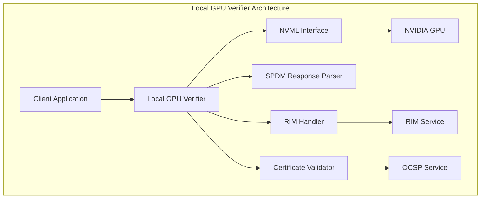
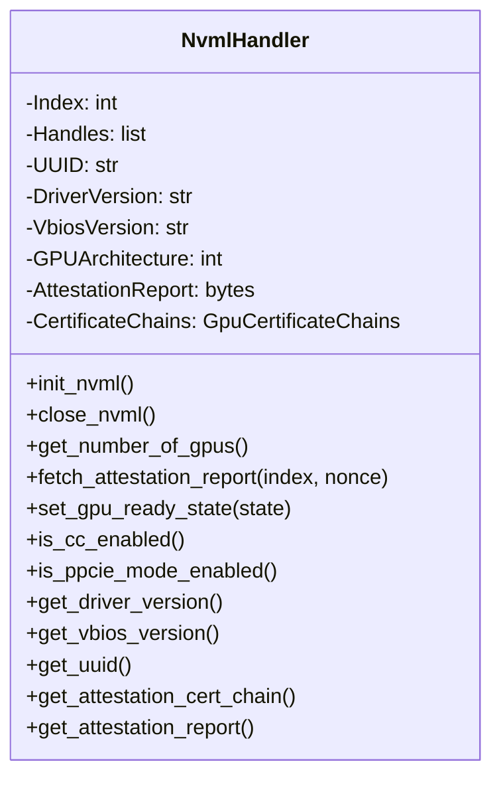
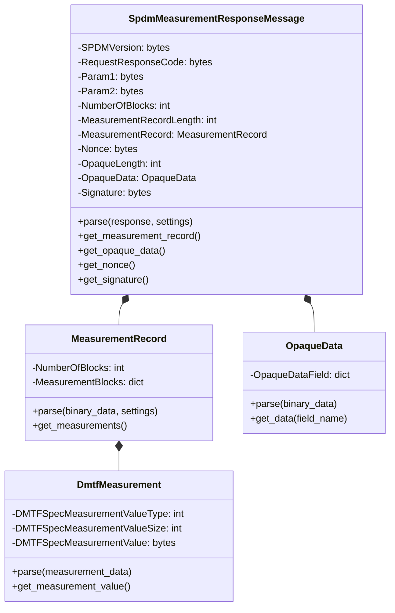
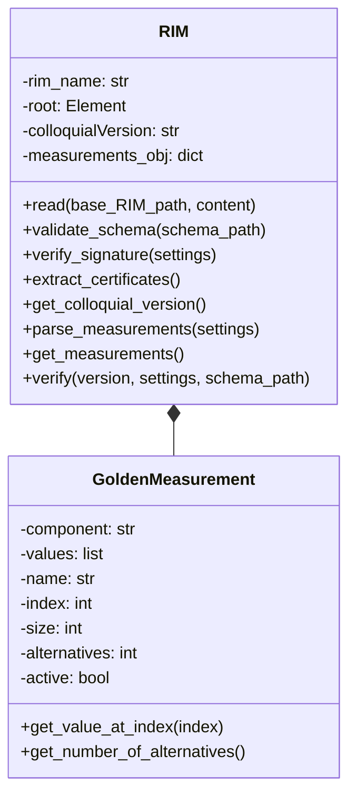
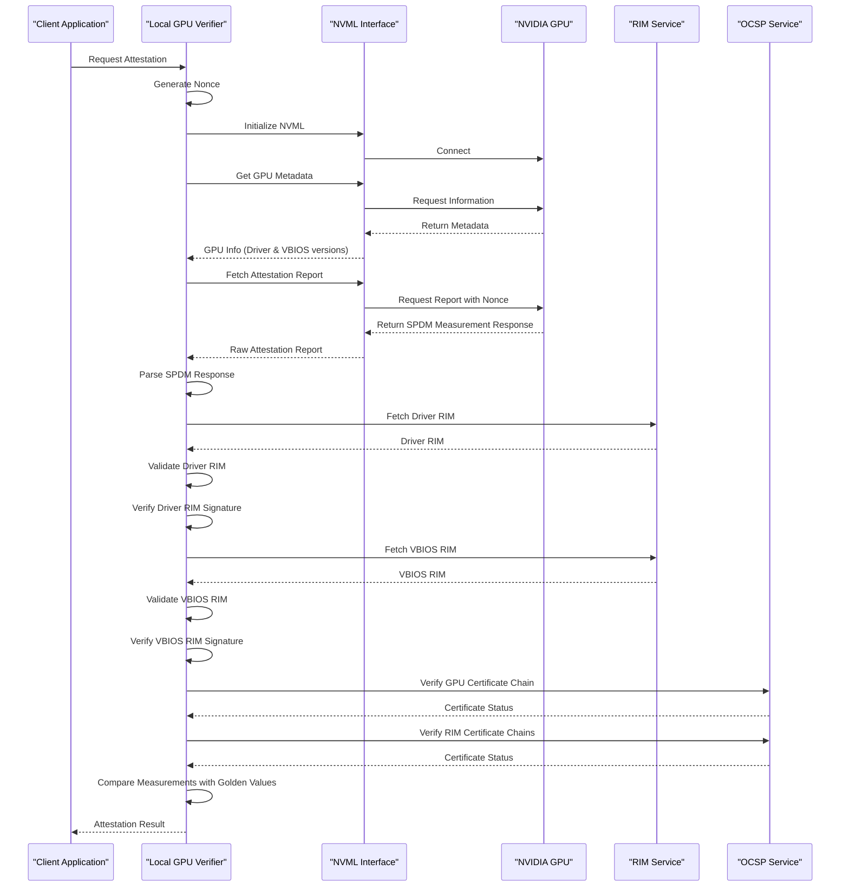

<!-- source: DeepWiki mcp.deepwiki.com · repo NVIDIA/nvtrust · extra page Local GPU Verifier Internals · fetched 2026-10-26 -->

# Local GPU Verifier Internals

Relevant source files

The following files were used as context for generating this wiki page:

- [guest_tools/gpu_verifiers/local_gpu_verifier/src/verifier/attestation/spdm_msrt_resp_msg.py](guest_tools/gpu_verifiers/local_gpu_verifier/src/verifier/attestation/spdm_msrt_resp_msg.py)
- [guest_tools/gpu_verifiers/local_gpu_verifier/src/verifier/cc_admin.py](guest_tools/gpu_verifiers/local_gpu_verifier/src/verifier/cc_admin.py)
- [guest_tools/gpu_verifiers/local_gpu_verifier/src/verifier/config.py](guest_tools/gpu_verifiers/local_gpu_verifier/src/verifier/config.py)
- [guest_tools/gpu_verifiers/local_gpu_verifier/src/verifier/nvml/__init__.py](guest_tools/gpu_verifiers/local_gpu_verifier/src/verifier/nvml/__init__.py)
- [guest_tools/ppcie-verifier/tests/test_verification.py](guest_tools/ppcie-verifier/tests/test_verification.py)

## Purpose and Scope

This document provides a technical deep dive into the internal workings of the Local GPU Verifier component of the nvTrust system. It explains the core components, data flow, and implementation details that enable secure local attestation of NVIDIA GPUs. For information on using the Local GPU Verifier as a tool, see [Local GPU Verifier](#3.1).

## Overview

The Local GPU Verifier is responsible for collecting and verifying measurement evidence from NVIDIA GPUs to ensure they are in a trusted state. It works by communicating with the GPU through NVML, collecting attestation reports, validating them against Reference Integrity Manifests (RIMs), and verifying cryptographic signatures and certificate chains.

Sources:
- [guest_tools/gpu_verifiers/local_gpu_verifier/src/verifier/nvml/__init__.py:77-342]()
- [guest_tools/gpu_verifiers/local_gpu_verifier/src/verifier/rim/__init__.py:64-516]()
- [guest_tools/gpu_verifiers/local_gpu_verifier/src/verifier/attestation/spdm_msrt_resp_msg.py:39-715]()

## Core Components

### NVML Interface

The NVML Interface serves as the communication layer between the Local GPU Verifier and the physical GPU hardware. It uses NVIDIA's Management Library to:

1. Initialize and close connections to the GPU
2. Fetch GPU metadata (driver version, VBIOS version, UUID)
3. Retrieve attestation reports from the GPU
4. Set the GPU's confidential computing ready state

Sources:
- [guest_tools/gpu_verifiers/local_gpu_verifier/src/verifier/nvml/__init__.py:77-342]()

### SPDM Measurement Response Parser

The SPDM Measurement Response Parser component handles parsing of Security Protocol and Data Model (SPDM) response messages received from the GPU through NVML. It includes several classes that parse and represent different aspects of the attestation evidence:

Sources:
- [guest_tools/gpu_verifiers/local_gpu_verifier/src/verifier/attestation/spdm_msrt_resp_msg.py:39-146]()
- [guest_tools/gpu_verifiers/local_gpu_verifier/src/verifier/attestation/spdm_msrt_resp_msg.py:147-254]()
- [guest_tools/gpu_verifiers/local_gpu_verifier/src/verifier/attestation/spdm_msrt_resp_msg.py:257-411]()
- [guest_tools/gpu_verifiers/local_gpu_verifier/src/verifier/attestation/spdm_msrt_resp_msg.py:413-715]()

### RIM (Reference Integrity Manifest) Handler

The RIM Handler component processes and validates Reference Integrity Manifests, which contain "golden measurements" that the verifier uses to validate the measurements received from the GPU:

Sources:
- [guest_tools/gpu_verifiers/local_gpu_verifier/src/verifier/rim/__init__.py:64-516]()

## Attestation Flow

The complete attestation flow within the Local GPU Verifier involves multiple steps that ensure the integrity and authenticity of the GPU:

Sources:
- [guest_tools/gpu_verifiers/local_gpu_verifier/src/verifier/nvml/__init__.py:77-342]()
- [guest_tools/gpu_verifiers/local_gpu_verifier/src/verifier/attestation/spdm_msrt_resp_msg.py:413-715]()
- [guest_tools/gpu_verifiers/local_gpu_verifier/src/verifier/rim/__init__.py:136-297]()

## Key Verification Steps

### 1. Attestation Report Collection

The verifier uses NVML to fetch an attestation report from the GPU. This report contains cryptographic measurements of the GPU firmware and hardware components:

1. The verifier generates a unique nonce
2. It calls `nvmlDeviceGetConfComputeGpuAttestationReport` via the NVML interface
3. The GPU creates an attestation report containing the nonce and signed measurements
4. The report is returned to the verifier as a SPDM measurement response

Sources:
- [guest_tools/gpu_verifiers/local_gpu_verifier/src/verifier/nvml/__init__.py:179-220]()

### 2. SPDM Response Parsing

The attestation report is parsed to extract:

1. Measurement blocks containing cryptographic measurements of GPU components
2. Opaque data containing additional GPU information (driver version, VBIOS version, etc.)
3. The signature that authenticates the report
4. The nonce that ensures freshness

This parsing is handled by the `SpdmMeasurementResponseMessage` class hierarchy.

Sources:
- [guest_tools/gpu_verifiers/local_gpu_verifier/src/verifier/attestation/spdm_msrt_resp_msg.py:413-715]()

### 3. RIM Validation

For both driver and VBIOS, the verifier:

1. Fetches the appropriate RIM from a RIM service
2. Validates the RIM's XML schema
3. Extracts and verifies the RIM's certificate chain
4. Validates the RIM's signature
5. Parses the RIM to extract golden measurements

Sources:
- [guest_tools/gpu_verifiers/local_gpu_verifier/src/verifier/rim/__init__.py:382-484]()

### 4. Measurement Comparison

The verifier compares the measurements from the GPU attestation report with the golden measurements from the RIMs:

1. For each measurement index, it checks if the value matches any of the alternative golden values
2. It verifies that all required measurements are present
3. It ensures that the measurements match the expected driver and VBIOS versions

Sources:
- [guest_tools/gpu_verifiers/local_gpu_verifier/src/verifier/rim/__init__.py:296-365]()

### 5. Certificate Chain Validation

The verifier validates all certificate chains involved in the attestation process:

1. The certificate chain from the GPU attestation report
2. The certificate chains from the driver and VBIOS RIMs
3. For each certificate, it checks validity dates and OCSP revocation status

This ensures that all cryptographic material used in the attestation process is valid and trustworthy.

Sources:
- [guest_tools/gpu_verifiers/local_gpu_verifier/src/verifier/rim/__init__.py:434-478]()

## Data Structures

### SPDM Measurement Response

The SPDM GET_MEASUREMENT response has the following structure:

| Field | Size (bytes) | Description |
|-------|--------------|-------------|
| SPDMVersion | 1 | SPDM protocol version |
| RequestResponseCode | 1 | Response code |
| Param1 | 1 | Parameter 1 |
| Param2 | 1 | Parameter 2 |
| NumberOfBlocks | 1 | Number of measurement blocks |
| MeasurementRecordLength | 3 | Length of measurement record in bytes |
| MeasurementRecord | Variable | The measurement blocks |
| Nonce | 32 | Random nonce for freshness |
| OpaqueLength | 2 | Length of opaque data in bytes |
| OpaqueData | Variable | Additional GPU information |
| Signature | 64 | Signature authenticating the response |

Sources:
- [guest_tools/gpu_verifiers/local_gpu_verifier/src/verifier/attestation/spdm_msrt_resp_msg.py:413-440]()

### Measurement Block

Each measurement block in the SPDM response has this structure:

| Field | Size (bytes) | Description |
|-------|--------------|-------------|
| Index | 1 | Measurement index |
| MeasurementSpecification | 1 | Specification type (DMTF = 1) |
| MeasurementSize | 2 | Size of measurement data in bytes |
| Measurement | Variable | The measurement data |

Sources:
- [guest_tools/gpu_verifiers/local_gpu_verifier/src/verifier/attestation/spdm_msrt_resp_msg.py:147-161]()

### DMTF Measurement

When the measurement specification is DMTF, each measurement has this structure:

| Field | Size (bytes) | Description |
|-------|--------------|-------------|
| DMTFSpecMeasurementValueType | 1 | Type of measurement |
| DMTFSpecMeasurementValueSize | 2 | Size of measurement value in bytes |
| DMTFSpecMeasurementValue | Variable | The measurement value |

Sources:
- [guest_tools/gpu_verifiers/local_gpu_verifier/src/verifier/attestation/spdm_msrt_resp_msg.py:39-51]()

### Opaque Data

Opaque data consists of multiple fields with this structure:

| Field | Size (bytes) | Description |
|-------|--------------|-------------|
| DataType | 2 | Type of data (e.g., driver version = 3, VBIOS version = 6) |
| DataSize | 2 | Size of data in bytes |
| Data | Variable | The data content |

Sources:
- [guest_tools/gpu_verifiers/local_gpu_verifier/src/verifier/attestation/spdm_msrt_resp_msg.py:257-296]()

## Conclusion

The Local GPU Verifier provides a comprehensive mechanism for attesting the integrity and authenticity of NVIDIA GPUs. By using industry-standard protocols like SPDM and the TCG Reference Integrity Manifest format, it provides a robust and secure way to verify that GPUs are in a trusted state before they are used for confidential computing workloads.

---

