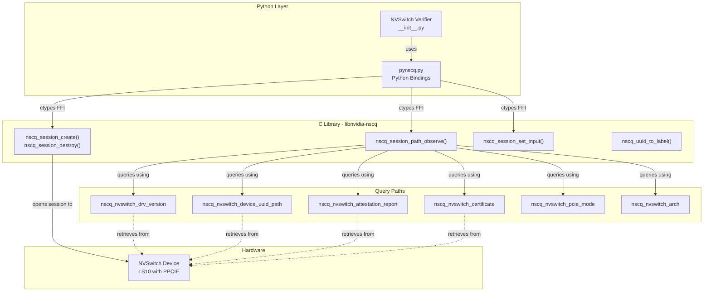
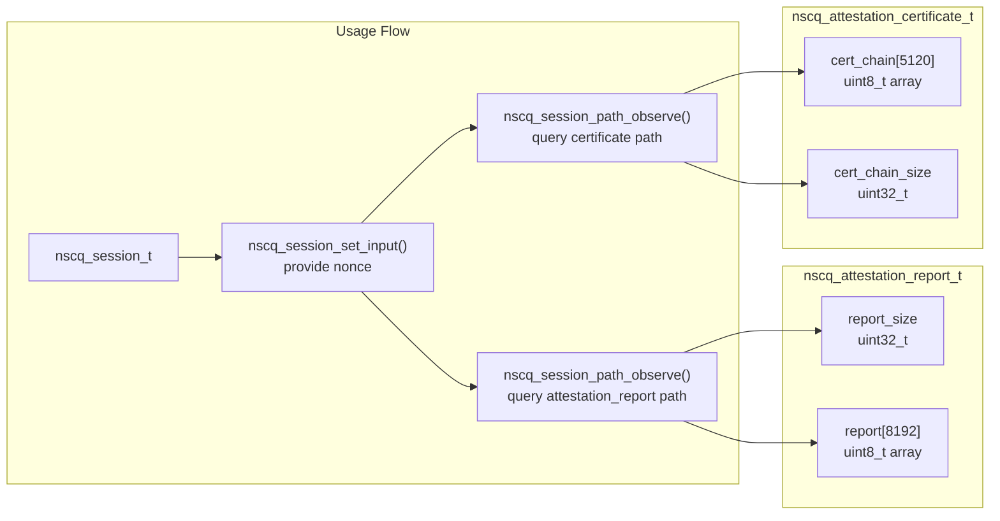
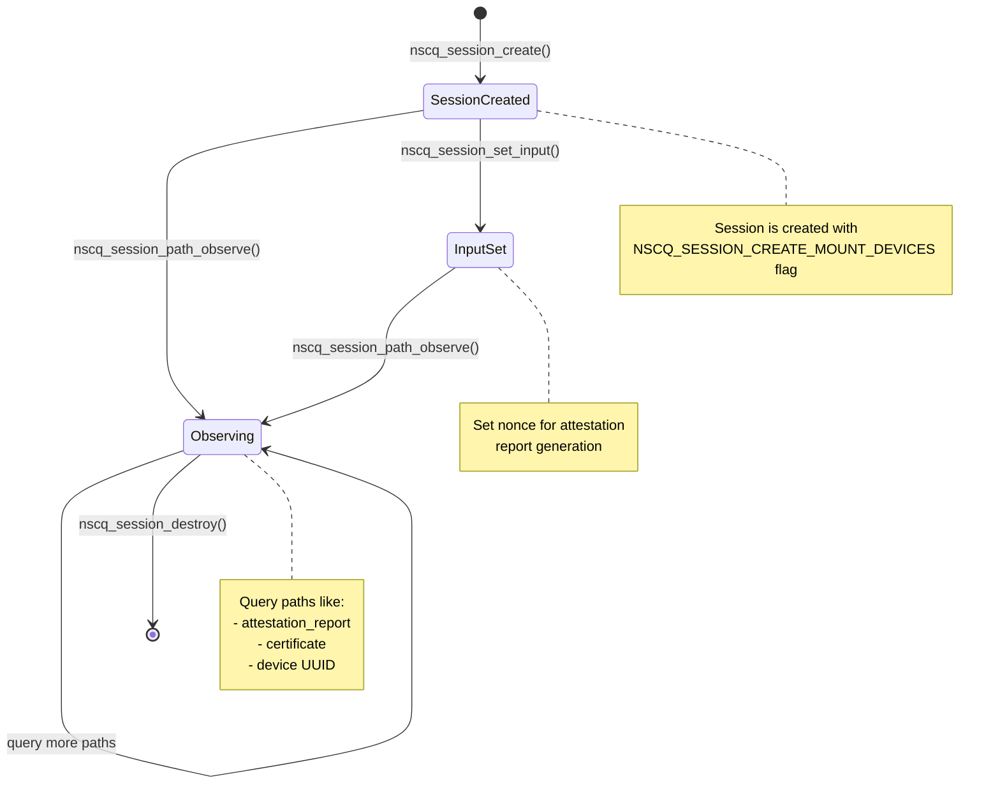
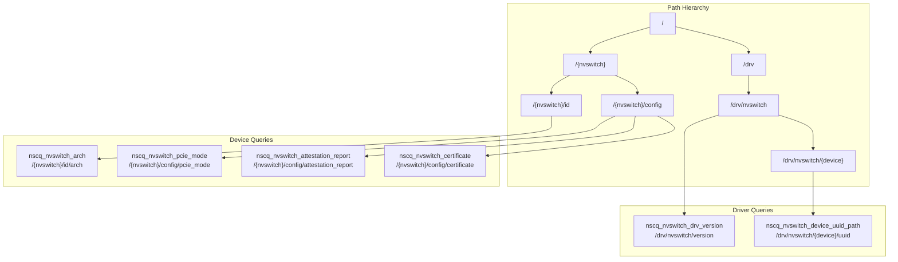
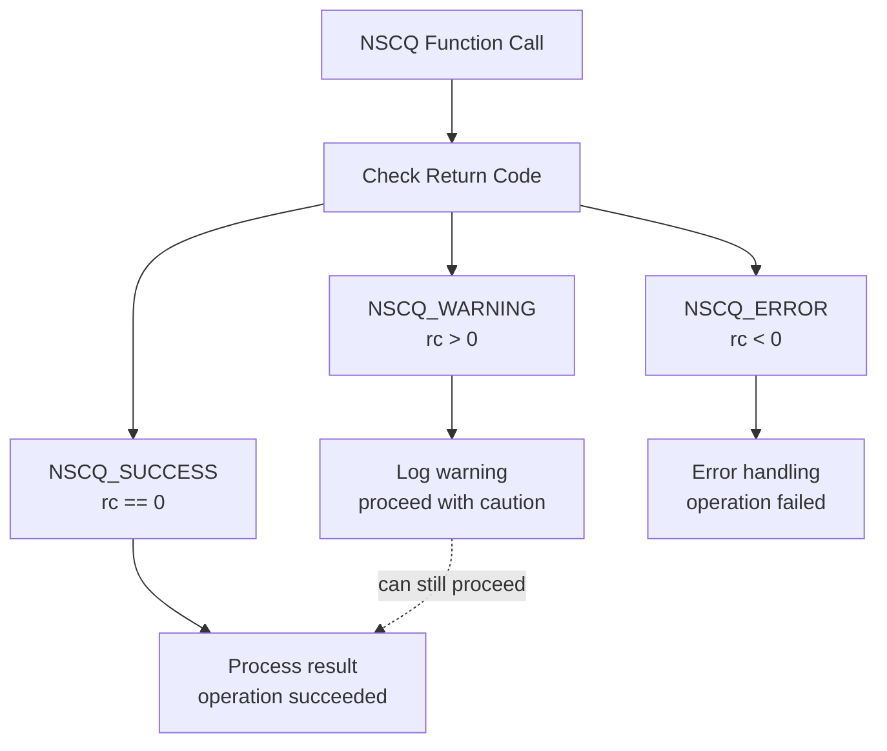
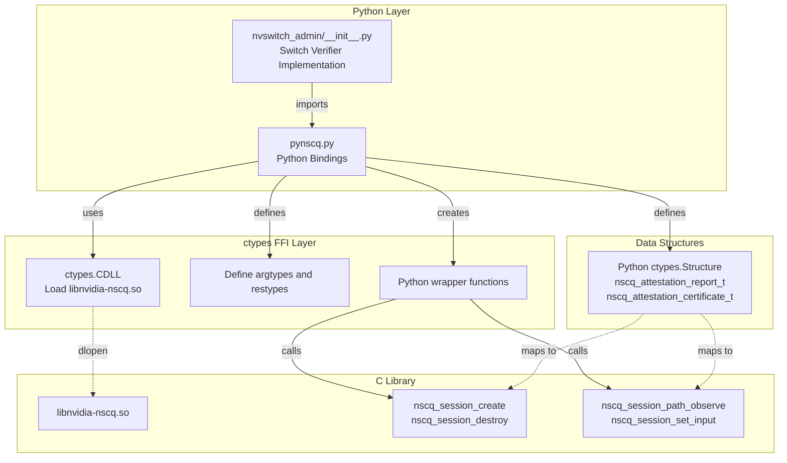

<!-- source: DeepWiki mcp.deepwiki.com · repo NVIDIA/nvtrust · extra page NSCQ Library Interface · fetched 2026-10-26 -->

# NSCQ Library Interface

<details>
<summary>Relevant source files</summary>

The following files were used as context for generating this wiki page:

- [guest_tools/attestation_sdk/src/nv_attestation_sdk/verifiers/nv_switch_verifier/nscq/README.md](guest_tools/attestation_sdk/src/nv_attestation_sdk/verifiers/nv_switch_verifier/nscq/README.md)
- [guest_tools/attestation_sdk/src/nv_attestation_sdk/verifiers/nv_switch_verifier/nscq/nscq_attestation.h](guest_tools/attestation_sdk/src/nv_attestation_sdk/verifiers/nv_switch_verifier/nscq/nscq_attestation.h)
- [guest_tools/attestation_sdk/src/nv_attestation_sdk/verifiers/nv_switch_verifier/nscq/nscq_attestation_path.h](guest_tools/attestation_sdk/src/nv_attestation_sdk/verifiers/nv_switch_verifier/nscq/nscq_attestation_path.h)

</details>


## Purpose and Scope

This document provides a technical reference for the NSCQ (NVSwitch Configuration Query) C library interface, which enables attestation capabilities for NVIDIA NVSwitch devices. The NSCQ library (`libnvidia-nscq`) provides the low-level interface for querying switch configuration, collecting attestation evidence, and retrieving certificates from NVSwitch hardware.

This page focuses on the C library API, data structures, and constants exposed through header files. For information about using the NSCQ library through the Python-based NVSwitch verifier, see [Local NVSwitch Verifier](#4.1). For the broader context of switch attestation workflows, see [NVSwitch Attestation](#4).

**Sources:** [guest_tools/attestation_sdk/src/nv_attestation_sdk/verifiers/nv_switch_verifier/nscq/README.md:1-15]()

## Library Overview

The NSCQ library provides a session-based API for interacting with NVSwitch devices. The library exposes two primary header files:

| Header File | Purpose |
|-------------|---------|
| `nscq_attestation.h` | Core NSCQ operations, data types, session management, and API versioning |
| `nscq_attestation_path.h` | Pre-defined query path constants for accessing device properties |

The library operates through a session abstraction where clients create a session, query device information using path-based observations, and collect attestation evidence in binary format.



**Sources:** [guest_tools/attestation_sdk/src/nv_attestation_sdk/verifiers/nv_switch_verifier/nscq/nscq_attestation.h:1-168](), [guest_tools/attestation_sdk/src/nv_attestation_sdk/verifiers/nv_switch_verifier/nscq/nscq_attestation_path.h:1-64](), [guest_tools/attestation_sdk/src/nv_attestation_sdk/verifiers/nv_switch_verifier/nscq/README.md:9-10]()

## API Versioning

The NSCQ library uses semantic versioning encoded as a 32-bit integer. The current API version is 2.0.0.

### Version Encoding

The API version is encoded using the `NSCQ_API_VERSION` macro:

```c
NSCQ_API_VERSION(major, minor, patch)
```

The encoding format stores major (8 bits), minor (12 bits), and patch (12 bits) components in a single `uint32_t` value:

| Bits | Field |
|------|-------|
| 31-24 | Major version (0-255) |
| 23-12 | Minor version (0-4095) |
| 11-0 | Patch version (0-4095) |

The library exposes a constant `nscq_api_version` that can be checked at runtime to verify compatibility.

**Sources:** [guest_tools/attestation_sdk/src/nv_attestation_sdk/verifiers/nv_switch_verifier/nscq/nscq_attestation.h:46-56]()

## Core Data Types

### Base Types

The library defines several fundamental types for API interaction:

| Type | Definition | Purpose |
|------|------------|---------|
| `nscq_rc_t` | `int8_t` | Return code type for all API functions |
| `nscq_session_t` | `struct nscq_session_st*` | Opaque session handle |
| `nscq_observer_t` | `struct nscq_observer_st*` | Opaque observer handle for path monitoring |
| `nscq_writer_t` | `struct nscq_writer_st*` | Opaque writer handle |
| `nscq_fn_t` | `void (*)(void)` | Generic function pointer type for callbacks |

**Sources:** [guest_tools/attestation_sdk/src/nv_attestation_sdk/verifiers/nv_switch_verifier/nscq/nscq_attestation.h:94-101]()

### Device Identification Types

#### UUID Structure

```c
typedef struct {
    uint8_t bytes[16];
} nscq_uuid_t;
```

Represents a 128-bit universally unique identifier for NVSwitch devices.

#### Label Structure

```c
typedef struct {
    char data[64];
} nscq_label_t;
```

A 64-byte character buffer for human-readable device labels. Used by `nscq_uuid_to_label()` to convert UUIDs to string representations.

#### Architecture Type

```c
typedef int8_t nscq_arch_t;
```

Identifies the NVSwitch architecture:

| Constant | Value | Architecture |
|----------|-------|--------------|
| `NSCQ_ARCH_SV10` | 0 | SV10 |
| `NSCQ_ARCH_LR10` | 1 | LR10 |
| `NSCQ_ARCH_LS10` | 2 | LS10 (with PPCIE support) |

**Sources:** [guest_tools/attestation_sdk/src/nv_attestation_sdk/verifiers/nv_switch_verifier/nscq/nscq_attestation.h:110-122]()

### TNVL Status Type

```c
typedef int8_t nscq_tnvl_status_t;
```

Indicates the Trusted NVLink (TNVL) security mode status:

| Constant | Value | Meaning |
|----------|-------|---------|
| `NSCQ_DEVICE_TNVL_MODE_UNKNOWN` | -1 | Status cannot be determined |
| `NSCQ_DEVICE_TNVL_MODE_DISABLED` | 0 | TNVL is disabled |
| `NSCQ_DEVICE_TNVL_MODE_ENABLED` | 1 | TNVL is enabled (secure mode) |
| `NSCQ_DEVICE_TNVL_MODE_FAILURE` | 2 | TNVL initialization failed |
| `NSCQ_DEVICE_TNVL_MODE_LOCKED` | 3 | TNVL is locked |

**Sources:** [guest_tools/attestation_sdk/src/nv_attestation_sdk/verifiers/nv_switch_verifier/nscq/nscq_attestation.h:124-130]()

## Attestation Data Structures

### Attestation Report Structure

```c
typedef struct {
    uint32_t report_size;
    uint8_t report[NSCQ_ATTESTATION_REPORT_SIZE];
} nscq_attestation_report_t;
```

Contains the SPDM attestation report generated by the NVSwitch device.

| Field | Type | Description |
|-------|------|-------------|
| `report_size` | `uint32_t` | Actual size of the attestation report in bytes |
| `report` | `uint8_t[8192]` | Binary buffer containing the SPDM attestation report |

The maximum report size is defined by `NSCQ_ATTESTATION_REPORT_SIZE` (0x2000 = 8192 bytes). The report includes device measurements, nonce, and cryptographic signatures.

The attestation report generation accepts a nonce for freshness, with the nonce size defined by `NSCQ_ATTESTATION_REPORT_NONCE_SIZE` (0x20 = 32 bytes).

**Sources:** [guest_tools/attestation_sdk/src/nv_attestation_sdk/verifiers/nv_switch_verifier/nscq/nscq_attestation.h:132-139]()

### Certificate Chain Structure

```c
typedef struct {
    uint8_t cert_chain[NSCQ_CERTIFICATE_CERT_CHAIN_MAX_SIZE];
    uint32_t cert_chain_size;
} nscq_attestation_certificate_t;
```

Contains the X.509 certificate chain for the NVSwitch device.

| Field | Type | Description |
|-------|------|-------------|
| `cert_chain` | `uint8_t[5120]` | Binary buffer containing DER-encoded certificates |
| `cert_chain_size` | `uint32_t` | Actual size of the certificate chain in bytes |

The maximum certificate chain size is defined by `NSCQ_CERTIFICATE_CERT_CHAIN_MAX_SIZE` (0x1400 = 5120 bytes). The certificate chain includes the device certificate and intermediate CA certificates up to the NVIDIA root.



**Sources:** [guest_tools/attestation_sdk/src/nv_attestation_sdk/verifiers/nv_switch_verifier/nscq/nscq_attestation.h:141-147]()

## Session Management

### Session Creation

```c
nscq_session_result_t nscq_session_create(uint32_t flags);
```

Creates a new NSCQ session for interacting with NVSwitch devices.

**Parameters:**
- `flags`: Session creation flags. Use `NSCQ_SESSION_CREATE_MOUNT_DEVICES` (0x1) to automatically mount device resources.

**Return Value:**
A `nscq_session_result_t` structure containing:
- `rc`: Return code indicating success or failure
- `session`: Opaque session handle if successful

### Session Destruction

```c
void nscq_session_destroy(nscq_session_t session);
```

Destroys a session and releases all associated resources.

**Parameters:**
- `session`: The session handle to destroy

### Result Type Pattern

The library uses a consistent result type pattern for functions that return values:

```c
typedef struct {
    nscq_rc_t rc;
    T value;
} nscq_<value>_result_t;
```

This allows both the return code and the actual result to be returned in a single structure.



**Sources:** [guest_tools/attestation_sdk/src/nv_attestation_sdk/verifiers/nv_switch_verifier/nscq/nscq_attestation.h:88-92](), [guest_tools/attestation_sdk/src/nv_attestation_sdk/verifiers/nv_switch_verifier/nscq/nscq_attestation.h:149-158]()

## Query Path Constants

The NSCQ library uses hierarchical path strings to query device properties. The `nscq_attestation_path.h` header defines string constants for standard queries.

### Path Format

Paths use a hierarchical format with placeholders for device identifiers:
- `{device}`: Placeholder for device index or identifier
- `{nvswitch}`: Placeholder for NVSwitch-specific identifier

### Pre-defined Path Constants

| Constant | Path String | Description |
|----------|-------------|-------------|
| `nscq_nvswitch_drv_version` | `/drv/nvswitch/version` | Driver version information |
| `nscq_nvswitch_device_uuid_path` | `/drv/nvswitch/{device}/uuid` | Device UUID (requires device substitution) |
| `nscq_nvswitch_arch` | `/{nvswitch}/id/arch` | Switch architecture (SV10/LR10/LS10) |
| `nscq_nvswitch_pcie_mode` | `/{nvswitch}/config/pcie_mode` | PCIe configuration mode |
| `nscq_nvswitch_attestation_report` | `/{nvswitch}/config/attestation_report` | SPDM attestation report (binary) |
| `nscq_nvswitch_certificate` | `/{nvswitch}/config/certificate` | X.509 certificate chain (DER) |

### Path Access Macro

The header provides a convenience macro for accessing path constants in both C and C++ code:

```c
NSCQ_PATH(path_name)
```

This macro expands to the appropriate path string constant with proper type casting.



**Sources:** [guest_tools/attestation_sdk/src/nv_attestation_sdk/verifiers/nv_switch_verifier/nscq/nscq_attestation_path.h:36-63]()

## Path Observation API

### Observing Path Values

```c
nscq_rc_t nscq_session_path_observe(
    nscq_session_t session,
    const char* path,
    nscq_fn_t callback,
    void* user_data,
    uint32_t flags
);
```

Queries a path and invokes a callback with the result.

**Parameters:**
- `session`: Active NSCQ session handle
- `path`: Path string (use path constants from `nscq_attestation_path.h`)
- `callback`: Function pointer to be called with the result (cast to `nscq_fn_t`)
- `user_data`: User-provided context pointer passed to callback
- `flags`: Reserved flags (currently unused)

**Callback Signature:**
The callback is cast internally to the appropriate type based on the path being observed. For binary data like attestation reports and certificates, the callback receives a pointer to the data structure.

### Setting Input Values

```c
nscq_rc_t nscq_session_set_input(
    nscq_session_t session,
    uint32_t input_id,
    void* data,
    uint32_t size
);
```

Sets input data for operations like attestation report generation.

**Parameters:**
- `session`: Active NSCQ session handle
- `input_id`: Input identifier (e.g., nonce for attestation)
- `data`: Pointer to input data buffer
- `size`: Size of input data in bytes

**Use Case:**
Before querying the attestation report path, clients must provide a 32-byte nonce using `nscq_session_set_input()`. This nonce is incorporated into the SPDM attestation report to ensure freshness.

**Sources:** [guest_tools/attestation_sdk/src/nv_attestation_sdk/verifiers/nv_switch_verifier/nscq/nscq_attestation.h:160-162]()

## Return Codes and Error Handling

### Return Code Type

All NSCQ functions return `nscq_rc_t` (an `int8_t`) with the following value ranges:

| Range | Category | Meaning |
|-------|----------|---------|
| 0 | Success | Operation completed successfully |
| 1-127 | Warning | Success with caveats |
| -128 to -1 | Error | Operation failed |

### Standard Return Codes

| Constant | Value | Description |
|----------|-------|-------------|
| `NSCQ_RC_SUCCESS` | 0 | Operation completed successfully |
| `NSCQ_RC_WARNING_RDT_INIT_FAILURE` | 1 | RDT initialization warning |
| `NSCQ_RC_ERROR_NOT_IMPLEMENTED` | -1 | Feature not implemented |
| `NSCQ_RC_ERROR_INVALID_UUID` | -2 | Invalid UUID provided |
| `NSCQ_RC_ERROR_RESOURCE_NOT_MOUNTABLE` | -3 | Resource cannot be mounted |
| `NSCQ_RC_ERROR_OVERFLOW` | -4 | Buffer overflow would occur |
| `NSCQ_RC_ERROR_UNEXPECTED_VALUE` | -5 | Unexpected value encountered |
| `NSCQ_RC_ERROR_UNSUPPORTED_DRV` | -6 | Unsupported driver version |
| `NSCQ_RC_ERROR_DRV` | -7 | Driver error |
| `NSCQ_RC_ERROR_TIMEOUT` | -8 | Operation timed out |
| `NSCQ_RC_ERROR_EXT` | -127 | Extended error (check details) |
| `NSCQ_RC_ERROR_UNSPECIFIED` | -128 | Unspecified error |

### Status Check Macros

The library provides macros for checking return code status:

```c
NSCQ_SUCCESS(result)  // Returns true if rc == 0
NSCQ_WARNING(result)  // Returns true if rc > 0
NSCQ_ERROR(result)    // Returns true if rc < 0
```

These macros work with both `nscq_rc_t` values and result structures (e.g., `nscq_session_result_t`) by dereferencing the first member.



**Sources:** [guest_tools/attestation_sdk/src/nv_attestation_sdk/verifiers/nv_switch_verifier/nscq/nscq_attestation.h:58-86]()

## Utility Functions

### UUID to Label Conversion

```c
nscq_rc_t nscq_uuid_to_label(
    const nscq_uuid_t* uuid,
    nscq_label_t* label,
    uint32_t flags
);
```

Converts a binary UUID to a human-readable string representation.

**Parameters:**
- `uuid`: Pointer to `nscq_uuid_t` structure containing 16-byte UUID
- `label`: Pointer to `nscq_label_t` structure to receive string representation (64 bytes)
- `flags`: Reserved flags (currently unused)

**Return Value:**
- `NSCQ_RC_SUCCESS` on success
- Error code on failure

**Sources:** [guest_tools/attestation_sdk/src/nv_attestation_sdk/verifiers/nv_switch_verifier/nscq/nscq_attestation.h:153]()

## Python Integration

The NSCQ C library is accessed from Python through ctypes Foreign Function Interface (FFI) bindings. The Python wrapper (`pynscq.py`) provides a Pythonic interface to the C API while maintaining access to the low-level functionality.

### Integration Architecture



### Key Integration Points

1. **Library Loading**: The Python bindings load `libnvidia-nscq.so` using `ctypes.CDLL`
2. **Structure Mapping**: C structures are mapped to Python `ctypes.Structure` classes with matching field layouts
3. **Function Signatures**: Python defines argument types (`argtypes`) and return types (`restype`) for C functions
4. **Session Management**: Python wrappers manage session lifecycle and handle resource cleanup
5. **Error Handling**: Return codes are checked and converted to Python exceptions when appropriate

The Python bindings are used by the NVSwitch verifier implementation to collect attestation evidence and certificates from switch hardware during the attestation workflow.

**Sources:** [guest_tools/attestation_sdk/src/nv_attestation_sdk/verifiers/nv_switch_verifier/nscq/README.md:9-10]()

## Library Installation

The NSCQ library is distributed as part of the NVIDIA driver package. To install `libnvidia-nscq`:

1. Install the NVIDIA GPU driver following the [Driver Installation Guide - NVSwitch](https://docs.nvidia.com/datacenter/tesla/driver-installation-guide/index.html#nvswitch)
2. The library is typically installed to `/usr/lib/x86_64-linux-gnu/libnvidia-nscq.so.1` or similar system library paths
3. Verify installation by checking for the library file:
   ```bash
   ldconfig -p | grep libnvidia-nscq
   ```

The library requires appropriate system permissions to access NVSwitch devices through the kernel driver.

**Sources:** [guest_tools/attestation_sdk/src/nv_attestation_sdk/verifiers/nv_switch_verifier/nscq/README.md:12-14]()

---

