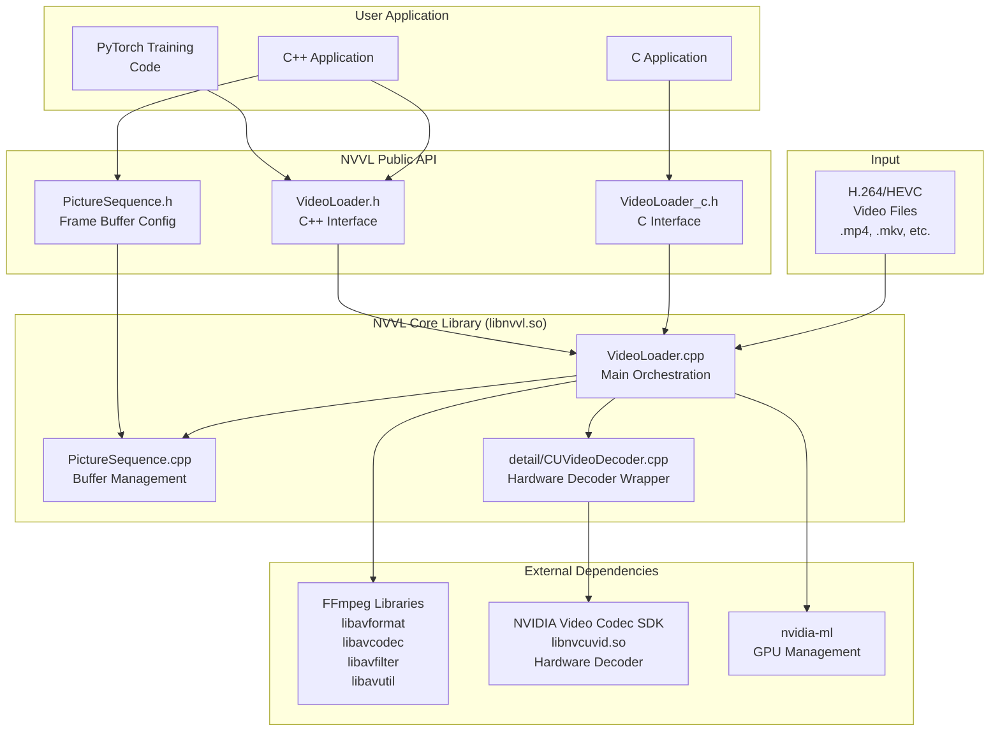
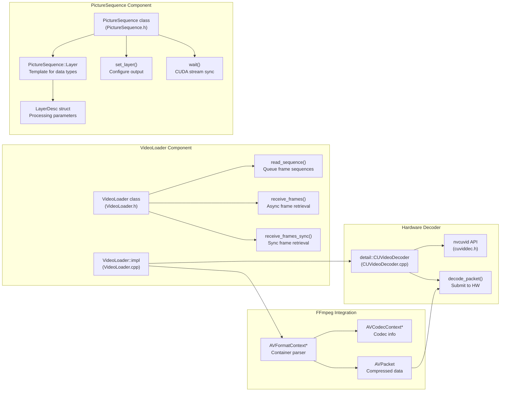

<!-- source: DeepWiki mcp.deepwiki.com · repo NVIDIA/nvvl · page 1 Overview · fetched 2026-10-26 -->

# Overview

Relevant source files

The following files were used as context for generating this wiki page:

- [LICENSE](LICENSE)
- [README.md](README.md)

This document provides an overview of NVVL (NVIDIA Video Loader), a GPU-accelerated video loading library designed for machine learning applications. It covers NVVL's purpose, architecture, relationship to DALI, key components, and primary use cases.

For detailed setup instructions, see [Getting Started](#2). For comprehensive API documentation, see [Core Library](#3). For practical implementation examples, see [Examples and Tutorials](#4).

## Purpose and Current Status

NVVL is a library for loading random sequences of video frames from compressed video files directly into GPU memory as tensors ready for machine learning training. As of 2018, **NVVL functionality has been incorporated into [DALI (NVIDIA Data Loading Library)](https://github.com/NVIDIA/DALI)**, which is the recommended solution for new projects. The NVVL project remains available on GitHub as a reference implementation but is no longer actively maintained.

**Note:** NVVL is example code from a research project performed by NVIDIA researchers. While useful, it is not a supported NVIDIA product and is provided largely as-is.

Sources: [README.md:1-24]()

## Core Problem and Solution

### The Problem

Traditional machine learning training pipelines store video datasets as individual frame images (e.g., PNG files), which creates significant bottlenecks:

- **Storage Overhead**: Individual frames consume 40x more disk space than compressed video
- **I/O Bottleneck**: More bytes must be read from disk during training
- **CPU Load**: Image decoding on CPU requires dedicated cores for data loading
- **Scalability**: Datasets may not fit on fast local storage (SSDs)

### NVVL's Solution

NVVL addresses these issues through:

1. **Compressed Video Storage**: Store datasets as H.264/HEVC video files
2. **Hardware Decoding**: Offload video decoding to NVIDIA GPU hardware decoders (nvcuvid)
3. **GPU-Resident Pipeline**: Perform all transformations on GPU, eliminating CPU/GPU data transfers
4. **Direct Tensor Output**: Provide ready-to-use tensors in GPU device memory

**Performance Results**: On NVIDIA DGX-1, NVVL reduced CPU load to 50-60% compared to PNG-based dataloaders.

Sources: [README.md:26-49]()

## High-Level Architecture

**Diagram: NVVL Architecture with Code Entities**

NVVL is structured in three layers:

1. **Public API Layer**: Header files in `include/` directory exposing C++ and C interfaces
2. **Core Library**: Implementation in `src/` directory, compiled into `libnvvl.so`
3. **External Dependencies**: FFmpeg for container parsing, nvcuvid for hardware decoding

Sources: [README.md:8-18](), [README.md:61-69]()

## Core Components and Code Entities

**Diagram: Core Component Code Entity Mapping**

### Key Classes and Files

| Component | Header | Implementation | Purpose |
|-----------|--------|----------------|---------|
| **VideoLoader** | `include/VideoLoader.h` | `src/VideoLoader.cpp` | Main API entry point; manages reading sequences and frame queuing |
| **PictureSequence** | `include/PictureSequence.h` | `src/PictureSequence.cpp` | Defines output buffer configuration and processing parameters |
| **CUVideoDecoder** | N/A (internal) | `src/detail/CUVideoDecoder.cpp` | Wraps NVIDIA hardware video decoder (nvcuvid) |

Sources: [README.md:198-209](), [README.md:214-239]()

## Data Flow Pipeline

```mermaid
graph LR
    VideoFile["Compressed<br/>Video File<br/>H.264/HEVC"]
    
    subgraph FFmpeg_Parse["FFmpeg Parsing"]
        av_open["av_open_input_file()"]
        av_read["av_read_frame()"]
        AVPacket_out["AVPacket<br/>(compressed)"]
    end
    
    subgraph HW_Decode["Hardware Decoding"]
        cuvidDecode["cuvidDecodePicture()"]
        cuvidMap["cuvidMapVideoFrame()"]
        NV12["NV12 Surface<br/>(GPU memory)"]
    end
    
    subgraph GPU_Transform["GPU Transformations"]
        NPP["CUDA/NPP kernels"]
        Scale["Scale"]
        Crop["Crop"]
        Flip["Horizontal Flip"]
        ColorConvert["YUV→RGB<br/>Conversion"]
    end
    
    subgraph Output_Buffer["Output Buffer"]
        PictureSequence_data["PictureSequence.Layer.data<br/>(user-allocated)"]
        Tensor["GPU Tensor<br/>float/half/uint8<br/>NCHW/NHWC"]
    end
    
    VideoFile --> av_open
    av_open --> av_read
    av_read --> AVPacket_out
    AVPacket_out --> cuvidDecode
    cuvidDecode --> cuvidMap
    cuvidMap --> NV12
    NV12 --> NPP
    NPP --> Scale
    Scale --> Crop
    Crop --> Flip
    Flip --> ColorConvert
    ColorConvert --> PictureSequence_data
    PictureSequence_data --> Tensor
```

**Diagram: NVVL Processing Pipeline with API Calls**

### Pipeline Stages

1. **Container Demuxing**: FFmpeg (`libavformat`) parses video container to extract compressed packets
2. **Hardware Decoding**: CUDA Video Decoder API (`cuvidDecodePicture()`) decodes packets using GPU hardware
3. **Surface Mapping**: `cuvidMapVideoFrame()` maps decoded NV12 surfaces to CUDA device memory
4. **GPU Transformations**: CUDA kernels perform scaling, cropping, flipping using texture units
5. **Color Space Conversion**: YUV (NV12) converted to RGB or kept as YCbCr
6. **Output**: Final tensor written to user-provided buffer in `PictureSequence::Layer::data`

Sources: [README.md:10-18]()

## Key Features

### Supported Video Formats

- **Codecs**: H.264 (libx264), HEVC/H.265 (libx265)
- **Containers**: Any format supported by FFmpeg (MP4, MKV, AVI, etc.)
- **Pixel Format**: YUV420p (required by hardware decoder)
- **Keyframe Requirements**: Frequent keyframes recommended (interval = sequence length)

Sources: [README.md:151-173]()

### Output Flexibility

The `PictureSequence::Layer` API allows configuration of:

| Parameter | Options | Description |
|-----------|---------|-------------|
| **Data Type** | `float`, `half`, `uint8` | Output tensor precision |
| **Color Space** | RGB, YCbCr | Color representation |
| **Normalization** | `[0, 1]` or `[0, 255]` | Value range |
| **Dimensions** | Any stride order | NCHW, NHWC, or custom via `stride` fields |
| **Scaling** | `scale_width`, `scale_height` | Resize frames |
| **Cropping** | `width`, `height`, `crop_x`, `crop_y` | Extract regions |
| **Flipping** | `horiz_flip` | Horizontal flip augmentation |

Sources: [README.md:237-261]()

### Asynchronous Operation

- `VideoLoader::receive_frames()` returns immediately, decoding continues asynchronously
- `PictureSequence::wait()` inserts CUDA stream synchronization event
- Enables overlapping data loading with computation

Sources: [README.md:275-286]()

## API Interfaces

NVVL provides three API interfaces:

### C++ Interface
- Main API: `VideoLoader` class and `PictureSequence` class
- Type-safe templates: `PictureSequence::Layer<float>`, `PictureSequence::Layer<half>`, `PictureSequence::Layer<uint8_t>`
- RAII resource management
- Header: [include/VideoLoader.h](), [include/PictureSequence.h]()
- Example: [doc/examples/extract_frames.cpp]()

### C Interface
- Function-based API: `nvvl_*` functions
- Manual resource management: `nvvl_create_video_loader()`, `nvvl_destroy_video_loader()`
- Header: [include/VideoLoader_c.h]()
- Example: [doc/examples/extract_frames_c.c]()

### PyTorch Wrapper
- Python API for PyTorch integration
- Direct loading into PyTorch tensors
- Custom dataloader implementation
- Documentation: [pytorch/README.md]()
- Example: [examples/pytorch_superres/]()

Sources: [README.md:186-197](), [README.md:288-290]()

## Dependencies

### Required Runtime Dependencies

| Library | Purpose | Typical Package |
|---------|---------|-----------------|
| **CUDA Toolkit** | GPU runtime and hardware decoder API | NVIDIA CUDA 8.0+ (9.0+ recommended) |
| **libavformat** | Container format parsing | `libavformat-dev` (Ubuntu) |
| **libavcodec** | Codec information structures | `libavcodec-dev` |
| **libavfilter** | FFmpeg filter infrastructure | `libavfilter-dev` |
| **libavutil** | FFmpeg utility functions | `libavutil-dev` |
| **libnvcuvid** | NVIDIA video decoder library | Included with CUDA Toolkit |
| **nvidia-ml** | GPU device management | `libnvidia-ml.so` |

### Optional Build Dependencies

| Tool | Purpose | Version Requirement |
|------|---------|---------------------|
| **CMake** | Build system | 3.8+ |
| **OpenCV** | Examples only (frame writing) | Any recent version |
| **Doxygen** | API documentation generation | Any recent version |

Sources: [README.md:61-73]()

## Use Cases

### Primary Use Case: ML Training Data Loading

NVVL is optimized for loading video data during neural network training:

1. **Video Super-Resolution**: Upscaling video frames (see [PyTorch Super-Resolution Example](#4.4))
2. **Action Recognition**: Temporal understanding from frame sequences
3. **Video Generation**: Training generative models on video data
4. **Optical Flow Estimation**: Learning motion between frames

### Advantages Over Frame-Based Loading

- **40x storage reduction**: Compressed video vs. individual PNG frames
- **Lower I/O bandwidth**: Fewer bytes read from disk
- **50-60% CPU reduction**: Hardware decoding offloads CPU
- **Faster training iteration**: Data fits on faster local storage

Sources: [README.md:26-49]()

## Relationship to DALI

**Current Recommendation**: As stated in the repository README, NVVL functionality has been incorporated into [NVIDIA DALI (Data Loading Library)](https://github.com/NVIDIA/DALI). For new projects, DALI is the recommended solution as it:

- Includes NVVL video loading capabilities
- Provides broader data loading functionality (images, audio, etc.)
- Receives active development and support
- Offers framework integration (PyTorch, TensorFlow, MXNet)

**NVVL Status**: The NVVL repository remains available as a reference implementation and for existing projects but is not actively maintained. New issues and feature requests should be submitted to the [DALI repository](https://github.com/NVIDIA/DALI/issues).

Sources: [README.md:1-5]()

## License

NVVL is released under the BSD 3-Clause License. Individual components have separate licenses:

- **NVVL source code**: BSD 3-Clause (see [LICENSE:1-27]())
- **Boost library files**: Boost Software License 1.0 (see [src/boost/LICENSE_1_0.txt]())
- **NVIDIA Video Codec SDK headers**: NVIDIA proprietary license (see headers in [src/nvidia/]())

For complete license information, see [License and Legal](#9).

Sources: [LICENSE:1-35]()

## Next Steps

- **Setup**: See [Building from Source](#2.1) or [Using Docker](#2.2)
- **Video Preparation**: See [Video Data Preparation](#2.3) for encoding guidelines
- **API Learning**: See [VideoLoader API](#3.2) and [PictureSequence API](#3.3)
- **Examples**: Start with [C++ Frame Extraction](#4.1) or [C Frame Extraction](#4.2)

---

