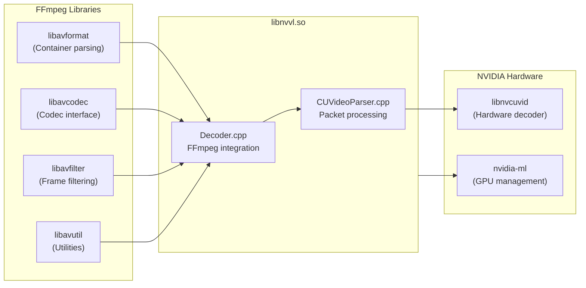
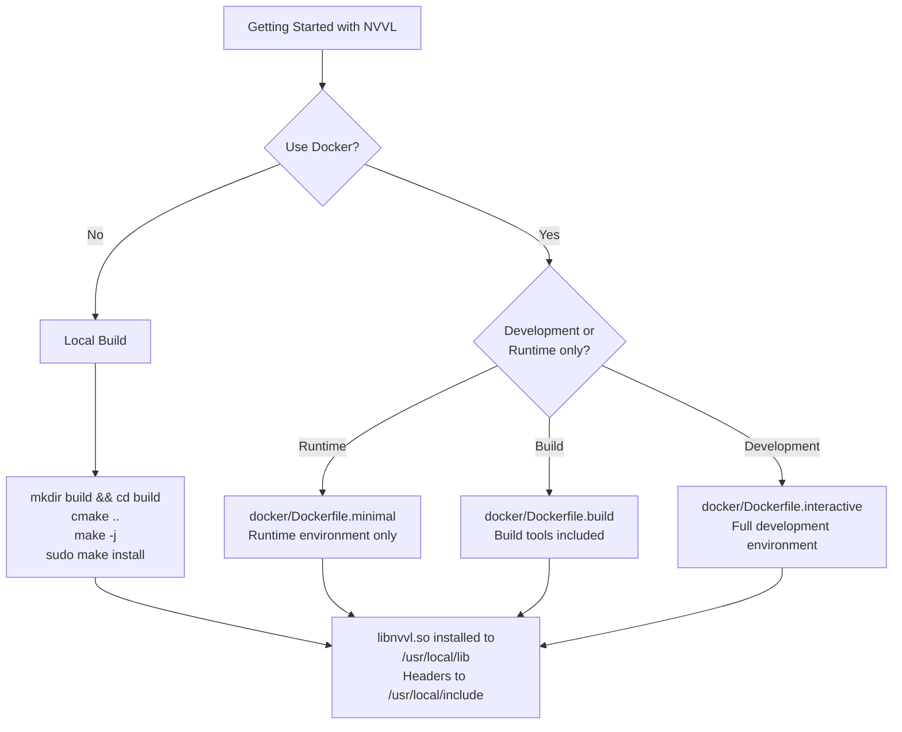
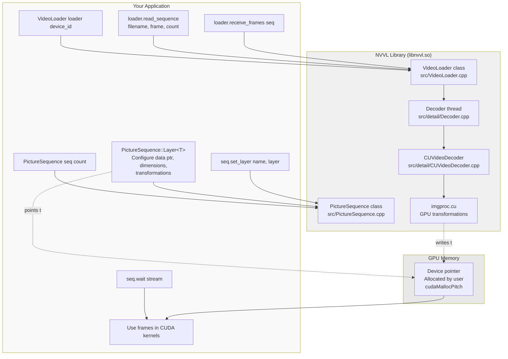
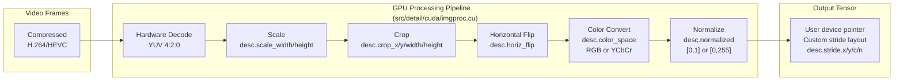
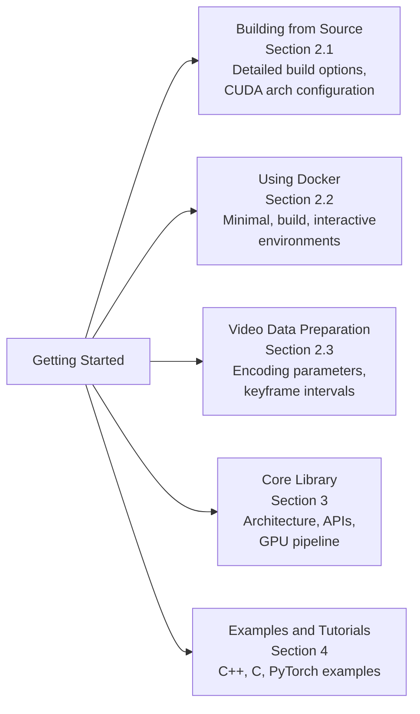

<!-- source: DeepWiki mcp.deepwiki.com · repo NVIDIA/nvvl · page 2 Getting Started · fetched 2026-10-26 -->

# Getting Started

<details>
<summary>Relevant source files</summary>

The following files were used as context for generating this wiki page:

- [CMakeLists.txt](CMakeLists.txt)
- [README.md](README.md)

</details>


This document provides an overview of how to begin using NVVL, including prerequisites, installation options, and basic usage patterns. For detailed build instructions, see [Building from Source](#2.1). For containerized workflows, see [Using Docker](#2.2). For video file preparation guidelines, see [Video Data Preparation](#2.3).

**Important**: NVVL has been incorporated into [DALI (NVIDIA Data Loading Library)](https://github.com/NVIDIA/DALI), which is actively maintained and offers additional functionality. For new projects, DALI is recommended. NVVL remains available but is no longer actively maintained.

## Prerequisites

NVVL requires the following dependencies to build and run:

| Dependency | Minimum Version | Purpose |
|------------|----------------|---------|
| CUDA Toolkit | 8.0 (9.0+ recommended) | Hardware video decoding and GPU processing |
| FFmpeg libraries | Any recent version | Container parsing and codec handling |
| CMake | 3.8 | Build system with CUDA language support |
| C++ Compiler | C++14 support | Building the library |

### FFmpeg Components

NVVL specifically requires these FFmpeg libraries:



**Diagram: NVVL Runtime Dependencies**

Sources: [README.md:61-69](), [CMakeLists.txt:16-29](), [CMakeLists.txt:73]()

### Installation Methods

The FFmpeg libraries can be installed via:
- **System packages**: `libavcodec-dev libavfilter-dev libavformat-dev libavutil-dev` on Ubuntu 16.04+
- **From source**: See the example configurations in [docker/]() directory
- **Pre-configured Docker images**: See [Using Docker](#2.2)

For CMake 3.8+, which is not available in many distributions:

```bash
# Via pip (recommended)
pip install cmake

# Or via binary distribution
wget https://cmake.org/files/v3.10/cmake-3.10.2-Linux-x86_64.sh
/bin/sh cmake-3.10.2-Linux-x86_64.sh --prefix=/usr/local
```

Sources: [README.md:61-99]()

## Installation Options



**Diagram: Installation Workflow**

Sources: [README.md:59-148](), [CMakeLists.txt:1-126]()

### Quick Build

For a standard local build with default options:

```bash
mkdir build && cd build
cmake ..
make -j
sudo make install
```

This installs:
- `libnvvl.so` to `/usr/local/lib`
- Public headers from [include/]() to `/usr/local/include`
- CMake package configuration files to `/usr/local/lib/cmake/NVVL/`

Sources: [README.md:101-108](), [CMakeLists.txt:76-122]()

### Build Configuration

Common CMake options passed via `cmake .. -DOPTION=Value`:

| Option | Values | Default | Description |
|--------|--------|---------|-------------|
| `CUDA_ARCH` | `Kepler`, `Maxwell`, `Pascal`, `Volta`, or `sm_XX` | `Maxwell;Pascal;Volta` | GPU architectures to compile for |
| `CMAKE_CUDA_FLAGS` | String | `-cudart shared` | Arguments passed to `nvcc` |
| `CMAKE_BUILD_TYPE` | `Debug`, `Release` | (varies) | Build type configuration |
| `CMAKE_INSTALL_PREFIX` | Path | `/usr/local` | Installation directory |
| `WITH_OPENCV` | `0`, `1` | `0` | Enable OpenCV in examples |

See [Building from Source](#2.1) for detailed configuration options.

Sources: [README.md:112-135](), [CMakeLists.txt:3-5](), [cmake/BuildType.cmake](), [cmake/CudaArchFlags.cmake]()

## Basic Usage Pattern



**Diagram: Core API Usage Flow with Code Entities**

Sources: [README.md:186-290](), [src/VideoLoader.cpp](), [src/PictureSequence.cpp](), [include/VideoLoader.h](), [include/PictureSequence.h]()

### Minimal Example

```cpp
// Create loader for device 0
auto loader = NVVL::VideoLoader{0};

// Request frames 100-105 from video
loader.read_sequence("video.mp4", 100, 5);

// Create sequence to receive 5 frames
auto seq = PictureSequence{5};

// Configure output layer
auto pixels = PictureSequence::Layer<float>{};
pixels.data = /* device pointer from cudaMallocPitch */;
pixels.desc.count = 5;
pixels.desc.channels = 3;
pixels.desc.width = 224;
pixels.desc.height = 224;
pixels.desc.color_space = ColorSpace_RGB;
pixels.desc.normalized = true;
// ... configure strides ...

// Add layer and receive frames
seq.set_layer("pixels", pixels);
loader.receive_frames(seq);

// Wait for completion before using data
seq.wait(cuda_stream);
```

This pattern demonstrates the core classes:
- **`VideoLoader`**: Manages video reading and decoding [src/VideoLoader.cpp]()
- **`PictureSequence`**: Describes output buffers and processing [src/PictureSequence.cpp]()
- **`PictureSequence::Layer<T>`**: Typed layer configuration for output formats

For complete examples, see:
- C++ example: [doc/examples/extract_frames.cpp]() (see [C++ Frame Extraction](#4.1))
- C example: [doc/examples/extract_frames_c.c]() (see [C Frame Extraction](#4.2))

Sources: [README.md:186-290](), [include/VideoLoader.h](), [include/PictureSequence.h]()

## Data Types and Processing

NVVL supports multiple output data types and processing options configured through `PictureSequence::Layer<T>`:

| Type | Description | Normalization |
|------|-------------|---------------|
| `float` | 32-bit floating point | `[0, 1]` or `[0, 255]` |
| `half` | 16-bit floating point | `[0, 1]` or `[0, 255]` |
| `uint8_t` | 8-bit unsigned integer | `[0, 255]` only |

### Layer Configuration Options



**Diagram: Frame Processing Pipeline Configuration**

Each transformation is configured through fields in `PictureSequence::Layer<T>::desc`:
- **Scaling**: `scale_width`, `scale_height` for resize before crop
- **Cropping**: `crop_x`, `crop_y`, `crop_width`, `crop_height` for region extraction
- **Flipping**: `horiz_flip` for horizontal mirroring
- **Color space**: `ColorSpace_RGB` or `ColorSpace_YCbCr`
- **Normalization**: `normalized` flag for `[0, 1]` vs `[0, 255]` range
- **Memory layout**: `stride.x`, `stride.y`, `stride.c`, `stride.n` for custom dimension ordering

All processing occurs on the GPU using dedicated texture mapping hardware and CUDA kernels.

Sources: [README.md:14-18](), [README.md:237-266](), [include/PictureSequence.h](), [src/detail/cuda/imgproc.cu]()

## Video Requirements

NVVL supports H.264 and HEVC codecs with specific encoding requirements for optimal performance:

| Requirement | Value | Reason |
|-------------|-------|--------|
| Pixel format | `yuv420p` | Hardware decoder requirement |
| Keyframe interval | Match sequence length | Minimize decoding overhead for random access |
| GOP structure | Closed GOPs (HEVC) | Required by seeking logic |
| Container | Any FFmpeg-supported | `.mp4`, `.mkv`, etc. |

Example encoding command:

```bash
ffmpeg -i input.mp4 -map v:0 \
       -c:v libx264 -crf 18 \
       -pix_fmt yuv420p -g 5 \
       -profile:v high output.mp4
```

For detailed video preparation guidelines, see [Video Data Preparation](#2.3).

Sources: [README.md:149-184]()

## Framework Integration

While the C/C++ library can be used directly, most users should use framework wrappers:

- **PyTorch**: Python wrapper available in [pytorch/]() directory. Does not require pre-installing the C++ library; setup scripts build it automatically.
- **DALI**: For new projects, use [DALI](https://github.com/NVIDIA/DALI) which incorporates NVVL functionality.

For advanced PyTorch usage with super-resolution example, see [PyTorch Super-Resolution](#4.4).

Sources: [README.md:1-6](), [README.md:51-57](), [pytorch/README.md]()

## Next Steps



**Diagram: Documentation Navigation**

- **[Building from Source](#2.1)**: Detailed build configuration, CMake options, and troubleshooting
- **[Using Docker](#2.2)**: Pre-configured environments for different use cases
- **[Video Data Preparation](#2.3)**: Encoding guidelines for optimal performance
- **[Core Library](#3)**: In-depth documentation of NVVL's architecture and APIs
- **[Examples and Tutorials](#4)**: Practical code examples from basic to advanced

For API reference documentation, build with `make doc` (requires Doxygen). See [Generating Documentation](#7.1).

Sources: [README.md:137-148]()

---

