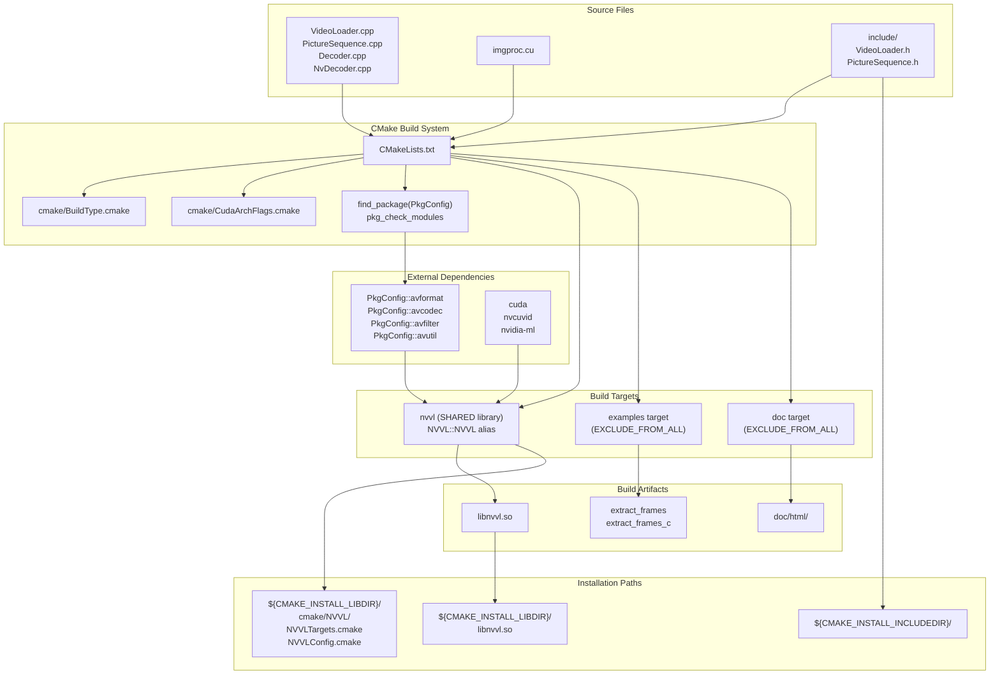
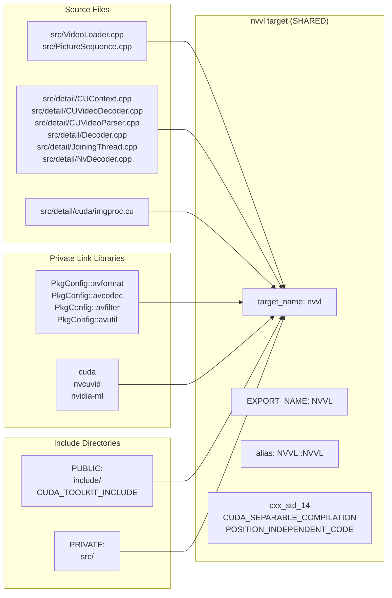
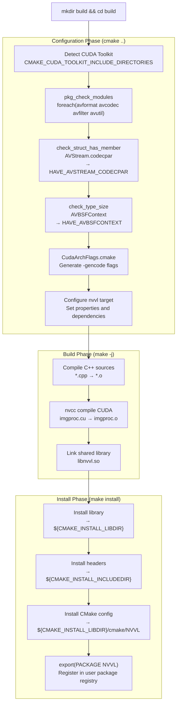
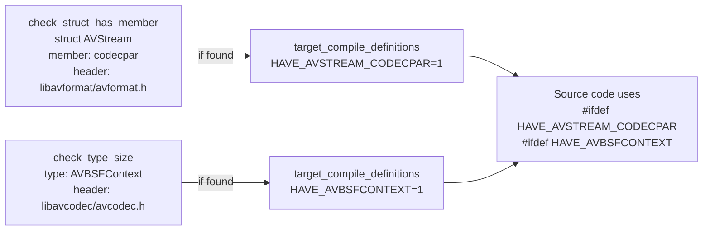
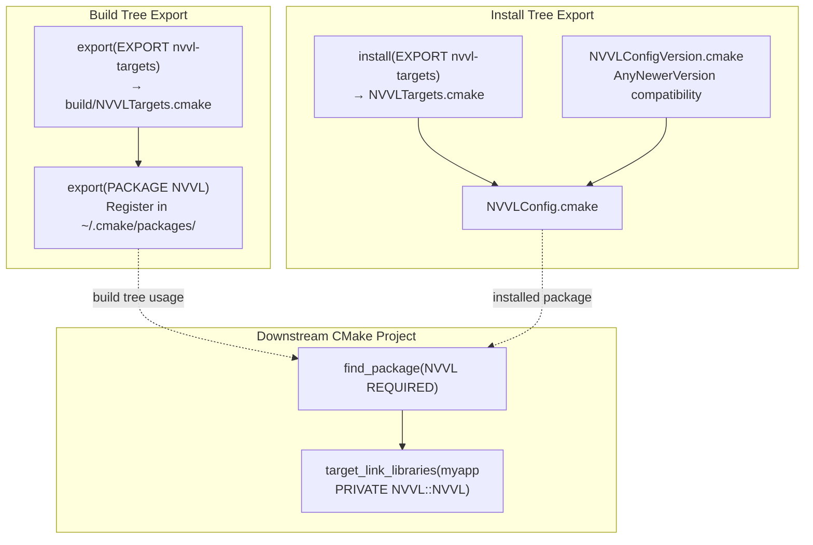

<!-- source: DeepWiki mcp.deepwiki.com · repo NVIDIA/nvvl · page 2.1 Building from Source · fetched 2026-10-26 -->

# Building from Source

<details>
<summary>Relevant source files</summary>

The following files were used as context for generating this wiki page:

- [CMakeLists.txt](CMakeLists.txt)
- [README.md](README.md)
- [cmake/BuildType.cmake](cmake/BuildType.cmake)
- [cmake/CudaArchFlags.cmake](cmake/CudaArchFlags.cmake)

</details>


This page provides detailed instructions for building the NVVL library from source code. It covers system prerequisites, dependency requirements, CMake configuration options, and the complete build and installation process.

For information about using pre-configured Docker environments instead of building manually, see [Using Docker](#2.2). For details about the CMake build system internals, see [CMake Configuration](#5.1).

## Purpose and Scope

This document guides developers through compiling NVVL from source on Linux systems. It covers:
- Installing required dependencies (CUDA Toolkit, FFmpeg libraries, CMake)
- Configuring the build with CMake options
- Compiling the shared library and optional components
- Installing to system directories

This page focuses on the mechanics of building the library itself. For information about preparing video data for use with NVVL, see [Video Data Preparation](#2.3).

## Prerequisites

### Required Dependencies

NVVL requires the following dependencies to build and run:

| Dependency | Minimum Version | Purpose | Notes |
|------------|----------------|---------|-------|
| **CUDA Toolkit** | 8.0+ (9.0+ recommended) | GPU acceleration, hardware video decoding | Includes `nvcuvid` library for hardware decoding |
| **FFmpeg libraries** | N/A | Video file parsing and demuxing | Requires `libavformat`, `libavcodec`, `libavfilter`, `libavutil` |
| **CMake** | 3.8+ | Build system | Version 3.8+ required for CUDA language support |
| **C++ Compiler** | N/A | Compilation | C++14 support required |
| **pkg-config** | N/A | Dependency detection | Used to locate FFmpeg libraries |
| **nvidia-ml** | N/A | GPU management | NVIDIA Management Library |

Sources: [README.md:61-73](), [CMakeLists.txt:1-23]()

### FFmpeg Installation

FFmpeg libraries can be installed either from source or via system packages:

**Ubuntu 16.04+ packages:**
```bash
sudo apt-get install libavcodec-dev libavfilter-dev libavformat-dev libavutil-dev
```

**Building from source:**
See the example Dockerfiles in the repository for reference configurations.

Sources: [README.md:65-69]()

### CMake Installation

CMake 3.8 or later is required because NVVL uses CMake's builtin CUDA language support introduced in that version. If your distribution provides an older version, install CMake via pip:

```bash
pip install cmake
```

Or download a binary distribution:
```bash
wget https://cmake.org/files/v3.10/cmake-3.10.2-Linux-x86_64.sh
/bin/sh cmake-3.10.2-Linux-x86_64.sh --prefix=/usr/local
```

Sources: [README.md:71-99]()

## Build System Architecture

The following diagram shows how the CMake build system processes source files into the installed library:



**Build Flow:** The `CMakeLists.txt` configures the build by detecting dependencies via `pkg-config`, applying build type settings from `BuildType.cmake`, and generating CUDA architecture flags via `CudaArchFlags.cmake`. The main `nvvl` target compiles C++ and CUDA source files into `libnvvl.so`, which is installed alongside headers and CMake package configuration files.

Sources: [CMakeLists.txt:1-126](), [cmake/BuildType.cmake:1-17](), [cmake/CudaArchFlags.cmake:1-51]()

## CMake Target Configuration

The build system defines several key targets and their properties:



**Target Properties:** The `nvvl` target at [CMakeLists.txt:32-73]() is configured as a shared library with C++14 features, CUDA separable compilation, and position-independent code. It links privately against FFmpeg and CUDA libraries, and exposes public headers via `BUILD_INTERFACE` and `INSTALL_INTERFACE` generator expressions.

Sources: [CMakeLists.txt:32-73]()

## Build Configuration Options

CMake can be configured with the following options using `cmake .. -DOPTION=Value` syntax:

### CUDA_ARCH

Specifies GPU architectures to generate device code for. Can be architecture generation names or specific compute capabilities.

**Valid values:**
- Generation names: `Kepler`, `Maxwell`, `Pascal`, `Volta` (Volta requires CUDA 9.0+)
- Specific architectures: `sm_30`, `sm_35`, `sm_37`, `sm_50`, `sm_52`, `sm_60`, `sm_61`, `sm_70`
- Multiple values separated by semicolon: `"Maxwell;Pascal;Volta"`

**Default:** `Maxwell;Pascal` (adds `Volta` if CUDA 9.0+)

**Example:**
```bash
cmake .. -DCUDA_ARCH="Pascal;Volta"
```

The `CudaArchFlags.cmake` module processes this option and generates `-gencode` flags. Each architecture is translated to appropriate compute capability numbers at [cmake/CudaArchFlags.cmake:23-51]().

Sources: [README.md:114-118](), [cmake/CudaArchFlags.cmake:1-51]()

### CMAKE_CUDA_FLAGS

Custom arguments to pass to the `nvcc` compiler. The default value links against the shared CUDA runtime.

**Default:** `-cudart shared`

**Common options:**
- `-cudart static` - Link against static CUDA runtime
- Custom gencode flags for fine-grained architecture control

**Example:**
```bash
cmake .. -DCMAKE_CUDA_FLAGS="-cudart static -gencode arch=compute_61,code=sm_61"
```

The default is set at [CMakeLists.txt:3-5]() if not already defined.

Sources: [README.md:120-124](), [CMakeLists.txt:3-5]()

### CMAKE_BUILD_TYPE

Specifies the build configuration type. The `BuildType.cmake` module sets a default if none is specified.

**Valid values:**
- `Debug` - Debugging symbols, `-Og` optimization for GCC
- `Release` - Full optimization, no debug symbols
- `RelWithDebInfo` - Optimization with debug symbols (default)
- `MinSizeRel` - Size optimization

**Default:** `RelWithDebInfo`

**Example:**
```bash
cmake .. -DCMAKE_BUILD_TYPE=Release
```

The default build type logic is at [cmake/BuildType.cmake:4-13]().

Sources: [README.md:132](), [cmake/BuildType.cmake:1-17]()

### CMAKE_INSTALL_PREFIX

Installation directory for the library, headers, and CMake configuration files.

**Default:** `/usr/local`

**Example:**
```bash
cmake .. -DCMAKE_INSTALL_PREFIX=/opt/nvvl
```

Sources: [README.md:129-130]()

### WITH_OPENCV

Enable optional OpenCV functionality in examples. This only affects example code, not the core library.

**Default:** Not set (OpenCV features disabled)

**Example:**
```bash
cmake .. -DWITH_OPENCV=1
```

Sources: [README.md:126-127]()

## Build Process

### Standard Build Procedure

The typical CMake build pattern:

```bash
mkdir build && cd build
cmake ..
make -j
sudo make install
```

This sequence:
1. Creates an out-of-source build directory
2. Configures the build system and detects dependencies
3. Compiles the library in parallel
4. Installs to the system (requires root for default prefix)

Sources: [README.md:101-108]()

### Build Steps Explained



**Configuration Phase:** CMake detects the CUDA toolkit and FFmpeg libraries via `pkg-config`. It checks for FFmpeg API compatibility by testing for `AVStream.codecpar` at [CMakeLists.txt:24-28]() and `AVBSFContext` type. The `CudaArchFlags.cmake` module generates appropriate `-gencode` flags based on `CUDA_ARCH`.

**Build Phase:** C++ sources are compiled with `-Wall -Wno-unused-function` warnings (non-CUDA files only) at [CMakeLists.txt:48-49](). CUDA sources are compiled with `nvcc` using separable compilation. All objects are linked into `libnvvl.so`.

**Install Phase:** The library, headers, and CMake package configuration files are installed. The package is also registered in the user's CMake package registry at [CMakeLists.txt:122]().

Sources: [CMakeLists.txt:1-126]()

### FFmpeg Compatibility Detection

The build system performs runtime compatibility checks for FFmpeg API changes:



These checks at [CMakeLists.txt:24-57]() enable conditional compilation for different FFmpeg API versions. `HAVE_AVSTREAM_CODECPAR` indicates the newer API where codec parameters are stored in `AVStream.codecpar` instead of `AVStream.codec`. `HAVE_AVBSFCONTEXT` indicates support for the bitstream filter context API.

Sources: [CMakeLists.txt:24-57]()

## Building Optional Components

### Examples

Build the C and C++ example programs:

```bash
make examples
```

This target is marked `EXCLUDE_FROM_ALL` at [CMakeLists.txt:125](), so examples are not built by default. The examples subdirectory contains:
- `extract_frames` (C++ example)
- `extract_frames_c` (C example)

See [C++ Frame Extraction](#4.1) and [C Frame Extraction](#4.2) for details on these examples.

Sources: [README.md:137-140](), [CMakeLists.txt:125]()

### API Documentation

Generate Doxygen HTML documentation:

```bash
make doc
```

This requires Doxygen to be installed and builds HTML documentation into `doc/html/`. The `doc` target is also marked `EXCLUDE_FROM_ALL` at [CMakeLists.txt:124]().

Sources: [README.md:142-147](), [CMakeLists.txt:124]()

## Installation Layout

After running `make install`, NVVL is installed with the following structure:

| Component | Installation Path | Description |
|-----------|------------------|-------------|
| **Shared Library** | `${CMAKE_INSTALL_LIBDIR}/libnvvl.so` | Main shared library |
| **Headers** | `${CMAKE_INSTALL_INCLUDEDIR}/` | Public API headers (entire `include/` directory) |
| **CMake Config** | `${CMAKE_INSTALL_LIBDIR}/cmake/NVVL/` | Package configuration files |
| **NVVLTargets.cmake** | `${CMAKE_INSTALL_LIBDIR}/cmake/NVVL/NVVLTargets.cmake` | Exported target definitions |
| **NVVLConfig.cmake** | `${CMAKE_INSTALL_LIBDIR}/cmake/NVVL/NVVLConfig.cmake` | Package configuration |
| **NVVLConfigVersion.cmake** | `${CMAKE_INSTALL_LIBDIR}/cmake/NVVL/NVVLConfigVersion.cmake` | Version compatibility file |

The installation logic is defined at [CMakeLists.txt:76-122](). The `INSTALL_CONFIGDIR` variable at [CMakeLists.txt:78]() determines the CMake package configuration location.

Sources: [CMakeLists.txt:76-122]()

## CMake Package Export

The build system exports NVVL as a CMake package that downstream projects can use via `find_package(NVVL)`:



**Build Tree Usage:** The build tree exports targets at [CMakeLists.txt:119]() and registers the package at [CMakeLists.txt:122](), allowing downstream projects to find NVVL without installation.

**Install Tree Usage:** Installing the package creates `NVVLTargets.cmake`, `NVVLConfig.cmake`, and `NVVLConfigVersion.cmake` in the CMake module path. The version file uses `AnyNewerVersion` compatibility at [CMakeLists.txt:100-104]().

**Downstream Integration:** Projects can find NVVL with `find_package(NVVL)` and link against the `NVVL::NVVL` imported target. The namespace is set via `NAMESPACE NVVL::` at [CMakeLists.txt:93]().

Sources: [CMakeLists.txt:76-122]()

## Compiler and Build Features

### Required Language Features

The `nvvl` target requires C++14 standard via `target_compile_features(nvvl PUBLIC cxx_std_14)` at [CMakeLists.txt:46](). This is propagated to downstream targets linking against `NVVL::NVVL`.

### Compiler Warnings

Non-CUDA sources are compiled with warnings enabled at [CMakeLists.txt:48-49]():
```cmake
target_compile_options(nvvl PRIVATE
    $<$<NOT:$<COMPILE_LANGUAGE:CUDA>>:-Wall;-Wno-unused-function>)
```

The generator expression ensures warnings only apply to C/C++ compilation, not CUDA.

### CUDA Compilation

CUDA sources use:
- **Separable compilation:** `CUDA_SEPARABLE_COMPILATION ON` at [CMakeLists.txt:61]()
- **Position-independent code:** `POSITION_INDEPENDENT_CODE ON` at [CMakeLists.txt:60]()

Sources: [CMakeLists.txt:46-63]()

## Troubleshooting

### Common Build Issues

| Issue | Cause | Solution |
|-------|-------|----------|
| **CMake version error** | CMake < 3.8 | Install CMake 3.8+ via pip or binary distribution |
| **CUDA not found** | CUDA Toolkit not in standard location | Set `CUDA_HOME` or `CMAKE_CUDA_COMPILER` |
| **FFmpeg not found** | pkg-config can't locate FFmpeg | Install FFmpeg development packages or set `PKG_CONFIG_PATH` |
| **Unknown architecture error** | Invalid `CUDA_ARCH` value | Use valid generation names or `sm_XX` format |
| **Volta on old CUDA** | CUDA < 9.0 with Volta requested | Upgrade CUDA Toolkit or remove Volta from `CUDA_ARCH` |
| **Fermi error** | Fermi GPU specified | Fermi GPUs lack hardware video decoders; use newer GPU |

The architecture validation logic at [cmake/CudaArchFlags.cmake:24-41]() provides error messages for invalid configurations.

### Debug Build Configuration

To see detailed CMake configuration:
```bash
cmake .. -DCMAKE_VERBOSE_MAKEFILE=ON
```

To see detected FFmpeg configuration:
```bash
pkg-config --cflags --libs libavformat libavcodec libavfilter libavutil
```

Sources: [cmake/CudaArchFlags.cmake:24-41]()

## Next Steps

After building and installing NVVL:

- **Use Docker environments:** See [Using Docker](#2.2) for pre-configured build and runtime containers
- **Prepare video data:** See [Video Data Preparation](#2.3) for codec requirements and optimization
- **Explore examples:** See [C++ Frame Extraction](#4.1) and [PyTorch Super-Resolution](#4.4) for usage patterns
- **Integrate with your project:** See [Package Configuration](#5.3) for using NVVL in downstream CMake projects

Sources: [README.md:1-313]()

---

