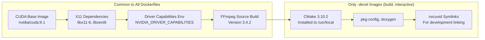

<!-- source: DeepWiki mcp.deepwiki.com · repo NVIDIA/nvvl · page 2.2 Using Docker · fetched 2026-10-26 -->

# Using Docker

<details>
<summary>Relevant source files</summary>

The following files were used as context for generating this wiki page:

- [docker/Dockerfile.build](docker/Dockerfile.build)
- [docker/Dockerfile.interactive](docker/Dockerfile.interactive)
- [docker/Dockerfile.minimal](docker/Dockerfile.minimal)
- [docker/README.md](docker/README.md)

</details>


## Purpose and Scope

This document describes the Docker environments provided by NVVL for different use cases: runtime deployment, library building, and interactive development. These pre-configured Docker images provide reproducible environments with the correct dependencies, CUDA versions, and FFmpeg configurations.

For information about building NVVL from source without Docker, see [Building from Source](#2.1). For details about the build system configuration, see [CMake Configuration](#5.1).

## Overview of Docker Environments

NVVL provides three Docker configurations, each optimized for different scenarios:

| Dockerfile | Base Image | Primary Use Case | FFmpeg Configuration | Additional Tools |
|------------|------------|------------------|---------------------|------------------|
| `Dockerfile.minimal` | `nvidia/cuda:9.1-runtime-ubuntu16.04` | Production deployment | Minimal (demux only) | None |
| `Dockerfile.build` | `nvidia/cuda:9.1-devel-ubuntu16.04` | CI/CD builds | Minimal (demux only) | CMake, pkg-config, Doxygen |
| `Dockerfile.interactive` | `nvidia/cuda:9.1-devel-ubuntu16.04` | Development/debugging | Full (includes ffmpeg CLI, encoders) | CMake, pkg-config, Doxygen, ffmpeg tool |

All Docker environments are parameterized with build arguments for `CUDA_VERSION`, `FFMPEG_VERSION`, and `CMAKE_VERSION`, allowing customization at build time.

**Sources:** [docker/README.md:1-20](), [docker/Dockerfile.minimal:1-4](), [docker/Dockerfile.build:1-5](), [docker/Dockerfile.interactive:1-5]()

## Docker Environment Architecture

```mermaid
graph TB
    subgraph BaseImages["Base Images"]
        RuntimeBase["nvidia/cuda:9.1-runtime-ubuntu16.04<br/>Runtime libraries only"]
        DevelBase["nvidia/cuda:9.1-devel-ubuntu16.04<br/>Development headers + libraries"]
    end
    
    subgraph MinimalEnv["Dockerfile.minimal"]
        MinimalFFmpeg["Minimal FFmpeg Build<br/>avformat, avcodec, avfilter<br/>demuxer=mov,matroska<br/>bsf=h264_mp4toannexb,hevc_mp4toannexb"]
        MinimalDeps["Runtime Dependencies<br/>libx11-6, libxext6"]
        MinimalNV["NVIDIA_DRIVER_CAPABILITIES<br/>video,compute,utility"]
    end
    
    subgraph BuildEnv["Dockerfile.build"]
        BuildFFmpeg["Minimal FFmpeg Build<br/>(same as minimal)"]
        BuildDeps["Build Dependencies<br/>pkg-config, doxygen"]
        BuildTools["Build Tools<br/>CMake 3.10.2"]
        BuildNVCUVID["nvcuvid Symlinks<br/>/usr/local/lib/libnvcuvid.so<br/>/usr/lib/x86_64-linux-gnu/libnvcuvid.so"]
    end
    
    subgraph InteractiveEnv["Dockerfile.interactive"]
        InteractiveFFmpeg["Full FFmpeg Build<br/>+ libx264, libx265<br/>+ cuvid, nvenc, cuda<br/>+ ffmpeg CLI tool<br/>+ encoders, decoders, hwaccels"]
        InteractiveDeps["Build Dependencies<br/>pkg-config, doxygen"]
        InteractiveTools["Build Tools<br/>CMake 3.10.2"]
        InteractiveNVCUVID["nvcuvid Symlinks<br/>(same as build)"]
    end
    
    RuntimeBase --> MinimalEnv
    DevelBase --> BuildEnv
    DevelBase --> InteractiveEnv
    
    MinimalDeps --> MinimalFFmpeg
    MinimalFFmpeg --> MinimalNV
    
    BuildDeps --> BuildFFmpeg
    BuildFFmpeg --> BuildTools
    BuildTools --> BuildNVCUVID
    
    InteractiveDeps --> InteractiveFFmpeg
    InteractiveFFmpeg --> InteractiveTools
    InteractiveTools --> InteractiveNVCUVID
```



**Diagram: Docker Environment Component Structure**

This diagram shows how the three Docker environments build upon different NVIDIA CUDA base images and include different levels of functionality. The minimal environment prioritizes size and security for production, while build and interactive environments include development tools.

**Sources:** [docker/Dockerfile.minimal:1-33](), [docker/Dockerfile.build:1-54](), [docker/Dockerfile.interactive:1-62]()

## Dockerfile.minimal - Runtime Environment

The minimal Docker environment provides only what is necessary to run applications linked against `libnvvl`. It uses the CUDA runtime base image (no development headers) and builds FFmpeg with the absolute minimum features required.

### Base Configuration

```
FROM nvidia/cuda:9.1-runtime-ubuntu16.04
ARG FFMPEG_VERSION=3.4.2
```

**Sources:** [docker/Dockerfile.minimal:1-3]()

### FFmpeg Configuration

The minimal FFmpeg build disables all features except those required for video demuxing:

| Configure Flag | Purpose |
|----------------|---------|
| `--disable-all --disable-autodetect` | Start with nothing enabled |
| `--enable-avformat --enable-avcodec --enable-avfilter` | Core libraries |
| `--enable-protocol=file` | Local file reading only |
| `--enable-demuxer=mov,matroska` | Support MP4 and MKV containers |
| `--enable-bsf=h264_mp4toannexb,hevc_mp4toannexb` | Bitstream filters for H.264/HEVC |
| `--disable-static --enable-shared` | Shared libraries only |

This configuration produces a minimal FFmpeg suitable for NVVL's parsing needs without encoders, filters, or network protocols.

**Sources:** [docker/Dockerfile.minimal:16-28]()

### Required Dependencies

The minimal environment installs only runtime dependencies:

- `libx11-6`, `libxext6` - Required by nvcuvid for X11 display support
- `NVIDIA_DRIVER_CAPABILITIES=video,compute,utility` - Enables GPU video decode and compute capabilities

**Sources:** [docker/Dockerfile.minimal:6-8]()

### Size Optimization

Build tools (`yasm`, `wget`, `bzip2`, `g++`, `gcc`, `libc-dev`, `make`) are purged after FFmpeg compilation to minimize image size:

```
apt-get purge -y yasm wget bzip2 g++ gcc libc-dev make && \
apt-get autoremove -y
```

**Sources:** [docker/Dockerfile.minimal:31-32]()

## Dockerfile.build - Build Environment

The build Docker environment includes all tools necessary to compile NVVL from source, making it suitable for CI/CD pipelines and automated builds.

### Base Configuration

```
FROM nvidia/cuda:9.1-devel-ubuntu16.04
ARG FFMPEG_VERSION=3.4.2
ARG CMAKE_VERSION=3.10.2
```

Uses the `-devel` base image which includes CUDA development headers and libraries required for compilation.

**Sources:** [docker/Dockerfile.build:1-5]()

### Build Tools

The environment installs:

- **CMake 3.10.2** - Downloaded from cmake.org and installed to `/usr/local`
- **pkg-config** - For dependency detection
- **Doxygen** - For documentation generation

**Sources:** [docker/Dockerfile.build:36-44]()

### nvcuvid Development Symlinks

The build environment works around nvidia-docker's runtime-only library provision by creating unversioned symlinks for development:

```
RUN ln -s /usr/local/nvidia/lib64/libnvcuvid.so.1 /usr/local/lib/libnvcuvid.so && \
    ln -s libnvcuvid.so.1 /usr/lib/x86_64-linux-gnu/libnvcuvid.so
```

This allows the linker to find `libnvcuvid.so` during compilation. Symlinks are created in two locations to accommodate different nvidia-docker versions.

**Sources:** [docker/Dockerfile.build:46-53]()

### FFmpeg Configuration

Uses the same minimal FFmpeg configuration as `Dockerfile.minimal` since only demuxing capabilities are required for building and testing NVVL.

**Sources:** [docker/Dockerfile.build:12-34]()

## Dockerfile.interactive - Development Environment

The interactive Docker environment provides a comprehensive development setup including a full-featured FFmpeg with encoding capabilities, useful for preparing test videos and interactive debugging.

### Enhanced FFmpeg Build

Unlike the minimal builds, the interactive environment enables extensive FFmpeg features:

| Feature Category | Enabled Components |
|------------------|-------------------|
| **Codecs** | `libx264`, `libx265`, H.264, HEVC |
| **Hardware Acceleration** | `cuvid`, `nvenc`, `cuda` |
| **Decoders** | `h264`, `h264_cuvid`, `hevc`, `hevc_cuvid` |
| **Encoders** | `h264_nvenc`, `hevc_nvenc`, `libx264`, `libx265` |
| **Hardware Accelerators** | `h264_cuvid`, `hevc_cuvid` |
| **Tools** | `ffmpeg` CLI, `swresample`, `swscale` |
| **Muxers** | `mp4`, `matroska` |
| **Filters** | `scale` |

This configuration enables video transcoding and preparation workflows inside the container.

**Sources:** [docker/Dockerfile.interactive:22-38]()

### Key Configure Flags

```
--enable-gpl --enable-libx264 --enable-libx265
--enable-swresample --enable-ffmpeg
--enable-swscale --enable-filter=scale
--enable-muxer=mp4,matroska
--enable-cuvid --enable-nvenc --enable-cuda
--enable-decoder=h264,h264_cuvid,hevc,hevc_cuvid
--enable-encoder=h264_nvenc,hevc_nvenc,libx264,libx265
--enable-hwaccel=h264_cuvid,hevc_cuvid
--enable-parser=h264,hevc
```

**Sources:** [docker/Dockerfile.interactive:30-38]()

### Codec Library Dependencies

The interactive build requires additional system packages:

- `libx264-148`, `libx264-dev` - H.264 encoding support
- `libx265-79`, `libx265-dev` - HEVC encoding support
- `yasm` - Assembly optimizer for codec performance

Development packages (`-dev`) are removed after build but runtime libraries remain.

**Sources:** [docker/Dockerfile.interactive:13-42]()

## Building and Using Docker Images

### Building an Image

All Dockerfiles support build-time customization via `ARG` parameters:

```bash
# Build with default versions
docker build -f docker/Dockerfile.build -t nvvl-build .

# Build with custom CUDA and FFmpeg versions
docker build \
  --build-arg CUDA_VERSION=10.0 \
  --build-arg FFMPEG_VERSION=4.1 \
  --build-arg CMAKE_VERSION=3.12.0 \
  -f docker/Dockerfile.interactive \
  -t nvvl-dev .
```

### Running with nvidia-docker

All images require nvidia-docker to access GPU capabilities:

```bash
# Interactive development shell
nvidia-docker run -it --rm \
  -v $(pwd):/workspace \
  -w /workspace \
  nvvl-dev /bin/bash

# Build NVVL inside container
nvidia-docker run --rm \
  -v $(pwd):/workspace \
  -w /workspace \
  nvvl-build \
  /bin/bash -c "mkdir build && cd build && cmake .. && make"
```

### Environment Variables

All images set `NVIDIA_DRIVER_CAPABILITIES=video,compute,utility` to enable:
- **video** - Hardware video decode/encode via nvcuvid/nvenc
- **compute** - CUDA compute operations
- **utility** - nvidia-smi and management operations

**Sources:** [docker/Dockerfile.minimal:8](), [docker/Dockerfile.build:10](), [docker/Dockerfile.interactive:10]()

## Common Docker Configuration Patterns

### Layer Structure Comparison



**Diagram: Common Docker Configuration Patterns**

**Sources:** [docker/Dockerfile.minimal:1-33](), [docker/Dockerfile.build:1-54](), [docker/Dockerfile.interactive:1-62]()

### OpenCV Variants

The README mentions `_opencv` suffixed variants that include OpenCV builds with necessary modules for running NVVL examples. These are not shown in the provided files but follow the same pattern with additional OpenCV compilation steps.

**Sources:** [docker/README.md:17-19]()

### Development Workflow Considerations

The README notes these images support "the decidedly non-docker-ish practice of developing while inside a container." This is facilitated by:

1. The nvcuvid symlink workaround for in-container compilation
2. Volume mounting the source directory
3. Including interactive tools like the ffmpeg CLI

This allows developers to iterate on NVVL code without installing dependencies on the host system.

**Sources:** [docker/README.md:14-15](), [docker/Dockerfile.build:46-53](), [docker/Dockerfile.interactive:54-61]()

---

