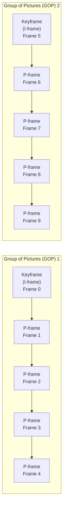
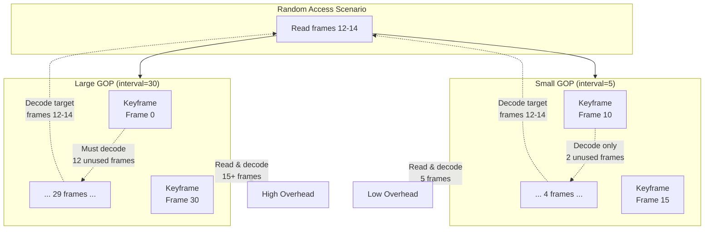
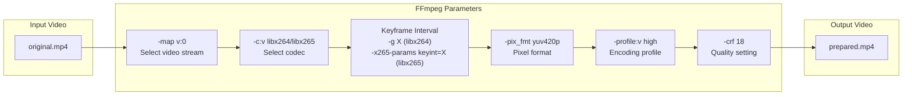
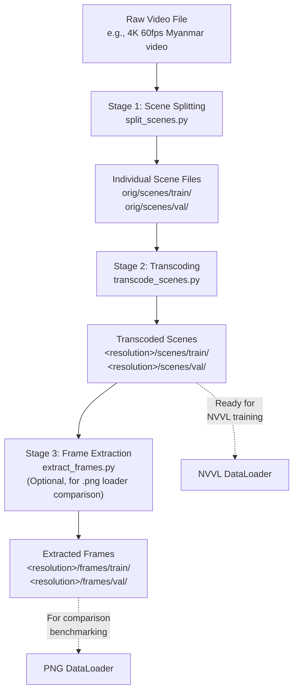

<!-- source: DeepWiki mcp.deepwiki.com · repo NVIDIA/nvvl · page 2.3 Video Data Preparation · fetched 2026-10-26 -->

# Video Data Preparation

<details>
<summary>Relevant source files</summary>

The following files were used as context for generating this wiki page:

- [README.md](README.md)
- [examples/pytorch_superres/README.md](examples/pytorch_superres/README.md)

</details>


## Purpose and Scope

This page explains how to prepare video files for optimal performance with NVVL. Video data preparation involves encoding video files with appropriate codecs, keyframe intervals, and pixel formats to enable efficient random access to frame sequences during training. This page covers codec requirements, keyframe interval configuration, and practical transcoding workflows.

For information about building and installing NVVL, see [Building from Source](#2.1). For Docker-based workflows, see [Using Docker](#2.2).

## Video Codec Fundamentals

### Keyframes and Inter-Frame Dependencies

Video codecs achieve compression by storing only certain frames as complete images in the data stream. These frames are called **keyframes** (or **intra-frames** or **I-frames**). All other frames require data from other frames—either before or after them in time—to be decoded. These dependent frames are called **inter-frames** (P-frames and B-frames).



**Diagram: Video Codec Frame Structure with Keyframe Intervals**

The interval between keyframes forms a **Group of Pictures (GOP)**. To decode any sequence of frames, the decoder must start at the keyframe before the sequence and continue past the sequence to the next keyframe after it.

### Impact on Random Access Performance

When sequentially streaming through a video, keyframe intervals are not problematic. However, when decoding small sequences of frames randomly throughout the video, large gaps between keyframes create significant performance overhead:



**Diagram: Impact of Keyframe Interval on Random Access Performance**

Sources: [README.md:149-167]()

## Codec and Format Requirements

### Supported Video Codecs

NVVL supports two video codecs through the NVIDIA hardware decoder:

| Codec | Name | Notes |
|-------|------|-------|
| H.264 | AVC (Advanced Video Coding) | Most common, broad hardware support |
| HEVC | H.265 (High Efficiency Video Coding) | Better compression, no open GOP support in NVVL |

The hardware decoder in NVIDIA GPUs provides accelerated decoding for these codecs, offloading work from the CPU.

### Container Format Requirements

NVVL supports **any container format that FFmpeg can parse**. Common formats include:
- `.mp4` (MPEG-4 Part 14)
- `.mkv` (Matroska)
- `.avi` (Audio Video Interleave)
- `.mov` (QuickTime)

The container format is independent of the codec; for example, H.264 video can be stored in `.mp4`, `.mkv`, or other containers.

### Pixel Format Requirements

The video must use the **`yuv420p` pixel format** to be supported by the NVIDIA hardware decoder. This is a 4:2:0 chroma subsampled YUV format where:
- Luma (Y) channel is full resolution
- Chroma (U and V) channels are half resolution in both dimensions

Most video encoders default to or support this format, as it is the most common for H.264 and HEVC.

### HEVC-Specific Requirements

For HEVC (H.265) streams, NVVL's seeking logic **does not support open GOPs**. An open GOP allows B-frames to reference frames outside the GOP boundaries, which complicates random seeking. When encoding HEVC video, you must disable open GOPs.

Sources: [README.md:151-178]()

## Keyframe Interval Configuration

### Choosing the Keyframe Interval

The optimal keyframe interval depends on the length of frame sequences you will read during training. A good rule of thumb:

**Set the keyframe interval equal to the sequence length you will be reading**

For example:
- If reading 5-frame sequences → set keyframe interval to 5
- If reading 10-frame sequences → set keyframe interval to 10
- If reading variable lengths → choose a value near the average or most common length

This provides a good compromise between:
- **File size**: More keyframes increase file size (keyframes compress less than inter-frames)
- **Loading performance**: Fewer unnecessary frames decoded per random access

### FFmpeg Encoder Parameters



**Diagram: FFmpeg Transcoding Parameter Flow**

#### For H.264 (libx264)

To set keyframe interval to `X` frames:
```bash
-g X
```

Example: For 5-frame sequences:
```bash
-g 5
```

#### For HEVC (libx265)

To set keyframe interval to `X` frames and disable open GOPs:
```bash
-x265-params "keyint=X:no-open-gop=1"
```

Example: For 5-frame sequences:
```bash
-x265-params "keyint=5:no-open-gop=1"
```

### Additional Required Parameters

| Parameter | Purpose | Value |
|-----------|---------|-------|
| `-pix_fmt yuv420p` | Set pixel format | Required for hardware decoder |
| `-map v:0` | Select video stream | Removes extra audio/video streams |
| `-profile:v high` | Encoding profile | Recommended for H.264 |
| `-crf 18` | Quality setting | Lower = better quality (typical range: 18-28) |

Sources: [README.md:169-183]()

## Practical Transcoding Examples

### Complete H.264 Transcoding Command

```bash
ffmpeg -i original.mp4 \
       -map v:0 \
       -c:v libx264 \
       -crf 18 \
       -pix_fmt yuv420p \
       -g 5 \
       -profile:v high \
       prepared.mp4
```

This command:
1. Reads from `original.mp4`
2. Selects only the first video stream (`-map v:0`)
3. Encodes with H.264 (`-c:v libx264`)
4. Sets quality to CRF 18 (`-crf 18`)
5. Uses yuv420p pixel format (`-pix_fmt yuv420p`)
6. Sets keyframe interval to 5 (`-g 5`)
7. Uses high profile (`-profile:v high`)
8. Outputs to `prepared.mp4`

### Complete HEVC Transcoding Command

```bash
ffmpeg -i original.mp4 \
       -map v:0 \
       -c:v libx265 \
       -crf 18 \
       -pix_fmt yuv420p \
       -x265-params "keyint=5:no-open-gop=1" \
       prepared.mp4
```

The key difference is using `libx265` and the `-x265-params` syntax for keyframe configuration.

### Stream Selection Details

The `-map v:0` parameter is crucial:
- `v` = video streams only (excludes audio, subtitles, etc.)
- `:0` = first video stream
- This removes extra audio tracks and subtitle streams that would increase file size and potentially interfere with decoding

Sources: [README.md:180-183]()

## Production Data Preparation Workflow

For large-scale video dataset preparation, a multi-stage workflow is recommended, as demonstrated in the PyTorch super-resolution example:



**Diagram: Multi-Stage Data Preparation Pipeline**

### Stage 1: Scene Splitting

Split the raw video into individual scenes and remove audio tracks:

```bash
python ./tools/split_scenes.py \
       --raw_data <path_to_mp4_file> \
       --out_data <data_dir>
```

Output: Scenes written to `<data_dir>/orig/scenes/` (split into `train/` and `val/` folders)

### Stage 2: Transcoding Scenes

Transcode scenes with smaller keyframe intervals and optional resolution downscaling:

```bash
python ./tools/transcode_scenes.py \
       --master_data <data_dir> \
       --resolution <resolution>
```

Where `<resolution>` can be:
- `4K` (3840×2160)
- `1080p` (1920×1080)
- `720p` (1280×720)
- `540p` (960×540)

Output: Transcoded scenes written to `<data_dir>/<resolution>/scenes/` (split into `train/` and `val/`)

This stage applies the optimal keyframe interval and pixel format settings for NVVL.

### Stage 3: Frame Extraction (Optional)

For benchmarking NVVL against traditional `.png` dataloaders:

```bash
python ./tools/extract_frames.py \
       --master_data <data_dir> \
       --resolution <resolution>
```

Output: Extracted frames written to `<data_dir>/<resolution>/frames/` (split into `train/` and `val/`, one folder per scene)

### Workflow Benefits

This staged approach provides several benefits:

| Benefit | Description |
|---------|-------------|
| **Speed** | Splitting first, then transcoding each scene is faster than transcoding the entire video |
| **Parallelization** | Individual scenes can be transcoded in parallel |
| **Flexibility** | Can generate multiple resolutions from the same split scenes |
| **Validation** | Can compare NVVL performance against `.png` dataloaders |

Sources: [examples/pytorch_superres/README.md:92-135]()

## Performance Impact

Proper video data preparation has significant impact on storage, I/O, and loading performance:

| Metric | H.264 .mp4 (NVVL) | .png files | Improvement |
|--------|-------------------|------------|-------------|
| **Disk Space** | 0.592 GB | 23 GB | **~40x smaller** |
| **Per-Iteration Load Time** | 0.91 ms | 2.73 ms | **~3x faster** |
| **CPU Load** | 10% | 17% | **Reduced by 40%** |

These measurements are from the PyTorch super-resolution example using 540p video with 5-frame sequences. Proper keyframe interval configuration (matching the sequence length) is critical to achieving these performance gains.

Sources: [README.md:26-45](), [examples/pytorch_superres/README.md:22-48]()

## Summary

Proper video data preparation for NVVL requires:

1. **Codec**: H.264 or HEVC
2. **Pixel Format**: `yuv420p`
3. **Keyframe Interval**: Set to match your sequence length
4. **Container**: Any FFmpeg-supported format (`.mp4` recommended)
5. **Stream Selection**: Remove extra audio/video streams
6. **HEVC**: Disable open GOPs with `no-open-gop=1`

The investment in proper video preparation pays off with dramatic reductions in storage requirements and improved loading performance during training.

Sources: [README.md:149-183](), [examples/pytorch_superres/README.md:92-135]()

---

