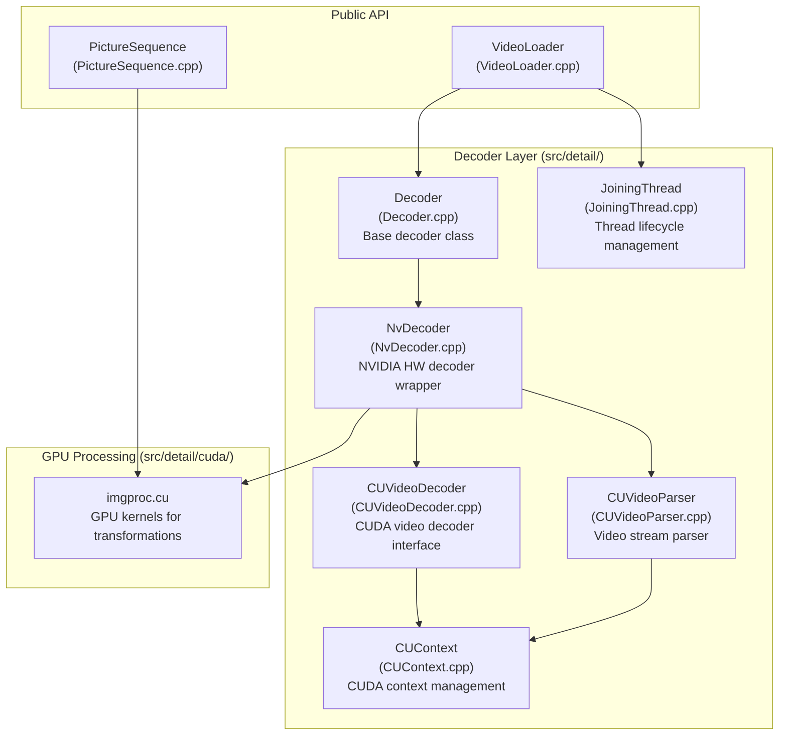
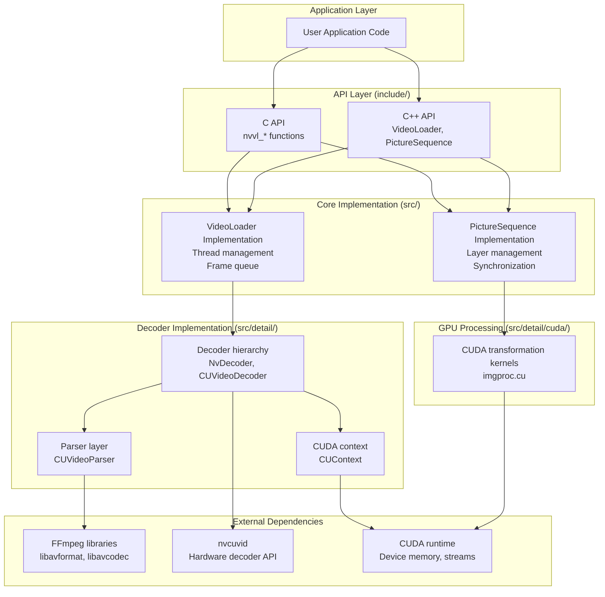
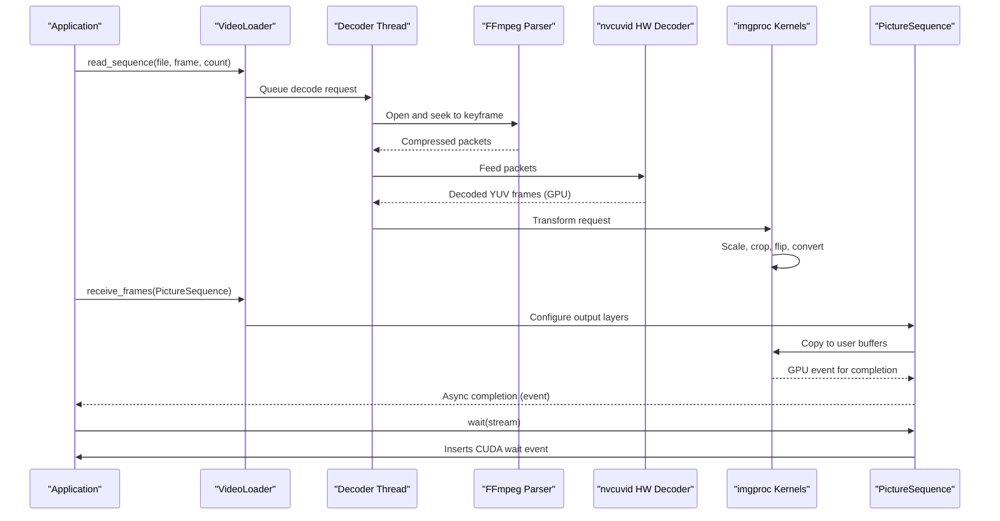

<!-- source: DeepWiki mcp.deepwiki.com · repo NVIDIA/nvvl · page 3 Core Library · fetched 2026-10-26 -->

# Core Library

<details>
<summary>Relevant source files</summary>

The following files were used as context for generating this wiki page:

- [CMakeLists.txt](CMakeLists.txt)
- [README.md](README.md)

</details>


## Purpose and Scope

This document provides an overview of NVVL's core C/C++ library, including its main components, architecture, and usage patterns. The core library (`libnvvl.so`) handles video decoding, GPU processing, and memory management to deliver decoded video frames as GPU tensors.

For detailed information on specific topics, see:
- Library internals and processing pipeline: [Library Architecture](#3.1)
- `VideoLoader` class API reference: [VideoLoader API](#3.2)
- `PictureSequence` class and layer configuration: [PictureSequence API](#3.3)
- GPU acceleration and transformations: [GPU Processing Pipeline](#3.4)
- External dependencies and their roles: [Dependencies](#3.5)
- Build configuration and installation: [Building from Source](#2.1)

Sources: [README.md:1-313](), [CMakeLists.txt:1-126]()

## Overview

The NVVL core library provides GPU-accelerated video decoding and preprocessing for machine learning workloads. It uses FFmpeg to parse compressed video files and NVIDIA's hardware video decoder (`nvcuvid`) to decode frames directly to GPU memory, bypassing the CPU. The library performs on-the-fly transformations (scaling, cropping, flipping, color space conversion) using GPU texture mapping units, delivering ready-to-use tensors in various formats (`float`, `half`, `uint8`).

The library provides both C++ and C interfaces defined in public headers under `include/`. The shared library `libnvvl.so` is built from source files in `src/` and installed with CMake package configuration for easy integration into downstream projects.

Sources: [README.md:8-18](), [README.md:186-290](), [CMakeLists.txt:32-73]()

## Library Components

### Primary API Classes

The core library exposes two main classes to users:

| Class | Header | Purpose |
|-------|--------|---------|
| `VideoLoader` | `include/VideoLoader.h` | Manages decoding threads, frame queues, and coordinates the decoding pipeline |
| `PictureSequence` | `include/PictureSequence.h` | Describes output buffer layout, transformations, and synchronization for decoded frames |

**VideoLoader** ([src/VideoLoader.cpp]()) is the main entry point. It accepts video file paths and frame sequence specifications, manages worker threads for parallel decoding, and delivers decoded frames to user-provided GPU buffers. It maintains statistics on video properties (frame count, dimensions, codec).

**PictureSequence** ([src/PictureSequence.cpp]()) defines the destination and processing parameters for decoded frames. Users create "layers" within a sequence to specify output data type, color space, normalization, cropping, scaling, and memory layout. Multiple layers can extract different representations from the same frame sequence.

Sources: [README.md:198-286](), [CMakeLists.txt:33-34]()

### Internal Decoder Components



**Decoder Components:**

- **Decoder** ([src/detail/Decoder.cpp]()): Abstract base class defining the decoder interface
- **NvDecoder** ([src/detail/NvDecoder.cpp]()): Implements NVIDIA hardware decoder integration
- **CUVideoDecoder** ([src/detail/CUVideoDecoder.cpp]()): Wraps `nvcuvid` decoder API calls
- **CUVideoParser** ([src/detail/CUVideoParser.cpp]()): Parses compressed video packets and feeds decoder
- **CUContext** ([src/detail/CUContext.cpp]()): Manages CUDA contexts for decoder operations
- **JoiningThread** ([src/detail/JoiningThread.cpp]()): RAII thread wrapper ensuring clean shutdown

**GPU Processing:**

- **imgproc.cu** ([src/detail/cuda/imgproc.cu]()): CUDA kernels performing scaling, cropping, color conversion, normalization, and format transformations

Sources: [CMakeLists.txt:35-42]()

## Component Architecture

### Layered Design



The architecture is organized in layers to separate concerns:

1. **API Layer**: Clean C++ and C interfaces hiding implementation details
2. **Core Implementation**: Frame queue management, threading, statistics
3. **Decoder Implementation**: Hardware decoder integration and packet parsing
4. **GPU Processing**: CUDA kernels for transformations and format conversions
5. **External Dependencies**: FFmpeg for parsing, CUDA/nvcuvid for decoding

Sources: [CMakeLists.txt:32-73](), [README.md:186-290]()

## Data Flow Pipeline

### Frame Loading Sequence



**Pipeline Steps:**

1. **Request Phase**: Application calls `read_sequence()` with video file path, starting frame number, and sequence length
2. **Parsing Phase**: Decoder thread opens video file with FFmpeg, seeks to keyframe before requested frames, demuxes compressed packets
3. **Decoding Phase**: Compressed packets sent to hardware decoder via `nvcuvid` API, decoder outputs YUV420 frames in GPU memory
4. **Transformation Phase**: GPU kernels perform scaling, cropping, flipping, color conversion (RGB/YCbCr), normalization, and data type conversion
5. **Delivery Phase**: Transformed frames copied to user-provided buffers specified in `PictureSequence` layers
6. **Synchronization Phase**: CUDA event inserted for asynchronous completion notification

Sources: [README.md:198-286]()

## Library Build Structure

The core library is built as a shared library with specific compile and link requirements:

**Build Target Configuration:**

```
Target: nvvl (libnvvl.so)
Language: C++14, CUDA
Source files: 9 files (see Component Architecture)
Link libraries: FFmpeg, cuda, nvcuvid, nvidia-ml
```

**Key Build Properties:**

| Property | Value | Purpose |
|----------|-------|---------|
| `POSITION_INDEPENDENT_CODE` | `ON` | Enable shared library creation |
| `CUDA_SEPARABLE_COMPILATION` | `ON` | Allow CUDA code across multiple files |
| `CMAKE_CUDA_FLAGS` | `-cudart shared` | Use shared CUDA runtime |
| C++ Standard | `cxx_std_14` | Require C++14 features |

**Include Directories:**

- Public: `include/` (API headers), CUDA toolkit includes
- Private: `src/` (implementation headers)

**Installed Artifacts:**

- Shared library: `${CMAKE_INSTALL_LIBDIR}/libnvvl.so`
- Headers: `${CMAKE_INSTALL_INCLUDEDIR}/`
- CMake config: `${CMAKE_INSTALL_LIBDIR}/cmake/NVVL/`

Sources: [CMakeLists.txt:32-96]()

## Basic Usage Pattern

### Initialization

```cpp
// Create loader for specific GPU device
auto loader = NVVL::VideoLoader{device_id};
```

The `VideoLoader` constructor initializes decoder threads and CUDA contexts for the specified device.

### Reading Frames

```cpp
// Queue a frame sequence for decoding
loader.read_sequence(filename, frame_num, sequence_length);
```

This queues a decode request. The loader seeks to the keyframe before `frame_num` and decodes `sequence_length` frames. Decoding happens asynchronously on background threads.

### Receiving Frames

```cpp
// Define output format and destination
auto seq = PictureSequence{sequence_count};
auto pixels = PictureSequence::Layer<float>{};

// Configure layer (memory, dimensions, transformations)
pixels.data = gpu_buffer_ptr;
pixels.desc.count = sequence_count;
pixels.desc.channels = 3;
pixels.desc.width = crop_width;
pixels.desc.height = crop_height;
pixels.desc.scale_width = scale_width;
pixels.desc.scale_height = scale_height;
pixels.desc.color_space = ColorSpace_RGB;
pixels.desc.normalized = true;
// ... configure strides for memory layout

// Add layer and request frames
seq.set_layer("pixels", pixels);
loader.receive_frames(seq);  // Async operation
```

The `PictureSequence` specifies output memory layout, data types, and transformations. `receive_frames()` returns immediately; decoding and processing continue asynchronously.

### Synchronization

```cpp
// Insert wait event into CUDA stream
seq.wait(cuda_stream);
// Subsequent kernels on cuda_stream will wait for frames
```

The `wait()` method inserts a CUDA event wait into the application's stream, enabling proper synchronization without blocking the CPU.

Sources: [README.md:198-286](), [README.md:232-261]()

## Interface Languages

The library provides two language interfaces:

**C++ Interface:**
- Defined in: `include/VideoLoader.h`, `include/PictureSequence.h`
- Features: RAII resource management, templated layers for type safety, exception handling
- Example: [doc/examples/extract_frames.cpp]()

**C Interface:**
- Defined in: C headers (prefixed with `nvvl_*`)
- Features: Manual resource management, error code returns, simpler ABI
- Example: [doc/examples/extract_frames_c.c]()

Both interfaces access the same underlying implementation. The C interface enables integration with languages that have C FFI but not C++ FFI.

Sources: [README.md:190-196](), [README.md:288-290]()

---

