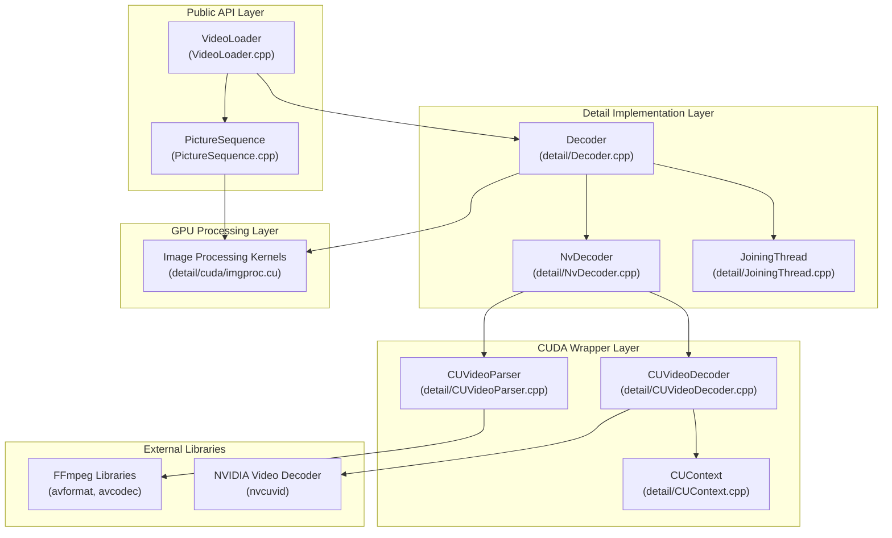
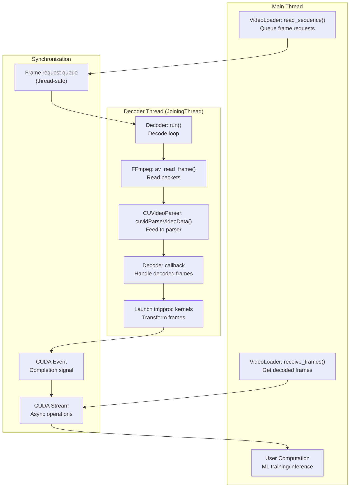
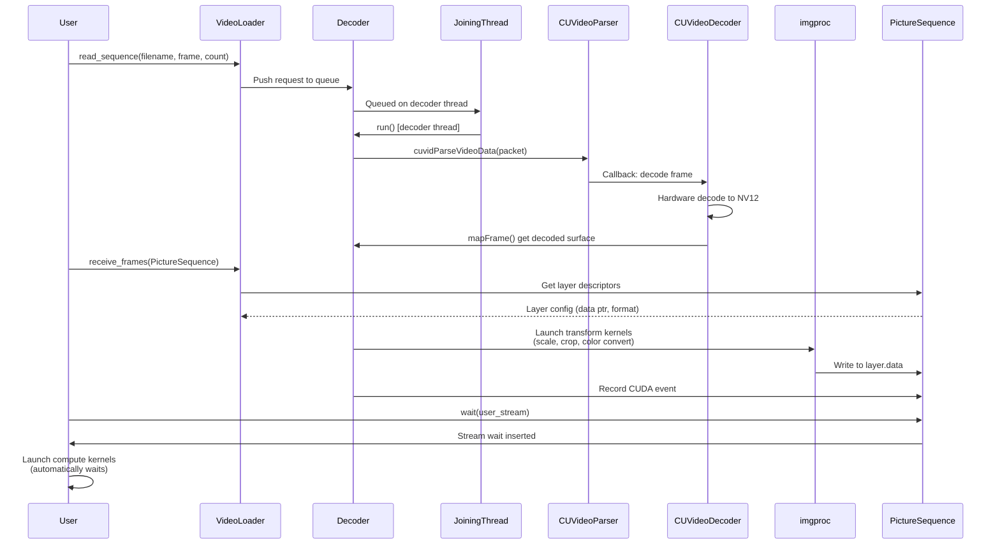

<!-- source: DeepWiki mcp.deepwiki.com · repo NVIDIA/nvvl · page 3.1 Library Architecture · fetched 2026-10-26 -->

# Library Architecture

Relevant source files

The following files were used as context for generating this wiki page:

- [CMakeLists.txt](CMakeLists.txt)
- [README.md](README.md)

This document explains NVVL's internal architecture, including the video decoding pipeline, component organization, threading model, and memory management. For details on using the public APIs, see [VideoLoader API](#3.2) and [PictureSequence API](#3.3). For information about GPU processing features, see [GPU Processing Pipeline](#3.4). For details on external dependencies, see [Dependencies](#3.5).

## Overview

NVVL is structured as a multi-threaded pipeline that coordinates FFmpeg container parsing, NVIDIA hardware video decoding, and GPU-based image processing. The library consists of two public-facing classes (`VideoLoader` and `PictureSequence`) and several internal detail classes that handle the video decoding pipeline.

The architecture separates concerns into distinct layers:

| Layer | Responsibility | Key Components |
|-------|---------------|----------------|
| Public API | User-facing interface | `VideoLoader`, `PictureSequence` |
| Decoding Logic | Video decoder orchestration | `Decoder`, `NvDecoder` |
| CUDA Wrappers | Hardware decoder interface | `CUVideoDecoder`, `CUVideoParser` |
| CUDA Management | Context and resource management | `CUContext` |
| GPU Processing | Image transformations | `imgproc.cu` kernels |
| Threading | Asynchronous operation | `JoiningThread` |

Sources: [CMakeLists.txt:32-42](), [README.md:8-18]()

## Component Architecture

**Component Architecture Diagram**

The library is organized into four distinct layers. The Public API layer provides `VideoLoader` for managing video loading operations and `PictureSequence` for specifying output configuration. The Detail Implementation layer contains `Decoder` which orchestrates the decoding process, `NvDecoder` which manages the NVIDIA hardware decoder, and `JoiningThread` which handles the asynchronous decoding thread. The CUDA Wrapper layer provides thin wrappers around NVIDIA's video decoding APIs through `CUVideoDecoder` and `CUVideoParser`, with `CUContext` managing CUDA contexts. The GPU Processing layer contains CUDA kernels for image transformations.

Sources: [CMakeLists.txt:32-42](), [README.md:8-18]()

## Video Decoding Pipeline

The video decoding pipeline processes compressed video files through multiple stages to produce GPU tensors ready for machine learning:

```mermaid
graph LR
    subgraph Input["Input Stage"]
        VideoFile["Video File<br/>(H.264/HEVC)"]
    end
    
    subgraph Parsing["FFmpeg Parsing Stage"]
        AVFormatContext["AVFormatContext<br/>Container Demux"]
        AVPacket["AVPacket<br/>Compressed Frames"]
    end
    
    subgraph Hardware_Decode["Hardware Decode Stage"]
        CUVideoParser_Stage["CUVideoParser<br/>Bitstream Parsing"]
        CUVideoDecoder_Stage["CUVideoDecoder<br/>HW Decode to NV12"]
    end
    
    subgraph Transform["GPU Transform Stage"]
        imgproc_kernels["imgproc CUDA Kernels<br/>Scale/Crop/Flip<br/>Color Conversion"]
    end
    
    subgraph Output["Output Stage"]
        PictureSequence_Buffer["PictureSequence Layers<br/>GPU Memory<br/>(float/half/uint8)"]
    end
    
    VideoFile --> AVFormatContext
    AVFormatContext --> AVPacket
    AVPacket --> CUVideoParser_Stage
    CUVideoParser_Stage --> CUVideoDecoder_Stage
    CUVideoDecoder_Stage --> imgproc_kernels
    imgproc_kernels --> PictureSequence_Buffer
```

**Video Decoding Pipeline Flow**

The pipeline begins with FFmpeg parsing the video container to extract compressed packets. These packets are fed to `CUVideoParser` which parses the bitstream and determines frame dependencies. The `CUVideoDecoder` performs hardware-accelerated decoding to NV12 format in GPU memory. The `imgproc` CUDA kernels then perform transformations (scaling, cropping, flipping) and color space conversion, writing results directly to the user-provided `PictureSequence` buffers.

| Pipeline Stage | Input Format | Output Format | Component |
|----------------|--------------|---------------|-----------|
| Container Parsing | Video file | Compressed packets | FFmpeg (avformat) |
| Bitstream Parsing | Compressed packets | Decode parameters | `CUVideoParser` |
| Hardware Decode | Compressed packets | NV12 frames (GPU) | `CUVideoDecoder` |
| GPU Transform | NV12 frames | RGB/YCbCr tensors | `imgproc.cu` |
| Layer Output | Transformed frames | User buffers | `PictureSequence` |

Sources: [README.md:8-18](), [CMakeLists.txt:36-42]()

## Threading Model

NVVL uses a multi-threaded architecture to overlap video decoding with GPU processing and user computation:

**Threading Model Diagram**

The main thread calls `VideoLoader::read_sequence()` to enqueue frame requests and `VideoLoader::receive_frames()` to retrieve results. A separate decoder thread, managed by `JoiningThread`, runs a continuous loop reading packets from FFmpeg, feeding them to the hardware decoder via `CUVideoParser`, and processing decoded frames. The decoder callback launches `imgproc` kernels to transform frames and signals completion via CUDA events. The main thread can wait on these events using `PictureSequence::wait()` before accessing the data.

Sources: [CMakeLists.txt:39](), [README.md:275-286]()

## Memory Management

NVVL manages GPU memory through CUDA contexts and streams to enable efficient asynchronous operation:

### CUDA Context Management

The `CUContext` class [src/detail/CUContext.cpp]() manages CUDA contexts and ensures proper initialization. Each `VideoLoader` instance operates on a specific GPU device specified at construction time.

### Buffer Allocation

Memory allocation follows this model:

| Memory Type | Ownership | Allocation | Usage |
|-------------|-----------|------------|-------|
| Decoded frames (NV12) | `CUVideoDecoder` | Internal decoder buffers | Temporary staging |
| Transform output | User (via `PictureSequence`) | User-allocated GPU memory | Final output tensors |
| Intermediate buffers | `imgproc` kernels | None (direct write) | N/A |

Users allocate GPU memory for output tensors and provide pointers through `PictureSequence::Layer::data`. The library writes directly to these buffers, avoiding extra copies. Strides can be configured to support various tensor layouts (NCHW, NHWC, etc.) via `PictureSequence::Layer::desc.stride`.

### Stream-Based Asynchronous Operation

NVVL uses CUDA streams for asynchronous GPU operations. The decoding and transformation pipeline runs on its own stream, allowing user computation to proceed in parallel. Synchronization is achieved through CUDA events:

1. Decoder launches `imgproc` kernels on internal stream
2. Records CUDA event on internal stream
3. User calls `PictureSequence::wait(stream)` 
4. Inserts stream wait on user's stream for the recorded event
5. User's subsequent kernels wait automatically

This design eliminates CPU-GPU synchronization overhead in typical usage.

Sources: [CMakeLists.txt:35-36](), [README.md:244-286](), [README.md:309-312]()

## Component Interaction

The following diagram shows the detailed interaction between components during a typical frame loading operation:

**Component Interaction Sequence Diagram**

This sequence shows the complete flow from frame request to GPU tensor availability. The user calls `read_sequence()` to enqueue a request, which is processed asynchronously by the decoder thread. When the user calls `receive_frames()` with a configured `PictureSequence`, the decoder obtains the layer specifications and launches GPU kernels to write transformed frames directly to the user's buffers. The `wait()` method ensures proper synchronization before the user accesses the data.

### Key Interaction Patterns

**Request Queueing**: `VideoLoader::read_sequence()` adds requests to a thread-safe queue consumed by the decoder thread, enabling multiple requests to be batched.

**Callback-Based Decoding**: `CUVideoParser` uses callbacks to notify when frames are decoded, allowing the library to process frames as soon as they're available rather than polling.

**Zero-Copy Transform**: The `imgproc` kernels read directly from the hardware decoder's output surfaces and write directly to user-provided buffers, eliminating intermediate copies.

**Event-Based Synchronization**: CUDA events recorded after kernel launches enable precise synchronization without blocking the CPU thread.

Sources: [README.md:203-286](), [CMakeLists.txt:32-42]()

## Library Compilation and Linkage

The NVVL shared library (`libnvvl.so`) is built with the following characteristics:

| Property | Configuration |
|----------|---------------|
| Language | C++14 (CUDA language mode) |
| Compiler flags | `-Wall -Wno-unused-function` (non-CUDA), `-cudart shared` |
| CUDA features | Separable compilation, position-independent code |
| Dependencies | FFmpeg (avformat, avcodec, avfilter, avutil), CUDA (cuda, nvcuvid, nvidia-ml) |
| Thread model | POSIX threads (implicit via FFmpeg and CUDA) |

The library is compiled with CUDA separable compilation enabled [CMakeLists.txt:61](), allowing device code in multiple translation units to be linked together. This is required because the `imgproc.cu` kernels are called from `Decoder.cpp`.

Runtime linking requires FFmpeg libraries, `libnvcuvid.so` (NVIDIA video decoder), and `libnvidia-ml.so` (NVIDIA management library) to be available [CMakeLists.txt:73]().

Sources: [CMakeLists.txt:32-73]()

---

