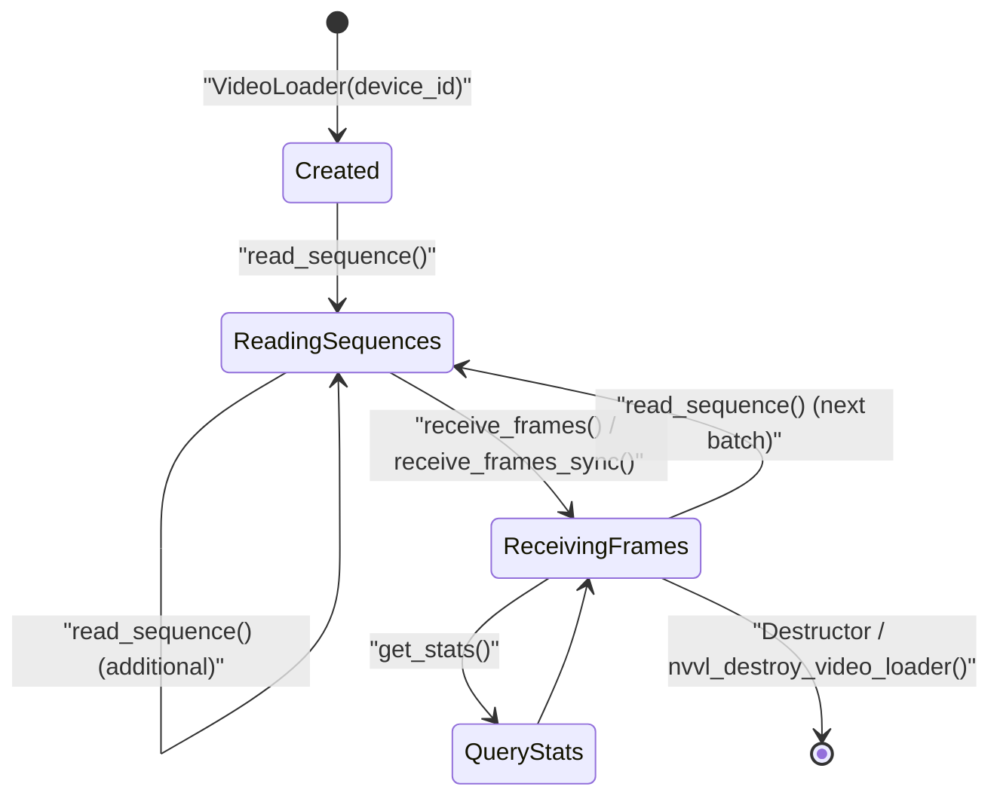
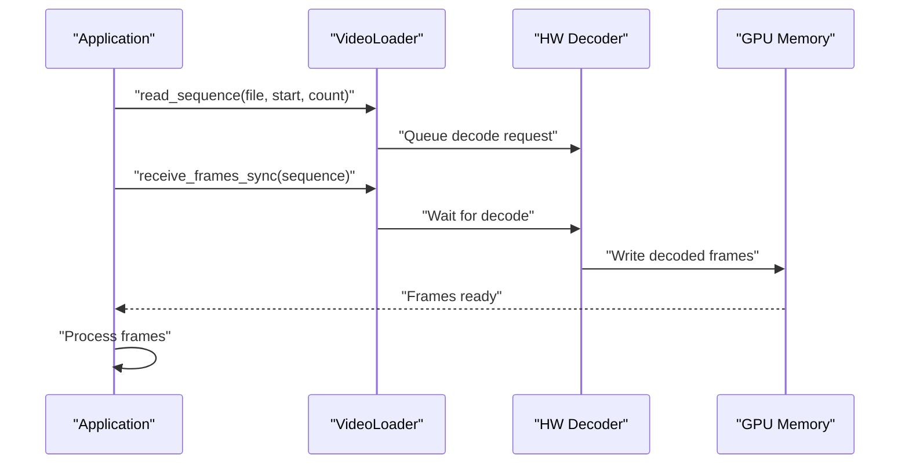
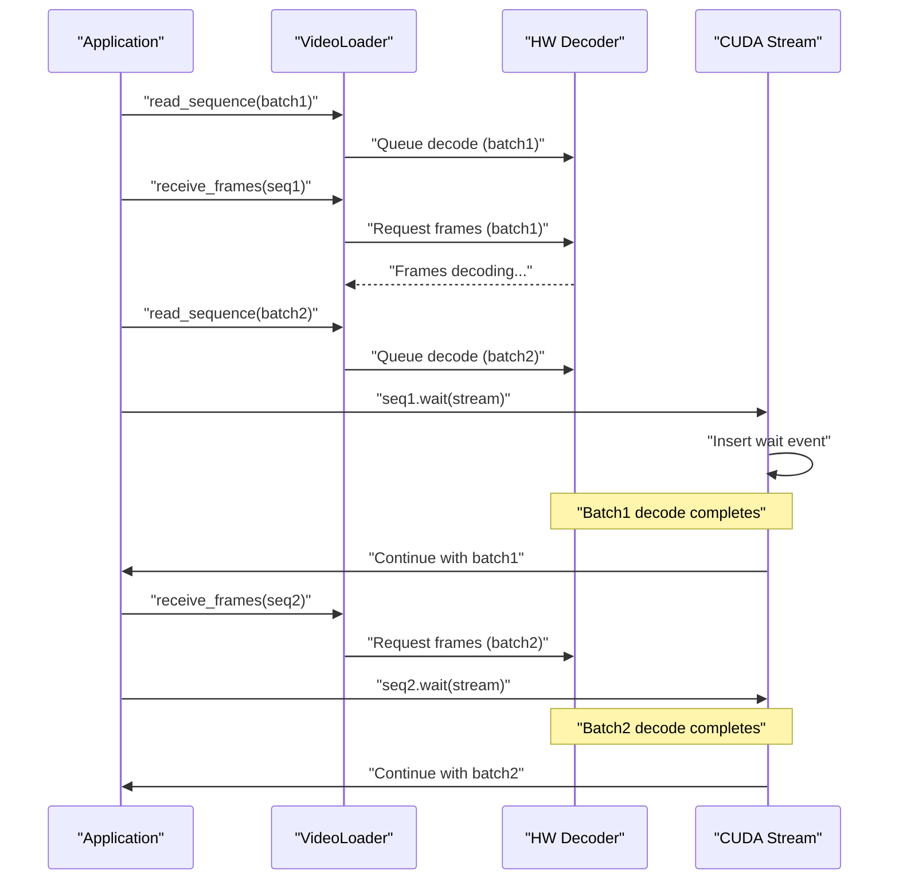
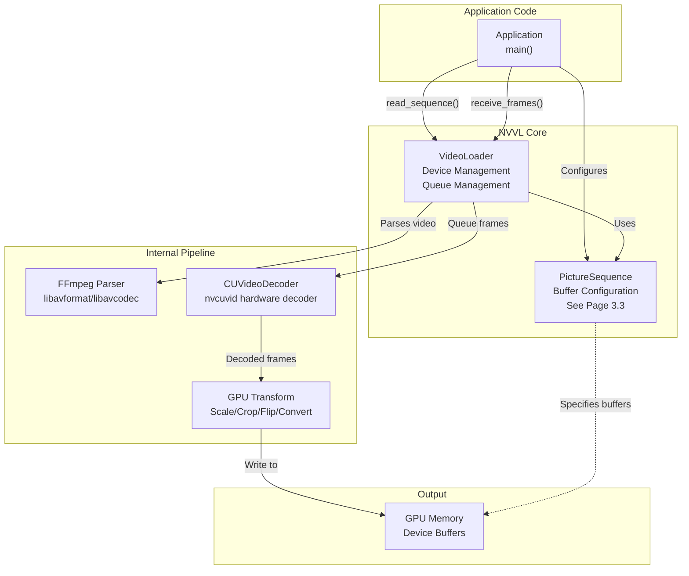

<!-- source: DeepWiki mcp.deepwiki.com · repo NVIDIA/nvvl · page 3.2 VideoLoader API · fetched 2026-10-26 -->

# VideoLoader API

<details>
<summary>Relevant source files</summary>

The following files were used as context for generating this wiki page:

- [README.md](README.md)
- [doc/examples/extract_frames.cpp](doc/examples/extract_frames.cpp)
- [doc/examples/extract_frames_c.c](doc/examples/extract_frames_c.c)

</details>


## Purpose and Scope

This document provides comprehensive documentation of the `VideoLoader` class and its C interface counterpart, which serve as the primary entry point for loading video frames in NVVL. The `VideoLoader` manages video file parsing, frame decoding requests, and coordinates delivery of decoded frames to GPU memory buffers.

For information about configuring output destinations and processing options, see [PictureSequence API](#3.3). For details on the internal decoding and processing pipeline, see [GPU Processing Pipeline](#3.4). For overall library architecture, see [Library Architecture](#3.1).

## Overview

The `VideoLoader` class manages the video loading pipeline by:
- Opening and parsing video files via FFmpeg
- Queuing frame sequences for decoding
- Coordinating hardware decoder operations
- Delivering decoded frames to user-specified GPU buffers
- Tracking decoding statistics

The loader operates as a frame queue manager that accepts requests to read frame sequences and fulfills them by routing data through the hardware decoder and GPU processing pipeline.

**Sources:** [README.md:198-213](), [doc/examples/extract_frames.cpp:198-205]()

## VideoLoader Lifecycle



**Sources:** [README.md:198-286](), [doc/examples/extract_frames.cpp:192-232]()

## C++ Interface

### Constructor

The `VideoLoader` constructor initializes the loader for a specific CUDA device:

```cpp
NVVL::VideoLoader loader{device_id};
```

**Parameters:**
- `device_id` (int): CUDA device ordinal to use for decoding operations

The constructor allocates internal resources for video parsing and sets up the hardware decoder on the specified device.

**Sources:** [README.md:204](), [doc/examples/extract_frames.cpp:198]()

### Core Methods

#### frame_count()

```cpp
int frame_count(const std::string& filename);
```

Parses the video file and returns the total number of frames in the video. This is a lightweight operation that only reads the video file metadata.

**Parameters:**
- `filename`: Path to the video file

**Returns:** Total number of frames in the video

**Example:**
```cpp
auto frame_count = loader.frame_count("video.mp4");
```

**Sources:** [doc/examples/extract_frames.cpp:201-202]()

#### read_sequence()

```cpp
void read_sequence(const std::string& filename, 
                   int frame_num, 
                   int sequence_length);
```

Queues a sequence of frames for decoding. This method is asynchronous and returns immediately after enqueueing the request. Multiple sequences can be queued before receiving any frames.

**Parameters:**
- `filename`: Path to the video file
- `frame_num`: Starting frame number (0-indexed)
- `sequence_length`: Number of consecutive frames to read

The loader will seek to the appropriate keyframe and decode all necessary frames to produce the requested sequence. Frames are decoded in the background and become available for retrieval via `receive_frames()` or `receive_frames_sync()`.

**Sources:** [README.md:210](), [doc/examples/extract_frames.cpp:205]()

#### receive_frames() and receive_frames_sync()

```cpp
void receive_frames(PictureSequence& sequence);
void receive_frames_sync(PictureSequence& sequence);
```

Retrieves decoded frames from the loader and writes them to the buffers specified in the `PictureSequence` object.

**Differences:**
- `receive_frames()`: **Asynchronous** - Returns immediately after initiating the transfer. Use `PictureSequence::wait()` to synchronize before accessing data.
- `receive_frames_sync()`: **Synchronous** - Blocks until frames are decoded and transferred to the destination buffers.

**Parameters:**
- `sequence`: A configured `PictureSequence` object specifying output buffers and processing options

The `sequence.count()` does not need to match the `sequence_length` from `read_sequence()`. You can read a large sequence and receive it as multiple smaller tensors, or read multiple sequences and receive them concatenated.

**Sources:** [README.md:272-286](), [doc/examples/extract_frames.cpp:188]()

#### get_stats()

```cpp
struct Stats {
    uint64_t packets_read;  // Total compressed packets read
    uint64_t bytes_read;    // Total bytes read from files
    uint64_t frames_used;   // Total frames delivered to output
};

Stats get_stats();
```

Returns statistics about video loading operations performed by this loader instance. Useful for profiling and understanding decoder efficiency.

**Returns:** A `Stats` structure containing cumulative statistics

**Example:**
```cpp
auto stats = loader.get_stats();
std::cout << "Total video packets read: " << stats.packets_read
          << " (" << stats.bytes_read << " bytes)\n"
          << "Total frames used: " << stats.frames_used << std::endl;
```

**Sources:** [doc/examples/extract_frames.cpp:225-229]()

## C Interface

The C interface provides equivalent functionality through opaque handle types for use in C code or for FFI bindings to other languages.

### Type Definitions

| C++ Type | C Type | Description |
|----------|--------|-------------|
| `NVVL::VideoLoader` | `VideoLoaderHandle` | Opaque pointer to loader instance |
| `NVVL::PictureSequence` | `PictureSequenceHandle` | Opaque pointer to sequence instance |

### C API Functions

#### nvvl_create_video_loader()

```c
VideoLoaderHandle nvvl_create_video_loader(int device_id);
```

Creates a new VideoLoader instance on the specified CUDA device.

**Sources:** [doc/examples/extract_frames_c.c:40]()

#### nvvl_read_sequence()

```c
void nvvl_read_sequence(VideoLoaderHandle loader,
                        const char* filename,
                        int frame,
                        int count);
```

Queues a frame sequence for decoding. Equivalent to the C++ `read_sequence()` method.

**Sources:** [doc/examples/extract_frames_c.c:61]()

#### nvvl_receive_frames_sync()

```c
void nvvl_receive_frames_sync(VideoLoaderHandle loader,
                              PictureSequenceHandle sequence);
```

Synchronously receives decoded frames. Equivalent to the C++ `receive_frames_sync()` method.

**Sources:** [doc/examples/extract_frames_c.c:62]()

#### nvvl_destroy_video_loader()

```c
void nvvl_destroy_video_loader(VideoLoaderHandle loader);
```

Destroys the VideoLoader instance and releases all associated resources.

**Sources:** [doc/examples/extract_frames_c.c:65]()

## Usage Patterns

### Synchronous Workflow

The simplest usage pattern is fully synchronous: queue a sequence, then immediately receive it.



**Example:**
```cpp
auto loader = NVVL::VideoLoader{device_id};
auto sequence = PictureSequence{count, device_id};
// ... configure sequence layers ...

loader.read_sequence(filename, 0, count);
loader.receive_frames_sync(sequence);
// frames are now ready for use
```

**Sources:** [doc/examples/extract_frames.cpp:205-189](), [doc/examples/extract_frames_c.c:61-62]()

### Asynchronous Workflow with Stream Synchronization

For better performance, use asynchronous receives with explicit stream synchronization. This allows overlapping decode operations with computation.



**Example:**
```cpp
auto loader = NVVL::VideoLoader{device_id};
auto seq1 = PictureSequence{count, device_id};
auto seq2 = PictureSequence{count, device_id};
// ... configure sequences ...

// Queue multiple batches
loader.read_sequence(filename, 0, count);
loader.receive_frames(seq1);

loader.read_sequence(filename, count, count);
loader.receive_frames(seq2);

// Synchronize and use batch 1
seq1.wait(cuda_stream);
// ... launch kernels on seq1 ...

// Synchronize and use batch 2
seq2.wait(cuda_stream);
// ... launch kernels on seq2 ...
```

**Sources:** [README.md:275-286]()

## VideoLoader Component Relationships



**Sources:** [README.md:198-286](), [doc/examples/extract_frames.cpp:160-232]()

## Multi-Type Processing Example

A typical pattern is to process the same video sequence multiple times with different output configurations (data types, color spaces, normalization, etc.):

| Configuration | Type | Color Space | Normalized | Scale | Flip | Frames |
|---------------|------|-------------|------------|-------|------|--------|
| Config 1 | `uint8_t` | RGB | No | No | No | 0-3 |
| Config 2 | `uint8_t` | RGB | No | No | Yes | 4-7 |
| Config 3 | `uint8_t` | RGB | No | Yes | No | 8-11 |
| Config 4 | `float` | RGB | Yes | Yes | No | 32-35 |
| Config 5 | `half` | YCbCr | Yes | Yes | No | 60-63 |

This allows testing different processing options or generating multiple representations for different model inputs from a single decode pass.

**Sources:** [doc/examples/extract_frames.cpp:207-223]()

## Thread Safety and Device Management

**Important considerations:**

- Each `VideoLoader` instance is bound to a specific CUDA device specified at construction
- Multiple `VideoLoader` instances can operate concurrently on different devices
- The same video file can be opened by multiple loader instances
- `read_sequence()` calls are queued internally and processed in order
- With CUDA 9.0+ (driver 384+), decode operations execute on a dedicated stream for better concurrency

**Sources:** [README.md:64-65, 309-312]()

---

