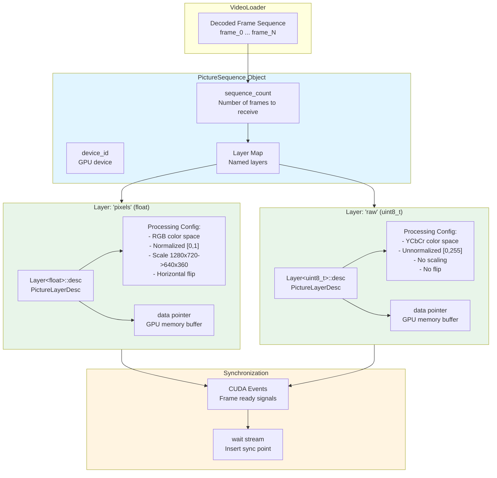
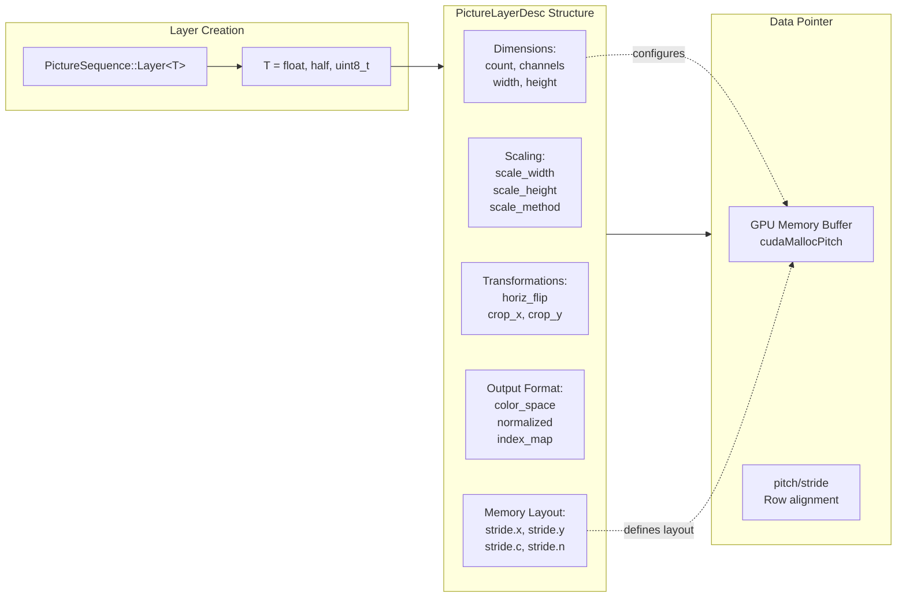
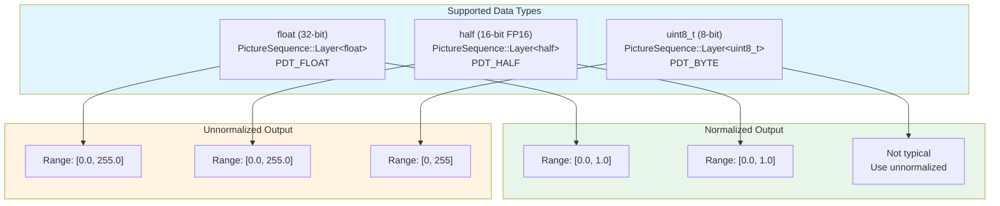
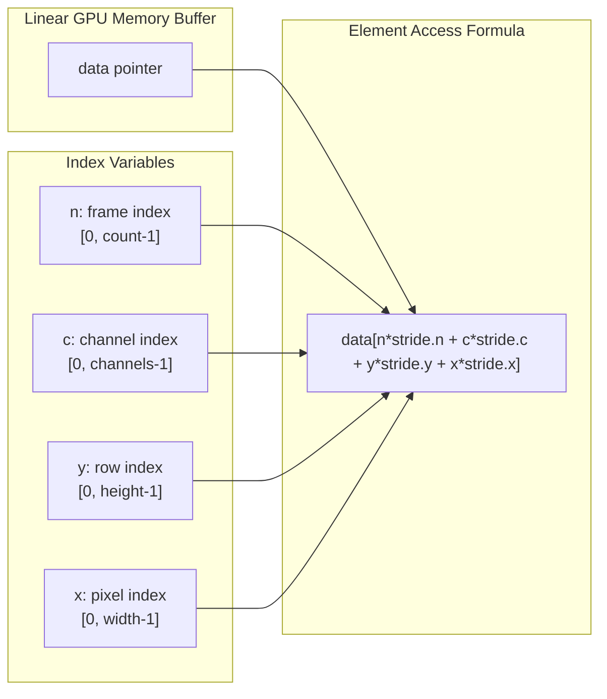
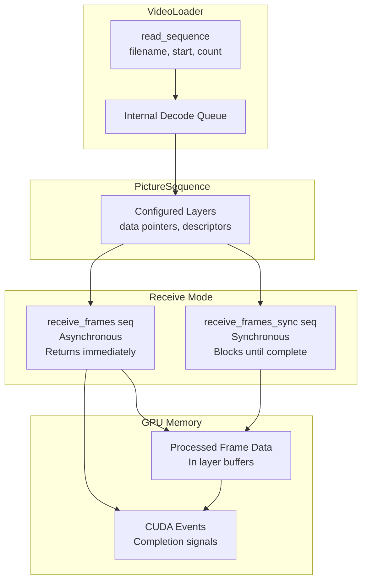
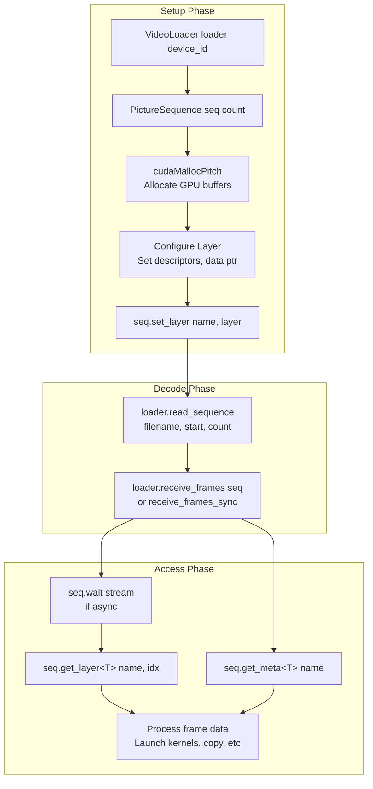

<!-- source: DeepWiki mcp.deepwiki.com · repo NVIDIA/nvvl · page 3.3 PictureSequence API · fetched 2026-10-26 -->

# PictureSequence API

<details>
<summary>Relevant source files</summary>

The following files were used as context for generating this wiki page:

- [README.md](README.md)
- [doc/examples/extract_frames.cpp](doc/examples/extract_frames.cpp)
- [doc/examples/extract_frames_c.c](doc/examples/extract_frames_c.c)

</details>


The `PictureSequence` class represents a destination for decoded video frames and controls how those frames are processed and stored in GPU memory. It serves as the primary interface for configuring frame output from the `VideoLoader`, specifying data types, processing transformations, memory layout, and synchronization. For information about initiating video decoding and frame sequence reading, see [VideoLoader API](#3.2). For details on GPU processing transformations, see [GPU Processing Pipeline](#3.4).

## Overview

A `PictureSequence` acts as a container for one or more "layers", where each layer defines:
- Output data type (`float`, `half`, or `uint8_t`)
- Processing configuration (scaling, cropping, flipping, color space conversion)
- Memory layout (dimensions, strides, buffer location)
- Frame selection from the decoded sequence

Multiple layers can be added to a single `PictureSequence`, allowing different representations of the same frames (e.g., RGB and YCbCr color spaces, or normalized and unnormalized data) to be produced simultaneously.

**Sources:** [README.md:214-286](), [include/PictureSequence.h]()

## PictureSequence Architecture



**Sources:** [README.md:214-286](), [doc/examples/extract_frames.cpp:167-189]()

## Creating a PictureSequence

### C++ Interface

A `PictureSequence` is constructed by specifying the number of frames it will receive and optionally the device ID:

```cpp
// Basic construction
auto seq = NVVL::PictureSequence{sequence_count};

// With explicit device ID
auto seq = NVVL::PictureSequence{sequence_count, device_id};
```

The `sequence_count` parameter does not need to match the number of frames read by `VideoLoader::read_sequence()`. You can:
- Read a large sequence and receive it as multiple smaller `PictureSequence` objects
- Read multiple smaller sequences and receive them concatenated in a single `PictureSequence`

**Sources:** [README.md:216-221](), [doc/examples/extract_frames.cpp:167]()

### C Interface

```c
PictureSequenceHandle sequence = nvvl_create_sequence(sequence_count);
```

The C interface returns an opaque handle that must be passed to subsequent API calls.

**Sources:** [doc/examples/extract_frames_c.c:42]()

## Layer Configuration



**Sources:** [README.md:227-266](), [include/PictureSequence.h]()

### Layer Structure

Each layer consists of:

| Component | Type | Purpose |
|-----------|------|---------|
| `data` | `T*` | Pointer to GPU memory buffer where frames will be written |
| `desc` | `PictureLayerDesc` | Descriptor containing all processing configuration |
| `type` (C API) | `NVVL_PicDataType` | Data type enum (PDT_BYTE, PDT_HALF, PDT_FLOAT) |

**Sources:** [include/PictureSequence.h](), [doc/examples/extract_frames_c.c:44-59]()

### Descriptor Fields

The `PictureLayerDesc` structure contains the following fields:

#### Dimensions

| Field | Type | Description |
|-------|------|-------------|
| `count` | `uint16_t` | Number of frames in the sequence |
| `channels` | `uint16_t` | Number of color channels (typically 3) |
| `width` | `uint16_t` | Width of output frames (after cropping) |
| `height` | `uint16_t` | Height of output frames (after cropping) |

#### Scaling and Cropping

| Field | Type | Description |
|-------|------|-------------|
| `scale_width` | `int16_t` | Width to scale frames to before cropping (0 = no scaling) |
| `scale_height` | `int16_t` | Height to scale frames to before cropping (0 = no scaling) |
| `crop_x` | `int16_t` | X coordinate of crop region (default: 0) |
| `crop_y` | `int16_t` | Y coordinate of crop region (default: 0) |
| `scale_method` | `ScaleMethod` | Scaling algorithm (ScaleMethod_Linear, ScaleMethod_Nearest) |

#### Transformations

| Field | Type | Description |
|-------|------|-------------|
| `horiz_flip` | `bool` | Apply horizontal flip (mirroring) |

#### Output Format

| Field | Type | Description |
|-------|------|-------------|
| `color_space` | `ColorSpace` | ColorSpace_RGB or ColorSpace_YCbCr |
| `normalized` | `bool` | If true, output values in [0, 1]; if false, [0, 255] |
| `index_map` | `int[4]` | Map input frame indices to output positions (advanced) |

#### Memory Layout

| Field | Type | Description |
|-------|------|-------------|
| `stride.x` | `size_t` | Stride between pixels (typically 1) |
| `stride.y` | `size_t` | Stride between rows (in elements, not bytes) |
| `stride.c` | `size_t` | Stride between channels |
| `stride.n` | `size_t` | Stride between frames |

**Sources:** [README.md:237-261](), [doc/examples/extract_frames.cpp:171-185]()

## Data Types and Memory Allocation

### Supported Data Types



**Sources:** [README.md:18](), [doc/examples/extract_frames.cpp:208-223]()

### Memory Allocation Example (C++)

```cpp
// Allocate GPU memory with pitch alignment
float* data = nullptr;
size_t pitch = 0;
cudaMallocPitch(&data, &pitch,
                crop_width * sizeof(float),
                crop_height * sequence_count * 3);

// Configure layer
auto pixels = PictureSequence::Layer<float>{};
pixels.data = data;
pixels.desc.count = sequence_count;
pixels.desc.channels = 3;
pixels.desc.width = crop_width;
pixels.desc.height = crop_height;
pixels.desc.stride.y = pitch / sizeof(float);  // Convert bytes to elements
```

**Sources:** [README.md:242-261](), [doc/examples/extract_frames.cpp:24-40]()

### Memory Allocation Example (C)

```c
struct NVVL_PicLayer layer;
memset(&layer, 0, sizeof(layer));

layer.desc.count = sequence_count;
layer.desc.channels = 3;
layer.desc.width = sequence_width;
layer.desc.height = sequence_height;
layer.type = PDT_BYTE;

cudaMallocPitch(&layer.data, &layer.desc.stride.y,
                layer.desc.width, 
                layer.desc.height * sequence_count * 3);
```

**Sources:** [doc/examples/extract_frames_c.c:44-55]()

## Memory Layout and Stride Configuration

The stride fields define how data is laid out in the output buffer, allowing flexible dimension ordering (NCHW, NHWC, etc.).

### Common Layout: NCHW (Batch, Channel, Height, Width)

```cpp
pixels.desc.stride.x = 1;                              // Adjacent pixels
pixels.desc.stride.y = pitch / sizeof(T);              // Next row
pixels.desc.stride.c = stride.y * height;              // Next channel
pixels.desc.stride.n = stride.c * channels;            // Next frame
```

This produces memory layout:
```
[frame0_ch0][frame0_ch1][frame0_ch2][frame1_ch0][frame1_ch1]...
```

### Alternative Layout: NHWC

```cpp
pixels.desc.stride.x = channels;                       // Interleaved channels
pixels.desc.stride.y = pitch / sizeof(T);              
pixels.desc.stride.c = 1;                              // Adjacent channels
pixels.desc.stride.n = stride.y * height * channels;   
```

### Stride Calculation Diagram



**Note:** All strides are measured in **number of elements**, not bytes. When using `cudaMallocPitch`, convert the pitch (in bytes) to elements by dividing by `sizeof(T)`.

**Sources:** [README.md:257-266](), [doc/examples/extract_frames.cpp:183-185](), [doc/examples/extract_frames_c.c:56-58]()

## Processing Configuration Examples

### Example 1: Basic RGB Output

```cpp
auto pixels = PictureSequence::Layer<uint8_t>{};
pixels.data = gpu_buffer;
pixels.desc.count = 4;
pixels.desc.channels = 3;
pixels.desc.width = 640;
pixels.desc.height = 360;
pixels.desc.color_space = ColorSpace_RGB;
pixels.desc.normalized = false;  // [0, 255] range
pixels.desc.horiz_flip = false;
// No scaling (scale_width/height default to 0)
```

**Sources:** [doc/examples/extract_frames.cpp:208]()

### Example 2: Scaled, Normalized Float Output

```cpp
auto pixels = PictureSequence::Layer<float>{};
pixels.data = gpu_buffer;
pixels.desc.count = 4;
pixels.desc.channels = 3;
pixels.desc.width = 640;
pixels.desc.height = 360;
pixels.desc.scale_width = 1280;   // Scale from 1280x720
pixels.desc.scale_height = 720;
pixels.desc.color_space = ColorSpace_RGB;
pixels.desc.normalized = true;    // [0.0, 1.0] range
pixels.desc.horiz_flip = false;
```

**Sources:** [doc/examples/extract_frames.cpp:214-216]()

### Example 3: Half-Precision with Flipping

```cpp
auto pixels = PictureSequence::Layer<half>{};
pixels.data = gpu_buffer;
pixels.desc.count = 4;
pixels.desc.channels = 3;
pixels.desc.width = 640;
pixels.desc.height = 360;
pixels.desc.scale_width = 1280;
pixels.desc.scale_height = 720;
pixels.desc.color_space = ColorSpace_RGB;
pixels.desc.normalized = true;
pixels.desc.horiz_flip = true;     // Mirror horizontally
```

**Sources:** [doc/examples/extract_frames.cpp:209]()

### Example 4: YCbCr Color Space

```cpp
auto pixels = PictureSequence::Layer<float>{};
pixels.data = gpu_buffer;
pixels.desc.count = 4;
pixels.desc.channels = 3;
pixels.desc.width = 640;
pixels.desc.height = 360;
pixels.desc.color_space = ColorSpace_YCbCr;  // Luminance + Chroma
pixels.desc.normalized = false;
```

**Sources:** [doc/examples/extract_frames.cpp:212](), [doc/examples/extract_frames.cpp:218]()

## Adding Layers to PictureSequence

### C++ Interface

```cpp
// Create and configure layer
auto pixels = PictureSequence::Layer<float>{};
// ... configure pixels.data and pixels.desc ...

// Add layer with name
seq.set_layer("pixels", pixels);

// Can add multiple layers
auto raw = PictureSequence::Layer<uint8_t>{};
// ... configure raw ...
seq.set_layer("raw", raw);
```

**Sources:** [README.md:268-271](), [doc/examples/extract_frames.cpp:186]()

### C Interface

```c
struct NVVL_PicLayer layer;
// ... configure layer ...
nvvl_set_layer(sequence, &layer, "pixels");
```

**Sources:** [doc/examples/extract_frames_c.c:59]()

## Receiving Frames



### C++ Interface

```cpp
// Asynchronous - returns immediately
loader.receive_frames(seq);
// ... can do other work ...
seq.wait(cuda_stream);  // Wait before using data

// Synchronous - blocks until complete
loader.receive_frames_sync(seq);
// Data ready immediately
```

**Sources:** [README.md:275-282](), [doc/examples/extract_frames.cpp:188]()

### C Interface

```c
// Synchronous only
nvvl_receive_frames_sync(loader, sequence);
```

**Sources:** [doc/examples/extract_frames_c.c:62]()

## Synchronization

Asynchronous frame reception requires explicit synchronization before accessing the frame data.

### Using `wait()` (C++ Only)

```cpp
// Submit receive request
loader.receive_frames(seq);

// Do other work on CPU or different GPU streams
// ...

// Before using frame data, synchronize
cudaStream_t my_stream;
cudaStreamCreate(&my_stream);
seq.wait(my_stream);  // Inserts wait event into stream

// Launch kernels on my_stream - they will wait for frames
my_kernel<<<grid, block, 0, my_stream>>>(seq_data, ...);
```

The `wait()` method inserts a CUDA event wait into the specified stream, ensuring subsequent operations on that stream wait for the frames to be ready.

**Sources:** [README.md:278-286]()

## Retrieving Layer Data

### C++ Interface

After frames are received, retrieve individual frames from layers:

```cpp
// Get metadata
auto frame_nums = sequence.get_meta<int>("frame_num");

// Iterate through frames
for (int i = 0; i < sequence.count(); ++i) {
    // Get layer for specific frame
    auto pixels = sequence.get_layer<float>("pixels", i);
    
    // Access data
    auto width = pixels.desc.width;
    auto height = pixels.desc.height;
    auto channels = pixels.desc.channels;
    
    // Data pointer for this frame
    float* frame_data = pixels.data;
    
    // Access individual channel
    float* channel_0 = pixels.data + 0 * pixels.desc.stride.c;
    float* channel_1 = pixels.data + 1 * pixels.desc.stride.c;
    float* channel_2 = pixels.data + 2 * pixels.desc.stride.c;
}
```

**Sources:** [doc/examples/extract_frames.cpp:84-105]()

### C Interface

```c
struct NVVL_PicLayer pixels = nvvl_get_layer(sequence, PDT_BYTE, "pixels");
printf("Got a sequence of size: %d\n", pixels.desc.count);

for (int i = 0; i < pixels.desc.count; i++) {
    uint8_t* frame_data = pixels.data + i * pixels.desc.stride.n;
    // Process frame_data
}
```

**Sources:** [doc/examples/extract_frames_c.c:11-27]()

## Metadata Access

`PictureSequence` can store metadata associated with frames:

```cpp
// Retrieve frame numbers (automatically added by VideoLoader)
auto frame_nums = sequence.get_meta<int>("frame_num");

// Access per-frame metadata
for (int i = 0; i < sequence.count(); ++i) {
    int frame_number = frame_nums[i];
    std::cout << "Frame " << frame_number << std::endl;
}
```

The `"frame_num"` metadata is automatically populated by `VideoLoader` and indicates the original frame index from the video file.

**Sources:** [doc/examples/extract_frames.cpp:84](), [doc/examples/extract_frames.cpp:132]()

## Complete Usage Example



### C++ Example

```cpp
// 1. Create VideoLoader and PictureSequence
auto loader = NVVL::VideoLoader{device_id};
auto seq = PictureSequence{sequence_count, device_id};

// 2. Allocate GPU memory
float* data = nullptr;
size_t pitch = 0;
cudaMallocPitch(&data, &pitch,
                width * sizeof(float),
                height * sequence_count * 3);

// 3. Configure layer
auto pixels = PictureSequence::Layer<float>{};
pixels.data = data;
pixels.desc.count = sequence_count;
pixels.desc.channels = 3;
pixels.desc.width = width;
pixels.desc.height = height;
pixels.desc.scale_width = scale_width;
pixels.desc.scale_height = scale_height;
pixels.desc.color_space = ColorSpace_RGB;
pixels.desc.normalized = true;
pixels.desc.stride.x = 1;
pixels.desc.stride.y = pitch / sizeof(float);
pixels.desc.stride.c = pixels.desc.stride.y * height;
pixels.desc.stride.n = pixels.desc.stride.c * 3;

// 4. Add layer to sequence
seq.set_layer("pixels", pixels);

// 5. Request frame sequence
loader.read_sequence(filename, start_frame, sequence_length);

// 6. Receive frames
loader.receive_frames_sync(seq);

// 7. Access frames
auto frame_nums = seq.get_meta<int>("frame_num");
for (int i = 0; i < seq.count(); ++i) {
    auto layer = seq.get_layer<float>("pixels", i);
    // Use layer.data for frame i
}
```

**Sources:** [README.md:200-286](), [doc/examples/extract_frames.cpp:167-189]()

## C API Function Reference

| Function | Purpose |
|----------|---------|
| `nvvl_create_sequence(count)` | Create a PictureSequence handle |
| `nvvl_set_layer(seq, layer, name)` | Add a layer to the sequence |
| `nvvl_get_layer(seq, type, name)` | Retrieve a layer from the sequence |
| `nvvl_destroy_sequence(seq)` | Destroy a PictureSequence handle |

The C API uses `struct NVVL_PicLayer` which contains:
- `type`: `NVVL_PicDataType` enum (PDT_BYTE, PDT_HALF, PDT_FLOAT)
- `data`: `void*` pointer to GPU memory
- `desc`: `struct PictureLayerDesc` with same fields as C++ version

**Sources:** [doc/examples/extract_frames_c.c:1-67](), [include/VideoLoader.h]()

## Performance Considerations

1. **Memory Alignment**: Use `cudaMallocPitch` for optimal memory access patterns. The pitch may be larger than `width * sizeof(T)` for alignment.

2. **Multiple Layers**: Adding multiple layers to a single `PictureSequence` processes frames only once, applying different transformations in parallel. This is more efficient than multiple separate sequences.

3. **Stride Configuration**: NCHW layout (channel-major) typically provides better performance for deep learning frameworks.

4. **Half-Precision**: Using `half` (FP16) reduces memory bandwidth requirements by 50% compared to `float`, with minimal precision loss for most ML applications.

5. **Asynchronous Operation**: Use `receive_frames()` (async) rather than `receive_frames_sync()` to overlap decoding with other computation.

**Sources:** [README.md:38-45](), [doc/examples/extract_frames.cpp:219-223]()

---

