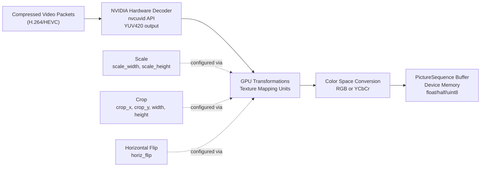
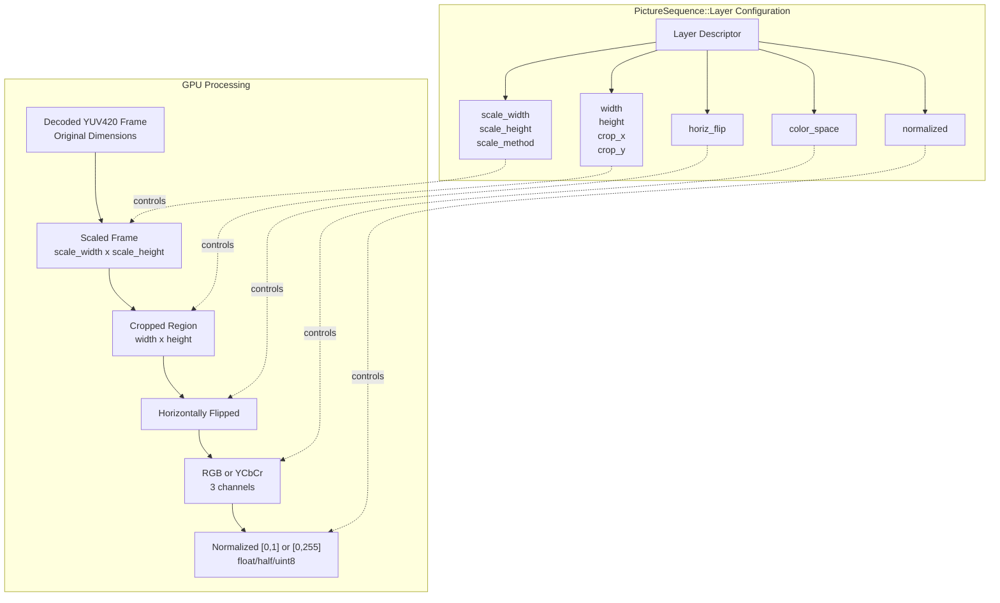
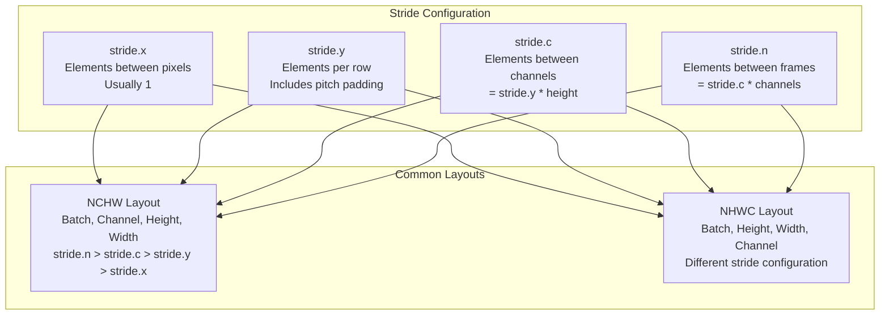
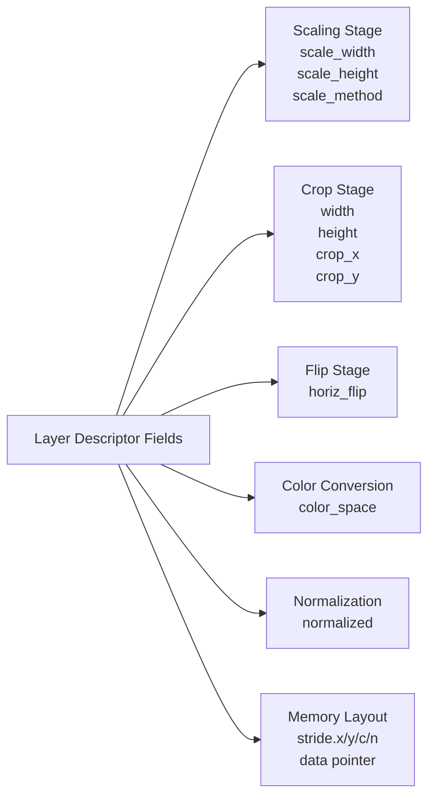

<!-- source: DeepWiki mcp.deepwiki.com · repo NVIDIA/nvvl · page 3.4 GPU Processing Pipeline · fetched 2026-10-26 -->

# GPU Processing Pipeline

<details>
<summary>Relevant source files</summary>

The following files were used as context for generating this wiki page:

- [README.md](README.md)
- [doc/examples/extract_frames.cpp](doc/examples/extract_frames.cpp)

</details>


This document explains NVVL's GPU-accelerated video processing pipeline, covering hardware-accelerated decoding, on-the-fly transformations, color space conversion, and output formatting. The pipeline is designed to eliminate CPU bottlenecks by performing all video processing operations directly on the GPU.

For information about configuring output buffers and memory layout, see [PictureSequence API](#3.3). For details on the high-level VideoLoader interface, see [VideoLoader API](#3.2).

## Pipeline Overview

NVVL's processing pipeline transforms compressed video packets into ready-to-use GPU tensors through four main stages: hardware decoding, GPU transformations, color space conversion, and memory formatting.



Sources: [README.md:8-18](), [README.md:38-45]()

## Hardware Video Decoding

NVVL uses NVIDIA's hardware video decoder (nvcuvid API) to decode H.264 and HEVC video streams directly on the GPU. This offloads decoding work from the CPU and produces decoded frames directly in GPU memory as YUV420 planar data.

### Decoder Capabilities

| Feature | Support |
|---------|---------|
| Video Codecs | H.264, HEVC (H.265) |
| Input Format | Any FFmpeg-parseable container |
| Decoder Output | YUV420 planar format |
| Memory Location | GPU device memory |
| Pixel Format Requirement | yuv420p |

The hardware decoder outputs frames in YUV420 planar format. All subsequent transformations operate on this decoded data without requiring CPU intervention or memory transfers to host memory.

Sources: [README.md:151-178]()

## GPU Transformation Operations

After hardware decoding, NVVL applies transformations using the GPU's dedicated texture mapping units. These operations are configured via the `PictureSequence::Layer` descriptor and applied on-the-fly as frames are decoded.



Sources: [README.md:14-18](), [doc/examples/extract_frames.cpp:163-189]()

### Scaling

Frames can be scaled to a target resolution before cropping. Scaling is configured using the `scale_width` and `scale_height` fields in the layer descriptor. If these fields are not set (or set to 0), no scaling is performed.

**Configuration Example:**
```cpp
pixels.desc.scale_width = scale_width;   // Target width after scaling
pixels.desc.scale_height = scale_height; // Target height after scaling
pixels.desc.scale_method = ScaleMethod_Linear; // Scaling algorithm
```

The `scale_method` field controls the interpolation algorithm used for scaling. Available methods include linear interpolation and other texture sampling modes provided by the GPU.

Sources: [doc/examples/extract_frames.cpp:176-177](), [doc/examples/extract_frames.cpp:182]()

### Cropping

After optional scaling, a rectangular region is cropped from the frame. The crop region is specified by the `width` and `height` fields in the layer descriptor, along with optional `crop_x` and `crop_y` offsets (defaulting to 0,0 if not specified).

**Configuration Example:**
```cpp
pixels.desc.width = sequence_width;   // Width of crop region
pixels.desc.height = sequence_height; // Height of crop region
// crop_x and crop_y default to 0 if not set
```

The crop operation extracts the specified region using the GPU's texture mapping hardware, which efficiently handles boundary conditions and memory access patterns.

Sources: [doc/examples/extract_frames.cpp:173-174]()

### Horizontal Flipping

Frames can be horizontally flipped for data augmentation. This is controlled by the `horiz_flip` boolean field.

**Configuration Example:**
```cpp
pixels.desc.horiz_flip = true;  // Enable horizontal flip
```

The flip operation is performed using texture coordinate manipulation, with no additional memory operations required.

Sources: [doc/examples/extract_frames.cpp:179](), [doc/examples/extract_frames.cpp:209]()

## Color Space Conversion

NVVL supports two output color spaces: RGB and YCbCr. The hardware decoder outputs YUV420 data, which is converted to the requested color space during the GPU transformation stage.

### Color Space Options

| Color Space | `color_space` Value | Description |
|-------------|---------------------|-------------|
| RGB | `ColorSpace_RGB` | Standard RGB with separate R, G, B channels |
| YCbCr | `ColorSpace_YCbCr` | Luma + chroma (Y, Cb, Cr channels) |

**Configuration Example:**
```cpp
pixels.desc.color_space = ColorSpace_RGB; // or ColorSpace_YCbCr
```

The color space conversion is performed efficiently using GPU texture units, which support these conversions in hardware. RGB output is most common for image processing and visualization, while YCbCr may be preferred for certain video processing tasks or when working with networks that process in YUV space.

Sources: [README.md:17](), [doc/examples/extract_frames.cpp:181](), [doc/examples/extract_frames.cpp:208-223]()

## Output Formatting

The final stage of the pipeline formats the processed frames into the requested data type and normalization range.

### Data Type Support

| Type | C++ Type | CUDA Type | Typical Use Case |
|------|----------|-----------|------------------|
| 8-bit unsigned integer | `uint8_t` | `uint8_t` | Integer image data, minimal memory |
| 16-bit floating point | `half` | `__half` | Mixed-precision training, memory efficiency |
| 32-bit floating point | `float` | `float` | Full-precision training, maximum accuracy |

**Configuration Example:**
```cpp
auto pixels = PictureSequence::Layer<float>{}; // Specify output type
```

### Normalization

The `normalized` field controls the output value range:
- `normalized = true`: Values in range [0.0, 1.0]
- `normalized = false`: Values in range [0.0, 255.0] for float/half, [0, 255] for uint8

**Configuration Example:**
```cpp
pixels.desc.normalized = true; // Output range [0, 1]
```

When `normalized` is true, pixel values are divided by 255.0 to produce values in the [0, 1] range, which is standard for many neural network preprocessing pipelines.

Sources: [README.md:17-18](), [doc/examples/extract_frames.cpp:180](), [doc/examples/extract_frames.cpp:214-223]()

## Memory Layout Configuration

The output buffer's memory layout is controlled by stride parameters in the layer descriptor. Strides specify the number of elements between consecutive pixels in each dimension.



**NCHW Layout Configuration Example:**
```cpp
pixels.desc.stride.x = 1;
pixels.desc.stride.y = pitch / sizeof(T);  // Elements per row
pixels.desc.stride.c = pixels.desc.stride.y * pixels.desc.height;
pixels.desc.stride.n = pixels.desc.stride.c * 3; // 3 channels
```

The stride values are in element counts, not bytes. The `pitch` value from `cudaMallocPitch` must be converted to element counts by dividing by `sizeof(T)`.

Sources: [doc/examples/extract_frames.cpp:170](), [doc/examples/extract_frames.cpp:183-185]()

## Processing Configuration Examples

The following table shows various processing configurations and their use cases:

| Type | Color Space | Scale | Normalized | Flip | Use Case |
|------|-------------|-------|------------|------|----------|
| `uint8_t` | RGB | No | No | No | Raw pixel extraction |
| `uint8_t` | RGB | Yes | No | Yes | Augmented image data |
| `float` | RGB | Yes | Yes | No | Neural network training |
| `float` | YCbCr | Yes | Yes | No | Video processing networks |
| `half` | RGB | Yes | Yes | No | Mixed-precision training |

**Example showing multiple configurations:**
```cpp
// Raw uint8 RGB without processing
process_frames<uint8_t>(loader, ColorSpace_RGB, false, false, false);

// Scaled and flipped for augmentation
process_frames<uint8_t>(loader, ColorSpace_RGB, true, false, true);

// Normalized float for training
process_frames<float>(loader, ColorSpace_RGB, true, true, false);

// Half-precision for memory efficiency
process_frames<half>(loader, ColorSpace_RGB, true, true, false);

// YCbCr color space for video processing
process_frames<float>(loader, ColorSpace_YCbCr, true, true, false);
```

Sources: [doc/examples/extract_frames.cpp:207-223]()

## Performance Benefits

The GPU processing pipeline provides significant performance advantages:

1. **Hardware Decoding**: Offloads video decoding from CPU to GPU, reducing CPU load by 40-50% compared to software decoding
2. **Zero-Copy Operation**: Decoded frames remain in GPU memory throughout processing, eliminating host-device transfers
3. **Texture Mapping Units**: Scaling, cropping, and flipping operations use dedicated hardware with minimal overhead
4. **Asynchronous Execution**: All processing occurs asynchronously on separate CUDA streams (with CUDA 9.0+ and driver version 384+)
5. **Memory Efficiency**: Direct processing from compressed video reduces storage requirements by ~40x compared to extracted frames

The pipeline is optimized to eliminate CPU/IO bottlenecks in machine learning training workflows, particularly important in systems with high GPU-to-CPU ratios like the NVIDIA DGX series.

Sources: [README.md:38-49](), [README.md:308-312]()

## Integration with PictureSequence

The GPU processing pipeline is configured through `PictureSequence::Layer` objects. A complete processing configuration involves:

1. Creating a `PictureSequence::Layer<T>` with the desired output type
2. Allocating device memory for the output buffer
3. Configuring processing parameters in `layer.desc`
4. Adding the layer to a `PictureSequence` via `set_layer()`
5. Passing the sequence to `VideoLoader::receive_frames()` or `receive_frames_sync()`

The layer descriptor fields directly control each stage of the GPU pipeline:



Sources: [doc/examples/extract_frames.cpp:163-189]()

---

