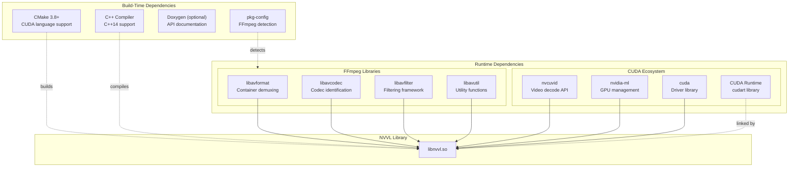
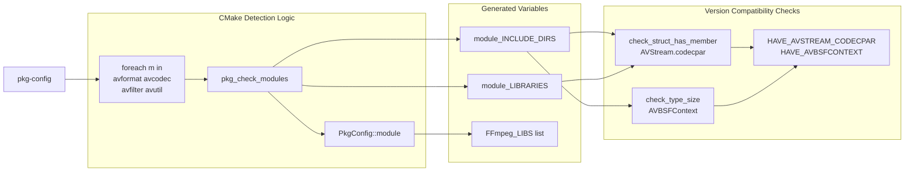
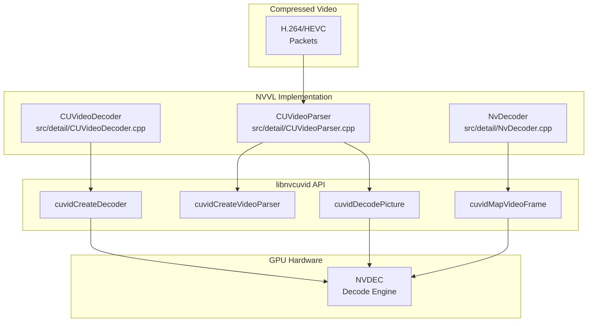
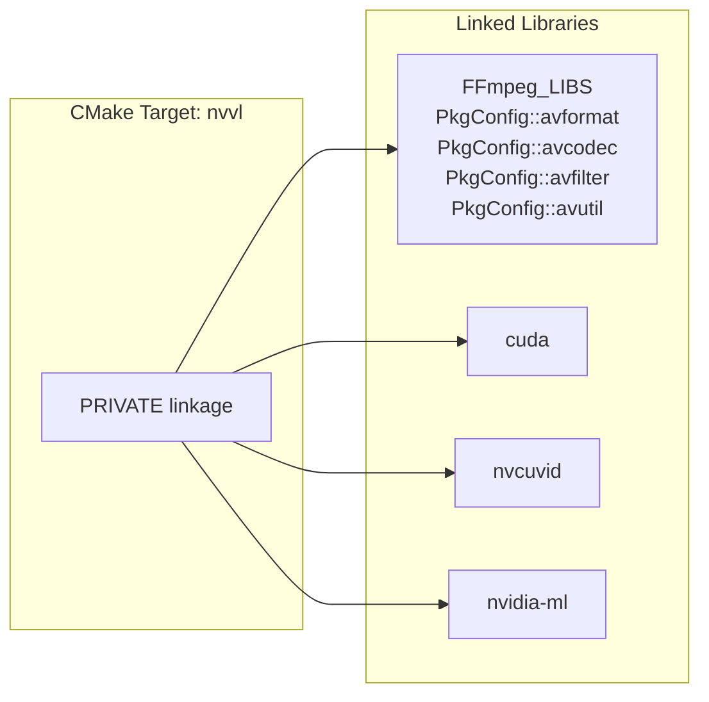
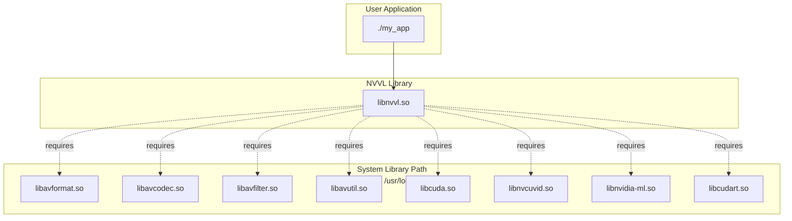

<!-- source: DeepWiki mcp.deepwiki.com · repo NVIDIA/nvvl · page 3.5 Dependencies · fetched 2026-10-26 -->

# Dependencies

<details>
<summary>Relevant source files</summary>

The following files were used as context for generating this wiki page:

- [CMakeLists.txt](CMakeLists.txt)
- [README.md](README.md)
- [docker/Dockerfile.build](docker/Dockerfile.build)

</details>


This document describes the external dependencies required by NVVL, their roles in the library architecture, and how they are detected and linked during the build process. For information about the build configuration system that handles these dependencies, see [CMake Configuration](#5.1). For instructions on setting up a development environment with these dependencies, see [Building from Source](#2.1) and [Using Docker](#2.2).

## Overview

NVVL depends on several external libraries that provide video parsing, hardware-accelerated decoding, and GPU compute capabilities. These dependencies fall into two categories: runtime dependencies required for library operation and build-time dependencies needed only during compilation.



**Sources:** [CMakeLists.txt:15-73](), [README.md:61-73]()

## FFmpeg Libraries

FFmpeg provides the video file parsing and container demuxing capabilities required by NVVL. Four FFmpeg libraries are used:

### libavformat

The `libavformat` library handles container format parsing and demuxing. It reads video files (MP4, MKV, etc.) and extracts individual compressed video packets. NVVL uses this to:
- Open video files
- Seek to specific timestamps
- Read compressed video packets in sequence

### libavcodec

The `libavcodec` library provides codec identification and configuration. NVVL uses this to:
- Identify the video codec (H.264, HEVC)
- Extract codec parameters needed for hardware decoder initialization
- Handle codec-specific packet formats

The build system checks for FFmpeg API compatibility by testing for the presence of `AVStream.codecpar` and `AVBSFContext`, which differ between FFmpeg versions.

### libavfilter

The `libavfilter` library provides the filtering framework. While NVVL performs most transformations on the GPU, it uses FFmpeg's filter infrastructure for certain operations.

### libavutil

The `libavutil` library provides common utility functions and data structures used by the other FFmpeg libraries.

### FFmpeg Detection

The CMake build system detects FFmpeg libraries using `pkg-config`:



**Sources:** [CMakeLists.txt:17-28]()

The detection process is implemented in the top-level CMakeLists.txt:

| Step | CMake Code | Purpose |
|------|------------|---------|
| Require pkg-config | `find_package(PkgConfig REQUIRED)` | Ensure pkg-config is available |
| Loop over modules | `foreach(m avformat avcodec avfilter avutil)` | Process each FFmpeg library |
| Module detection | `pkg_check_modules(${m} REQUIRED IMPORTED_TARGET lib${m})` | Find library via pkg-config |
| Create import target | Creates `PkgConfig::${m}` | CMake import target for linking |
| Aggregate list | `list(APPEND FFmpeg_LIBS PkgConfig::${m})` | Build list of all FFmpeg libraries |

**Sources:** [CMakeLists.txt:17-22]()

The build system performs API compatibility checks to handle FFmpeg version differences:

```cpp
// Checks if AVStream has codecpar member (newer FFmpeg versions)
check_struct_has_member("struct AVStream" codecpar libavformat/avformat.h 
                        HAVE_AVSTREAM_CODECPAR LANGUAGE C)

// Checks if AVBSFContext type exists (bitstream filters)
check_type_size("AVBSFContext" AVBSFCONTEXT LANGUAGE CXX)
```

If these features are detected, corresponding compile definitions are set: `HAVE_AVSTREAM_CODECPAR` and `HAVE_AVBSFCONTEXT`.

**Sources:** [CMakeLists.txt:24-29](), [CMakeLists.txt:51-57]()

### FFmpeg Build Configuration

The Docker build environment demonstrates minimal FFmpeg configuration required for NVVL:

| Configure Option | Purpose |
|------------------|---------|
| `--disable-static` | Build shared libraries only |
| `--disable-all` | Start with all components disabled |
| `--enable-shared` | Enable shared library output |
| `--enable-avformat` | Enable container demuxing |
| `--enable-avcodec` | Enable codec framework |
| `--enable-avfilter` | Enable filtering framework |
| `--enable-protocol=file` | Enable file I/O protocol |
| `--enable-demuxer=mov,matroska` | Enable MP4 and MKV demuxers |
| `--enable-bsf=h264_mp4toannexb,hevc_mp4toannexb` | Enable bitstream filters for H.264/HEVC |

**Sources:** [docker/Dockerfile.build:18-30]()

## CUDA Ecosystem

NVVL relies on several components from the NVIDIA CUDA ecosystem for GPU-accelerated video decoding and processing.

### CUDA Runtime (cudart)

The CUDA runtime library (`libcudart.so`) provides the CUDA API used throughout NVVL. By default, NVVL links against the shared CUDA runtime. This can be controlled via the `CMAKE_CUDA_FLAGS` variable:

```cmake
# Default: shared runtime
set(CMAKE_CUDA_FLAGS "-cudart shared")

# Alternative: static runtime
# set(CMAKE_CUDA_FLAGS "-cudart static")
```

**Sources:** [CMakeLists.txt:3-5](), [README.md:120-124]()

### nvcuvid (NVIDIA Video Decoder)

The `libnvcuvid.so` library provides the NVIDIA Video Decoder API (NVDECODE), which exposes the hardware video decoding engines on NVIDIA GPUs. This is the core dependency that enables NVVL's GPU-accelerated decoding.



**Sources:** [CMakeLists.txt:73](), [src/detail/CUVideoDecoder.cpp](), [src/detail/CUVideoParser.cpp](), [src/detail/NvDecoder.cpp]()

The NVDECODE API is used by:
- `CUVideoDecoder` - Creates and manages video decoder instances
- `CUVideoParser` - Parses video packets and feeds them to the decoder
- `NvDecoder` - Maps decoded frames from video memory to CUDA memory

The `nvcuvid` library requires specific NVIDIA driver capabilities to function. The Docker environment sets:

```dockerfile
ENV NVIDIA_DRIVER_CAPABILITIES=video,compute,utility
```

**Sources:** [docker/Dockerfile.build:10]()

### nvidia-ml (NVIDIA Management Library)

The `libnvidia-ml.so` library provides the NVIDIA Management Library (NVML) API for GPU monitoring and management. NVVL uses this for:
- Detecting available GPUs
- Querying GPU capabilities
- Managing GPU resources

**Sources:** [CMakeLists.txt:73]()

### cuda (CUDA Driver Library)

The `libcuda.so` library is the CUDA driver library that provides low-level GPU access. NVVL uses this for:
- CUDA context management (see `CUContext` class)
- Device memory operations
- Stream synchronization

**Sources:** [CMakeLists.txt:73](), [src/detail/CUContext.cpp]()

### CUDA Toolkit Include Directories

The NVVL library target includes CUDA toolkit headers in its public interface:

```cmake
target_include_directories(nvvl
    PUBLIC
        ${CMAKE_CUDA_TOOLKIT_INCLUDE_DIRECTORIES}
    ...
)
```

This allows downstream projects linking against NVVL to access CUDA types and functions.

**Sources:** [CMakeLists.txt:65-72]()

## Dependency Linking

The `nvvl` library target links against all runtime dependencies:



**Sources:** [CMakeLists.txt:73]()

The linking is performed with `PRIVATE` visibility, meaning these dependencies are not propagated to downstream targets. Downstream projects only need to link against `NVVL::NVVL` without explicitly listing these dependencies.

## Version Requirements

| Dependency | Minimum Version | Notes |
|------------|----------------|-------|
| CUDA Toolkit | 8.0 | CUDA 9.0+ recommended for async kernel execution |
| FFmpeg libavformat | N/A | Must support `pkg-config` detection |
| FFmpeg libavcodec | N/A | API compatibility checked at build time |
| FFmpeg libavfilter | N/A | Standard FFmpeg 3.x or 4.x versions work |
| FFmpeg libavutil | N/A | Matched with other FFmpeg libraries |
| CMake | 3.8 | Required for CUDA language support |
| C++ Compiler | C++14 | Set via `target_compile_features` |

**Sources:** [README.md:62-65](), [README.md:71-73](), [README.md:309-312](), [CMakeLists.txt:46]()

### CUDA Version Notes

While CUDA 8.0 is the minimum supported version, CUDA 9.0 or later provides better performance. With CUDA 9.0+ and nvidia kernel modules version 384+, CUDA kernels launched by NVVL run asynchronously on a separate stream. With earlier versions, kernels are launched on the default stream, which can impact performance.

**Sources:** [README.md:309-312]()

## Development Dependencies

The `libnvcuvid.so` library presents a unique challenge during development. The `nvidia-docker` runtime provides the library for runtime use but not the development symlink required by the linker. The build Dockerfile works around this:

```dockerfile
# Create unversioned symlink for development
RUN ln -s /usr/local/nvidia/lib64/libnvcuvid.so.1 /usr/local/lib/libnvcuvid.so && \
    ln -s libnvcuvid.so.1 /usr/lib/x86_64-linux-gnu/libnvcuvid.so
```

This creates the `libnvcuvid.so` symlink that `ld` expects when linking against `-lnvcuvid`, pointing to the versioned `libnvcuvid.so.1` provided by nvidia-docker.

**Sources:** [docker/Dockerfile.build:52-53]()

## Runtime Library Loading

At runtime, the NVVL library requires the following shared libraries to be available in the system library path:



The dynamic linker resolves these dependencies automatically when `libnvvl.so` is loaded, provided they are in the library search path.

**Sources:** [CMakeLists.txt:73](), [docker/Dockerfile.build:8-9]()

## Optional Dependencies

### OpenCV

OpenCV is an optional dependency used only in example applications, not in the core library. The `extract_frames.cpp` example can optionally save decoded frames using OpenCV's image writing functions.

The build system provides a `WITH_OPENCV` option to enable OpenCV integration in examples:

```cmake
# To build examples with OpenCV support
cmake .. -DWITH_OPENCV=1
```

**Sources:** [README.md:126-127]()

### Doxygen

Doxygen is an optional build-time dependency for generating API documentation. If Doxygen is installed, the `doc` target becomes available:

```bash
make doc
```

This generates HTML documentation from inline comments in the header files.

**Sources:** [README.md:142-147](), [CMakeLists.txt:124]()

---

