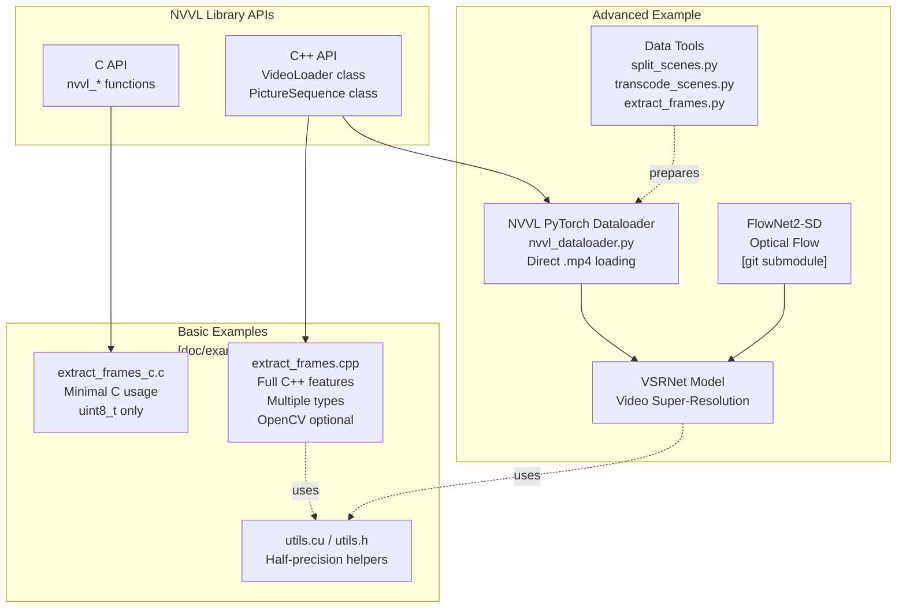
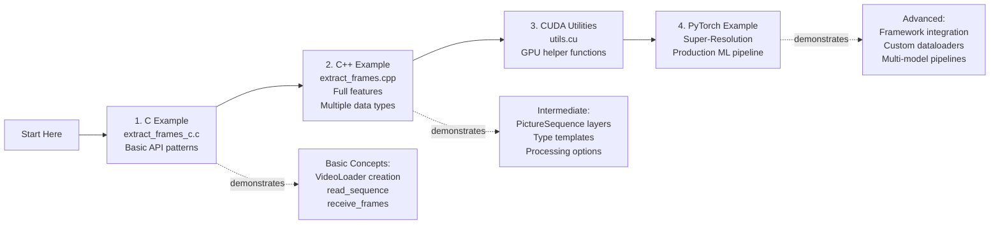
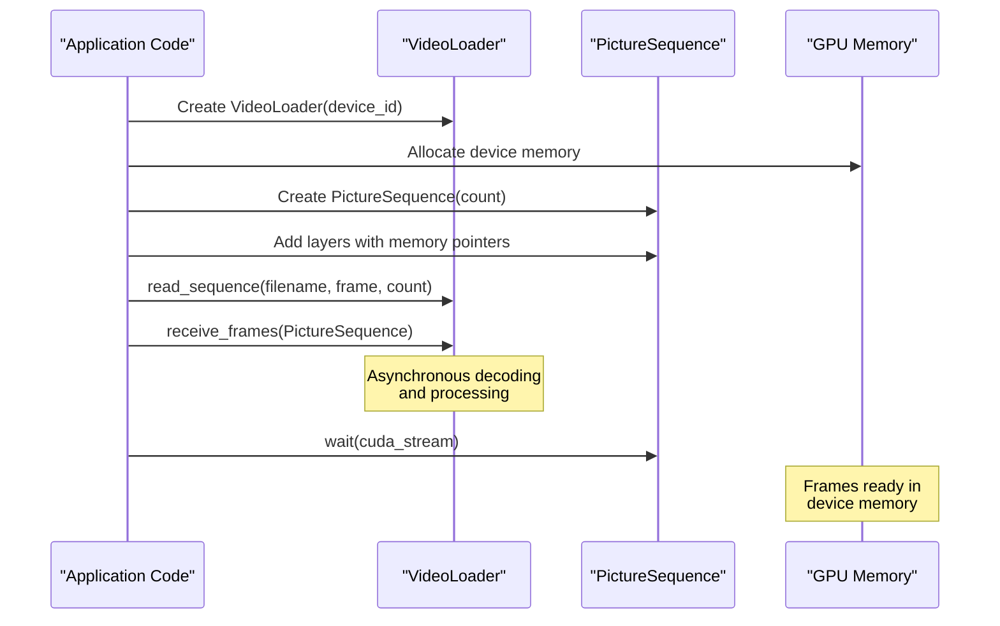

<!-- source: DeepWiki mcp.deepwiki.com · repo NVIDIA/nvvl · page 4 Examples and Tutorials · fetched 2026-10-26 -->

# Examples and Tutorials

<details>
<summary>Relevant source files</summary>

The following files were used as context for generating this wiki page:

- [README.md](README.md)
- [doc/CMakeLists.txt](doc/CMakeLists.txt)

</details>


This page provides an overview of the example applications and tutorials included with NVVL. These examples demonstrate how to use NVVL's APIs, ranging from basic frame extraction in C and C++ to advanced machine learning pipelines with PyTorch. Each example is documented in detail in its respective subsection.

The examples serve both as learning resources and as reference implementations for integrating NVVL into various types of applications. For information about building NVVL itself from source, see [Building from Source](#2.1). For detailed API documentation, see [Core Library](#3).

## Example Categories

NVVL provides examples organized by complexity and use case:

| Example | Language/Framework | Primary Purpose | Page |
|---------|-------------------|-----------------|------|
| C Frame Extraction | C | Demonstrate minimal C API usage for basic frame extraction | [4.2](#4.2) |
| C++ Frame Extraction | C++ | Demonstrate full C++ API with multiple data types and OpenCV integration | [4.1](#4.1) |
| CUDA Utilities | CUDA | Provide helper functions for precision conversions in GPU code | [4.3](#4.3) |
| PyTorch Super-Resolution | PyTorch/Python | Demonstrate real-world ML pipeline with NVVL dataloader, VSRNet, and FlowNet2 | [4.4](#4.4) |

Sources: [README.md:137-196]()

## Building Examples

Examples are located in [doc/examples]() and are built separately from the main NVVL library. After configuring the build with CMake as described in [Building from Source](#2.1), build the examples using:

```bash
make examples
```

The C++ frame extraction example has optional OpenCV integration. To enable this functionality, configure CMake with:

```bash
cmake .. -DWITH_OPENCV=1
```

Sources: [README.md:137-140]()

## Example Architecture



**Figure 1: Example Application Ecosystem**

This diagram shows the relationship between NVVL's APIs and the provided examples. Basic examples demonstrate direct library usage, while the advanced PyTorch example shows integration into a complete ML training pipeline.

Sources: [README.md:48-57](), [README.md:186-196]()

## Example Progression and Learning Path

The examples are designed to be studied in order of increasing complexity:



**Figure 2: Recommended Learning Path**

Sources: [README.md:186-196]()

### 1. C Frame Extraction ([4.2](#4.2))

The C example [doc/examples/extract_frames_c.c]() demonstrates the minimal C API interface. It shows:
- Creating a `nvvl_video_loader` with `nvvl_create_video_loader`
- Reading sequences with `nvvl_read_sequence`
- Setting up layers with `nvvl_set_layer`
- Receiving frames with `nvvl_receive_frames`

This example outputs `uint8_t` data only and is the simplest starting point for understanding NVVL's core concepts.

### 2. C++ Frame Extraction ([4.1](#4.1))

The C++ example [doc/examples/extract_frames.cpp]() demonstrates the full-featured C++ API. It shows:
- Using the `NVVL::VideoLoader` class with RAII
- Creating `PictureSequence` objects with typed layers
- Multiple data types: `float`, `half`, and `uint8_t`
- Various processing options: scaling, cropping, color space conversion
- Optional OpenCV integration for frame output

This example is the most comprehensive demonstration of NVVL's processing capabilities.

### 3. CUDA Utilities ([4.3](#4.3))

The utility files [doc/examples/utils.cu]() and [doc/examples/utils.h]() provide:
- `convertFp16toFp32`: Convert half-precision to single-precision on GPU
- `convertFp32toFp16`: Convert single-precision to half-precision on GPU

These utilities are used by both the C++ frame extraction example and the PyTorch super-resolution example for mixed-precision workflows.

### 4. PyTorch Super-Resolution ([4.4](#4.4))

The PyTorch example [examples/pytorch_superres]() demonstrates a complete production ML pipeline:
- Custom NVVL-based PyTorch `Dataset` implementation
- VSRNet architecture for video super-resolution
- FlowNet2-SD integration for motion compensation
- Data preparation tools for video dataset creation
- Training and evaluation scripts

This example shows real-world performance benefits quantified in the example's README.

Sources: [README.md:186-196](), [README.md:48-49]()

## Common Usage Patterns

All examples follow a common pattern for using NVVL:



**Figure 3: NVVL Usage Pattern Across All Examples**

This sequence is implemented differently in each example based on the API used (C vs C++) and the complexity of the processing pipeline, but the fundamental flow remains consistent.

Sources: [README.md:186-291]()

## Example Locations

The examples are organized in the repository as follows:

```
nvvl/
├── doc/
│   └── examples/          # Basic C and C++ examples
│       ├── extract_frames_c.c
│       ├── extract_frames.cpp
│       ├── utils.cu
│       └── utils.h
└── examples/
    └── pytorch_superres/  # Advanced PyTorch example
        ├── nvvl_dataloader.py
        ├── VSRNet.py
        ├── flownet2/      # Git submodule
        ├── split_scenes.py
        ├── transcode_scenes.py
        └── extract_frames.py
```

Sources: [README.md:137-140](), [README.md:48-57]()

## Data Requirements for Examples

All examples require video files prepared according to NVVL's specifications. The key requirements are:

- **Codec**: H.264 (`libx264`) or HEVC (`libx265`)
- **Pixel Format**: `yuv420p` (required for hardware decoder)
- **Keyframe Interval**: Set to match expected sequence length for optimal performance
- **Container**: Any FFmpeg-supported format (`.mp4`, `.mkv`, etc.)

For detailed information on preparing video data, see [Video Data Preparation](#2.3).

Example transcoding command:
```bash
ffmpeg -i input.mp4 -map v:0 -c:v libx264 -crf 18 \
       -pix_fmt yuv420p -g 5 -profile:v high output.mp4
```

Sources: [README.md:149-183]()

## Performance Measurements

The PyTorch super-resolution example includes detailed performance measurements demonstrating NVVL's benefits:

- **Storage Reduction**: H.264 `.mp4` files are ~40x smaller than `.png` frame sequences
- **CPU Load Reduction**: 50-60% of the CPU load compared to loading `.png` files
- **I/O Reduction**: Fewer bytes read from disk due to compressed format

These measurements were performed on NVIDIA DGX-1 systems and are documented in detail in the super-resolution example documentation.

Sources: [README.md:26-49]()

## Next Steps

After reviewing the examples overview:

1. **New Users**: Start with the C Frame Extraction example ([4.2](#4.2)) to learn basic NVVL concepts
2. **C++ Developers**: Proceed to the C++ Frame Extraction example ([4.1](#4.1)) for full API coverage
3. **ML Practitioners**: Review the PyTorch Super-Resolution example ([4.4](#4.4)) for production pipeline patterns
4. **Library Developers**: Study the CUDA Utilities ([4.3](#4.3)) for GPU processing integration

For building and installing NVVL, see [Getting Started](#2). For detailed API documentation, see [Core Library](#3).

Sources: [README.md:1-196]()

---

