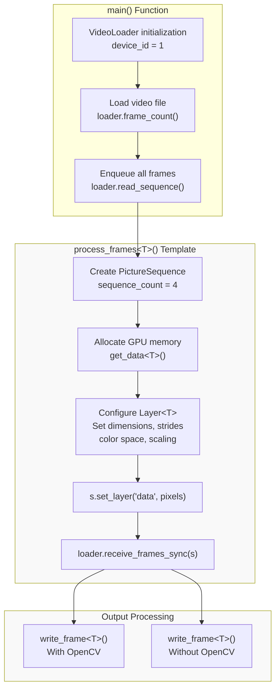
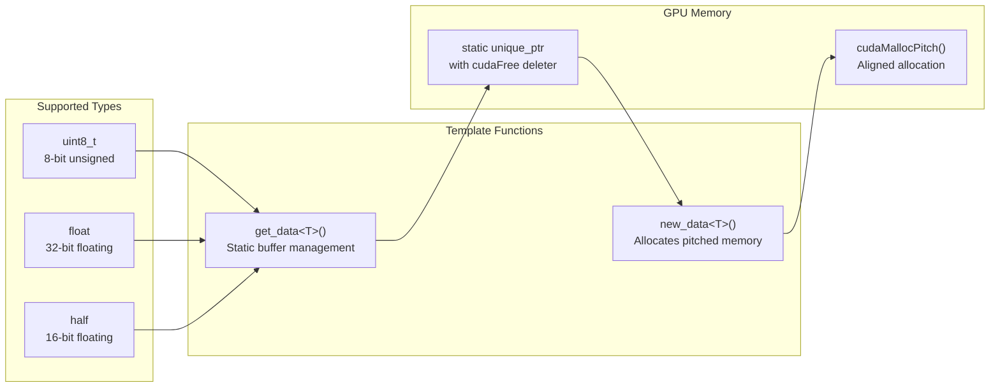
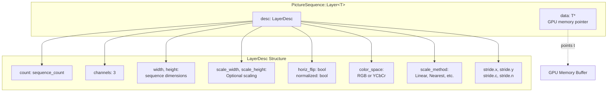
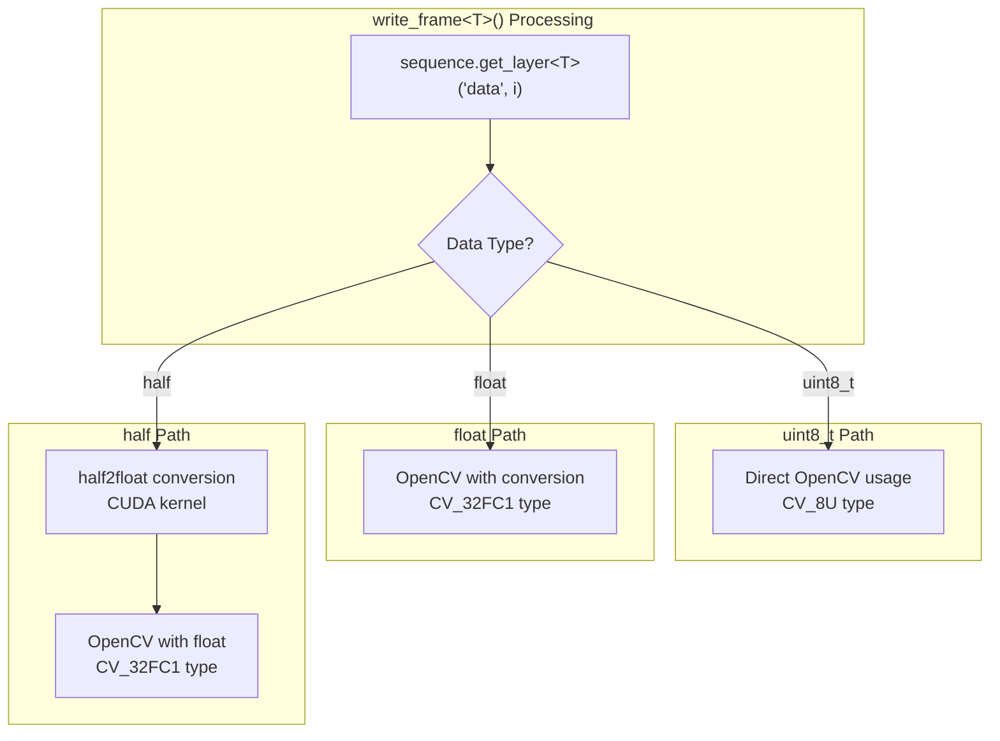
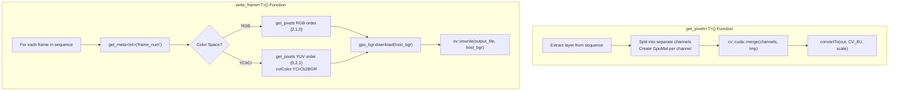
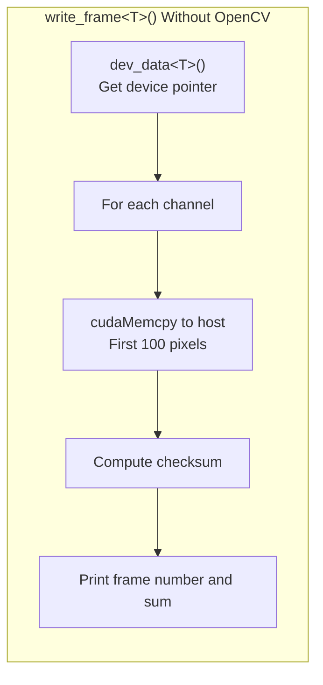
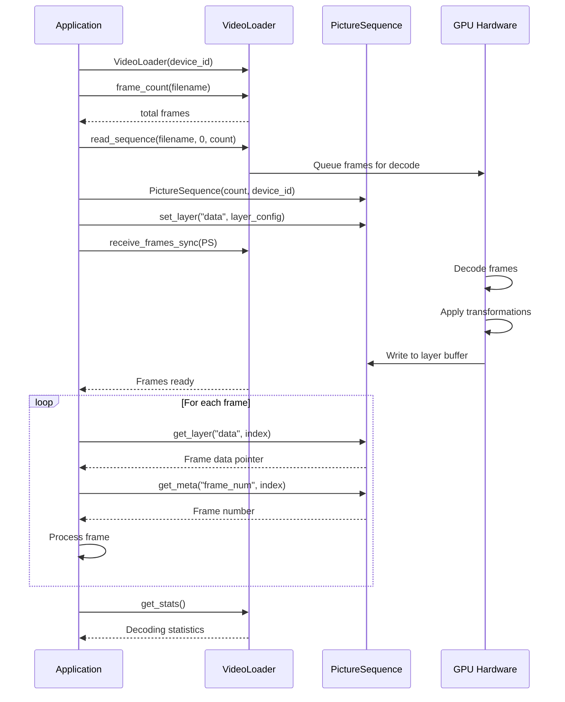

<!-- source: DeepWiki mcp.deepwiki.com · repo NVIDIA/nvvl · page 4.1 C++ Frame Extraction · fetched 2026-10-26 -->

# C++ Frame Extraction

<details>
<summary>Relevant source files</summary>

The following files were used as context for generating this wiki page:

- [doc/CMakeLists.txt](doc/CMakeLists.txt)
- [doc/examples/cuda/utils.cu](doc/examples/cuda/utils.cu)
- [doc/examples/cuda/utils.h](doc/examples/cuda/utils.h)
- [doc/examples/extract_frames.cpp](doc/examples/extract_frames.cpp)

</details>


This document provides a detailed walkthrough of the C++ frame extraction example, which demonstrates the full capabilities of NVVL's C++ API. The example shows how to extract and process video frames with support for multiple data types, color spaces, and transformations. For basic C API usage, see [C Frame Extraction](#4.2). For details on the CUDA utility functions used in this example, see [CUDA Utilities](#4.3).

Sources: [doc/examples/extract_frames.cpp:1-232]()

## Overview

The C++ frame extraction example (`extract_frames.cpp`) is a comprehensive demonstration of NVVL's capabilities. It processes a single video file through 16 different configurations, exercising various combinations of:

- **Data types**: `uint8_t`, `float`, `half` (FP16)
- **Color spaces**: RGB and YCbCr
- **Processing options**: scaling, normalization, horizontal flip
- **Output modes**: OpenCV-based PNG export (optional) or simple verification

The example showcases template-based programming patterns that allow the same code to handle different data types efficiently.

Sources: [doc/examples/extract_frames.cpp:192-232]()

## Processing Pipeline



**Diagram: C++ Frame Extraction Processing Flow**

The pipeline begins with video loading, proceeds through configuration and frame reception, and ends with output processing. The `process_frames` template function is called multiple times with different type parameters and configurations.

Sources: [doc/examples/extract_frames.cpp:162-232]()

## Configuration Parameters

The example uses several compile-time constants to define the processing configuration:

| Constant | Value | Purpose |
|----------|-------|---------|
| `sequence_width` | 640 | Output frame width (1280/2) |
| `sequence_height` | 360 | Output frame height (720/2) |
| `sequence_count` | 4 | Number of frames per batch |
| `scale_width` | 640 | Scaling target width |
| `scale_height` | 360 | Scaling target height |
| `device_id` | 1 | GPU device to use |

These constants are defined at the top of the file and used throughout to ensure consistency in buffer allocation and configuration.

Sources: [doc/examples/extract_frames.cpp:14-19]()

## Memory Management

The example uses a sophisticated template-based approach to manage GPU memory for different data types:



**Diagram: Memory Management Architecture**

### Memory Allocation Functions

The `new_data` template allocates pitched memory on the GPU:

```cpp
template<typename T>
T* new_data(size_t* pitch, size_t width, size_t height)
```

This function uses `cudaMallocPitch` to allocate properly aligned memory, which is crucial for optimal GPU performance. The pitch (stride in bytes) is returned to the caller.

The `get_data` template provides a singleton pattern for memory buffers:

```cpp
template<typename T>
auto get_data(size_t* ret_pitch)
```

This function maintains a static buffer for each data type, allocating it on first use and automatically freeing it via `std::unique_ptr` with a custom `cudaFree` deleter. The buffer is sized to hold `sequence_count * 3` frames (3 color channels).

Sources: [doc/examples/extract_frames.cpp:23-41]()

## Layer Configuration

The `process_frames` function demonstrates how to configure a `PictureSequence::Layer` for frame processing:



**Diagram: PictureSequence Layer Configuration**

The configuration process involves:

1. **Creating a PictureSequence**: `auto s = PictureSequence{sequence_count, device_id}`
2. **Allocating memory**: `pixels.data = get_data<T>(&pixels.desc.stride.y)`
3. **Setting dimensions**: `pixels.desc.width`, `pixels.desc.height`, `pixels.desc.count`, `pixels.desc.channels`
4. **Configuring transformations**: Optional scaling, flipping, normalization
5. **Setting color space**: `ColorSpace_RGB` or `ColorSpace_YCbCr`
6. **Computing strides**: Layout specification for memory access
7. **Registering the layer**: `s.set_layer("data", pixels)`

Sources: [doc/examples/extract_frames.cpp:167-186]()

### Stride Configuration

The stride configuration defines the memory layout:

| Stride | Value | Description |
|--------|-------|-------------|
| `stride.x` | 1 | Elements between horizontal pixels |
| `stride.y` | Pitch from allocation | Elements between vertical rows |
| `stride.c` | `stride.y * height` | Elements between color channels |
| `stride.n` | `stride.c * 3` | Elements between frames in sequence |

This configuration creates a channel-planar layout where all pixels of one channel are stored contiguously before the next channel begins.

Sources: [doc/examples/extract_frames.cpp:170-185]()

## Data Type Support

The example demonstrates three different data types, each with specific characteristics:

### Type Comparison

| Type | Size | Range | Normalized Range | Use Case |
|------|------|-------|------------------|----------|
| `uint8_t` | 8-bit | 0-255 | 0.0-1.0 | Standard image formats, minimal memory |
| `float` | 32-bit | Varies | 0.0-1.0 | High precision, ML training |
| `half` | 16-bit | Varies | 0.0-1.0 | Mixed precision training, memory efficiency |

### Type-Specific Handling



**Diagram: Type-Specific Processing Paths**

The `half` type requires special handling because OpenCV doesn't natively support FP16. The example provides a specialized template function that converts `half` to `float` using the `half2float` CUDA utility before processing with OpenCV.

Sources: [doc/examples/extract_frames.cpp:62-80](), [doc/examples/extract_frames.cpp:119-127]()

## OpenCV Integration

When compiled with `HAVE_OPENCV` defined, the example can write frames to PNG files:



**Diagram: OpenCV Processing Pipeline**

### Channel Order Handling

The `get_pixels` function handles channel ordering based on the source color space:

- **RGB input**: Channels are reordered from RGB to BGR using `{2, 1, 0}` to match OpenCV's expected BGR format
- **YCbCr input**: Channels are ordered as `{0, 2, 1}` (Y, Cr, Cb) then converted to BGR using `cv::cuda::cvtColor`

This ensures that regardless of the source color space, the output PNG files have correct colors.

Sources: [doc/examples/extract_frames.cpp:43-105]()

### Normalization Handling

When frames are normalized (values in 0.0-1.0 range), the conversion to 8-bit format applies a scale factor:

```cpp
tmp.convertTo(out, CV_8U, pixels.desc.normalized ? 255.0 : 1.0);
```

This multiplies normalized values by 255 to map them to the 0-255 range expected by 8-bit image formats.

Sources: [doc/examples/extract_frames.cpp:58](), [doc/examples/extract_frames.cpp:78]()

## Non-OpenCV Mode

When OpenCV is not available, the example provides a simple verification mode that reads and checksums sample pixels:



**Diagram: Non-OpenCV Verification Flow**

This mode is useful for:
- Testing NVVL functionality without OpenCV dependencies
- Quick verification that frames are being decoded correctly
- Performance testing without I/O overhead

The `host_type` template trait provides the appropriate host-side type for each device type, with special handling for `half` which is converted to `float` for CPU processing.

Sources: [doc/examples/extract_frames.cpp:106-158]()

## Example Configurations

The `main` function demonstrates 16 different processing configurations:

```mermaid
graph TB
    subgraph Configs["16 Processing Configurations"]
        direction TB
        Group1["Frames 0-3: uint8_t RGB, no scale"]
        Group2["Frames 4-7: uint8_t RGB, no scale, flip"]
        Group3["Frames 8-11: uint8_t RGB, scaled"]
        Group4["Frames 12-15: uint8_t RGB, scaled, flip"]
        Group5["Frames 16-19: uint8_t YCbCr, no scale"]
        Group6["Frames 20-23: uint8_t YCbCr, scaled"]
        Group7["Frames 24-27: float RGB, no scale"]
        Group8["Frames 28-31: float RGB, scaled"]
        Group9["Frames 32-35: float RGB, scaled, normalized"]
        Group10["Frames 36-39: float YCbCr, scaled"]
        Group11["Frames 40-43: float YCbCr, scaled, normalized"]
        Group12["Frames 44-47: half RGB, no scale"]
        Group13["Frames 48-51: half RGB, scaled"]
        Group14["Frames 52-55: half RGB, scaled, normalized"]
        Group15["Frames 56-59: half YCbCr, scaled"]
        Group16["Frames 60-63: half YCbCr, scaled, normalized"]
    end
```



**Diagram: Example Configuration Matrix**

### Configuration Patterns

The configurations follow a systematic pattern to test different combinations:

| Type | Color Space | Scaled | Normalized | Flipped | Frame Range |
|------|-------------|--------|------------|---------|-------------|
| uint8_t | RGB | No | No | No | 0-3 |
| uint8_t | RGB | No | No | Yes | 4-7 |
| uint8_t | RGB | Yes | No | No | 8-11 |
| uint8_t | RGB | Yes | No | Yes | 12-15 |
| uint8_t | YCbCr | No | No | No | 16-19 |
| uint8_t | YCbCr | Yes | No | No | 20-23 |
| float | RGB | No | No | No | 24-27 |
| float | RGB | Yes | No | No | 28-31 |
| float | RGB | Yes | Yes | No | 32-35 |
| float | YCbCr | Yes | No | No | 36-39 |
| float | YCbCr | Yes | Yes | No | 40-43 |
| half | RGB | No | No | No | 44-47 |
| half | RGB | Yes | No | No | 48-51 |
| half | RGB | Yes | Yes | No | 52-55 |
| half | YCbCr | Yes | No | No | 56-59 |
| half | YCbCr | Yes | Yes | No | 60-63 |

Sources: [doc/examples/extract_frames.cpp:208-224]()

## Usage Pattern

The typical usage pattern demonstrated in the example:

1. **Initialize VideoLoader**: Create a `VideoLoader` instance with a device ID
2. **Query video properties**: Use `frame_count()` to determine video length
3. **Enqueue frames**: Call `read_sequence()` to queue frames for decoding
4. **Configure PictureSequence**: Set up output buffers and processing parameters
5. **Receive frames**: Call `receive_frames_sync()` to get decoded frames
6. **Process frames**: Access frame data through `get_layer()` and metadata through `get_meta()`
7. **Check statistics**: Use `get_stats()` to monitor decoding performance

### Complete Example Flow



**Diagram: Sequence of Operations**

Sources: [doc/examples/extract_frames.cpp:192-231]()

## Performance Considerations

The example demonstrates several performance-oriented design choices:

### Memory Reuse
Static buffers in `get_data()` are allocated once and reused across all configurations, avoiding repeated allocation overhead.

### Pitched Memory
Using `cudaMallocPitch()` ensures optimal memory alignment for GPU access, improving transfer bandwidth and kernel performance.

### Synchronous Processing
The example uses `receive_frames_sync()` for simplicity, but production code would benefit from asynchronous processing (see [VideoLoader API](#3.2)).

### Batch Processing
Processing 4 frames at a time (`sequence_count = 4`) amortizes the overhead of GPU operations across multiple frames.

Sources: [doc/examples/extract_frames.cpp:34-39]()

## Building and Running

The example is built as part of the NVVL build process when examples are enabled. To build:

```bash
mkdir build && cd build
cmake -DBUILD_EXAMPLES=ON ..
make
```

To run:

```bash
# With OpenCV (writes PNG files)
./examples/extract_frames /path/to/video.mp4

# Without OpenCV (prints checksums)
./examples/extract_frames /path/to/video.mp4
```

The example expects an `output/frames` directory to exist when running with OpenCV support.

Sources: [doc/examples/extract_frames.cpp:192-196]()

## Statistics Output

After processing all configurations, the example prints decoding statistics:

```cpp
auto stats = loader.get_stats();
std::cout << "Total video packets read: " << stats.packets_read
          << " (" << stats.bytes_read << " bytes)\n"
          << "Total frames used: " << stats.frames_used
          << std::endl;
```

This provides insight into:
- **packets_read**: Number of compressed video packets decoded
- **bytes_read**: Total bytes of compressed video data processed
- **frames_used**: Number of frames actually used by the application

These statistics help assess the efficiency of video processing and can guide optimization efforts.

Sources: [doc/examples/extract_frames.cpp:225-229]()

---

