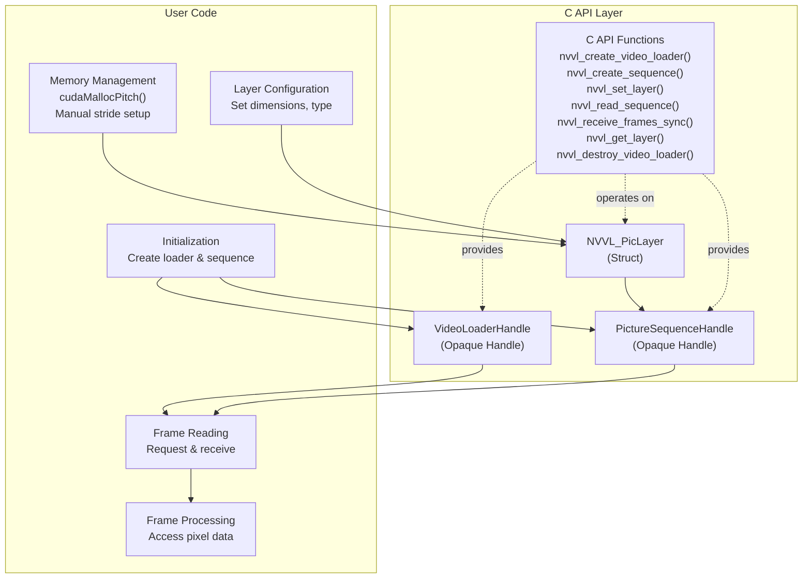
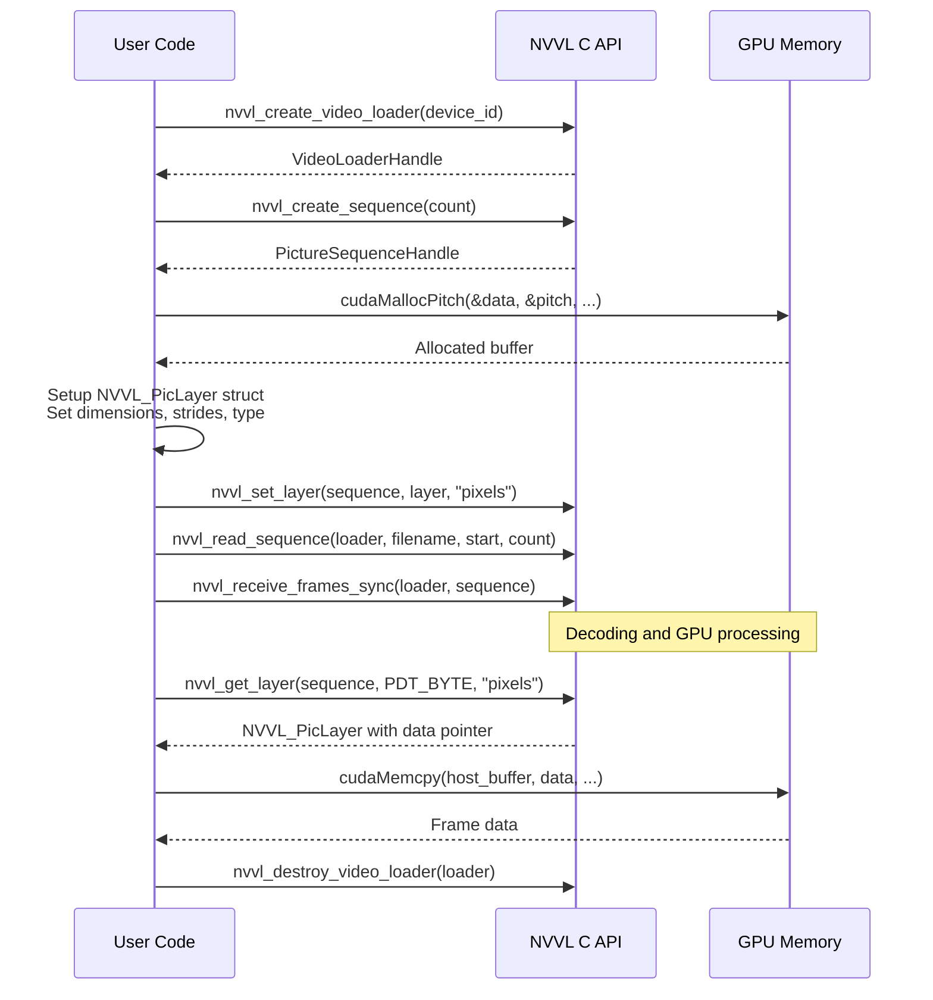
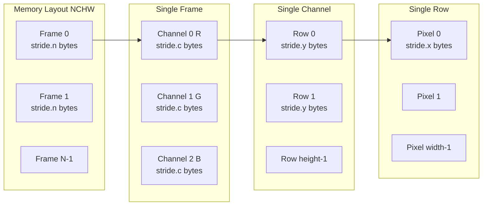

<!-- source: DeepWiki mcp.deepwiki.com · repo NVIDIA/nvvl · page 4.2 C Frame Extraction · fetched 2026-10-26 -->

# C Frame Extraction

<details>
<summary>Relevant source files</summary>

The following files were used as context for generating this wiki page:

- [doc/CMakeLists.txt](doc/CMakeLists.txt)
- [doc/examples/cuda/utils.cu](doc/examples/cuda/utils.cu)
- [doc/examples/cuda/utils.h](doc/examples/cuda/utils.h)
- [doc/examples/extract_frames_c.c](doc/examples/extract_frames_c.c)

</details>


## Purpose and Scope

This document covers the C frame extraction example, which demonstrates the minimal C API interface for NVVL. The example shows how to decode video frames using NVVL's C API, focusing on basic uint8_t output and manual memory management patterns.

For C++ API usage with additional features like OpenCV integration and multiple data types, see [C++ Frame Extraction](#4.1). For CUDA utility functions used in other examples, see [CUDA Utilities](#4.3).

**Sources:** [doc/examples/extract_frames_c.c:1-67]()

---

## Overview

The C frame extraction example demonstrates NVVL's C API, which provides a lower-level interface suitable for integration with C codebases or language bindings. Unlike the C++ API, the C interface uses opaque handles, explicit memory management, and a more verbose configuration style.

The example performs the following operations:
1. Initialize a video loader
2. Create a picture sequence buffer
3. Manually allocate and configure GPU memory for frames
4. Read and decode a sequence of frames
5. Validate the output by computing a checksum

**Sources:** [doc/examples/extract_frames_c.c:30-67]()

---

## C API Architecture



**Diagram: C API Structure**

The C API uses opaque handles (`VideoLoaderHandle`, `PictureSequenceHandle`) that encapsulate internal implementation details. Users configure frames through the `NVVL_PicLayer` struct, which requires manual memory allocation and stride calculation.

**Sources:** [doc/examples/extract_frames_c.c:40-62]()

---

## API Call Sequence



**Diagram: C API Call Sequence**

This sequence shows the complete lifecycle of frame extraction using the C API. Note the synchronous `nvvl_receive_frames_sync` call, which blocks until all frames are decoded.

**Sources:** [doc/examples/extract_frames_c.c:40-66]()

---

## Memory Layout Configuration

The C API requires explicit memory layout configuration through the `NVVL_PicLayer` structure. Understanding the stride calculations is critical for correct operation.

### NVVL_PicLayer Structure

| Field | Type | Purpose |
|-------|------|---------|
| `desc.count` | `uint16_t` | Number of frames in sequence |
| `desc.channels` | `uint16_t` | Number of color channels (3 for RGB) |
| `desc.width` | `uint16_t` | Frame width in pixels |
| `desc.height` | `uint16_t` | Frame height in pixels |
| `desc.stride.x` | `size_t` | Bytes between adjacent pixels (typically 1) |
| `desc.stride.y` | `size_t` | Bytes between rows (from cudaMallocPitch) |
| `desc.stride.c` | `size_t` | Bytes between color channels |
| `desc.stride.n` | `size_t` | Bytes between frames |
| `type` | `enum` | Data type (PDT_BYTE, PDT_HALF, PDT_FLOAT) |
| `data` | `void*` | GPU memory pointer |



**Diagram: NVVL_PicLayer Memory Layout (NCHW Format)**

NVVL uses NCHW (batch, channels, height, width) format. The stride values define the byte offsets needed to traverse each dimension.

**Sources:** [doc/examples/extract_frames_c.c:44-59]()

---

## Example Walkthrough

### Initialization

The example begins by creating the core NVVL objects:

```
VideoLoaderHandle loader = nvvl_create_video_loader(0);
PictureSequenceHandle sequence = nvvl_create_sequence(sequence_count);
```

[doc/examples/extract_frames_c.c:40-42]()

- `nvvl_create_video_loader(0)` creates a loader on GPU device 0
- `nvvl_create_sequence(10)` creates a buffer for 10 frames

### Memory Allocation and Configuration

The example manually allocates GPU memory and configures strides:

```c
struct NVVL_PicLayer b;
memset(&b, 0, sizeof(b));
b.desc.count = sequence_count;    // 10 frames
b.desc.channels = 3;               // RGB
b.desc.width = sequence_width;     // 400 pixels
b.desc.height = sequence_height;   // 400 pixels
b.type = PDT_BYTE;                 // uint8_t output

cudaMallocPitch(&b.data, &b.desc.stride.y, 
                b.desc.width, 
                b.desc.height * sequence_count * 3);

b.desc.stride.x = 1;                              // 1 byte per pixel
b.desc.stride.c = b.desc.stride.y * b.desc.height; // Full channel
b.desc.stride.n = b.desc.stride.c * 3;             // Full frame (3 channels)
```

[doc/examples/extract_frames_c.c:44-58]()

Key points:
- `cudaMallocPitch` allocates aligned memory and returns the row stride in `b.desc.stride.y`
- Total allocation: `width * (height * count * channels)` = 400 × (400 × 10 × 3) = 4.8 MB
- Stride calculations ensure proper memory layout for NCHW format

### Reading Frames

Frame reading uses two API calls:

```c
nvvl_read_sequence(loader, argv[1], 0, sequence_count);
nvvl_receive_frames_sync(loader, sequence);
```

[doc/examples/extract_frames_c.c:61-62]()

- `nvvl_read_sequence` initiates decoding from frame 0
- `nvvl_receive_frames_sync` blocks until all frames are decoded and transferred to GPU

### Accessing Frame Data

The example retrieves and validates frames:

```c
struct NVVL_PicLayer pixels = nvvl_get_layer(sequence, PDT_BYTE, "pixels");
for (int i = 0; i < pixels.desc.count; i++) {
    uint8_t* p = pixels.data + i*pixels.desc.stride.n;
    uint8_t tmp[100];
    cudaMemcpy(tmp, p, 100, cudaMemcpyDeviceToHost);
    
    uint32_t sum = 0;
    for (int j = 0; j < 100; j++) {
        sum += tmp[j];
    }
    printf(" Frame %d sum (first 100): %d\n", i, sum);
}
```

[doc/examples/extract_frames_c.c:10-27]()

This computes a simple checksum of the first 100 bytes of each frame to verify data was decoded correctly.

**Sources:** [doc/examples/extract_frames_c.c:10-27](), [doc/examples/extract_frames_c.c:61-63]()

---

## Key Differences from C++ API

The C API has several important differences from the C++ API documented in [C++ Frame Extraction](#4.1):

| Aspect | C API | C++ API |
|--------|-------|---------|
| **Handle Management** | Opaque handles (`VideoLoaderHandle`) | Smart pointers/RAII |
| **Memory Allocation** | Manual with `cudaMallocPitch` | Automatic or optional manual |
| **Type Safety** | Void pointers, explicit type enum | Template-based |
| **Error Handling** | Return codes, NULL checks | Exceptions |
| **Data Types** | Limited (uint8_t example) | Multiple (uint8_t, half, float) |
| **Configuration** | Manual struct setup | Method chaining |
| **OpenCV Integration** | Not demonstrated | Built-in support |

### Code Comparison: Initialization

**C API:**
```c
VideoLoaderHandle loader = nvvl_create_video_loader(0);
PictureSequenceHandle sequence = nvvl_create_sequence(10);
```

**C++ API (for comparison):**
```cpp
NVVL::VideoLoader loader(0);
PictureSequence sequence(10, 400, 400);
```

The C++ API provides RAII-based resource management, while the C API requires explicit cleanup with `nvvl_destroy_video_loader()`.

**Sources:** [doc/examples/extract_frames_c.c:40-42](), [doc/examples/extract_frames_c.c:65]()

---

## Data Type Support

The C example demonstrates only `PDT_BYTE` (uint8_t) output:

```c
b.type = PDT_BYTE;
```

[doc/examples/extract_frames_c.c:50]()

The C API supports three data types via the `PictureDataType` enum:
- `PDT_BYTE` - 8-bit unsigned integer (0-255)
- `PDT_HALF` - 16-bit floating point
- `PDT_FLOAT` - 32-bit floating point

However, the example only demonstrates `PDT_BYTE`. For half-precision conversion utilities, see [CUDA Utilities](#4.3).

**Sources:** [doc/examples/extract_frames_c.c:50]()

---

## Building the Example

The C example is built as part of the NVVL examples. It has minimal dependencies:

**Required:**
- CUDA Runtime (for `cudaMallocPitch`, `cudaMemcpy`)
- NVVL library (`libnvvl.so`)
- Standard C library

**Build command:**
```bash
mkdir build && cd build
cmake ..
make extract_frames_c
```

The resulting executable accepts a video file path as its only argument:

```bash
./extract_frames_c /path/to/video.mp4
```

**Sources:** [doc/examples/extract_frames_c.c:31-34]()

---

## Usage Patterns

### Recommended Use Cases

The C API is appropriate for:

1. **C Projects** - Integration with existing C codebases
2. **Language Bindings** - Creating Python, Rust, or other language wrappers
3. **Minimal Dependencies** - When C++ runtime is unavailable
4. **Fine-Grained Control** - When manual memory management is required

### Not Recommended For

1. **C++ Projects** - Use the C++ API for better type safety and RAII
2. **Complex Processing** - The C++ API has more convenience features
3. **OpenCV Integration** - The C++ example shows direct OpenCV interop

**Sources:** [doc/examples/extract_frames_c.c:1-67]()

---

## Error Handling

The example demonstrates minimal error handling:

```c
if (cudaMemcpy(tmp, p, 100, cudaMemcpyDeviceToHost) != cudaSuccess) {
    fprintf(stderr, "Couldn't copy frame data to cpu\n");
    exit(1);
}
```

[doc/examples/extract_frames_c.c:16-19]()

Production code should add:
- NULL checks after `nvvl_create_video_loader` and `nvvl_create_sequence`
- CUDA error checking after `cudaMallocPitch`
- Validation of returned layer dimensions
- Proper cleanup in error paths

**Sources:** [doc/examples/extract_frames_c.c:16-19](), [doc/examples/extract_frames_c.c:52-55]()

---

## Summary

The C frame extraction example demonstrates NVVL's minimal C API interface. It shows the essential pattern of:

1. Creating loader and sequence handles
2. Manually allocating GPU memory with proper alignment
3. Configuring the `NVVL_PicLayer` structure with explicit strides
4. Reading frames synchronously
5. Accessing decoded frame data

This example serves as a foundation for C integrations and language bindings, though C++ applications should prefer the more ergonomic C++ API documented in [C++ Frame Extraction](#4.1).

**Sources:** [doc/examples/extract_frames_c.c:1-67]()

---

