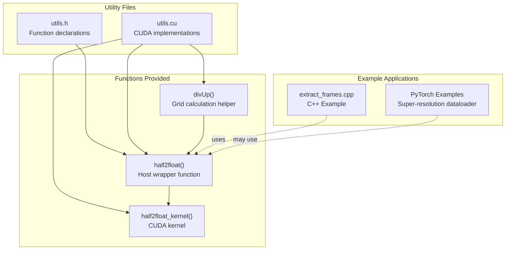
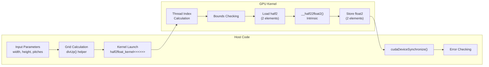
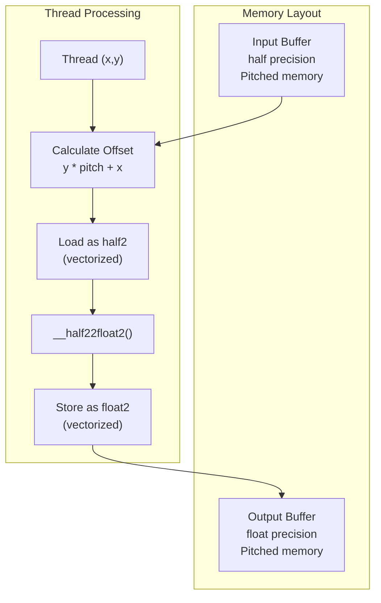
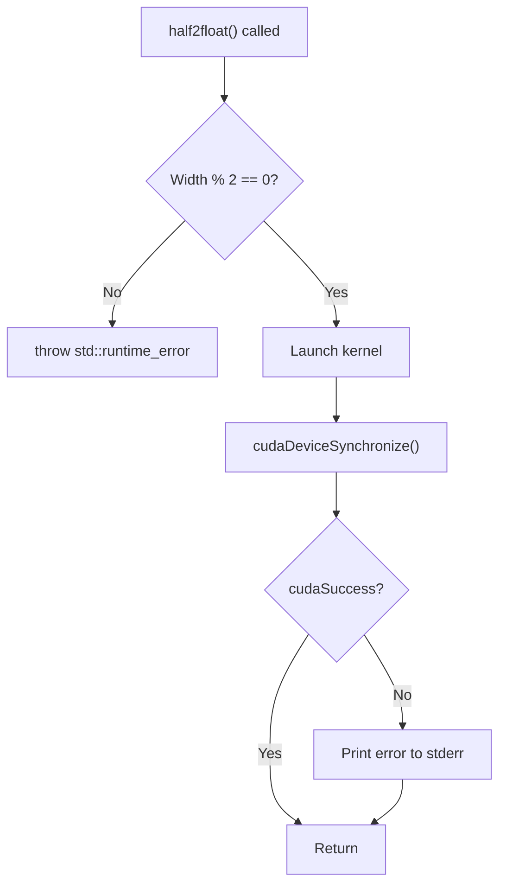

<!-- source: DeepWiki mcp.deepwiki.com · repo NVIDIA/nvvl · page 4.3 CUDA Utilities · fetched 2026-10-26 -->

# CUDA Utilities

<details>
<summary>Relevant source files</summary>

The following files were used as context for generating this wiki page:

- [doc/examples/cuda/utils.cu](doc/examples/cuda/utils.cu)
- [doc/examples/cuda/utils.h](doc/examples/cuda/utils.h)

</details>


## Purpose and Scope

This document covers the CUDA utility functions provided in the NVVL repository to support the example applications. These utilities are located in `doc/examples/cuda/` and primarily provide precision conversion operations needed when working with different data types in NVVL's output. The utilities are designed for use in the examples rather than being part of the core NVVL library.

For information about the core NVVL library GPU processing capabilities, see [GPU Processing Pipeline](#3.4). For usage of these utilities in context, see [C++ Frame Extraction](#4.1) and [PyTorch Super-Resolution](#4.4).

## Utility Files Overview

The CUDA utilities consist of two files that provide helper functions for the example applications:

| File | Purpose |
|------|---------|
| `doc/examples/cuda/utils.h` | Header file declaring utility function interfaces |
| `doc/examples/cuda/utils.cu` | CUDA implementation of utility functions and kernels |

**Utility Files Structure**



Sources: [doc/examples/cuda/utils.h:1-6](), [doc/examples/cuda/utils.cu:1-47]()

## Half-Precision to Float Conversion

The primary utility provided is `half2float`, which converts half-precision (16-bit) floating-point data to single-precision (32-bit) floating-point format on the GPU.

### Function Signature

```cpp
void half2float(half* input, size_t input_pitch,
                uint16_t width, uint16_t height,
                float* output, size_t output_pitch);
```

### Parameters

| Parameter | Type | Description |
|-----------|------|-------------|
| `input` | `half*` | Pointer to input half-precision data in GPU memory |
| `input_pitch` | `size_t` | Row stride of input data in elements (for 2D pitched memory) |
| `width` | `uint16_t` | Width of the data in elements |
| `height` | `uint16_t` | Height of the data in rows |
| `output` | `float*` | Pointer to output float data buffer in GPU memory |
| `output_pitch` | `size_t` | Row stride of output data in elements (for 2D pitched memory) |

**Constraint**: The width parameter must be a multiple of 2 for optimal vectorized processing. The function throws a `std::runtime_error` if this requirement is not met.

Sources: [doc/examples/cuda/utils.h:3-5](), [doc/examples/cuda/utils.cu:28-46]()

## Implementation Architecture

The conversion is implemented as a CUDA kernel with a host wrapper that handles kernel launch configuration and error checking.

### Conversion Pipeline



Sources: [doc/examples/cuda/utils.cu:8-46]()

### Kernel Design

The `half2float_kernel` processes data using vectorized operations for improved performance:

**Thread Organization**:
- Block dimensions: 32×8 threads [doc/examples/cuda/utils.cu:31]()
- Each thread processes 2 half-precision elements (1 `half2` vector) [doc/examples/cuda/utils.cu:11]()
- Grid dimensions calculated using `divUp` helper [doc/examples/cuda/utils.cu:32]()

**Memory Access Pattern**:


Sources: [doc/examples/cuda/utils.cu:8-22]()

### Vectorized Conversion

The kernel uses CUDA's vectorized half-precision intrinsics for efficiency:

1. **Input Access**: Data is loaded as `half2` (2 packed half values) using reinterpret_cast [doc/examples/cuda/utils.cu:21]()
2. **Conversion**: Uses `__half22float2()` intrinsic for hardware-accelerated conversion [doc/examples/cuda/utils.cu:21]()
3. **Output Storage**: Results are stored as `float2` (2 packed float values) [doc/examples/cuda/utils.cu:20]()

This approach processes 2 elements per thread with a single conversion instruction, improving throughput compared to element-by-element processing.

Sources: [doc/examples/cuda/utils.cu:17-21]()

## Helper Functions

### Grid Size Calculation

The `divUp` function is a utility for calculating grid dimensions when launching CUDA kernels:

```cpp
int divUp(int total, int grain) {
    return (total + grain - 1) / grain;
}
```

This computes the ceiling of integer division, ensuring sufficient grid blocks to cover all data elements. It is used to calculate grid dimensions from image dimensions and block sizes.

Sources: [doc/examples/cuda/utils.cu:24-26]()

## Error Handling

The `half2float` function includes comprehensive error handling:

| Check Type | Location | Behavior |
|------------|----------|----------|
| Width validation | Before kernel launch | Throws `std::runtime_error` if width is odd [doc/examples/cuda/utils.cu:34-36]() |
| CUDA errors | After `cudaDeviceSynchronize()` | Prints error message to stderr [doc/examples/cuda/utils.cu:40-45]() |

**Error Handling Flow**



Sources: [doc/examples/cuda/utils.cu:34-45]()

## Usage Context

These utilities are designed to support NVVL's example applications when working with different precision formats:

**Typical Usage Scenario**:
1. NVVL can output data in half-precision format (`PictureSequence::PDT_HALF`) for memory efficiency
2. Downstream processing or visualization may require single-precision float data
3. The `half2float` utility performs on-GPU conversion without CPU involvement
4. Data remains in GPU memory throughout the pipeline

**Integration Points**:
- C++ frame extraction example may use this when configured for half-precision output
- PyTorch examples may use this for data type conversion in custom dataloaders
- Any custom example that needs to convert between precision formats

Sources: [doc/examples/cuda/utils.cu:1-47]()

## Performance Characteristics

The implementation prioritizes simplicity and correctness for example code rather than maximum optimization, as noted in the comment at [doc/examples/cuda/utils.cu:7]().

**Design Characteristics**:
- Vectorized processing (2 elements per thread) provides reasonable performance
- Simple grid configuration (32×8 blocks) works well for typical image sizes
- Synchronous execution with `cudaDeviceSynchronize()` ensures completion before returning
- Memory pitch support enables efficient handling of CUDA's 2D allocated memory

**Performance Considerations**:
- Block size of 32×8 = 256 threads provides good occupancy on modern GPUs
- Vectorized `half2`/`float2` operations reduce memory transactions by 2×
- Width must be even to leverage vectorization (enforced by runtime check)

Sources: [doc/examples/cuda/utils.cu:7-46]()

## Technical Dependencies

The utilities require the following CUDA components:

| Dependency | Purpose |
|------------|---------|
| `<cuda_runtime.h>` | CUDA runtime API for kernel launches and synchronization |
| `<cuda_fp16.h>` | Half-precision types (`half`, `half2`) and intrinsics (`__half22float2`) |

Standard C++ headers (`<iostream>`, `<stdexcept>`, `<stdint.h>`) are used for error handling and type definitions.

Sources: [doc/examples/cuda/utils.cu:1-5]()

---

