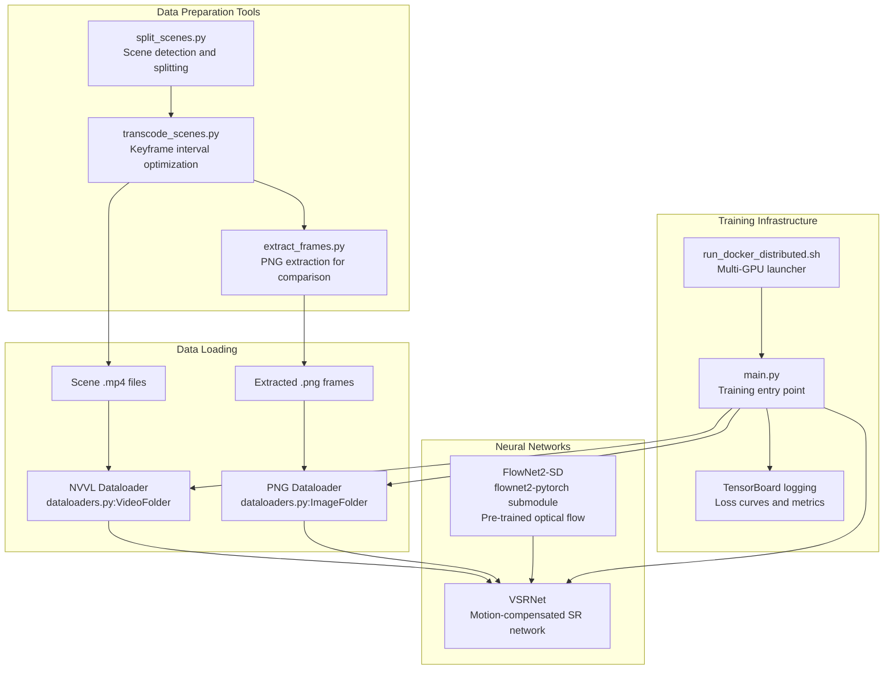
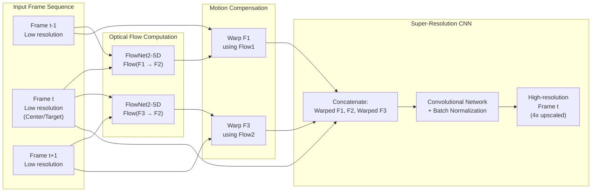
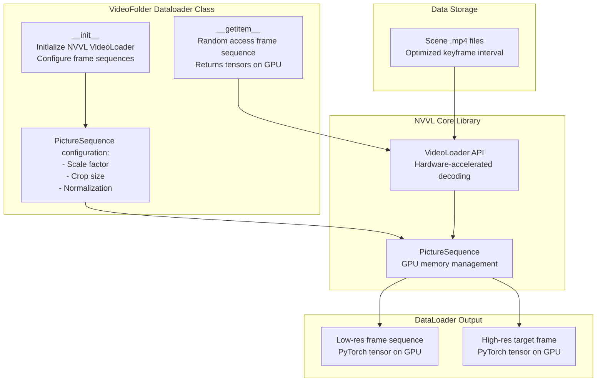
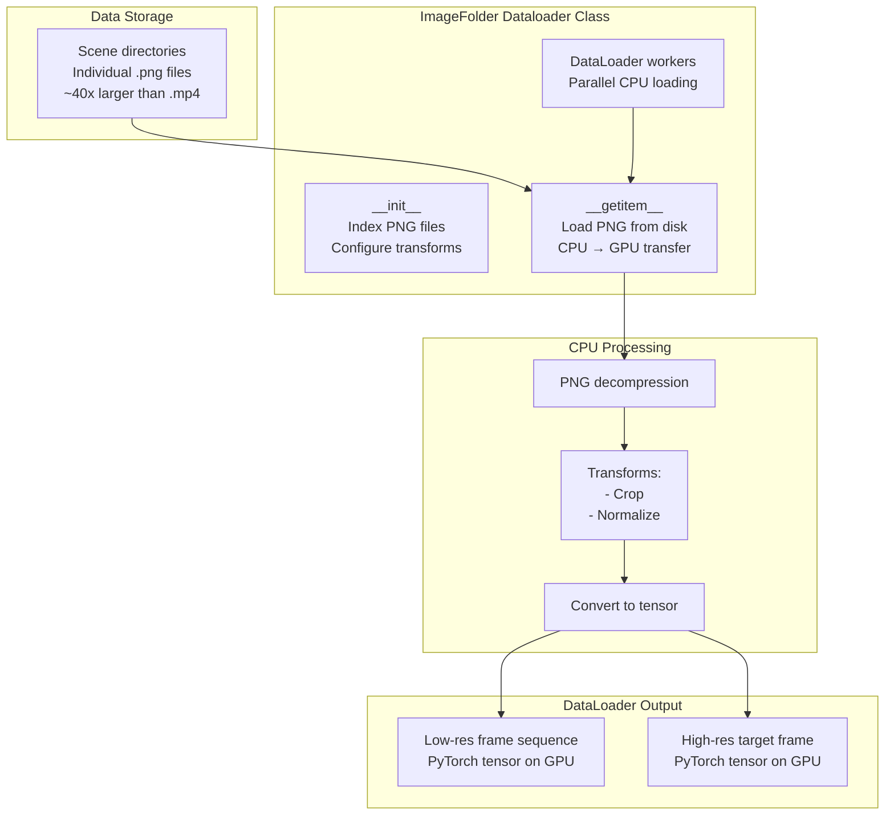
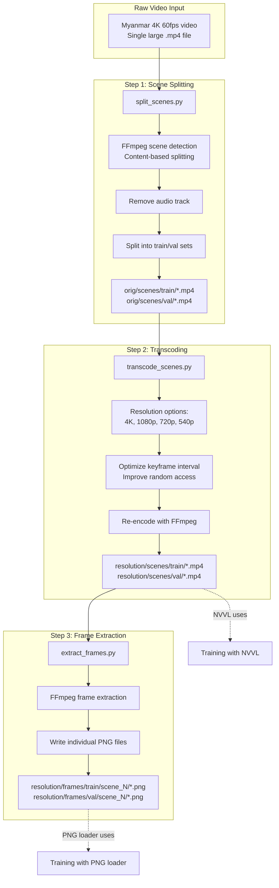
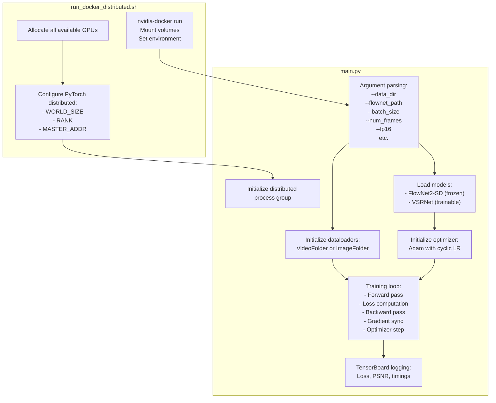

<!-- source: DeepWiki mcp.deepwiki.com · repo NVIDIA/nvvl · page 4.4 PyTorch Super-Resolution · fetched 2026-10-26 -->

# PyTorch Super-Resolution

<details>
<summary>Relevant source files</summary>

The following files were used as context for generating this wiki page:

- [examples/pytorch_superres/.gitignore](examples/pytorch_superres/.gitignore)
- [examples/pytorch_superres/LICENSE](examples/pytorch_superres/LICENSE)
- [examples/pytorch_superres/README.md](examples/pytorch_superres/README.md)
- [examples/pytorch_superres/data/input.png](examples/pytorch_superres/data/input.png)
- [examples/pytorch_superres/data/predicted.png](examples/pytorch_superres/data/predicted.png)

</details>


## Purpose

This page documents the PyTorch super-resolution example, which demonstrates NVVL usage in a real-world machine learning application. The example implements VSRNet, a video super-resolution network that uses optical flow-based motion compensation to upscale video frames by 4x. This example showcases NVVL's integration with PyTorch dataloaders for efficient video frame loading directly from compressed .mp4 files, as well as distributed multi-GPU training infrastructure.

For basic NVVL API usage patterns, see [C++ Frame Extraction](#4.1) and [C Frame Extraction](#4.2). For information on building the core library, see [Building from Source](#2.1).

## System Overview

The super-resolution example consists of four major subsystems: the VSRNet neural network architecture, the FlowNet2-SD optical flow network (integrated as a git submodule), NVVL-based data loading infrastructure, and data preparation utilities. The system replicates the architecture from "End-to-End Learning of Video Super-Resolution with Motion Compensation" by Makansi et al. (2017).



**Sources:** [examples/pytorch_superres/README.md:1-192]()

## Network Architecture

### VSRNet Processing Pipeline

VSRNet takes an odd number of consecutive video frames (typically 3, 5, or 7) and produces a single upscaled version of the center frame. The outer frames are warped to align with the center frame using optical flow computed by FlowNet2-SD, then all frames are fed through a convolutional network to predict the high-resolution output.



**Sources:** [examples/pytorch_superres/README.md:3-8]()

### FlowNet2-SD Integration

FlowNet2-SD is a pre-trained optical flow network integrated as a git submodule at `flownet2-pytorch/`. The network must be initialized with pre-trained weights before training VSRNet. The default weight location is `flownet2-pytorch/networks/FlowNet2-SD_checkpoint.pth.tar`, configurable via the `--flownet_path` argument to `main.py`.

| Component | Description |
|-----------|-------------|
| **Submodule Path** | `flownet2-pytorch/` |
| **Source Repository** | https://github.com/NVIDIA/flownet2-pytorch |
| **Initialization** | `git submodule init && git submodule update` |
| **Weight File** | `FlowNet2-SD_checkpoint.pth.tar` (173MB) |
| **Configuration Parameter** | `--flownet_path` in `main.py` |
| **Role** | Compute optical flow between consecutive frames for motion compensation |

**Sources:** [examples/pytorch_superres/README.md:76-90]()

## Data Loading Architecture

### NVVL-Based Dataloader

The NVVL dataloader, implemented in the `VideoFolder` class within `dataloading/dataloaders.py`, enables random access to frame sequences directly from compressed .mp4 files. This eliminates the need to extract and store individual frames as images, significantly reducing disk usage and I/O overhead.



**Sources:** [examples/pytorch_superres/README.md:12-19]()

### PyTorch PNG Dataloader

The PNG dataloader, implemented in the `ImageFolder` class within `dataloading/dataloaders.py`, provides a baseline comparison by loading pre-extracted PNG frames from disk. This approach requires substantially more disk space and CPU resources for frame decompression and loading.



**Sources:** [examples/pytorch_superres/README.md:14-19]()

### Performance Comparison

The README provides detailed performance benchmarks comparing NVVL and PNG dataloaders across multiple training configurations. NVVL consistently demonstrates lower CPU load, reduced host memory usage, dramatically reduced disk space requirements, and faster per-iteration data loading times.

| Metric | NVVL Advantage |
|--------|----------------|
| **CPU Load** | Reduced by ~40% (10 vs 17-20 for PNG) |
| **Host Memory** | Reduced by ~15-20% (4.0% vs 4.7-4.8%) |
| **Disk Space** | Reduced by ~40-65x (0.592-0.961 GB vs 23-38 GB) |
| **Data Loading Time** | Reduced by 3-13x (0.21-0.91 ms vs 2.66-3.15 ms) |

Example configuration (540p, no crop, fp32, batch size 7):

| Data Loader | CPU Load | Peak Host Memory (%) | Disk Space (GB) | Per Iteration Data Time (ms) |
|-------------|----------|---------------------|-----------------|------------------------------|
| NVVL        | 10       | 4.0                 | 0.592           | 0.91                         |
| PNG (10 workers) | 17  | 4.7                 | 23              | 2.73                         |

**Note:** Per-iteration data loading times are measured with CUDA synchronization. Due to asynchronous loading, this latency may be hidden by computation unless the model forward/backward pass is faster than data loading.

**Sources:** [examples/pytorch_superres/README.md:20-47]()

## Data Preparation Pipeline

The example provides three Python tools for preparing the Myanmar 60p video dataset. These tools are designed to be run sequentially, each taking the output of the previous step as input.



### Scene Splitting Tool

The `split_scenes.py` tool performs scene detection on the raw video file, splits it into individual scenes, removes the audio track, and organizes scenes into training and validation directories. This is the first step in data preparation.

**Usage:**
```bash
python ./tools/split_scenes.py --raw_data <path_to_mp4_file> --out_data <data_dir>
```

**Output Structure:**
- `<data_dir>/orig/scenes/train/*.mp4` - Training scenes
- `<data_dir>/orig/scenes/val/*.mp4` - Validation scenes

**Sources:** [examples/pytorch_superres/README.md:103-112]()

### Transcoding Tool

The `transcode_scenes.py` tool re-encodes scene files to optimize keyframe intervals for random access and optionally downscales to lower resolutions. Shorter keyframe intervals improve NVVL's random access performance by reducing the distance to the nearest keyframe when seeking to arbitrary frames.

**Usage:**
```bash
python ./tools/transcode_scenes.py --master_data <data_dir> --resolution <resolution>
```

**Supported Resolutions:**
- `4K` - 3840x2160
- `1080p` - 1920x1080
- `720p` - 1280x720
- `540p` - 960x540

**Output Structure:**
- `<data_dir>/<resolution>/scenes/train/*.mp4` - Training scenes
- `<data_dir>/<resolution>/scenes/val/*.mp4` - Validation scenes

**Sources:** [examples/pytorch_superres/README.md:114-123]()

### Frame Extraction Tool

The `extract_frames.py` tool extracts individual PNG frames from scene .mp4 files for use with the PNG-based dataloader. This step is only necessary for performance comparison with the PNG dataloader; NVVL training can proceed directly from the transcoded .mp4 files.

**Usage:**
```bash
python ./tools/extract_frames.py --master_data <data_dir> --resolution <resolution>
```

**Output Structure:**
- `<data_dir>/<resolution>/frames/train/scene_N/*.png` - Training frames
- `<data_dir>/<resolution>/frames/val/scene_N/*.png` - Validation frames

Where `scene_N` is one directory per scene containing sequential frame files.

**Sources:** [examples/pytorch_superres/README.md:125-134]()

## Training Infrastructure

### Entry Points and Configuration

Training is initiated through `main.py`, which configures the network architecture, dataloaders, optimizer, and training loop. The `run_docker_distributed.sh` script provides a wrapper for multi-GPU distributed training using PyTorch's DistributedDataParallel.



**Key Training Parameters:**

| Parameter | Purpose | Default/Recommended |
|-----------|---------|---------------------|
| `--data_dir` | Root directory for dataset | Required |
| `--flownet_path` | Path to FlowNet2-SD weights | `flownet2-pytorch/networks/FlowNet2-SD_checkpoint.pth.tar` |
| `--num_frames` | Number of input frames | 3, 5, or 7 (odd number) |
| `--batch_size` | Batch size per GPU | 4-7 depending on resolution |
| `--fp16` | Enable mixed precision training | Boolean flag |
| `--resolution` | Input resolution | `540p`, `720p`, `1080p`, `4K` |
| `--crop_size` | Random crop size | Optional, for 720p→540p etc. |

**Sources:** [examples/pytorch_superres/README.md:137-147]()

### Multi-GPU Distributed Training

The training infrastructure supports distributed data parallel training across multiple GPUs. PyTorch's DistributedDataParallel is used to synchronize gradients across GPUs, enabling efficient scaling to 2-8 GPUs.

**System Requirements:**
- 2 or more Kepler, Pascal, Maxwell, or Volta NVIDIA GPUs
- CUDA 9.0+
- PyTorch 0.4+

**Multi-GPU Architecture:**
- Each GPU processes a separate mini-batch
- Gradients are averaged across all GPUs after backward pass
- Model parameters are synchronized before each forward pass
- FlowNet2-SD weights are frozen and shared across all GPUs
- Only VSRNet parameters are updated during training

**Sources:** [examples/pytorch_superres/README.md:49-51](), [examples/pytorch_superres/README.md:137-147]()

### Mixed Precision Training

The example supports both fp32 and fp16 (mixed precision) training. Mixed precision training can improve performance on Volta and newer architectures while maintaining numerical stability.

**Implementation Details:**
- Half-precision (fp16) computation for forward and backward passes
- Gradient scaling to prevent underflow
- Loss scaling for numerical stability
- Performance benefit varies by resolution and batch size

**Performance Impact (from benchmarks):**
- fp32: 0.91 ms data loading time (540p, batch 7)
- fp16: 0.21 ms data loading time (540p, batch 7)

**Note:** CUDA utilities for half-precision conversions are documented in [CUDA Utilities](#4.3).

**Sources:** [examples/pytorch_superres/README.md:10](), [examples/pytorch_superres/README.md:29-38]()

### Monitoring and Visualization

Training progress is monitored through TensorBoard, which logs loss curves, validation metrics (PSNR), timing information, and sample images. The TensorBoard server runs on port 6006 and can be accessed at `<host_ip>:6006` while training is active.

**Logged Metrics:**
- Training loss per iteration
- Validation PSNR (Peak Signal-to-Noise Ratio)
- Data loading time per iteration
- Forward pass time
- Backward pass time
- Sample input and output images

**Sources:** [examples/pytorch_superres/README.md:147](), [examples/pytorch_superres/README.md:161-167]()

## Docker Environment

A Dockerfile is provided at `docker/Dockerfile` that builds a complete training environment with all dependencies. The base container inherits from NVIDIA GPU Cloud (NGC) PyTorch containers.

**Build Command:**
```bash
cd examples/pytorch_superres/docker
docker build -t vsrnet .
```

**Required Dependencies in Container:**
- CUDA 9.0+
- PyTorch 0.4+
- FFmpeg 3.4.2
- scikit-image
- tensorflow (for TensorBoard)
- tensorboard
- tensorboardX

**Sources:** [examples/pytorch_superres/README.md:49-74]()

## File Structure

The example follows a structured organization with separate directories for data loading code, tools, network implementations, and configuration.

```
examples/pytorch_superres/
├── dataloading/
│   └── dataloaders.py          # VideoFolder and ImageFolder classes
├── tools/
│   ├── split_scenes.py         # Scene detection and splitting
│   ├── transcode_scenes.py     # Keyframe optimization and transcoding
│   └── extract_frames.py       # PNG extraction for comparison
├── docker/
│   └── Dockerfile              # Complete training environment
├── flownet2-pytorch/           # Git submodule (FlowNet2-SD)
│   └── networks/
│       └── FlowNet2-SD_checkpoint.pth.tar  # Pre-trained weights
├── main.py                     # Training entry point
├── run_docker_distributed.sh   # Multi-GPU launch script
├── README.md                   # Documentation
└── LICENSE                     # BSD 3-clause license
```

**Ignored Files/Directories (from `.gitignore`):**
- `__pycache__/` - Python bytecode
- `runs/` - TensorBoard logs
- `null` - Temporary files
- `networks/` - Downloaded model checkpoints

**Sources:** [examples/pytorch_superres/.gitignore:1-6](), [examples/pytorch_superres/README.md:1-192]()

## References

The implementation is based on two academic papers:

1. **VSRNet Architecture:**
   - Makansi, O., Ilg, E., and Brox, T. (2017). "End-to-End Learning of Video Super-Resolution with Motion Compensation." German Conference on Pattern Recognition (GCPR) 2017.
   - URL: http://lmb.informatik.uni-freiburg.de/Publications/2017/IB17

2. **FlowNet2-SD:**
   - Ilg, E., Mayer, N., Saikia, T., Keuper, M., Dosovitskiy, A., and Brox, T. (2017). "FlowNet 2.0: Evolution of Optical Flow Estimation with Deep Networks." IEEE Conference on Computer Vision and Pattern Recognition (CVPR).
   - URL: http://lmb.informatik.uni-freiburg.de//Publications/2017/IMKDB17

**Sources:** [examples/pytorch_superres/README.md:169-191]()

---

