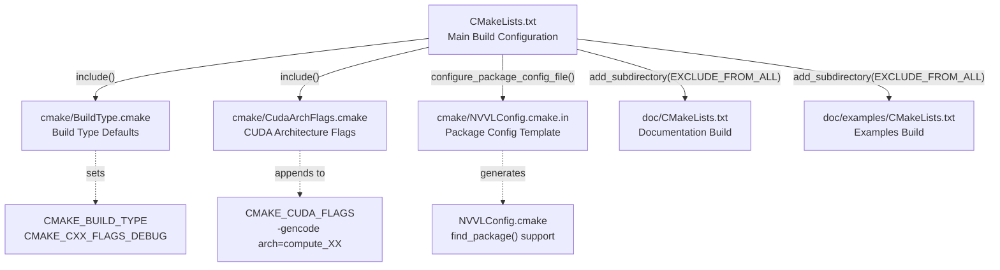
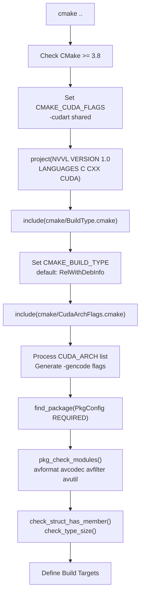
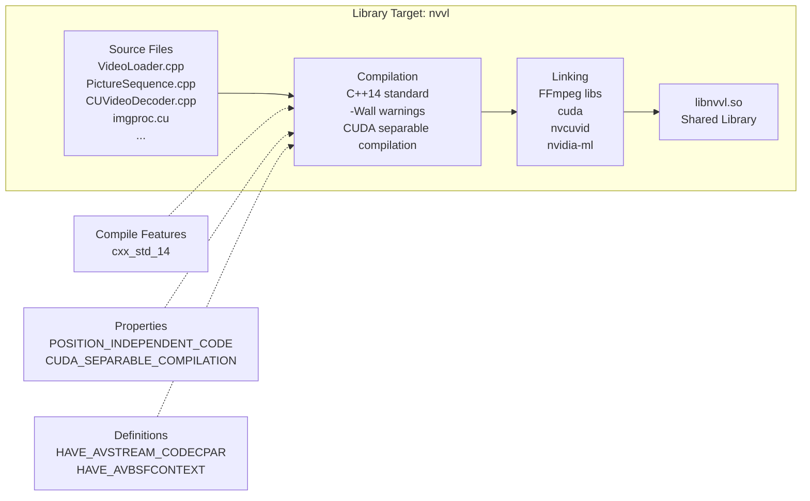
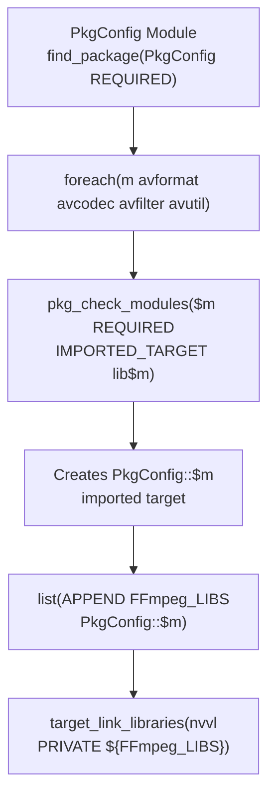
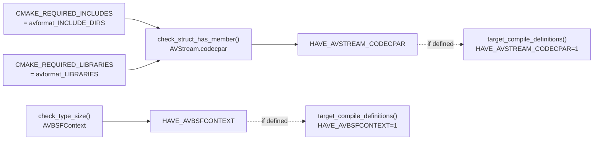
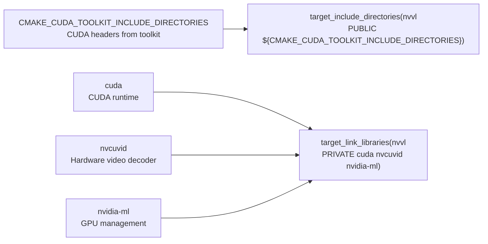
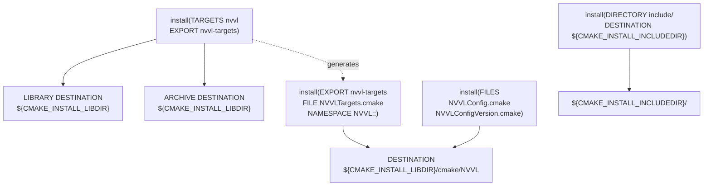
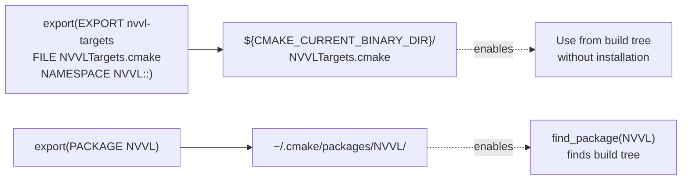

<!-- source: DeepWiki mcp.deepwiki.com · repo NVIDIA/nvvl · page 5 Build System · fetched 2026-10-26 -->

# Build System

<details>
<summary>Relevant source files</summary>

The following files were used as context for generating this wiki page:

- [CMakeLists.txt](CMakeLists.txt)
- [cmake/BuildType.cmake](cmake/BuildType.cmake)
- [cmake/CudaArchFlags.cmake](cmake/CudaArchFlags.cmake)

</details>


## Purpose and Scope

This document describes NVVL's CMake-based build system architecture, including dependency resolution, target configuration, and package generation. It covers the top-level build organization and how the various CMake modules work together to produce the shared library.

For specific topics:
- Build type configuration and compiler flags: see [CMake Configuration](#5.1)
- CUDA GPU architecture selection: see [CUDA Architecture Detection](#5.2)
- Installation and downstream integration: see [Package Configuration](#5.3)

## Build System Architecture

NVVL uses CMake 3.8+ as its build system, organized into a main configuration file and specialized modules for different aspects of the build.

### CMake Module Organization



**Build System Module Structure**

Sources: [CMakeLists.txt:1-14](), [cmake/BuildType.cmake:1-17](), [cmake/CudaArchFlags.cmake:1-51]()

The build system is organized into three primary modules:
- **Main configuration** ([CMakeLists.txt]()) - Project definition, targets, dependencies, installation
- **Build type module** ([cmake/BuildType.cmake]()) - Sets default build configuration to `RelWithDebInfo`
- **CUDA architecture module** ([cmake/CudaArchFlags.cmake]()) - Generates GPU architecture compilation flags

## Build Process Flow

### Initialization and Configuration



**CMake Configuration Phase**

Sources: [CMakeLists.txt:1-29](), [cmake/BuildType.cmake:4-13](), [cmake/CudaArchFlags.cmake:9-21]()

The configuration phase proceeds through these steps:

1. **Version check** - Ensures CMake 3.8+ for CUDA language support
2. **CUDA runtime setup** - Sets `-cudart shared` flag if not already defined [CMakeLists.txt:3-5]()
3. **Project declaration** - Defines NVVL 1.0 with C, C++, and CUDA languages [CMakeLists.txt:7]()
4. **Build type configuration** - Sets default to `RelWithDebInfo` if not specified [cmake/BuildType.cmake:4-13]()
5. **Architecture detection** - Processes `CUDA_ARCH` variable and generates `-gencode` flags [cmake/CudaArchFlags.cmake:9-51]()
6. **Dependency resolution** - Finds FFmpeg libraries via `pkg-config` and checks API compatibility [CMakeLists.txt:17-28]()

### Target Definition and Compilation



**Build Target Configuration**

Sources: [CMakeLists.txt:32-74]()

The main build target `nvvl` is a shared library with these characteristics:

| Property | Value | Line Reference |
|----------|-------|----------------|
| Target name | `nvvl` | [CMakeLists.txt:32]() |
| Export name | `NVVL` | [CMakeLists.txt:62]() |
| Namespace | `NVVL::NVVL` | [CMakeLists.txt:44]() |
| Language standard | C++14 | [CMakeLists.txt:46]() |
| Position-independent code | ON | [CMakeLists.txt:60]() |
| CUDA separable compilation | ON | [CMakeLists.txt:61]() |

**Source Files**

The library comprises 10 source files [CMakeLists.txt:33-42]():
- `src/VideoLoader.cpp` - Main API implementation
- `src/PictureSequence.cpp` - Frame sequence management
- `src/detail/CUContext.cpp` - CUDA context wrapper
- `src/detail/CUVideoDecoder.cpp` - Video decoder wrapper
- `src/detail/CUVideoParser.cpp` - Video stream parser
- `src/detail/Decoder.cpp` - Decoder abstraction
- `src/detail/JoiningThread.cpp` - Thread management
- `src/detail/NvDecoder.cpp` - NVIDIA decoder implementation
- `src/detail/cuda/imgproc.cu` - CUDA image processing kernels

## Dependency Management

### FFmpeg Library Detection



**FFmpeg Component Resolution**

Sources: [CMakeLists.txt:17-22]()

The build system uses `pkg-config` to locate FFmpeg libraries:

1. **Module iteration** - Loops through required FFmpeg components: `avformat`, `avcodec`, `avfilter`, `avutil` [CMakeLists.txt:18]()
2. **Package check** - Calls `pkg_check_modules()` with `IMPORTED_TARGET` to create CMake targets [CMakeLists.txt:20]()
3. **Target accumulation** - Builds `FFmpeg_LIBS` list with `PkgConfig::avformat`, `PkgConfig::avcodec`, etc. [CMakeLists.txt:21]()

### FFmpeg API Compatibility Checks



**API Version Detection**

Sources: [CMakeLists.txt:24-57]()

NVVL adapts to different FFmpeg versions through compile-time checks:

1. **AVStream.codecpar check** [CMakeLists.txt:26]()
   - Tests for `codecpar` member in `struct AVStream`
   - Sets `HAVE_AVSTREAM_CODECPAR` if present
   - Defines preprocessor macro for conditional compilation [CMakeLists.txt:51-53]()

2. **AVBSFContext check** [CMakeLists.txt:28]()
   - Tests for `AVBSFContext` type existence
   - Sets `HAVE_AVBSFCONTEXT` if present
   - Defines preprocessor macro for conditional compilation [CMakeLists.txt:55-57]()

These checks enable backward compatibility with older FFmpeg versions while using newer APIs when available.

### CUDA and NVIDIA Libraries



**NVIDIA Library Dependencies**

Sources: [CMakeLists.txt:69-74]()

The library links against three NVIDIA libraries [CMakeLists.txt:73]():

| Library | Purpose |
|---------|---------|
| `cuda` | CUDA runtime API |
| `nvcuvid` | Hardware video decoding via CUVID API |
| `nvidia-ml` | GPU device management and monitoring |

CUDA toolkit headers are included via `CMAKE_CUDA_TOOLKIT_INCLUDE_DIRECTORIES` [CMakeLists.txt:69](), which CMake populates automatically when CUDA is enabled as a project language.

## Installation and Export

### Installation Targets



**Installation Layout**

Sources: [CMakeLists.txt:76-116]()

The installation process creates this directory structure:

```
${CMAKE_INSTALL_PREFIX}/
├── lib/
│   ├── libnvvl.so                    # Shared library
│   └── cmake/NVVL/
│       ├── NVVLTargets.cmake         # Imported target definitions
│       ├── NVVLConfig.cmake          # Package configuration
│       └── NVVLConfigVersion.cmake   # Version compatibility
└── include/
    ├── VideoLoader.h                 # Public headers
    ├── PictureSequence.h
    └── ...
```

**Installation Components:**

1. **Library files** [CMakeLists.txt:80-84]()
   - Shared library (`libnvvl.so`) to `${CMAKE_INSTALL_LIBDIR}`
   - Archive variant to same location for static linking

2. **Header files** [CMakeLists.txt:86]()
   - All files from `include/` directory to `${CMAKE_INSTALL_INCLUDEDIR}`

3. **CMake export files** [CMakeLists.txt:89-96]()
   - `NVVLTargets.cmake` defining the `NVVL::NVVL` imported target
   - Uses namespace `NVVL::` for all exported targets

4. **Package configuration** [CMakeLists.txt:98-116]()
   - `NVVLConfigVersion.cmake` for version compatibility checks
   - `NVVLConfig.cmake` generated from template for `find_package()` support

### Build Tree Export



**Build Tree Integration**

Sources: [CMakeLists.txt:118-122]()

NVVL can be used directly from the build tree without installation:

1. **Export to build directory** [CMakeLists.txt:119]()
   - Creates `NVVLTargets.cmake` in build directory
   - Allows downstream projects to use `find_package(NVVL PATHS /path/to/build)`

2. **User package registry** [CMakeLists.txt:122]()
   - Registers build tree location in `~/.cmake/packages/NVVL/`
   - Enables automatic discovery via `find_package(NVVL)` without specifying path
   - Useful for development workflows where library is frequently rebuilt

## Build Targets Summary

### Primary Targets

| Target | Type | Description | Source |
|--------|------|-------------|--------|
| `nvvl` | Shared Library | Main library target | [CMakeLists.txt:32]() |
| `NVVL::NVVL` | Alias | Namespace alias for library | [CMakeLists.txt:44]() |
| `doc` | Subdirectory | Documentation generation (excluded from all) | [CMakeLists.txt:124]() |
| `doc/examples` | Subdirectory | Example programs (excluded from all) | [CMakeLists.txt:125]() |

Sources: [CMakeLists.txt:32-44](), [CMakeLists.txt:124-126]()

Both `doc` and `doc/examples` subdirectories are marked `EXCLUDE_FROM_ALL`, meaning they are not built by default when running `make` or `cmake --build .`. They must be explicitly requested:

```bash
cmake --build . --target doc          # Build documentation
cmake --build . --target extract_frames  # Build specific example
```

### Compiler and Linker Configuration

**Compile Options** [CMakeLists.txt:48-49]():
- `-Wall` enabled for C/C++ code (not CUDA)
- `-Wno-unused-function` suppresses unused function warnings
- Applied only to non-CUDA source files using generator expression

**CUDA Configuration**:
- Shared CUDA runtime (`-cudart shared`) [CMakeLists.txt:4]()
- Separable compilation enabled [CMakeLists.txt:61]()
- Architecture flags generated by [cmake/CudaArchFlags.cmake]()

**Debug Configuration** [cmake/BuildType.cmake:16]():
- Uses `-Og` optimization for faster debugging with modern GCC
- Includes `-g` for debug symbols

Sources: [CMakeLists.txt:3-5](), [CMakeLists.txt:48-49](), [CMakeLists.txt:59-63](), [cmake/BuildType.cmake:16]()

---

