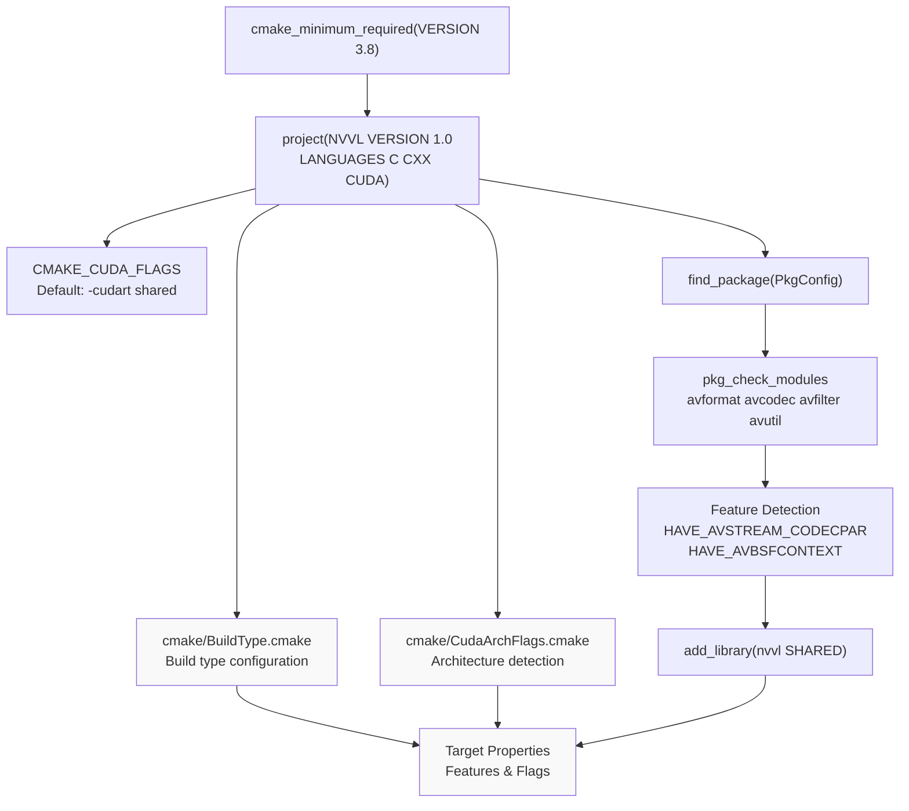
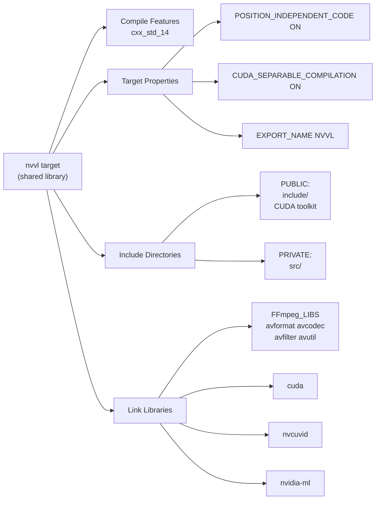
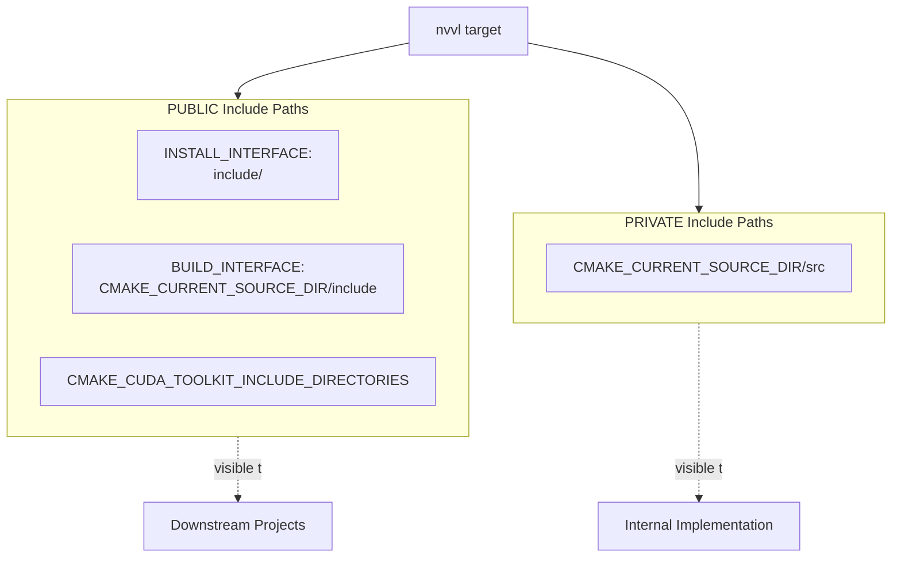
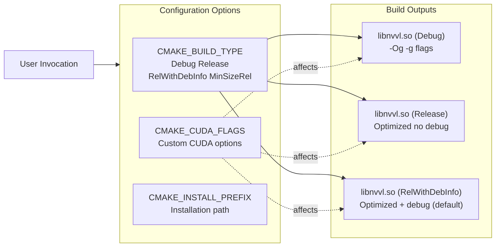

<!-- source: DeepWiki mcp.deepwiki.com · repo NVIDIA/nvvl · page 5.1 CMake Configuration · fetched 2026-10-26 -->

# CMake Configuration

<details>
<summary>Relevant source files</summary>

The following files were used as context for generating this wiki page:

- [CMakeLists.txt](CMakeLists.txt)
- [cmake/BuildType.cmake](cmake/BuildType.cmake)

</details>


This page documents NVVL's CMake build configuration system, including project setup, build type management, compiler flags, and target configuration. For information about CUDA architecture detection and gencode flags, see [CUDA Architecture Detection](#5.2). For details on CMake package generation and installation, see [Package Configuration](#5.3). For user-facing build instructions, see [Building from Source](#2.1).

## Project Setup

The NVVL project is configured with CMake version 3.8 or higher and declares three languages: C, CXX (C++), and CUDA. The project version is defined as 1.0.

[CMakeLists.txt:1-7]() initializes the project:

```cmake
cmake_minimum_required(VERSION 3.8)
project(NVVL VERSION 1.0 LANGUAGES C CXX CUDA)
```

The CUDA runtime is configured to use shared linking by default unless explicitly overridden:

[CMakeLists.txt:3-5]()

### CMake Configuration Flow



Sources: [CMakeLists.txt:1-73]()

## Build Types

NVVL uses [cmake/BuildType.cmake]() to configure default build types and compiler flags. If no build type is specified, the system defaults to `RelWithDebInfo` (Release with Debug Information).

### Available Build Types

| Build Type | Description | Use Case |
|------------|-------------|----------|
| `Debug` | Optimization disabled, full debug symbols | Development and debugging |
| `Release` | Full optimization, no debug symbols | Production deployment |
| `MinSizeRel` | Size-optimized, no debug symbols | Size-constrained environments |
| `RelWithDebInfo` | Optimized with debug symbols (default) | Performance profiling and debugging |

[cmake/BuildType.cmake:4-13]() sets the default and available options:

```cmake
set(default_build_type "RelWithDebInfo")
set_property(CACHE CMAKE_BUILD_TYPE PROPERTY STRINGS
  "Debug" "Release" "MinSizeRel" "RelWithDebInfo")
```

### Debug Build Flags

For Debug builds, NVVL configures the C++ compiler to use `-Og` (optimize for debugging) instead of the CMake default of `-O0`:

[cmake/BuildType.cmake:16]()

```cmake
SET(CMAKE_CXX_FLAGS_DEBUG  "-Og -g")
```

The `-Og` flag provides better debugging experience with modern GCC while maintaining some optimization, resulting in more representative performance behavior during debugging sessions.

Sources: [cmake/BuildType.cmake:1-17]()

## Target Configuration

### Library Target Definition

The core `nvvl` shared library target is defined with the following source files:

[CMakeLists.txt:32-42]()

```cmake
add_library(nvvl SHARED
    src/VideoLoader.cpp
    src/PictureSequence.cpp
    src/detail/CUContext.cpp
    src/detail/CUVideoDecoder.cpp
    src/detail/CUVideoParser.cpp
    src/detail/Decoder.cpp
    src/detail/JoiningThread.cpp
    src/detail/NvDecoder.cpp
    src/detail/cuda/imgproc.cu
)
```

An alias target `NVVL::NVVL` is created for namespace consistency in downstream projects:

[CMakeLists.txt:44]()

### Target Properties



Sources: [CMakeLists.txt:44-73]()

[CMakeLists.txt:59-63]() configures critical target properties:

```cmake
set_target_properties(nvvl PROPERTIES
    POSITION_INDEPENDENT_CODE ON
    CUDA_SEPARABLE_COMPILATION ON
    EXPORT_NAME NVVL
)
```

| Property | Value | Purpose |
|----------|-------|---------|
| `POSITION_INDEPENDENT_CODE` | `ON` | Enables PIC for shared library compatibility |
| `CUDA_SEPARABLE_COMPILATION` | `ON` | Allows CUDA device code to be compiled separately and linked later |
| `EXPORT_NAME` | `NVVL` | Sets the exported target name for `find_package(NVVL)` |

## Compiler Options and Features

### C++ Standard Requirement

NVVL requires C++14 as a public compile feature, ensuring downstream projects also use C++14 or later:

[CMakeLists.txt:46]()

```cmake
target_compile_features(nvvl PUBLIC cxx_std_14)
```

### Warning Flags

Compiler warnings are configured for non-CUDA source files:

[CMakeLists.txt:48-49]()

```cmake
target_compile_options(nvvl PRIVATE
    $<$<NOT:$<COMPILE_LANGUAGE:CUDA>>:-Wall;-Wno-unused-function>)
```

This configuration:
- Applies `-Wall` (all warnings) to C/C++ files only
- Suppresses unused function warnings with `-Wno-unused-function`
- Excludes CUDA files from these flags using generator expressions

### CUDA Compilation Settings

[CMakeLists.txt:3-5]() sets the default CUDA flags:

```cmake
if(NOT CMAKE_CUDA_FLAGS)
    set(CMAKE_CUDA_FLAGS "-cudart shared")
endif()
```

The `-cudart shared` flag links against the shared CUDA runtime library instead of the static version, reducing binary size and allowing runtime version flexibility.

Sources: [CMakeLists.txt:3-5, 46-49]()

## Include Directories

NVVL's include directory structure is configured to support both build-time and install-time usage:

[CMakeLists.txt:65-72]()

```cmake
target_include_directories(nvvl
    PUBLIC
        $<INSTALL_INTERFACE:include>
        $<BUILD_INTERFACE:${CMAKE_CURRENT_SOURCE_DIR}/include>
        ${CMAKE_CUDA_TOOLKIT_INCLUDE_DIRECTORIES}
    PRIVATE
        ${CMAKE_CURRENT_SOURCE_DIR}/src
)
```

### Include Directory Configuration



Sources: [CMakeLists.txt:65-72]()

| Scope | Path | Purpose |
|-------|------|---------|
| PUBLIC (Install) | `include/` | Public headers for installed library |
| PUBLIC (Build) | `${CMAKE_CURRENT_SOURCE_DIR}/include` | Public headers during build |
| PUBLIC | CUDA toolkit includes | CUDA headers for API users |
| PRIVATE | `${CMAKE_CURRENT_SOURCE_DIR}/src` | Internal implementation headers |

## Feature Detection and Conditional Compilation

NVVL performs feature detection for FFmpeg API compatibility across different versions:

[CMakeLists.txt:24-28]()

```cmake
set(CMAKE_REQUIRED_INCLUDES ${avformat_INCLUDE_DIRS})
set(CMAKE_REQUIRED_LIBRARIES ${avformat_LIBRARIES})
check_struct_has_member("struct AVStream" codecpar libavformat/avformat.h 
                        HAVE_AVSTREAM_CODECPAR LANGUAGE C)
check_type_size("AVBSFContext" AVBSFCONTEXT LANGUAGE CXX)
```

These checks detect:
- `HAVE_AVSTREAM_CODECPAR`: Whether FFmpeg's `AVStream` structure has the `codecpar` member (added in FFmpeg 3.1)
- `HAVE_AVBSFCONTEXT`: Whether the `AVBSFContext` type exists (bitstream filter API)

The results are propagated to the build as compile definitions:

[CMakeLists.txt:51-57]()

```cmake
if (HAVE_AVSTREAM_CODECPAR)
    target_compile_definitions(nvvl PRIVATE HAVE_AVSTREAM_CODECPAR=1)
endif()

if (HAVE_AVBSFCONTEXT)
    target_compile_definitions(nvvl PRIVATE HAVE_AVBSFCONTEXT=1)
endif()
```

These definitions allow the source code to use preprocessor conditionals for FFmpeg version compatibility.

Sources: [CMakeLists.txt:24-57]()

## Dependency Configuration

### FFmpeg Libraries

NVVL locates FFmpeg libraries using `pkg-config`:

[CMakeLists.txt:17-22]()

```cmake
find_package(PkgConfig REQUIRED)
foreach(m avformat avcodec avfilter avutil)
    string(TOUPPER ${m} M)
    pkg_check_modules(${m} REQUIRED IMPORTED_TARGET lib${m})
    list(APPEND FFmpeg_LIBS PkgConfig::${m})
endforeach(m)
```

This creates imported targets for each FFmpeg component:
- `PkgConfig::avformat` - Container format demuxing
- `PkgConfig::avcodec` - Codec access
- `PkgConfig::avfilter` - Filter graph framework
- `PkgConfig::avutil` - Common utility functions

### CUDA and Hardware Decoder Libraries

[CMakeLists.txt:73]() links the required NVIDIA libraries:

```cmake
target_link_libraries(nvvl PRIVATE ${FFmpeg_LIBS} cuda nvcuvid nvidia-ml)
```

| Library | Purpose |
|---------|---------|
| `${FFmpeg_LIBS}` | All FFmpeg components (avformat, avcodec, avfilter, avutil) |
| `cuda` | CUDA driver API |
| `nvcuvid` | NVIDIA hardware video decoder (CUVID) API |
| `nvidia-ml` | NVIDIA Management Library for GPU monitoring |

All dependencies are linked with `PRIVATE` scope, meaning they are not propagated to downstream targets.

Sources: [CMakeLists.txt:17-22, 73]()

## Customization Options

### Overriding CUDA Flags

Users can override the default CUDA compilation flags by setting `CMAKE_CUDA_FLAGS` before invoking CMake:

```bash
cmake -DCMAKE_CUDA_FLAGS="-cudart static -arch=sm_70" ..
```

[CMakeLists.txt:3-5]() checks for existing flags before setting defaults.

### Specifying Build Type

The build type can be specified at configuration time:

```bash
cmake -DCMAKE_BUILD_TYPE=Release ..
```

Or changed in existing build directories:

```bash
cmake -DCMAKE_BUILD_TYPE=Debug .
```

### Build Configuration Matrix



Sources: [cmake/BuildType.cmake:1-17](), [CMakeLists.txt:3-5]()

### Common Configuration Examples

| Use Case | Configuration Command |
|----------|----------------------|
| Development build | `cmake -DCMAKE_BUILD_TYPE=Debug ..` |
| Production build | `cmake -DCMAKE_BUILD_TYPE=Release ..` |
| Profiling build | `cmake -DCMAKE_BUILD_TYPE=RelWithDebInfo ..` (default) |
| Custom CUDA arch | `cmake -DCMAKE_CUDA_FLAGS="-arch=sm_75" ..` |
| Custom install path | `cmake -DCMAKE_INSTALL_PREFIX=/opt/nvvl ..` |

## Subdirectories

The main CMakeLists.txt includes two subdirectories for documentation and examples:

[CMakeLists.txt:124-125]()

```cmake
add_subdirectory(doc EXCLUDE_FROM_ALL)
add_subdirectory(doc/examples EXCLUDE_FROM_ALL)
```

Both are marked with `EXCLUDE_FROM_ALL`, meaning they are not built by default with `make` or `make all`. They must be built explicitly:

```bash
make doc           # Build documentation
make examples      # Build example programs
```

Sources: [CMakeLists.txt:124-125]()

---

