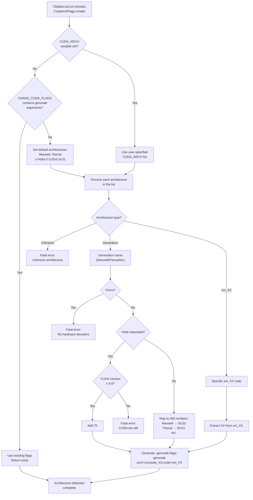
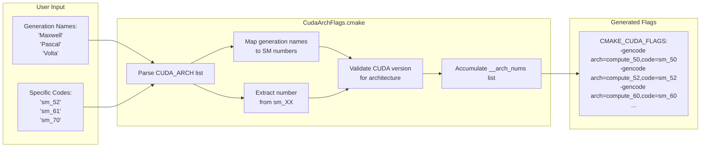
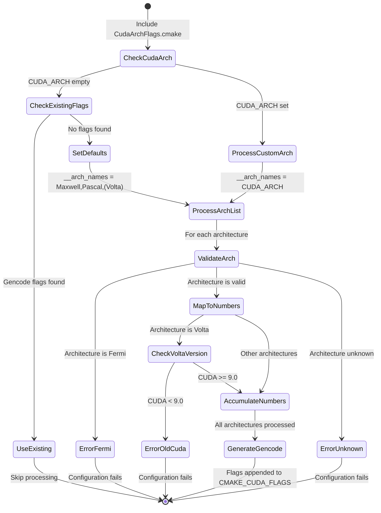

<!-- source: DeepWiki mcp.deepwiki.com · repo NVIDIA/nvvl · page 5.2 CUDA Architecture Detection · fetched 2026-10-26 -->

# CUDA Architecture Detection

<details>
<summary>Relevant source files</summary>

The following files were used as context for generating this wiki page:

- [CMakeLists.txt](CMakeLists.txt)
- [cmake/CudaArchFlags.cmake](cmake/CudaArchFlags.cmake)

</details>


## Purpose and Scope

This document describes NVVL's CUDA architecture detection and configuration system, which automatically generates appropriate `-gencode` compiler flags for NVIDIA GPU architectures. The system translates user-friendly GPU generation names (e.g., "Pascal", "Volta") or specific compute capabilities (e.g., "sm_52") into the compiler flags required by `nvcc` to generate optimized device code.

For general CMake build configuration, see [CMake Configuration](#5.1). For information about the overall build system structure, see [Build System](#5).

**Sources:** [cmake/CudaArchFlags.cmake:1-51]()

## Overview

The CUDA architecture detection system is implemented in `cmake/CudaArchFlags.cmake` and provides a mechanism to control which GPU architectures NVVL's CUDA device code is compiled for. This affects both binary compatibility (which GPUs can run the code) and performance (architecture-specific optimizations).

The system operates during the CMake configuration phase, before any compilation occurs. It processes the `CUDA_ARCH` CMake cache variable and appends appropriate `-gencode` flags to `CMAKE_CUDA_FLAGS`.

**Sources:** [cmake/CudaArchFlags.cmake:1-6](), [CMakeLists.txt:13]()

## Configuration Flow



**Sources:** [cmake/CudaArchFlags.cmake:7-51]()

## GPU Architecture Mapping

The system supports multiple GPU generations and translates high-level names to specific compute capability versions. The following table shows the complete mapping:

| Generation Name | Compute Capabilities | Example GPUs | Supported |
|----------------|---------------------|--------------|-----------|
| Fermi | 20, 21 | GTX 480, GTX 580 | ❌ Explicitly rejected |
| Kepler | 30, 35, 37 | Tesla K40, GTX Titan | ✅ Yes |
| Maxwell | 50, 52 | GTX 980, GTX Titan X | ✅ Default |
| Pascal | 60, 61 | GTX 1080, Tesla P100 | ✅ Default |
| Volta | 70 | Tesla V100, Titan V | ✅ Default (CUDA ≥9.0) |

**Note:** Fermi GPUs are explicitly rejected because they lack the necessary hardware video decoders required by NVVL's `nvcuvid` dependency.

**Sources:** [cmake/CudaArchFlags.cmake:24-41]()

## Architecture Name Resolution



**Sources:** [cmake/CudaArchFlags.cmake:23-50]()

## Configuration Options

### Default Behavior

When `CUDA_ARCH` is not set and no architecture flags are present in `CMAKE_CUDA_FLAGS`, the system uses default architectures:

```cmake
# Default architectures (if not configured)
set(__arch_names "Maxwell" "Pascal")
if(CMAKE_CUDA_COMPILER_VERSION VERSION_GREATER_EQUAL "9.0")
    list(APPEND __arch_names "Volta")
endif()
```

This generates code for:
- Maxwell: `sm_50`, `sm_52`
- Pascal: `sm_60`, `sm_61`
- Volta: `sm_70` (if CUDA ≥ 9.0)

**Sources:** [cmake/CudaArchFlags.cmake:14-17]()

### Custom Architecture Selection

Users can specify architectures using the `CUDA_ARCH` CMake cache variable:

```bash
# Build for Pascal GPUs only
cmake -DCUDA_ARCH="Pascal" ..

# Build for specific compute capabilities
cmake -DCUDA_ARCH="sm_52;sm_61;sm_70" ..

# Build for multiple generations
cmake -DCUDA_ARCH="Maxwell;Pascal;Volta" ..

# Build for Kepler through Pascal
cmake -DCUDA_ARCH="Kepler;Maxwell;Pascal" ..
```

**Sources:** [cmake/CudaArchFlags.cmake:7-21]()

### Preserving Existing Flags

If `CMAKE_CUDA_FLAGS` already contains architecture-related flags (`--gpu-architecture`, `-arch`, `--gpu-code`, `-code`, `--generate-code`, or `-gencode`), the system preserves those flags and skips automatic generation:

```cmake
if(${CMAKE_CUDA_FLAGS} MATCHES "--gpu-architecture|-arch[= ]|--gpu-code| -code[= ]|--generate-code|-gencode")
    message(STATUS "Using device code generation options found in CMAKE_CUDA_FLAGS")
    return()
endif()
```

This allows advanced users to manually specify exact compilation targets.

**Sources:** [cmake/CudaArchFlags.cmake:10-13]()

## Code Generation Details

### Architecture to Gencode Translation

For each compute capability number, the system generates a corresponding `-gencode` argument:

```cmake
foreach(arch ${__arch_nums})
    string(APPEND CMAKE_CUDA_FLAGS " -gencode arch=compute_${arch},code=sm_${arch}")
endforeach()
```

For example, if `__arch_nums` contains `50`, `52`, `60`, `61`, the generated flags are:

```
-gencode arch=compute_50,code=sm_50 -gencode arch=compute_52,code=sm_52 -gencode arch=compute_60,code=sm_60 -gencode arch=compute_61,code=sm_61
```

**Sources:** [cmake/CudaArchFlags.cmake:48-50]()

### Compute vs. SM Codes

Each `-gencode` argument specifies:
- `arch=compute_XX`: The virtual architecture (PTX intermediate representation)
- `code=sm_XX`: The actual GPU architecture (SASS machine code)

This generates optimized binary code for `sm_XX` while embedding PTX for forward compatibility.

**Sources:** [cmake/CudaArchFlags.cmake:48-50]()

## Version Requirements and Validation

### Volta Architecture Requirement

Volta (compute capability 7.0) requires CUDA 9.0 or newer. The system validates this requirement:

```cmake
elseif(${arch} STREQUAL "Volta")
    if (CMAKE_CUDA_COMPILER_VERSION VERSION_LESS "9.0")
        message(FATAL_ERROR "Requested Volta architecture, but CUDA version ${CMAKE_CUDA_COMPILER_VERSION} is not new enough")
    endif()
    list(APPEND __arch_nums "70")
```

If Volta is requested with an older CUDA version, configuration fails with a clear error message.

**Sources:** [cmake/CudaArchFlags.cmake:32-36]()

### Fermi Rejection

Fermi GPUs are explicitly rejected because NVVL requires hardware video decoding capabilities not present in Fermi:

```cmake
if(${arch} STREQUAL "Fermi")
    message(FATAL_ERROR "ERROR: Fermi GPU does not have the necessary hardware video decoders")
```

**Sources:** [cmake/CudaArchFlags.cmake:24-25]()

## Integration with Build System

The architecture detection module is included early in the main CMakeLists.txt:

```cmake
include(cmake/BuildType.cmake)
include(cmake/CudaArchFlags.cmake)
```

This ensures architecture flags are set before any CUDA compilation occurs. The flags affect all CUDA source files compiled for the `nvvl` target, including:
- `src/detail/cuda/imgproc.cu`

And any device code in the library sources.

**Sources:** [CMakeLists.txt:12-13](), [CMakeLists.txt:41]()

## Error Handling

The system performs comprehensive validation and reports errors for:

| Error Condition | Error Message | Location |
|----------------|---------------|----------|
| Unknown architecture name | `ERROR: Unknown architecture ${arch} in CUDA_ARCH` | [cmake/CudaArchFlags.cmake:40]() |
| Fermi requested | `ERROR: Fermi GPU does not have the necessary hardware video decoders` | [cmake/CudaArchFlags.cmake:25]() |
| Volta with old CUDA | `Requested Volta architecture, but CUDA version ${CMAKE_CUDA_COMPILER_VERSION} is not new enough` | [cmake/CudaArchFlags.cmake:34]() |
| No architectures specified | `ERROR: Don't know what GPU architectures to compile for.` | [cmake/CudaArchFlags.cmake:45]() |

All errors are fatal and stop the configuration process, preventing invalid builds.

**Sources:** [cmake/CudaArchFlags.cmake:24-46]()

## Architecture Detection State Machine



**Sources:** [cmake/CudaArchFlags.cmake:7-51]()

## Practical Examples

### Example 1: Building for a Specific Data Center

If deploying to a data center with Tesla V100 GPUs (Volta, compute capability 7.0):

```bash
cmake -DCUDA_ARCH="Volta" -DCMAKE_BUILD_TYPE=Release ..
make
```

Generated flags: `-gencode arch=compute_70,code=sm_70`

### Example 2: Building for Consumer GPUs

For GTX 1080 Ti (Pascal, compute capability 6.1):

```bash
cmake -DCUDA_ARCH="sm_61" ..
make
```

Generated flags: `-gencode arch=compute_61,code=sm_61`

### Example 3: Wide Compatibility Build

For distribution to users with various GPUs from Maxwell to Volta:

```bash
cmake -DCUDA_ARCH="Maxwell;Pascal;Volta" ..
make
```

Generated flags:
```
-gencode arch=compute_50,code=sm_50 -gencode arch=compute_52,code=sm_52 -gencode arch=compute_60,code=sm_60 -gencode arch=compute_61,code=sm_61 -gencode arch=compute_70,code=sm_70
```

This produces a larger binary but ensures compatibility across multiple GPU generations.

**Sources:** [cmake/CudaArchFlags.cmake:23-50]()

## Implementation Details

### Variable Naming Conventions

| Variable Name | Purpose | Scope |
|--------------|---------|-------|
| `CUDA_ARCH` | User-facing configuration variable | Cache variable |
| `__arch_names` | Internal list of architecture names to process | Local to CudaArchFlags.cmake |
| `__arch_nums` | Internal list of compute capability numbers | Local to CudaArchFlags.cmake |
| `CMAKE_CUDA_FLAGS` | Global CUDA compiler flags | CMake built-in |
| `CMAKE_CUDA_COMPILER_VERSION` | Detected CUDA version | CMake built-in |

The double underscore prefix (`__`) indicates internal implementation variables that should not be used by other parts of the build system.

**Sources:** [cmake/CudaArchFlags.cmake:7-50]()

### Regular Expression Matching

The system uses regex matching to extract compute capability numbers from `sm_XX` format:

```cmake
elseif(${arch} MATCHES "sm_([0-9]+)")
    list(APPEND __arch_nums ${CMAKE_MATCH_1})
```

This allows users to specify exact compute capabilities like `sm_52` or `sm_61` when generation names are too broad.

**Sources:** [cmake/CudaArchFlags.cmake:37-38]()

---

