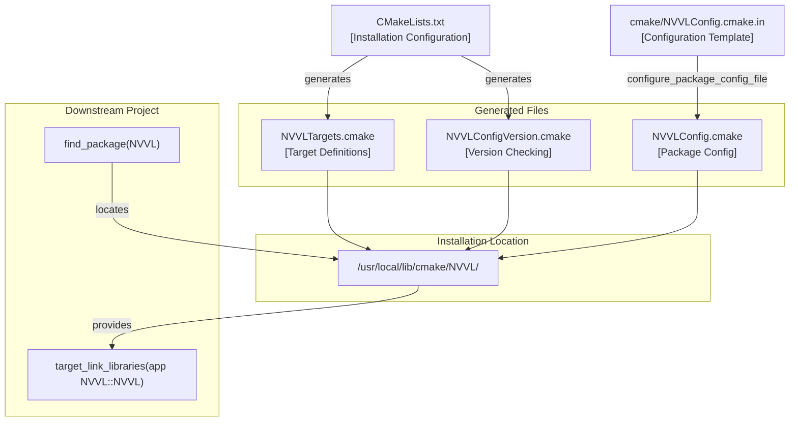
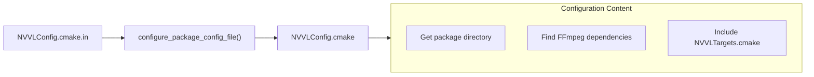
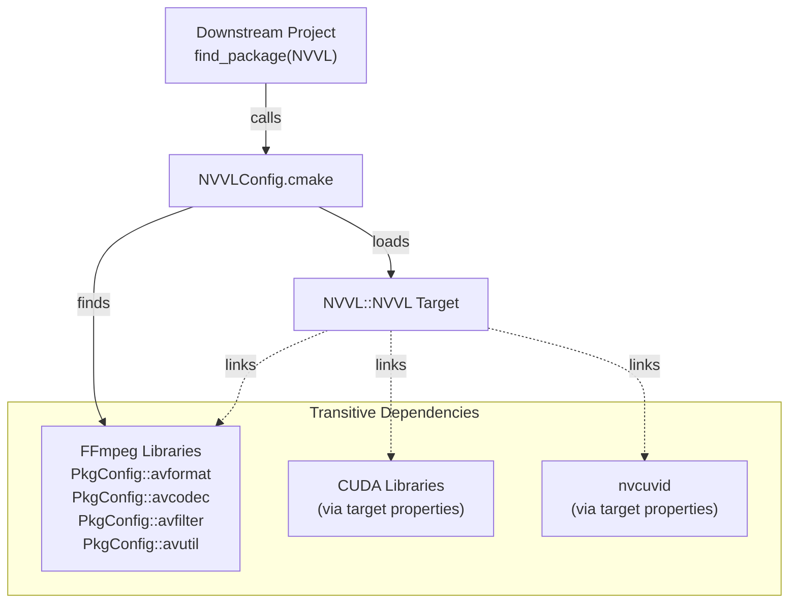

<!-- source: DeepWiki mcp.deepwiki.com · repo NVIDIA/nvvl · page 5.3 Package Configuration · fetched 2026-10-26 -->

# Package Configuration

<details>
<summary>Relevant source files</summary>

The following files were used as context for generating this wiki page:

- [CMakeLists.txt](CMakeLists.txt)
- [cmake/NVVLConfig.cmake.in](cmake/NVVLConfig.cmake.in)

</details>


This document explains NVVL's CMake package configuration system, which enables downstream projects to integrate NVVL using the standard `find_package(NVVL)` mechanism. It covers the generation of package configuration files, installation layout, dependency handling, and usage patterns for consuming projects.

For information about building NVVL itself, see [Building from Source](#2.1). For general CMake build configuration options, see [CMake Configuration](#5.1).

## Purpose and Scope

CMake package configuration is the mechanism by which NVVL exports its build targets, headers, and dependencies in a standardized format that downstream projects can consume. When NVVL is installed, it generates several CMake files that allow other projects to locate NVVL, link against it correctly, and automatically resolve its dependencies.

This system provides:
- **Target export** - Makes the `NVVL::NVVL` imported target available to downstream projects
- **Dependency propagation** - Automatically handles FFmpeg and CUDA dependencies
- **Version compatibility** - Ensures version requirements are met
- **Build tree usage** - Allows using NVVL directly from its build directory without installation

## Package Configuration Components



**Diagram: Package Configuration Generation and Usage**

The package configuration system consists of three generated files that work together to provide a complete integration mechanism for downstream projects.

Sources: [CMakeLists.txt:76-122](), [cmake/NVVLConfig.cmake.in:1-14]()

## Installation Directory Structure

NVVL installs files to standard system directories following the GNU Install Directories convention:

| Component | Install Location | CMake Variable |
|-----------|-----------------|----------------|
| Shared Library | `/usr/local/lib/libnvvl.so` | `CMAKE_INSTALL_LIBDIR` |
| Public Headers | `/usr/local/include/` | `CMAKE_INSTALL_INCLUDEDIR` |
| Package Config | `/usr/local/lib/cmake/NVVL/` | `INSTALL_CONFIGDIR` |

The package configuration directory is specifically set as:

```cmake
set(INSTALL_CONFIGDIR ${CMAKE_INSTALL_LIBDIR}/cmake/NVVL)
```

This follows the standard CMake convention where package configuration files reside in `<prefix>/lib/cmake/<PackageName>/`.

Sources: [CMakeLists.txt:77-78](), [CMakeLists.txt:86]()

## NVVLTargets.cmake: Target Export

The `NVVLTargets.cmake` file contains the definition of the imported `NVVL::NVVL` target, including:
- Library location
- Include directories
- Compile features (C++14 requirement)
- Link dependencies

This file is generated during installation:

```cmake
install(EXPORT nvvl-targets
  FILE
    NVVLTargets.cmake
  NAMESPACE
    NVVL::
  DESTINATION
    ${INSTALL_CONFIGDIR}
)
```

The `NAMESPACE NVVL::` directive ensures the exported target is named `NVVL::NVVL`, following the modern CMake convention of namespaced targets. The double-colon syntax makes it clear that this is an imported target and provides better error messages if the target is not found.

The export references the `nvvl` target defined earlier:

```cmake
install(TARGETS nvvl
    EXPORT nvvl-targets
    LIBRARY DESTINATION ${CMAKE_INSTALL_LIBDIR}
    ARCHIVE DESTINATION ${CMAKE_INSTALL_LIBDIR}
)
```

Sources: [CMakeLists.txt:80-96]()

## NVVLConfig.cmake: Package Configuration

The `NVVLConfig.cmake` file is the main entry point for downstream projects using `find_package(NVVL)`. It is generated from the template `cmake/NVVLConfig.cmake.in`:



**Diagram: NVVLConfig.cmake Generation**

The template performs three key tasks:

### 1. Self-Location

```cmake
get_filename_component(NVVL_CMAKE_DIR "${CMAKE_CURRENT_LIST_FILE}" PATH)
```

This determines where the package configuration files are located, enabling relative path resolution.

### 2. Dependency Resolution

```cmake
find_package(PkgConfig)
foreach(m avformat avcodec avfilter avutil)
    string(TOUPPER ${m} M)
    pkg_check_modules(${m} REQUIRED IMPORTED_TARGET lib${m})
    list(APPEND FFmpeg_LIBS PkgConfig::${m})
endforeach(m)
```

NVVL requires FFmpeg libraries, and the configuration file ensures these dependencies are found when a downstream project uses `find_package(NVVL)`. This propagates the dependency requirement automatically - downstream projects don't need to manually find FFmpeg.

### 3. Target Inclusion

```cmake
if(NOT TARGET NVVL::NVVL)
    include("${NVVL_CMAKE_DIR}/NVVLTargets.cmake")
endif()
```

This includes the target definitions, but only if the target hasn't already been loaded (preventing duplicate inclusion).

The configuration is generated using:

```cmake
configure_package_config_file(${CMAKE_CURRENT_LIST_DIR}/cmake/NVVLConfig.cmake.in
    ${CMAKE_CURRENT_BINARY_DIR}/NVVLConfig.cmake
    INSTALL_DESTINATION ${INSTALL_CONFIGDIR}
)
```

Sources: [cmake/NVVLConfig.cmake.in:1-14](), [CMakeLists.txt:106-109]()

## NVVLConfigVersion.cmake: Version Compatibility

The version file ensures that downstream projects requesting a specific version of NVVL get compatible versions:

```cmake
write_basic_package_version_file(
    ${CMAKE_CURRENT_BINARY_DIR}/NVVLConfigVersion.cmake
    VERSION ${PROJECT_VERSION}
    COMPATIBILITY AnyNewerVersion
)
```

The `AnyNewerVersion` compatibility mode means:
- A project requesting version 1.0 will accept NVVL 1.0, 1.1, 2.0, etc.
- A project requesting version 1.5 will reject NVVL 1.0
- This follows semantic versioning principles where newer versions maintain backward compatibility

The project version is set in the main `CMakeLists.txt`:

```cmake
project(NVVL VERSION 1.0 LANGUAGES C CXX CUDA)
```

Sources: [CMakeLists.txt:7](), [CMakeLists.txt:100-104]()

## Dependency Propagation



**Diagram: Dependency Propagation to Downstream Projects**

When a downstream project links against `NVVL::NVVL`, it automatically receives:

1. **FFmpeg Dependencies** - Found explicitly in `NVVLConfig.cmake`
2. **CUDA Dependencies** - Embedded in the target properties from the original build
3. **Include Directories** - Public headers are exported via `$<INSTALL_INTERFACE:include>`

The original target configuration specifies:

```cmake
target_include_directories(nvvl
    PUBLIC
        $<INSTALL_INTERFACE:include>
        $<BUILD_INTERFACE:${CMAKE_CURRENT_SOURCE_DIR}/include>
        ${CMAKE_CUDA_TOOLKIT_INCLUDE_DIRECTORIES}
    PRIVATE
        ${CMAKE_CURRENT_SOURCE_DIR}/src
    )
target_link_libraries(nvvl PRIVATE ${FFmpeg_LIBS} cuda nvcuvid nvidia-ml)
```

The `PUBLIC` include directories and `PRIVATE` link libraries are preserved in the exported target, ensuring downstream projects can compile and link correctly.

Sources: [cmake/NVVLConfig.cmake.in:4-9](), [CMakeLists.txt:65-73]()

## Downstream Project Integration

A downstream project can integrate NVVL using standard CMake commands:

### Basic Usage

```cmake
find_package(NVVL REQUIRED)
target_link_libraries(my_application PRIVATE NVVL::NVVL)
```

### With Version Requirement

```cmake
find_package(NVVL 1.0 REQUIRED)
target_link_libraries(my_application PRIVATE NVVL::NVVL)
```

### Optional Dependency

```cmake
find_package(NVVL QUIET)
if(NVVL_FOUND)
    target_link_libraries(my_application PRIVATE NVVL::NVVL)
    target_compile_definitions(my_application PRIVATE HAVE_NVVL)
endif()
```

When `find_package(NVVL)` succeeds, it provides:
- `NVVL_FOUND` - Boolean indicating success
- `NVVL::NVVL` - Imported target with all properties
- `NVVL_VERSION` - Version string (via NVVLConfigVersion.cmake)

The downstream project does **not** need to:
- Manually find FFmpeg
- Locate CUDA libraries
- Set include directories
- Configure compiler flags for C++14

All of these are handled automatically through the exported target properties.

Sources: [CMakeLists.txt:89-96]()

## Build Tree Export

NVVL also supports usage directly from its build directory without installation:

```cmake
export(EXPORT nvvl-targets FILE ${CMAKE_CURRENT_BINARY_DIR}/NVVLTargets.cmake NAMESPACE NVVL::)
export(PACKAGE NVVL)
```

This creates `NVVLTargets.cmake` in the build directory and registers the package in the user's package registry (`~/.cmake/packages/NVVL` on Linux).

A downstream project can then find NVVL even if it's not installed:

```cmake
# CMake will check the user package registry
find_package(NVVL REQUIRED)
```

This is particularly useful for:
- Development workflows where frequent rebuilds occur
- Testing NVVL changes without system-wide installation
- CI/CD pipelines that don't want to modify system directories

The build tree export uses the same target namespace and configuration as the install tree export, ensuring consistency.

Sources: [CMakeLists.txt:119-122]()

## Target Properties and Aliases

The `nvvl` target is created with an alias that matches the exported name:

```cmake
add_library(NVVL::NVVL ALIAS nvvl)
```

This allows the same `NVVL::NVVL` target name to be used whether:
- Building NVVL as part of a larger project (uses alias)
- Using NVVL as an installed package (uses imported target)
- Using NVVL from its build directory (uses exported target)

The target is configured with:

```cmake
set_target_properties(nvvl PROPERTIES
    POSITION_INDEPENDENT_CODE ON
    CUDA_SEPARABLE_COMPILATION ON
    EXPORT_NAME NVVL
    )
```

The `EXPORT_NAME NVVL` property ensures that in the exported target file, the target is referred to as `NVVL` rather than `nvvl`, which combined with the `NVVL::` namespace produces the final `NVVL::NVVL` target name.

Sources: [CMakeLists.txt:44](), [CMakeLists.txt:59-63]()

## Installation Process

The complete installation sequence:

| Step | Action | Generated File | Purpose |
|------|--------|----------------|---------|
| 1 | `install(TARGETS nvvl ...)` | `/usr/local/lib/libnvvl.so` | Shared library |
| 2 | `install(DIRECTORY include/ ...)` | `/usr/local/include/` | Public headers |
| 3 | `install(EXPORT nvvl-targets ...)` | `/usr/local/lib/cmake/NVVL/NVVLTargets.cmake` | Target definitions |
| 4 | `write_basic_package_version_file(...)` | `build/NVVLConfigVersion.cmake` | Version checking |
| 5 | `configure_package_config_file(...)` | `build/NVVLConfig.cmake` | Package configuration |
| 6 | `install(FILES ...)` | `/usr/local/lib/cmake/NVVL/NVVLConfig*.cmake` | Config files |

After installation, downstream projects can use:

```bash
cmake -DCMAKE_PREFIX_PATH=/usr/local ..
```

Or if installed to a custom prefix:

```bash
cmake -DCMAKE_PREFIX_PATH=/custom/prefix ..
```

CMake will automatically search `<prefix>/lib/cmake/NVVL/` for the package configuration files.

Sources: [CMakeLists.txt:76-116]()

---

